# 003：知识

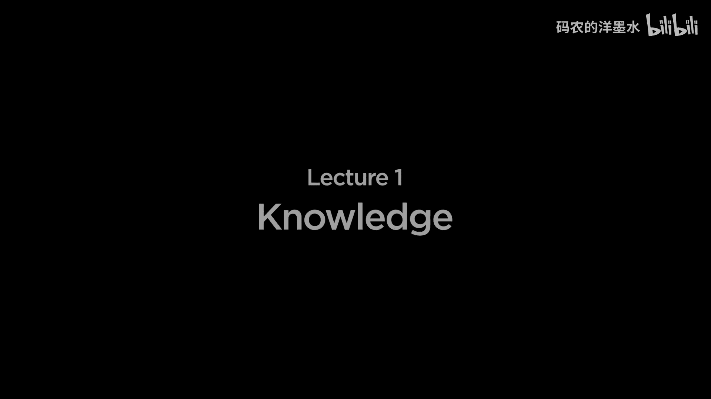

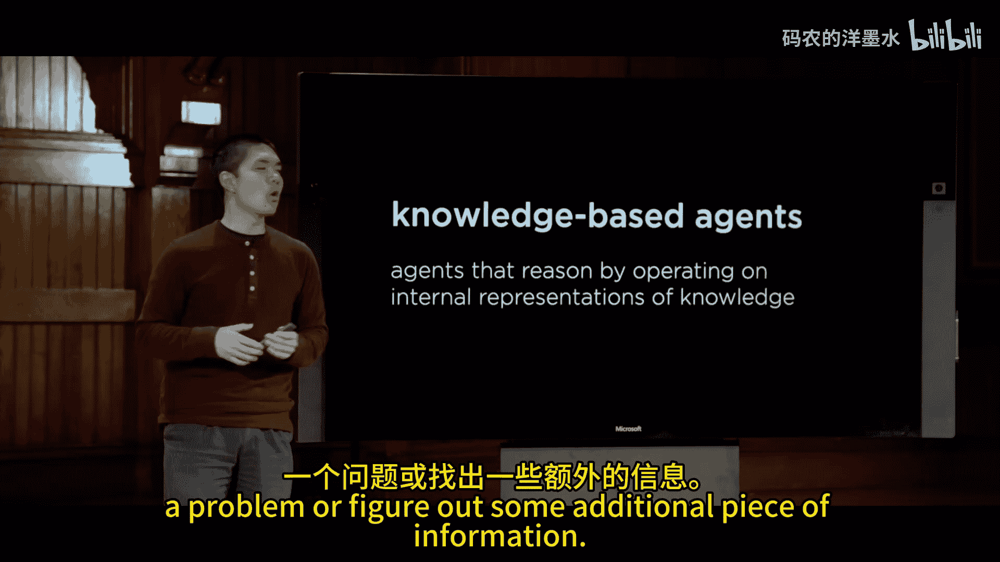

在本节课中，我们将要学习知识在人工智能中的核心作用。我们将探讨如何让AI代理能够表示知识，并基于已知信息进行逻辑推理以得出结论。

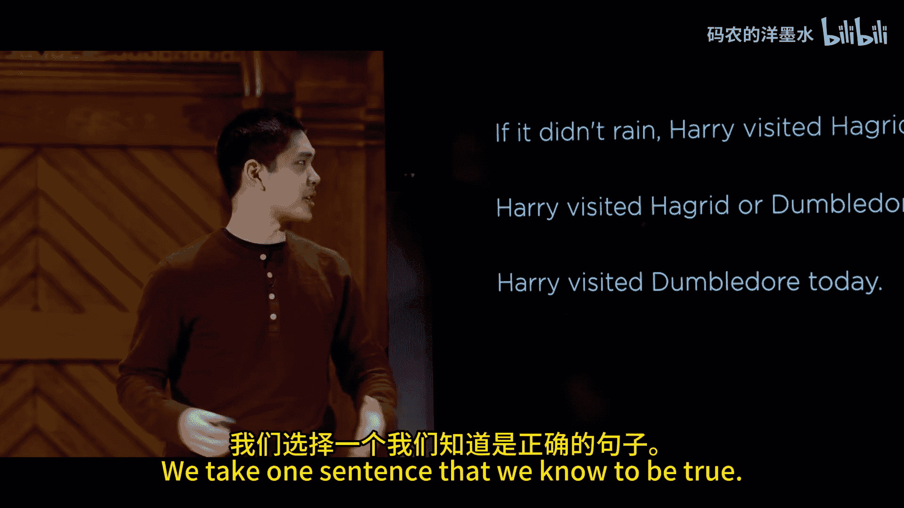

## 概述：从搜索到知识

上一节我们介绍了搜索问题，即AI代理通过在环境中采取行动来解决问题。本节中，我们将注意力转向更一般的“知识”概念。许多智能行为都基于知识。人们了解关于世界的事实，并利用这些已知信息进行推理，从而得出结论或解决问题。我们将重点研究如何将这种基于知识进行推理的能力应用到人工智能中，构建所谓的“基于知识的代理”。

## 知识推理示例

为了更好地理解基于知识进行推理以得出结论的含义，让我们看一个来自《哈利·波特》的简单例子。

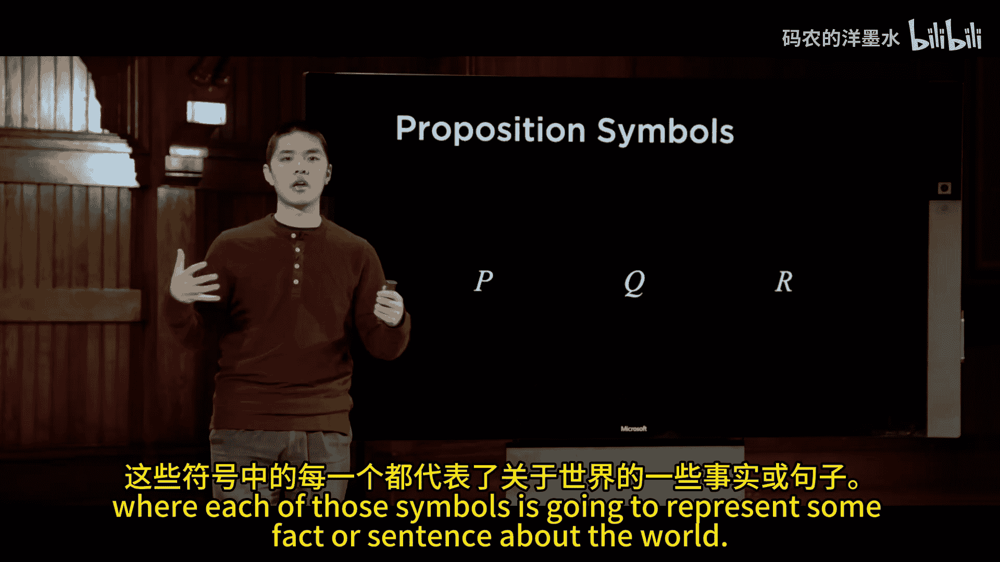

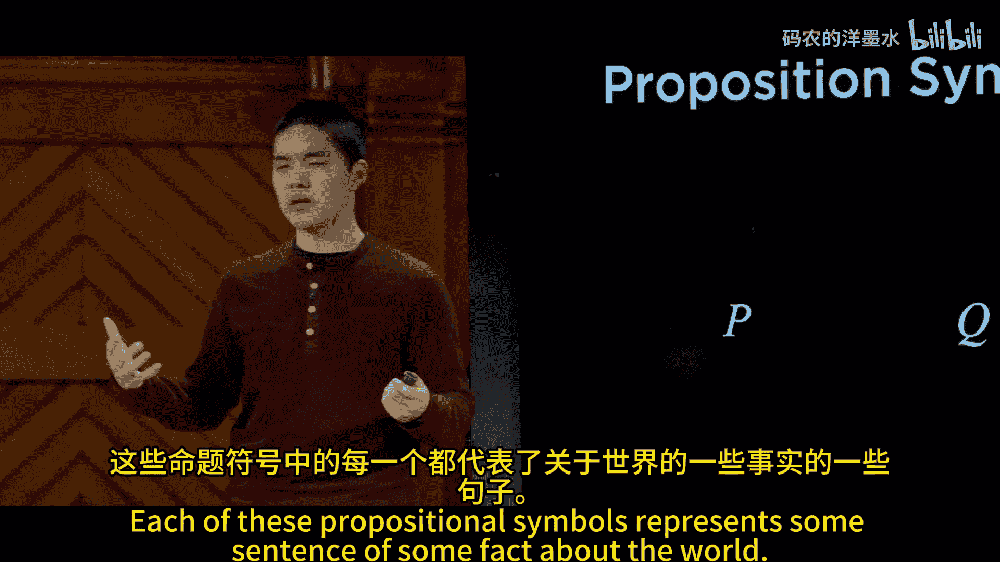

我们已知一个为真的句子：
> 如果没下雨，那么哈利今天拜访了海格。

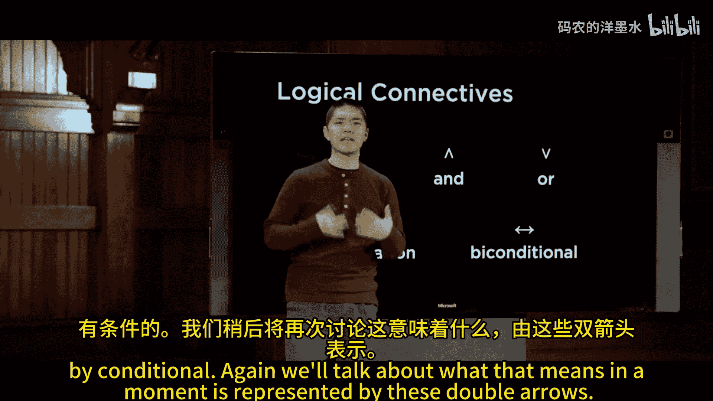

我们已知另一个事实：
> 哈利今天拜访了海格或邓布利多，但并非两者都拜访了。

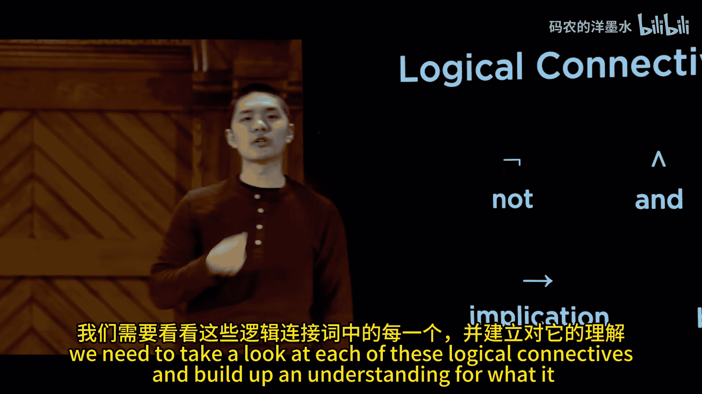

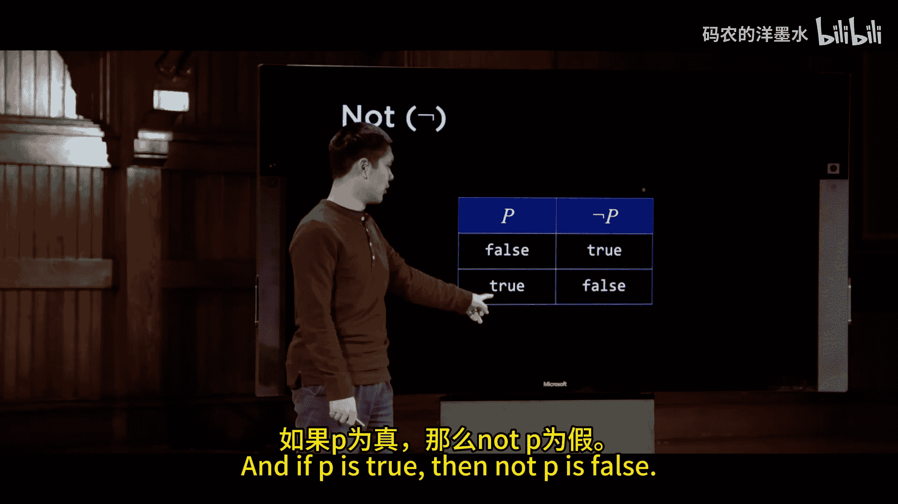

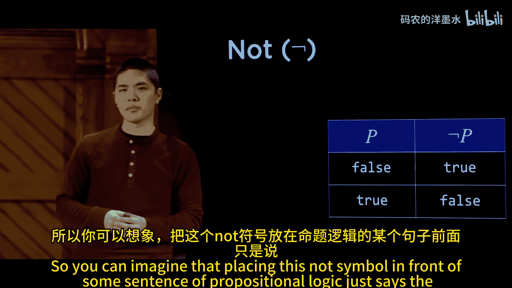

这句话告诉我们，哈利要么拜访了海格（而非邓布利多），要么拜访了邓布利多（而非海格）。

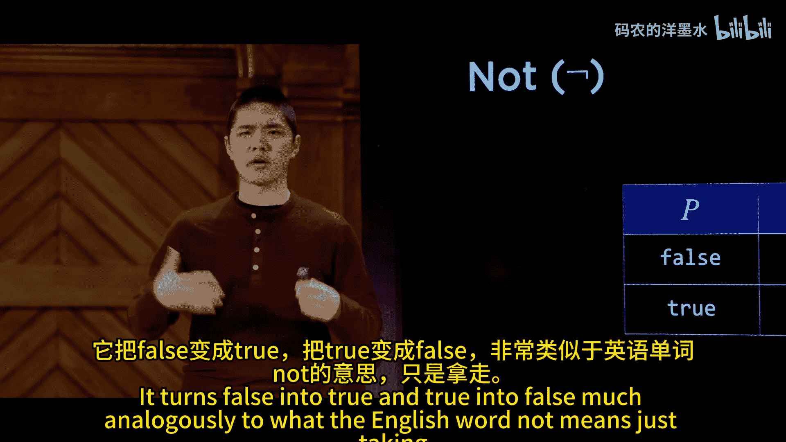

现在我们有了关于世界的第三条信息：
> 哈利今天拜访了邓布利多。

我们现在有了三条信息，或者说知识库中的三个事实。作为人类，我们可以尝试对此进行推理，并基于这些信息得出额外的结论。

观察最后两条陈述：“哈利拜访了海格或邓布利多，但并非两者都拜访了”，以及“哈利拜访了邓布利多”。我们可以合理地得出结论：哈利今天一定没有拜访海格。这是基于这两条陈述的组合得出的推论。

但事实证明，我们还可以通过观察第一条陈述并进行推理，得到更多信息。第一条陈述说“如果没下雨，那么哈利拜访了海格”。这意味着在所有没下雨的情况下，我们知道哈利拜访了海格。但既然我们现在知道哈利没有拜访海格，那么这告诉我们关于初始前提的一些信息。具体来说，它告诉我们今天确实下雨了。因为我们可以推理：如果没下雨，哈利就会拜访海格；但我们确切知道哈利今天没有拜访海格。

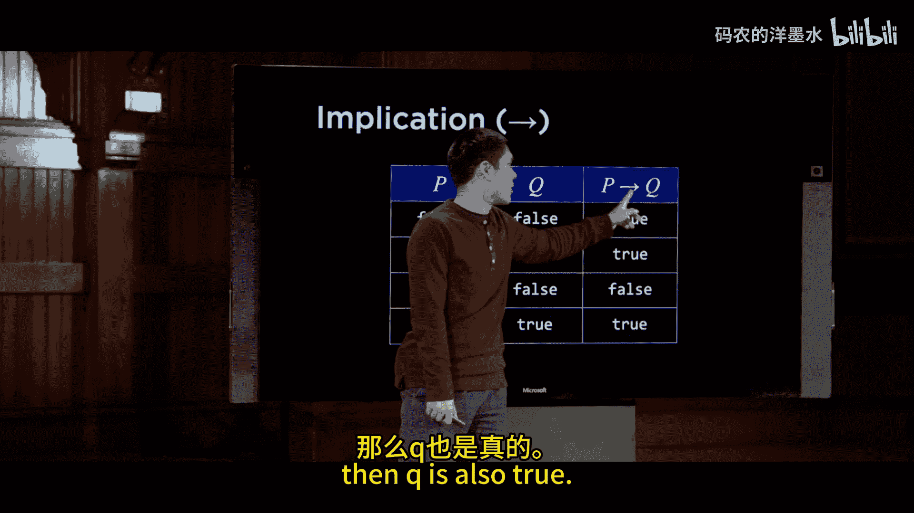

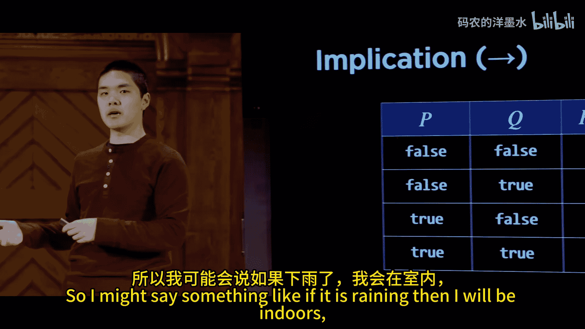

这种基于已知信息运用逻辑进行推理，从而得出结论的过程，将是我们今天讨论的重点。我们如何让人工智能具备逻辑性，使其能够进行与我们刚才所做的相同的演绎和推理？

## 命题逻辑：形式化推理

当然，人类通常用自然语言（如英语）进行逻辑推理。但当我们将注意力转向计算机，并试图在机器内部编码逻辑、真值和假值的概念时，我们需要更加形式化。我们将引入一些术语和符号，以帮助我们在人工智能中推理逻辑。

我们从“句子”的概念开始。在自然语言（如英语）中，句子就是我正在说的话。在AI的语境中，句子是在某种“知识表示语言”中对世界的断言。我们将花费今天大部分时间通过一种称为“命题逻辑”的逻辑来推理知识。

命题逻辑基于命题或关于世界的陈述。我们从“命题符号”的概念开始。我们将有一些符号（通常是字母，如P、Q、R），每个符号代表关于世界的某个事实或句子。例如，P可以代表“正在下雨”这个事实，Q可以代表“哈利今天拜访了海格”。每个命题符号都代表关于世界的某个句子或事实。

除了拥有关于世界的单个事实外，我们还需要一些方法来连接这些命题符号，以便对世界中可能存在的其他事实进行更复杂的推理。为此，我们需要引入一些称为“逻辑连接词”的附加符号。

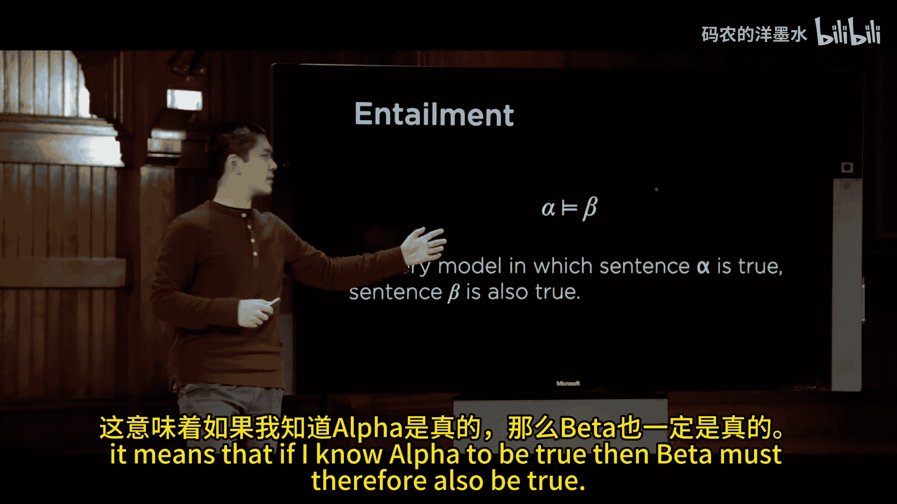

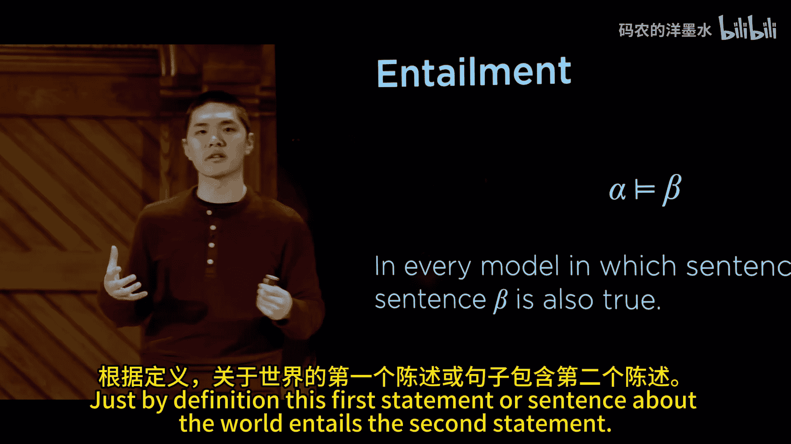

以下是五个最重要的逻辑连接词，也是我们今天将重点关注的：
*   **非**：表示为 `¬`
*   **与**：表示为 `∧`（类似倒置的V）
*   **或**：表示为 `∨`（V形）
*   **蕴含**：表示为 `→`
*   **双条件**：表示为 `↔`

这五个逻辑连接词构成了命题逻辑语言的核心，我们将用这种语言来描述思想，并推理这些思想以得出结论。

为了理解它们，我们需要看看每个逻辑连接词的含义。我们将为每一个展示一个“真值表”，该表展示了当我们将其附加到命题符号或逻辑语言中的任何句子时，这个词意味着什么。

以下是每个连接词的真值表定义：

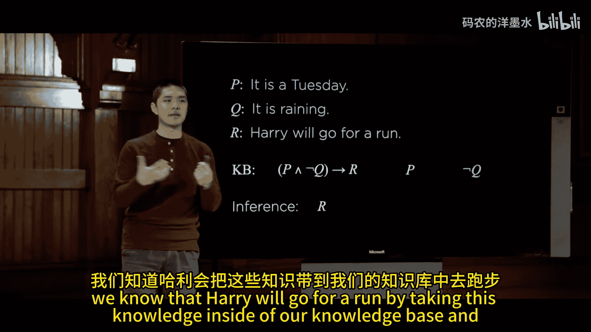

**非** (`¬`)：
*   如果 `P` 为假，则 `¬P` 为真。
*   如果 `P` 为真，则 `¬P` 为假。
你可以将 `¬` 符号放在某个命题逻辑句子的前面，表示该句子的反面。

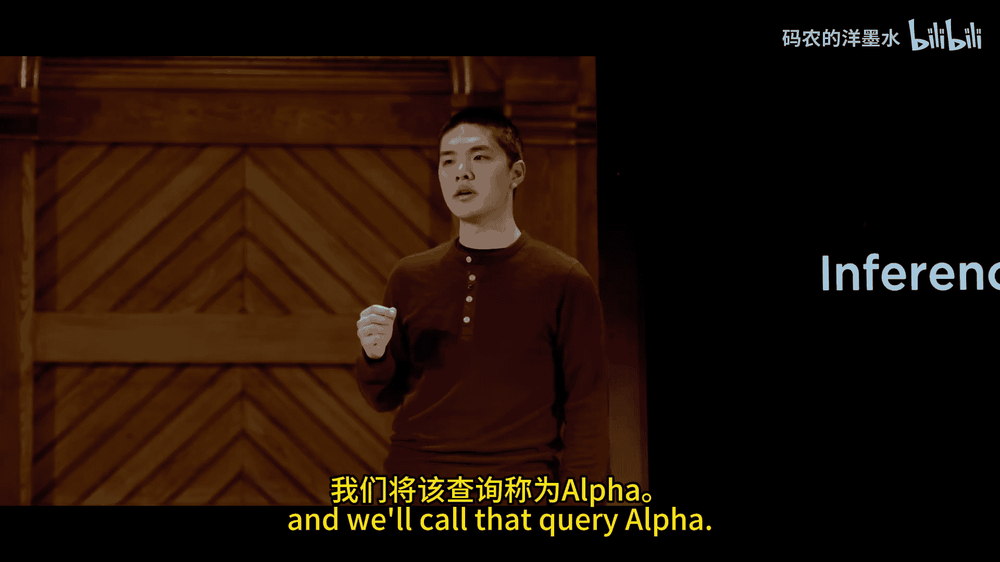

**与** (`∧`)：
*   `P ∧ Q` 为真，仅当 `P` 为真 **并且** `Q` 也为真。
*   在所有其他情况下（`P`假`Q`假、`P`假`Q`真、`P`真`Q`假），`P ∧ Q` 为假。
这与我们对“与”的直觉相符。

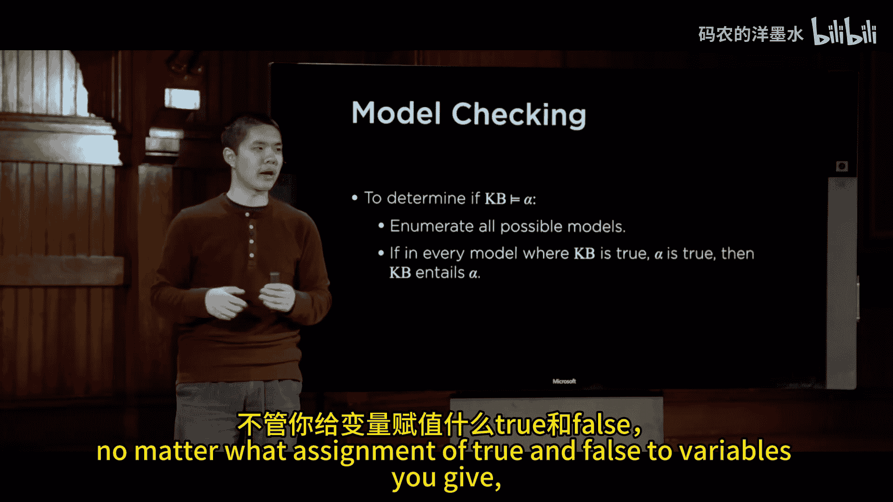

**或** (`∨`)：
*   `P ∨ Q` 为真，只要 `P` 为真 **或** `Q` 为真（或两者都为真）。
*   仅当 `P` 为假 **并且** `Q` 也为假时，`P ∨ Q` 为假。
这通常与大多数人使用“或”的方式一致，但请注意，这里的“或”是包含性的（允许两者都为真）。

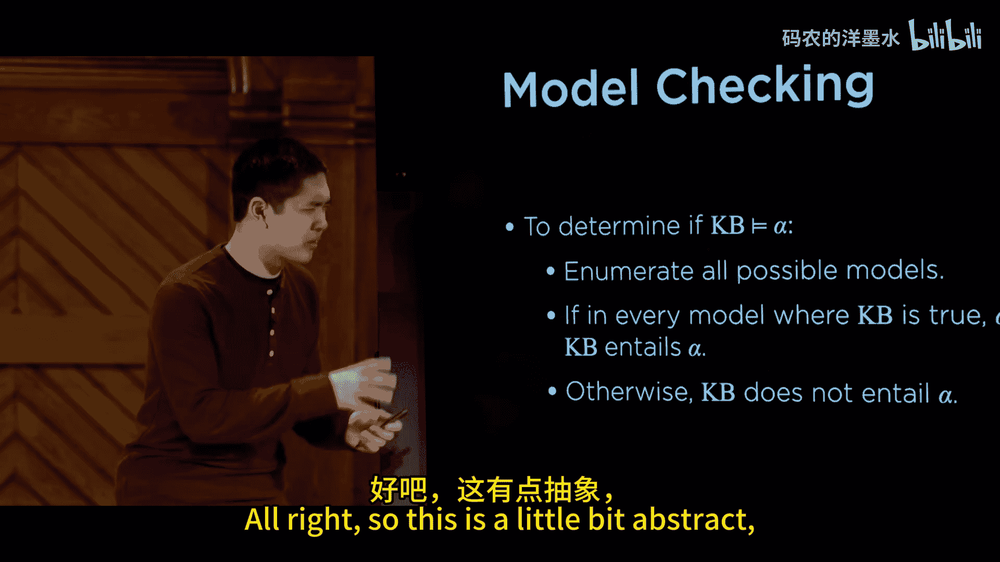

**蕴含** (`→`)：
*   我们通常将 `P → Q` 读作“P蕴含Q”或“如果P，那么Q”。
*   如果 `P` 为真且 `Q` 为真，则 `P → Q` 为真。
*   如果 `P` 为真但 `Q` 为假，则 `P → Q` 为假。
*   如果 `P` 为假，则无论 `Q` 是真还是假，`P → Q` 都为真。因为当前提 `P` 为假时，该蕴含式没有对 `Q` 做出任何声明。

**双条件** (`↔`)：
*   你可以将双条件理解为双向的条件。`P ↔ Q` 读作“P当且仅当Q”。
*   仅当 `P` 和 `Q` 具有相同的真值时（即两者都为真或两者都为假），`P ↔ Q` 才为真。
*   如果 `P` 和 `Q` 真值不同，则 `P ↔ Q` 为假。

这五个基本的逻辑连接词构成了命题逻辑语言的核心，我们将用这种语言来描述思想，并推理这些思想以得出结论。

## 模型与知识库

现在，让我们看看为了形成命题逻辑语言并编写能够理解这种逻辑的AI，我们需要了解的一些其他术语。

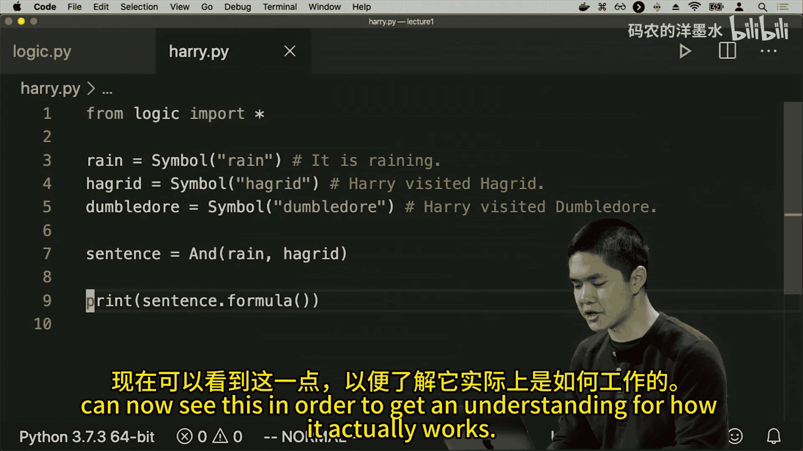

接下来我们需要的是关于世界实际上什么是真的概念。我们有一堆命题符号：P、Q、R等等。但我们需要某种方式知道，例如，P是真还是假，Q是真还是假。为此，我们引入“模型”的概念。

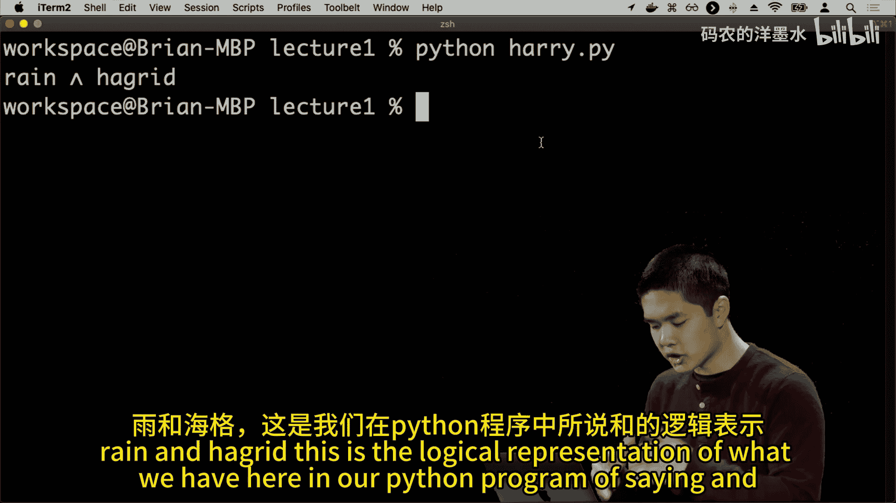

模型只是为每个命题符号分配一个真值（真或假）。换句话说，它创建了我们可能称之为“可能世界”的东西。例如，如果有两个命题符号：P（正在下雨）和Q（是星期二）。一个模型只是为这两个符号中的每一个分配一个真值。如果存在n个可以设为真或假的命题符号，那么可能的模型数量是2^n个。

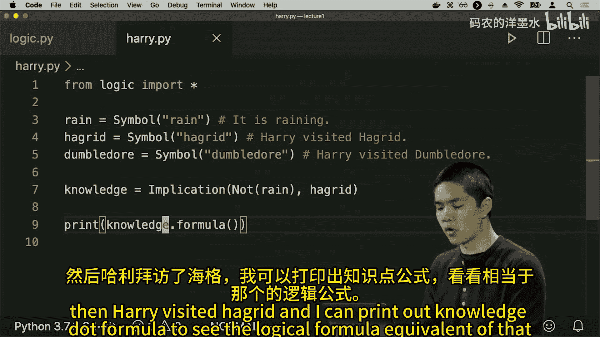

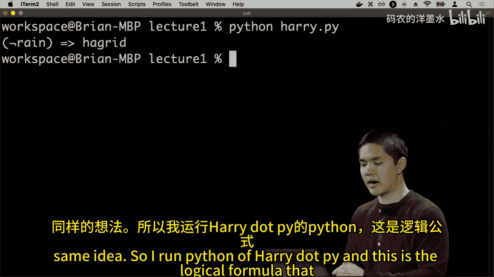

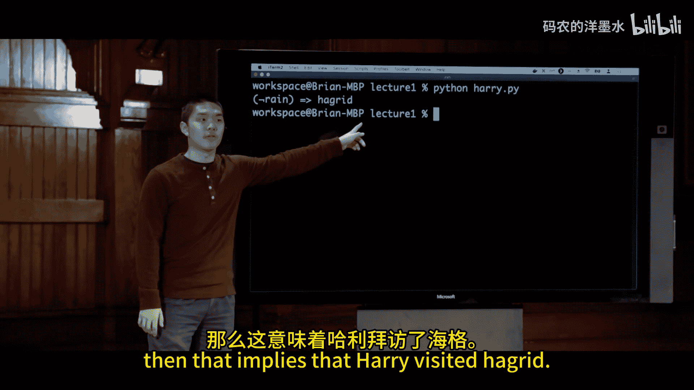

现在我们已经有了表示知识所需的符号和连接词，我们需要某种方式来表示这些知识。为此，我们将允许我们的AI访问一个“知识库”。我们的知识库实际上只是我们的AI知道为真的一组句子，即AI所知道的关于世界的命题逻辑句子。

我们可能会告诉AI一些信息，关于它所处的情况或它试图解决的问题的情况。AI会将这些信息存储在其知识库中。接下来，AI希望利用知识库中的信息来得出关于世界其余部分的结论。

为了理解这些结论，我们需要再引入一个概念，一个符号，即“蕴含”的概念。

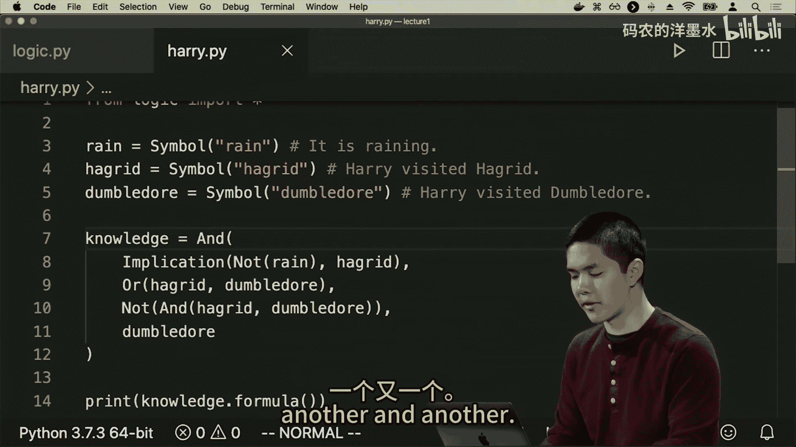

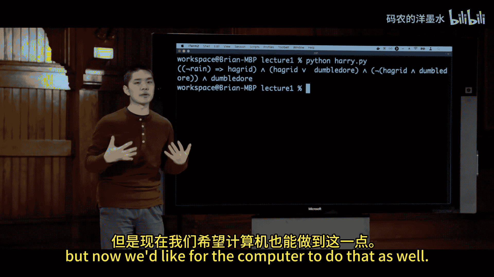

我们用 `⊨` 这个符号表示蕴含，写作 `α ⊨ β`，读作“α蕴含β”。这里α和β只是命题逻辑中的句子。这意味着，在所有使句子α为真的模型（可能世界）中，句子β也为真。如果某个东西蕴含另一个东西，那么如果我们知道α为真，那么β因此也必须为真。

最终，正是这种蕴含的概念，我们将尝试将其编码到计算机中。我们希望我们的AI代理能够找出可能的蕴含是什么。我们希望我们的AI能够获取给定的句子，并仅使用这些信息进行推断或找出结论。这个过程被称为“推理”，这将是我们今天关注的重点。

## 推理示例

让我们看一个推理示例，看看在我们采用更算法化的方法之前，如何在人类意义上进行推理。我们将看到实际上有多种方法可以实现这一点。

我们再次处理几个命题符号：P、Q和R。
*   P：是星期二
*   Q：正在下雨
*   R：哈利会去跑步

我们给AI一个知识库（KB），包含以下知识：
1.  `(P ∧ ¬Q) → R` （如果是星期二且没下雨，那么哈利会去跑步）
2.  `P` （是星期二）
3.  `¬Q` （没下雨）

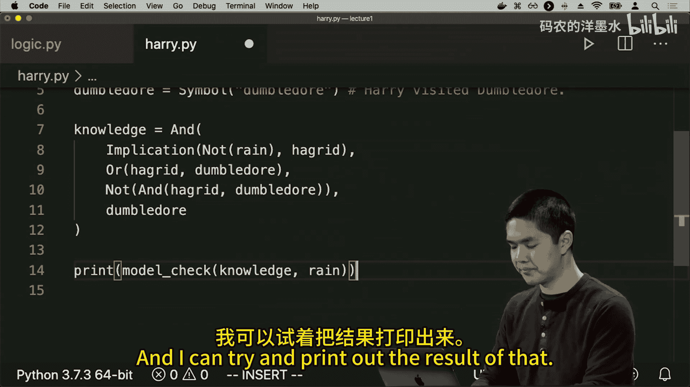

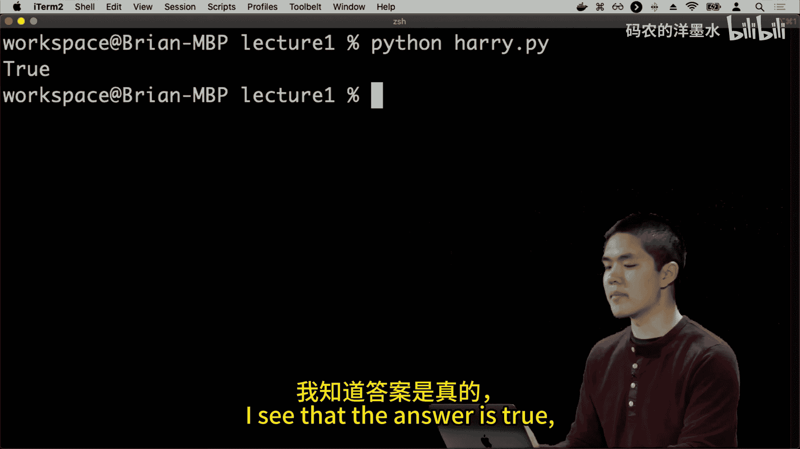

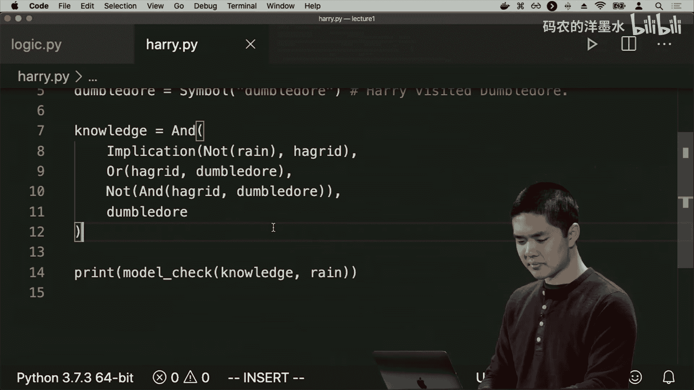

使用这些信息，我们应该能够得出一些推论。`P ∧ ¬Q` 仅当 `P` 和 `¬Q` 都为真时才为真。我们知道 `P` 为真，也知道 `¬Q` 为真，所以我们知道整个表达式 `P ∧ ¬Q` 为真。根据蕴含的定义，如果左边整个部分为真，那么右边部分也必须为真。因此，如果我们知道 `P ∧ ¬Q` 为真，那么 `R` 也必须为真。所以我们可以从所有这些信息中推断出 `R` 为真，即哈利会去跑步。

这最终构成了我们可能考虑的某种推理算法的开端。这些推理算法最终要回答的是关于蕴含的核心问题：给定一个关于世界的查询（我们称之为α），我们想问的是，我们的知识库KB是否蕴含α？换句话说，仅使用我们知识库中的信息，我们能否得出结论α为真？

## 模型检查算法

那么我们如何做到这一点呢？我们如何编写一个算法来查看这个知识库并判断查询α是否确实为真？事实证明，有几种不同的算法可以做到这一点。其中最简单的一种可能就是“模型检查”。

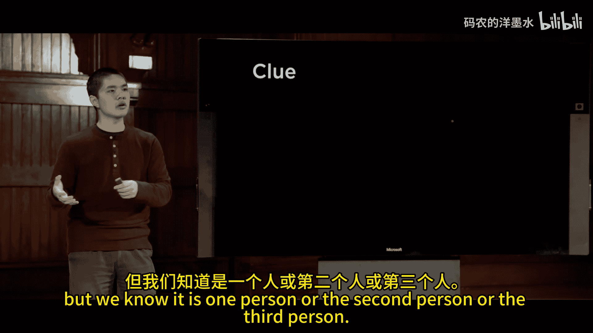

回想一下，模型只是对我们语言中所有命题符号分配真值（真或假）。你可以将模型视为一个可能世界。模型检查算法正是通过枚举所有可能的模型来工作的。

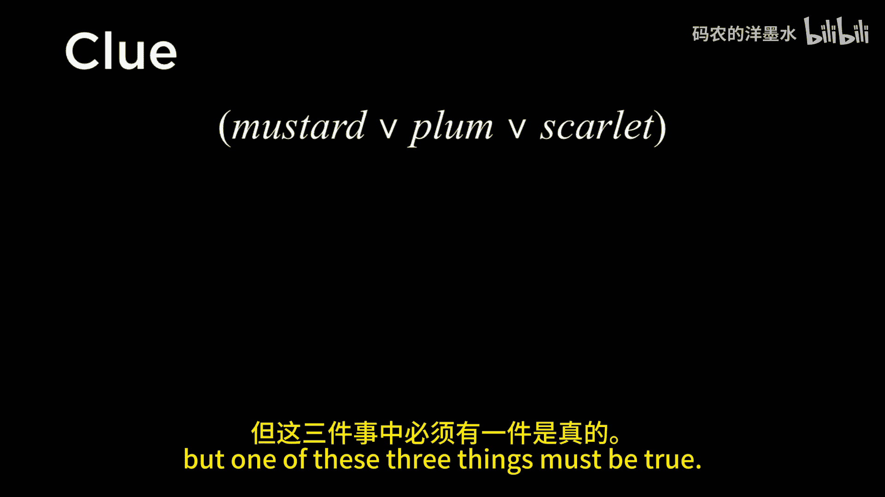

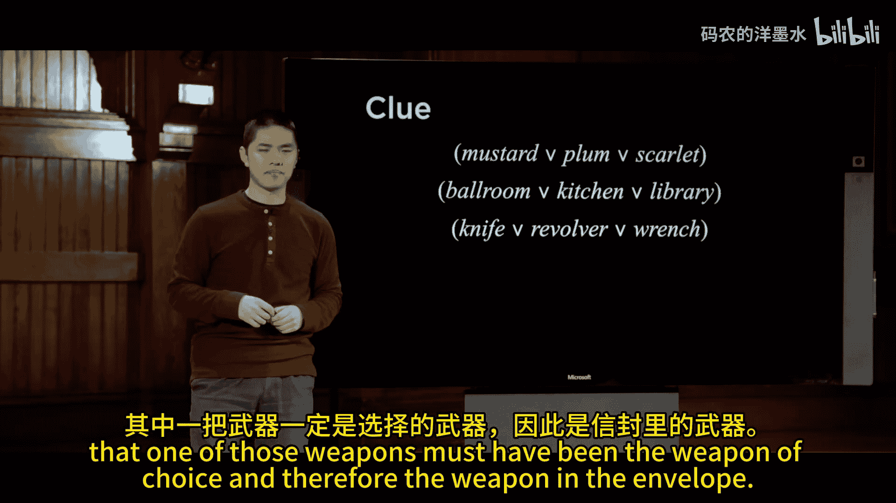

模型检查算法的工作方式如下：如果我们想确定我们的知识库是否蕴含某个查询α，那么我们将枚举所有可能的模型。换句话说，考虑我们变量的所有可能的真值和假值组合，即我们的世界可能处于的所有可能状态。如果在知识库为真的每一个模型中，α也为真，那么我们就知道知识库蕴含α。

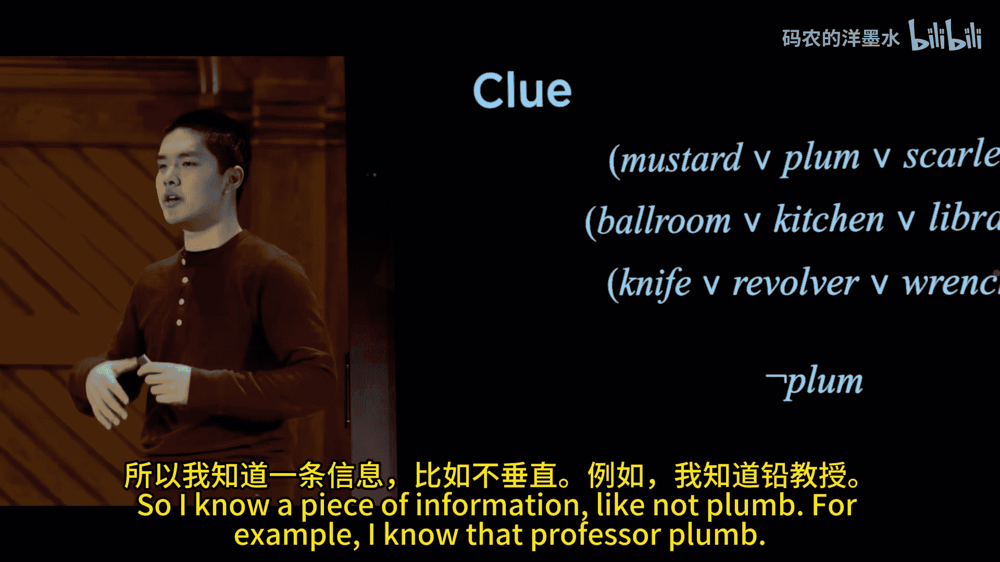

让我们通过一个例子来具体理解这个算法。我们使用与之前相同的例子：P（是星期二）、Q（正在下雨）、R（哈利会去跑步）。我们的知识库包含：`(P ∧ ¬Q) → R`、`P` 和 `¬Q`。我们的查询α是 `R`。

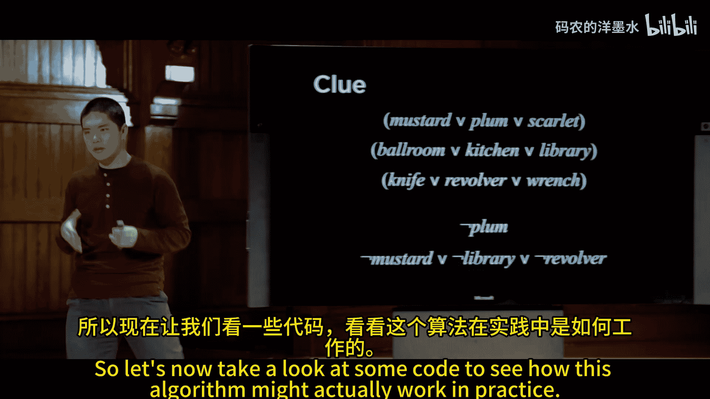

第一步是枚举所有可能的模型。我们有三个命题符号P、Q、R，这意味着我们有2^3 = 8个可能的模型。对于每个模型，我们问：知识库在这里是真的吗？在我们的知识库中，我们知道 `P`（是星期二），所以P为假的那些模型不适用。我们也知道 `¬Q`（没下雨），所以Q为真的那些模型也不适用。最后，我们知道 `(P ∧ ¬Q) → R`。我们发现，只有一个可能的模型使我们的知识库为真，即P为真、Q为假、R为真。在这个模型中，查询 `R` 为真。因此，我们可以得出结论，知识库蕴含 `R`。

这就是模型检查的思想：枚举所有可能的模型，并在那些可能的模型中查看，如果我们的知识库为真，所查询的内容是否也为真。

## 在Python中实现逻辑

现在让我们看看如何在像Python这样的编程语言中实际编写这些内容。我们将查看一些实际代码，这些代码编码了命题符号、逻辑以及诸如与、或、非、蕴含等连接词的概念。

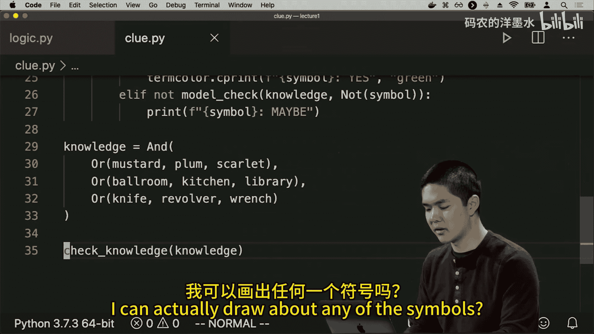

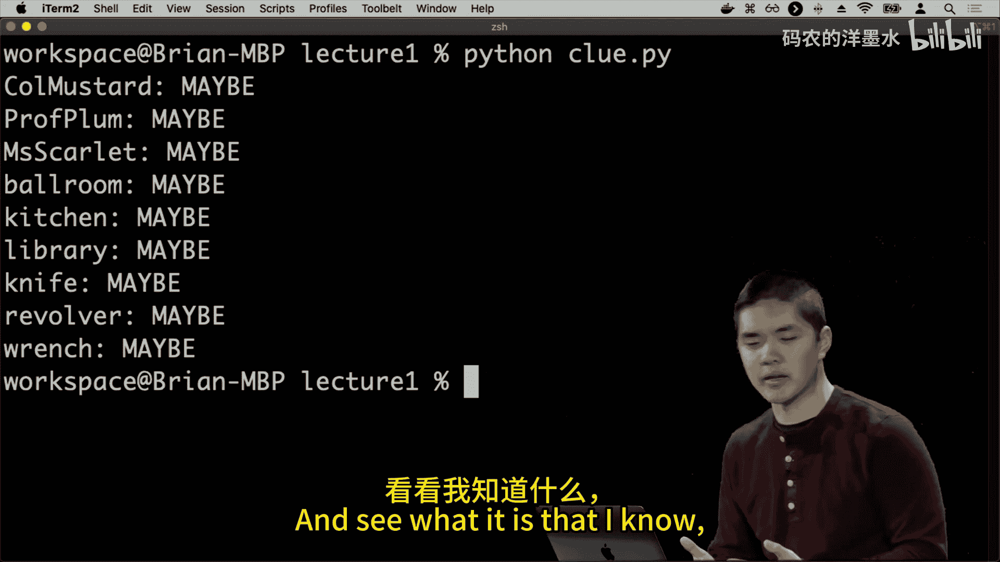

我已经提前编写了一个逻辑库。重要的是，我们为每种逻辑符号或连接词都有一个类。例如，我们有一个用于逻辑符号的类，其中每个符号都将存储该特定符号的名称。我们还有一个用于“非”的类，它接受一个操作数。我们还有用于“与”、“或”等的类。

我将演示这是如何工作的。我将创建一个文件 `harry.py` 来存储关于哈利·波特世界的信息。首先，我从我的逻辑模块导入所有内容。为了创建一个符号，我使用 `Symbol()` 函数。我创建符号 `rain`（表示正在下雨）、`hagrid`（表示哈利拜访了海格）和 `dumbledore`（表示哈利拜访了邓布利多）。然后，我可以使用逻辑连接词将它们组合起来。

例如，我可以创建一个句子 `And(rain, hagrid)` 并打印其公式表示。但更重要的是，我想编码关于世界的知识，以解决课程开始时提出的问题：弄清楚哈利拜访了谁，以及是否下雨。

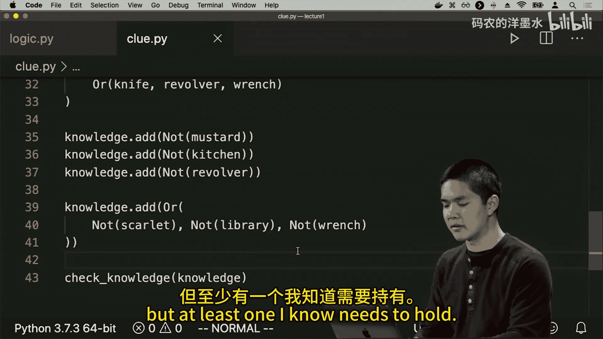

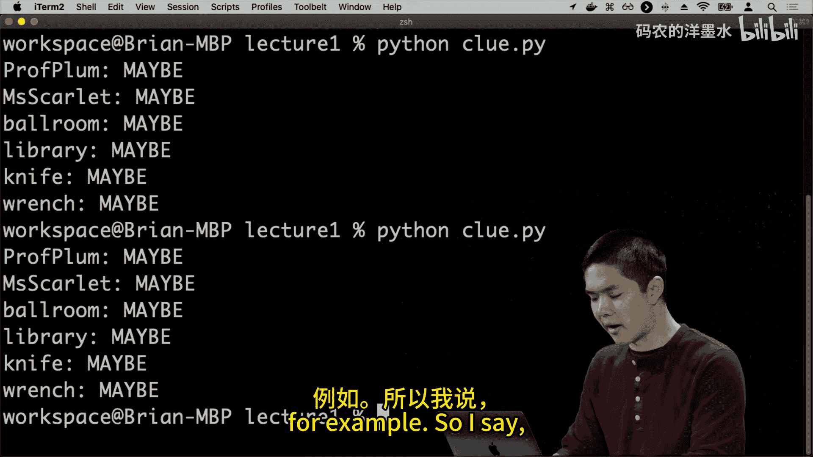

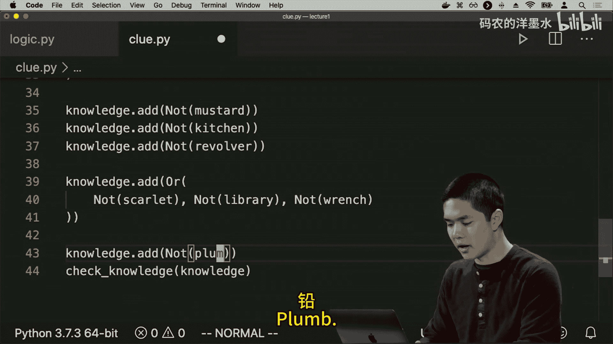

我创建一个名为 `knowledge` 的变量来表示我所知道的信息。我知道的第一句话是：“如果没下雨，那么哈利将拜访海格”。我可以用 `Implication(Not(rain), hagrid)` 来编码。我知道的第二条信息是：“哈利拜访了海格或邓布利多”。我可以用 `Or(hagrid, dumbledore)` 来编码。但初始句子还说“但并非两者都拜访了”。所以我需要编码哈利没有同时拜访海格和邓布利多，即 `Not(And(hagrid, dumbledore))`。最后，我知道“哈利拜访了邓布利多”，即 `dumbledore` 为真。

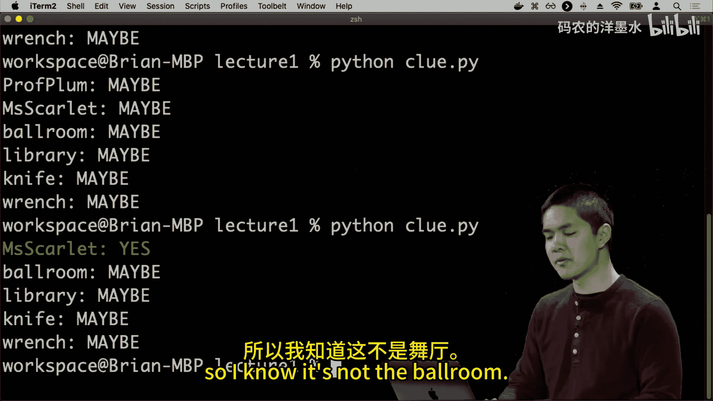

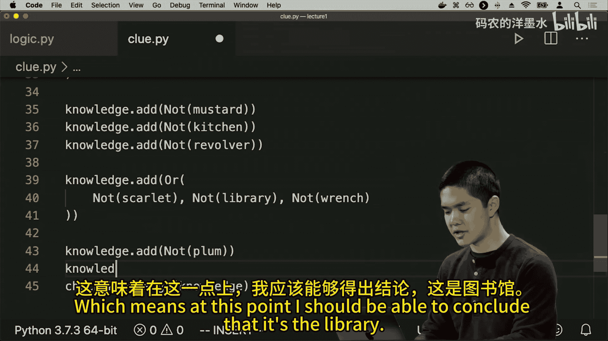

所以我的知识是所有这些句子的合取：`And(Implication(Not(rain), hagrid), Or(hagrid, dumbledore), Not(And(hagrid, dumbledore)), dumbledore)`。我可以打印出这个知识库的逻辑公式表示。

现在我想使用模型检查来提出一个查询：基于这些信息，我知道是否在下雨吗？我们人类能够通过逻辑推理出来，但现在我们希望计算机也能做到。我在 `logic.py` 中定义了一个名为 `model_check` 的函数。`model_check` 接受两个参数：我已经知道的知识和查询。为了进行模型检查，我需要枚举所有可能的模型。对于每个可能的模型，我需要问自己：知识库为真吗？查询为真吗？

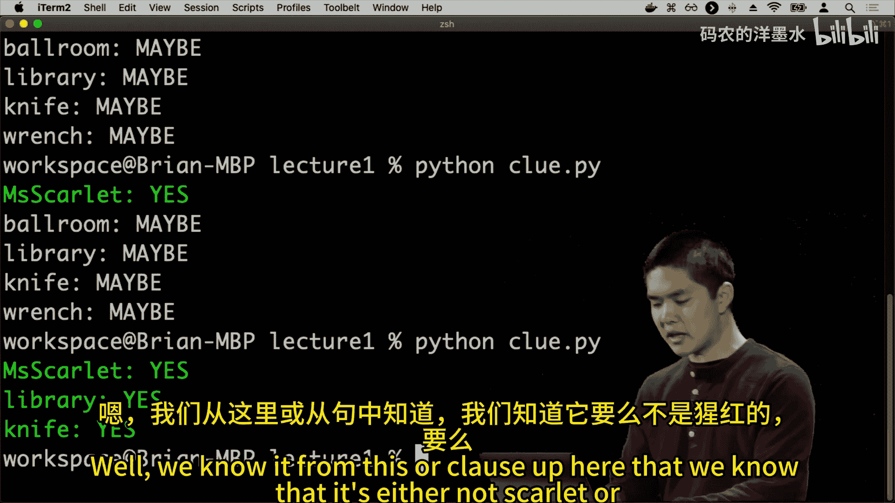

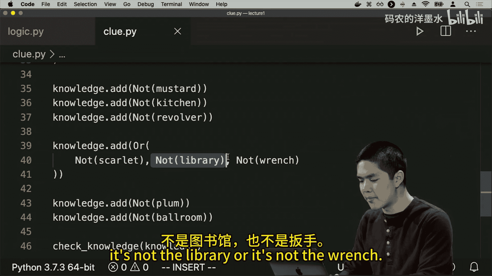

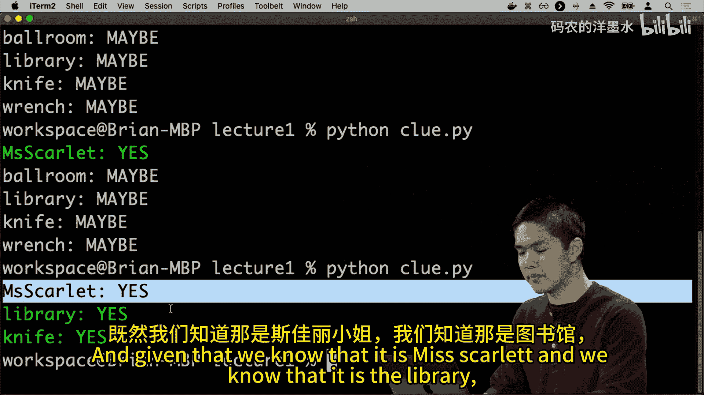

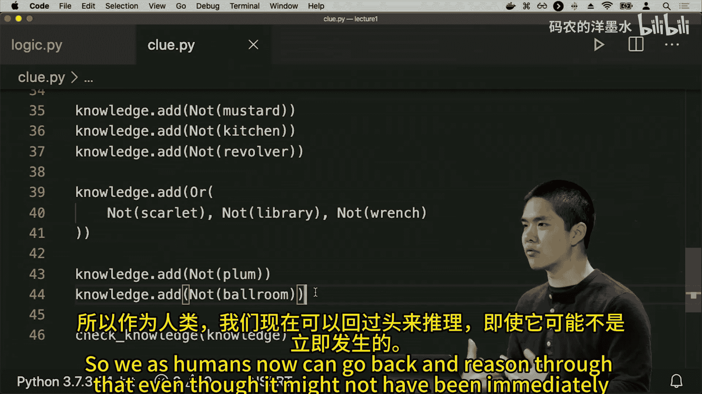

`model_check` 函数首先获取知识和查询中的所有符号。然后它调用一个辅助函数 `check_all`，该函数基本上会递归调用自己，检查命题符号的每种可能配置。如果所有符号都已赋值，则检查在此模型中知识是否为真。如果知识为真，则仅当查询也为真时才返回真，否则返回假（因为如果知识为真但查询为假，则不存在蕴含）。如果知识不为真，我们就不关心查询的真假，直接返回真。如果我们还没有给所有符号赋值，我们就弹出一个符号，创建模型的两个副本：一个将该符号设为真，另一个将其设为假。然后我们递归地在这两个模型上调用 `check_all`，确保蕴含关系在两种情况下都成立。

在 `harry.py` 中，我可以通过调用 `model_check(knowledge, rain)` 来使用这个函数。当我运行这个程序时，我看到答案是 `True`。基于这些信息，我可以最终得出结论：正在下雨。因为使用这个模型检查算法，我们能够检查在知识为真的每一个世界中，都在下雨。

## 知识工程：应用逻辑推理

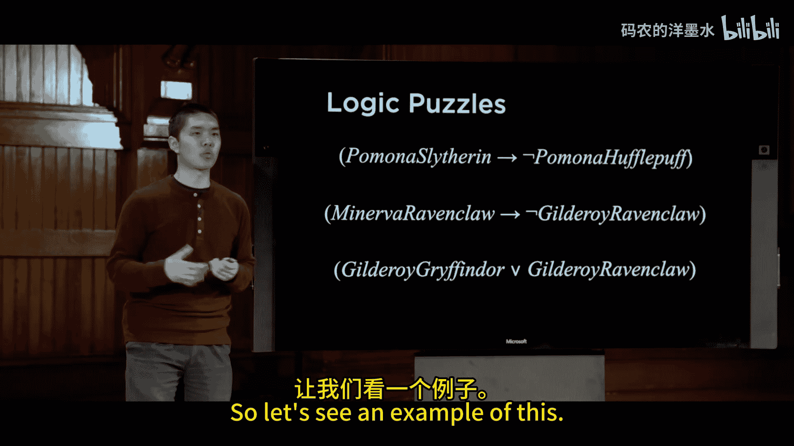

这种逻辑可以应用于许多不同类型的问题。如果面对一个可以使用某种逻辑演绎来解决的问题，你可以尝试思考需要哪些命题符号来表示该信息，以及使用哪些命题逻辑语句来编码你所知道的信息。这种尝试解决问题并找出使用哪些命题符号来编码该想法或如何逻辑地表示它的过程，被称为“知识工程”。

现在我们将看两三个知识工程的实际例子，看看如何应用逻辑符号和使用逻辑公式来编码想法。我们将从一个非常流行的棋盘游戏“妙探寻凶”开始。

在“妙探寻凶”游戏中，有许多不同的因素。但游戏的基本前提是：有若干不同的人物（例如Mustard上校、Plum教授、Scarlet小姐）、若干不同的房间（例如舞厅、厨房、图书馆）和若干不同的武器（例如刀、左轮手枪、扳手）。其中各有一个（一个人物、一个房间、一件武器）是谜题的解决方案（即凶手、所在房间和所用武器）。游戏开始时，所有卡片被随机洗牌，其中三张（一个人物、一个房间、一件武器）被放入一个密封的信封中，我们不知道是什么。我们需要通过查看部分（而非全部）卡片，尝试使用某种逻辑过程来弄清楚信封里是什么。

我们可以使用完全相同的想法来实现这个概念。首先，我们需要思考最终需要哪些命题符号。命题符号只是世界中可以为真或假的符号。在这种情况下，命题符号将对应于信封中可能存在的每个事物。例如，`mustard` 是一个命题符号，如果Mustard上校在信封中（他是凶手）则为真，否则为假。同样地，对于每个房间和每件武器，我们都有一个命题符号。

使用这些命题符号，我们可以开始创建逻辑句子，创建关于世界的知识。例如，我们知道有人是凶手，即三个人中有一个是凶手。我们可以这样编码：`mustard ∨ plum ∨ scarlet`。这条知识编码了这三个人中有一个是凶手。我们还知道，其中一个房间必须是犯罪发生的房间。我们可以编码为：`ballroom ∨ kitchen ∨ library`。同样，对于武器：`knife ∨ revolver ∨ wrench`。

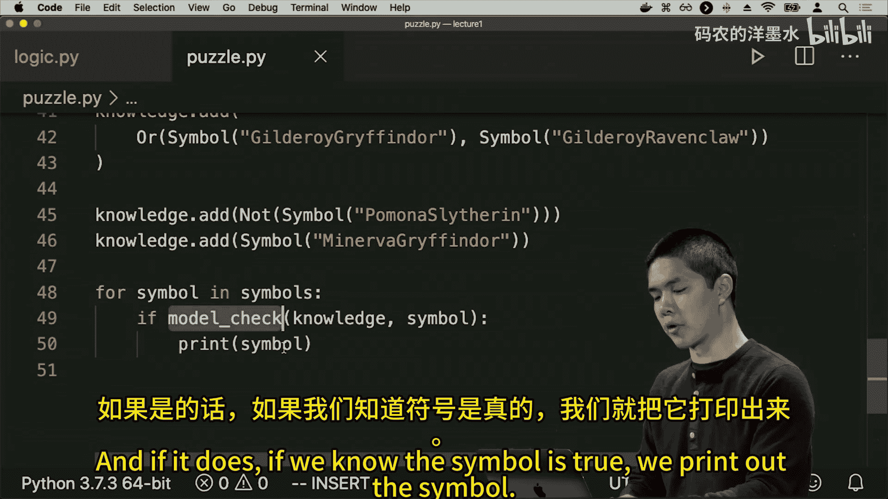

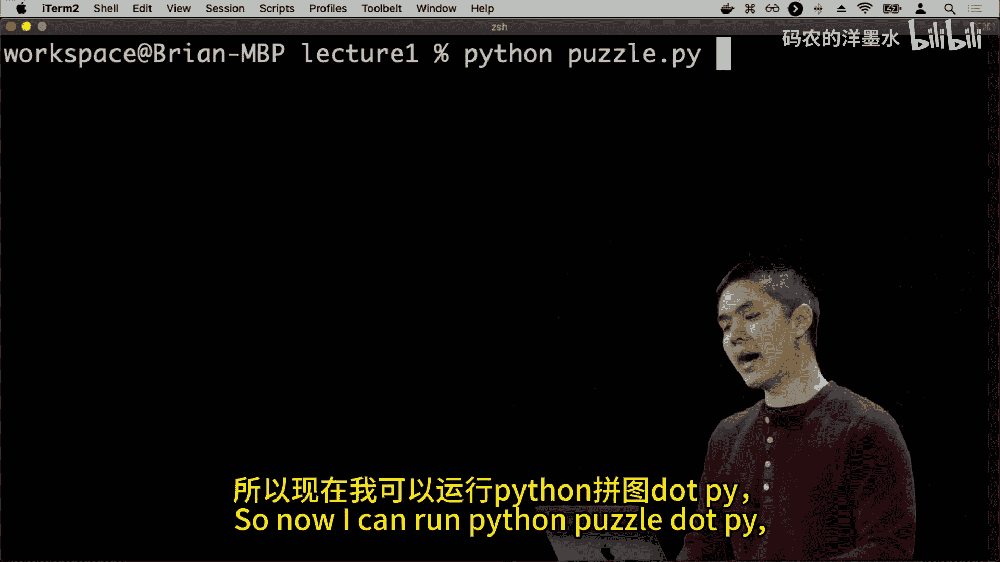

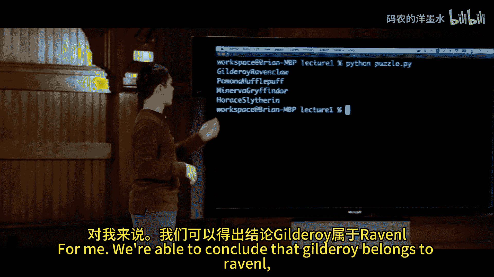

随着游戏的进行，人们会获得各种卡片。使用这些卡片，你可以推断信息。例如，如果我手中有Plum教授的卡片，那么我知道Plum教授的卡片不可能在信封中。我知道 `¬plum`。有时，我可能不确定某张特定卡片是否在中间，但有时有人会做出猜测，我会知道三种可能性中至少有一种不成立。例如，有人猜测Mustard上校在图书馆用左轮手枪作案，然后可能会揭示一张我看不到的卡片。如果这张卡片是Mustard上校、图书馆或左轮手枪中的一张，那么我知道其中至少有一个肯定不在中间。所以我知道类似 `¬mustard ∨ ¬library ∨ ¬revolver` 这样的信息。

这就是“妙探寻凶”游戏的命题逻辑表示，一种使用命题逻辑编码我们在游戏中所知知识的方式，使得计算机算法（如我们刚才看到的模型检查）能够查看和理解。

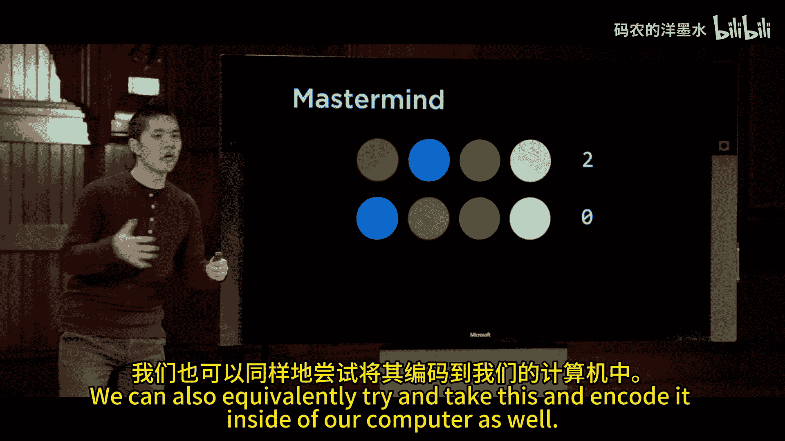

让我们看一些代码，看看这个算法在实践中如何实际工作。我打开一个名为 `clue.py` 的文件。我定义了一些初始符号：人物符号（Mustard, Plum, Scarlet）、房间符号（ballroom, kitchen, library）和武器符号（knife, revolver, wrench）。所有这些字符、房间和武器一起构成了我的符号。

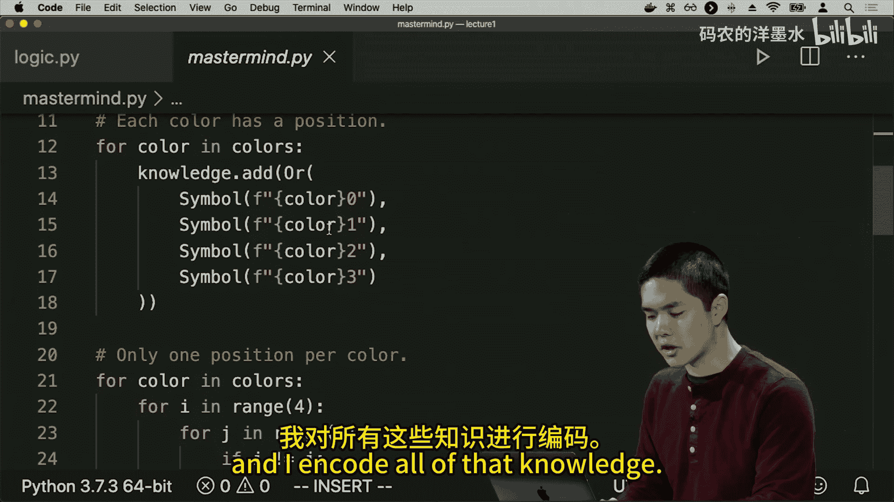

我还有一个 `check_knowledge` 函数，它接受我的知识，并尝试得出关于我所知道内容的结论。例如，它会遍历所有可能的符号，检查我是否知道该符号为真。如果我知道它为真（即它必须是信封中的卡片），我就用绿色打印“是”。如果我不确定符号为真，也许我可以检查是否确定符号不为真。如果我确定符号不为真，我就用红色打印“否”。如果我不确定符号是否为假，我就打印“可能”。

我的初始知识是：我知道三个人中有一个是罪犯（`Or(mustard, plum, scarlet)`），我知道它必须发生在其中一个房间里（`Or(ballroom, kitchen, library)`），并且我知道必须使用其中一件武器（`Or(knife, revolver, wrench)`）。如果我运行我的知识检查函数，我还没有任何确定的信息。

但现在让我尝试添加一些额外的信息，看看额外的知识是否能帮助我们逻辑推理。例如，如果我拥有Mustard上校的卡片，我知道 `¬mustard`。如果我拥有厨房卡片，我知道 `¬kitchen`。如果我拥有左轮手枪卡片，我知道 `¬revolver`。当我重新运行程序时，我已经能够排除一些可能性。现在我只剩下刀和扳手之间不确定。

如果我还得到信息，有人猜测Scarlet小姐在图书馆用扳手作案，并且揭示了一张卡片，那么我知道Scarlet、图书馆、扳手中至少有一个不在中间。我可以添加知识：`Or(Not(scarlet), Not(library), Not(wrench))`。此时我仍然没有额外的确定信息。

但假设我得到更多信息，例如有人给我看了Plum教授的卡片。那么我知道 `¬plum`。重新运行程序，现在我可以得出一些结论：我已经排除了Plum教授，剩下唯一可能的人就是Scarlet小姐。所以我知道 `scarlet` 必须为真。

让我们再添加一条信息：我知道不是舞厅（有人给我看了舞厅卡片）。那么我知道 `¬ballroom`。运行程序后，我不仅可以得出结论是图书馆，而且我还知道武器是刀。这可能是一个需要更多推理的推断，但AI通过模型检查算法能够得出这个结论。

因此，能够以这种方式表示知识通常是有帮助的。任何时候我们能够将某些东西转化为这样的命题逻辑符号，这种方法都可能有用。

## 逻辑谜题与一阶逻辑

你可能熟悉逻辑谜题，你必须通过 puzzling 来弄清楚一些事情。这是一个经典逻辑谜题的样子：Gilderoy、Minerva、Pomona和Horace各自属于四个学院（Gryffindor、Hufflepuff、Ravenclaw、Slytherin）中的一个，并且我们有一些信息，例如Gilderoy属于Gryffindor或Ravenclaw，Pomona不属于Slytherin，Minerva属于Gryffindor。我们需要利用这些信息得出每个人属于哪个学院的结论。

我们可以使用完全相同的想法来实现这个概念。我们需要一些命题符号。在这种情况下，命题符号会变得更复杂，尽管我们稍后会看到一些使其更简洁的方法。我们需要16个命题符号，每个人和学院的组合一个。例如，`GilderoyGryffindor` 要么为真要么为假，`GilderoyHufflepuff` 也为真或假，依此类推。

使用这种类型的知识，我们可以开始思考关于谜题我们可以说哪些类型的逻辑句子。甚至在考虑给出的信息之前，我们可以思考问题的前提：每个人被分配到一个不同的学院。这告诉我们一些句子，例如：`PomonaSlytherin → ¬PomonaHufflepuff`（如果Pomona在Slytherin，那么我们知道Pomona不在Hufflepuff）。我们对所有人和所有学院组合都有类似的知识。我们还知道每个人在不同的学院，所以我还有类似 `MinervaRavenclaw → ¬GilderoyRavenclaw` 的知识。此外，我还有给出的知识，例如Gilderoy在Gryffindor或Ravenclaw，可以表示为 `GilderoyGryffindor ∨ GilderoyRavenclaw`。

使用这些句子，我可以开始得出关于世界的结论。让我们看一个例子。我打开一个名为 `puzzle.py` 的文件，我已经开始实现这种想法。我定义了人物列表和学院列表，并为每个人和学院的组合创建了一个符号。然后我添加了一些信息：我知道每个人属于一个学院，我为每个人添加了 `Or(personGryffindor, personHufflepuff, personRavenclaw, personSlytherin)`。我还知道每人只属于一个学院，所以我循环遍历每个人，然后循环遍历所有不同的学院对，并添加知识：`Implication(Symbol(f"{person}{house1}"), Not(Symbol(f"{person}{house2}")))`。另一条我需要编码的逻辑是每个学院只能有一个人，所以我循环遍历所有学院，循环遍历所有不同的人物对，并添加知识：`Implication(Symbol(f"{person1}{house}"), Not(Symbol(f"{person2}{house}")))`。

现在我可以添加给出的信息：Gilderoy在Gryffindor或Ravenclaw（`Or(gilderoyGryffindor, gilderoyRavenclaw)`），Pomona不在Slytherin（`Not(pomonaSlytherin)`），Minerva在Gryffindor（`minervaGryffindor`）。然后我循环遍历所有符号，检查知识是否蕴含该符号（通过再次调用 `model_check` 函数）。如果我知道该符号为真，我就打印出该符号。运行程序后，Python为我解决了这个谜题，得出结论：Gilderoy属于Ravenclaw，Pomona属于Hufflepuff，Minerva属于Gryffindor，Horace属于Slytherin。

你可以想象这被应用于许多不同类型的演绎情境。但你可能已经注意到，这个过程花费了相当长的时间。事实上，模型检查并不是一个特别高效的算法。为了进行模型检查，我需要获取所有可能的不同变量，并枚举它们所有可能的状态。如果我有n个变量，我有2^n个可能的世界需要查看。随着数据量变得更大，变量更多，这种方法可能不可行。

因此，虽然对于像Mastermind这样的游戏来说，模型检查可能还行，但我们希望找到一些更好的方法来进行推理，而不是仅仅枚举所有可能性。为此，我们接下来将转向“推理规则”的概念。

## 推理规则与归结

推理规则是我们可以应用于已有知识，将其转化为新知识形式的某种规则。推理规则的一般结构是有一条水平线，线上方代表前提（我们知道为真的东西），线下方是我们可以通过应用推理规则得出的结论。

例如，考虑“肯定前件”推理规则：如果我们知道 `α → β`，并且我们也知道 `α` 为真，那么我们可以得出结论 `β` 也为真。这是从两条信息生成新信息的一种完全不同的方法。

其他推理规则包括：
*   **与消除**：如果 `α ∧ β` 为真，那么 `α` 为真（同样 `β` 也为真）。
*   **双重否定消除**：如果 `¬¬α` 为真，那么 `α` 为真。
*   **蕴含消除**：`α → β` 等价于 `¬α ∨ β`。
*   **双条件消除**：`α ↔ β` 等价于 `(α → β) ∧ (β → α)`。
*   **德摩根定律**：`¬(α ∧ β)` 等价于 `¬α ∨ ¬β`；`¬(α ∨ β)` 等价于 `¬α ∧ ¬β`。
*   **分配律**：`α ∧ (β ∨ γ)` 等价于 `(α ∧ β) ∨ (α ∧ γ)`；`α ∨ (β ∧ γ)` 等价于 `(α ∨ β) ∧ (α ∨ γ)`。

这些推理规则为我们提供了将逻辑句子从一种形式转换为另一种形式的方法。我们可以将定理证明视为一种搜索问题：初始状态是我们开始时的知识库；可用的动作是我们在任何时候可以应用的任何推理规则；转换模型告诉我们应用推理规则后我们拥有的新知识集；目标测试是检查我们是否证明了我们试图证明的陈述；路径成本函数可能是我们需要使用的推理规则的数量。

但事实证明，还有另一种我们可以尝试应用推理的方式，即“归结”。归结基于另一个非常强大的推理规则。基本思想是：假设我知道“Ron在礼堂或Hermione在图书馆”，并且我也知道“Ron不在礼堂”。基于这两条信息，我可以合理地得出结论：Hermione一定在图书馆。这是因为这两个“互补文字”（彼此相反的陈述）似乎相互冲突。

我们可以将其表述为更一般的“单元归结规则”：如果我们有 `P ∨ Q`，并且我们也知道 `¬P`，那么我们可以合理地得出结论 `Q`。这可以被推广：`Q` 不必是单个命题符号，它可以是多个符号连接在一起的一个“子句”。如果我们有 `P ∨ Q1 ∨ Q2 ∨ ... ∨ Qn` 和 `¬P`，那么我们可以将这两个子句“归结”以产生一个新的子句 `Q1 ∨ Q2 ∨ ... ∨ Qn`。

我们还可以进一步推广：如果我们有 `P ∨ Q` 和 `¬P ∨ R`，我们可以将这两个子句归结在一起得到 `Q ∨ R`。同样，`Q` 和 `R` 可以代表多个符号。

这里，一个“子句”被正式定义为“文字的析取”，其中析取意味着一堆用“或”连接的东西，而“文字”要么是一个命题符号，要么是一个命题符号的否定。

这使我们能够将任何逻辑句子转化为“合取范式”。一个合取范式句子是一个逻辑句子，它是子句的合取。换句话说，它是用“与”连接的单个子句的集合，每个子句内部用“或”分隔。我们可以通过应用推理规则和转换，将逻辑中的任何句子转化为合取范式。

将公式转化为合取范式的过程如下：
1.  消除双条件（`↔`）。
2.  消除蕴含（`→`）。
3.  使用德摩根定律将否定向内移动。
4.  使用分配律分配“或”，使“或”在表达式内部，“与”在外部。

一旦我们有了合取范式中的这些子句，这些子句就成为我们刚才看到的归结推理规则的输入。如果我们有两个子句，它们之间存在某些互补或冲突的内容，我们可以将它们归结以获得一个新的子句，得出一个新的结论。我们称这个过程为“归结推理”。

关于归结，有几个关键点需要注意。一个是，如果我们有 `P ∨ Q ∨ S` 和 `¬P ∨ R ∨ S`，归结会得到 `Q ∨ S ∨ R ∨ S`，但重复的 `S` 是冗余的，我们通常也会进行“因子化”过程，消除任何出现的重复变量。另一个是，如果我尝试归结 `P` 和 `¬P`，我会得到“空子句”，它总是假的，代表一个矛盾。

如果我们归结两个矛盾项得到空子句，这是我们基于归结的推理算法的基础。算法的高级层面如下：我们想证明我们的知识库蕴含某个查询α。为了做到这一点，我们将尝试证明，如果我们知道知识且 `¬α`，那将导致矛盾。这是一个反证法：假设我们要证明的东西是假的，并表明它会导致矛盾。

更正式地说，我们如何检查知识库和 `¬α` 会导致矛盾？这就是归结发挥作用的地方。为了确定我们的知识库是否蕴含某个查询α，我们将把知识库和 `¬α` 转化为合取范式。当我们有了这些单独的子句，我们就可以不断检查是否可以使用归结产生一个新的子句。我们循环检查任何一对子句，看是否有某个文字在两者中是相反的或互补的。如果我们能归结产生一个新子句，我们就这样做。这个过程循环进行。最终，我们可能会产生空子句。如果我们产生了空子句，那么我们就有了一个矛盾，这意味着我们的知识库一定蕴含这个查询α。否则，如果没有更多新的子句可添加，我们做了所有能做的归结，但仍然没有产生空子句，那么在这种情况下就没有蕴含。

让我们看一个例子，实际使用这个归结推理过程来证明一些蕴含。问题是：我们有这个知识库：`(A ∨ B) ∧ (¬B ∨ C) ∧ (¬C)`。我们想知道所有这一切是否蕴含 `A`。我们的查询α是 `A`。首先，我们通过反证法来证明，假设 `A` 是假的。所以我们从知识库和 `¬A` 开始。现在它在合取范式中，有四个子句：`A ∨ B`、`¬B ∨ C`、`¬C`、`¬A`。

现在我开始挑选两个可以归结的子句。我看到 `¬B ∨ C` 和 `¬C` 可以归结，因为存在互补文字 `C` 和 `¬C`。归结得到新子句 `¬B`。然后，我可以使用这个新子句和 `A ∨ B` 进行归结，因为 `B` 和 `¬B` 互补。归结得到新子句 `A`。最后，我可以归结 `¬A` 和 `A`，得到空子句。空子句为假，意味着我们有一个矛盾。因此，我们可以肯定地说，整个知识库蕴含 `A`。

## 一阶逻辑简介

我们刚刚看到的所有这些都是基于一种特定类型的逻辑：命题逻辑。但命题逻辑并不是唯一存在的逻辑类型。事实上，我们看到命题逻辑存在局限性。例如，在Mastermind例子或逻辑谜题例子中，我们需要很多不同的命题符号来表示一些相当基本的概念。

因此，作为今天课程结束前要看的最后一个主题，是另一种不同于命题逻辑的逻辑类型，称为“一阶逻辑”。它比命题逻辑更强大，将使我们可以更容易地表达某些类型的概念。

在命题逻辑中，如果我们回想一下那个关于霍格沃茨学院人物的谜题，我们有很多符号，每个符号只能为真或假。我们有一个符号表示Minerva在Gryffindor，一个表示Minerva在Hufflepuff，等等。但这开始变得相当冗余。我们希望能够表达这些命题符号之间存在关系（Minerva出现在所有符号中），并且我们希望不必用那么多不同的符号来表示一个相当简单的问题。

一阶逻辑将为我们提供一种不同的方式来处理这个想法，它为我们提供了两种不同类型的符号：
1.  **常量符号**：代表对象，如人物或学院。
2.  **谓词符号**：可以看作是关系或函数，它们接受输入并评估为真或假，告诉我们某个常量或常量对的某些属性是否成立。

在这个相同的问题中，常量符号可能是对象，如人物（Minerva, Pomona, Horace, Gilderoy）和学院（Gryffindor, Hufflepuff, Ravenclaw, Slytherin）。谓词符号可能是适用于这些个体常量的属性。例如，`Person(Minerva)` 为真，但 `Person(Gryffindor)` 为假；`House(Ravenclaw)` 为真，但 `House(Horace)` 为假。而 `BelongsTo` 将是某种关系，将人物与他们的学院联系起来。

一阶逻辑句子可能看起来像这样：`Person(Minerva)` 表示“Minerva是一个人”。`House(Gryffindor)` 表示“Gryffindor是一个学院”。`¬House(Minerva)` 表示“Minerva不是一个学院”。`BelongsTo(Minerva, Gryffindor)` 表示“Minerva属于Gryffindor”。

一阶逻辑与命题逻辑的关键区别在于：在命题逻辑中，我需要一个符号表示Minerva在Gryffindor，一个符号表示Minerva在Hufflepuff，等等。而在一阶逻辑中，我只需要每个人一个符号，每个学院一个符号。然后，我可以使用像 `BelongsTo` 这样的谓词来表达诸如“Minerva属于Gryffindor学院”这样的想法。

但一阶逻辑还为我们提供了几个额外的功能，我们可以用它们来表达更复杂的思想。这些额外的功能通常被称为“量词”。一阶逻辑中有两个主要的量词：
1.  **全称量词** (`∀`)：让我表达这样的思想：对于变量的所有值，某个陈述都将成立。例如，`∀x (BelongsTo(x, Gryffindor) → ¬BelongsTo(x, Hufflepuff))` 表示“对于所有对象x，如果x属于Gryffindor，那么x不属于Hufflepuff”，或者更简单地说，“任何在Gryffindor的人都不在Hufflepuff”。
2.  **存在量词** (`∃`)：表示某个表达式对于变量的某个值（至少一个值）将为真。例如，`∃x (House(x) ∧ BelongsTo(Minerva, x))` 表示“存在某个对象x，使得x是一个学院并且Minerva属于x”，或者更简单地说，“Minerva属于一个学院”。

结合全称量词和存在量词，我们可以创建比仅使用命题逻辑更复杂的逻辑语句。例如，`∀x (Person(x) → ∃y (House(y) ∧ BelongsTo(x, y)))` 表示“对于所有x，如果x是一个人，那么存在一个y，使得y是一个学院并且x属于y”，或者更简单地说，“每个人都属于一个学院”。

## 总结

本节课中我们一起学习了知识在人工智能中的核心作用。我们探讨了如何让AI代理能够表示知识，并基于已知信息进行逻辑推理以得出结论。我们从命题逻辑的基础开始，学习了命题符号、逻辑连接词（非、与、或、蕴含、双条件）以及真值表。我们引入了模型、知识库和蕴含的概念，并探讨了如何通过推理从已知信息中得出新结论。

我们研究了两种主要的推理算法：模型检查（枚举所有可能世界）和基于推理规则（如归结）的推理。我们通过“妙探寻凶”游戏、逻辑谜题和Mastermind游戏等实例，实践了“知识工程”——将现实问题转化为逻辑表示的过程。

最后，我们简要介绍了一阶逻辑，它通过常量符号、谓词符号和量词（全称量词和存在量词）提供了更强大、更简洁的知识表示能力，使我们能够表达更复杂的关系和属性。

所有这些都有助于我们创建能够表示关于其所知和所不知信息的AI。下节课，我们将探讨如何使我们的AI更加强大，不仅编码我们确定知道为真或为假的信息，还将研究不确定性，看看如果AI认为某事可能发生或可能不发生，或者介于两者之间，会发生什么。这一切都是为了努力构建更加智能的系统。