# 006：学习

在本节课中，我们将要学习机器学习的核心概念与算法。我们将从监督学习开始，探讨如何让计算机从带有标签的数据中学习规律，然后了解强化学习如何让智能体通过奖励与惩罚从经验中学习，最后简要介绍无监督学习中的聚类任务。

---

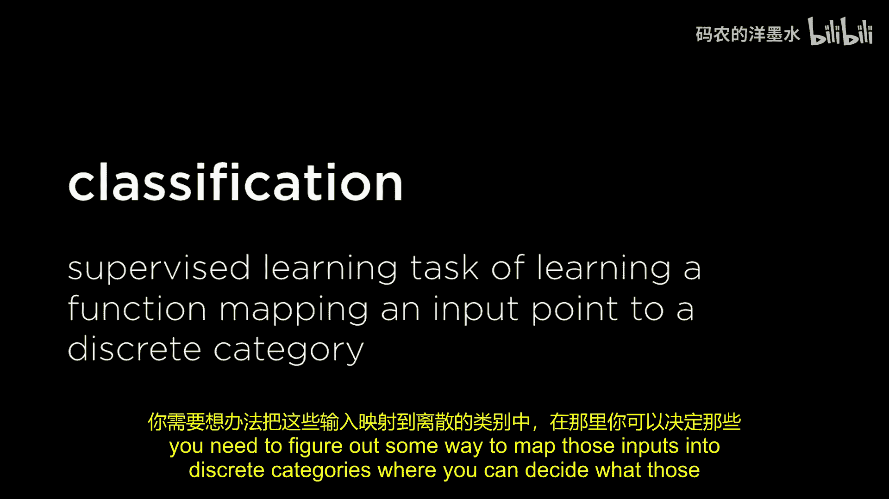

## 监督学习

到目前为止，在这门课程中，我们已经使用人工智能解决了许多不同的问题。我们给人工智能提供了如何搜索解决方案或如何满足某些约束的指令，以便从某个输入点找到通往某个输出点的路径，从而解决某种问题。今天，我们将转向学习的世界。

具体来说，是**机器学习**的概念，它通常指的是这样一种思想：我们不会给计算机明确的指令来执行任务，而是让计算机以数据或模式的形式访问信息，让它从中学习，并尝试找出这些模式，理解这些数据，以便能够自行执行任务。

机器学习有多种不同的形式，是一个非常广泛的领域。因此，今天我们将探索支撑机器学习许多不同领域的一些基础算法和思想。其中最流行的一种思想是**监督机器学习**，或简称**监督学习**。

### 什么是监督学习？

监督学习是一种特定类型的任务。它指的是我们给计算机提供数据访问权限的任务，这些数据由**输入-输出对**组成。我们希望计算机能够找出某个将输入映射到输出的函数。

因此，我们拥有大量数据，这些数据通常包含某种输入、某些证据或计算机将有权访问的某些信息。我们希望计算机基于这些输入信息来预测某个输出是什么。我们会给它一些数据，以便计算机可以开始在其模型上进行训练，开始理解这些信息如何工作，以及输入和输出之间如何相互关联。

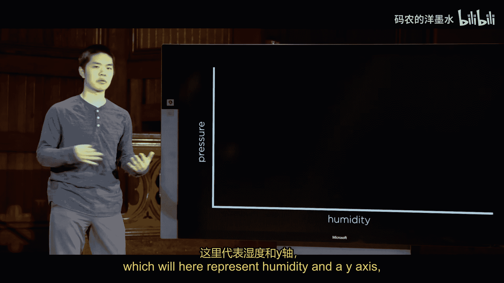

但最终，我们希望我们的计算机能够找出某个函数，给定这些输入，能够得出那些输出。

### 分类任务

监督学习中有几个不同的任务。我们将重点讨论并首先介绍的是**分类**。分类问题是：如果我给你一大堆输入，你需要找出某种方法将这些输入映射到**离散的类别**中。

你可以决定这些类别是什么，而计算机的工作就是预测这些类别将是什么。

例如，我给你一张美元钞票的信息，然后请你为我预测：它属于**真钞**类别，还是属于**假钞**类别。你需要对输入进行分类，我们希望训练计算机找出某个函数来进行这种计算。

另一个例子可能是天气情况，这是我们在这门课中已经稍微讨论过的话题。我们希望预测在给定的一天是否会下雨，或者那天是否会多云。之前我们已经看到，如果我们真的给计算机所有确切的概率（例如，如果这些是条件，下雨的概率是多少），我们如何能做到这一点。然而，我们通常无法获得这些信息，但我们确实拥有大量数据。因此，如果我们想要预测类似“是否会下雨”的事情，我们会给计算机提供关于下雨天和非下雨天的历史信息，并要求计算机在这些数据中寻找模式。

那么这些数据可能是什么样子呢？我们可以将数据构造成这样的表格：

| 湿度 | 气压 | 标签 |
| :--- | :--- | :--- |
| ... | ... | 下雨 |
| ... | ... | 不下雨 |

对于任何特定的一天（回溯），我们有关于该天湿度和气压的信息。然后重要的是，我们有一个**标签**，即人类已经说明在该特定天是下雨还是不下雨。

你可以用大量数据填充此表。我们称之为**监督学习**练习的原因是，人类已经介入并为每个数据点添加了标签，说明在湿度和气压为这些值的这一天是下雨天，而这一天是不下雨天。

然后，我们希望计算机能够做到的是，给定这些输入（如湿度和气压），计算机能够预测应该与该天关联什么标签，即该天看起来更像是下雨天还是不下雨天。

### 数学形式化

更数学化一点，你可以将其视为一个接受两个输入的函数。输入是我们的计算机将有权访问的数据点，例如湿度和气压。因此，我们可以写一个函数 **f**，它以湿度和气压作为输入。

然后，输出将是我们分配给这些特定输入点的类别，即我们与该输入关联的标签。我们在这里看到了几个示例数据点，其中给定湿度的这个值和气压的这个值，我们预测是会下雨还是不会下雨。

这些信息是我们从世界中收集的。我们在不同的日子测量了湿度和气压。我们观察了在该特定日子是否看到下雨。而这个函数 **f** 正是我们想要近似的。

现在，计算机（以及我们人类）并不真正知道这个函数 **f** 究竟如何工作。它可能是一个相当复杂的函数。因此，我们要做的是尝试**估计**它。我们想提出一个**假设函数 h**，它将尝试近似 **f** 的功能。我们想提出某个函数 **h**，它也接受相同的输入并产生输出（下雨或不下雨）。理想情况下，我们希望这两个函数尽可能一致。

因此，监督学习分类任务的目标将是弄清楚这个函数 **h** 是什么样子，我们如何开始根据所有这些信息、所有这些数据来估计应该将哪个类别或标签分配给特定数据点。

### 可视化与最近邻分类

那么，你从哪里开始做这件事呢？一个合理的方法，尤其是在这种情况下（我有两个数值），就是尝试将其绘制在具有两个轴（x轴和y轴）的图表上。在这种情况下，我们将只使用两个数值作为输入，但当你添加更多输入时，这些相同类型的思想同样适用。我们将在二维中绘制事物，但正如我们很快将看到的，你可以添加更多输入，只需想象多维空间中的事物。虽然我们人类在视觉上难以概念化三维以上的任何事物，但计算机在尝试想象更多维度方面没有问题。对计算机来说，每个维度只是它跟踪的某个单独的数字。因此，计算机思考10维或100维以尝试解决问题并非不合理。

但现在我们有两个输入。因此，我们将沿着两个轴绘制事物：x轴（这里代表湿度）和y轴（这里代表气压）。

我们可以做的是：取所有下雨的日子，尝试将它们绘制在此图上，看看它们落在图上的哪个位置。这里可能是所有的下雨天，其中每个下雨天是这些蓝点之一，对应于湿度的特定值和气压的特定值。

然后，我可以对不下雨的日子做同样的事情。因此，我取所有不下雨的日子，找出它们在这两个输入上的值，并将它们也绘制在此图上。我在这里用红色绘制了它们。所以，蓝色代表下雨天，红色代表不下雨天。

这就是我的计算机可以访问的所有输入。我希望计算机能够做的是训练一个模型，这样，如果出现一个没有关联标签的新输入（比如这里的这个白点），我希望根据这两个输入的值来预测，我们应该将其分类为蓝点（下雨天），还是应该将其分类为红点（不下雨天）。

如果你只是从图形上看这张图，试图说：好吧，这个白点，它看起来属于蓝色类别还是红色类别？我想大多数人会同意它可能属于蓝色类别。为什么？因为它看起来靠近其他蓝点。这不是一个非常正式的概念，但我们将很快将其形式化。因为它似乎靠近这个蓝点，没有其他点比它更近，那么我们可能会说它应该被归类为蓝色，它应该属于那个类别——我认为基于该输入，那天将是下雨天。这可能不完全准确，但这是一个相当不错的猜测。

这种类型的算法实际上是一种非常流行和常见的机器学习算法，称为**最近邻分类**。它是一种解决这些分类类型问题的算法。

### 最近邻分类算法

在最近邻分类中，它将执行以下算法：给定一个输入，它将选择**离该输入最近的数据点的类别**。我们这里所说的“类别”只是指像下雨/不下雨、真钞/假钞这样的分类。我们根据最近的数据点选择类别或分类。

因此，给定我们刚才查看的所有数据，最近的数据点是蓝点还是红点？根据这个问题的答案，我们能够做出某种判断，我们能够说出类似“我们认为它将是蓝色”或“我们认为它将是红色”的话。

同样，我们也可以将此应用于我们遇到的其他数据点。如果突然出现这个数据点，那么离它最近的数据点是红色的，因此我们会将其归类为红点（不下雨）。

### K最近邻分类

然而，当你查看像这里的这个白点时，事情会变得有点棘手。你问同样的问题：它应该属于蓝点（下雨天）的类别，还是应该属于红点（不下雨天）的类别？

最近邻分类会说，解决这个问题的方法是查看哪个点离该点最近。你看这个最近的点，说它是红色的（不下雨天），因此，根据最近邻分类，我会说这个未标记的点也应该被归类为红色，也应该被归类为不下雨天。

但你的直觉可能会认为这是一个合理的判断，因为最接近它的是不下雨天，所以不妨猜测它是不下雨天。然而，从更大的背景来看，可能也有理由说：是的，离它最近的点确实是红点，但它被一大堆其他蓝点包围着。因此，从更大的背景来看，可能有一个论据表明这个点实际上应该是蓝色的。而仅凭这些数据，我们实际上并不确定。我们得到了一些输入，我们试图预测某些东西，我们不一定知道输出会是什么。

因此，在这种情况下，哪个是正确的很难说。但通常，考虑不止一个邻居，考虑多个邻居有时能给我们更好的结果。

因此，最近邻分类算法有一个变体，称为**K最近邻分类算法**，其中 **K** 是我们选择的某个参数，某个数字，表示我们要查看多少个邻居。一最近邻分类就是我们之前看到的，只挑选一个最近的邻居并使用该类别。但对于K最近邻分类（其中K可能是3、5或7），做法略有不同。该算法将：给定一个输入，**选择离该输入最近的K个数据点中最常见的类别**。

因此，如果我们查看五个最近的点，其中三个说下雨，两个说不下雨，我们将选择三个而不是两个，因为每个点实际上都为自己认为的类别投了一票。最终，你选择得票最多的类别作为结果。

K最近邻分类非常直观，易于理解。你只需查看邻居，就能找出答案可能是什么。事实证明，这对于解决各种不同类型的分类问题非常有效。

### 不同算法的权衡

但并非每个模型在所有情况下都有效。因此，我们今天要关注的一点是，特别是在监督机器学习的背景下，机器学习有多种不同的方法、多种不同的算法，它们都解决相同类型的问题，都解决某种分类问题，即我们希望获取输入并将其组织到不同的类别中。没有一种算法必然总是比另一种算法更好，它们各有优缺点。也许根据数据的不同，某种类型的算法可能比其他算法更适合尝试对该信息进行建模。

因此，许多机器学习研究最终都是关于：当你尝试应用机器学习技术时，你通常不仅看一种特定算法，而是尝试多种不同算法，试图看看哪种算法能为你预测某个将输入映射到输出的函数提供最佳结果。

### 最近邻分类的缺点

那么，K最近邻分类的缺点是什么？有几个。

一个可能是，至少在朴素的方法中，必须遍历并测量一个点与这里存在的每一个点之间的距离可能相当慢。当然，有方法可以尝试解决这个问题。有一些数据结构可以帮助更快地找到这些邻居。你也可以使用一些技术来尝试修剪部分数据，移除一些数据点，以便只留下相关的数据点，使其更容易一些。

但最终，我们可能想做的是提出另一种尝试进行分类的方法。

### 线性回归与决策边界

另一种尝试进行分类的方法是查看相邻的点。但另一种方法可能是尝试查看所有数据，看看是否能提出某种**决策边界**，某种将下雨天与不下雨分开的边界。

在二维情况下，我们可以通过画一条线来做到这一点。例如，我们可能想尝试做的就是找到某条线，找到某个分隔符，将这里的蓝点（下雨天）与那里的红点（不下雨天）分开。

我们现在正在尝试一种不同的方法，与最近邻方法（只查看我们关心的输入数据点周围的局部数据）形成对比。现在，我们正在尝试使用一种称为**线性回归**的技术来找到某种将两半分开的线。

实际上，有时可能可以提出某条线，完美地将所有下雨天与不下雨分开。但现实地说，这可能比许多实际数据集要干净得多。通常，数据会更混乱。存在异常值，系统中存在随机噪声，而我们仍然希望能够弄清楚一条线可能是什么样子。

因此，在实践中，数据并不总是**线性可分**的。“线性可分”指的是某些数据，我可以画一条线来完美地分隔两半。相反，你可能遇到这样的情况：有一些下雨的点在线的一侧，一些不下雨的点在线的另一侧，可能没有一条线能完美地将一半输入与另一半分开，完美地将所有下雨天与不下雨天分开。但我们仍然可以说这条线在尝试进行预测方面做得相当不错。我们稍后将尝试形式化一下，当我们说类似“这条线做得相当不错”时，我们指的是什么。

但现在，我们只说我们正在寻找一条线，它能尽可能好地尝试将一类事物与另一类事物分开。

### 形式化线性分类

现在，让我们尝试在数学上将其形式化一点。我们想提出某种函数，某种定义这条线的方式。在这种情况下，我们的输入是湿度和气压等。

我们的输入，我们可能称 **x₁** 代表湿度，**x₂** 代表气压。这些是我们要提供给机器学习算法的输入。给定这些输入，我们希望我们的模型能够预测某种输出。我们将使用我们的假设函数 **h** 来进行预测。

我们的假设函数将接受 **x₁** 和 **x₂**（在这种情况下是湿度和气压）作为输入。你可以想象，如果我们不只有两个输入，而是有三个、四个、五个或更多输入，我们可以让这个假设函数接受所有这些作为输入，我们稍后也会看到这方面的例子。

现在的问题是，这个假设函数做什么？它实际上只需要衡量这个数据点是在边界的一侧还是在另一侧。我们如何形式化这个边界呢？边界通常是这些输入变量的**线性组合**。至少在这种特定情况下，当我们说线性组合时，是指取这些输入中的每一个，并将它们乘以某个我们需要找出的数字。

我们通常称该数字为**权重**，表示这些变量在确定答案时的重要性。因此，我们将用某个权重对每个变量进行加权，并且我们可能在其中添加一个常数，只是为了使函数略有不同。然后，结果我们只需要比较它是否大于等于0或小于0，以确定它属于线的哪一侧。

那么，这个数学表达式可能如下所示：

我们将取我的每个变量 **x₁** 和 **x₂**，将它们乘以某个权重。我还不知道那个权重是什么，但它将是某个数字：**w₁** 和 **w₂**。也许我们还想在其中加上某个其他权重 **w₀**，因为函数可能要求我们将整个值上下移动一定量。然后，我们只需比较：如果我们完成所有这些映射，结果是否大于等于0？如果是，我们可能将该数据点归类为下雨天；否则，我们可能说不会下雨。

因此，这里的关键是，这个表达式是我们将如何计算是否下雨的方式。我们将进行一系列数学运算：取每个变量，乘以一个权重，可能再加上一个额外的权重，查看结果是否大于等于0。然后，使用该表达式的结果，我们能够确定是下雨还是不下雨。

这里的这个表达式，在这种情况下，将指代某条线。如果你要将其绘制成图形，它只是一条线。而这条线实际看起来是什么样子，取决于这些权重。**x₁** 和 **x₂** 是输入，但这些权重真正决定了那条线的形状、那条线的斜率以及那条线实际看起来的样子。

### 学习权重

因此，我们接下来想弄清楚这些权重应该是什么。我们可以选择任意权重，但我们希望以这样的方式选择权重：如果你传入一个下雨天的湿度和气压，那么你最终会得到一个大于等于0的结果；并且我们希望，如果我们将不下雨天的输入传入我们的假设函数，那么我们得到的输出应该是不下雨。

在我们深入之前，让我们尝试在数学上将其形式化一点，以便了解如果你进一步深入监督机器学习并探索这个想法，你经常会看到这种情况。

一件事是，通常对于这些类别，我们有时只使用类别的名称，如下雨和不下雨。但在数学上，如果我们试图在这些事物之间进行比较，只处理数字世界通常更容易。因此，我们可以只说1和0，1代表下雨，0代表不下雨。

因此，我们进行所有这些数学运算，如果结果大于等于0，我们将说我们的假设函数输出1，表示下雨；否则输出0，表示不下雨。

通常，这种类型的表达式将使用**向量**数学来表示。如果你不熟悉“向量”这个术语，它指的是一系列数值。你可以在Python中使用数值列表或数值元组来表示它。

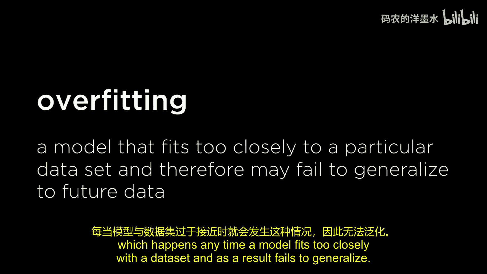

这里我们有几个数值序列。我们的一个向量，我们的一个数值序列，就是所有这些单独的权重：**w₀**、**w₁** 和 **w₂**。因此，我们可以构造一个我们称之为**权重向量**的东西（我们稍后会看到为什么这有用），通常用粗体 **w** 表示，它只是这三个权重的序列：权重0、权重1和权重2。

为了能够基于这些权重计算我们认为一天是下雨还是不下雨，我们将把每个权重乘以我们的一个输入变量。**w₂** 这个权重将乘以输入变量 **x₂**，**w₁** 将乘以输入变量 **x₁**，而 **w₀** 呢？它没有乘以任何东西，但为了确保向量长度相同（我们稍后会看到为什么这有用），我们干脆说 **w₀** 乘以1，因为你可以将某物乘以1并得到完全相同的数字。

因此，除了权重向量 **w** 之外，我们还将有一个**输入向量**，我们称之为 **x**，它有三个值：1（同样，因为我们最终只是将 **w₀** 乘以1），然后是 **x₁** 和 **x₂**。

这样，我们就表示了两个不同的向量：一个我们需要以某种方式学习的权重向量（我们机器学习算法的目标是学习这个权重向量应该是什么），以及一个表示我们试图预测的数据点的输入向量（我们试图预测某个标签的数据点）。

然后，为了进行计算，我们想计算这个表达式。事实证明，这个表达式就是我们所说的这两个向量的**点积**。两个向量的点积意味着取向量中的每一项并将它们相乘：**w₀** 乘以1，**w₁** 乘以 **x₁**，**w₂** 乘以 **x₂**。这就是为什么这些向量需要长度相同。

然后，我们只需将所有结果相加。因此，**w** 和 **x** 的点积，即我们的权重向量和输入向量的点积，就是 **w₀** 乘以1（即 **w₀**）加上 **w₁** 乘以 **x₁**（这两项相乘），再加上 **w₂** 乘以 **x₂**（这两项相乘）。

因此，我们有我们的权重向量（我们需要弄清楚它），我们有表示我们试图预测类别的数据点的输入向量，并且我们能够通过取这个点积来进行计算（你经常会在向量形式中看到这种表示）。但如果你以前没见过向量，你可以将其视为等同于这个数学表达式：只是进行乘法，将结果相加，然后查看结果是否大于等于0。

这里的这个表达式等同于我们正在计算的表达式，用于查看在这种情况下答案是否大于等于0。

因此，出于这个原因，你经常会看到假设函数写成这样：一个更简单的表示，其中假设接受某个输入向量 **x**（某天的湿度和气压）作为输入，我们想要预测一个输出，如下雨或不下雨，或者如果我们选择用数字表示，则是1或0。我们这样做的方式是取权重和我们的输入的点积。如果它大于等于0，我们将说输出是1；否则输出将是0。

我们说这个假设是由权重**参数化**的。根据我们选择的权重，我们将得到不同的假设。如果我们随机选择权重，我们可能不会得到一个很好的假设函数。我们会得到一个1或0，但它可能无法准确反映我们认为一天是否会下雨。但如果我们正确选择权重，我们通常可以很好地估计我们认为函数的输出应该是1还是0。

### 感知器学习规则

那么问题是如何找出这些权重应该是什么，如何调整这些参数。有多种方法可以做到这一点。其中最常见的一种被称为**感知器学习规则**（我们稍后会看到更多）。感知器学习规则的思想（我们不会深入数学细节，主要只是从概念上介绍）是：给定某个我们想要从中学习的数据点（某个具有输入 **x** 和输出 **y** 的数据点，其中 **y** 类似于1代表下雨或0代表不下雨），那么我们将更新权重。

我们将在一会儿查看公式，但总体思路是，我们可以从随机权重开始，然后从数据中学习，即一次取一个数据点，对于每个数据点，弄清楚我们需要改变权重内部的哪些参数，以便更好地匹配该输入点。这就是在监督机器学习算法中拥有大量数据访问权限的价值：你取每个数据点，也许多次查看，并尝试弄清楚是否需要调整权重，以便更好地创建某个能够正确或更准确地尝试估计输出应该是什么的权重向量（无论我们认为会下雨还是不会下雨）。

### 权重更新公式

那么权重更新是什么样子呢？在不深入太多数学细节的情况下，我们将把每个权重更新为原始权重加上某个额外表达式的结果。为了理解这个表达式，我们需要知道实际输出是什么，以及假设函数对输入 **x** 的估计是什么。

因此，我可以将其替换为：实际值减去我们的估计值。基于实际值和我们的估计值之间的差异，我们可能想要改变我们的假设，改变我们进行估计的方式。

如果实际值和估计值相同，意味着我们能够正确预测该数据点属于哪个类别，那么实际值减去估计值将正好是0，这意味着右侧的整个项变为0，权重不会改变。权重 **wᵢ**（其中 **i** 类似于权重1、权重2或权重0）保持为 **wᵢ**，如果我们能够正确预测输入属于哪个类别，则所有权重都不会改变。

但是，如果我们的假设没有正确预测输入属于哪个类别，那么也许我们需要进行一些更改，调整权重，以便将来能更好地预测这类数据点。

我们可能怎么做呢？如果实际值大于估计值（并且现在我们将假设这些 **x** 是正值），那么如果实际值大于估计值，这意味着我们需要增加权重，以使输出更大，从而更有可能达到正确的实际值。因此，如果实际值大于估计值，那么实际值减去估计值将是一个正数，所以你可以想象我们只是在权重上加一些正数，稍微增加它。

同样，相反的情况也成立：如果实际值小于估计值（实际值是0，但我们估计是1，意味着实际上没有下雨，但我们预测会下雨），那么我们想要降低权重的值，因为在这种情况下，我们想要尝试降低计算该点积的总值，以降低我们预测实际会下雨的可能性。

所以，不需要深入这些数学细节，但总体思路是，每当我们遇到某个数据点时，我们可以相应地调整这些权重，试图使权重更好地与我们拥有的实际数据对齐。你可以用数据点重复这个过程，直到最终，希望你的算法收敛到某个权重集，该权重集在尝试弄清楚一天是否会下雨方面做得相当不错。

关于这个特定方程的最后一点：这里的这个值 **α** 通常就是我们所说的**学习率**。它只是我们选择的一个参数，一个数字，表示我们实际更新这些权重值的速度。如果 **α** 较大，那么我们将大量更新这些权重值；如果 **α** 较小，那么我们将较少地更新权重值。你可以根据问题选择 **α** 的值，不同的值可能比其它值更适合或更不适合情况。

### 阈值函数

在完成所有这些之后，在我们完成了这个训练过程（获取所有这些数据并使用这个学习规则，查看所有数据片段，并使用每个数据片段作为我们的指示：权重是保持不变，还是我们增加权重，还是减少权重，如果是，减少多少），你最终得到的基本上是一个**阈值函数**。

我们可以看看阈值函数是什么样子。在这里的x轴上，我们有该函数的值（取权重，取它与输入的点积）。在y轴上，我们将有什么输出将是0（在这种情况下代表不下雨）和1（在这种情况下代表下雨）。我们的假设函数的工作方式是计算这个值，如果它大于0或大于某个阈值，那么我们宣布它是下雨天；否则我们宣布它是不下雨天。

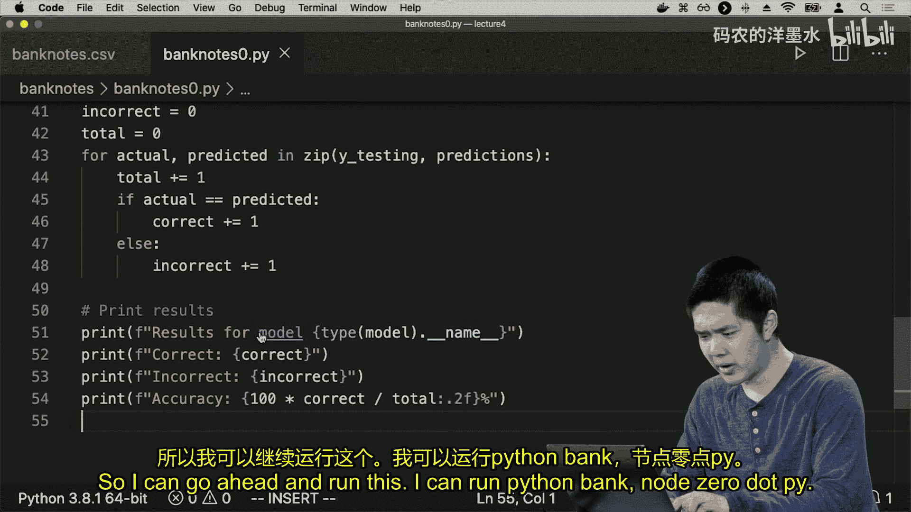

这在图形上就是该函数的样子：最初，当这个点积的值很小时，不下雨，不下雨，不下雨；但一旦它越过那个阈值，我们突然说：好了，现在下雨了，现在下雨了，现在下雨了。

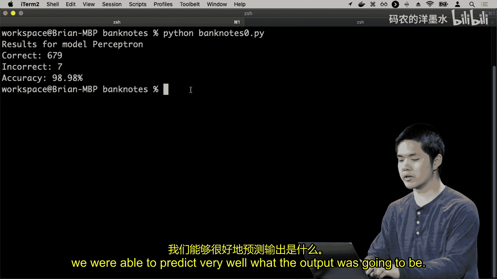

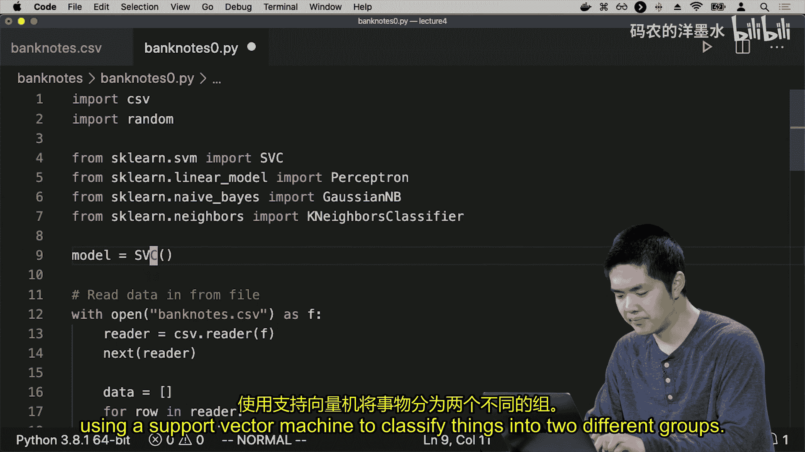

解释这种表示的方式是：线上的这一侧的任何东西，都是我们会说“是的，下雨”的数据点类别；落在线的这一侧的任何数据点，都是我们会说“不下雨”的数据点。

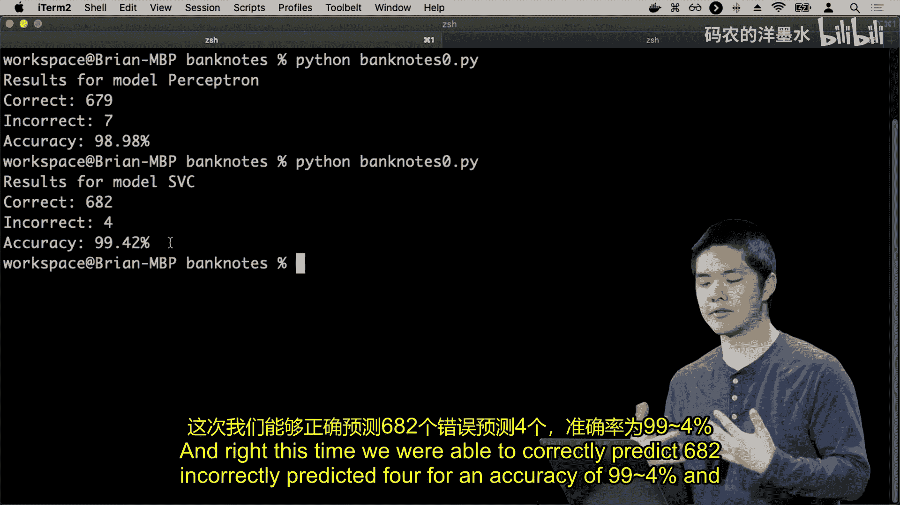

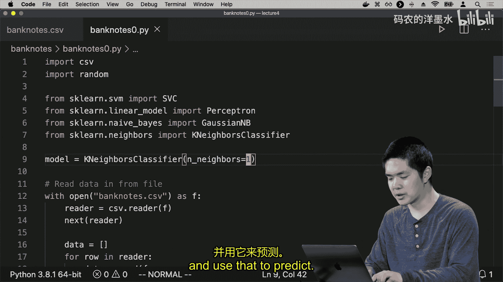

同样，我们想为权重选择某个值，该值会产生一个函数，该函数在尝试进行这种估计方面做得相当不错。

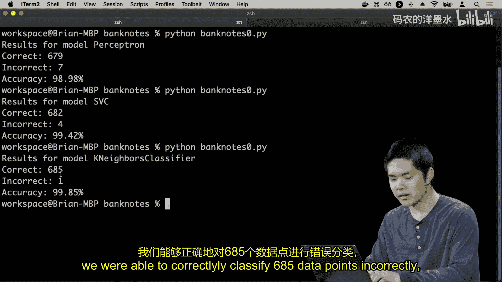

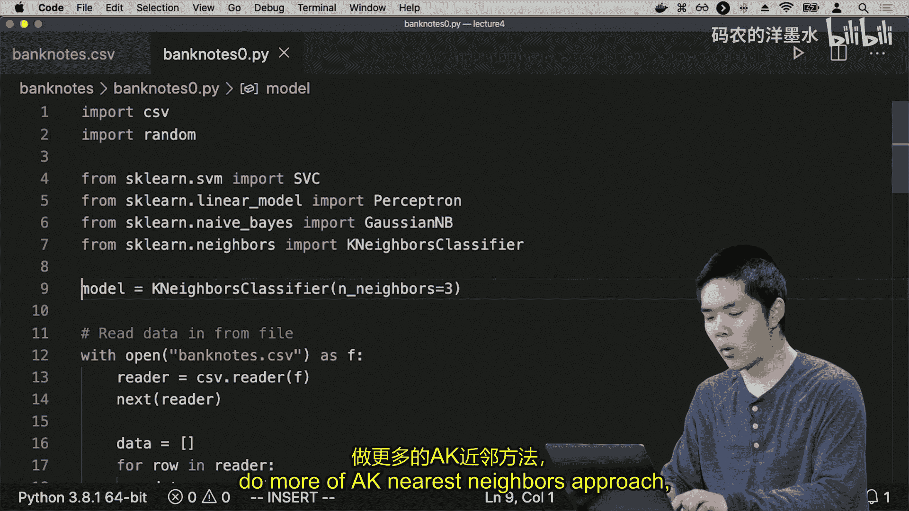

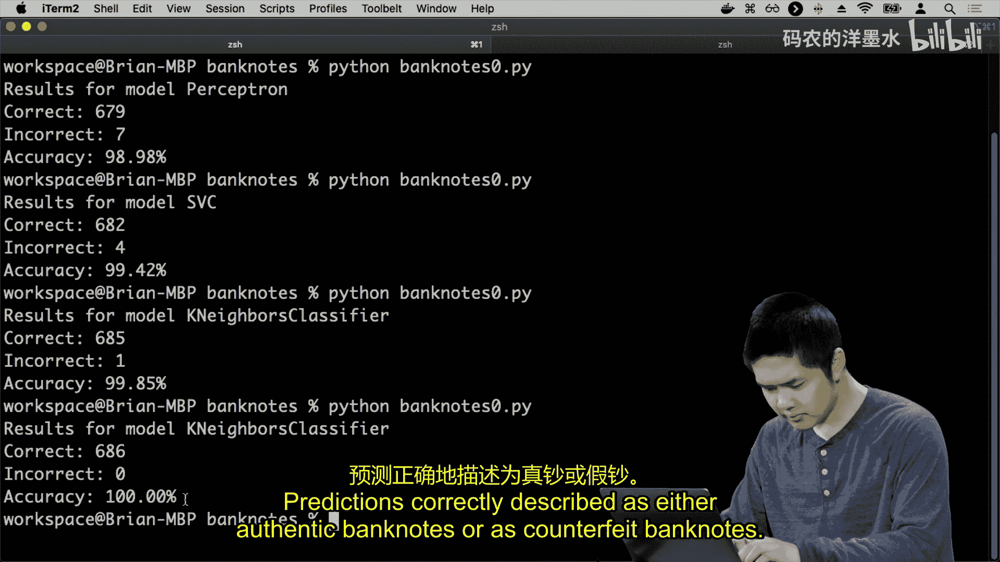

### 从硬阈值到软阈值

但这种硬阈值的一个棘手之处在于，它只留下两种可能的结果。我们输入一些数据作为输入，得到的输出是下雨或不下雨。中间没有余地。也许这正是你想要的。也许你想要的只是给定某个数据点，你希望能够将其分类到这些不同类别中的一个或两个。

但也可能是，你关心知道该预测的强度。例如，如果我们回到这个例子，这里下雨天在线的一侧，不下雨天在线的另一侧。你可能想象现在看看这两个白点数据，我们想为其预测标签或类别的数据点。

对于这个数据点，我们相当有信心地说，那应该是一个下雨天。它似乎靠近其他下雨天。如果我们采用最近邻策略，如果它落在我们通过找出权重应该是什么而确定的线的这一侧，那么它就在这一侧。如果我们使用“它落在线的哪一侧”的策略（即决策边界的哪一侧），我们也会说这里的这个点也是下雨天，因为它落在对应于下雨天的线的一侧。

但很可能，即使在这种情况下，我们也会知道，我们对左边这个数据点的信心远不如对右边这个数据点的信心。对于右边这个，我们可以非常有信心地说，是的，是下雨天。而这个，你知道，如果我们仅凭距离判断，它非常接近线。因此，你可能不那么确定。

但我们的阈值函数不允许“不那么确定”或“更确定”的概念。这就是我们所说的**硬阈值**。一旦你越过这条线，我们立即说是，这将是下雨天；在此之前，我们将说它不是下雨天。这在许多情况下可能没有帮助。首先，这不是一个特别容易处理的函数，如果你深入机器学习世界并尝试做诸如对这些曲线求导之类的事情，这种类型的函数会使事情变得具有挑战性。另一个挑战是，我们实际上没有任何事物之间的渐变概念。我们没有“是的，这是一个非常强烈的信念，认为会下雨”与“你知道，更可能不会下雨，但也许也不完全确定”的概念。

因此，我们可以利用一种称为**逻辑回归**的技术，不是使用这种硬阈值类型的函数，而是使用一个**逻辑函数**，我们可以称之为**软阈值**。这将把它转换成看起来更像这样的东西，某种更优美的曲线。

结果，可能的输出值不再只是0和1（0代表不下雨，1代表下雨）。你实际上可以得到0到1之间的任何实数值。如果你在这一边很远的地方，那么你得到的值是0（不会下雨），我们对此相当确定。如果你在另一边，你得到的值是1（是的，我们非常确定会下雨）。但在中间，你可以得到某个实数值。像0.7这样的值可能意味着我们认为会下雨，基于数据，下雨的可能性大于不下雨，但我们不像其他数据点那样有信心。

### 软阈值的优势

因此，软阈值的一个优势是，它允许我们有一个输出，该输出是某个实数，可能反映了某种**概率**，即我们认为该特定数据点属于该特定类别的可能性。它还具有其他一些良好的数学特性。

### 支持向量机

那么，这是两种解决这类分类问题的不同方法。一种是这种最近邻类型的方法，你只需取一个数据点并查看附近的数据点，以尝试估计我们认为它属于哪个类别。另一种方法是说，好吧，让我们尝试使用线性回归，找出这些权重应该是什么，调整权重以找出哪条线或哪个决策边界能最好地分隔这两个类别。

事实证明，另一种流行的方法（或者如果你只有一个数据集并想开始尝试对其进行学习，这是一种非常流行的方法）是我们所说的**支持向量机**。我们不会深入探讨支持向量机的数学细节，但至少会从图形上探索它，看看它是什么样子，以及支持向量机背后的思想或动机。

支持向量机的思想是，实际上我们可以画出很多不同的线，很多不同的决策边界来分隔两组数据。例如，如果我有这里的红点和这里的蓝点，我可以画的一条可能的线是这样的：这条线将红点与蓝点分开，并且它完美地做到了这一点——所有红点都在线的一侧，所有蓝点都在线的另一侧。

但这可能会让你有点紧张，如果你提出一个模型，而该模型提出了一条看起来像这样的线。原因是，你担心它将如何**泛化**到其他不一定在我们有权访问的数据中的数据点。例如，如果有一个点落在像这里的地方，在线的右侧，那么基于此，我们可能想猜测它实际上是一个红点，但它落在了我们估计它是蓝点的一侧。

因此，基于此，这条线可能不是一个好的选择，只是因为它太接近这些不同的数据点。我们可能更喜欢像对角线那样的线，它只是对角线穿过数据，就像我们之前看到的那样。但同样，我们也可以画出很多对角线。例如，我可以画这条对角线，它也能成功地将所有红点与所有蓝点分开。从仅仅试图找出某种权重设置以允许我们预测正确输出的角度来看，这条线将每次都能正确预测这个特定数据集的输出，因为红点在一侧，蓝点在另一侧。

但同样，你可能应该有点紧张，因为这条线太接近这些红点，即使我们能够正确预测输入数据。如果有一个点落在这一般区域，我们的算法、这个模型会说，是的，我们认为它是一个蓝点，而实际上它可能属于红色类别，只是因为它看起来靠近其他红点。

我们真正想要能够说的是，给定这些数据，如何最好地泛化它，就是提出一条像这样的线，这似乎是直观上要画的线。之所以直观，是因为它似乎尽可能远离红色数据和蓝色数据，这样，如果我们稍微泛化一点，并假设我们有一些与输入不同但仍稍远的点，我们仍然可以说这边的东西可能是红色的，那边的东西可能是蓝色的，我们可以以这种方式做出判断。

这就是支持向量机设计要做的。它们旨在尝试找到我们所说的**最大间隔分隔器**，其中最大间隔分隔器只是某种边界，它**最大化点组之间的距离**，而不是提出某种非常接近一组点或另一组点的边界（在之前的情况下，我们不会在意，只要我们对输入进行分类，那似乎就是我们需要做的）。

支持向量机将尝试找到这个最大间隔分隔器，某种尝试最大化那个特定距离的方法。它通过找到我们所说的**支持向量**（即最接近线的向量）并尝试最大化线与那些特定点之间的距离来实现这一点。

它在二维中这样工作。它也在更高维度中工作，在那里我们不是寻找分隔两个数据点的某条线，而是寻找我们通常所说的**超平面**，某种决策边界，有效地将一组数据与另一组数据分开。支持向量机在更高维度中工作的能力实际上也有许多其他应用。

但一个是，它有助于处理数据可能不是线性可分的情况。因此，我们之前讨论过线性可分性，即你可以获取数据并只画一条线或输入的某种线性组合，使我们能够完美地将两组彼此分开。有些数据集不是线性可分的，有些甚至在二维中，你根本无法找到一条好的线来进行那种分隔。例如像这样的东西。

或者，如果你想象这里有红点和围绕它的蓝点，如果你试图找到一条将红点与蓝点分开的线，实际上会很困难，甚至不可能做到。你选择的任何线，如果你在这里画一条线，那么你就忽略了所有这些实际上应该是蓝色而不是红色的蓝点。你在其他地方画的任何线，都会有很多错误，很多我们很快会称之为**损失**的错误。

对于你画的那条线，你将错误分类很多点。我们真正想要的是能够找到更好的决策边界，它可能不仅仅是穿过这个二维空间的一条直线。支持向量机可以做到的是，它们可以开始在更高维度中操作，并能够找到其他决策边界（比如在这种情况下是圆），该边界实际上能够更好地区分这些数据集中的一组与另一组。

因此，通常在数据不是线性可分的数据集中，支持向量机通过在更高维度中工作，实际上可以找到一种有效解决这类问题的方法。

### 回归问题

分类只是你在监督机器学习中可能遇到的任务之一，因为在分类中，我们试图预测的是某个离散类别。我们试图预测红色或蓝色、下雨或不下雨、真钞或假钞。

但有时我们想预测的是一个实数值。为此，我们有一个相关问题，不是分类，而是称为**回归**。

回归是监督学习问题，我们尝试学习一个将输入映射到输出的函数，和以前一样，但输出不是离散类别（如下雨或不下雨），在回归问题中，输出值通常是连续值，某个我们想要预测的实数。

这种情况也经常发生。你可能想象一家公司如果试图弄清楚，例如，其广告的效果如何（广告支出如何转化为公司产品的销售），那么它可能会采用这种方法。

因此，他们可能想尝试预测某个函数，该函数接受这个输入（广告支出金额）。这里我们只使用一个输入，但同样，如果你有权访问许多不同类型的数据，你可以将其扩展到更多输入。目标是学习一个函数，给定这个广告支出金额，我们将得到这个销售金额。你可以基于拥有大量数据（例如，对于过去的每个月，这是我们花了多少广告费，这是销售额是多少）来判断。

我们想预测某种假设函数，该函数同样给定广告支出金额，可以预测某个实数，即我们预期该公司在该月或该季度（或我们选择衡量事物的任何时间单位）的销售额估计值。

### 线性回归方法

同样，解决这类问题的方法，我们可以尝试使用线性回归类型的方法，我们获取这些数据并将其绘制在图上：x轴上是广告支出，y轴上是销售额。我们可能只想尝试画一条线，在尝试估计广告和销售之间关系方面做得相当不错。

在这种情况下，与之前不同，我们不是试图将数据点分成离散类别，而是在这种情况下，我们只是试图找到一条线来近似广告和销售之间的关系，这样，如果我们想找出特定广告预算的估计销售额，你只需在这条线上查找，找出对于这个广告金额，我们将有多少销售额，并尝试以这种方式进行估计。

因此，你可以尝试提出一条线，再次弄清楚如何使用各种不同的技术来修改权重，以使其尽可能好地拟合。

### 评估机器学习模型

有了所有这些尝试解决机器学习风格问题的方法后，问题就变成了：我们如何评估这些方法？我们如何评估我们可以提出的各种不同假设？因为这些算法中的每一个都会给我们某种假设，某个将输入映射到输出的函数。我们想知道该函数的效果如何。

你可以将评估这些假设并尝试获得更好的假设视为一种优化问题。在优化问题中，你可能还记得，我们要么试图通过找到全局最大值来最大化某个目标函数，要么试图通过找到某个全局最小值来最小化某个成本函数。

在评估这些假设的情况下，我们可能会说，这个成本函数，我们试图最小化的东西，我们可能试图最小化我们所说的**损失函数**。损失函数是什么？它是一个函数，将为我们估计我们的函数表现有多差。更正式地说，它就像是效用的损失：每当我们预测错误时，那就是效用的损失，它将加到我们的损失函数的输出中。

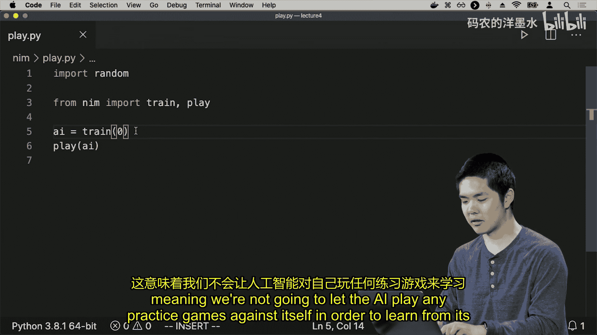

你可以提出任何你想要的损失函数，只是某种数学方式来估计：给定每个这些数据点，给定实际输出是什么，给定我们的预测输出是什么（我们的估计），你可以为其计算某种数值损失。

### 常见损失函数

但有几个流行的损失函数值得讨论，以便你以前见过它们。

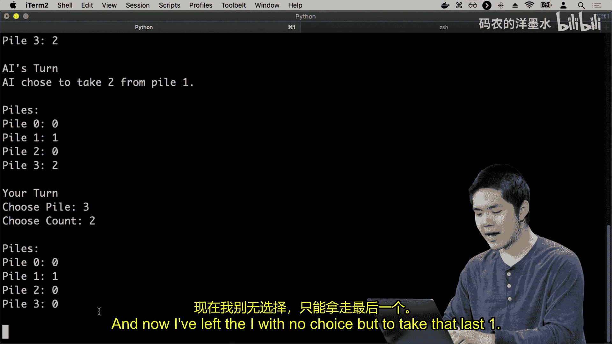

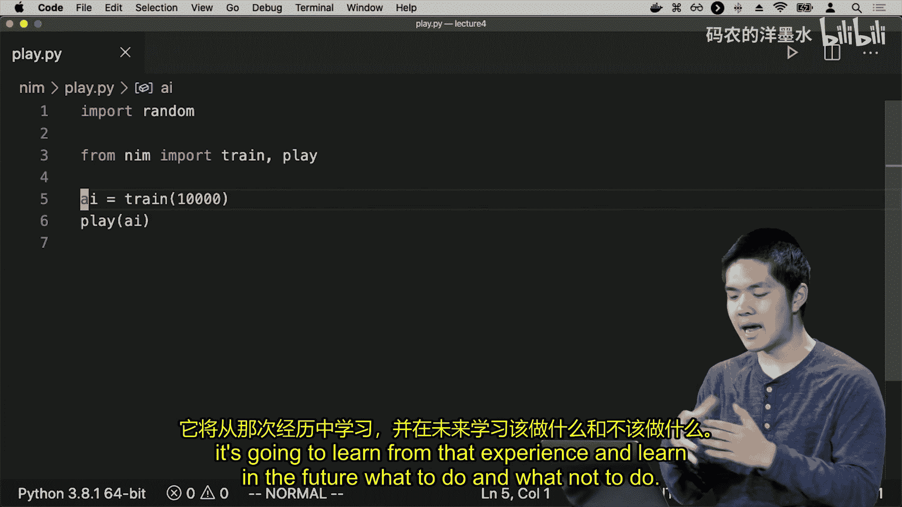

当涉及离散类别时，如下雨/不下雨、假钞/非假钞，一种方法是**0-1损失函数**。它的工作方式是：对于每个数据点，我们的损失函数接受实际输出是什么（例如，实际上是下雨还是不下雨）作为输入，并将我们的预测考虑在内。我们是否预测，给定这个数据点，会下雨还是不下雨？如果实际值等于预测值，那么0-1损失函数会说损失是0，没有效用损失，因为我们能够正确预测。否则，如果实际值与我们的预测不同，那么在这种情况下，我们的损失是1。我们失去了一些东西，失去了一些效用，因为我们预测的函数输出与实际不符。

那么，在这种情况下，目标将是提出某种假设，以最小化总**经验损失**，即我们损失的总量。如果你对所有数据点（实际输出是什么以及你的假设会预测什么）进行求和。

### 评估决策边界

例如，在这种情况下，如果我们回到将日子分类为下雨或不下雨，并且我们提出了这个决策边界，我们如何评估这个决策边界？它比在这里画线或在那里画线好多少？我们可以取每个输入数据点，每个输入数据点都有一个标签（是下雨还是不下雨），然后我们可以将其与预测（我们预测会下雨还是不下雨）进行比较，并为其分配一个数值结果。

例如，这里的这些点，它们都是下雨天，我们预测会下雨，因为它们落在线的底部一侧，所以它们的损失为零，这些情况没有损失。同样，对于这里的一些点也是如此，那里不下雨，我们也预测不会下雨。

我们有损失的点是像这里的这个点和那里的那个点，我们预测不会下雨，但实际上它是一个蓝点（下雨了）；或者同样在这里，我们预测会下雨，但实际上它是一个红点（没有下雨）。因此，结果是我们错误分类了这些我们试图训练的数据点。

因此，这里有一些损失：这里一个损失，那里一个损失，这里一个，那里一个，例如，在这种情况下总损失为四。这可能就是我们如何估计或如何说这条线比在其他地方画的线或更下面的线更好的方式，因为这条线可能最小化了损失，如果你只是通过我们的空间画一条直线，没有比这四个损失点更好的方法了。

### L1和L2损失

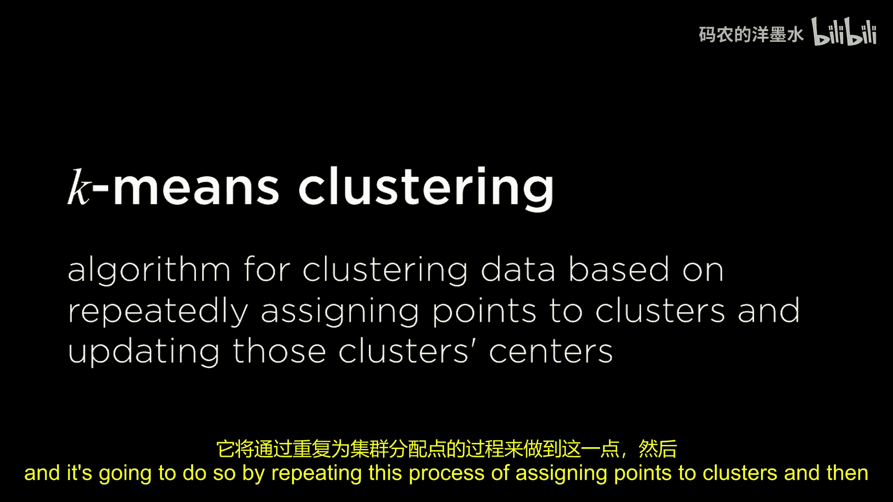

因此，0-1损失函数检查：我们做对了吗？我们做错了吗？如果我们做对了，损失是0，没有损失；如果我们做错了，那么该数据点的损失函数说是1。我们将所有这些损失在所有数据点上相加，得到某种经验损失，即我们在所有原始数据点上损失了多少，我们的算法有权访问这些数据点。

还有其他形式的损失，在处理更多实值情况时尤其有效，例如广告预算和销售额之间的映射。因为在这种情况下，你关心的不仅仅是数字完全正确，还关心你离实际值有多近。如果实际值是你做了2800美元的销售额，而你预测你会做2900美元的销售额，也许这很好，这比你预测你会做1000美元的销售额要好得多。

因此，我们希望我们的损失函数也能考虑到这一点，不仅要考虑实际值和期望值是否完全相同，还要考虑它们相距多远。

为此，一种方法是所谓的**L1损失**。L1损失不仅仅看实际值和预测值是否相等。我们取实际值减去预测值的**绝对值**。换句话说，我们只问实际值和预测值相距多远，然后我们在所有数据点上求和，以得到我们的答案最终是什么。

### 损失函数可视化

那么，这对我们的数据实际上可能是什么样子呢？如果我们回到这个表示，其中x轴上是广告，y轴上是销售额。我们的线是我们的预测，我们对任何给定广告金额的销售额的估计。我们的L1损失只是我们的预测与每个数据点在销售额轴上垂直相距多远。

因此，我们可以准确找出我们的预测与每个数据点相距多远，并由此找出对于这个特定假设，我们的总损失