# 007：神经网络

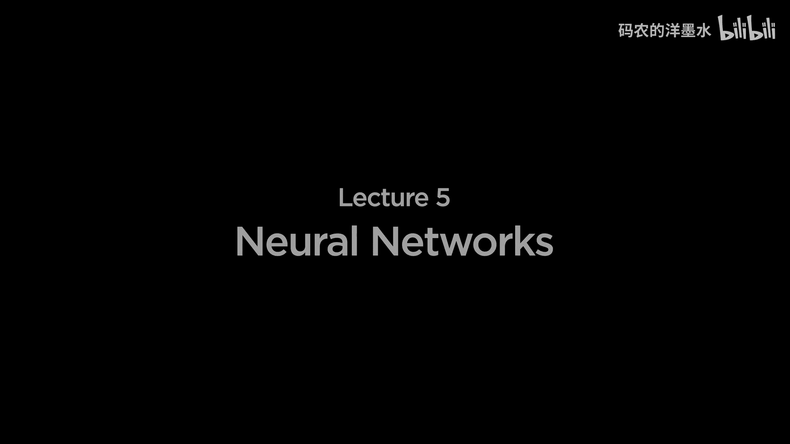

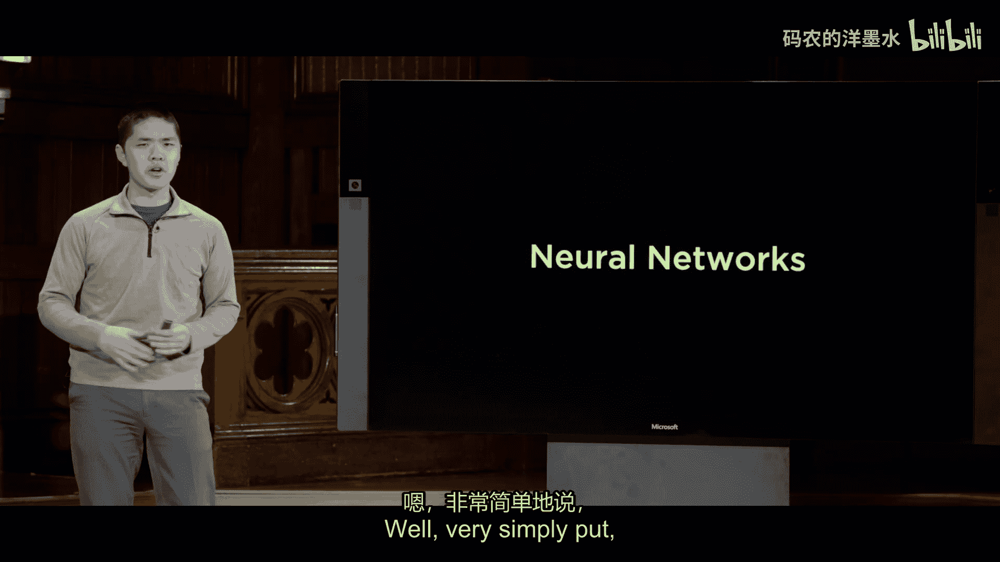

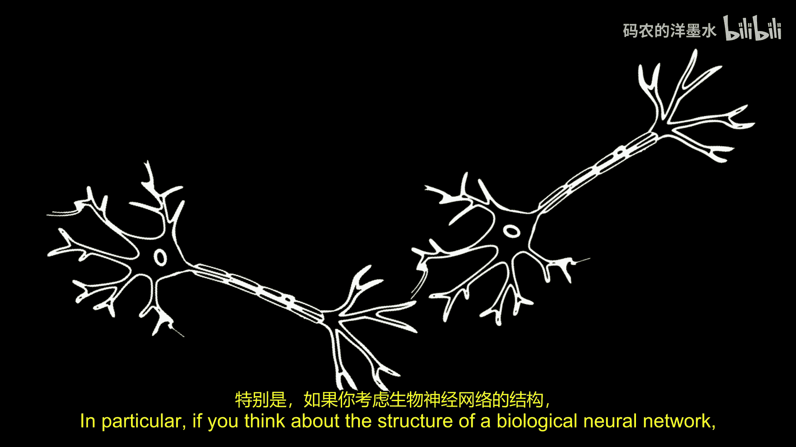

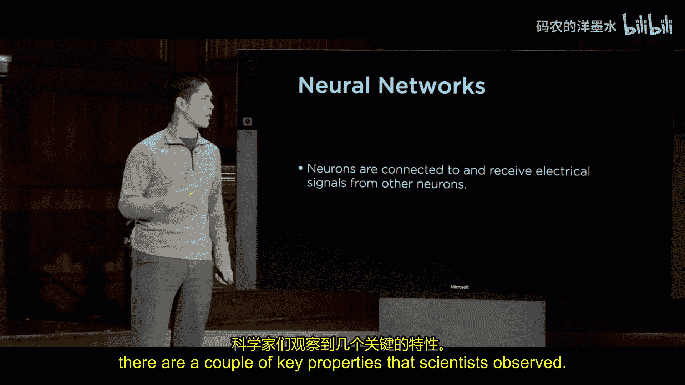

在本节课中，我们将要学习神经网络，这是一种受人类大脑结构启发的强大机器学习工具。我们将从最简单的神经网络模型开始，逐步深入到更复杂的结构，如多层网络、卷积神经网络和循环神经网络，并了解它们如何解决图像识别、序列处理等实际问题。

---

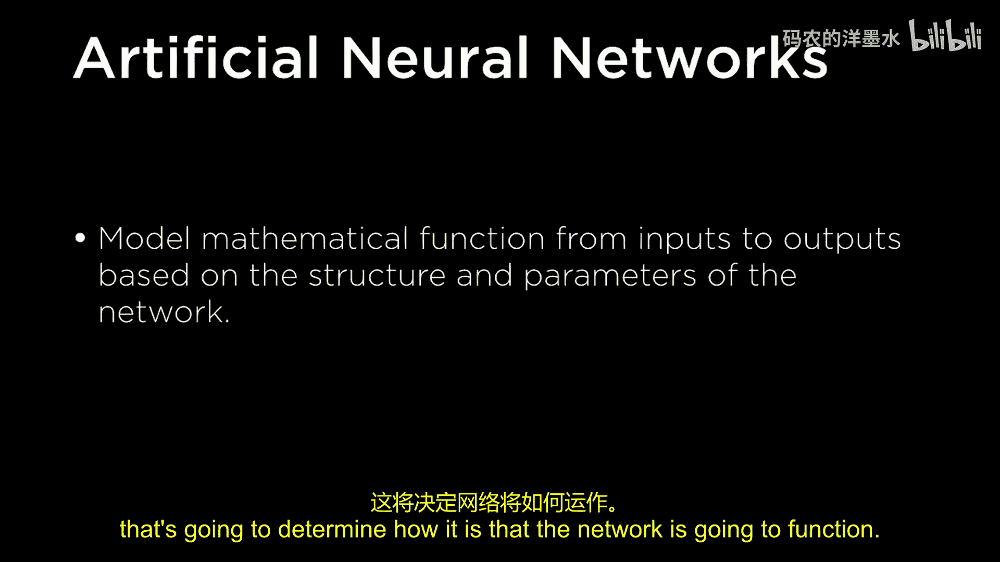

## 神经网络基础

上一节我们介绍了机器学习的基本概念。本节中，我们来看看一种特定的机器学习方法：神经网络。

神经网络的研究灵感最早可追溯到20世纪40年代。研究人员通过研究神经科学和人脑，思考人类如何学习，并尝试将这些想法应用于计算机，以人类学习为模型进行计算机学习。

那么，大脑是如何构造的呢？简而言之，大脑由大量神经元组成，这些神经元相互连接并以某种方式相互通信。具体来说，生物神经网络的结构具有几个关键特性：
*   神经元彼此连接，并接收来自其他神经元的电信号。
*   一个神经元可以将电信号传递给另一个神经元。
*   神经元处理这些输入信号，并可以在某个时刻被激活。
*   神经元被激活后，可以向后续的神经元传播更多的信号。

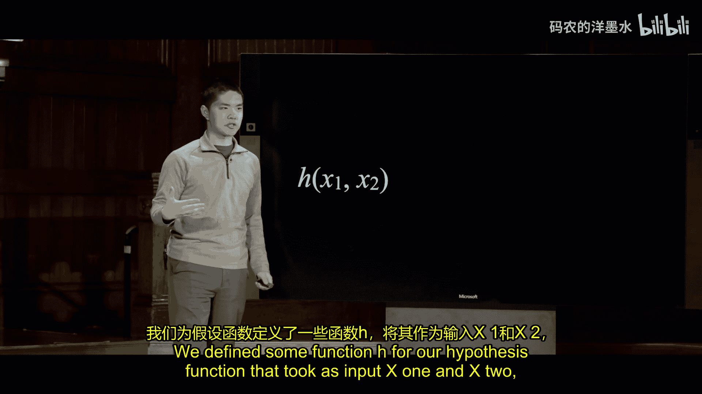

于是问题就变成了：我们能否将这种人类通过大脑和神经元进行学习的生物学思想也应用到机器上？实际上，这就是设计人工神经网络（ANN）的目标，它是一种受生物神经网络启发的学习数学模型。

人工神经网络首先能够对某种数学函数进行建模。你看到的每一个神经网络（我们稍后会看到更多）实际上都只是某种数学函数，它根据网络的结构将特定的输入映射到特定的输出。网络中特定单元的位置将决定网络如何运行。

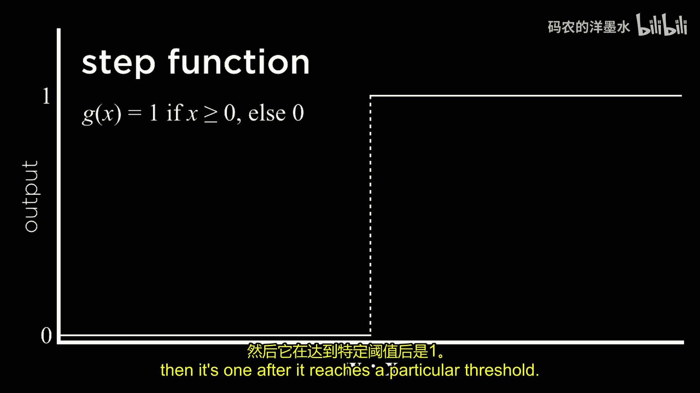

特别是，人工神经网络将为我们提供一种方法来学习网络的参数应该是什么。我们稍后会看到更多细节。但实际上，我们希望建立这样的模型，使我们能够轻松地编写一些代码，让网络能够根据特定的输入数据找出如何建模正确的数学函数。

为了创建我们的人工神经网络，我们不使用生物神经元，而是使用我们称之为“单元”的东西，即神经网络内部的单元，我们可以将其表示为图中的一个节点，这里用一个蓝色圆圈表示。这些人工单元，这些人造神经元可以相互连接。例如，这里我们有两个单元通过图中的这条边连接起来。

---

## 从数学公式到网络结构

现在我们要做的是将这种想法视为某种从输入到输出的映射。我们有一个单元连接到另一个单元，我们可以将这一侧视为输入，另一侧视为输出。然后，我们试图解决的问题是：如何建模某种数学函数。

这可能采用我们上次看到的形式，例如：我们有一些输入，如变量 `x1` 和 `x2`。给定这些输入，我们想要执行某种任务，例如预测是否会下雨。理想情况下，我们希望有某种方法，给定这些输入 `x1` 和 `x2`（它们代表与天气相关的某些变量），能够预测一个布尔分类：会下雨还是不会下雨。

我们上次通过一个数学函数做到了这一点。我们定义了一个假设函数 `H`，它以 `x1` 和 `x2` 作为输入，这两个输入是我们为了确定是否下雨而需要处理的信息。

那么问题来了：这个假设函数为了做出这个判断做了什么？我们上次决定使用这些输入变量的线性组合来确定输出应该是什么。

所以我们的假设函数等于这样的形式：
`输出 = 权重0 + 权重1 * x1 + 权重2 * x2`

这里发生的情况是：`x1` 和 `x2` 是输入变量，是这个假设函数的输入。每个输入变量都乘以某个权重（即某个数字）。`x1` 乘以权重1，`x2` 乘以权重2。我们还有这个额外的权重0，它根本不乘以任何输入变量，只是用来将函数值向上或向下移动。你可以将其视为一个乘以某个虚拟值（如数字1）的权重，所以它没有乘以任何东西。有时在文献中，人们称这个变量权重0为“偏置”。所以你可以认为这些变量略有不同：我们有乘以输入的权重，并且我们还单独向结果添加一些偏置。当人们谈论神经网络和机器学习时，你会听到这两种术语都被使用。

实际上，我们在这里所做的是：为了定义一个假设函数，我们只需要决定并找出这些权重应该是什么，以确定用什么值乘以我们的输入来得到某种结果。

当然，在这最后，我们需要进行某种分类，例如“下雨”或“不下雨”。为此，我们使用某种函数来定义一个阈值。因此，我们看到了阶跃函数，它被定义为：如果权重乘以输入的结果至少为零，则输出为1；否则为0。你可以将中间的这条线想象成一条虚线，它在达到某个点之前一直保持为零，然后函数步进或跳跃到1。所以它在达到某个阈值之前是0，在达到特定阈值之后是1。

这是定义我们称之为“激活函数”的一种方式，该函数决定输出何时变为激活状态（从0变为1）。但我们也看到，如果我们不想要纯粹的二元分类（不想要纯粹的1或0），而是允许一些介于其间的实数值，我们可以使用不同的函数。有很多选择，但我们看到的是逻辑Sigmoid函数，它具有S形曲线，我们可以将其表示为概率。例如，下雨的概率可能是0.5，稍后下雨的概率可能是0.8。因此，我们不仅可以有0或1的二元分类，还可以允许介于其间的数字。

事实证明，还有许多其他不同类型的激活函数。激活函数只是对权重相乘并加上偏置的结果进行处理，以确定实际输出应该是什么。另一个流行的是修正线性单元（ReLU），其工作原理是：它取这个输入，并取该输入和0中的最大值。所以如果它是正数，它保持不变；但如果它是0或负数，它就会保持在0。我们还可以选择其他激活函数。但简而言之，你可以将每个激活函数视为应用于所有这些计算结果的函数。我们取某个函数 `g`，并将其应用于所有计算的结果。

---

## 构建最简单的神经网络

这就是我们上次看到的内容：定义某个假设函数的方法，该函数接受输入，计算这些输入的某种线性组合，然后通过某种激活函数传递以得到我们的输出。

这实际上被证明是最简单的神经网络的模型。我们将以图形方式表示这个数学思想，使用这样的结构：作为一个神经网络，它有两个输入（可以将其视为 `x1` 和 `x2`）和一个输出（可以将其视为分类我们是否认为会下雨）。

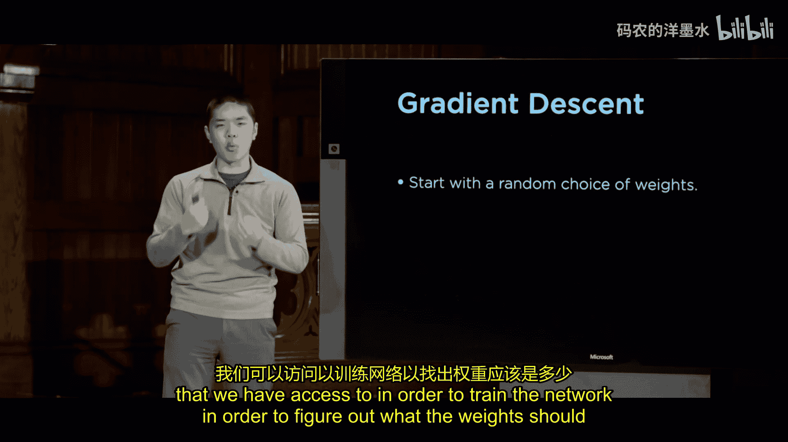

那么这个模型到底是如何工作的呢？这两个输入中的每一个都代表我们的一个输入变量 `x1` 和 `x2`。请注意，这些输入通过边连接到这个输出，这些边将由它们的权重定义。所以这些边每条都有一个相关的权重：权重1和权重2。

然后，这个输出单元将根据这些输入和这些权重计算一个输出。这个输出单元将把所有输入乘以它们的权重，加上这个偏置项（你可以将其视为添加进去的额外 `W0` 项），然后我们将其传递给一个激活函数。

因此，这只是以图形方式表示了我们上次看到的数学思想。我们将其称为一个非常简单的神经网络。我们希望这个神经网络能够学习如何计算我们想要的某个函数，即我们希望神经网络学习的某个函数。神经网络将学习 `W0`、`W1` 和 `W2` 的值应该是什么，以及激活函数应该是什么，以获得我们期望的结果。

---

## 实例：实现逻辑函数

我们实际上可以看一个这样的例子。那么一个非常简单的函数可能是什么？如果我们回想一下命题逻辑，我们看到的最简单的函数之一是“或”函数，它接受两个输入 `X` 和 `Y`，如果其中一个输入或两者都为1（也称为真），则输出1；如果两个输入都为0（或假），则输出0。

这就是“或”函数。这是“或”函数的真值表：只要其中一个输入为1，函数的输出就是1；输出为0的唯一情况是两个输入都为0。那么问题是，我们如何训练一个神经网络来学习这个特定函数？那些权重应该是什么样子？

我们可以这样做。这是我们的神经网络。我提议，为了计算“或”函数，我们将对每个权重使用值1，并使用偏置-1。然后我们将使用这个阶跃函数作为我们的激活函数。

那么这是如何工作的呢？如果我想计算类似 `0 OR 0`（我们知道是0，因为假或假是假），那么我们要做什么？我们的输出单元将计算：输入乘以权重，`0*1` 是0，同样这里 `0*1` 是0。我们加上偏置-1，这样我们就得到结果-1。如果我们在激活函数上绘制-1，-1在这里，它在阈值之前（阈值是输出变为1的点）。由于-1在阈值之前，这个单元提供的输出将是0。这就是我们所期望的：`0 OR 0` 应该是0。

如果我们有的是 `1 OR 0`，其中这个是数字1，那么会怎样？在这种情况下，为了计算输出将是什么，我们再次进行加权计算：`1*1` 是1，`0*1` 是0，目前总和是1。加上-1，那么输出是0。如果我们在阶跃函数上绘制0，0正好在阈值处。所以这里的输出将是1，因为 `1 OR 0` 的输出是1。所以这也是我们所期望的。

再举一个例子，如果我有 `1 OR 1`，结果会是什么？`1*1` 是1，`1*1` 是1，这些的总和是2。我加上偏置项，得到数字1。1绘制在这个图上，远远超过阈值。所以这个输出也将是1。输出总是0或1，取决于我们是否超过阈值。那么这个神经网络就模拟了“或”函数。这是一个非常简单的函数，但它仍然能够正确地模拟它。如果我给它输入，它会告诉我 `x1` 或 `x2` 是什么。

你可以想象尝试对其他函数也这样做。例如，像“与”函数，它接受两个输入并计算 `x` 和 `y` 是否都为真。所以如果 `x` 是1且 `y` 是1，那么 `x AND y` 的输出是1。但在所有其他情况下，输出是0。

我们如何在神经网络中模拟这个呢？事实证明，我们可以用同样的方式来做，只是不使用-1作为偏置，而是使用-2作为偏置。那最终看起来是什么样子？如果我有 `1 AND 1`，那应该是1，因为真与真等于真。我取 `1*1` 是1，`1*1` 是1，目前总共有2。现在我加上-2的偏置，得到值0。0，当我在激活函数上绘制时，刚好超过那个阈值。所以输出将是1。

但如果我添加任何其他输入，例如 `1 AND 0`，那么这些的加权和是 `1+0=1`，减去2将得到-1，而-1没有超过那个阈值。所以输出将是0。

这些就是我们可以使用具有两个输入和一个输出的神经网络来模拟的一些非常简单的函数。我们的目标是能够找出那些权重应该是什么，以确定输出应该是什么。

你可以想象将其推广到计算更复杂的函数。例如，给定湿度和压力，我们想要计算下雨的概率。或者我们可能想做一个回归风格的问题：给定一些广告量和给定的月份，我们可能想预测该月的预期销售额。所以你可以想象这些输入和输出也可以是不同的。

事实证明，在某些问题中，我们不仅仅有两个输入。这些神经网络的优点是，我们可以将多个单元组合在一起，通过向这个特定的神经网络添加更多单元来使我们的网络更加复杂。

---

## 扩展网络与训练原理

我们一直在看的网络有两个输入和一个输出。但我们也可以很容易地说，让我们继续在那里有三个输入，甚至更多输入。我们可以任意决定我们的问题有多少输入，所有这些输入都将计算我们关心的某个输出值。

那么计算该输出的数学原理是如何工作的呢？它将以非常相似的方式工作。在两个输入的情况下，我们有由这些边表示的两个权重，我们将权重乘以数字，加上这个偏置项。在其他情况下，我们也会做同样的事情。如果我有三个输入，你将想象将这三个输入中的每一个乘以这些权重中的每一个。如果我有五个输入，我们也会在这里做同样的事情。我说的是从1到5求和：`X_i` 乘以权重 `i`。所以取五个输入变量中的每一个，乘以它们对应的权重，然后加上偏置。例如，这将是一个有五个输入进入这个神经网络的情况。但在这个神经网络内部，我们可能想要任意多的节点，每次我们只是将所有那些输入变量乘以它们的权重求和，然后在最后加上偏置项。

因此，这使我们能够通过增加神经网络的大小来表示具有更多输入的问题。

---

## 梯度下降：训练神经网络

现在，我们可能问的下一个问题是关于我们如何训练这些神经网络。对于“或”函数和“与”函数，它们是足够简单的函数，我可以直接告诉你权重应该是什么，你自己也可能推理出权重应该是什么以计算你想要的输出。

但一般来说，对于像预测销售额或预测是否会下雨这样的函数，这些函数要难得多，我们希望计算机有某种机制来计算权重应该是什么，如何设置权重，以便我们的神经网络能够准确地模拟我们关心的、试图估计的函数。

事实证明，受微积分领域启发的策略是一种称为“梯度下降”的技术。梯度下降是一种在训练神经网络时最小化损失的算法。回想一下，损失指的是我们的假设函数有多糟糕。我们可以定义某些损失函数，我们上次看到了一些损失函数的例子，它们只是为任何特定的假设给出一个数字，说明它对数据的建模有多差，它弄错了多少个例子，与我们可能定义的其他假设函数相比，它是更差还是没那么差。

这个损失函数只是一个数学函数。当你有一个数学函数时，在微积分中，你可以计算一种称为“梯度”的东西，你可以将其视为斜率。它是损失函数在任何特定点的移动方向。它将告诉我们，应该朝哪个方向移动这些权重，以最小化损失量。

一般来说，我们不会深入探讨其微积分。但梯度下降的高级思想看起来像这样：如果我们想训练一个神经网络，我们将首先随机选择权重。只为神经网络中的所有权重选择随机权重。

然后，我们将使用我们拥有的输入数据来训练网络，以找出权重实际上应该是什么。所以我们将一遍又一遍地重复这个过程。第一步，我们将基于所有数据点计算梯度。所以我们将查看所有数据，并找出在我们当前权重设置下，梯度在哪里（即我们应该朝哪个方向移动权重以最小化总损失量，使我们的解决方案更好）。

一旦我们计算出了那个梯度（即损失函数中我们应该移动的方向），那么我们就可以根据梯度更新那些权重。朝那些权重的方向迈出一小步，试图使我们的解决方案稍微好一点。我们迈出的步长是可变的。你可以在训练特定神经网络时选择它。但简而言之，思想是：取所有数据点，根据这些数据点找出权重应该朝哪个方向移动，然后让权重朝那个方向移动一小步。

如果你一遍又一遍地重复这个过程，每次基于所有数据点稍微调整权重，最终，你应该会得到一个相当好的解决方案来解决这类问题，至少这是我们希望发生的情况。

---

## 梯度下降的优化：随机与批量

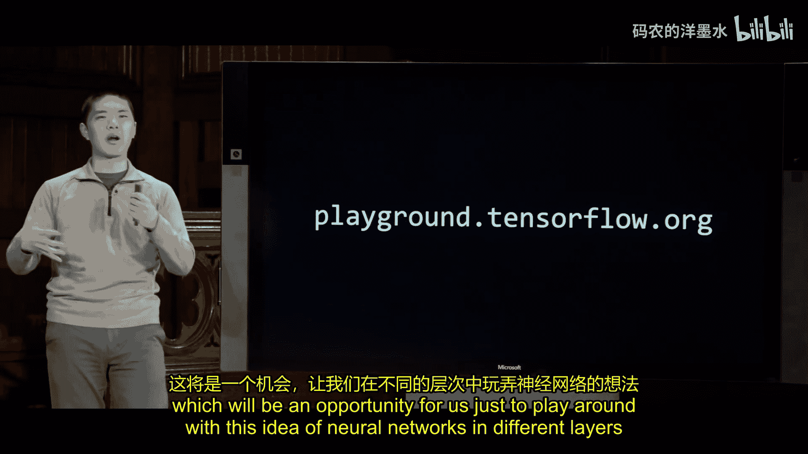

现在，当你查看这个算法时，分析算法时要问的一个好问题是：进行计算时，哪一部分会是昂贵的？什么会花费大量工作来弄清楚？特别是在梯度下降的情况下，真正昂贵的部分是这里的“所有数据点”部分：必须取所有数据点，并使用所有这些数据点来找出在所有权重的这个特定设置下的梯度是多少。因为在一个大型机器学习问题中，当你试图用大量数据解决一个大问题时，你有很多数据点需要计算，基于所有这些数据点计算梯度将是昂贵的，而且你必须多次这样做。你可能会一次又一次地重复这个过程，遍历所有数据点，一次又一次地迈出一小步，试图找出这些权重的最佳设置是什么。

事实证明，我们理想情况下希望能够更快地训练我们的神经网络，以便能够更快地收敛到某种对问题来说是好解决方案的方案。因此，在这种情况下，除了仅仅查看所有数据点的标准梯度下降之外，还有其他选择。我们可以采用像“随机梯度下降”这样的方法，它会随机地一次只选择一个数据点来计算基于该数据点的梯度，而不是基于所有数据点计算。

所以那里的想法是：我们有一些权重设置，我们选择一个数据点，基于那一个数据点，我们找出应该朝哪个方向移动所有权重，并将权重朝那个小方向移动。然后取另一个数据点，再做一次，并一次又一次地重复这个过程，可能多次查看每个数据点。但每次只使用一个数据点来计算梯度，计算我们应该朝哪个方向移动。

现在，只使用一个数据点而不是所有数据点，可能给我们一个关于梯度实际是什么的不太准确的估计。但好处是，计算起来要快得多。我们可以更快地计算基于一个数据点的梯度，而不是基于所有数据点计算，并且不必一次又一次地做所有这些计算工作。

因此，在查看所有数据点和仅查看一个数据点之间存在权衡。事实证明，一个同样非常流行的折中方案是一种称为“小批量梯度下降”的技术。其思想是：我们不是查看所有数据与单个点，而是将我们的数据集分成小批次（数据点组）。你可以决定一个特定批次有多大。但简而言之，你每次只查看少量点，希望获得更准确的梯度估计，但也不需要查看每一个数据点所需的所有计算工作。

因此，梯度下降是我们可以用来训练这些神经网络的技术，以找出所有这些权重的设置应该是什么，如果我们想要某种方法来尝试并获得关于这个函数应该如何工作的准确概念，某种建模如何将输入转换为特定输出的方法。

---

## 多输出神经网络

到目前为止，我们研究的所有网络结构都类似于这样：我们有一些输入（可能是两个、三个、五个或更多），然后有一个输出，它只是预测像下雨或不下雨，或者只是预测一个特定值。

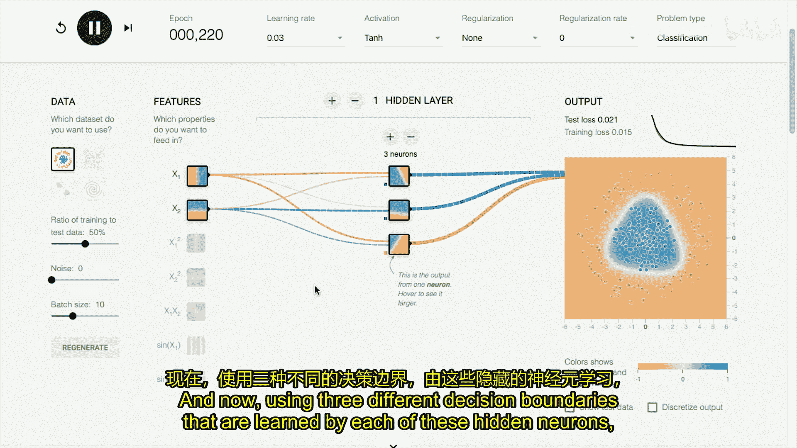

但在机器学习问题中，我们通常不只关心一个输出。我们可能关心一个具有多个不同相关值的输出。因此，就像我们可以向输入层添加单元一样，我们同样可以向输出层添加输出。不仅仅是一个输出，你可以想象我们有两个输出，或者我们可以有四个输出。

例如，如果我们想保持这两个层之间的网络完全连接，我们只需要添加更多的权重。现在，每个输入节点都有四个权重与四个输出中的每一个相关联。对于这些不同的输入节点中的每一个都是如此。所以当我们添加节点时，我们添加更多的权重，以确保每个输入都可以以某种方式连接到每个输出，这样每个输出值都可以基于输入的值来计算。

那么，我们想要多个不同输出值的情况可能是什么？例如，在天气预测的情况下，我们可能不仅关心是否下雨。可能有多类不同的天气类别，我们想要将天气分类到其中。对于单个输出变量，我们可以进行二元分类，例如下雨或不下雨（1或0），但它不允许我们做更多的事情。对于多个输出变量，我可能能够使用每一个来预测一些稍微不同的东西。也许我想将天气分类为四种不同类别之一，例如：会下雨、晴天、多云还是下雪。我现在有四个输出变量，可以用来表示下雨、晴天、多云或下雪的概率。

那么这个神经网络将如何工作呢？我们有一些输入变量，代表我们收集的有关天气的一些数据。这些输入中的每一个都乘以这些各种不同的权重（我们有更多的乘法要做，但这些是相当快的数学运算）。然后，在通过输出中的某种激活函数后，我们得到某种数字。你可以想象，你可以将该数字解释为概率，例如它是一个类别相对于另一个类别的概率。所以在这里，我们说基于输入，我们认为有10%的几率下雨，60%的几率晴天，20%的几率多云，10%的几率下雪。给定这个输出，如果这些代表一个概率分布，那么你可以只选择具有最高值的那个（在这种情况下是晴天），并说：最有可能的是，我们认为这些输入的分类意味着输出应该是晴天，这就是我们期望在这种特定情况下的天气。

因此，这使我们能够进行这种多类分类，而不是仅仅具有二元分类（1或0），我们可以拥有任意多个不同的类别，并且我们可以让我们的神经网络输出这些类别中哪些更可能比其他类别更可能的概率，并使用这些数据，我们能够就我们应该做什么得出某种推断。

---

## 神经网络与强化学习

这是监督机器学习的思想。我可以给神经网络一大堆数据，一大堆输入数据，对应于某个标签，某个输出数据（例如我们知道这一天在下雨，我们知道那一天是晴天），并使用所有这些数据，算法可以使用梯度下降来找出所有权重应该是什么，以创建某种模型，希望允许我们预测我们认为天气会是什么样。

但神经网络也有很多其他应用。你可以想象将同样的想法应用于强化学习的例子。在强化学习中，我们想要做的是训练某种智能体，以根据其当前所处的状态来学习采取什么行动。

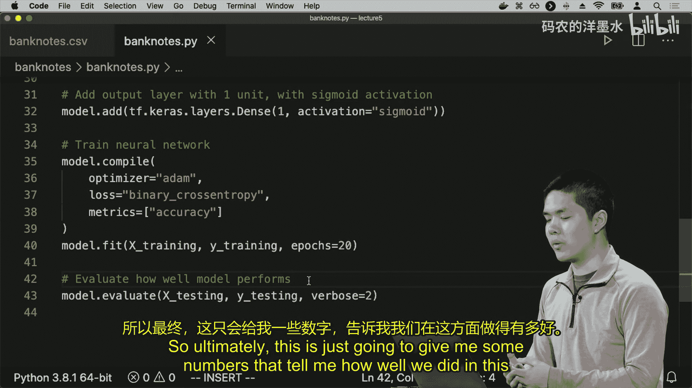

因此，根据世界的当前状态，我们希望智能体从可用的行动中选择一个。你可以通过让这些输入变量中的每一个代表有关状态的一些信息（关于我们的智能体当前处于什么状态的数据）来建模。然后，输出（例如）可以是我们的智能体可以采取的各种不同行动（行动1、2、3、4）。你可以想象这个网络将以同样的方式工作：基于这些特定的输入，我们继续计算每个输出的值，这些输出可以模拟哪个行动比其他行动更好，我们可以根据查看这些输出来选择应该采取哪个行动。

因此，这些神经网络的应用非常广泛，它们真正做的只是对某个数学函数进行建模。所以任何我们可以构建为数学函数的东西，比如将输入分类到各种不同的类别中，或者基于某个输入状态找出我们应该采取什么行动，这些都是我们可以尝试利用这种神经网络结构建模的数学函数。特别是，利用梯度下降这种技术，我们可以用来找出权重应该是什么以进行这种计算。

---

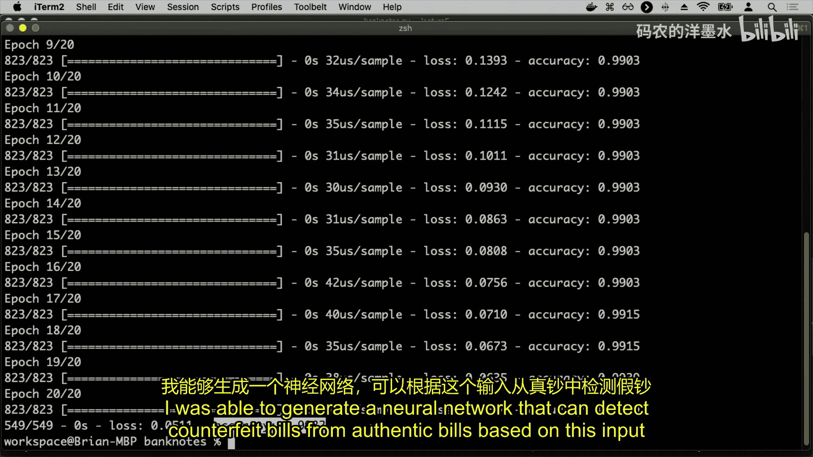

## 训练多输出网络

现在，你将如何训练一个具有多个输出而不是一个输出的神经网络？对于只有一个输出，我们可以看到该值的输出应该是什么，然后更新与之对应的所有权重。当我们有多个输出时，至少在这种特定情况下，我们真的可以将其视为四个独立的神经网络。实际上，我们这里只有一个网络，它有这三个输入，对应于这个输出值的这三个权重。对于这个输出值也是如此，它实际上定义了另一个具有相同三个输入但对应于这个输出的不同权重集的神经网络。同样，这个输出也有自己的权重集，第四个输出也是如此。

因此，如果你想训练一个具有四个输出而不是一个输出的神经网络（在这种情况下，输入直接连接到输出），你实际上可以将其视为训练四个独立的神经网络。根据我们的输入数据，我们知道这四个输出中的每一个应该是什么，并使用这些数据，我们可以开始找出所有这些单个权重应该是什么。也许最后还有一个额外的步骤，以确保我们将这些值转换为概率分布，这样我们就可以解释哪一个比另一个更好或更可能作为一个类别。

因此，这似乎在获取输入并尝试预测输出应该是什么方面做得相当好。我们稍后也会看到一些这方面的真实例子。

---

## 单层网络的局限性：线性可分问题

但重要的是要思考这种仅获取输入的线性组合并将其传递给某种激活函数的方法的局限性是什么。事实证明，当我们对二元分类（例如尝试预测它是否属于一个类别或另一个类别）这样做时，我们只能预测线性可分的东西，因为我们正在获取输入的线性组合，并使用它来定义某个决策边界或阈值。

那么我们得到的情况是：如果我们有这组数据，我们可以预测一条线，将红点和蓝点线性分开。但是，进行二元分类的单个单元（也称为感知机）无法处理像这样的情况，我们以前见过这种情况：没有一条直线可以直接穿过数据，将红点与蓝点分开。这是一个更复杂的决策边界。决策边界需要以某种方式捕获这个圆圈内的东西，而实际上没有一条线可以让我们处理这个问题。

所以这是感知机的局限性。这些仅基于其输入做出二元决策的单元，单个感知机只能学习线性可分的决策边界。它所能做的就是定义一条线，确保它可以根据我们离该决策边界有多近来给我们概率，但它实际上只能基于线性决策边界做出决定。

因此，这似乎不能很好地推广到涉及真实世界数据的情况，因为真实世界的数据通常不是线性可分的。通常情况并非如此：我们可以只画一条线穿过数据，并将其分成多个组。

---

## 解决方案：多层神经网络

那么解决方案是什么？提出的想法是多层神经网络。到目前为止，我们看到的所有神经网络都有一组输入和一组输出，并且输入连接到那些输出。

但在多层神经网络中，这将是一个具有输入层、输出层，但中间还有一个或多个隐藏层的人工神经网络，这些隐藏层也有其他层的人工神经元或单元，它们也将计算自己的值。

因此，与其说是一个具有三个输入和一个输出的神经网络，你可以在中间注入一个隐藏层。像这样：这是一个具有四个节点的隐藏层。你可以选择有多少节点或单元最终进入隐藏层。你也可以有多个隐藏层。

现在，这些输入中的每一个都不是直接连接到输出。每个输入都连接到这个隐藏层。然后，隐藏层中的所有节点都连接到那个输出。

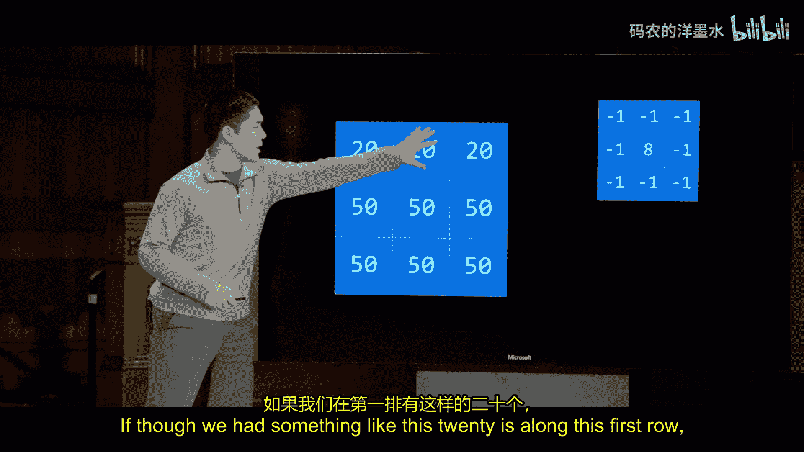

因此，这只是我们可以采取的另一步骤，以计算更复杂的函数。这些隐藏单元中的每一个将基于所有输入的线性组合来计算其输出值（也称为其激活）。一旦我们有了所有这些节点的值（而不仅仅是这个作为输出），我们再次做同样的事情：基于将这些单元中的每一个的值乘以它们的权重来计算这个节点的输出。

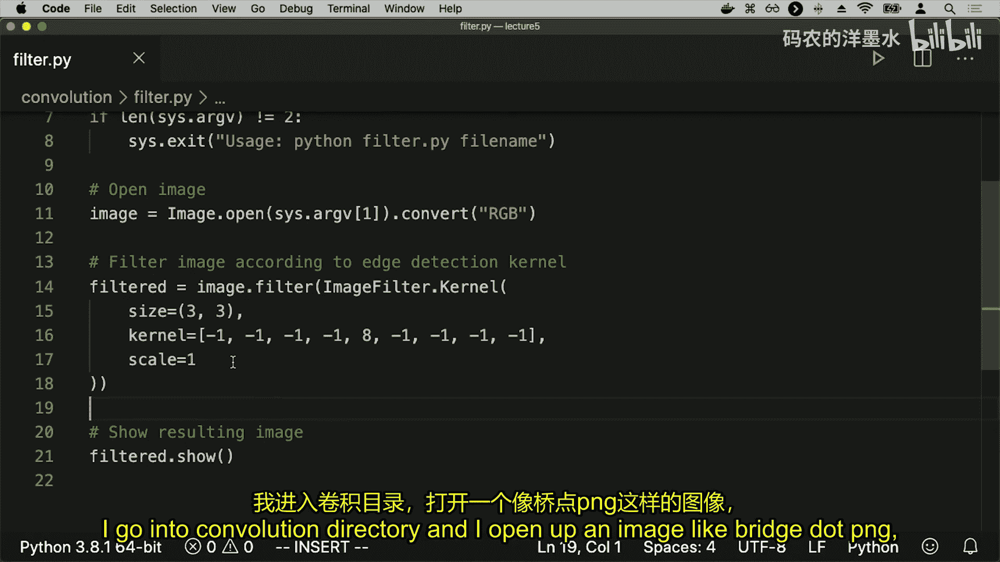

实际上，这种方式的工作原理是：我们从输入开始。它们乘以权重以计算隐藏节点的值。这些值再乘以权重以找出最终的输出将是什么。

这样分层的好处是，它使我们能够建模更复杂的函数。与仅具有单个决策边界（一条将红点与蓝点分开的线）不同，这些隐藏节点中的每一个都可以学习不同的决策边界。我们可以组合这些决策边界来找出最终的输出将是什么。

当我们开始想象更复杂的情况时，你可以想象这些节点中的每一个都在学习所有输入的一些有用属性或特征，并且我们以某种方式学习如何将这些特征组合在一起，以获得我们实际想要的输出。

---

## 训练隐藏层：反向传播算法

现在，当我们开始研究这个时，一个自然的问题是：我们如何训练一个内部有隐藏层的神经网络？这最初被证明是一个有点棘手的问题，因为我们被给予的输入数据是：我们被给予所有输入的值，并且我们被给予输出应该是什么值（例如类别是什么）。但输入数据并没有告诉我们所有这些节点的值应该是什么，所以我们不知道这些节点中的每一个实际上有多大的误差，因为我们只被给予了输入和输出的数据。

这被称为隐藏层的原因是：提供给我们数据并没有告诉我们所有这些中间节点的值实际上应该是什么。

因此，人们提出的策略是：如果你知道输出节点上的误差或损失是什么，那么基于这些权重是什么，如果其中一个权重比另一个高，你可以根据这些权重的值，计算出这个节点的误差有多少是由于隐藏层的这个部分或那个部分造成的。实际上就是说：基于输出的误差，我可以反向传播误差，并估算出隐藏层中每个节点的误差是多少。

这里涉及更多的微积分，我们不会深入细节。但这个算法的思想被称为“反向传播”。它是一种用于训练具有多个不同隐藏层的神经网络的算法。这个算法的伪代码再次是：如果我们想用反向传播运行梯度下降，我们将像以前一样从随机选择权重开始。

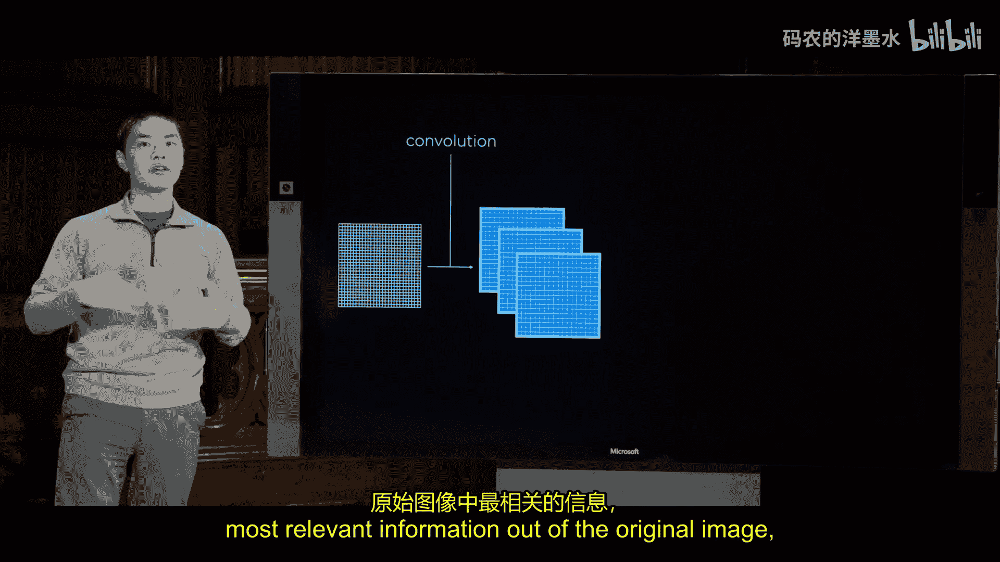

现在我们将继续重复训练过程。但我们现在每次要做的是：首先计算输出层的误差。我们知道输出应该是什么，我们知道我们计算了什么，所以我们可以找出那里的误差是什么。

但然后我们将为每一层重复（从输出层开始，移回隐藏层，然后移回之前的隐藏层，如果有多个隐藏层，则一直回到第一个隐藏层），将误差反向传播一层。无论输出是什么误差，根据那些权重的值，找出前一层应该是什么误差。然后我们可以更新那些权重。

因此，以图形方式，你可能会这样思考：我们首先从输出开始。我们知道输出应该是什么。我们知道我们计算了什么输出。基于此，我们可以弄清楚：我们需要如何更新那些权重，将误差反向传播到这些节点。利用这一点，我们可以弄清楚我们应该如何更新这些权重。

你可以想象，如果有多个层，我们可以一次又一次地重复这个过程，开始弄清楚所有这些权重应该如何更新。这个反向传播算法确实是使神经网络成为可能的关键算法，它使得采用这些多层结构并根据这些权重的值来训练这些结构成为可能，以找出我们应该如何更新那些权重，以创建能够最小化总损失量的某个函数，找出权重的某种良好设置，将输入转换为我们期望的输出。

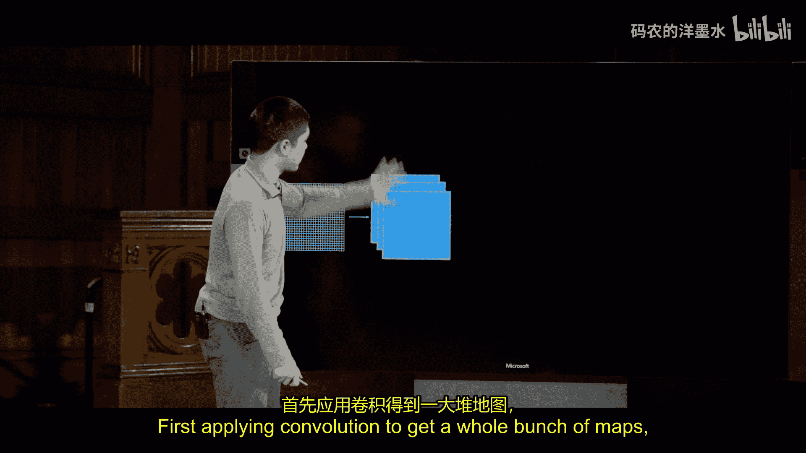

---

## 深度神经网络与过拟合

正如我们所说，这不仅适用于单个隐藏层。你可以想象多个隐藏层，其中每个隐藏层，我们只定义我们想要的任意多个节点，其中一层的每个节点都可以连接到下一层的节点，定义越来越复杂的网络，能够建模越来越复杂类型的函数。

因此，这种类型的网络就是我们可能称之为“深度神经网络”的东西，属于更大的深度学习算法家族的一部分（如果你听说过这个术语）。深度学习就是使用多个层来预测和建模输入内部的高级特征，以找出输出应该是什么。

因此，深度神经网络只是一个具有多个这些隐藏层的神经网络，我们从输入开始，计算这一层的值，然后是这一层，然后是这一层，然后最终得到一个输出。这使我们能够建模越来越复杂的函数类型，这些层中的每一层都可以计算一些略有不同的东西，我们可以组合这些信息来找出输出应该是什么。

当然，与任何机器学习情况一样，当我们开始使模型越来越复杂以建模越来越复杂的函数时，我们面临的风险是“过拟合”之类的问题。我们上次在训练模型以学习某种决策边界的背景下讨论过过拟合。当我们对训练数据拟合得太紧密时，就会发生过拟合。结果，我们也不能很好地推广到其他情况。

我们使用具有许多不同节点的更复杂神经网络所面临的风险之一是，我们可能会基于输入数据过拟合。我们可能会过度依赖某些节点来计算纯粹基于输入数据的东西，这不允许我们很好地推广到输出。

---

## 应对过拟合：Dropout

有很多策略可以处理过拟合。但在神经网络上下文中，最流行的一种技术被称为“Dropout”。Dropout 所做的是：当我们在训练神经网络时，我们会临时从网络中移除单元（临时移除这些人造神经元），这些单元是随机选择的。

这里的目的是防止过度依赖某些单元。通常发生过拟合时，我们开始过度依赖神经网络中的某些单元来告诉我们如何解释输入数据。Dropout 将做的是随机移除其中一些单元，以减少我们过度依赖某些单元的机会，使我们的神经网络更加健壮，能够处理即使我们完全丢弃特定神经元的情况。

那么这种方式可能如何工作呢？我们有一个像这样的网络。当我们在训练它时，当我们尝试第一次更新权重时，我们只是随机选择一定百分比的节点从网络中丢弃。就好像那些节点根本不存在一样，就好像与那些节点相关的权重根本不存在一样，我们将以这种方式训练它。然后下一次我们更新权重时，我们将选择另一组节点，并继续以这种方式训练。然后再次，随机选择并用其他已被丢弃的节点进行训练。

这样做的目标是：在训练过程之后，如果你通过丢弃这个神经网络中的随机节点进行训练，你最终会得到一个更健壮的网络。它不会过度依赖任何一个特定节点，而是更普遍地学习如何近似一个函数。

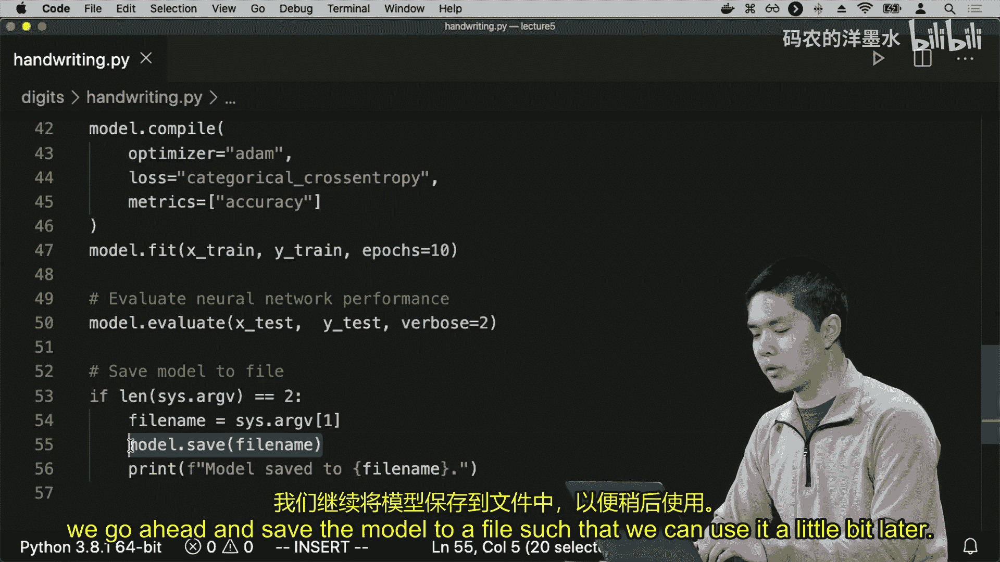

---

## 实践：使用 TensorFlow 构建神经网络

那么，这就是我们可以用来实现神经网络的一些技术的概述，以实现获取输入、将其通过这些不同的层以产生某种输出的想法。

现在，我们想做的就是将这些想法付诸代码。为此，有许多不同的机器学习库和神经网络库可供我们使用，这些库允许我们访问某人实现的反向传播和所有这些隐藏层。由谷歌开发的最流行的库之一是 TensorFlow，这是一个我们可以用来快速创建神经网络、建模并在一些样本数据上运行它们以查看输出将是什么的库。

在我们真正开始编写代码之前，我们将先看看 TensorFlow 的游乐场，这将是我们玩弄神经网络和不同层概念的机会，只是为了了解通过利用神经网络我们可以做什么。

---

## TensorFlow 游乐场演示

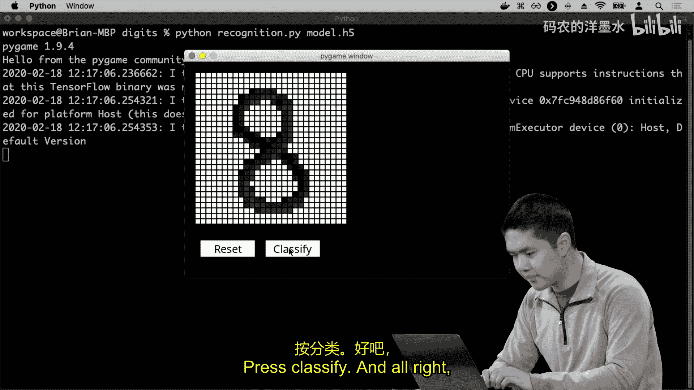

让我们进入 TensorFlow 的游乐场，你可以通过访问之前的 URL 进入。我们现在要做的是尝试学习这个特定输出的决策边界。我想学习将橙点与蓝点分开，并且我想学习神经网络中权重的某种设置，以便能够将它们彼此分开。

我们可以访问的特征（我们的输入数据）是 x 值和 y 值，即沿两个轴的两个值。我现在要做的是设置特定参数，比如我想使用什么激活函数，然后我将按播放看看会发生什么。

这里发生的情况是：你会看到，仅使用这两个输入特征（x 值和 y 值），没有隐藏层，只是获取输入 X 和 y 值并找出决策边界是什么，我们的神经网络很快就学会了，为了划分这两个点，我们应该只使用这条线。这条线充当决策边界，将这组点与那组点分开，而且做得非常好。你可以在这里看到损失是什么：训练损失是0，意味着我们能够完美地模拟在训练数据中将这些点彼此分开。

所以这是一个相当简单的应用神经网络的案例，因为数据非常干净，非常完美地线性可分。我们可以只画一条线将所有那些点彼此分开。

现在让我们考虑一个更复杂的情况。我暂停模拟，我们来看看这个数据集。这个数据现在有点复杂。在这个数据集中，我们仍然有我们想要彼此分开的蓝点和橙点，但没有一条单一的线我们可以画出来能够弄清楚如何将蓝色与橙色分开，因为蓝色位于这两个象限，而橙色位于这里和这里。这是一个更复杂的函数需要学习。

所以让我们看看，如果我们只是尝试基于那些输入（X 和 Y 坐标）来预测输出应该是什么，会发生什么。我按播放。你会注意到，我们真的无法得出太多结论，我们无法非常清楚地看到应该如何将橙点与蓝点分开。你看不到非常清晰的分离。

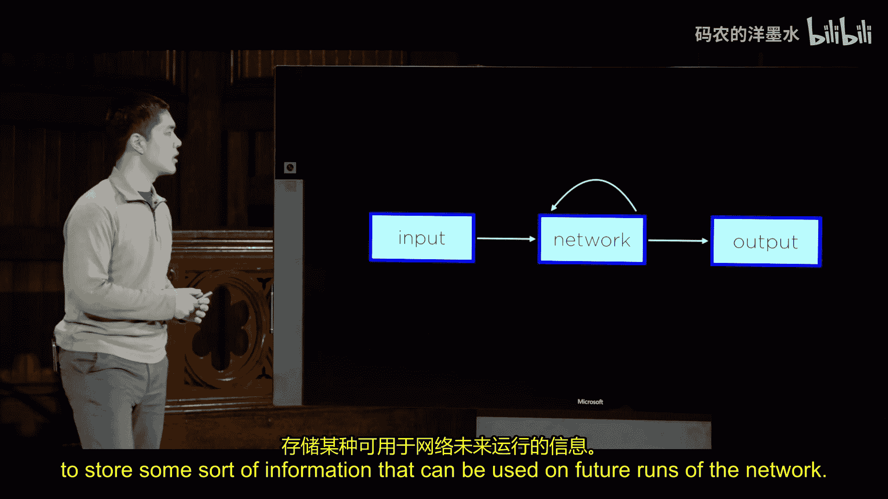

所以看起来我们的网络内部没有足够的复杂性来模拟那么复杂的东西。我们需要一个更好的模型来处理这个神经网络。我将通过添加一个隐藏层来实现。

所以现在我有一个隐藏层，里面有两个神经元。所以我有两个输入，然后进入隐藏层中的两个神经元，然后进入我们的输出。现在我按播放。你会注意到，我们能够做得稍微好一点。我们现在能够说：这些点绝对是蓝色的，这些点绝对是橙色的。但我们仍然在努力处理上面的这些点。

我们可以做的是，我们可以看到对于这些隐藏神经元中的每一个，这些隐藏神经元到底在做什么。每个隐藏神经元都在学习自己的决策边界。我们可以看到那个边界是什么：第一个神经元正在学习这条线，它似乎将一些蓝点与其余的点分开。另一个隐藏神经元正在学习另一条线，它似乎将右下角的橙点与其余的点分开。这就是为什么我们能够弄清楚底部区域的这两个区域。但我们仍然无法完美地对所有点进行分类。

所以让我们继续添加另一个神经元。现在我们的隐藏层中有三个神经元，看看我们现在能学到什么。好了，现在通过隐藏层中的三个神经元学习三个不同的决策边界，我们似乎做得更好，能够更好地弄清楚如何将这些蓝点与橙点分开。你可以看到这些隐藏神经元中的每一个在学习什么：每一个都在学习一个略有不同的决策边界。然后我们组合这些决策边界来找出整体输出应该是什么。

我们可以再试一次，在那里添加第四个神经元，并尝试学习。现在看来，我们似乎可以做得更好，试图将蓝点与橙点分开。但我们只有通过添加一个隐藏层才能做到这一点，通过添加某个学习其他边界并组合这些边界以确定输出的层。这些线的粗细表示这些权重有多高，每个输入对于进行这种计算有多重要。

我们也许可以再做一次模拟。让我们继续尝试这个看起来像这样的数据集。继续去掉这里的隐藏层。现在我们试图将蓝点与橙点分开，其中所有蓝点基本上又位于一个圆内。所以我们无法学习一条线。我按播放，我们真的无法进行任何分类，因为没有一条线可以干净地将蓝点与橙点分开。

所以让我们尝试通过引入一个隐藏层来解决这个问题。我按播放。好了，有了两个神经元和一个隐藏层，我们能够做得更好一些，因为我们有效地学习了两个不同的决策边界：我们学习了左边的这条线，我们学习了右边的这条线。现在，我们只是说：好吧，如果它在中间，我们就称它为蓝色；如果它在外面，我们就称它为橙色。虽然不完美，但肯定比以前好，因为我们学习了一个决策边界和另一个。基于这些，我们可以找出输出应该是什么。

但现在让我们继续添加第三个神经元，看看现在会发生什么。我继续训练它。现在使用这三个由这些隐藏神经元学习的不同决策边界，我们能够更准确地模拟蓝点和橙点之间的区别。我们能够弄清楚，也许通过这三个决策边界，将它们组合在一起，你可以想象找出输出应该是什么以及如何进行这种分类。

因此，这里的目标只是感受一下：在这些隐藏层中拥有更多的神经元使我们能够学习数据中更多的结构，使我们能够找出相关和重要的决策边界是什么。然后，使用这个反向传播算法，我们能够找出这些权重的值应该是什么，以便训练这个网络能够将一类点与另一类点分类开来。

---

## 实战：使用 TensorFlow 识别假钞

这最终就是我们在训练神经网络时试图做的事情。所以让我们继续实际看一个例子。你可能会记得上次我们有一个钞票文件，其中包含有关假钞与真钞的信息，其中我有像四个不同的钞票值，然后是该钞票被认为是真钞还是假钞的分类。我想做的是基于该输入信息，找出某个函数，可以根据输入信息计算它属于哪个类别。

我在 `banknotes.py` 中编写的内容是一个将学习这一点的神经网络：一个基于所有输入学习是否应将钞票分类为真钞或假钞的网络。

第一步与我们上次看到的相同：我实际上只是读入数据并将其转换为适当的格式。这就是更多关于你自己编写 Python 代码来处理这些数据的地方，将数据按摩成被像 Scikit-learn 或 TensorFlow 这样的机器学习库理解的格式。

在这里，我将其分为训练集和测试集。现在我在下面做的是：我在这里创建一个神经网络。我使用 `tf`（代表 TensorFlow，在上面我说了 `import tensorflow as tf`，`tf` 只是一个我们经常使用的缩写，这样我们就不需要在每次想使用库中的任何东西时写出 TensorFlow）。

我使用 `tf.keras`。Keras 是一个 API，一组我们可以用来在 TensorFlow 中操作神经网络的函数。事实证明，其他机器学习库也使用 Keras API。

但在这里，我说：好吧，给我一个顺序模型，一个顺序神经网络，意味着一层接一层。现在我要向该模型添加我想要的层到我的神经网络中。

所以在这里，我说 `model.add`，继续添加一个密集层。当我们说密集层时，我们指的是该层中的每个节点都将连接到前一层中的每个节点。所以我们有一个密集连接的层。这一层内部将有八个单元。所以它将是我们神经网络中的一个隐藏层，有八个不同的单元，八个人工神经元，每个神经元可能学习不同的东西。我只是任意选择了八个，你可以选择隐藏层内部不同数量的隐藏节点。正如我们之前看到的，取决于隐藏层内部单元的数量，更多的单元意味着你可以学习更复杂的函数，所以也许你可以更准确地模拟训练数据，但这是有代价的：更多的单元意味着你需要弄清楚如何更新的权重更多，所以进行该计算可能更昂贵，而且如果你有太多的单元并学习仅仅过拟合训练数据，你也面临过拟合数据的风险，这也不好。所以需要平衡，通常有一个测试过程，你会在一些数据上训练，并可能在一个单独的数据集（通常称为验证集）上验证你的表现如何，以查看哪个参数设置（我应该有多少层，每层应该有多少单元）在验证集上表现最好，这样你可以做一些测试来找出这些所谓的“超参数”应该等于什么。

接下来，我指定输入形状是什么，意思是：我的输入看起来像什么？我的输入有四个值，所以输入形状就是四，因为我们有四个输入。然后我指定激活函数是什么。激活函数再次，我们可以选择。这里有很多不同的激活函数，我使用的是 ReLU，你可能从之前回忆起来。

然后我将添加一个输出层。所以我有我的隐藏层。现在我添加另一层，它将只有一个单元，因为我要做的就是预测类似假钞或真钞。所以我只需要一个单元，这里我要使用的激活函数是 sigmoid 激活函数，它又是那个 S 形曲线，它只是