# 008：自然语言处理


## 概述

在本节课中，我们将要学习如何让计算机理解和使用人类的自然语言，例如英语。我们将探讨自然语言处理（NLP）的核心任务、面临的挑战，以及从基于规则的语法分析到现代基于深度学习的模型（如Transformer）的一系列技术。

---

## 自然语言处理的任务与挑战

上一节我们介绍了本课程的整体目标，本节中我们来看看自然语言处理的具体任务和核心挑战。

自然语言处理的目标是让计算机能够处理人类的语言。这包括多种任务：

*   **自动摘要**：给定长文本，生成其简短概括。
*   **信息抽取**：从文本中提取相关事实或细节。
*   **机器翻译**：将文本从一种语言翻译成另一种语言。
*   **问答系统**：理解问题文本并生成回答文本。
*   **文本分类**：为文本分配标签，例如判断邮件是“收件箱”还是“垃圾邮件”。

然而，让计算机理解语言充满挑战，主要涉及两个方面：

1.  **句法**：关于语言的结构。一个句子需要由单词以正确的结构组合而成。
    *   例如，“Just before 9 o‘clock, Sherlock Holmes stepped briskly into the room.” 是一个句法正确的句子。
    *   而“Just before Sherlock Holmes 9 o’clock stepped briskly the room.” 虽然由有效单词组成，但结构混乱，句法无效。
    *   有些句子存在**歧义**，例如“I saw the man on the mountain with a telescope.” 可以有两种不同的结构解释。

2.  **语义**：关于语言的含义。计算机不仅需要知道句子结构正确，还需要理解其意义。
    *   例如，“Just before 9 o‘clock, Sherlock Holmes stepped briskly into the room.” 和 “A few minutes before 9, Sherlock Holmes walked quickly into the room.” 这两个句子用词不同，但语义相似。
    *   有些句法正确的句子可能没有实际意义，例如语言学家诺姆·乔姆斯基的著名例句：“Colorless green ideas sleep furiously.”

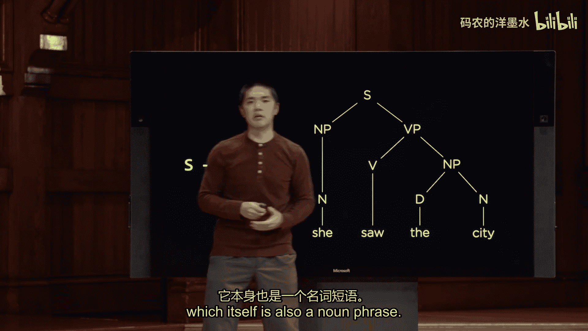

---

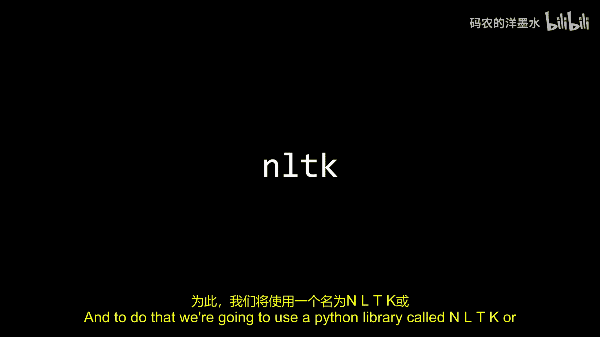


## 基于规则的方法：形式语法

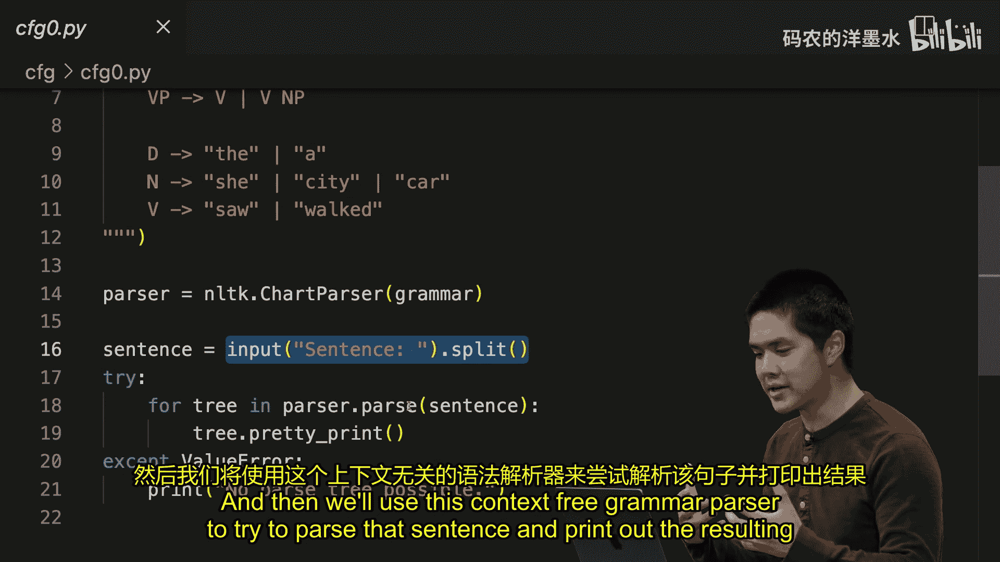

上一节我们了解了语言理解的核心挑战，本节中我们来看看如何通过定义规则来让计算机理解句法。

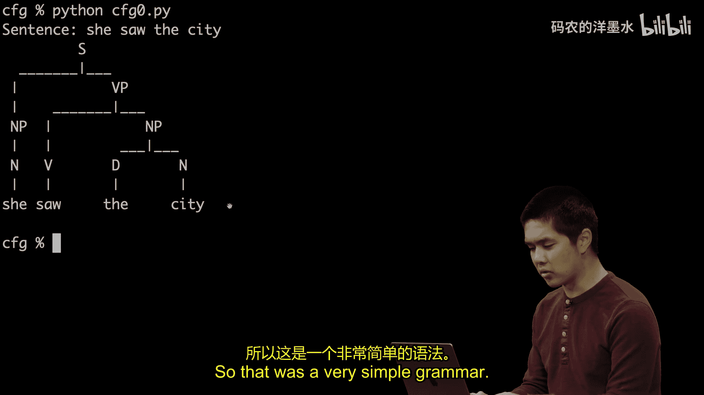

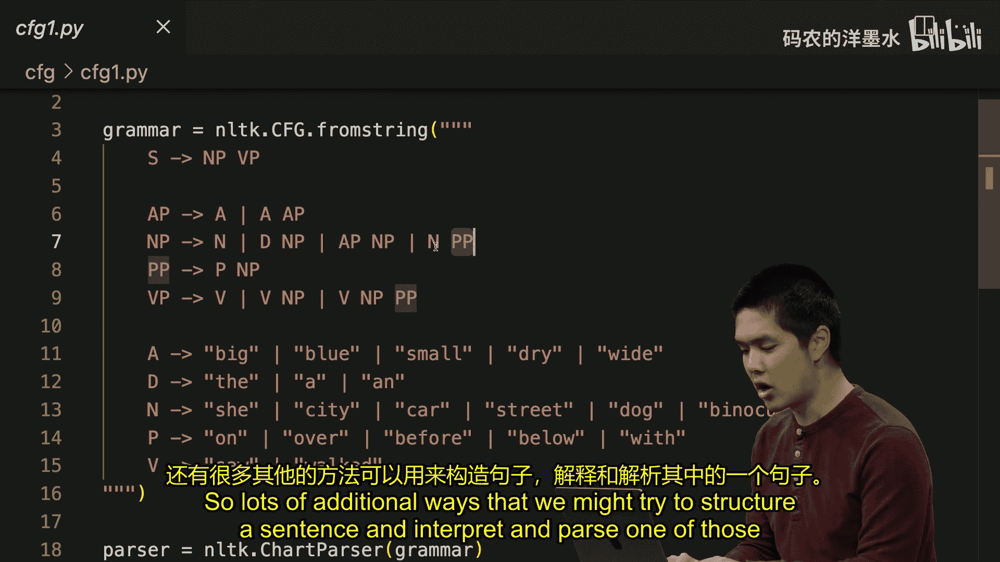

一种方法是定义**形式语法**，即生成语言中句子的规则系统。我们采用**基于规则**的方法，将人类已知的语言规则交给计算机。

我们将重点介绍一种称为**上下文无关语法**的语法。其核心思想是定义**非终结符**（如 N 代表名词，V 代表动词）和**终结符**（具体的单词），并通过**重写规则**描述如何从非终结符生成终结符或其他非终结符序列。

以下是一些重写规则的例子：
*   `N -> "she" | "city" | "car" | "Harry"`
*   `D -> "the" | "a" | "an"`
*   `NP -> N | D N` （名词短语可以是单个名词，或限定词后接名词）
*   `VP -> V | V NP` （动词短语可以是单个动词，或动词后接名词短语）
*   `S -> NP VP` （句子由名词短语后接动词短语构成）

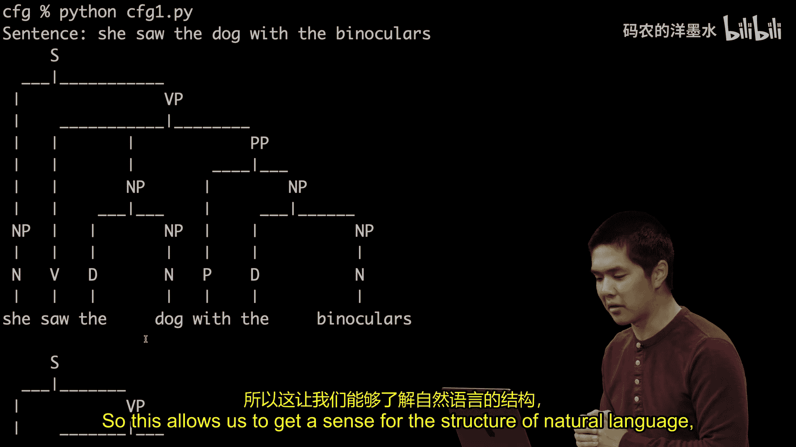

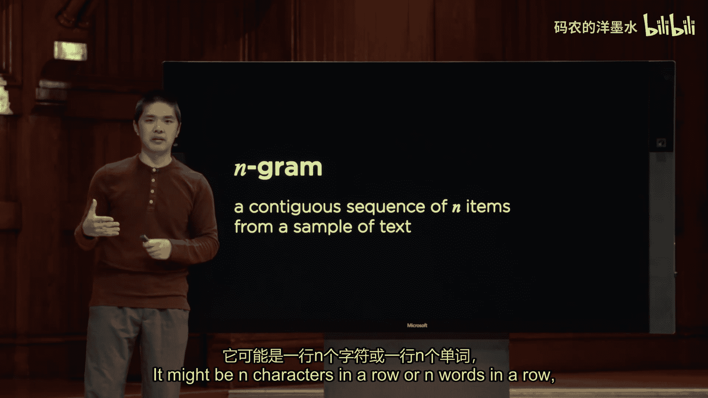

根据这些规则，计算机可以解析出句子“she saw the city”的结构：`S(NP(N("she")), VP(V("saw"), NP(D("the"), N("city"))))`。

我们可以使用Python的**自然语言工具包（NLTK）** 来实现和解析上下文无关语法。


以下是使用NLTK解析句子的核心代码示例：
```python
import nltk

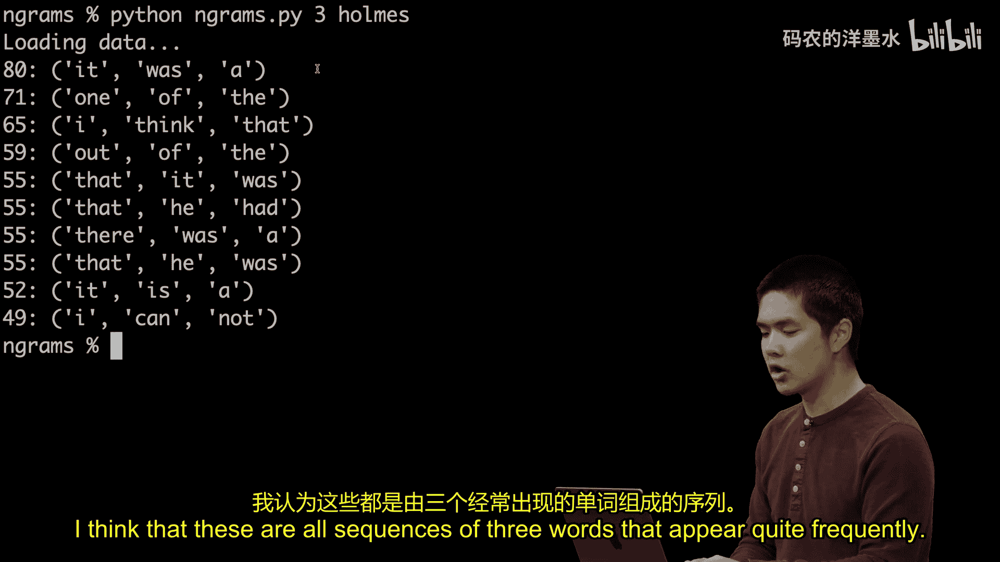

# 定义语法规则
grammar = nltk.CFG.fromstring("""
    S -> NP VP
    NP -> N | D N
    VP -> V | V NP
    D -> "the" | "a"
    N -> "she" | "city" | "car"
    V -> "saw" | "walked"
""")

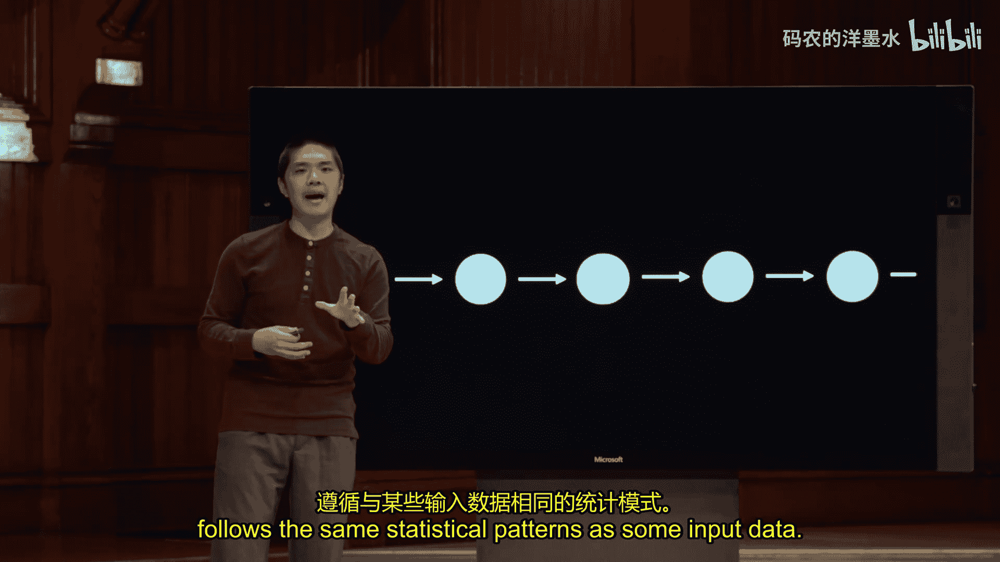

# 创建解析器
parser = nltk.ChartParser(grammar)

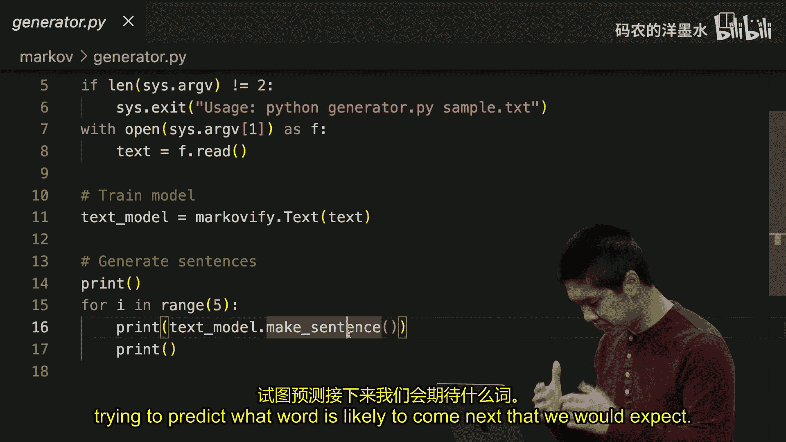

# 解析句子
sentence = "she saw the city".split()
for tree in parser.parse(sentence):
    print(tree)
    tree.pretty_print()
```
通过更复杂的语法规则，NLTK甚至能解析出歧义句子的多种可能结构，例如“she saw the dog with the binoculars.”（是她用望远镜看狗，还是狗带着望远镜？）。

然而，为所有可能的英语句子手动编写规则是极其困难且不现实的。因此，我们需要更强大的方法。

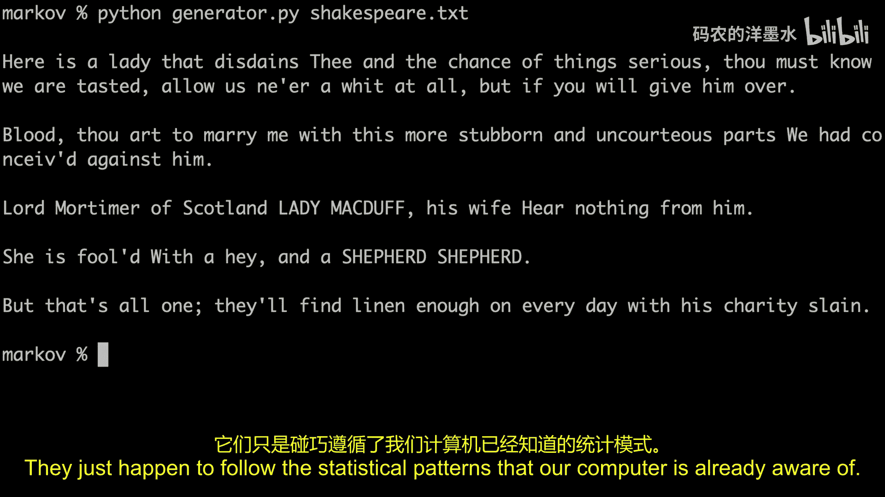

---

## 统计方法：N元语法与马尔可夫链

上一节我们介绍了基于规则的方法，本节中我们来看看如何从数据中统计学习语言的结构。

我们可以从大量现有文本数据中学习语言模式。一种有效的方法是分析**N元语法**，即文本中连续的n个项目（如n个单词）的序列。

例如，对于文本“how often have I said to you that...”，其**三元语法**包括：“how often have”、“often have I”、“have I said”等。

通过分析大型语料库（如福尔摩斯故事集）中常见的N元语法，计算机可以了解哪些单词序列经常一起出现，从而感知语言结构。这个过程涉及**分词**，即将字符序列拆分为单词。

以下是使用NLTK查找常见N元语法的核心代码思路：
```python
from nltk import ngrams
from collections import Counter

# 假设 `words` 是分词后的单词列表
bigrams = ngrams(words, 2) # 二元语法
trigrams = ngrams(words, 3) # 三元语法

# 计算最常见的N元语法
most_common_bigrams = Counter(bigrams).most_common(10)
```

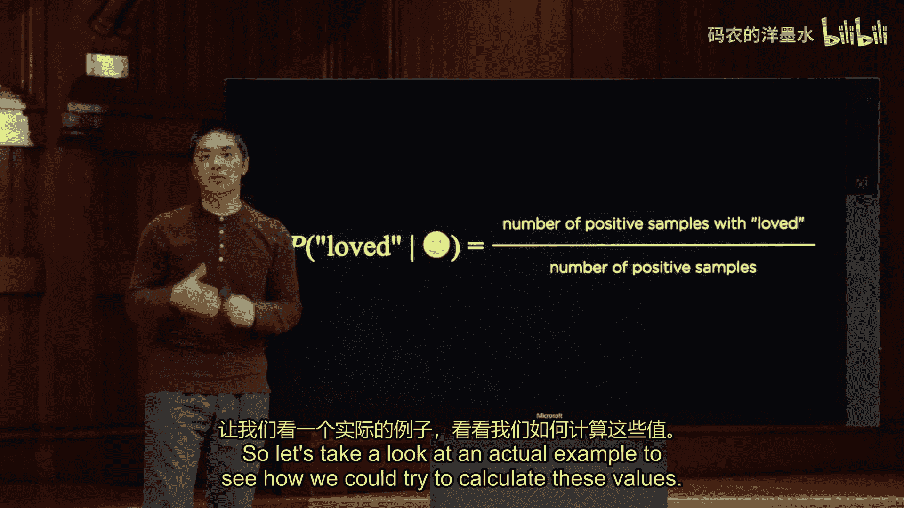

利用N元语法的统计信息，我们可以构建**马尔可夫链**来生成文本。马尔可夫链可以根据当前状态（最近的单词序列）预测下一个可能出现的单词。

通过在以莎士比亚作品为训练数据训练的马尔可夫模型上生成句子，我们可以得到符合其统计风格的新句子，尽管这些句子在语义上可能不连贯。这引出了如何生成更有意义文本的问题。

---

## 文本分类：词袋模型与朴素贝叶斯

上一节我们看到了如何统计生成文本，本节中我们来看看一个具体的NLP任务：**文本分类**，例如情感分析（判断评论是正面还是负面）。


我们采用**词袋模型**，它将文本视为一个**无序的**单词集合，忽略单词顺序信息以简化模型。

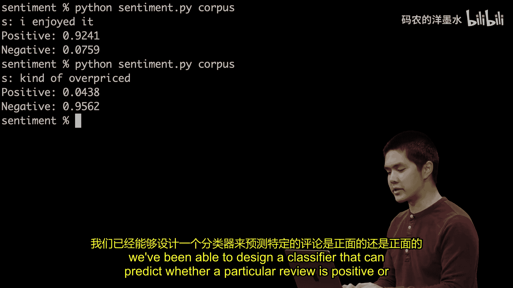

基于词袋模型，我们使用**朴素贝叶斯分类器**。其核心思想是利用贝叶斯规则，计算一条评论属于正面或负面情感的概率。

对于一条评论，例如“my grandson loved it”，我们想计算 `P(正面 | 单词“my”, “grandson”, “loved”, “it” 出现)`。

根据贝叶斯规则和**朴素**（即单词条件独立）的假设，该概率正比于：
`P(正面) * P(“my”|正面) * P(“grandson”|正面) * P(“loved”|正面) * P(“it”|正面)`

这些概率可以从已标注的训练数据中估计：
*   `P(正面)` = （正面评论数量） / （总评论数量）
*   `P(“loved”|正面)` = （包含“loved”的正面评论数量） / （正面评论数量）

计算完正面和负面的概率后，进行归一化，即可得到分类结果。

一个潜在问题是，如果训练数据中某个单词（如“grandson”）从未在正面评论中出现，会导致概率为零。解决方案是使用**拉普拉斯平滑**，为所有计数添加一个小的常数（如1），避免零概率。


以下是情感分析分类器的核心思路：
```python
from sklearn.naive_bayes import MultinomialNB
from sklearn.feature_extraction.text import CountVectorizer

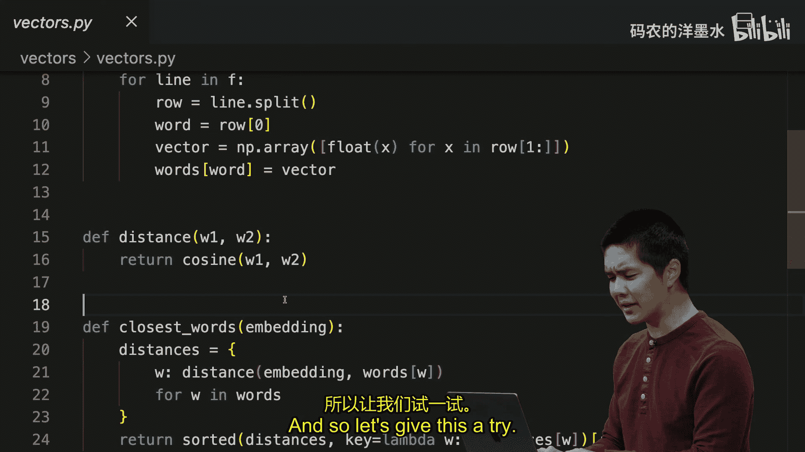

# 训练数据
train_texts = ["it was great", "so much fun", ...] # 正面
train_labels = [1, 1, ...] # 1代表正面

# 将文本转换为词袋特征向量
vectorizer = CountVectorizer()
X_train = vectorizer.fit_transform(train_texts)

# 训练朴素贝叶斯分类器
classifier = MultinomialNB()
classifier.fit(X_train, train_labels)

# 预测新评论
new_review = ["I enjoyed it"]
X_new = vectorizer.transform(new_review)
prediction = classifier.predict_proba(X_new)
# prediction 会给出属于正面和负面的概率
```

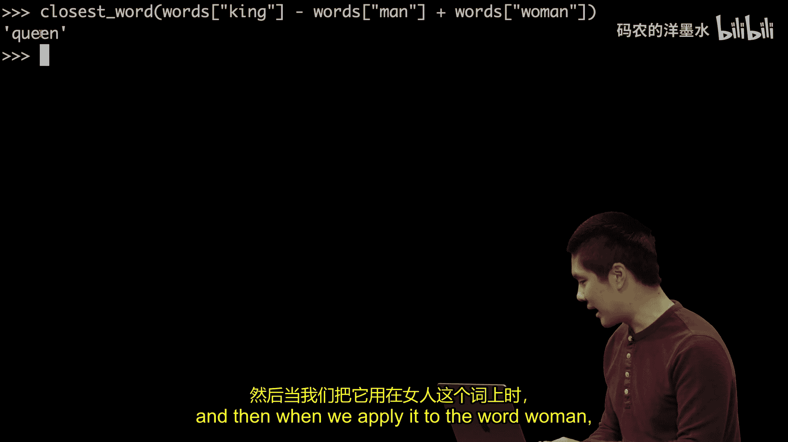

---

## 词的向量表示：Word2Vec

上一节我们使用词袋模型进行分类，但忽略了单词的语义相似性。本节中我们来看看如何将单词表示为有意义的数值向量，即**词向量**。

简单的**独热编码**（每个词是一个仅有一个1其余为0的长向量）存在维度灾难且无法表达语义相似性。

我们需要**分布式表示**，即用一个较短的稠密向量表示一个词，且语义相似的词向量也相似。其核心思想来自语言学家J.R. Firth的名言：“**由一个词周围的词（上下文）来定义它**。”

**Word2Vec**模型正是基于这一思想。它通过让计算机在大规模语料库中学习，将出现在相似上下文中的词（如“breakfast”, “lunch”, “dinner”）的向量在空间中被拉近。

训练完成后，我们可以进行有趣的语义运算：
*   向量距离：`distance("book", "novel")` 小于 `distance("book", "breakfast")`。
*   找到相似词：`closest_words("book")` 可能返回 “novel”, “memoir”, “essay”等。
*   类比推理：`vector("king") - vector("man") + vector("woman")` 的结果最接近 `vector("queen")`。

词向量为将单词输入神经网络等模型提供了良好的数值基础。

---

## 序列到序列模型：循环神经网络与注意力机制

上一节我们获得了词的向量表示，本节中我们来看看如何处理更复杂的任务，如机器翻译和问答，这些任务需要将**一个序列**（如句子）转换为**另一个序列**。

我们使用**循环神经网络（RNN）** 来处理序列数据。RNN通过维护一个**隐藏状态**，在每一步处理输入时更新该状态，从而记住之前的信息。

对于序列到序列任务（如英译法），常采用**编码器-解码器架构**：
1.  **编码器**（一个RNN）：逐词处理输入句子，将整个句子的信息压缩成最终的隐藏状态。
2.  **解码器**（另一个RNN）：以编码器的最终隐藏状态为起点，逐词生成输出句子。

然而，这种方法存在瓶颈：编码器需要将所有输入信息压缩到**一个**最终的隐藏状态中，对于长句子来说信息损失严重。

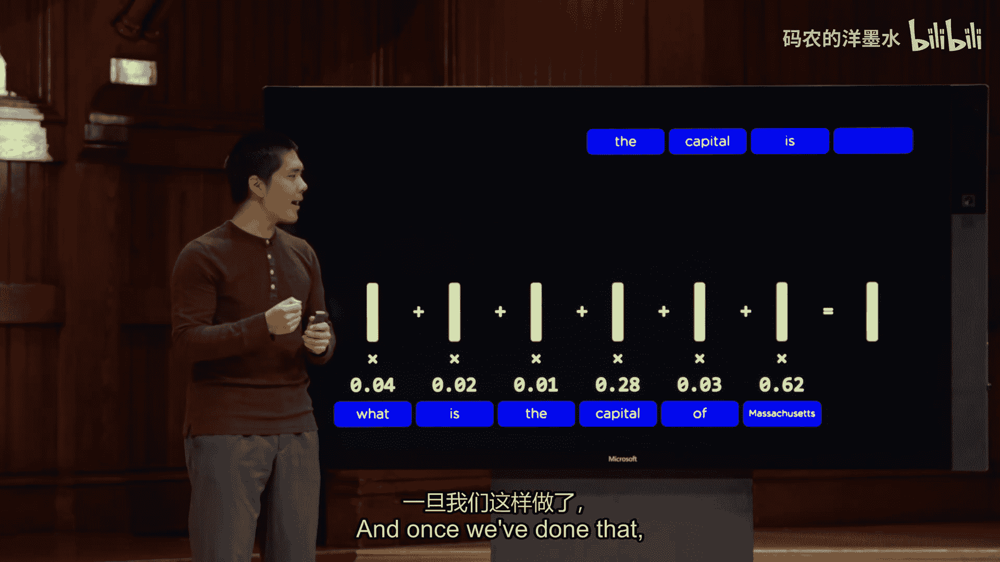

**注意力机制** 解决了这个问题。在解码器生成每一个输出词时，它不再只关注编码器最后的一个隐藏状态，而是可以“注意”编码器在**所有输入词**上产生的隐藏状态。


注意力机制会为每个输入词的隐藏状态计算一个**注意力分数**，表示当前生成输出词时该输入词的重要性。然后，将这些隐藏状态按其注意力分数进行加权求和，得到一个**上下文向量**，这个向量聚焦于当前最重要的输入信息，再输入给解码器生成当前词。

这使得模型在翻译时能动态地对齐输入和输出的单词（例如，生成法语“accord”时重点关注英语“agreement”），大大提升了长序列和复杂句子的处理能力。

---

## 现代架构：Transformer

上一节我们结合RNN和注意力机制解决了长序列信息丢失问题，但RNN的顺序计算特性难以并行化，限制了训练效率。本节中我们来看看革命性的**Transformer**架构，它完全基于注意力机制，实现了高效的并行计算。

Transformer也采用编码器-解码器结构，但其核心是完全摒弃RNN，主要依靠**自注意力机制**和**前馈神经网络**。

**编码器**工作流程（所有输入词并行处理）：
1.  输入词向量 + **位置编码**（注入单词在序列中位置的信息）。
2.  送入**多头自注意力层**：让每个词都能关注输入序列中的所有其他词，更好地理解上下文。
3.  再送入**前馈神经网络层**。
4.  步骤2和3可以重复多次，形成深层网络。

**解码器**工作流程（在训练时可并行，生成时需顺序进行）：
1.  已生成的输出词向量 + 位置编码。
2.  **掩码多头自注意力层**：让每个输出词关注**之前已生成**的输出词。
3.  **编码-解码注意力层**：让每个输出词关注**编码器输出的所有隐藏状态**（这是关键，替代了RNN编码器的最终状态）。
4.  前馈神经网络层。

**Transformer的优势**：
*   **高度并行化**：编码器可同时处理所有输入词，训练速度极快。
*   **强大的长程依赖建模**：自注意力机制使任意两个词的距离都是“一步之遥”，有效捕捉长远关系。
*   **卓越的性能**：在翻译、问答、文本生成等任务上取得了突破性成果。

此后，基于Transformer架构发展出了如BERT（仅用编码器）、GPT系列（仅用解码器）等众多强大的预训练语言模型，推动了自然语言处理领域的飞速发展。

---

## 总结

本节课中我们一起学习了人工智能中一个充满魅力且快速发展的领域——自然语言处理。

我们从理解语言的**句法**和**语义**挑战出发，首先探索了基于规则的**形式语法**分析方法。接着，我们转向统计方法，学习了**N元语法**和用于文本生成的**马尔可夫链**。针对**文本分类**任务，我们深入探讨了**词袋模型**和**朴素贝叶斯分类器**的原理与应用。

为了更深入地表示语义，我们引入了**词向量**的概念和**Word2Vec**模型，它能够捕获单词之间的语义关系和类比。对于复杂的序列到序列任务（如翻译和问答），我们分析了**循环神经网络（RNN）** 与**编码器-解码器架构**，并指出了其处理长序列的局限性，进而引入了关键的**注意力机制**来解决信息瓶颈问题。

最后，我们探讨了当今主流的**Transformer**架构，它完全基于注意力机制，实现了高效的并行计算，并通过**自注意力**和**位置编码**等技术，在各类NLP任务上取得了革命性的成功。


回顾整个课程，我们涵盖了搜索、知识、不确定性、优化、机器学习（特别是神经网络）以及今天的自然语言处理。人工智能是一个广阔且不断进化的领域，希望这次探索能为你打开一扇门，激发你继续深入研究的兴趣。


感谢课程团队的努力，这就是“使用Python的人工智能导论”。