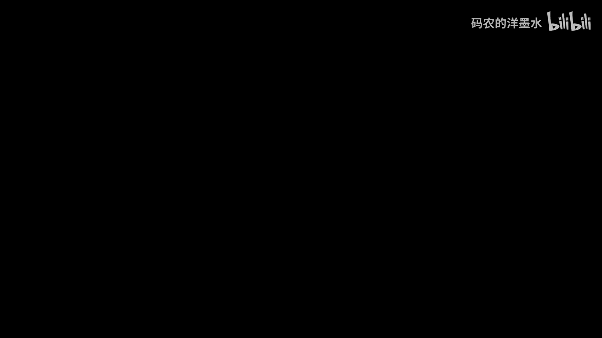
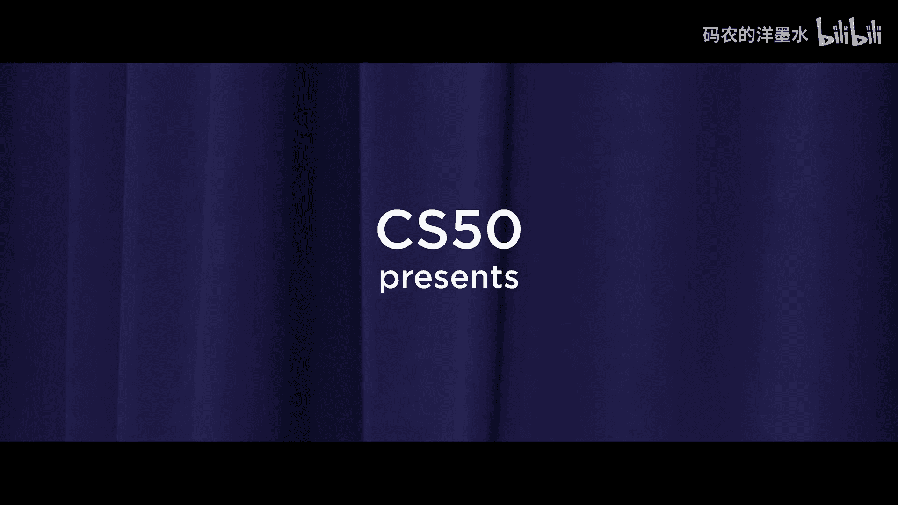
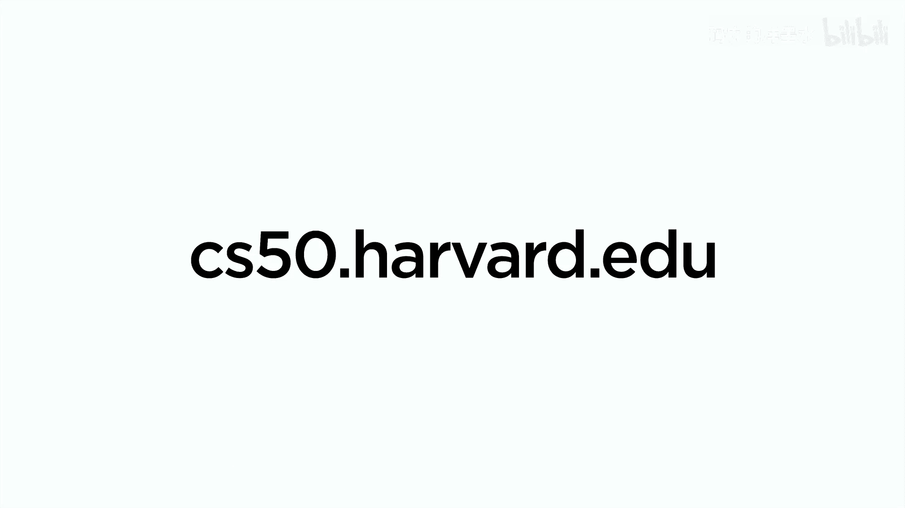

**哈佛大学CS50 R语言编程：P01：课程介绍**

在本节课中，我们将要学习哈佛大学CS50 R语言编程课程的总体介绍，了解这门课程的目标、内容结构以及学习路径。

大家好，这是CS50的R语言编程入门课程。R是一种流行的语言，用于统计计算、图形、数据科学以及其他领域。我的名字是David Main，我的名字是Carteranki。CS50，也被称为CS50X，主要关注计算机科学和通用编程。而本课程CS50 R则完全专注于R语言。你可以在学习CS50X之前、之中或之后学习CS50 R。

在本课程中，我们首先将探索这种名为R的语言中的**数据**，学习名为**向量**和**数据框**的数据结构。然后，我们将进阶到**转换数据**，特别是使用**逻辑表达式**进行筛选，以便从你的数据中选取子集。

接下来，我们将学习如何使用**函数**、**循环**以及像**函数式编程**这样的编程范式来转换数据。

在此之后，我们将站在前人的肩膀上，学习如何**整理数据**，使其更易于分析。

一旦数据变得整洁，我们也能更轻松地**可视化**它。在课程接近尾声时，我们将**测试**我们的程序，确保它们的行为符合预期。一旦程序运行正确，我们会将它们**打包**起来。

这门课程将带你从对R一无所知，到能够与世界分享你的R语言知识。我们很期待看到你将创造出什么。这就是你的CS50 R语言编程课程。

---

**总结**

本节课我们一起学习了CS50 R语言编程课程的总体介绍。我们了解到这门课程专注于R语言，适合任何阶段的学习者。课程将从基础的数据结构（如向量和数据框）开始，逐步深入到数据转换、整理、可视化、测试和打包等核心主题，旨在帮助初学者从零开始，最终能够独立完成数据分析项目并与他人分享成果。