# 002：数据表示 📊


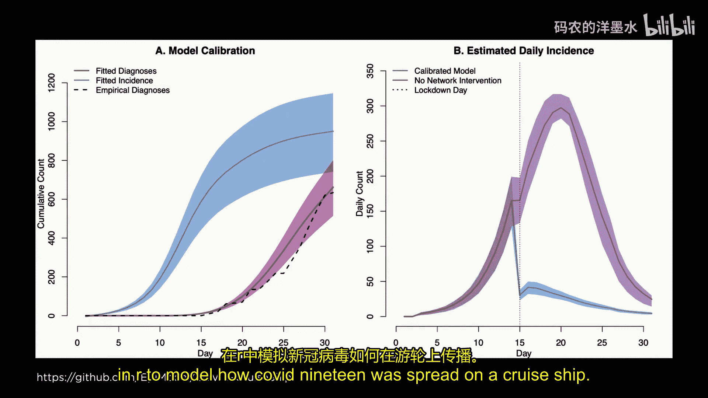

在本节课中，我们将学习R语言的基础知识，包括如何编写第一个程序、与用户交互、处理不同类型的数据，以及如何读取和操作表格数据。我们将从“Hello World”程序开始，逐步探索R的核心概念。


---

## 你好，世界！👋

上一节我们介绍了R语言及其在数据科学领域的应用。本节中，我们来看看如何编写第一个R程序。

首先，我们需要一个编写代码的工具。RStudio是一个专门为R设计的集成开发环境（IDE）。它包含一个R控制台，我们可以在这里逐行执行R语句。


要创建一个R程序文件，我们可以使用以下代码：

```r
file.create("hello.R")
```

R程序文件通常以 `.R` 作为扩展名。创建文件后，我们可以在RStudio的文件编辑器中打开它，并编写我们的第一个程序。

```r
print("hello, world")
```

`print` 是一个函数，它执行一个动作：将我们提供的文本显示在控制台上。函数名后面的括号内是函数的输入，称为参数。在这个例子中，`"hello, world"` 就是传递给 `print` 函数的参数。函数运行后产生的可见效果（如打印文本）称为副作用。

运行程序后，我们可能会遇到错误。例如，如果拼错了函数名，R会提示找不到该函数。这个过程称为调试，即查找并修复代码中的错误。

---

## 与用户交互 💬

上一节我们编写了一个简单的打印程序。本节中，我们来看看如何获取用户输入并生成个性化的问候。

为了获取用户输入，R提供了 `readline` 函数。它会提示用户输入信息，并返回用户输入的内容。

```r
name <- readline("What's your name? ")
```

这行代码做了几件事：
1.  `readline("What's your name? ")` 函数运行，提示用户输入。
2.  用户输入的内容（例如 “Carter”）作为函数的返回值。
3.  `<-` 是赋值运算符，它将返回值存储在一个名为 `name` 的变量（或对象）中。

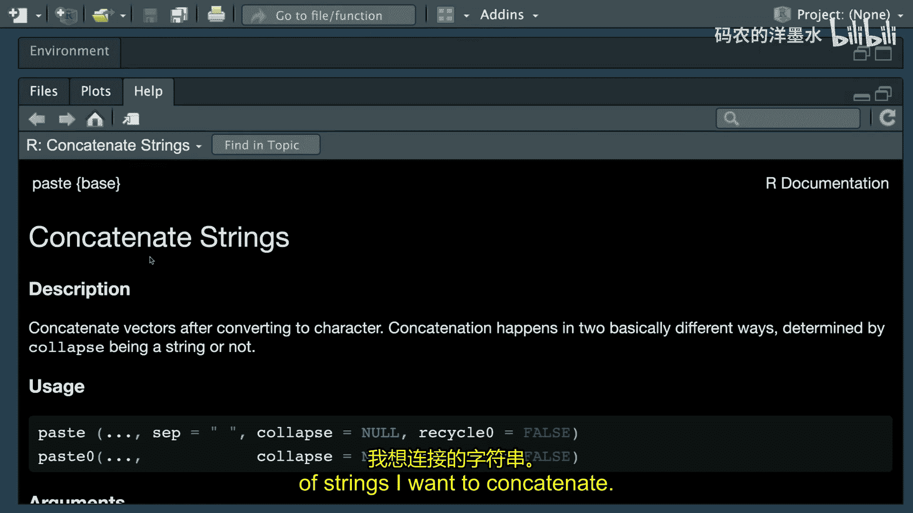

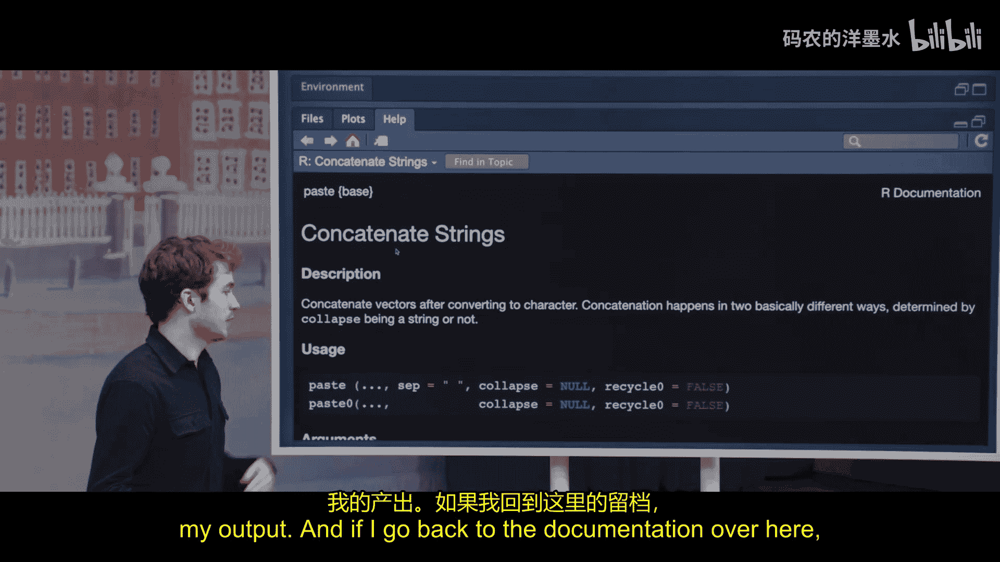

变量是值的名称，这个值可以在程序后续部分被重复使用。现在，我们想将问候语 “hello, ” 和用户名组合起来。这涉及到字符串拼接。


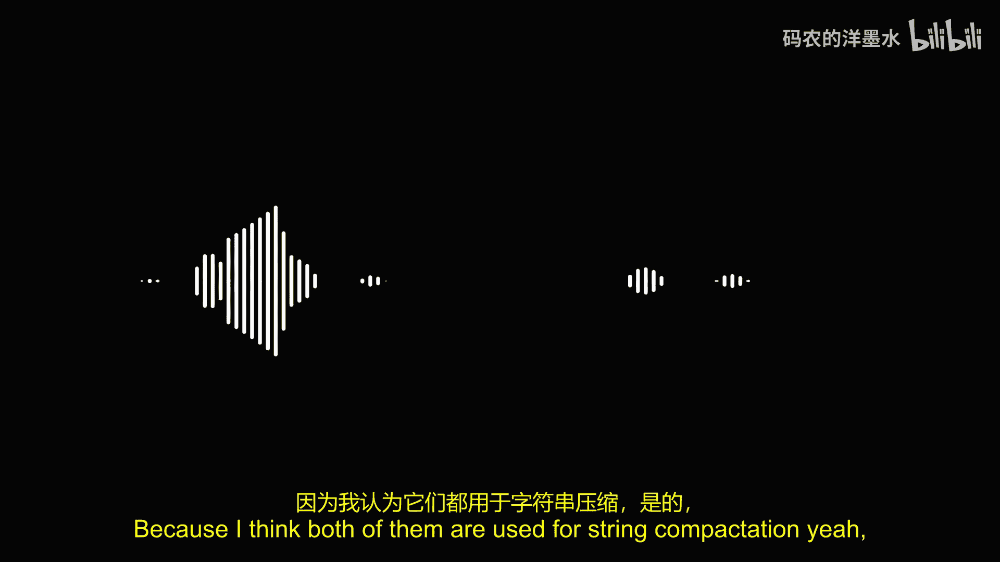

R中的文本称为字符串。我们可以使用 `paste` 或 `paste0` 函数来拼接字符串。

```r
greeting <- paste0("hello, ", name)
print(greeting)
```


`paste0` 函数将多个字符串参数拼接成一个字符串，默认不在它们之间添加任何分隔符。然后，我们将拼接结果存储在 `greeting` 变量中，并打印出来。


我们可以通过函数组合来简化代码，将一个函数的输出直接作为另一个函数的输入。

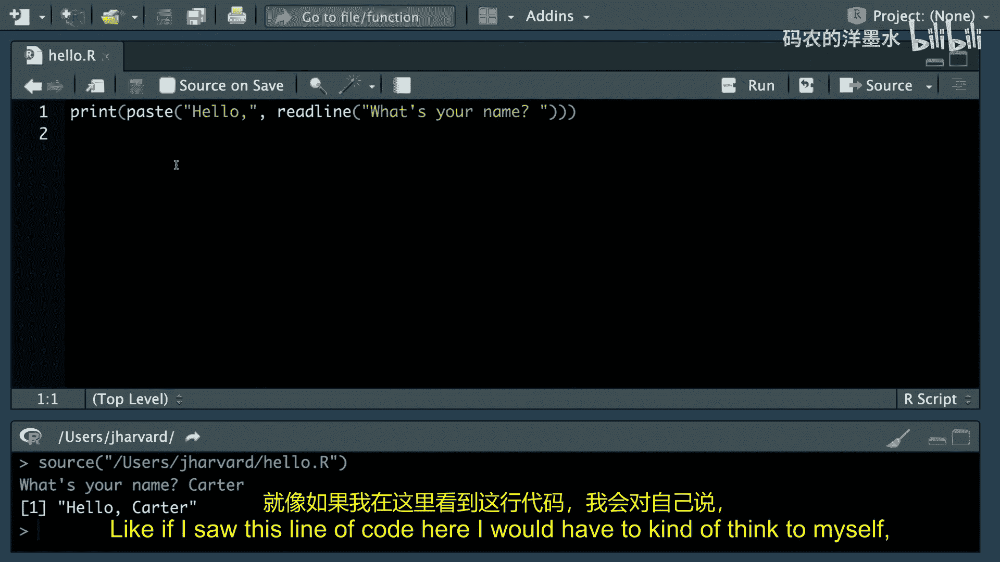


```r
print(paste0("hello, ", readline("What's your name? ")))
```

虽然这行代码更简洁，但可读性较差。在编程中，代码的清晰度和可维护性通常比极致的简洁更重要。我们可以使用注释（以 `#` 开头）来为代码添加说明。

```r
# Ask user for their name
name <- readline("What's your name? ")
# Say hello to the user
print(paste0("hello, ", name))
```

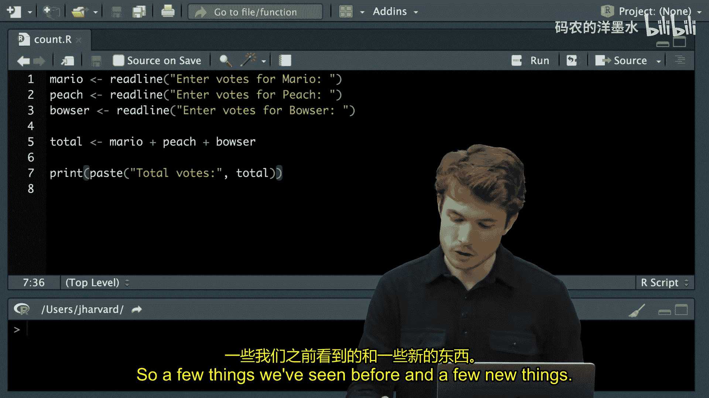


---

## 处理数值数据 🔢

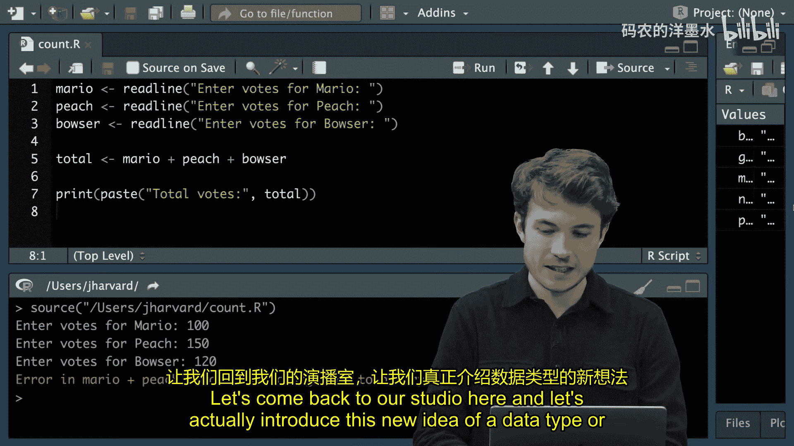

上一节我们处理了文本数据。本节中，我们来看看如何处理数值数据，例如统计选举票数。


假设我们为三个候选人（Mario, Peach, Bowser）统计票数。我们需要从用户那里获取每位候选人的得票数，然后计算总票数。

```r
# Get votes for each candidate
mario <- as.integer(readline("Enter votes for Mario: "))
peach <- as.integer(readline("Enter votes for Peach: "))
bowser <- as.integer(readline("Enter votes for Bowser: "))

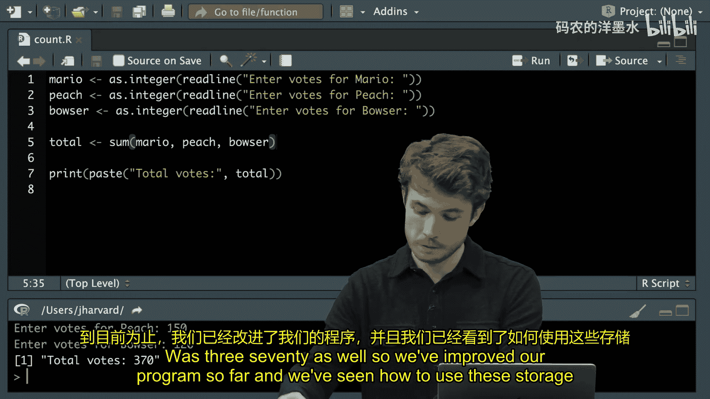


# Calculate total votes
total <- sum(mario, peach, bowser)

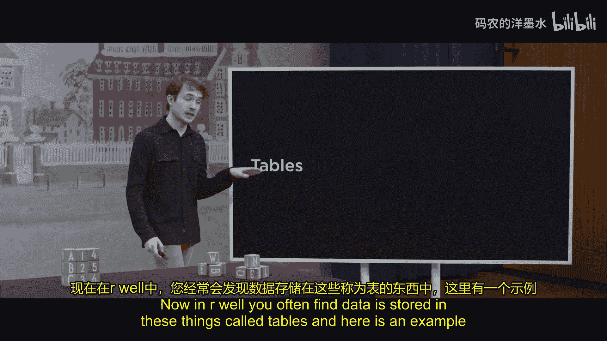

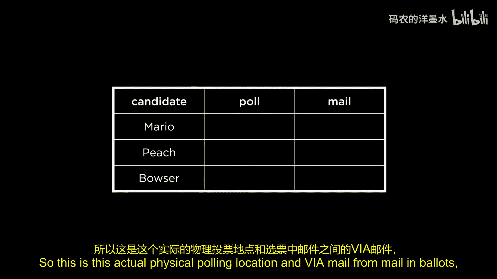

# Print the result
print(paste("Total votes:", total))
```

这里引入了几个新概念：
1.  **数据类型**：`readline` 返回的是字符串（字符型）。为了进行数学运算，我们需要使用 `as.integer()` 函数将其转换为整数型。
2.  **算术运算符**：`+` 用于加法。R还支持 `-`（减）、`*`（乘）、`/`（除）。
3.  **`sum` 函数**：这个函数可以接收多个数值参数，并返回它们的总和，比手动使用 `+` 运算符更简洁。

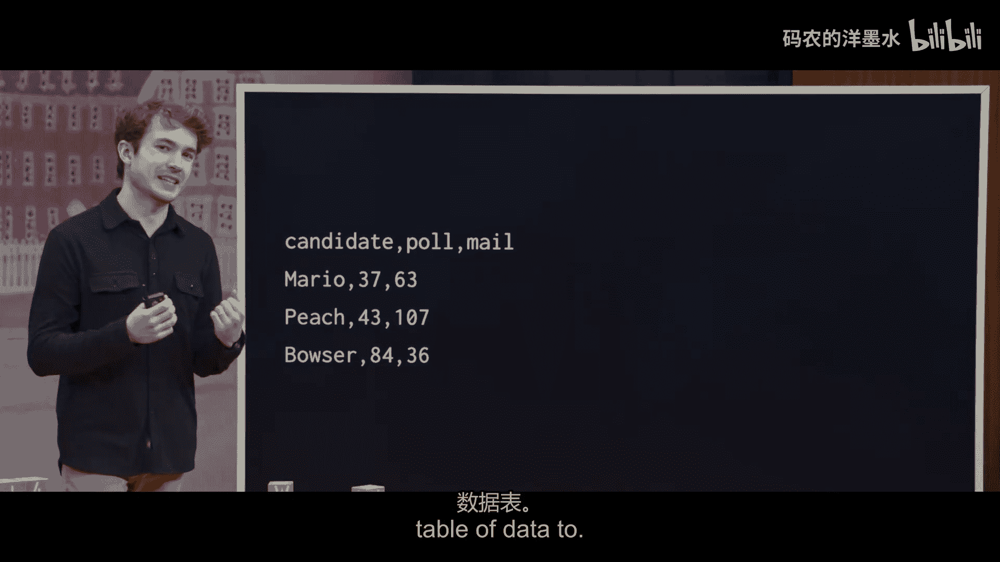

数据类型（或存储模式）决定了R如何解释和处理数据。常见的基本类型包括：
*   `character`： 字符或字符串。
*   `numeric` / `double`： 数值（可包含小数）。
*   `integer`： 整数。

---

## 表格数据与数据框 📈

上一节我们处理了独立的数值。在现实中，数据通常以表格形式组织。本节中，我们来看看R如何表示和操作表格数据。

表格数据通常存储在CSV（逗号分隔值）文件中。R可以使用 `read.csv` 函数读取CSV文件，并将其加载为一个称为 **数据框** 的结构。

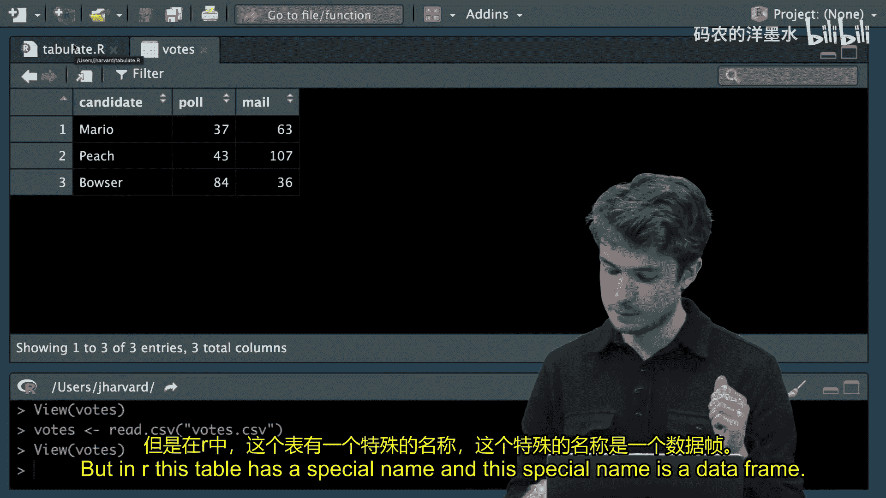


```r
votes <- read.csv("votes.csv")
```

数据框是R中用于存储表格数据的主要结构。它包含行和列。我们可以使用多种方式访问数据框中的内容：

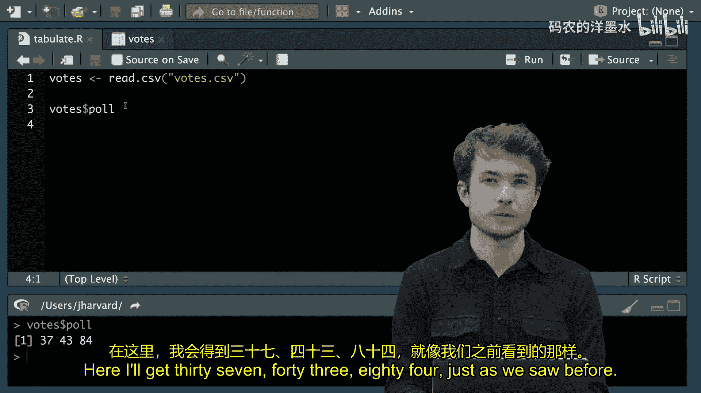

1.  **按列名访问**：使用 `$` 符号。
    ```r
    votes$candidate  # 访问 “candidate” 列
    votes$poll       # 访问 “poll” 列
    ```


2.  **按位置访问**：使用 `[行, 列]` 符号。
    ```r
    votes[1, ]       # 访问第一行所有列
    votes[, 2]       # 访问第二列所有行
    votes[1, 2]      # 访问第一行第二列的值
    ```

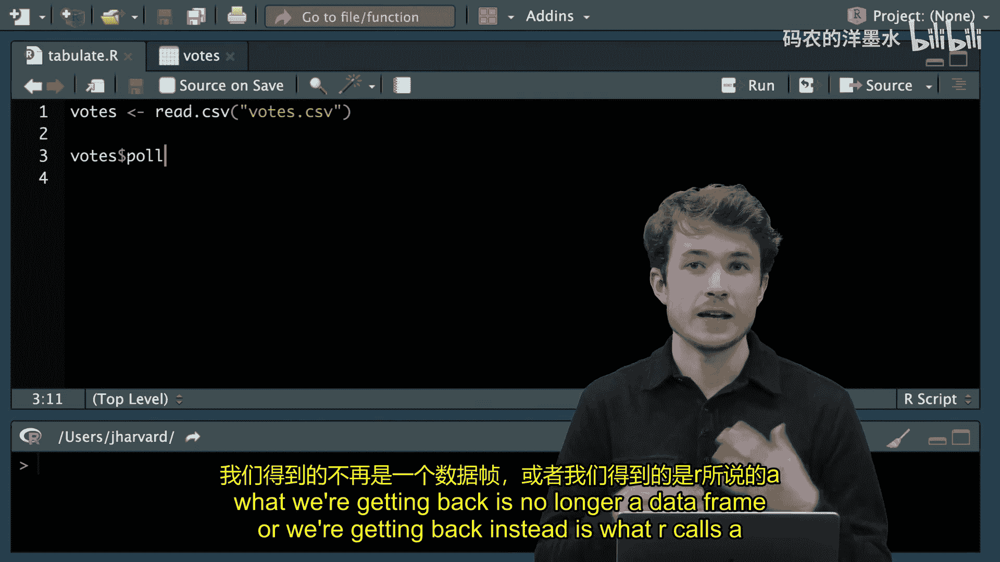

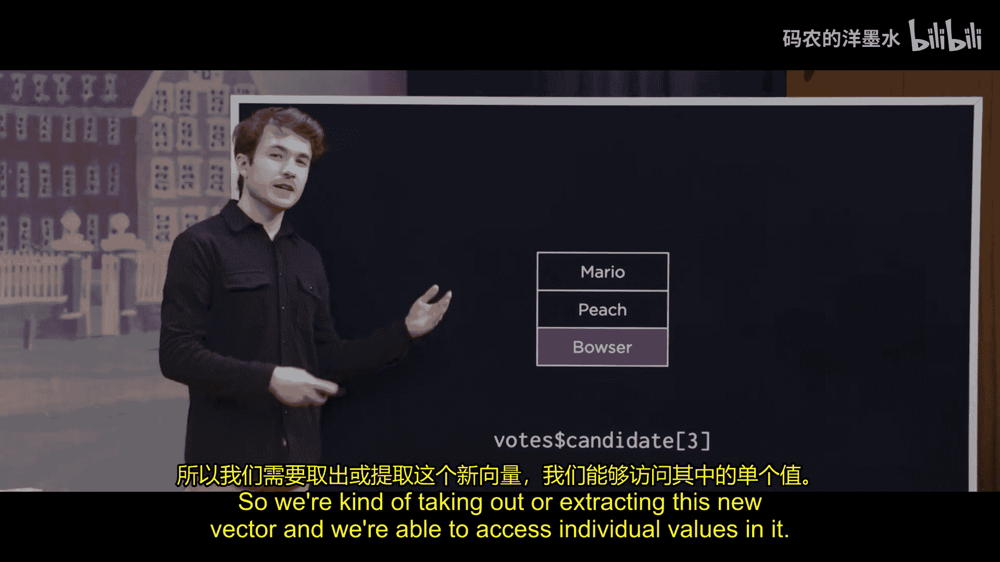

当使用 `$` 或 `[, 列号]` 提取单列时，我们得到的是一个 **向量**。向量是R中另一种基本数据结构，它是一组相同类型的数据。

数据框的威力在于我们可以对整个列（向量）进行操作。例如，计算所有候选人的总票数（假设有“poll”和“mail”两列）：

```r
total_votes <- votes$poll + votes$mail
```

这行代码利用了 **向量化运算**。R会将 `votes$poll` 向量的第一个元素与 `votes$mail` 向量的第一个元素相加，然后是第二个元素，以此类推，最终生成一个新的向量。我们可以将这个新向量作为一列添加回数据框：

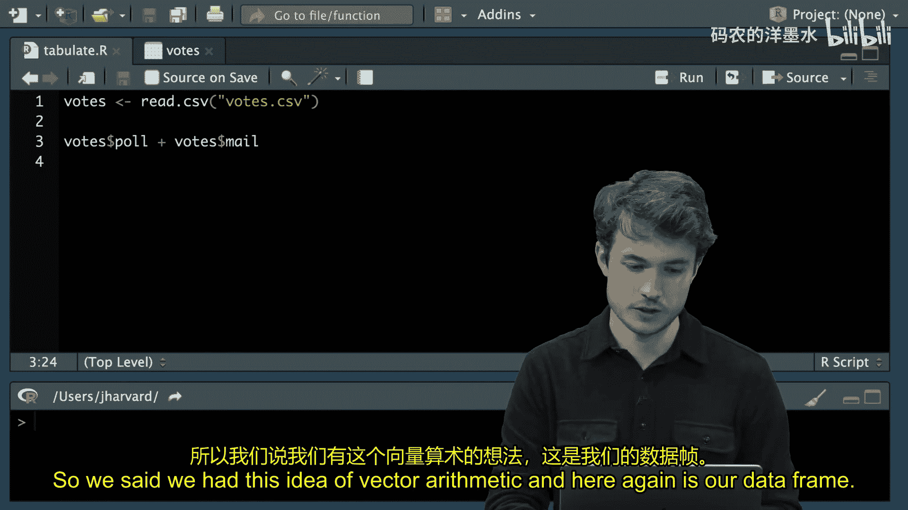

```r
votes$total <- votes$poll + votes$mail
```

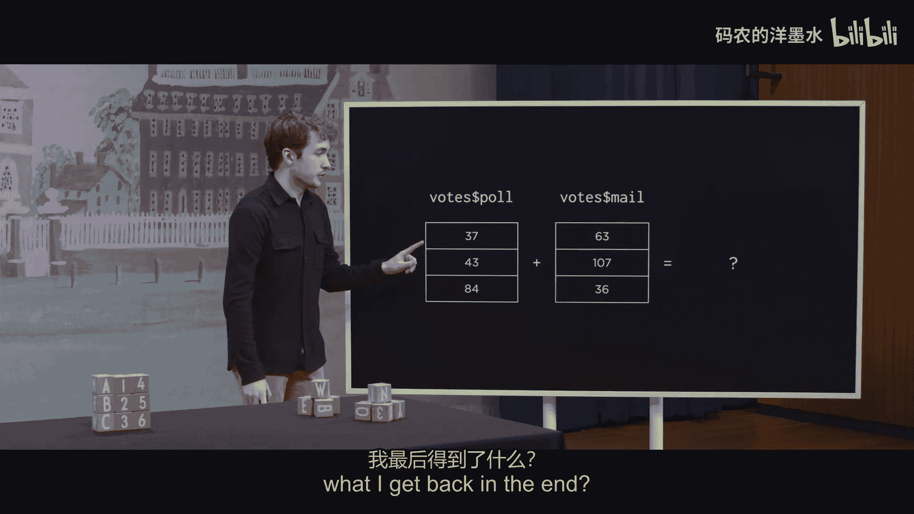

处理完数据后，我们可以使用 `write.csv` 函数将数据框保存回CSV文件。


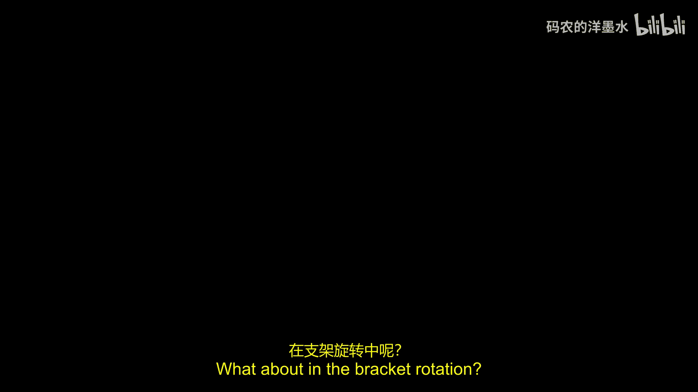


```r
write.csv(votes, "totals.csv", row.names = FALSE)
```

---

## 分类数据与因子 🏷️

上一节我们处理了数值和表格。本节中，我们来看看一种特殊的数据类型：分类数据。

在调查数据中，答案通常是类别性的（例如，“是”、“否”、“不确定”），但在数据集中可能用数字（1，2，3）编码。R使用 **因子** 来高效地表示和处理这类分类数据。

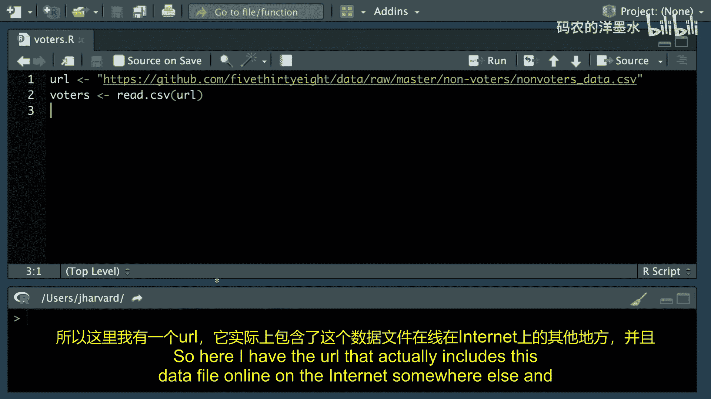


我们可以使用 `factor()` 函数将向量转换为因子。

```r
# 假设 q21 是一个包含 1,2,3 的向量，代表对某个问题的回答
q21_vector <- voters$q21
q21_factor <- factor(q21_vector)
```

因子有“水平”，即数据中唯一的类别。为了使数据更易读，我们可以在创建因子时为这些水平指定标签：

```r
q21_factor <- factor(q21_vector,
                     levels = c(1, 2, 3),
                     labels = c("Yes", "No", "Unsure/Undecided"))
```

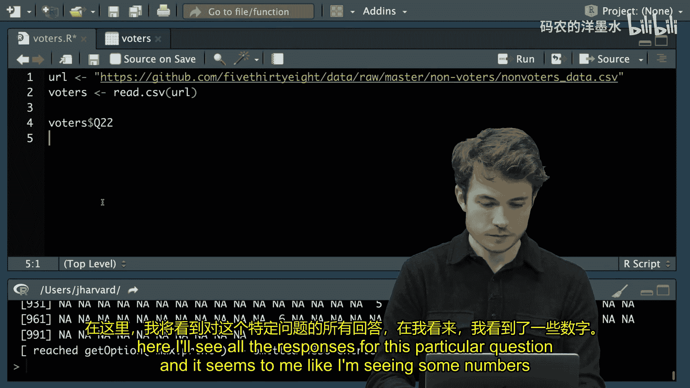

有时数据集中会包含需要特殊处理的值，例如未知编码（如-1）或缺失值。R用 `NA` 表示缺失值。我们可以在创建因子时排除某些值：

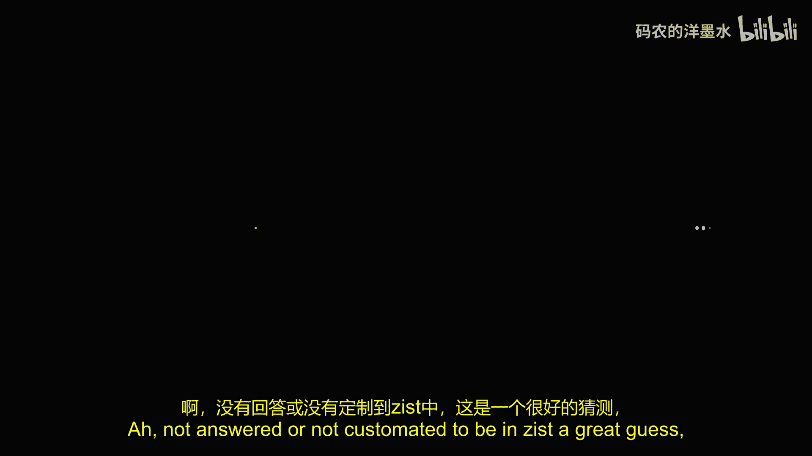

```r
q21_factor <- factor(q21_vector,
                     levels = c(1, 2, 3),
                     labels = c("Yes", "No", "Unsure/Undecided"),
                     exclude = -1)
```


被排除的值在因子中会显示为 `NA`。因子使得分类数据的分析和可视化变得更加直观和方便。


---

## 总结 ✨

本节课中我们一起学习了R语言数据表示的基础知识。

我们从最简单的“Hello World”程序开始，理解了函数、参数和副作用的概念。接着，我们通过 `readline` 和变量实现了与用户的交互，并学会了使用 `paste` 进行字符串拼接。

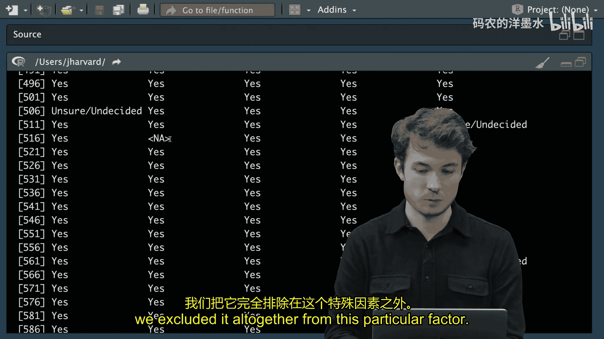


然后，我们探索了不同的数据类型，使用 `as.integer` 进行类型转换，并利用算术运算符和 `sum` 函数处理数值计算。

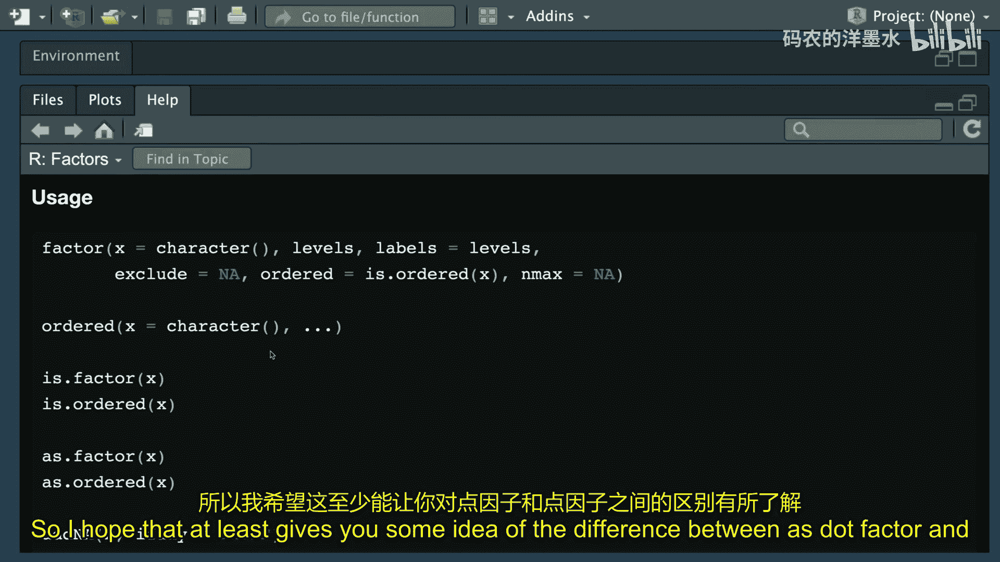

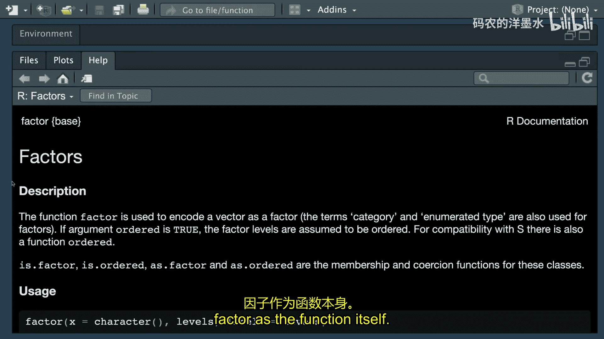

对于更复杂的表格数据，我们引入了 **数据框** 这一核心结构，学习了如何用 `read.csv` 读取数据，并通过 `$` 和 `[ ]` 访问行列。我们还见识了 **向量化运算** 的强大之处。


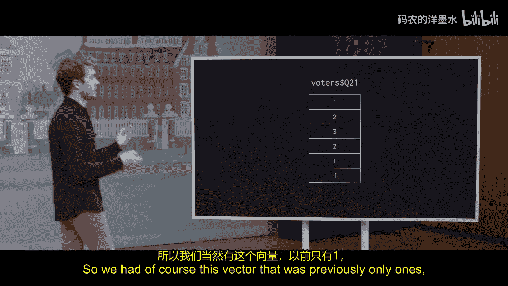


最后，我们了解了用于表示分类数据的 **因子**，以及如何通过定义水平和标签使数据更具可读性，并处理缺失或无效值。

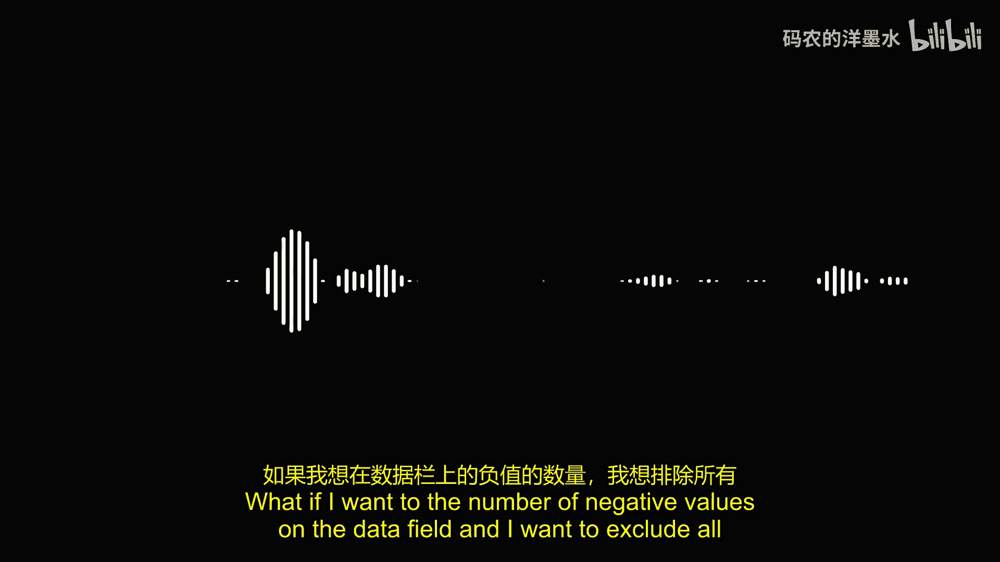


这些关于数据表示的基本概念是后续进行数据操作、分析和可视化的基石。下一节课，我们将学习如何对数据进行筛选、转换和整理。