# 003：数据转换 📊


在本节课中，我们将学习如何转换数据。我们将了解如何移除不需要的数据片段，如何对数据进行子集化以查找特定部分，以及最终如何将来自不同来源的数据组合成一个单一的数据集。

---

## 数据中的异常值 🧊

在统计学或数据科学中，你可能听说过**异常值**的概念，即落在某个标准范围之外的数据点。

例如，下图显示了美国东北部一月份的平均气温。在y轴上，温度以华氏度表示。在x轴上，是月份的日期（1到31日）。条形图的高度代表该日的平均温度。


在美国东北部，一月份通常很冷，温度大多在零度左右，但有时也可能高达50华氏度。然而，从图中可以看出，有几天明显超出了这个范围：第2天和第4天异常寒冷（约-10到-20华氏度），而第7天则异常温暖（约60华氏度以上）。这些就是数据集中的异常值。

出于某些原因，科学家或统计学家可能希望完全移除这些异常值，并在不包含它们的情况下进行分析。接下来，让我们看看如何使用R来解决异常值的问题。


---

## 在R中处理异常值 🔧


我们回到RStudio集成开发环境。首先，我们创建一个新的R脚本文件。

```r
file.create("temps.R")
```

现在，我们打开这个文件。在R中，我们经常需要从文件中读取数据。除了CSV文件，R还可以处理一种特定的R数据文件格式（`.RData`），它可以直接存储R的数据结构（如向量、数据框）。

我们可以使用 `load()` 函数来加载一个R数据文件。


```r
load("temps.RData")
```

运行这行代码后，我们会在环境面板中看到一个名为 `temps` 的向量，它包含了31个数值，代表一月份每天的平均温度。


为了了解整体情况，我们可以先计算整个一月份的平均温度。我们使用 `mean()` 函数来计算平均值。

```r
mean(temps)
```
**输出**：`22.74`

这告诉我们，一月份的平均温度大约是22.74华氏度。但这并不是我们的主要目标。我们的目标是处理那些看起来异常的数据点（异常值）。

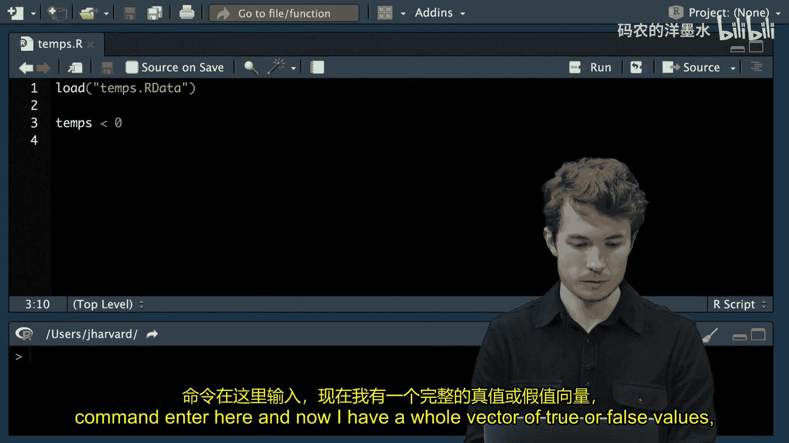

我们可以通过输入向量名来查看整个 `temps` 向量。

```r
temps
```


在输出中，我们可以看到第2个值为-15，第4个值为-20，第7个值为65。这些就是我们的异常值。

上一节我们介绍了如何查看数据，本节中我们来看看如何提取这些异常值。我们之前学过，可以使用索引（方括号 `[]`）来访问向量中的特定元素。


```r
temps[2]  # 输出: -15
temps[4]  # 输出: -20
temps[7]  # 输出: 65
```

然而，我们更希望得到一个包含所有异常值的向量，而不是单独访问它们。在R中，我们可以使用一个索引向量来一次性获取多个元素。

```r
temps[c(2, 4, 7)]
```
**输出**：`-15 -20 65`


这样，我们就得到了一个包含所有异常值的新向量。但请注意，这并没有从原始向量中移除它们，只是提取了出来。

---

## 从向量中移除元素 ➖

如果我们想从原始向量中移除这些异常值，可以在索引向量前加上负号 `-`。

```r
temps[-c(2, 4, 7)]
```

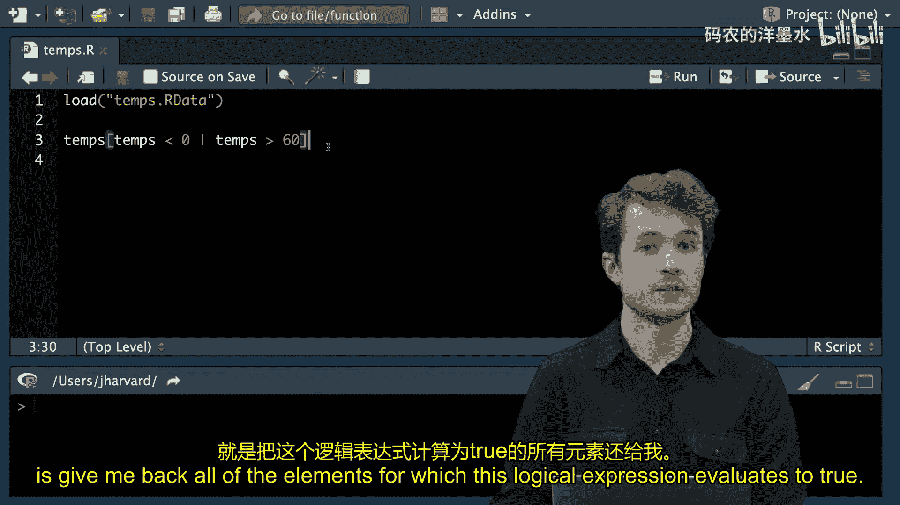

运行这行代码会返回一个不包含第2、4、7个元素的新向量。但请注意，这并没有修改原始的 `temps` 向量。如果我们想永久地修改它，需要将结果重新赋值给 `temps`。


```r
temps <- temps[-c(2, 4, 7)]
```

现在，`temps` 向量中就不再包含那些异常值了。

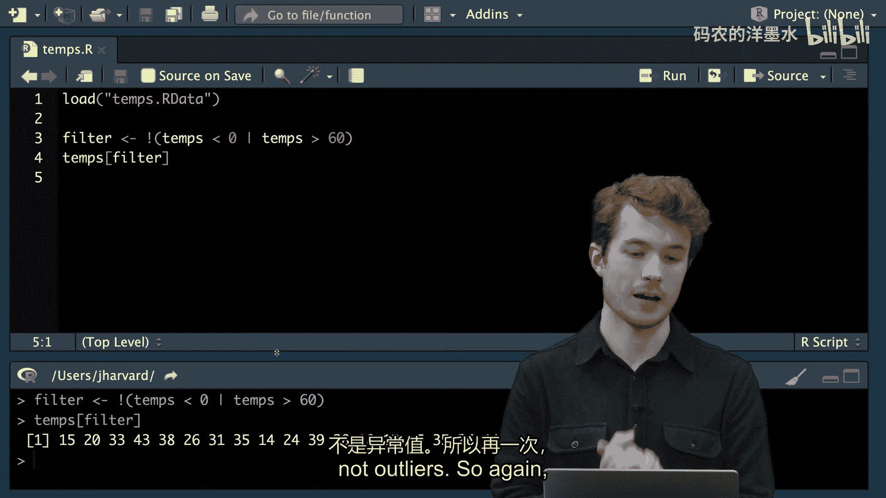

---


## 使用逻辑表达式自动识别异常值 🧠

手动查找异常值的索引效率很低，尤其是数据量很大时。更好的方法是向数据提问：“这个数据点是异常值吗？” 在R中，我们可以使用**逻辑表达式**来提出这种是/否问题。


逻辑表达式使用**比较运算符**：
*   `==`：等于
*   `!=`：不等于
*   `>`：大于
*   `>=`：大于等于
*   `<`：小于
*   `<=`：小于等于

这些表达式会返回**逻辑值**：`TRUE`（真）或 `FALSE`（假）。


让我们用逻辑表达式来识别温度低于0度（过冷）的异常值。

```r
temps < 0
```
这将返回一个与 `temps` 等长的逻辑向量，其中满足条件（温度<0）的位置为 `TRUE`。

我们也可以一次性对整个向量提问。R的许多运算符是**向量化**的，这意味着它们可以直接对整个向量进行操作。

```r
temps < 0
```
**输出**：一个逻辑向量，其中第2和第4个位置为 `TRUE`。

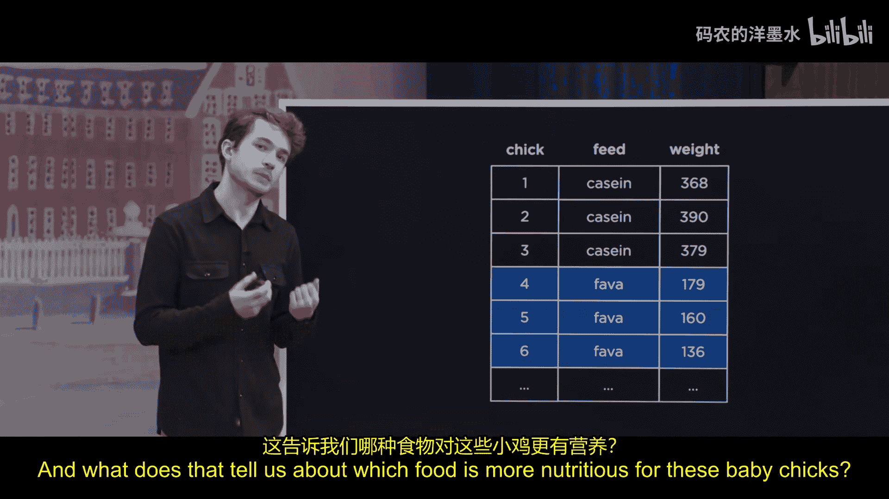

为了同时找出过冷（<0）和过热（>60）的异常值，我们需要组合逻辑表达式。这时需要使用**逻辑运算符**：
*   `&`：与（两个条件都需满足）
*   `|`：或（满足其中一个条件即可）

对于向量，我们使用单个符号 `&` 和 `|`。

```r
(temps < 0) | (temps > 60)
```
这个表达式会检查每个温度是否小于0 **或** 大于60，并返回相应的逻辑向量。现在，第2、4、7个位置都应该是 `TRUE`。

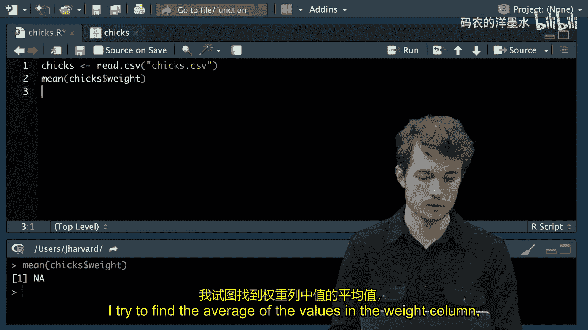

我们可以使用 `which()` 函数来找出逻辑向量中哪些位置是 `TRUE`。


```r
which((temps < 0) | (temps > 60))
```
**输出**：`2 4 7`

这样，我们就自动找到了所有异常值的索引。

---

## 使用逻辑向量进行子集化 🎯

实际上，在R中，我们可以直接用逻辑向量来对向量进行子集化。R会返回所有对应逻辑值为 `TRUE` 的元素。

```r
filter <- (temps < 0) | (temps > 60)
temps[filter]
```
**输出**：`-15 -20 65`

这直接给出了异常值向量。如果我们想要非异常值（即正常值）的向量，可以使用逻辑非运算符 `!` 来取反。

```r
temps[!filter]
```
这将返回所有不是异常值的温度。

现在，我们可以创建两个清晰的向量：一个包含异常值，一个不包含。

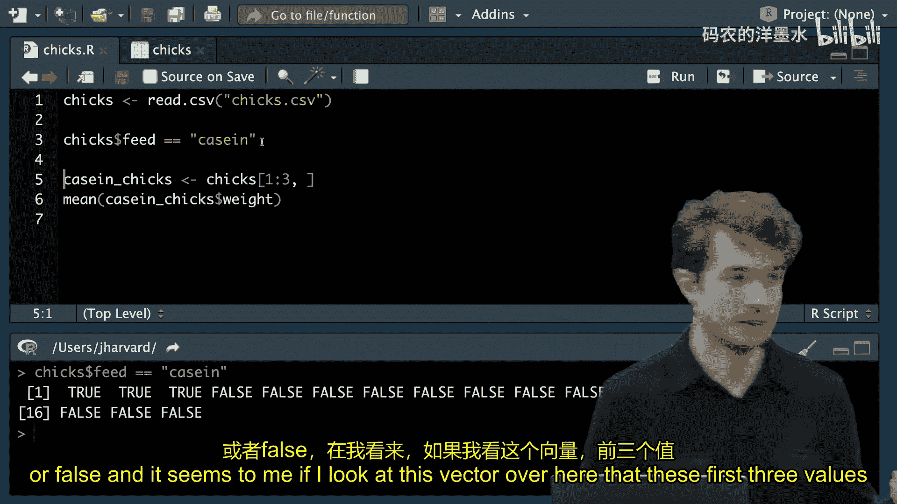


```r
outliers <- temps[filter]
no_outliers <- temps[!filter]
```

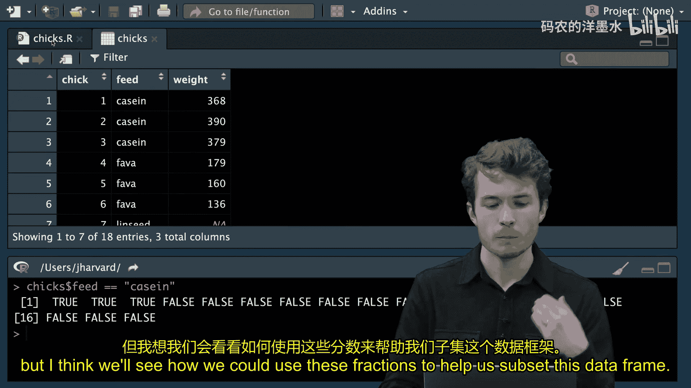

最后，我们可以使用 `save()` 函数将这些向量保存为R数据文件，以便后续使用。

```r
save(no_outliers, file = "no_outliers.RData")
save(outliers, file = "outliers.RData")
```


---

## 对数据框进行子集化 📋

上一节我们介绍了如何处理向量的异常值，本节中我们来看看如何对更复杂的结构——数据框进行子集化。我们将使用一个关于小鸡生长的数据集，其中包含小鸡编号、饲料类型和两周后的体重。

首先，我们读取数据并查看。

```r
chicks <- read.csv("chicks.csv")
View(chicks)
```

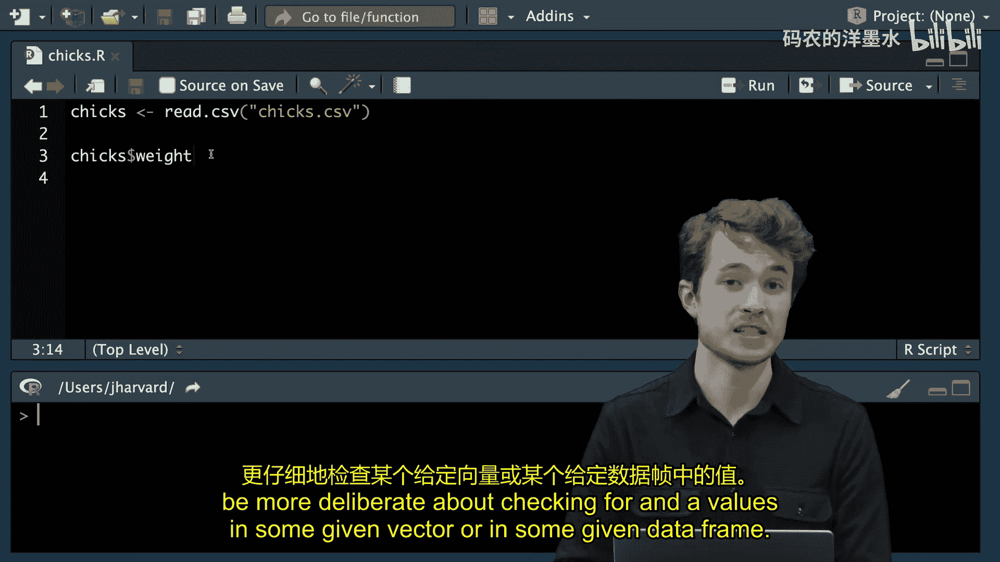

数据框中有一些体重值为 `NA`（不可用）。如果我们直接计算平均体重，`mean()` 函数会因为 `NA` 的存在而返回 `NA`。


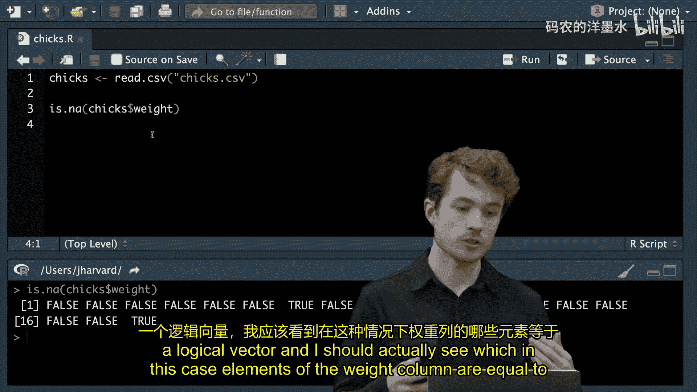


```r
mean(chicks$weight) # 输出: NA
```

我们需要告诉 `mean()` 函数在计算前移除 `NA` 值，通过设置参数 `na.rm = TRUE`。

```r
mean(chicks$weight, na.rm = TRUE) # 输出: 280.77
```

但我们更感兴趣的是计算不同饲料组小鸡的平均体重。例如，只计算喂食 `casein` 的小鸡的体重。

一种方法是手动找出喂食 `casein` 的行索引（假设是第1-3行），然后进行子集化。

```r
casein_chicks <- chicks[c(1, 2, 3), ]
mean(casein_chicks$weight, na.rm = TRUE)
```

但这种方法不灵活且容易出错。更好的方法是使用逻辑表达式。我们可以创建一个逻辑向量，标识出 `feed` 列等于 `"casein"` 的行。

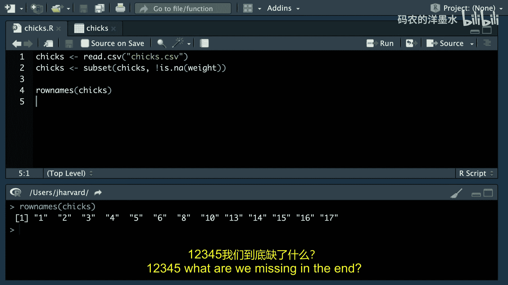


```r
filter <- chicks$feed == "casein"
```

然后，我们可以用这个逻辑向量对数据框进行子集化。R会保留所有对应逻辑值为 `TRUE` 的行。

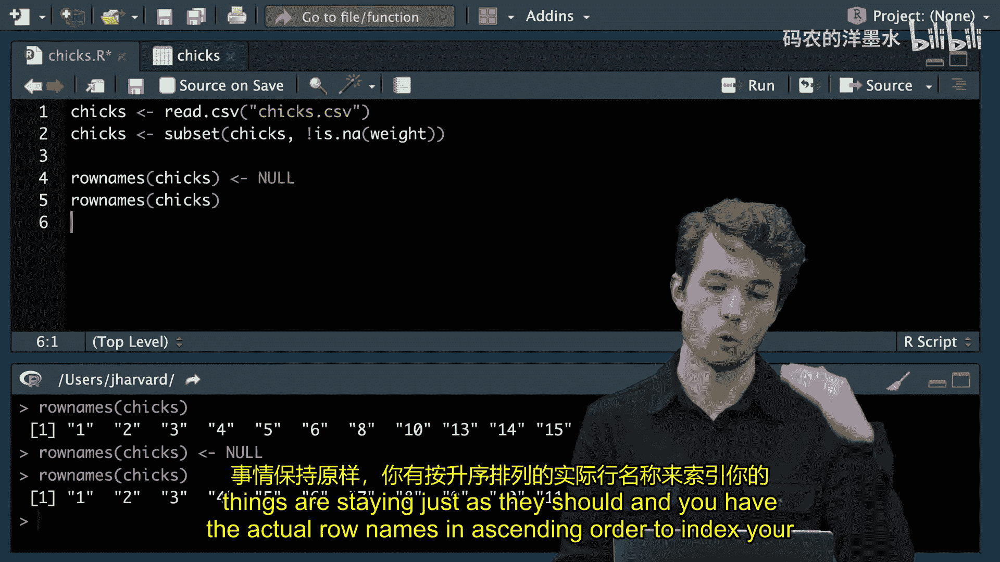

```r
casein_chicks <- chicks[filter, ]
```


我们也可以使用 `subset()` 函数，它专为数据框设计，语法更简洁。

```r
casein_chicks <- subset(chicks, feed == "casein")
```

在子集化之后，数据框的行名（row names）可能不再连续。我们可以通过将其设置为 `NULL` 来重置行名。

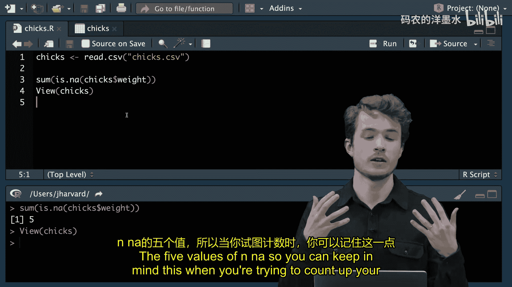

```r
rownames(casein_chicks) <- NULL
```

---

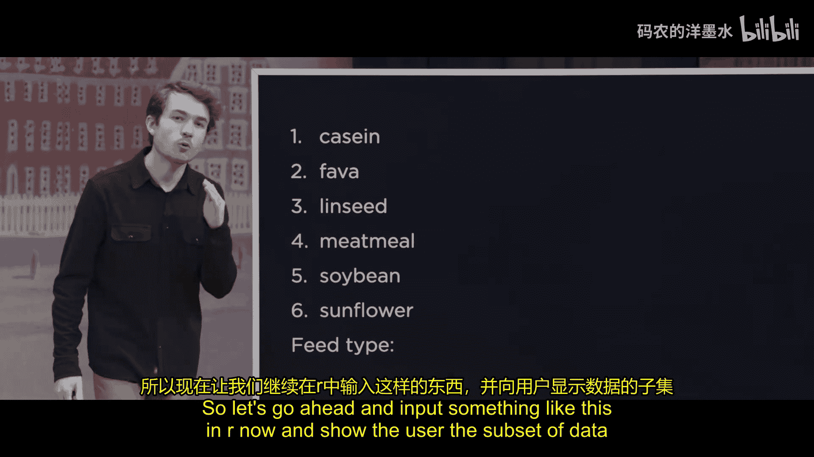

## 处理数据框中的NA值 🗑️

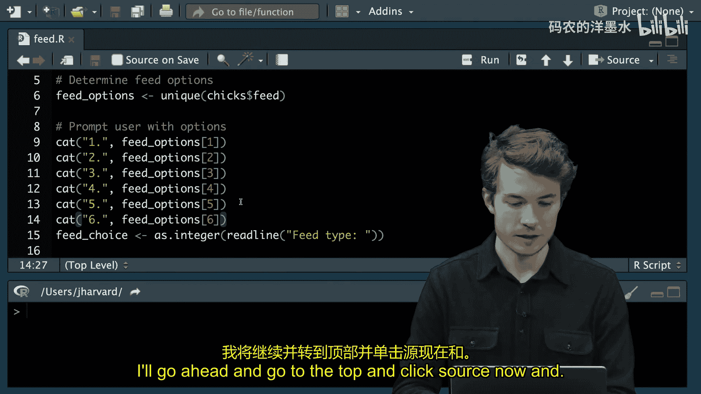

在进行分析前，我们可能希望先移除所有体重为 `NA` 的行。我们可以使用 `is.na()` 函数来检测 `NA` 值，然后取反来获得有效数据的逻辑向量。


```r
valid_weight <- !is.na(chicks$weight)
chicks <- chicks[valid_weight, ]
# 或者使用 subset 函数
chicks <- subset(chicks, !is.na(weight))
```

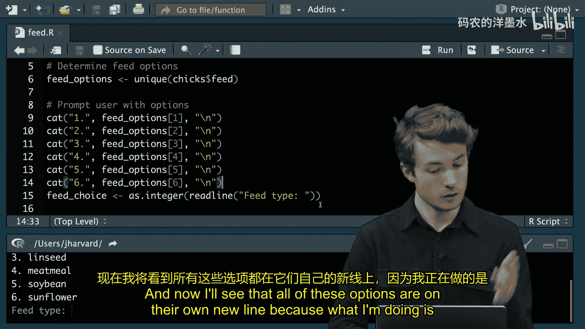

现在，`chicks` 数据框中就不再有体重为 `NA` 的行了。


如果我们想统计原始数据中有多少个 `NA`，可以利用逻辑值 `TRUE` 在数值计算中等于1，`FALSE` 等于0的特性。

```r
sum(is.na(chicks$weight))
```
这会将逻辑向量中 `TRUE` 的个数相加，从而得到 `NA` 的数量。

---

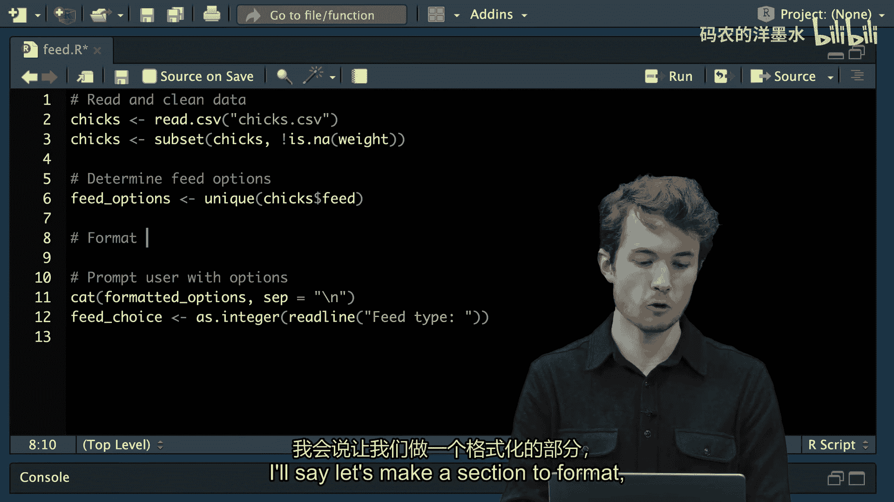

## 创建用户交互式菜单 📝

上一节我们介绍了如何根据条件子集化数据，本节中我们来看看如何让用户来选择他们想看的数据子集。我们将创建一个程序，让用户从不同的饲料类型中选择一种，然后显示对应的小鸡数据。

首先，我们获取所有不重复的饲料选项。

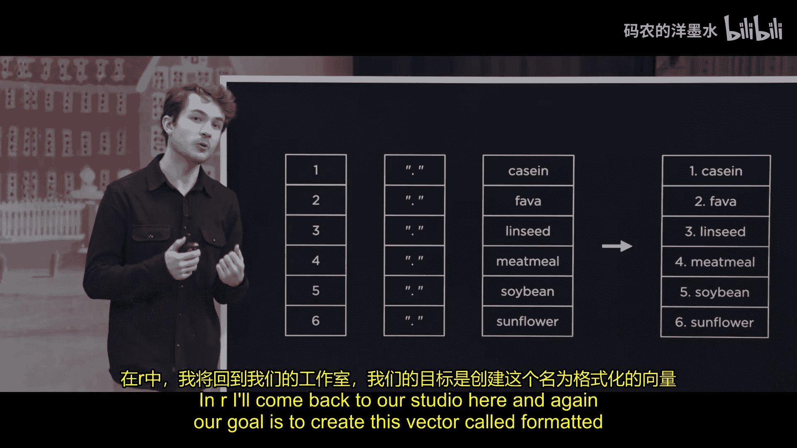

```r
feed_options <- unique(chicks$feed)
```

然后，我们需要将这些选项格式化为一个菜单显示给用户。我们可以使用 `paste()` 函数来向量化地创建菜单项。

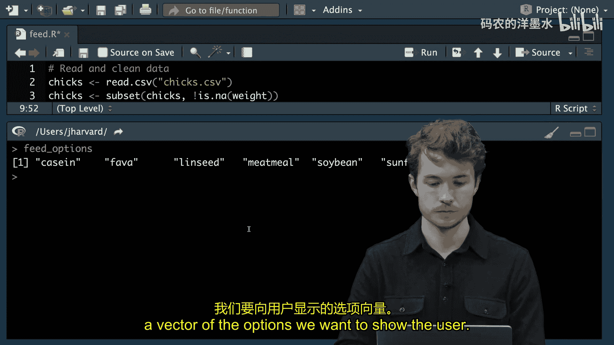

```r
formatted_options <- paste0(1:length(feed_options), ". ", feed_options)
```

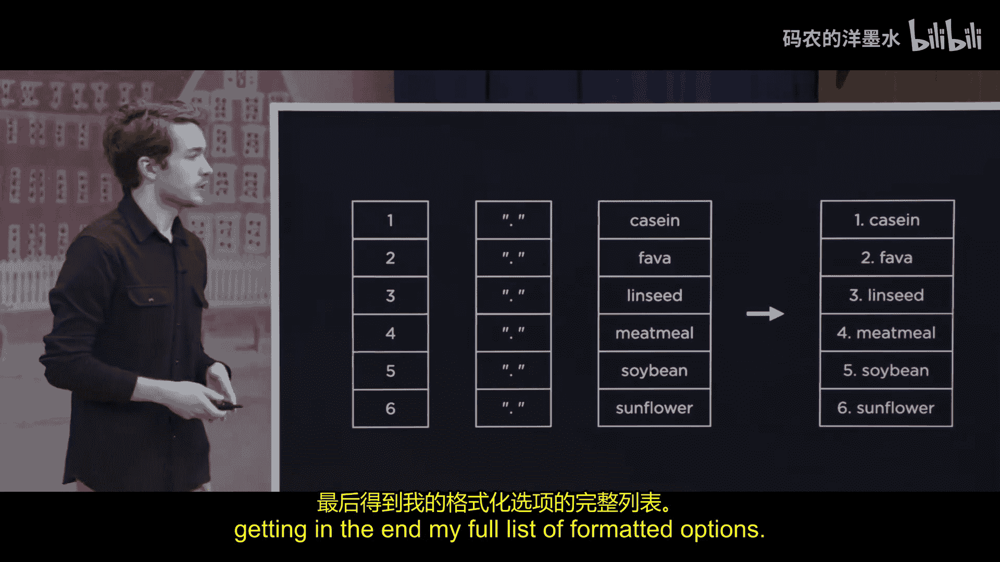

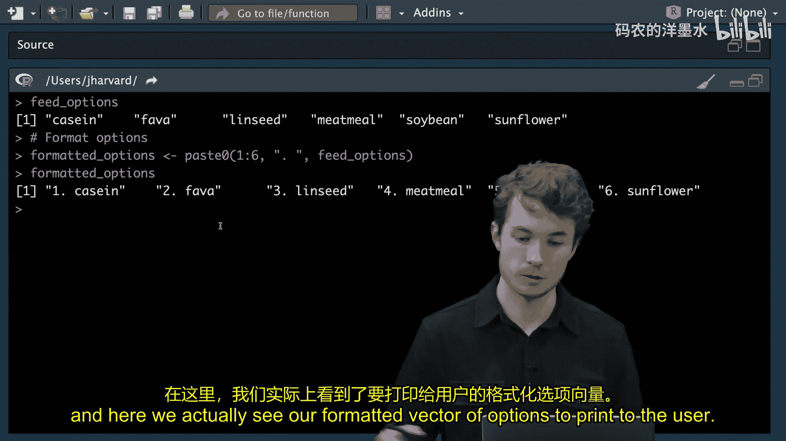

`paste0()` 将数字序列、点号和饲料选项向量按元素连接起来。如果向量长度不同，R会循环利用较短的向量（称为“回收”）。

接下来，我们使用 `cat()` 函数和换行符 `\n` 将菜单打印出来。


```r
cat(formatted_options, sep = "\n")
```

然后，我们使用 `readline()` 函数获取用户输入。

```r
feed_choice <- as.integer(readline("Enter the number of the feed type: "))
```

我们需要处理无效输入（如数字超出范围）。这时可以使用**条件语句** `if` 和 `else`。

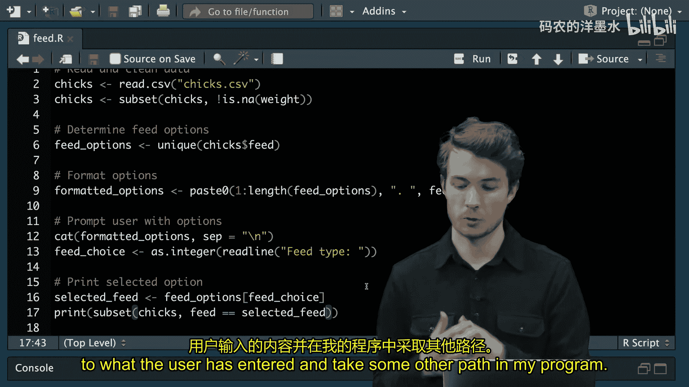


```r
if (feed_choice < 1 | feed_choice > length(feed_options)) {
  cat("Invalid choice.\n")
} else {
  selected_feed <- feed_options[feed_choice]
  selected_chicks <- subset(chicks, feed == selected_feed)
  print(selected_chicks)
}
```

如果用户输入无效，程序会提示“Invalid choice.”；如果输入有效，则显示对应的小鸡数据子集。

---

## 合并不同来源的数据 🤝

在实际工作中，数据通常存储在不同的文件或表格中。例如，一家公司的销售数据可能按季度存储在四个独立的CSV文件中（Q1.csv, Q2.csv, Q3.csv, Q4.csv）。每个文件的结构相同，都包含`customer_id`和`sale_amount`列。

我们的任务是将这些数据合并成一个全年度的数据集。我们可以使用 `rbind()` 函数（行绑定）来垂直堆叠这些数据框。

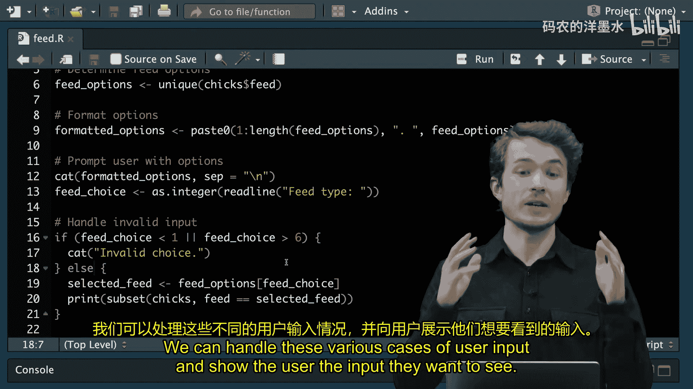

```r
q1 <- read.csv("Q1.csv")
q2 <- read.csv("Q2.csv")
q3 <- read.csv("Q3.csv")
q4 <- read.csv("Q4.csv")

total_sales <- rbind(q1, q2, q3, q4)
```


合并后，`total_sales` 数据框包含了所有季度的数据。但是，我们丢失了每条销售记录属于哪个季度的信息。为了解决这个问题，我们可以在合并前，为每个季度的数据框添加一个标识列。

```r
q1$quarter <- "Q1"
q2$quarter <- "Q2"
q3$quarter <- "Q3"
q4$quarter <- "Q4"

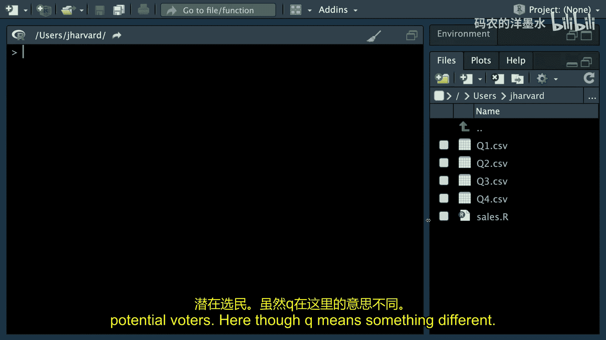

total_sales <- rbind(q1, q2, q3, q4)
```


现在，`total_sales` 数据框中就多了一个 `quarter` 列。

---

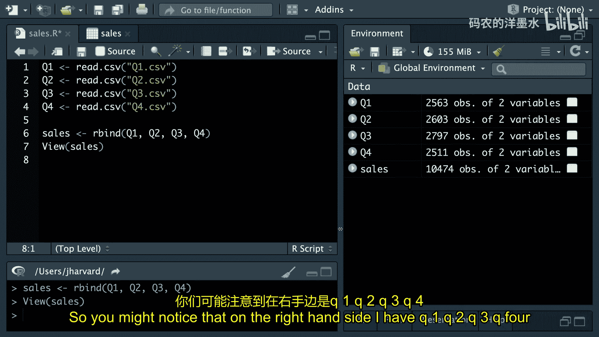

## 基于条件创建新列 🏷️


最后，我们可能想基于现有列的值创建一个新的分类列。例如，根据销售额标记交易是“高价值”还是“常规”。

我们可以使用 `ifelse()` 函数，它非常适合对向量进行条件赋值。
*   第一个参数：逻辑条件（向量）
*   第二个参数：条件为 `TRUE` 时的返回值
*   第三个参数：条件为 `FALSE` 时的返回值

```r
total_sales$value <- ifelse(total_sales$sale_amount > 100, "High Value", "Regular")
```

这行代码会创建一个新的 `value` 列：如果 `sale_amount` 大于100，则值为“High Value”，否则为“Regular”。

---

## 总结 📚

在本节课中，我们一起学习了数据转换的核心技能：

1.  **识别与处理异常值**：使用逻辑表达式（比较运算符和逻辑运算符）和 `which()` 函数自动定位数据中的异常点，并通过索引或逻辑子集化来移除或提取它们。
2.  **数据框的子集化**：使用逻辑表达式或 `subset()` 函数，根据特定条件筛选出行，并对结果进行清理（如重置行名）。
3.  **处理缺失值**：使用 `is.na()` 识别 `NA`，并在计算或子集化前妥善处理它们（如移除或忽略）。
4.  **创建用户交互**：利用 `readline()` 获取输入，使用条件语句（`if`, `else`）处理不同情况，构建简单的交互式程序。
5.  **合并数据**：使用 `rbind()` 函数将结构相同的多个数据框垂直合并，并在合并前添加必要的标识列以保留来源信息。
6.  **创建衍生列**：使用向量化的 `ifelse()` 函数，基于现有列的逻辑条件，高效地创建新的分类列。

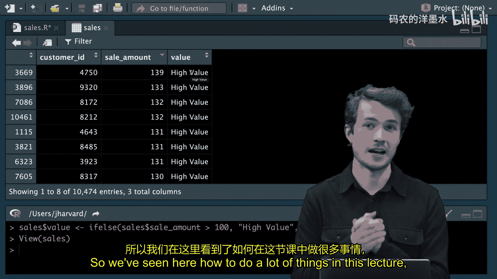

通过这些工具，你可以清理、筛选、组合数据，并为其添加新的信息层，为后续的分析和可视化做好准备。下一讲，我们将深入探讨如何编写自定义函数。