# 005：数据整理 📊


在本节课中，我们将学习如何使用R语言中的工具来整理和清理数据。数据常常以混乱的格式出现，例如表格形状不正确、格式错误或包含不需要的字符。我们将利用R社区中已有的解决方案——**包**，特别是**tidyverse**系列包，来解决这些问题。通过本课，你将学会如何选择、过滤、排序、分组和汇总数据，以及如何将数据转换为整洁的格式。


---

## 安装与加载包 📦


在R中，我们可以使用他人编写的代码，这些代码被称为**包**。我们可以从CRAN（综合R档案网络）下载和安装包。今天，我们将重点介绍**tidyverse**，它实际上是一个包的集合，其中包括用于数据转换的**dplyr**、用于数据可视化的**ggplot2**、用于处理字符串的**stringr**以及用于整理R数据结构的**tidyr**。


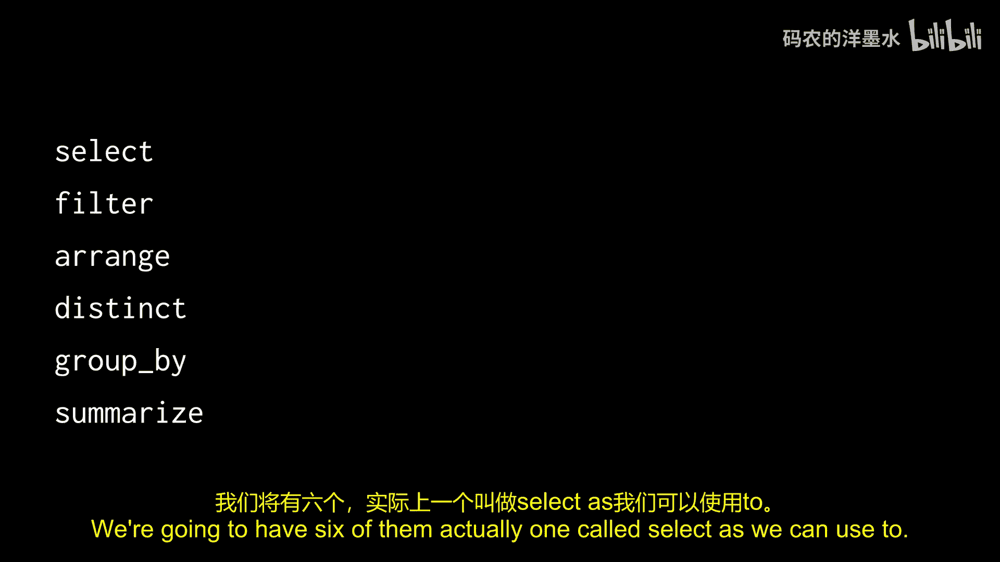


要安装`tidyverse`包，可以使用以下函数：

```r
install.packages("tidyverse")
```

安装完成后，需要使用`library()`函数将其加载到当前会话中：

```r
library(tidyverse)
```

请注意，**包**是他人编写供我们使用的代码，而**库**是这些包存储在我们计算机上的位置。

---

## 使用dplyr转换数据 🔧

`dplyr`包提供了一系列函数，用于操作和转换数据。我们可以将其想象成用钳子将数据塑造成我们想要的形状。以下是`dplyr`中的六个核心函数：

1.  **`select`**: 用于选择数据框中的特定列。
2.  **`filter`**: 用于根据条件过滤行。
3.  **`arrange`**: 用于对行进行排序。
4.  **`distinct`**: 用于查找唯一的行。
5.  **`group_by`**: 用于对数据进行分组。
6.  **`summarize`**: 用于对分组数据进行汇总。

我们将使用内置的`storms`数据集来演示这些函数。该数据集来自美国国家海洋和大气管理局（NOAA），记录了北大西洋地区强风暴的观测数据。

### 探索storms数据集

首先，让我们查看`storms`数据集的结构：

```r
storms
```

输出显示这是一个**tibble**，这是tidyverse中一种特殊的数据框，能提供更丰富的信息。数据集约有19,537行和13列，包括风暴名称、年份、月份、日期、小时、纬度、经度、状态、类别、风速（节）和气压等列。

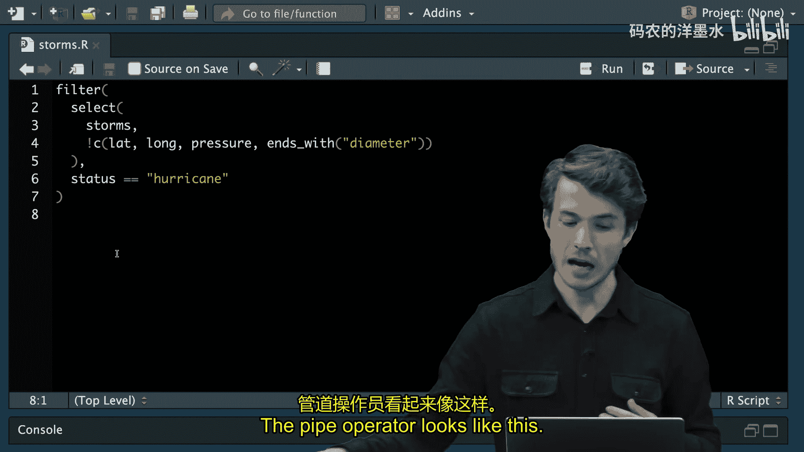

### 使用select选择列

假设我们只关心风暴名称、年份、状态、类别和风速，而不需要纬度、经度、气压等列。我们可以使用`select`函数来删除不需要的列：

```r
select(storms, -lat, -long, -pressure, -ends_with("diameter"))
```

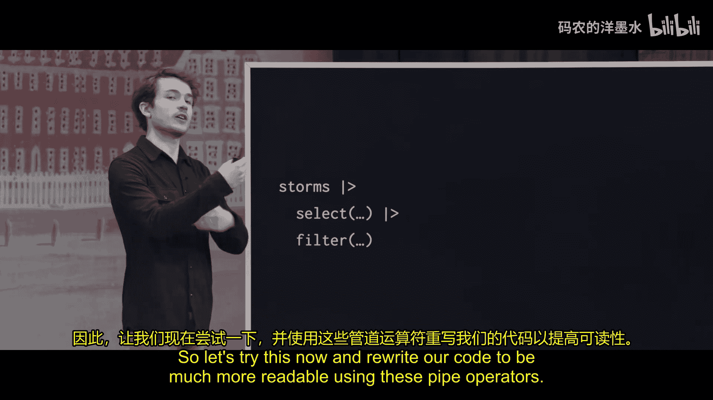

这里，`-`表示删除列，`ends_with("diameter")`是一个辅助函数，用于选择所有以"diameter"结尾的列名。

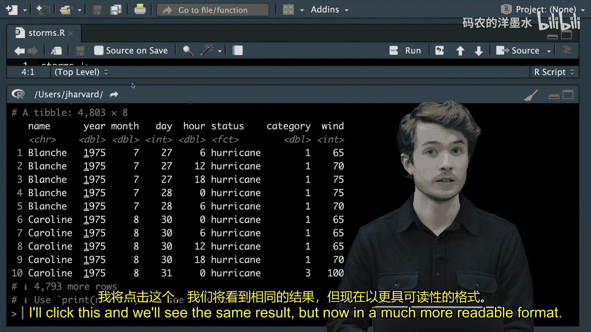

### 使用filter过滤行

接下来，我们可能只对飓风感兴趣，而不是热带低压或热带风暴。我们可以使用`filter`函数来筛选状态为"hurricane"的行：


```r
filter(storms, status == "hurricane")
```

### 使用管道操作符 %>% 简化代码

嵌套多个函数会使代码难以阅读。R中的**管道操作符** `%>%` 允许我们将左侧的值作为第一个参数传递到右侧的函数中，从而使代码更清晰。

例如，我们可以将上述操作串联起来：

```r
storms %>%
  select(-lat, -long, -pressure, -ends_with("diameter")) %>%
  filter(status == "hurricane")
```

这样，代码可以从左到右、从上到下阅读，更加直观。

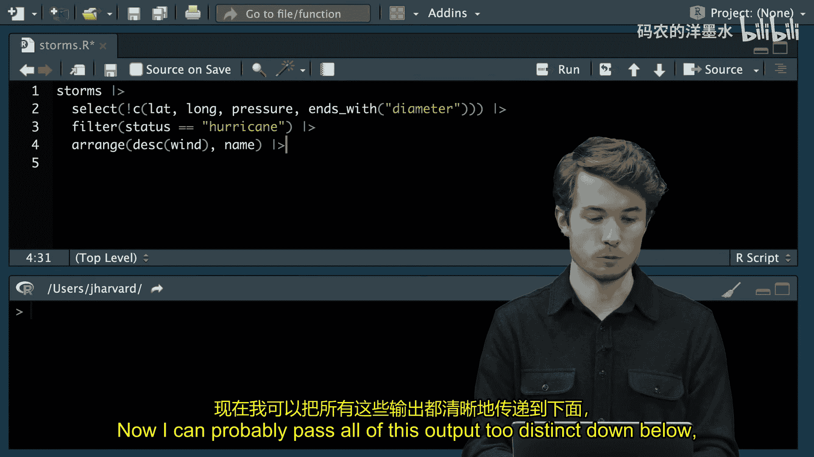

### 使用arrange排序行

现在，我们想按风速从高到低对飓风进行排序。可以使用`arrange`函数：

```r
storms %>%
  select(-lat, -long, -pressure, -ends_with("diameter")) %>%
  filter(status == "hurricane") %>%
  arrange(desc(wind))
```

`desc(wind)`表示按`wind`列降序排列。如果风速相同，我们还可以按名称字母顺序排序：

```r
arrange(desc(wind), name)
```

### 使用distinct去除重复行


数据集中包含多次观测，但我们可能只关心每个飓风的唯一记录。`distinct`函数可以帮助我们去除重复行。默认情况下，它会比较所有列的值。但为了正确识别唯一的飓风，我们需要同时考虑`name`和`year`列：

```r
storms %>%
  select(-lat, -long, -pressure, -ends_with("diameter")) %>%
  filter(status == "hurricane") %>%
  arrange(desc(wind), name) %>%
  distinct(name, year, .keep_all = TRUE)
```

参数`.keep_all = TRUE`确保在去除重复行时保留所有其他列。

---

## 使用group_by和summarize进行分组汇总 📈

上一节我们介绍了如何选择、过滤、排序和去重数据。本节中，我们来看看如何对数据进行分组和汇总。例如，我们可能想知道每年最强的飓风是哪一场。

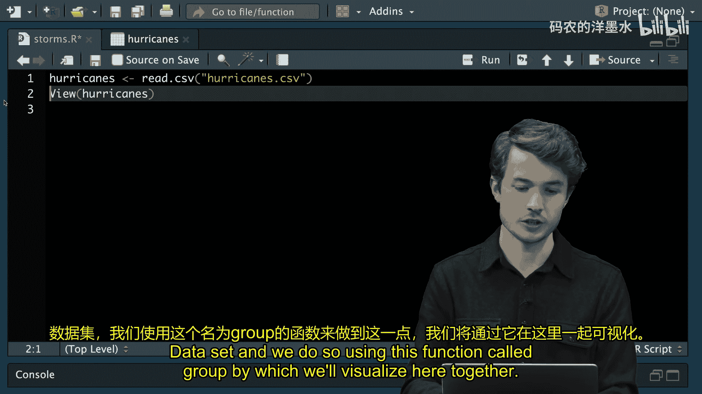

### 分组数据


首先，我们可以使用`group_by`函数按年份对数据进行分组：

```r
hurricanes %>%
  group_by(year)
```

### 在组内排序并选择最大值

分组后，我们可以在每个组内按风速降序排列，然后选择每个组的第一行（即风速最高的飓风）：

```r
hurricanes %>%
  group_by(year) %>%
  arrange(desc(wind), .by_group = TRUE) %>%
  slice_head(n = 1)
```

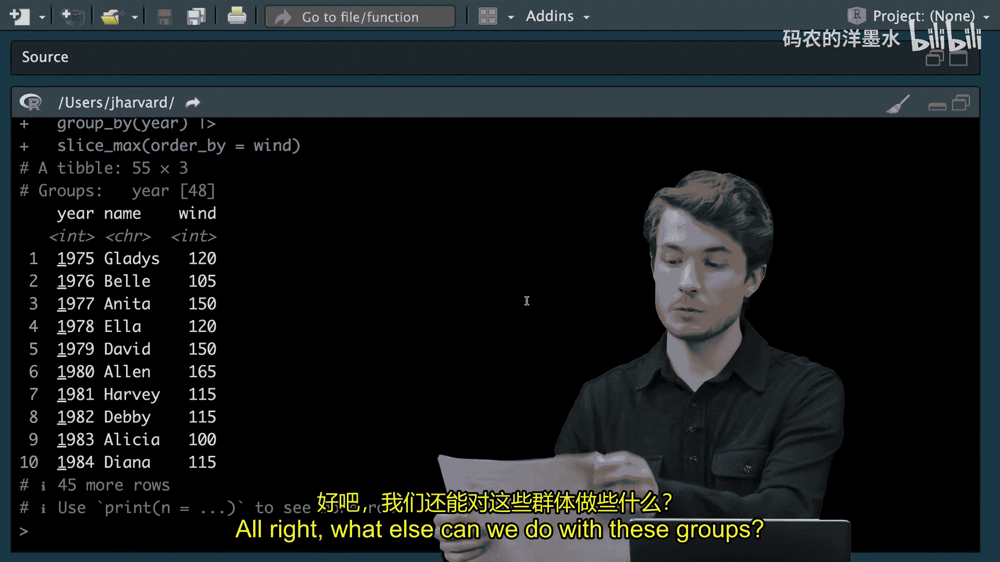

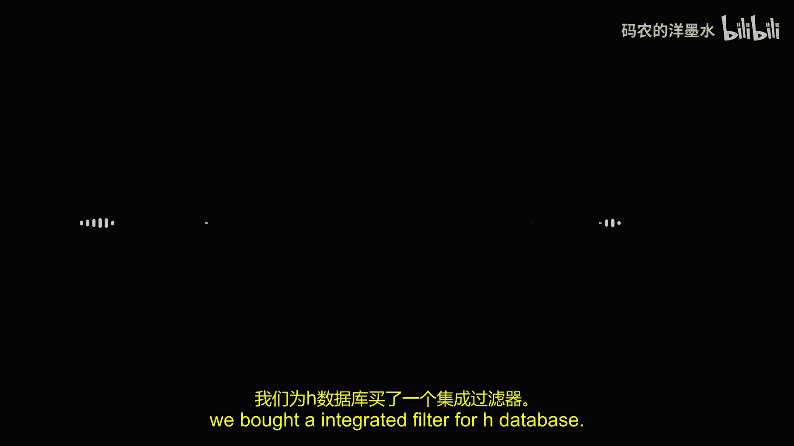

或者，更简洁地使用`slice_max`函数：

```r
hurricanes %>%
  group_by(year) %>%
  slice_max(order_by = wind, n = 1)
```

### 汇总分组数据

我们还可以使用`summarize`函数对每个组进行汇总计算，例如计算每年的飓风数量：

```r
hurricanes %>%
  group_by(year) %>%
  summarize(num_hurricanes = n())
```

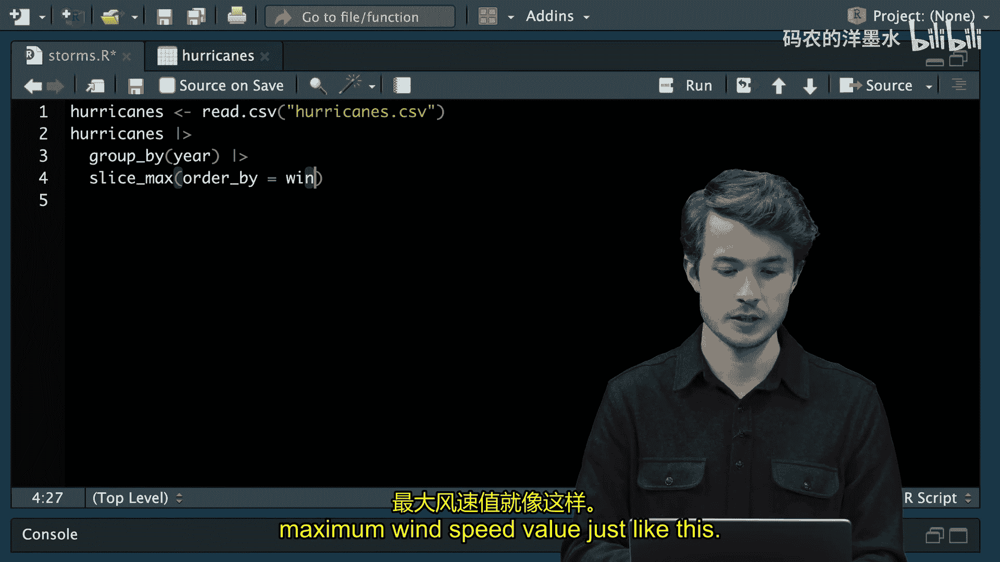

这里，`n()`是一个特殊函数，用于计算每个组中的行数。


### 取消分组

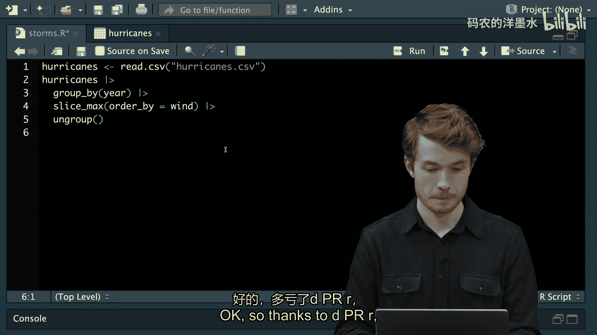

完成分组操作后，如果需要移除分组结构，可以使用`ungroup`函数：

```r
hurricanes %>%
  group_by(year) %>%
  slice_max(order_by = wind, n = 1) %>%
  ungroup()
```

---

## 使用tidyr整理数据结构 🧹

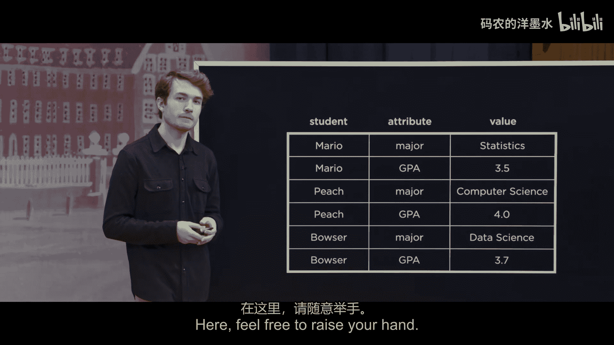


数据不仅需要在内容上整洁，还需要在结构上符合标准。**整洁数据**遵循三个原则：
1.  每个观测值占一行。
2.  每个变量占一列。
3.  每个值占一个单元格。

### 识别不整洁的数据

考虑以下`students`数据集，它记录了学生的专业和GPA：


| student | attribute | value       |
|---------|-----------|-------------|
| Mario   | major     | Statistics  |
| Mario   | GPA       | 3.5         |
| Peach   | major     | Data Science|
| Peach   | GPA       | 4.0         |

这个数据集违反了整洁数据的第二个原则，因为变量（`major`和`GPA`）被存储为`attribute`列的值，而不是单独的列。

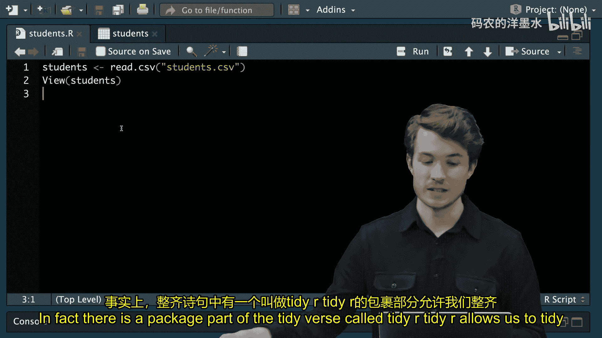

### 使用pivot_wider变宽数据

`tidyr`包中的`pivot_wider`函数可以将长格式数据转换为宽格式。我们需要指定：
*   `id_cols`: 标识唯一行的列（例如`student`）。
*   `names_from`: 其值将成为新列名的列（例如`attribute`）。
*   `values_from`: 其值将填充新列的列（例如`value`）。


```r
students_tidy <- students %>%
  pivot_wider(
    id_cols = student,
    names_from = attribute,
    values_from = value
  )
```


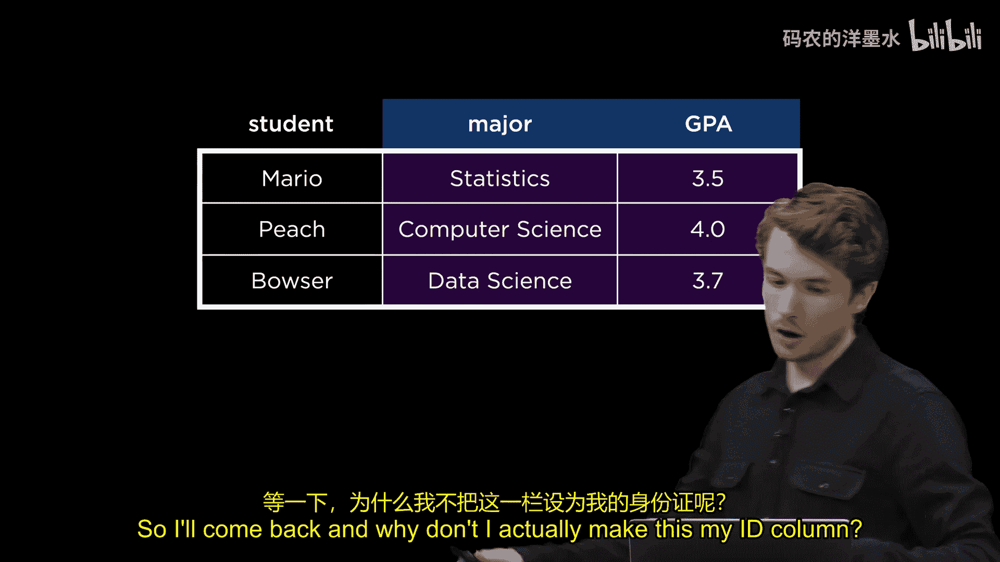

转换后，数据变为：

| student | major        | GPA |
|---------|--------------|-----|
| Mario   | Statistics   | 3.5 |
| Peach   | Data Science | 4.0 |

现在数据是整洁的，我们可以轻松地进行后续分析，例如按专业计算平均GPA：

```r
students_tidy %>%
  mutate(GPA = as.numeric(GPA)) %>% # 确保GPA是数值型
  group_by(major) %>%
  summarize(avg_gpa = mean(GPA))
```

如果原始数据中某个学生的GPA信息缺失，`pivot_wider`会在相应位置填充`NA`。

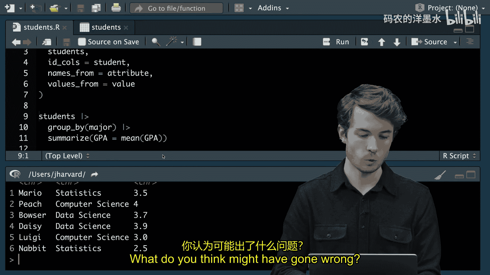

---


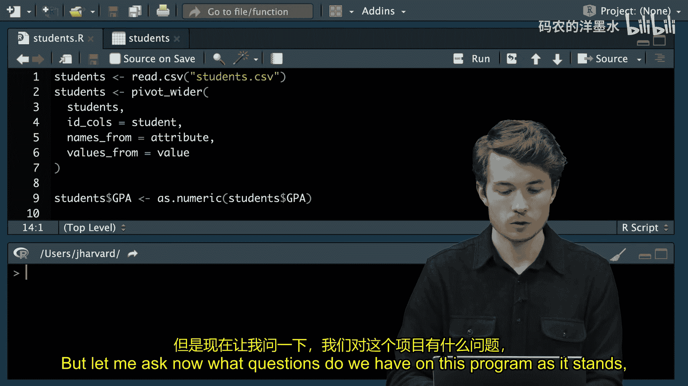

## 使用stringr清理字符串数据 ✨


有时，数据值本身可能很混乱，例如包含多余空格、大小写不一致或拼写错误。`stringr`包提供了处理字符串的函数。


### 修剪和压缩空格

`str_trim`可以删除字符串开头和结尾的空格，`str_squish`可以删除字符串内部多余的空格并将其压缩为单个空格。


```r
shows$show <- shows$show %>%
  str_trim() %>%    # 去除首尾空格
  str_squish()      # 压缩内部空格
```

### 标准化大小写

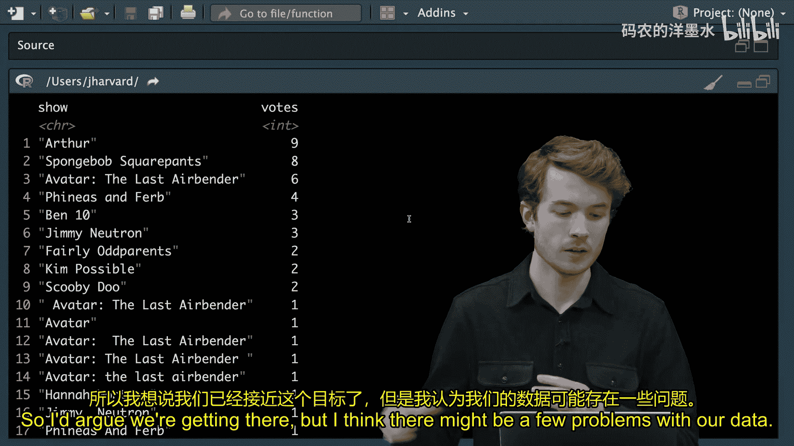


`str_to_lower`、`str_to_upper`和`str_to_title`可以分别将字符串转换为全小写、全大写或标题格式（每个单词首字母大写）。


```r
shows$show <- shows$show %>%
  str_trim() %>%
  str_squish() %>%
  str_to_title()    # 转换为标题格式
```

### 检测和替换字符串

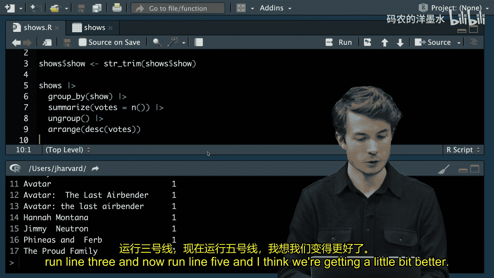

`str_detect`可以检测字符串中是否包含特定模式。例如，我们可以找到所有包含"Avatar"的节目名称，并将其统一为标准的标题：


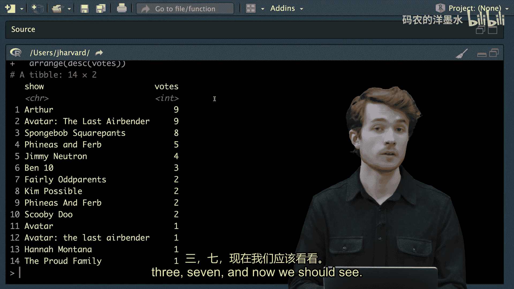

```r
# 检测包含"Avatar"的节目
avatar_indices <- str_detect(shows$show, "Avatar")

# 将这些节目名称统一标准化
shows$show[avatar_indices] <- "Avatar: The Last Airbender"
```


**注意**：使用字符串检测和替换时需要谨慎，确保不会错误地匹配或覆盖其他有效数据。

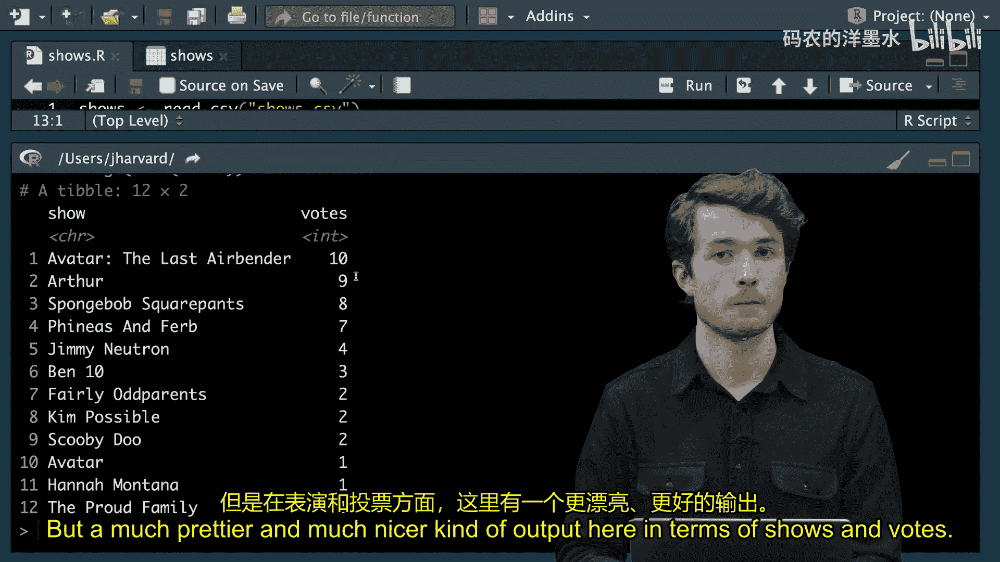

---

## 总结 📝


本节课中，我们一起学习了如何使用R语言，特别是`tidyverse`生态系统，来有效地整理和清理数据。

我们首先学习了如何安装和加载`tidyverse`包。然后，深入探讨了`dplyr`包的核心函数：`select`（选择列）、`filter`（过滤行）、`arrange`（排序行）、`distinct`（去重）、`group_by`（分组）和`summarize`（汇总），并利用管道操作符`%>%`将这些操作流畅地连接起来。

接着，我们了解了**整洁数据**的三原则，并使用`tidyr`包的`pivot_wider`函数将数据从长格式转换为更易分析的宽格式。

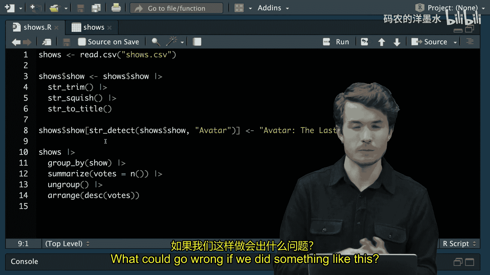

最后，我们使用`stringr`包的工具清理了字符串数据，包括修剪空格、标准化大小写以及检测和替换特定文本模式。


通过这些技能，你可以将原始、混乱的数据集转化为结构清晰、内容干净的格式，为后续的数据分析和可视化打下坚实的基础。