# 007：程序测试 🧪


在本节课中，我们将学习程序可能出错的各种方式，了解如何处理这些称为“错误”的情况，并学习如何测试我们的程序以确保它们按预期运行。

## 概述：程序中的错误与异常

在编程过程中，我们经常会遇到程序停止运行并显示错误信息的情况。这些错误在计算机科学中更正式地被称为**异常**。当程序遇到它不知道如何处理的情况时，就会发生异常，导致程序完全停止。

上一节我们介绍了错误的基本概念，本节中我们来看看如何主动处理这些异常。

## 主动处理错误

让我们从一个简单的函数开始，它计算一组数字的平均值。

```r
average <- function(x) {
  sum(x) / length(x)
}
```

这个函数假设输入 `x` 是一个数字向量。但如果用户不小心输入了文本（字符）呢？

```r
average(c("1", "2", "3"))
```
运行上述代码会产生一个错误，因为 `sum` 函数无法处理字符向量。

为了避免这个错误，我们可以在函数内部主动检查输入类型。

```r
average <- function(x) {
  if (!is.numeric(x)) {
    return(NA)
  }
  sum(x) / length(x)
}
```
现在，如果输入不是数字，函数会返回 `NA`，而不是直接崩溃。但这是一种“静默”处理，用户可能不知道哪里出了问题。

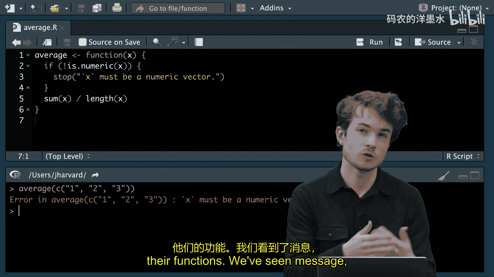

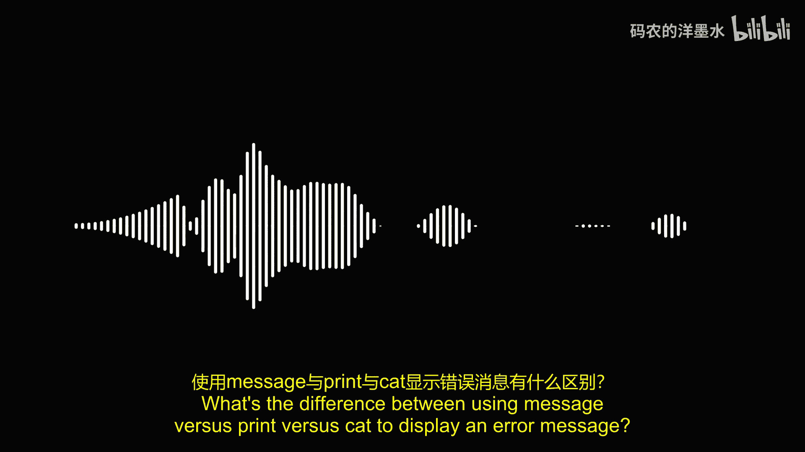

## 与用户沟通：消息、警告和错误

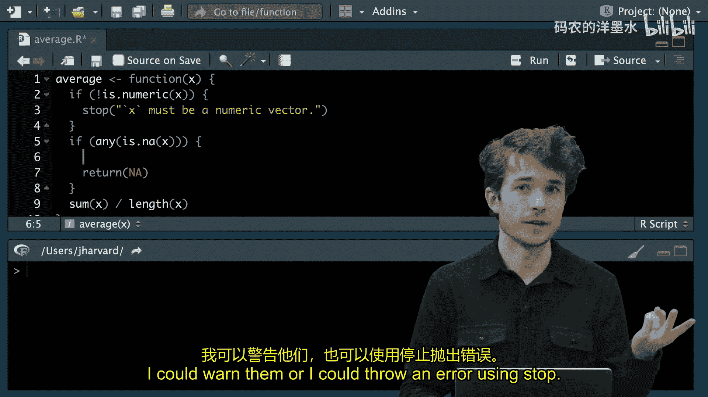

为了改善用户体验，R 提供了几种向用户传达信息的方式：

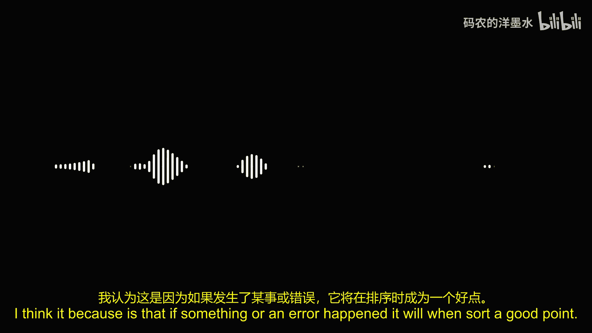

1.  **`message`**: 用于在函数运行时向控制台发送一般性信息，通常用于指示进度或状态。
2.  **`warning`**: 用于指示潜在问题。程序会继续运行，但用户应该注意。
3.  **`stop`**: 用于抛出致命错误。程序会立即停止运行。

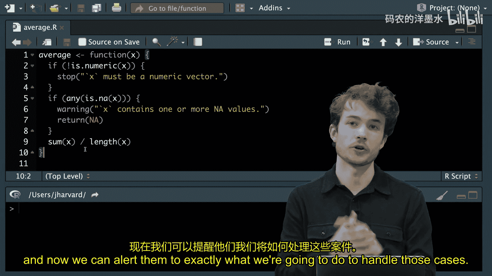

对于非数字输入，使用 `stop` 可能更合适，因为函数的基本目标无法实现。

```r
average <- function(x) {
  if (!is.numeric(x)) {
    stop("x 必须是一个数字向量")
  }
  sum(x) / length(x)
}
```

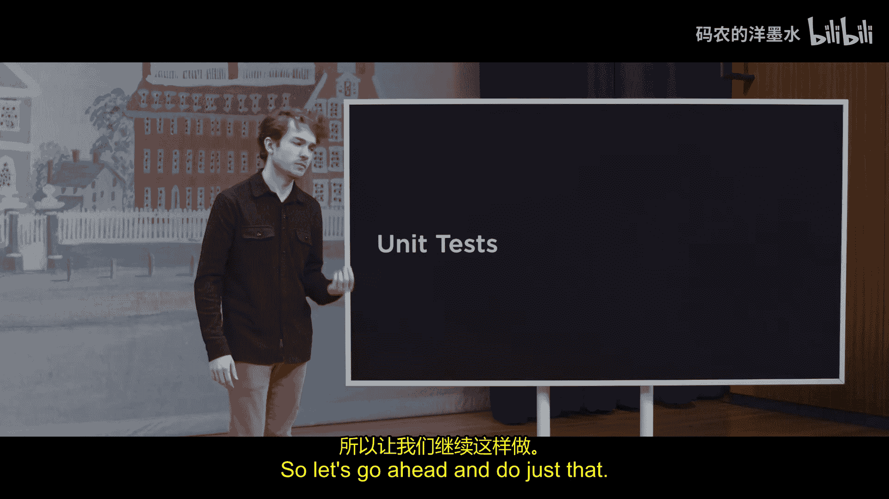

对于包含 `NA` 值的输入，使用 `warning` 更合适，因为函数仍然可以返回一个值（通常是 `NA`），但用户应该知道数据不完整。

```r
average <- function(x) {
  if (!is.numeric(x)) {
    stop("x 必须是一个数字向量")
  }
  if (any(is.na(x))) {
    warning("输入 x 包含一个或多个 NA 值")
    return(NA)
  }
  sum(x) / length(x)
}
```

上一节我们学习了如何预防和处理错误，本节中我们来看看如何系统地测试我们的代码，确保它在各种情况下都能正确工作。

## 编写单元测试

**单元测试**是我们编写的用于测试程序中单个“单元”（通常是函数）的代码。其目标是验证函数在各种输入下是否返回预期的输出。

### 手动编写测试

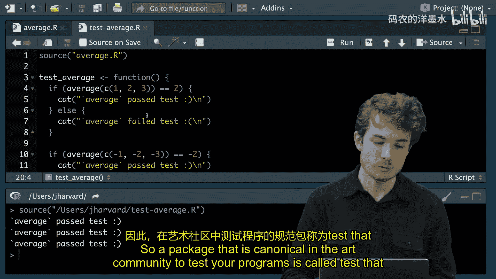

我们可以编写一个测试函数，其中包含多个测试用例。

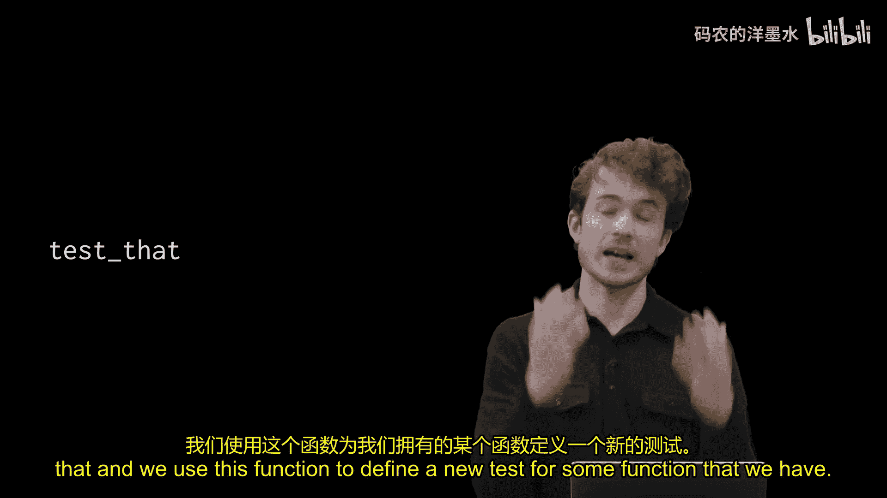

```r
# 首先，确保 average 函数可用
source("average.R")

test_average <- function() {
  # 测试用例 1: 正数
  if (average(c(1, 2, 3)) == 2) {
    cat("测试通过 :)\n")
  } else {
    cat("测试失败 :(\n")
  }
  # 测试用例 2: 负数
  if (average(c(-1, -2, -3)) == -2) {
    cat("测试通过 :)\n")
  } else {
    cat("测试失败 :(\n")
  }
}
test_average()
```
然而，手动为每个函数编写大量测试代码非常繁琐。

### 使用 `testthat` 包

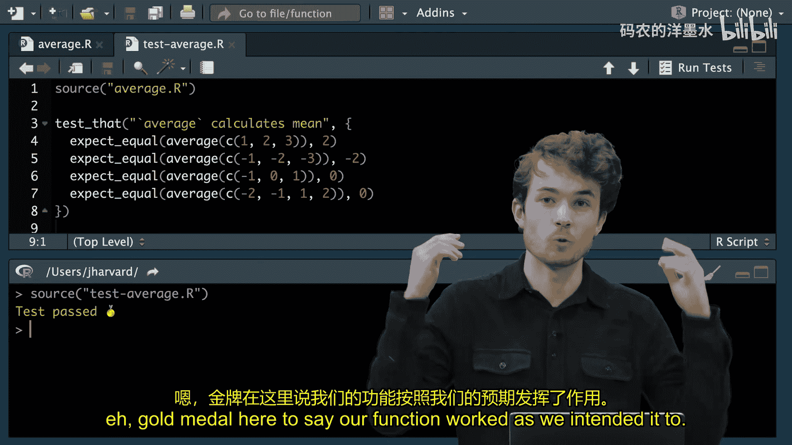

R 社区开发了 `testthat` 包，它让编写和运行测试变得简单而高效。

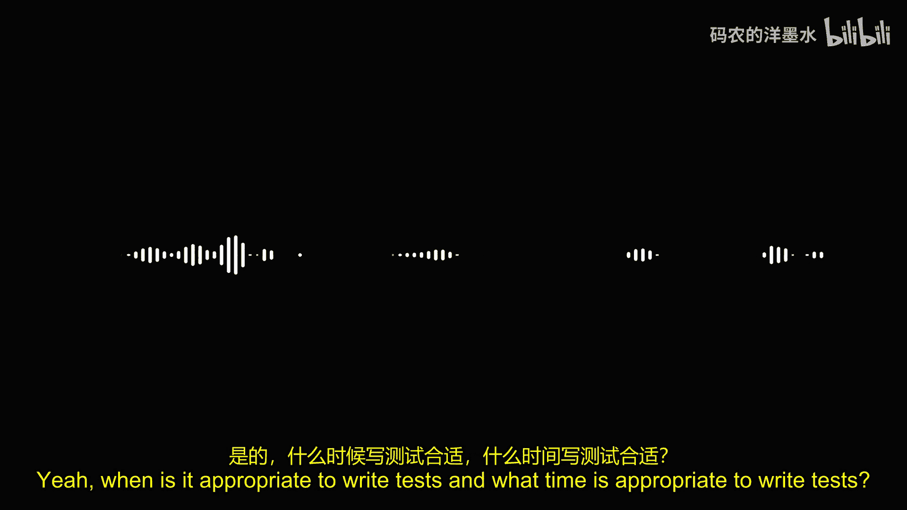

首先，安装并加载包：
```r
install.packages("testthat")
library(testthat)
```

然后，我们可以用更简洁的方式编写测试：

```r
source("average.R")

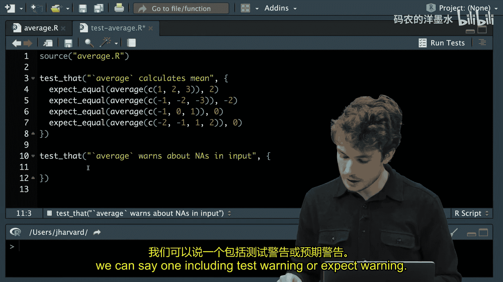

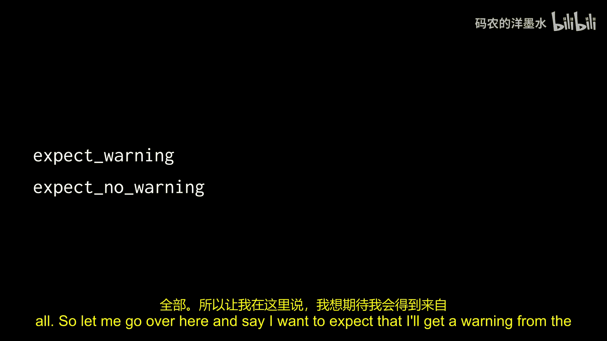

test_that("average 正确计算平均值", {
  expect_equal(average(c(1, 2, 3)), 2)
  expect_equal(average(c(-1, -2, -3)), -2)
  expect_equal(average(c(-1, 0, 1)), 0)
})

test_that("average 对包含 NA 的输入发出警告", {
  expect_warning(average(c(1, NA, 3)))
})

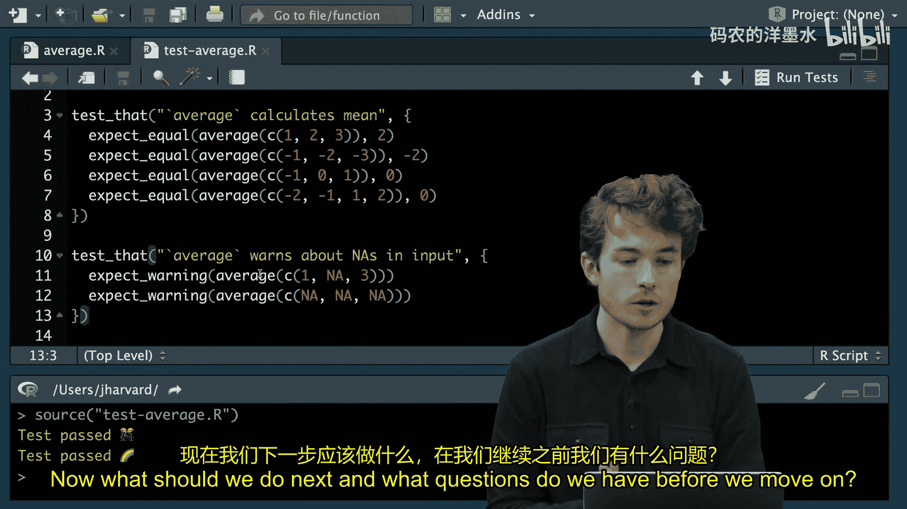

test_that("average 对非数字输入抛出错误", {
  expect_error(average(c("1", "2", "3")))
})
```
`testthat` 提供了 `expect_equal`、`expect_warning`、`expect_error` 等函数来声明我们的期望。

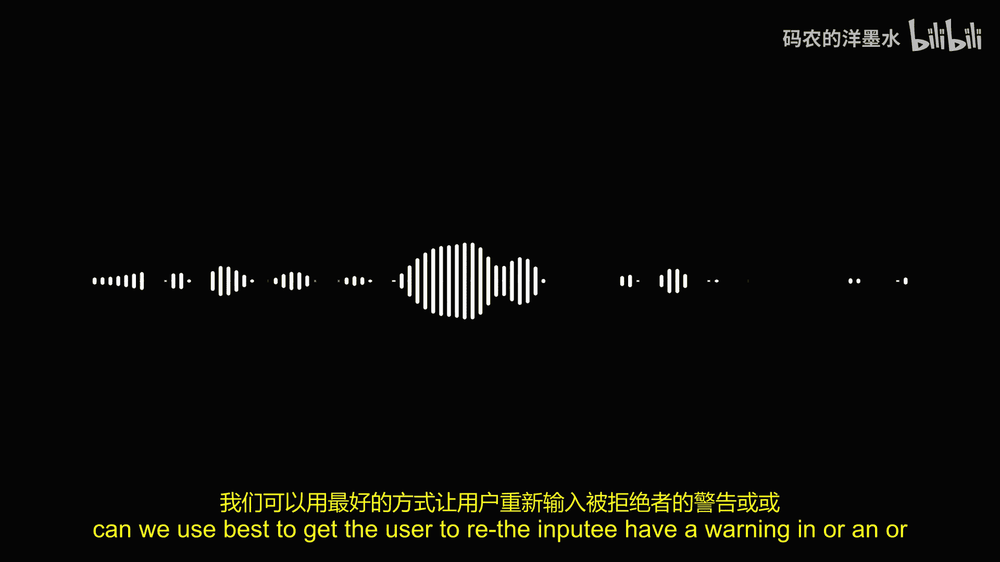

## 处理浮点数精度问题

在测试涉及小数的计算时，需要特别注意计算机的**浮点数精度**问题。例如，`0.1 + 0.5` 在计算机中可能不等于精确的 `0.3`。

`expect_equal` 函数内置了**容差**处理机制，允许结果在微小范围内波动。你也可以通过 `tolerance` 参数自定义容差。

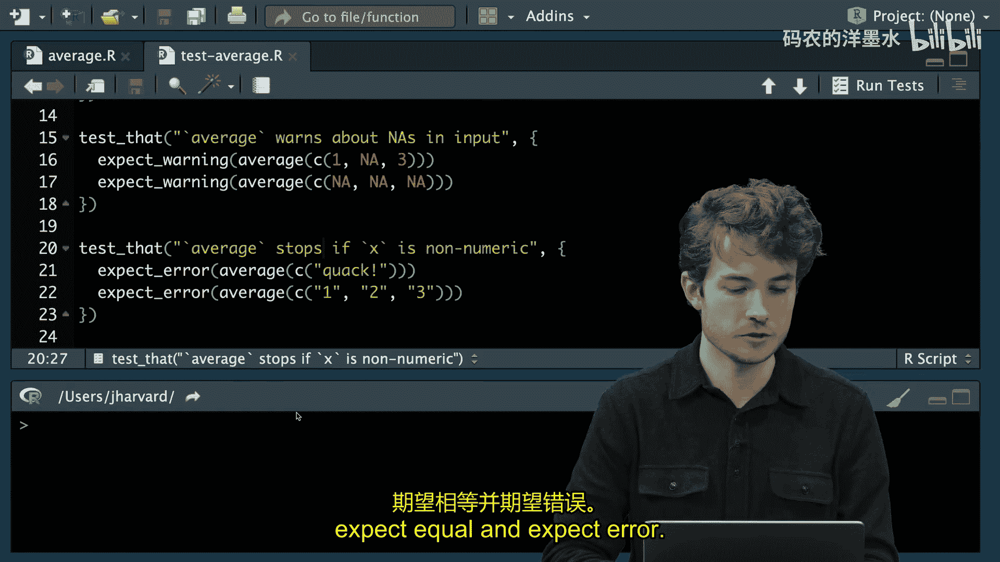


```r
test_that("average 处理浮点数", {
  expect_equal(average(c(0.1, 0.5)), 0.3, tolerance = 1e-8)
})
```

## 测试驱动开发 (TDD) 与行为驱动开发 (BDD)

### 测试驱动开发

TDD 是一种开发哲学，主张**先写测试，后写代码**。这有助于明确代码应该实现的功能。

例如，我们想写一个 `greet` 函数来打招呼。先写测试：

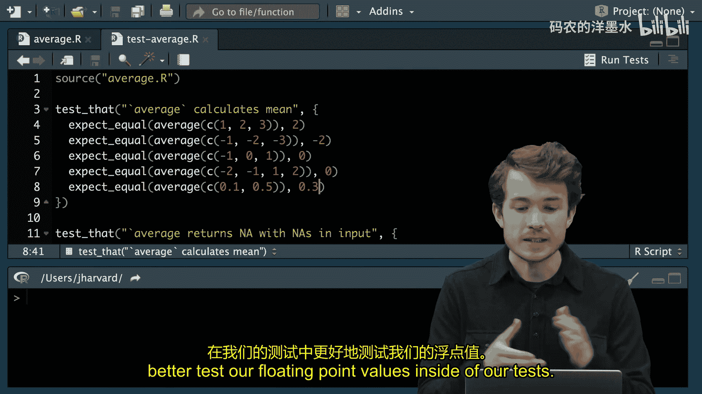

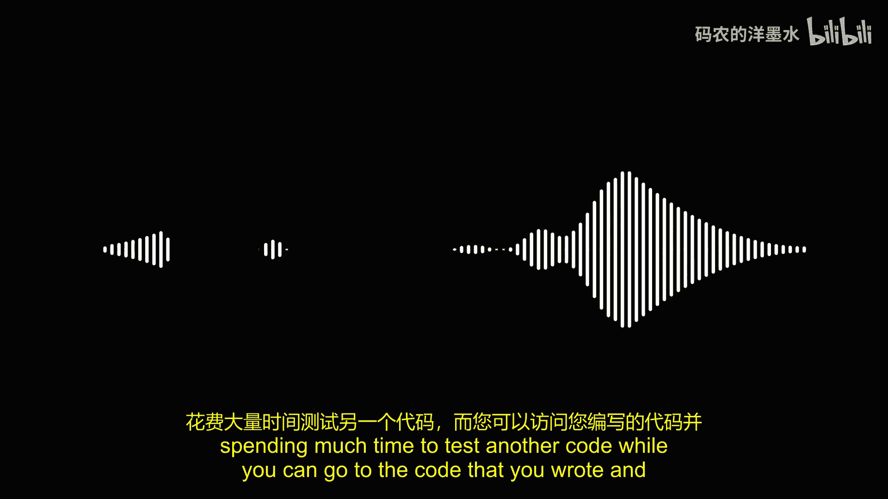

```r
# test_greet.R
source("greet.R") # 假设这个文件稍后会创建

test_that("greet 向用户问好", {
  expect_equal(greet("Carter"), "Hello, Carter")
  expect_equal(greet("Mario"), "Hello, Mario")
})
```
然后，再根据测试的要求去实现 `greet` 函数。

### 行为驱动开发

BDD 是 TDD 的一种延伸，更强调用自然语言描述软件的行为。`testthat` 也支持这种风格。

```r
describe("greet 函数", {
  it("可以向用户问好", {
    name <- "Carter"
    expect_equal(greet(name), "Hello, Carter")
  })
  it("可以向世界问好（默认值）", {
    expect_equal(greet(), "Hello, world")
  })
})
```
这种写法让测试读起来更像功能规格说明书。

## 测试覆盖率

**测试覆盖率**是衡量你的测试套件执行了多少代码的指标。它帮助你了解程序的哪些部分经过了测试，哪些部分可能被遗漏。追求高覆盖率是编写健壮软件的好习惯，但100%的覆盖率并不总是可行或必要。

## 总结

本节课中我们一起学习了：
1.  程序中的**错误**和**异常**。
2.  如何使用 `message`、`warning` 和 `stop` 与用户沟通不同严重程度的问题。
3.  如何编写**单元测试**来验证函数的正确性。
4.  如何使用强大的 `testthat` 包来简化测试过程。
5.  如何处理**浮点数精度**问题。
6.  **测试驱动开发**和**行为驱动开发**的基本理念。
7.  **测试覆盖率**的概念及其重要性。

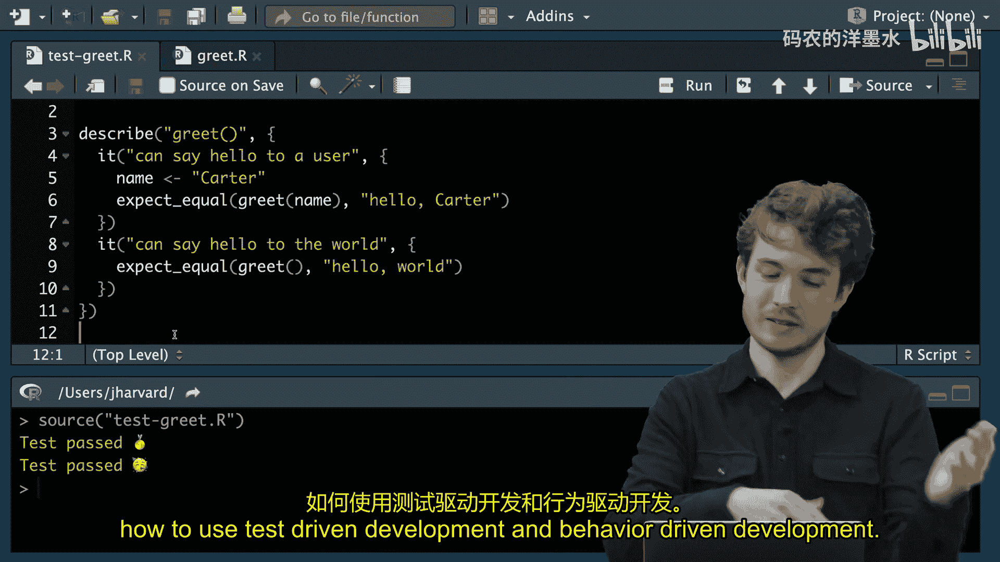


通过系统地测试代码，我们可以更早地发现错误，更有信心地进行修改，并最终构建出更可靠、更易于维护的程序。