# 008：程序打包 🦆


在本节课中，我们将学习如何将R代码打包成一个完整的、可分享的软件包。我们将通过创建一个名为 `ducksay` 的包来实践整个过程，这个包的功能是让一只小鸭子说出用户指定的任何话。

## 概述：什么是R包？

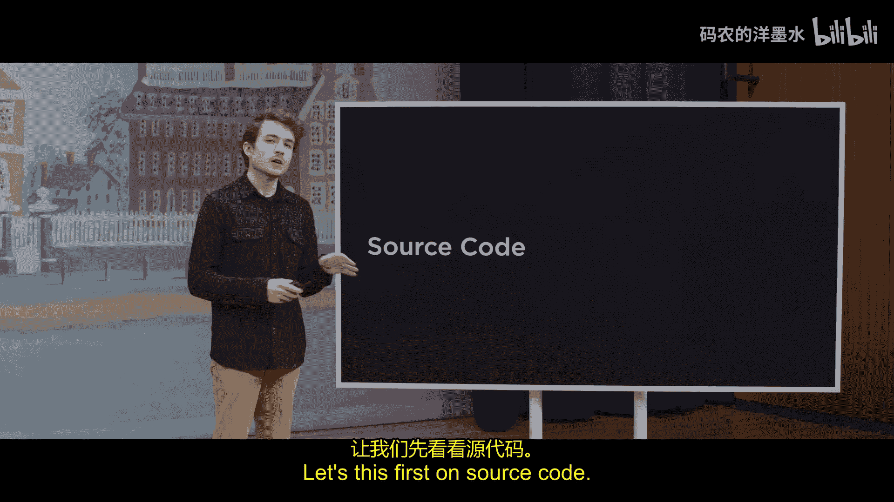

到目前为止，我们一直是R包的使用者，学会了如何安装、加载和使用包内的函数。但我们还没有探究过包背后的源代码是如何构建的。当你从CRAN等地方下载一个包时，你得到的是一个单一的二进制文件。然而，创建包时，你并不需要直接编写二进制代码，而是编写构成包的源代码（即 `.R` 文件和各种文件夹）。当需要分享你的包时，你会将这些源代码“构建”或“编译”成一个可以分发的单一文件。

## 创建包的基本结构

上一节我们介绍了R包的概念，本节中我们来看看如何为我们的 `ducksay` 包搭建基础框架。

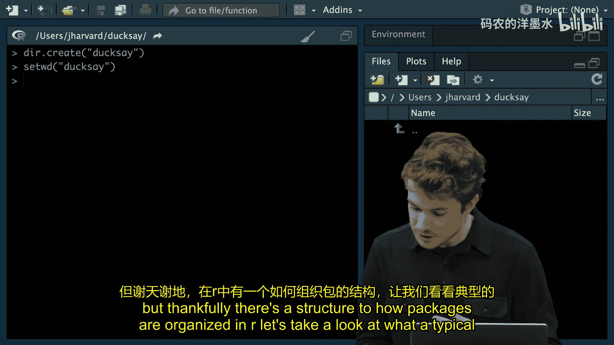

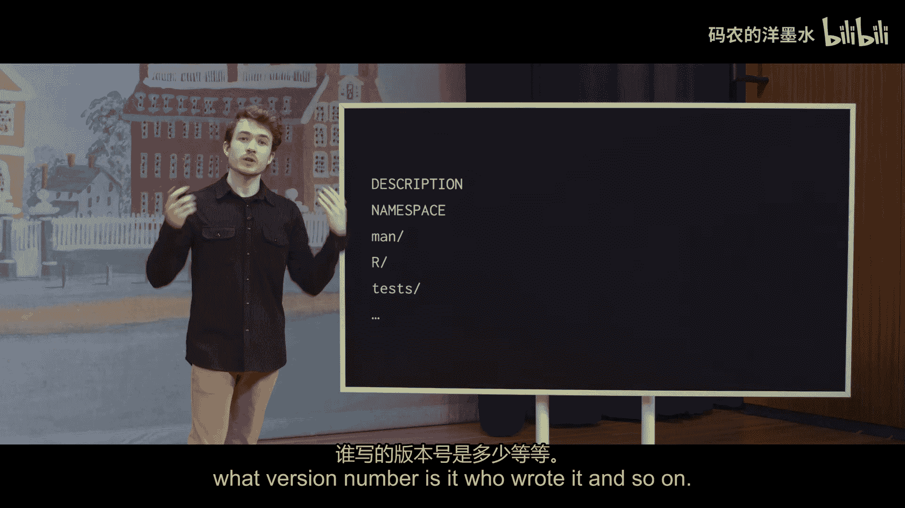

按照惯例，包的源代码应放在一个以包名命名的文件夹中。因此，我们首先创建一个名为 `ducksay` 的文件夹。

```r
dir.create("ducksay")
```

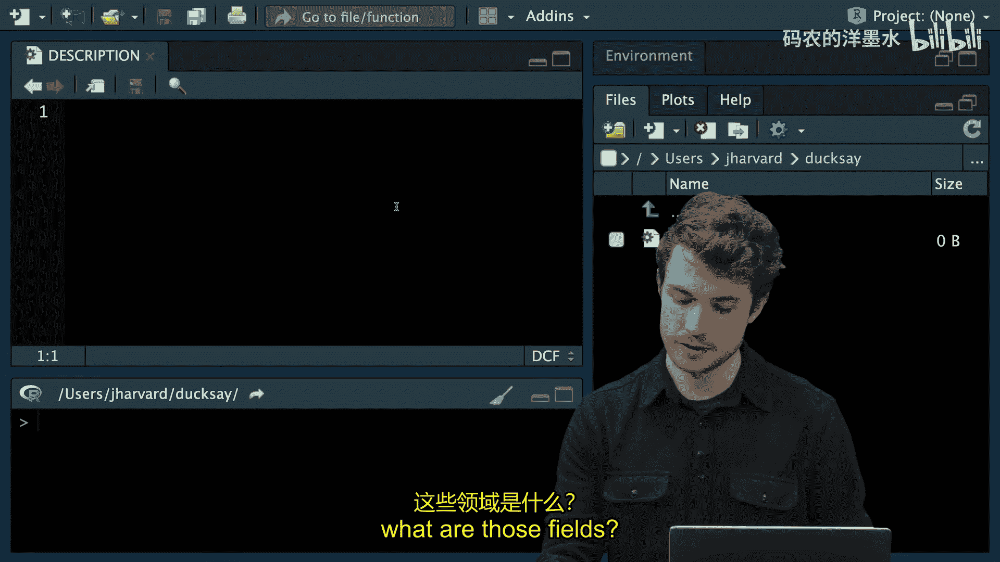

创建文件夹后，我们将工作目录设置到这个文件夹内，这相当于我们进入了这个文件夹，准备开始编写包的源代码。

```r
setwd("ducksay")
```

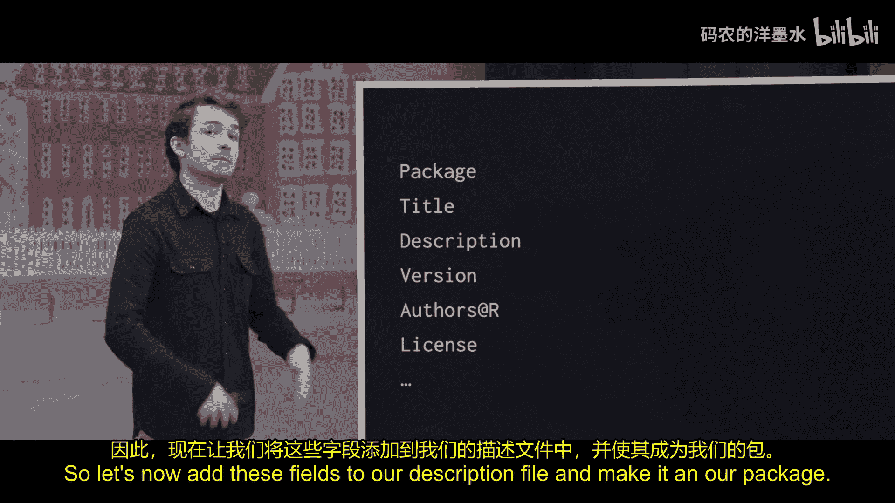

一个典型的R包通常包含以下核心文件和文件夹：

*   **DESCRIPTION**: 描述你的包，包括名称、版本、作者等信息。
*   **NAMESPACE**: 定义包中哪些函数可供最终用户使用。
*   **man/**: 存放函数使用手册（manual）的文件夹。
*   **R/**: 存放所有 `.R` 源文件的文件夹，函数定义就在这里。
*   **tests/**: 存放测试代码的文件夹。

## 编写DESCRIPTION文件

我们已经创建了包文件夹，接下来需要定义包的基本信息。这通过 `DESCRIPTION` 文件完成。

首先，我们创建这个文件。

```r
file.create("DESCRIPTION")
```

`DESCRIPTION` 文件由多个字段组成，以下是必须包含的核心字段：

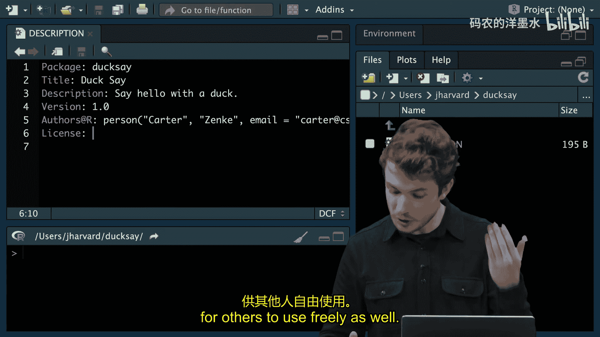

*   **Package**: 包的名称（如 `ducksay`），用户将通过此名称安装你的包。
*   **Title**: 包的标题，可以用更友好的英文描述（可包含空格）。
*   **Description**: 对包功能的详细描述。
*   **Version**: 包的版本号。
*   **Authors@R**: 使用R函数 `person()` 来定义作者及其角色。
*   **License**: 软件许可证，规定他人使用你代码的法律条款。

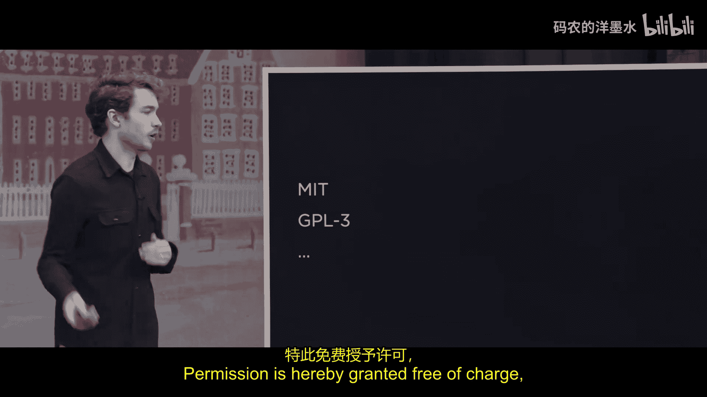

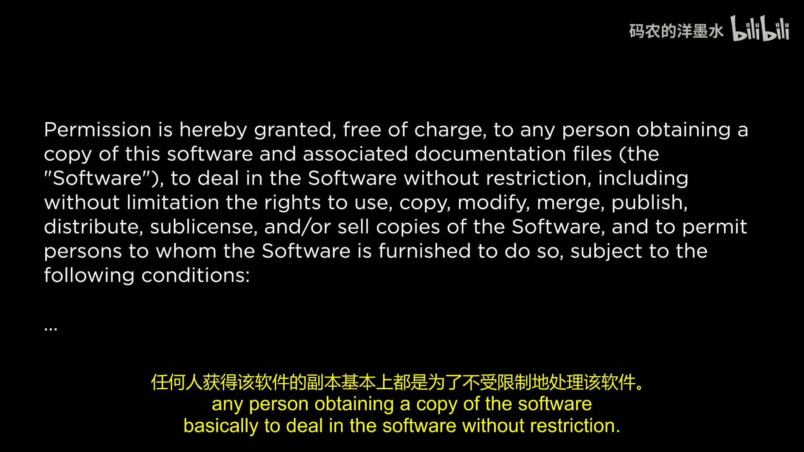

让我们为 `ducksay` 包填充这些字段。在 `DESCRIPTION` 文件中输入以下内容：

```
Package: ducksay
Title: Duck Say
Description: Say hello with a duck.
Version: 1.0
Authors@R: person("Carter", "Zenke", email = "carter@cs50.harvard.edu", role = c("aut", "cre", "cph"))
License: MIT + file LICENSE
```

关于作者角色：
*   `"aut"` 代表作者（author），即对包有贡献的人。
*   `"cre"` 代表维护者（creator），负责包的长期更新和维护。
*   `"cph"` 代表版权持有者（copyright holder）。

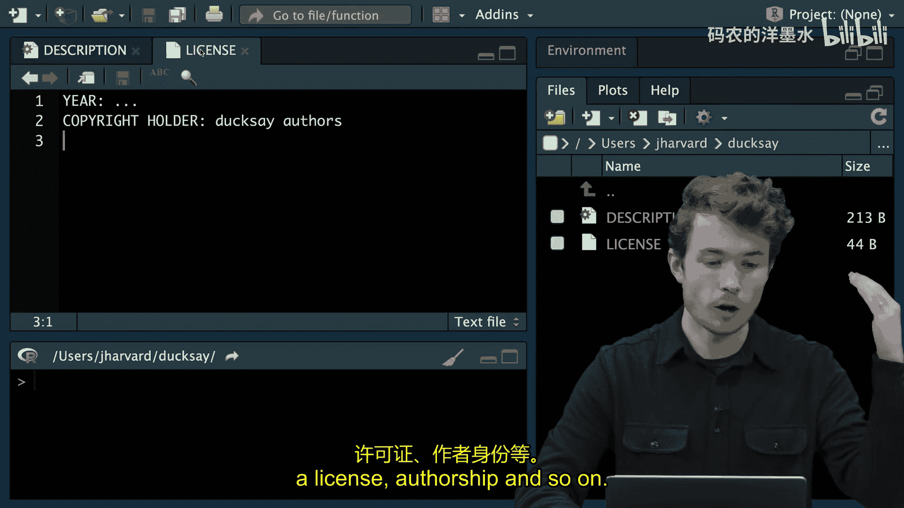

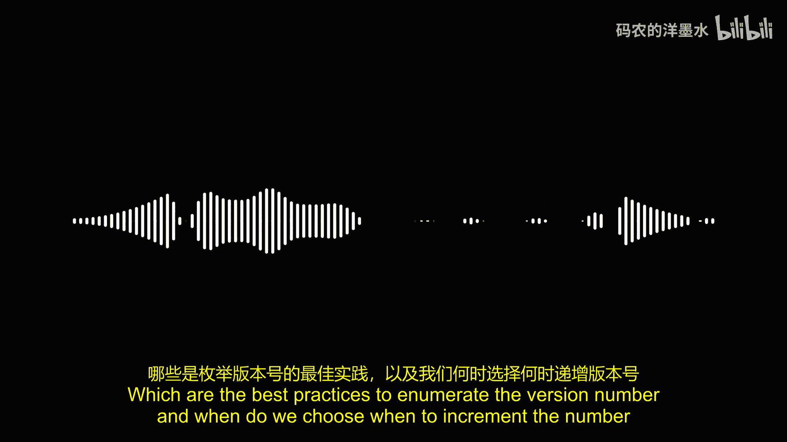

关于许可证，我们选择了MIT许可证，这是一种允许他人自由使用和分享代码的常见开源许可证。`+ file LICENSE` 表示我们还需要一个额外的 `LICENSE` 文件来补充信息。

接下来，我们创建 `LICENSE` 文件。

```r
file.create("LICENSE")
```

在 `LICENSE` 文件中，我们填入MIT许可证的模板，并替换占位符：

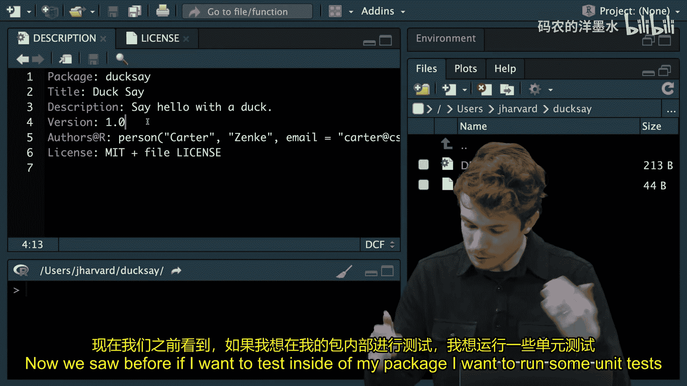

```
YEAR: 2023
COPYRIGHT HOLDER: ducksay authors
```

**关于版本号**：实践中，R社区常使用“语义化版本”（Semantic Versioning），格式为 `主版本号.次版本号.修订号`。修订号用于bug修复，次版本号用于新增功能（向后兼容），主版本号用于重大变更（可能不兼容旧版本）。本例中我们使用 `1.0` 简化处理。

## 使用 `devtools` 辅助开发

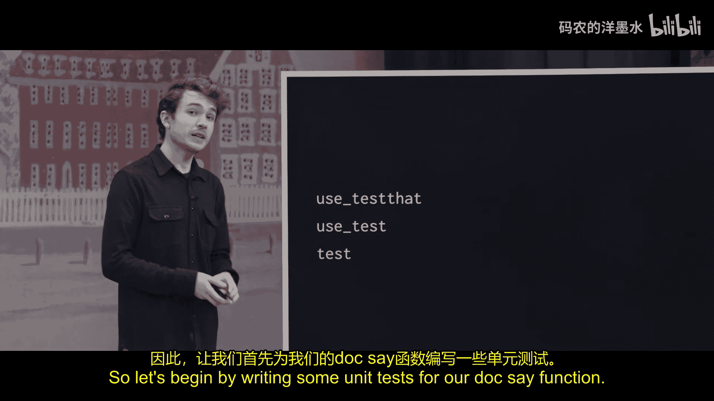

手动管理包结构可能繁琐。幸运的是，有一个名为 `devtools` 的包提供了许多辅助函数来简化包的创建和测试过程。

首先，我们需要加载 `devtools` 包。

```r
library(devtools)
```

`devtools` 包中有一系列函数可以帮助我们设置测试框架、创建R文件等。

## 编写单元测试

在编写实际功能代码之前，先编写测试是一个好习惯。这能确保我们的函数按预期工作。我们将使用 `testthat` 包进行单元测试。

`devtools` 提供了 `use_testthat()` 函数来为我们的包配置 `testthat` 测试框架。

```r
use_testthat()
```

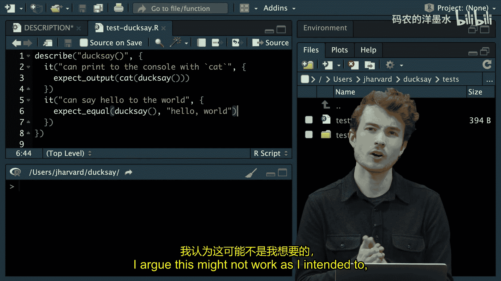


运行此命令后，它会自动创建 `tests/` 目录及其子目录 `tests/testthat/`，并在 `DESCRIPTION` 文件的 `Suggests` 字段中添加 `testthat` 依赖。`Suggests` 字段表示建议用户安装这些包以使用某些功能（如运行测试），但并非强制要求。如果某个包是你的包运行所必需的，则应将其添加到 `Imports` 字段。

现在，我们可以为 `ducksay` 函数创建具体的测试文件。

```r
use_test("ducksay")
```

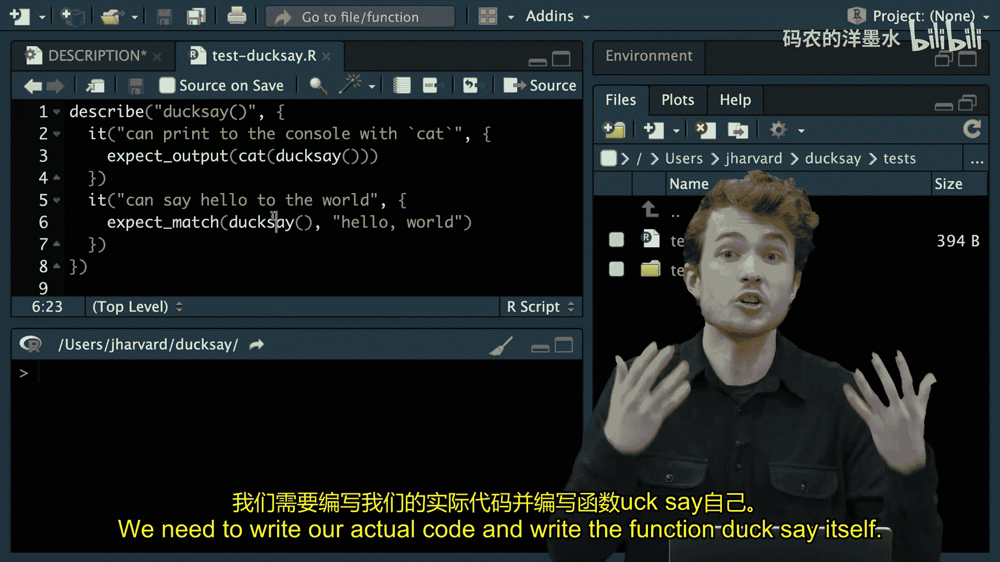

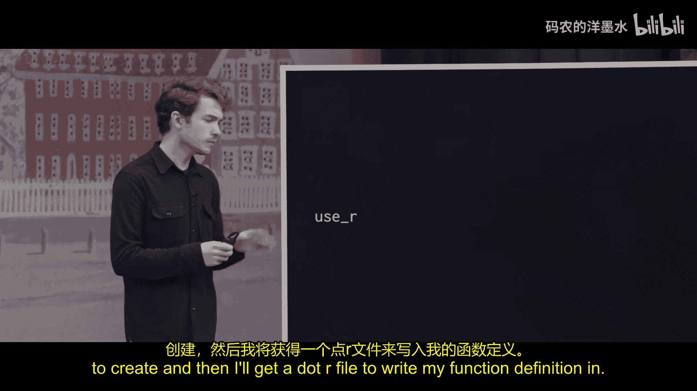

这会在 `tests/testthat/` 目录下创建一个名为 `test-ducksay.R` 的文件。我们打开并编辑它，定义我们的测试。

我们希望 `ducksay` 函数能完成两件事：
1.  能与 `cat()` 函数配合，将输出打印到控制台。
2.  其返回的字符串中包含用户指定的短语（以及一只鸭子）。

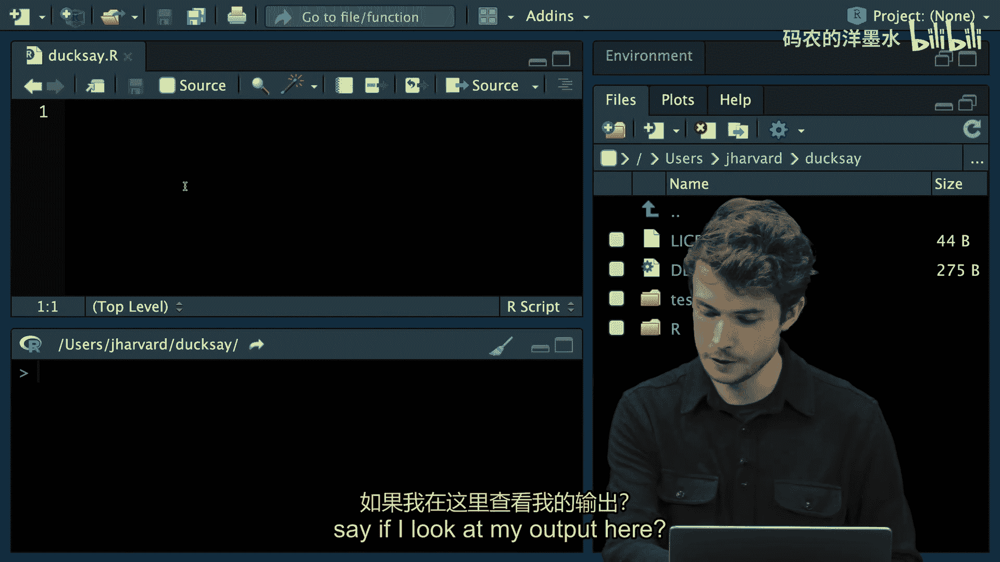

以下是测试代码：

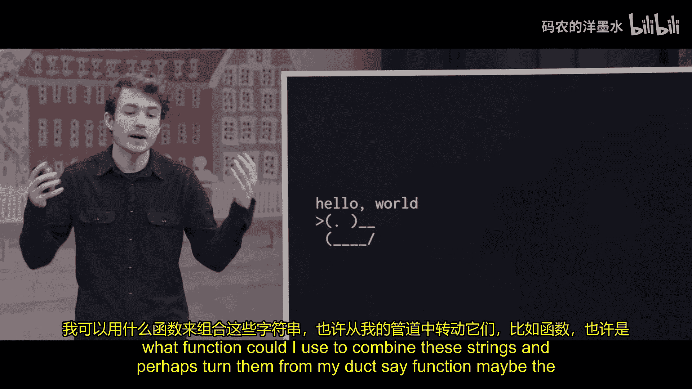

```r
test_that("ducksay works with cat", {
  expect_output(cat(ducksay()))
})

test_that("ducksay says hello world", {
  expect_match(ducksay(), "hello, world")
})

test_that("ducksay includes a duck", {
  duck <- paste(">(.)__", " (___/", sep = "\n")
  expect_match(ducksay(), duck, fixed = TRUE)
})
```

这里使用了 `testthat` 包中的几个断言函数：
*   `expect_output()`: 检查代码是否产生控制台输出。
*   `expect_match()`: 检查返回值中是否匹配某个文本模式（正则表达式）。当需要精确匹配特殊字符（如 `>`、`.`）时，使用参数 `fixed = TRUE`。

## 实现 `ducksay` 函数

有了测试目标，现在我们来编写 `ducksay` 函数本身。R包的函数源代码应放在 `R/` 目录下。

我们可以用 `devtools` 的 `use_r()` 函数来创建对应的R文件。

```r
use_r("ducksay")
```

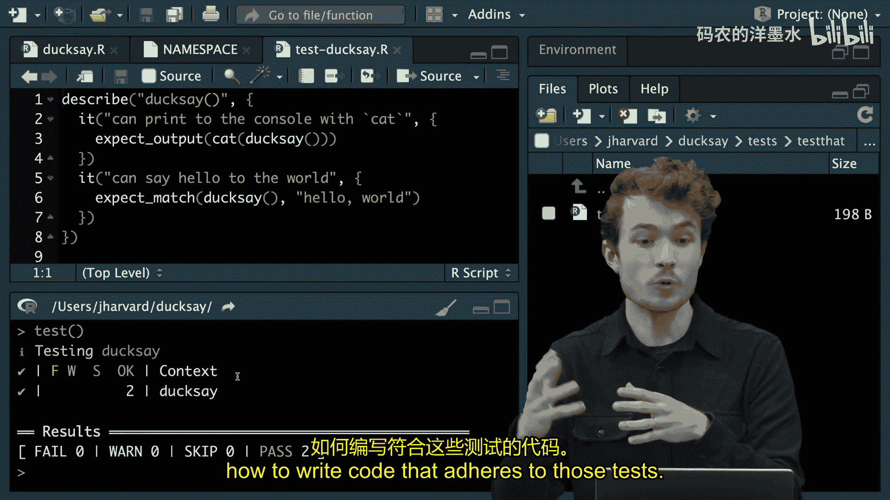

这会在 `R/` 目录下创建 `ducksay.R` 文件。我们在此文件中定义函数。

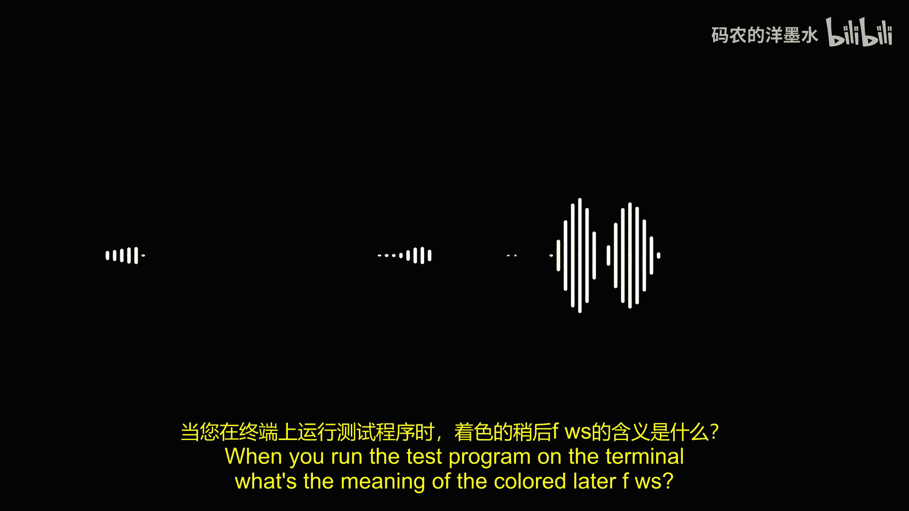

`ducksay` 函数的目标是返回一个多行字符串，包含用户短语和一只鸭子的ASCII艺术。我们可以使用 `paste()` 函数，并用换行符 `\n` 连接各行。

```r
ducksay <- function(phrase = "hello, world") {
  top <- paste0(" ", phrase)
  middle <- ">(.)__"
  bottom <- " (___/"
  paste(top, middle, bottom, sep = "\n")
}
```

这个函数接受一个参数 `phrase`，默认值为 `"hello, world"`。它使用 `paste(..., sep = "\n")` 将三行文本组合成一个字符串，行与行之间用换行符分隔。

## 导出函数到命名空间

仅仅在 `R/` 目录下定义函数还不够，我们需要通过 `NAMESPACE` 文件明确声明哪些函数可供包的用户使用。

创建 `NAMESPACE` 文件。

```r
file.create("NAMESPACE")
```

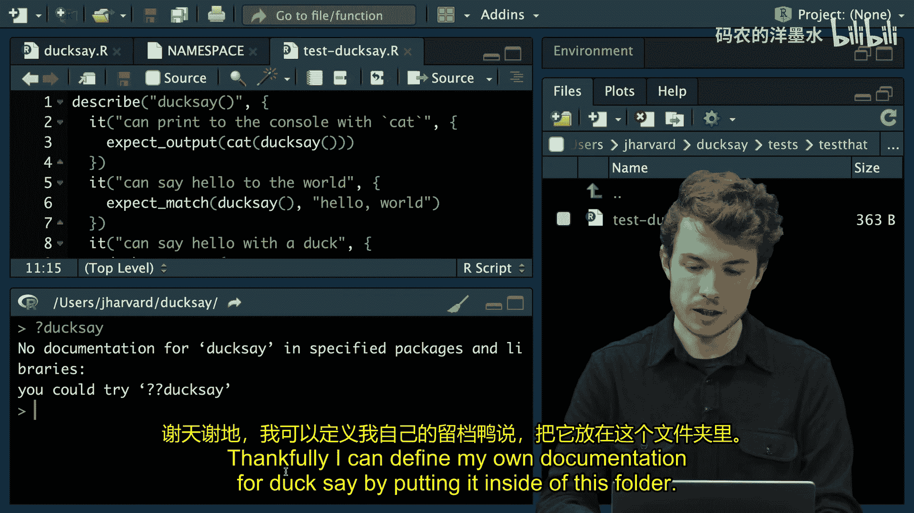

在 `NAMESPACE` 文件中，我们使用 `export()` 指令导出 `ducksay` 函数。

```
export(ducksay)
```

现在，我们可以使用 `devtools::load_all()` 来加载我们包中所有已导出的函数，以便在控制台交互测试。

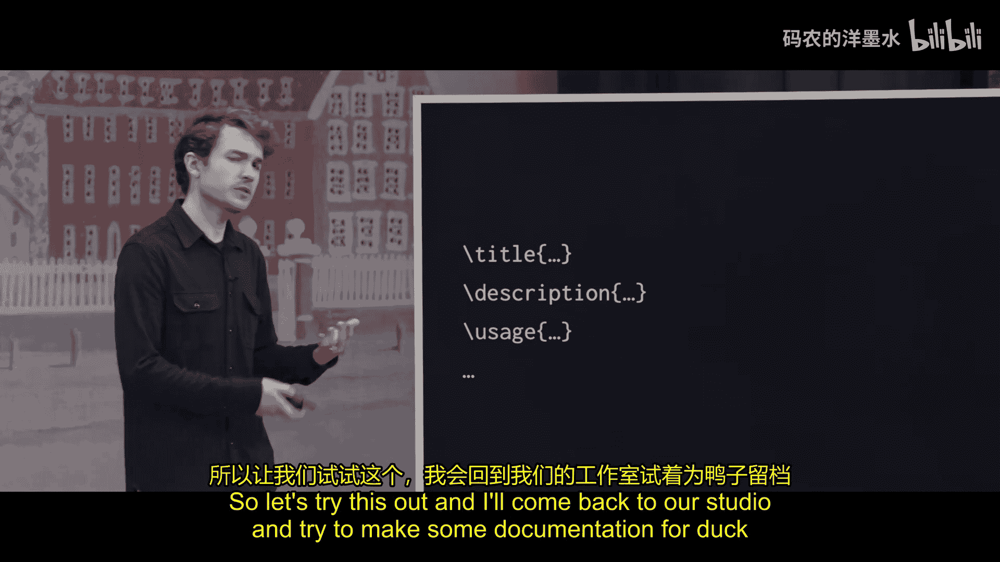

```r
load_all()
```

测试函数：

```r
cat(ducksay())
cat(ducksay("quack!"))
```

运行我们之前写的测试，确保一切正常。

```r
test()
```

如果测试全部通过，说明我们的函数实现正确。

## 为函数编写文档

优秀的包离不开清晰的文档。R包的文档是写在 `man/` 目录下的 `.Rd` 文件中，使用一种特殊的标记语言。

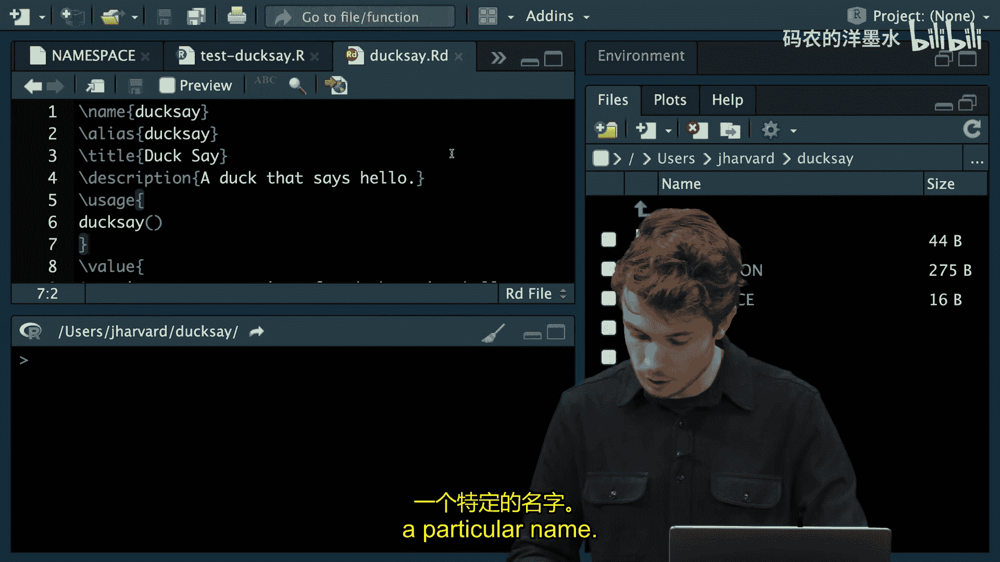

首先创建 `man/` 目录和文档文件。

```r
dir.create("man")
file.create("man/ducksay.Rd")
```

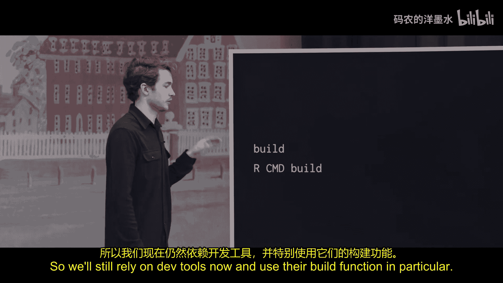

打开 `man/ducksay.Rd` 文件，编写文档内容。以下是一些核心的标记指令：

*   `\name{}`: 函数名称。
*   `\alias{}`: 用户在控制台查询文档时使用的名称（通常与函数名相同）。
*   `\title{}`: 函数标题。
*   `\description{}`: 函数描述。
*   `\usage{}`: 函数用法，包括参数和默认值。
*   `\value{}`: 函数的返回值描述。
*   `\examples{}`: 使用示例。

一个简单的 `ducksay.Rd` 文件内容如下：

```
\name{ducksay}
\alias{ducksay}
\title{Duck Say}
\description{A duck that says hello (or any phrase you like).}
\usage{ducksay(phrase = "hello, world")}
\value{A character string representation of a duck saying the input phrase.}
\examples{
cat(ducksay())
cat(ducksay("quack!"))
}
```

保存文件后，在R控制台中输入 `?ducksay` 即可查看渲染好的帮助文档。

## 构建和安装包

我们的包已经开发完成，包含代码、测试和文档。现在，我们需要将其“构建”成一个可以分发和安装的单一文件。

使用 `devtools::build()` 函数可以完成构建。

```r
build()
```

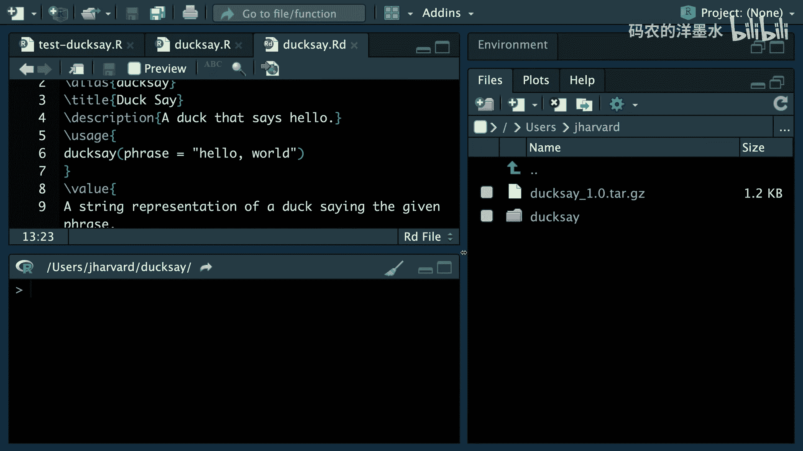

构建成功后，会在包目录的上层目录（即 `ducksay/` 文件夹的旁边）生成一个类似 `ducksay_1.0.tar.gz` 的文件。这就是我们包的发行版文件，也称为“tarball”。


要安装这个包到本地R环境中，可以使用 `install.packages()` 并指定本地文件路径。

```r
install.packages("../ducksay_1.0.tar.gz", repos = NULL, type = "source")
```

安装成功后，就可以像使用其他CRAN包一样使用 `ducksay` 了。

```r
library(ducksay)
cat(ducksay("Hello from the installed package!"))
```

## 迭代开发与分享

包开发是一个迭代过程：编写代码 -> 编写测试 -> 编写文档 -> 构建 -> 测试 -> 修改 -> 重新构建。每次对包有重大更新时，都应更新 `DESCRIPTION` 中的版本号，并重新运行 `build()` 和 `install.packages()`。

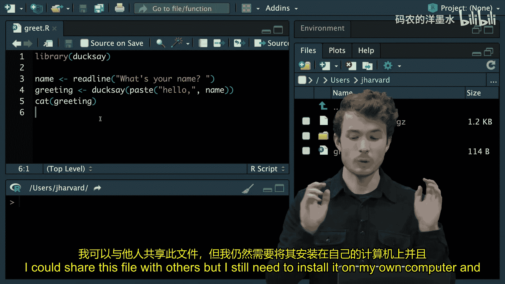

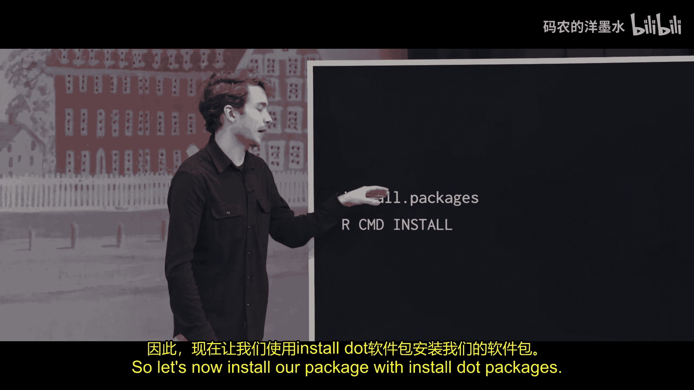

最后，你可以通过多种方式分享你的包：
*   提交到 **CRAN**（需遵守其规范）。
*   上传到代码托管平台如 **GitHub**。
*   直接通过电子邮件发送 `.tar.gz` 文件给他人。

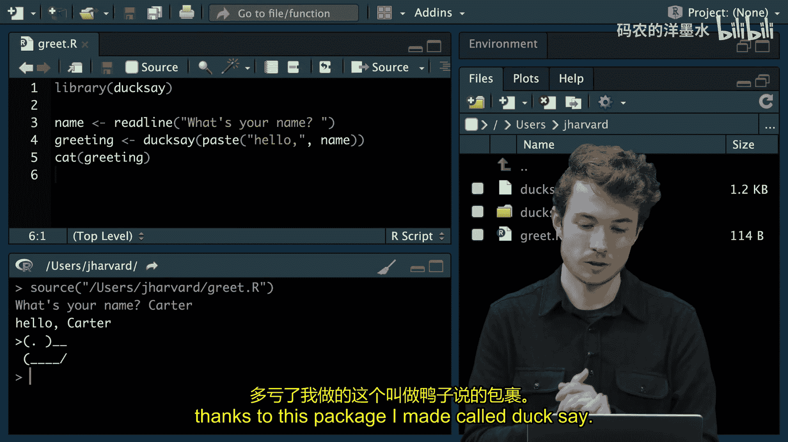

## 总结

本节课中我们一起学习了如何从头开始创建一个完整的R包。我们涵盖了以下关键步骤：
1.  **搭建包结构**：创建必要的文件和文件夹（`DESCRIPTION`, `NAMESPACE`, `R/`, `man/`, `tests/`）。
2.  **编写元数据**：在 `DESCRIPTION` 中定义包的基本信息、作者和许可证。
3.  **利用开发工具**：使用 `devtools` 包简化创建和测试流程。
4.  **测试驱动开发**：先为 `ducksay` 函数编写 `testthat` 单元测试，再实现功能代码。
5.  **编写函数与导出**：在 `R/` 目录下实现函数逻辑，并通过 `NAMESPACE` 文件导出。
6.  **编写文档**：使用R文档标记语言在 `man/` 目录下创建函数帮助文件。
7.  **构建与安装**：使用 `build()` 生成可分发的包文件，并使用 `install.packages()` 安装到本地。
8.  **迭代与分享**：理解包的迭代开发周期，并了解分享包的不同途径。


通过将你的数据分析、可视化或工具函数打包，你可以有效地组织代码、确保其可靠性，并轻松地与他人协作和分享你的工作成果。