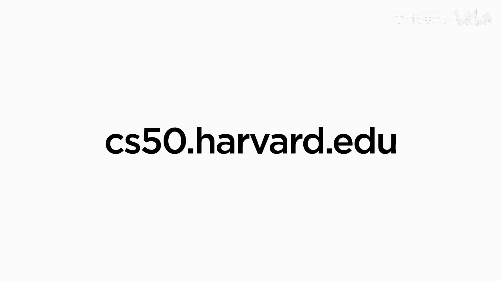

# 001：课程介绍 🛡️

在本节课中，我们将学习哈佛大学CS50网络安全导论课程的核心目标与基本理念。课程面向技术与非技术背景的观众，旨在教授如何保护个人与工作环境中的数字资产。

## 概述

课程将探讨如何保护账户、数据、系统和软件，以应对当前及未来的威胁。我们将学习如何维护个人隐私，并从风险与收益的角度理解网络安全，而非将其视为绝对概念。

## 网络安全的核心视角

上一节我们概述了课程目标，本节中我们来看看网络安全的基本思维方式。网络安全是攻击者的风险、收益与防御者的成本、效益之间的权衡。同时，它也是安全性与可用性之间的折衷。

在网络安全领域，防御者必须做到完美无缺，确保所有“门窗”都已锁好。而攻击者只需找到一个被疏忽的漏洞，例如一扇未关好的门或窗。

因此，我们的焦点不应仅限于预防，还应包括检测。通过审计和监控，即使攻击者成功入侵，我们也能迅速发现并最小化损失，从而降低攻击者的收益。

如今，人工智能等工具或许能帮助我们检测那些自身难以察觉的攻击模式和行为。如果我们能显著提高攻击者的成本和风险，降低其潜在回报，他们可能就会对我们失去兴趣。

当然，如果攻击者拥有更多资源，他们仍可能成功。但关键在于，我们是否值得成为他们的目标？在本课程中，我们将探讨哪些威胁真正值得关注。

## 课程内容与方法

以下是本课程将采用的教学方法：

*   **多层次案例**：课程将提供高层次和低层次的具体威胁案例。
*   **技术知识普及**：即使您不是程序员或计算机专家，课程也会提供理解这些案例所需的技术知识。
*   **第一性原理**：通过案例，我们将介绍计算机运作的基本原理。这能帮助您在课程结束后，自行理解和推断世界上尚未出现的新型威胁是如何运作的。

## 总结

本节课中，我们一起学习了CS50网络安全导论课程的目标与基本框架。我们认识到网络安全是相对的、需要权衡的，并且防御策略应结合预防与检测。课程将通过实际案例和原理讲解，使不同背景的学习者都能建立对网络安全的基础理解。