# 002：保护账户 🔐

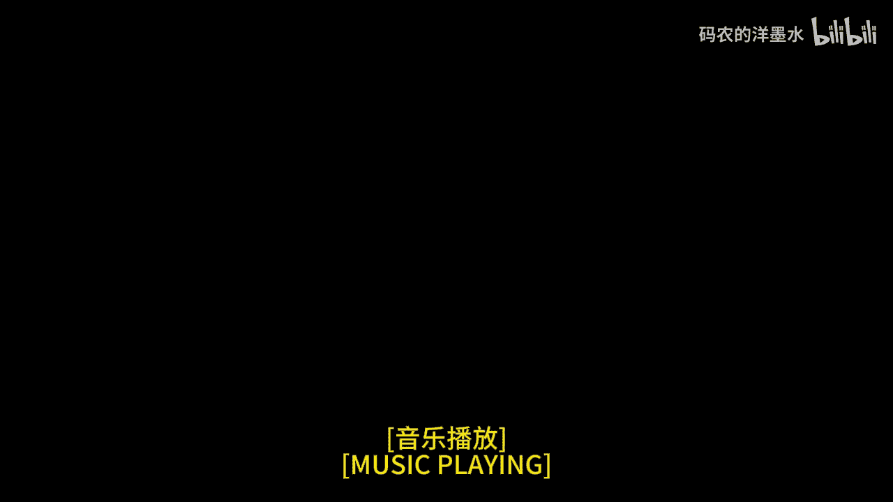

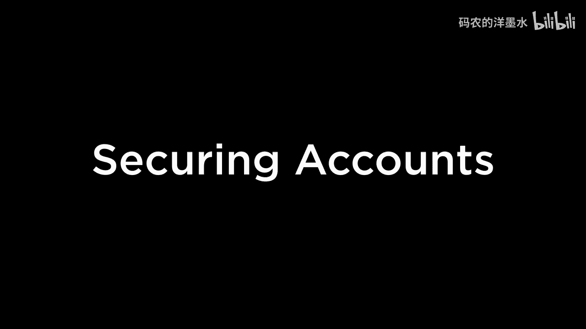

在本节课中，我们将学习如何保护我们的在线账户。我们将探讨账户面临的各种威胁，并重点介绍一些关键的防御措施，以确保账户安全。

首先，让我们思考物理世界中的安全概念。例如，无论你住在家里、公寓还是宿舍，你很可能有一把钥匙可以进入那栋建筑。这把钥匙让你可以通过锁着的门进入，从而获得对整个住所的访问权。但问题是，如果其他人拿到了那把钥匙，他们同样可以进入那个系统或同一栋建筑。

现在，让我们考虑数字世界中的安全基石，以便我们能够准确理解这些威胁和防御措施。首先，我建议我们从**身份验证**的角度来思考账户的安全性。

身份验证指的是在数字世界中证明你是谁的过程。例如，证明我是David。但仅此一项并不足以保证系统的安全，因为仅仅因为我是David，并不意味着我应该有权访问你的整个家。也许我根本不应该有访问权，或者只应该有权进入入口区域，或者某种更有限的访问权限。

因此，在涉及位置或系统的安全性时，还有一个相关的主题，称为**授权**。

授权讨论的是，在你证明了自己的身份（即我是David）之后，你是否应该有权访问某些东西，以及我是否确实有权通过我刚走过的门。

在数字世界中，我们的账户不使用物理钥匙，但如今我们经常使用用户名，这当然可以是公开的。用户名可能是“David”，也可能是“mailand”，或者更常见的是整个电子邮件地址。这大概能在世界上唯一地标识你。

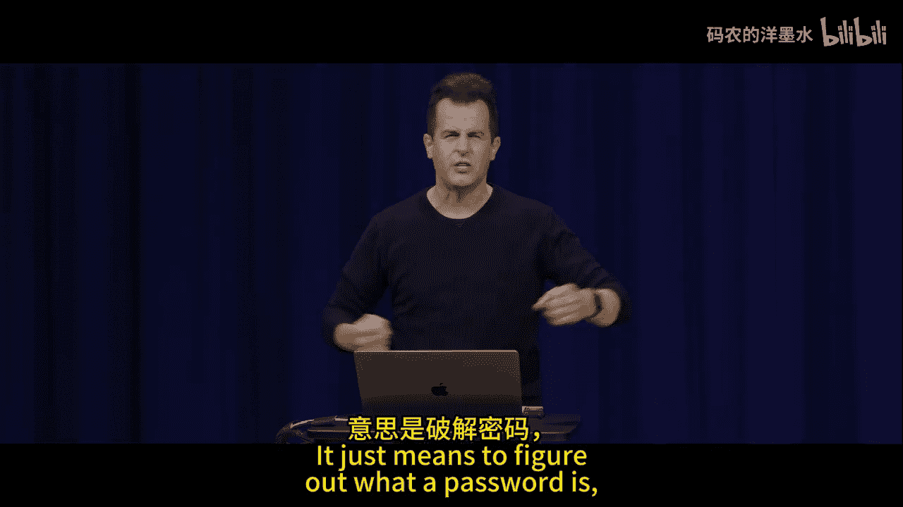

尽管用户名是公开的，但你我理想中应该保密的是我们的**密码**。如今，你我必须有几十个，甚至可能几百个密码，希望这些密码各不相同，并且不在所有不同的网站上重复使用。稍后我们会详细讨论这一点。正是这个密码最终允许你验证自己的身份，证明你是谁。因为理论上，世界上只有我不仅知道我的用户名或电子邮件地址（这些我们都可以知道），而且只有我知道我的用户名和这个密码。

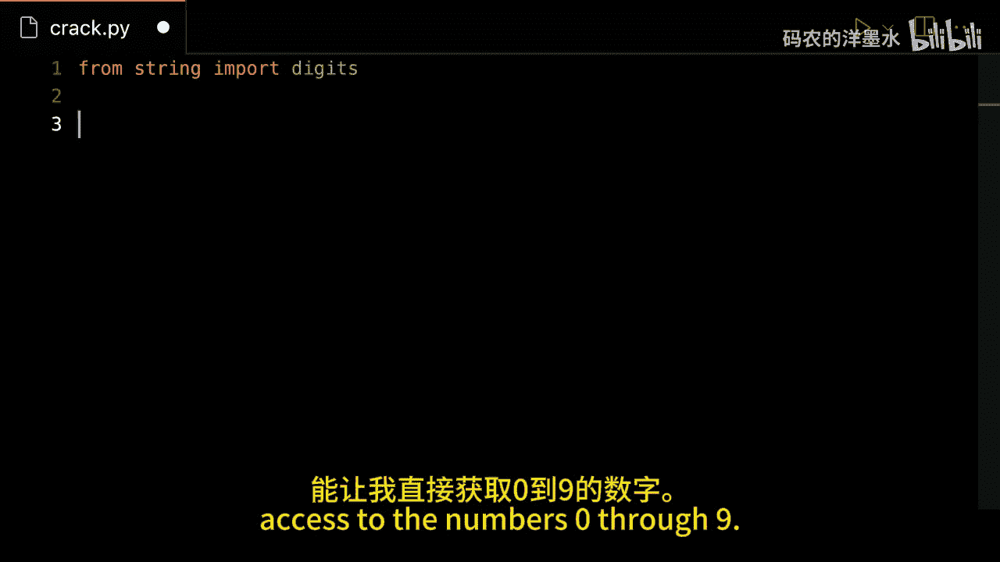

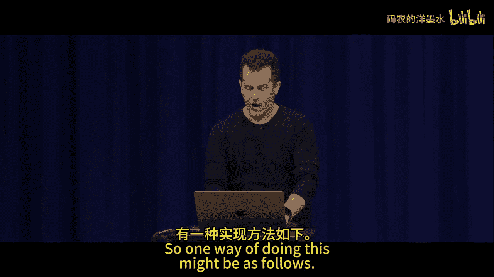

因此，假设是，如果我将这两个值输入到某个应用程序或网站，那么我肯定就是David Malan。

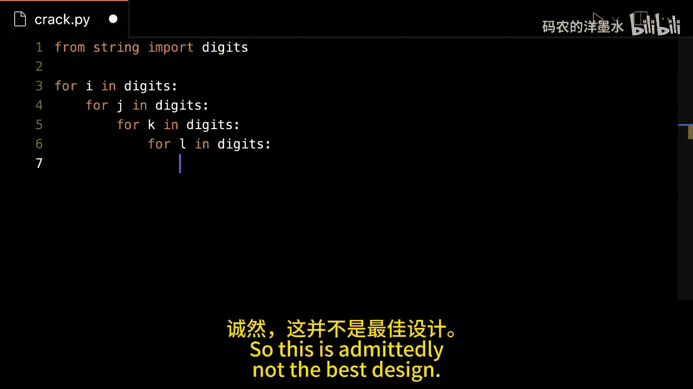

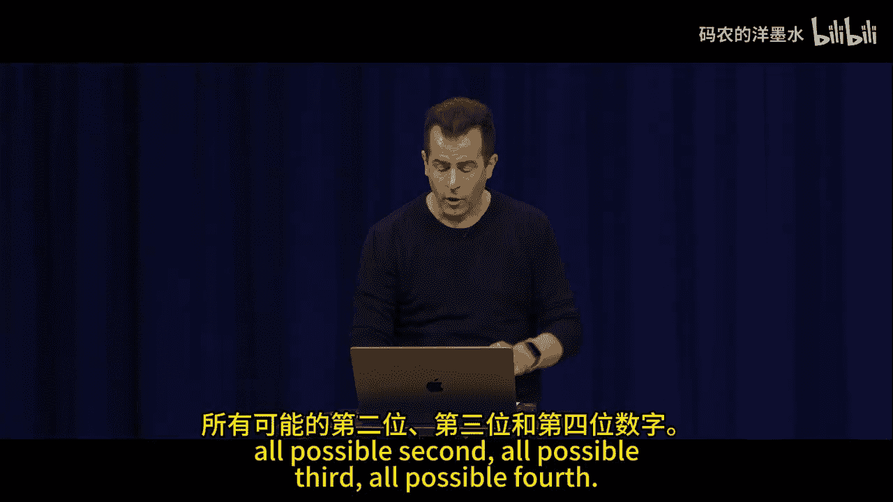

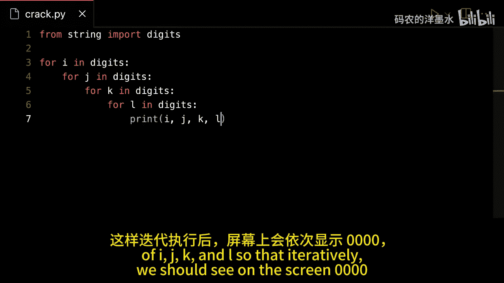

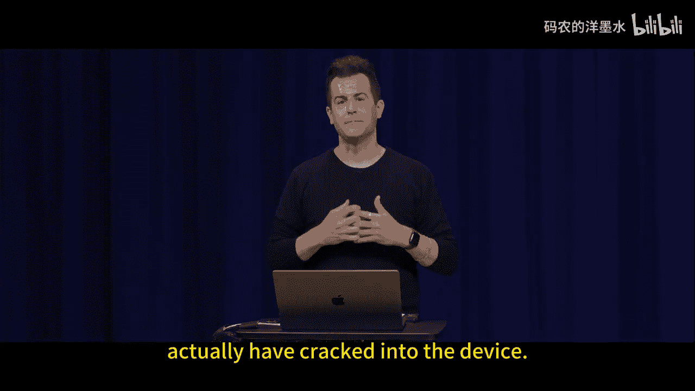

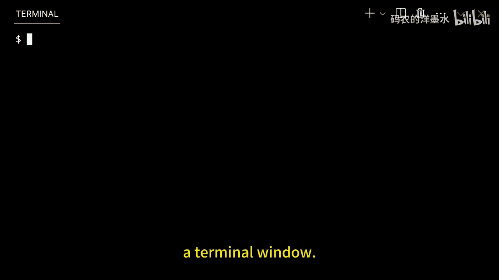

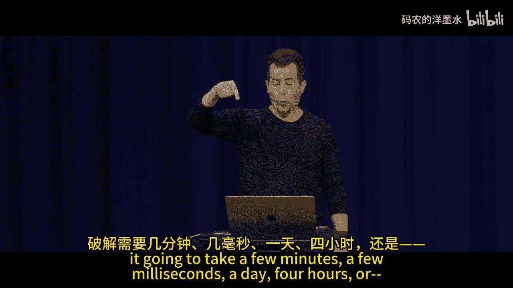

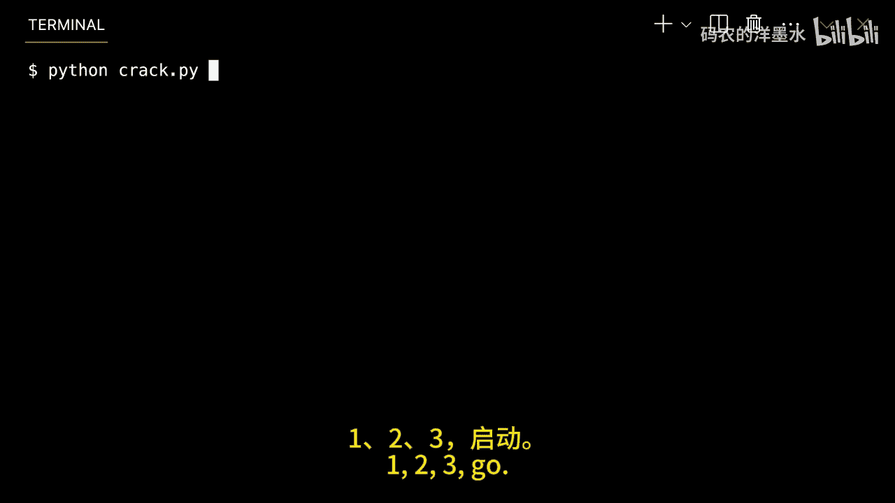

当然，仅仅有密码是不够的，你需要有一个**好密码**。

那么，什么是好密码呢？理想情况下，这个密码不应该是一个字典词，比如字面上的英语词典中的单词，或者任何其他人类语言的词典。为什么呢？因为存在一种称为**字典攻击**的威胁。我的意思是，一个想要进入你账户的对手（黑客）可以开始随机输入来尝试猜测你的密码，但他们更聪明一些，实际上会使用字典攻击。也就是说，他们会打开一本实体单词书，或者更可能的是，打开他们电脑上的一个文件，其中包含大量实际的英语单词或其他人类语言单词，然后一个接一个地尝试：用这个词作为你的密码，用那个词作为你的密码，依此类推。因为如果你我选择了一个相当容易猜测的密码，一个实际存在于字典中的单词，他们就能更快地进入你的账户。

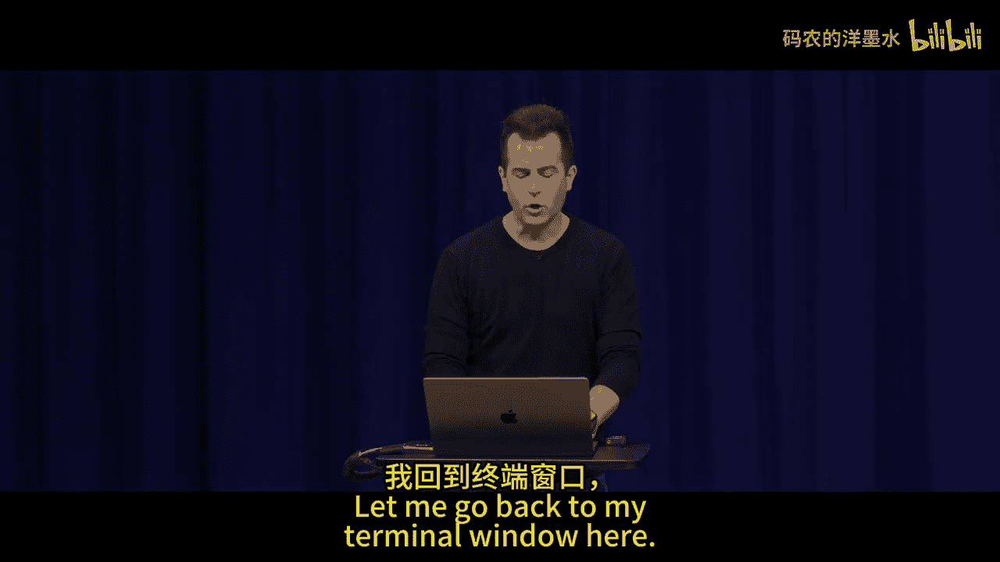

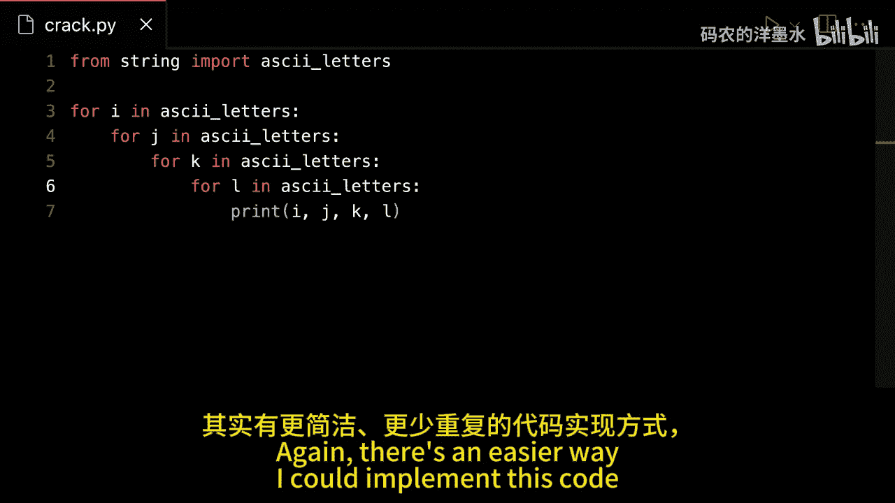

但即使你我都很聪明，并且根据生活经验，你知道不应该只选择一个简单的英语或其他语言的单词，而应该可能包含一些数字、字母、标点符号等，你仍然容易受到我们所说的**暴力攻击**的威胁。暴力攻击让人联想到过去有人可能用大树干作为攻城槌试图进入城堡的情景。但在数字世界中，暴力攻击意味着类似的事情，即使用软件在数字上尝试所有可能的密码。

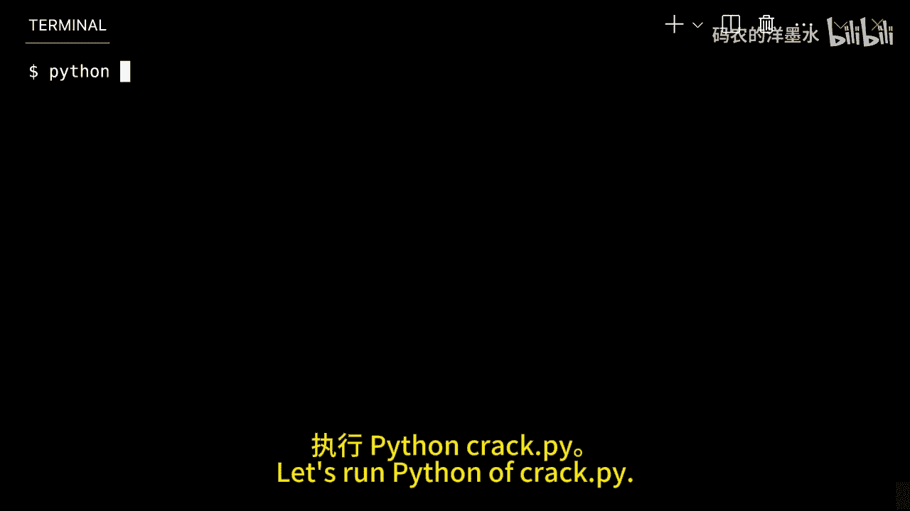

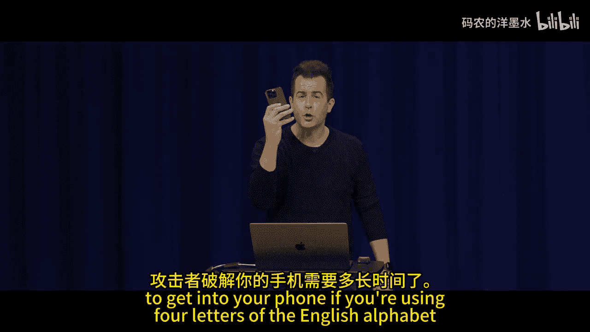

因此，在这里你也容易受到攻击，因为你的密码太短了。即使它是随机的，包含字母、数字和符号，一个有足够时间和足够技术知识的对手或黑客，也可以尝试世界上所有可能的密码，最终他们很可能进入你的系统。

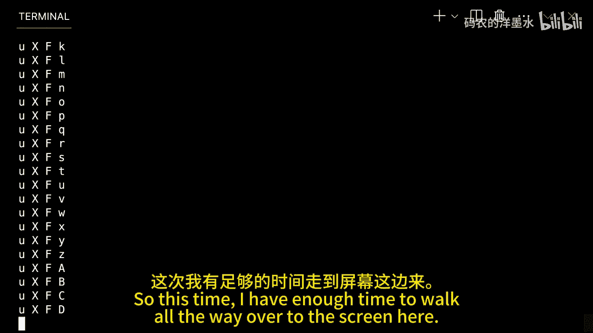

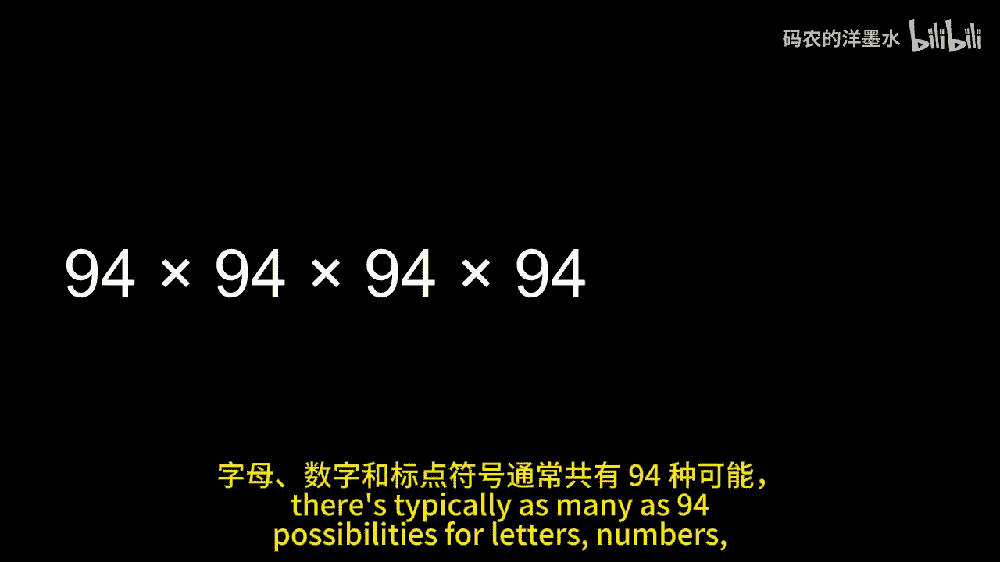

那么，我们如何防御这类攻击呢？我们使用这些密码，但这些密码当然有不同的形式，而且如今很多设备上默认设置的门槛仍然很低。例如，在你的手机上，如果你愿意在聊天中发表意见，系统通常要求多少字符或特别是多少位数字？我推测，当我设置手机时，经常只被要求输入一个密码，一个仅由四位数字组成的数字密码。

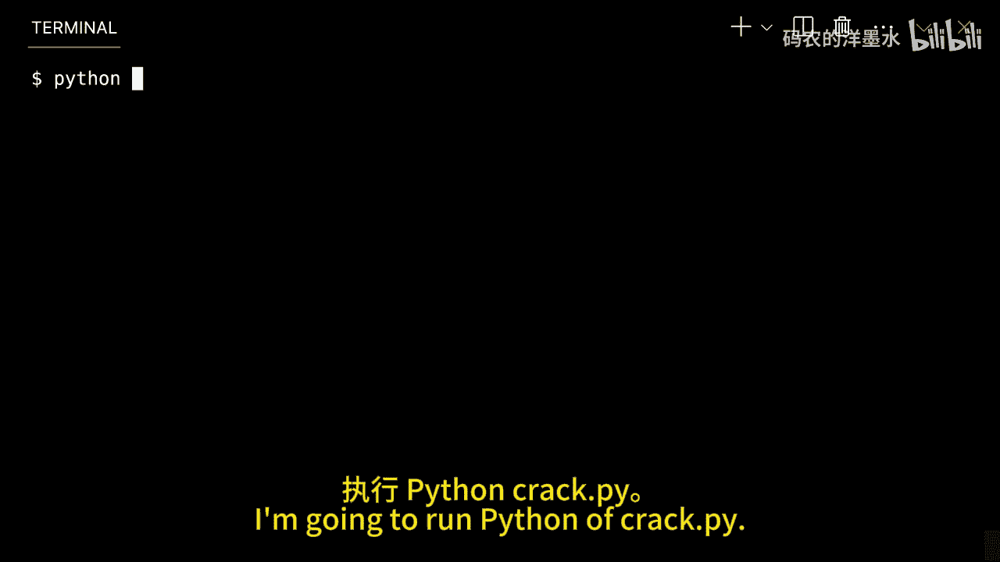

现在，如果你有一个四位数字的密码或更一般的密码，它的安全性如何？我们甚至如何开始思考这个密码的安全性？我建议我们可以开始衡量，甚至不需要使用复杂的数学，只需一些基本的启发式方法。我们可以通过考虑有多少可能的四位数字密码来衡量仅由四位数字组成的密码的安全性。

那么，也许你愿意在聊天中发表意见，如果密码全是0到9的十进制数字，并且你只有四位数字，那么有多少种可能的密码？我看到1000，我看到10000，我看到9999，我看到一个范围，我想你们很多人都答对了，是10000。为什么是10000？如果我们只是从零开始思考，我有四个十进制数字，0到9。我能想到的最小密码可以说是0000，我能想到的最大密码是9999。你可能会想，好吧，那显然是9999种可能性，但不太对，因为如果你包括0000，那是第1000种可能性。所以，如果我们特别使用四位数字，确实有10000种可能的密码。

那么，我们如何更普遍地思考这个问题，特别是为了现在也能为更长的密码计算出数学公式？如果你有0到9作为第一个可能的数字，0到9作为下一个，0到9作为第三个，0到9作为第四个，那么你有10种可能性乘以10种可能性乘以10乘以10。当然，如果我们用更数学的方式计算，就是10的四次方，指数是4，这同样得到10000。这可能是更数学化的方法，而不是更直观地从0000一直到9999。

现在，再问大家一个问题：你认为对手或黑客可能需要多长时间才能进入我的设备，例如我的手机，如果我确实有一个四位数字的密码？如果我有一个四位数字的密码，这意味着他们可能必须尝试多达10000种可能性，因为在最简单的情况下，当然，如果他们幸运，我的密码仍然是默认的0000。但在最坏的情况下，我选择了9999，他们直到尝试的最后才会猜到那个密码，或者我可能选择了介于两者之间的某个密码。我看到10秒，不到一秒，毫秒，10秒，一天，4小时，所以答案五花八门。

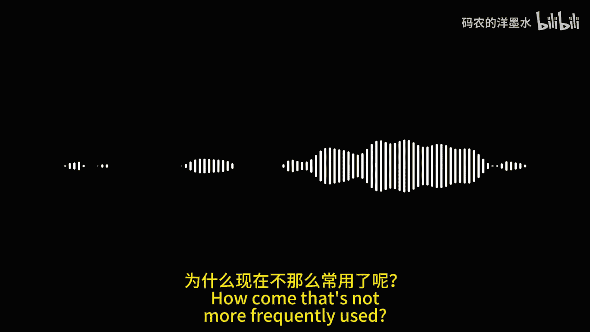

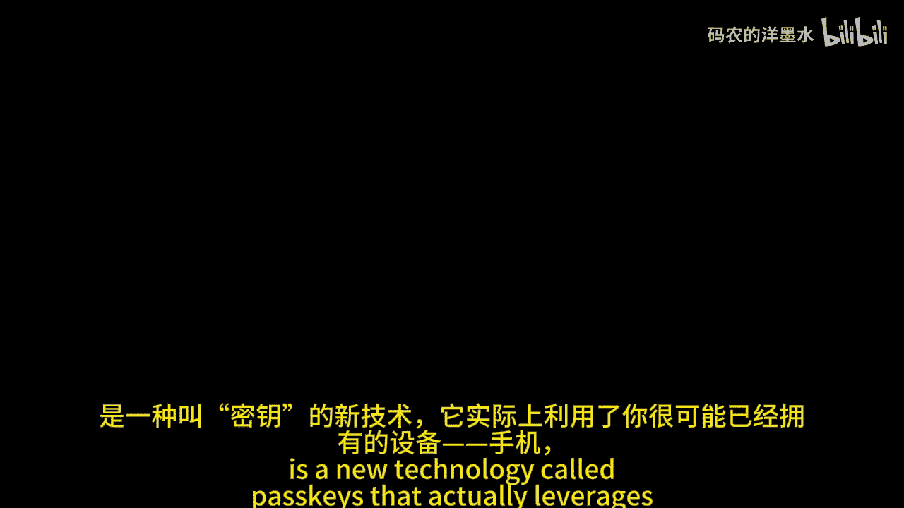

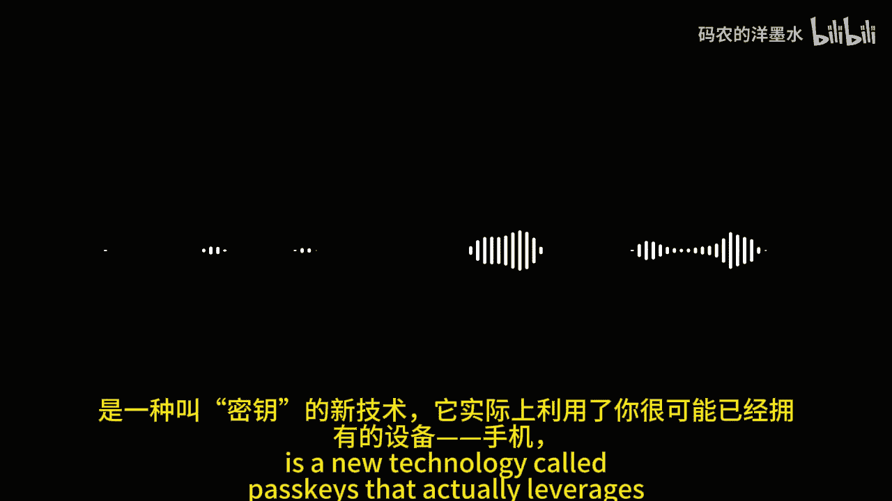

那么，我们如何实际衡量或估计这个时间呢？让我提出这个建议。我将转到我的电脑这里。即使你以前从未写过任何代码，让我们一起写一些代码。我将打开一个名为VS Code（Visual Studio Code）的程序，这是我们在CS50中更普遍使用的一个免费程序，它允许我在我的Mac、PC或任何基于互联网的设备上编写代码，我不仅可以编写代码，还可以运行它。

在这种情况下，我将用一种叫做Python的语言编写代码。这是一种非常流行的语言，但我也可以使用十几种或更多不同的编程语言。这里的目标不是学习Python，我们有其他完整的课程，而只是为了演示一个对手、一个黑客如果想要进入你的iPhone或Android设备或任何只有四位数字密码的设备需要做什么。

现在，为了演示的目的，我的假设是，我将编写代码，只是在屏幕上打印所有可能的密码。但你可以想象，如果我有一根USB线或闪电线，我可以将这部手机连接到这台笔记本电脑，特别是如果这是我从桌子上偷来的你的手机，我可以快速将它插入我的电脑，运行我即将编写的代码，甚至在你还没意识到手机丢失之前，自动向你的设备发送所有10000种可能性。

现在，我将这样做。我将在一个名为`crack.py`的文本文件中编写代码，其中“crack”实际上是一个术语，意思是找出密码是什么，暴力破解进入。我将从一个名为`string`的库中导入`digits`。这是一种非常简单的方法，可以让我访问数字0到9。我显然可以在键盘上把它们全部打出来，但这样更快，因为它给了我一个我关心的数字列表。

现在，有几种不同的方式可以编写这段代码。但直观地说，我真正想做的是尝试第一个值的所有可能数字，尝试第二个值的所有可能数字，然后是第三个，然后是第四个。一种方法可能如下。我将在Python中使用一个名为`for`的关键字，意思是只要我想让你做某事，就继续做。然后我将给自己一个变量，就像在数学中一样，这样我就可以用某个东西来跟踪每个数字。我将使用一个默认值`i`（代表整数）。然后我将继续说明，对于那10个数字中的每个值`i`，我想做以下事情。对于第一个值的每个`i`数字，我想对`j`在`digits`中也做同样的事情。然后对于我的第三个值的每个值，我可能会做类似`for k in digits`的事情。最后，我可能会做`for l in digits`。

必须承认，这不是最好的设计。你们中编程过的人可能会对我这种缩进方式感到不适。但对于那些不熟悉编程的人来说，这是一种简单的方式来演示我们如何尝试所有可能的第一个数字、所有可能的第二个、所有可能的第三个、所有可能的第四个。现在，我将在代码的最内部做的就是打印出`i`、`j`、`k`和`l`的值。这样，我们应该在屏幕上依次看到0000，一直到9999。

所以，假设我已经将我的手机连接到这台笔记本电脑，理想情况下，我们将估算出实际破解进入设备可能需要多长时间。

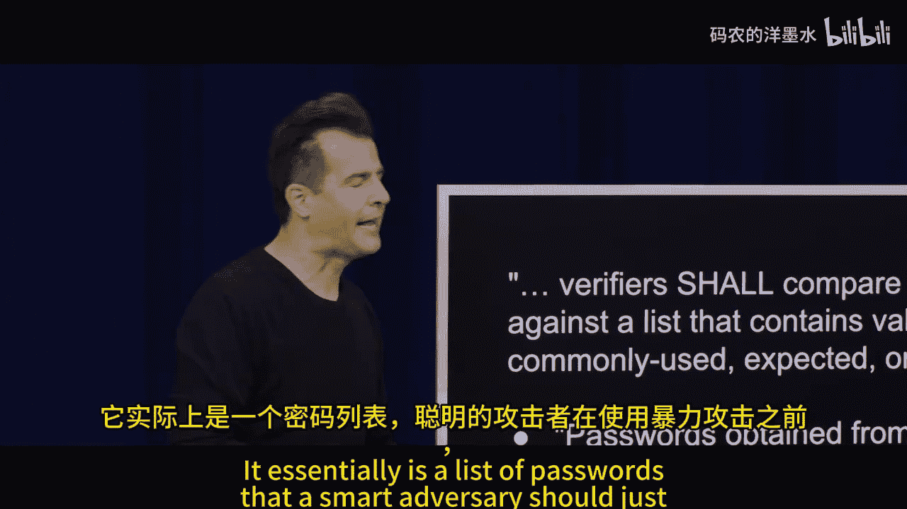

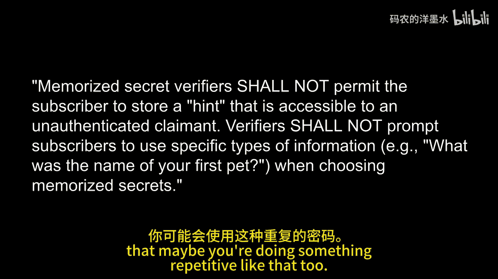

让我们开始做吧。我将在屏幕上打开一个单独的窗口，称为终端窗口。我将运行`python crack.py`。稍等片刻，我们将会看到……开始，一，二，三，开始。

好的，那些估计只需几毫秒的人说对了。那么，这里的要点是什么？显然，使用四位数字密码根本不安全，因为看看我（故事中的对手、黑客）能够多快地进入你的手机。事实上，我可能在那时就可以拔掉它，因为我已经从你的手机上获取了我关心的任何数据，而你甚至可能毫无察觉。

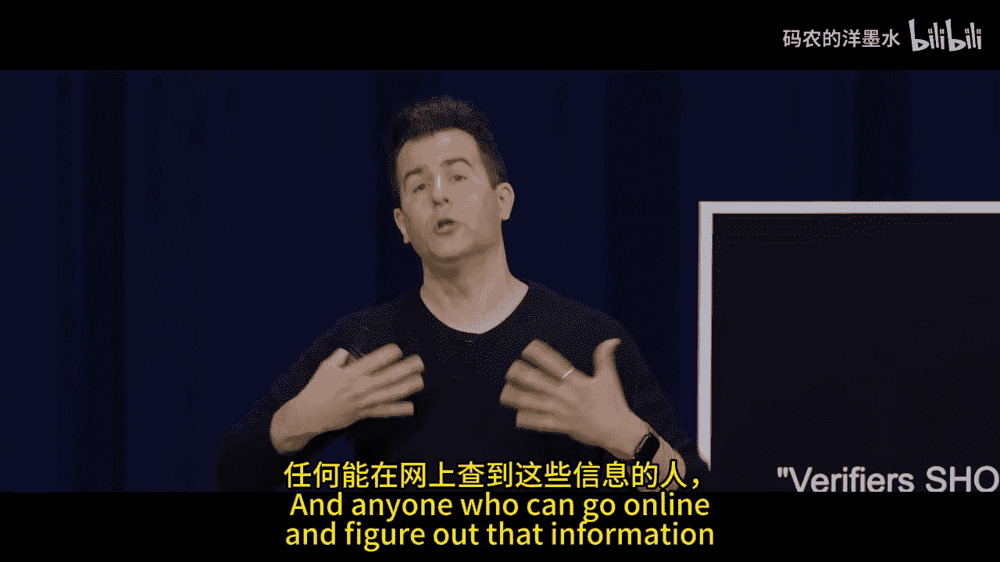

那么，我们如何改进这个系统呢？我建议，与其使用四位数字密码，不如使用四个字母。我们将使用英语，因为这是我说的语言。在英语中，我们有26个字母，从a到z。但你知道，最初这可能会给我们第一个位置26种可能性，乘以第二个到第四个位置的26种可能性。但我建议我们实际上使用小写和大写字母。这样，每个位置给我的不是26种可能性，而是52种可能性。

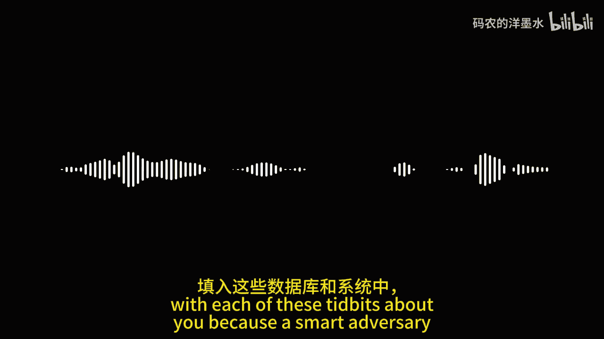

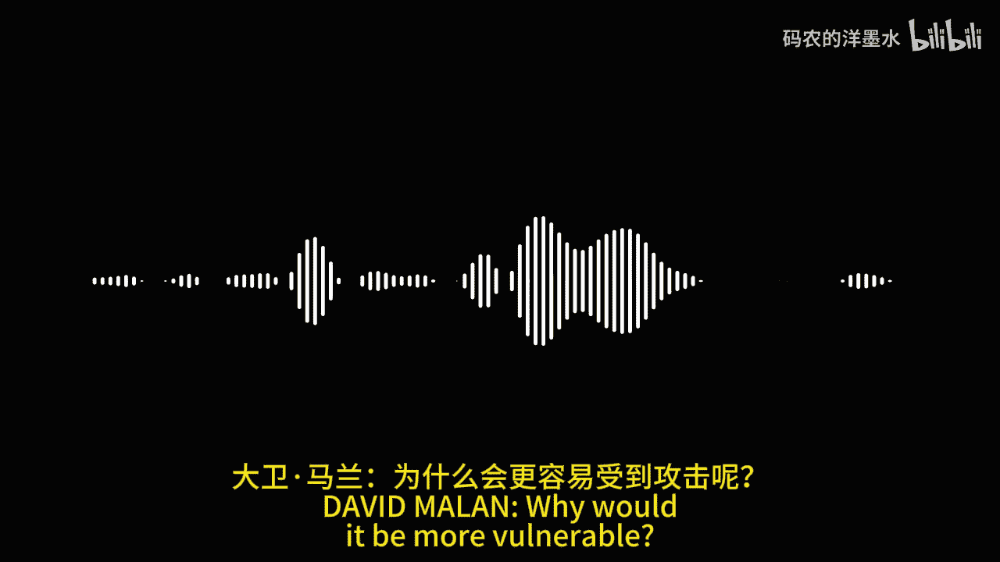

所以，如果我有52种可能性，那就是52的四次方。有没有人想估算一下，如果我现在使用四个英文字母（大写或小写），有多少种可能的密码？我看到26的四次方，但如果你使用大写和小写，那就不对了。确实是52的四次方。我看到很多。但这里我们有大约700万的估计。

所以，有700万种可能性，你可能会想，好吧，这肯定会好很多，黑客需要更长的时间才能破解这部手机。但让我们试试看。让我回到我的终端窗口。让我重新打开我的代码文件，让我们使用不是`digits`，而是`ascii_letters`。对于不熟悉的人来说，`ascii_letters`就是字母A到Z的大小写形式。现在我开始修改，我必须将这里的`digits`改为`ascii_letters`，将`digits`改为`ascii_letters`，将`digits`改为`ascii_letters`，最后将`digits`改为`ascii_letters`。再次说明，有更简单的方法，我可以实现这段代码更简洁、更少重复，但这涉及到一些我们将在其他课程中介绍的功能。

但现在，我的第一个占位符到最后一个占位符都有了所有可能的ASCII字母。让我们打开同一个终端窗口。让我们运行`python crack.py`。现在，这就是如果你使用四个英文字母作为密码，对手进入你的手机可能需要多长时间的答案。

好的，这次我有足够的时间一直走到屏幕这里，你可以看到我们按字母顺序排列，首先是小写，现在是大写。但就在片刻之后，我们完成了，一直到了Zzzz。所以那是几秒钟，确实更慢，但那真的没费多大力气。因此，可能即使是四个字母的密码也不足以保证我们的安全。

那么，让我继续做我们都被告知要做的事情，那就是进入你的手机或任何有问题的设备，实际上使用四个字符，也许更多。所以不仅仅是字母，不仅仅是数字，让我们也加入一些标点符号。在标点符号的世界里，至少在美国英语键盘上，通常有多达94种字母、数字和标点符号的可能性，因为我们有26个小写字母、26个大写字母、10个十进制数字0到9，以及另外32个可以加入混合的标点符号。所以给出了94种可能的按键，或者94的四次方。

有没有人想估算一下这是什么？我们从10000到700万，到……我在聊天中确实看到大约7800万种可能性。所以在某种意义上，安全性提高了10倍。让我们回到我的终端窗口，打开我的代码，这次不仅导入`ascii_letters`，还有之前的`digits`，以及一些`punctuation`。现在让我们把`ascii_letters`改为`ascii_letters`加上那些`digits`再加上那个`punctuation`。为了节省时间，我将高亮并复制我刚输入的内容，并将第二个位置、第三个位置和第四个位置也改为使用那94种可能性的组合。我将再次打开我的终端窗口，运行`python crack.py`。这次因为我们有10倍的可能性，我大概有10倍的时间走到屏幕前，因为我们确实还在小写字母阶段，Gs，Hs。现在看起来有点像好莱坞电影，也许你甚至可以看到，尽管它在屏幕上快速滚动，但有很多神秘的输出，因为我们正在遍历所有字母、数字和标点符号。所以看起来有点花哨。

现在你可能也记得好莱坞电影中，它们往往非常戏剧化。所以，不仅仅是这样做，从左到右缓慢迭代，电影和电视节目往往非常戏剧化地先猜对第三个字符，然后猜对第一个字符，然后及时猜对第四个，然后猜对第二个。这并不是暴力破解的真正工作方式，你倾向于有条不紊地做事，而不是在符号之间跳来跳去。但这显然需要很长时间。我甚至不打算等它完成，因为我们仍然需要遍历所有标点符号。

所以，这最终说明，7800万种可能性实际上已经相当高了。但说实话，如果我们等一分钟左右，我打赌它无论如何都会完成。而我们中没有人希望自己的密码只有四个字符。如今，包含字母、数字和标点符号的密码，很可能至少是常规的八个字符，而且大多数网站和应用程序也要求你这样做。

现在的数学相当简单。如果你有94种可能性，但你现在总共有八个字符，那就是94的八次方。有没有人想大致估算一下，如果只有八个字符（这甚至不算长），但总共有八个，有多少种可能的密码？太多了。答案回来了：多到数不清。好吧，我看到我们在这里放弃了。但我确实在聊天中看到一个，大约是这么多可能的密码，这实际上有点难计算。所以，我们姑且说是百万、十亿、万亿、千万亿。所以这是6千万亿种可能性。现在我们才在谈论。现在对手可能会耗尽时间、精力、金钱、寿命，如果尝试破解你的特定密码需要这么长时间的话。

所以，这是我们在网络安全和保护账户方面的第一个要点。这真的是一场相对性和资源的游戏。我们在这里所做的，通过加入数字、字母和标点符号，本质上并没有什么不同。这仍然是我们密码的相同公式、相同方法。但随着我们增加复杂性，并使其越来越长，我们提高了对手的门槛。为什么？只要你我不要做傻事，比如仍然选择00000000，只要我们在这个6千万亿种可能性的范围内选择一些相当随机的东西，对手就需要比原本多得多的时间来暴力破解那个密码。所以，等到他们最终进入账户时，你可能已经更改了密码，你可能不再使用该账户，或者你或对手甚至可能已经不在这个星球上了。这确实是目标。

但当然也有缺点，你的密码越长、越复杂，你我就越不可能记住那个密码是什么。所以这里存在一种平衡行为，试图找出账户的可用性（即访问它的用户友好程度）与账户安全性之间的平衡点。找到那个拐点在一定程度上是个人或公司政策的问题。

通常，好吧，让我在这里暂停一下，看看现在是否有任何关于仅通过密码保护我们账户的问题。

几年前，有带有指纹识别功能的USB设备。为什么这种设备没有更频繁地使用？是太贵了吗？这是一个非常好的问题，我们稍后会详细讨论生物识别技术。但你的直觉基本正确，拥有另一个设备很昂贵，大多数消费者不会浪费钱购买只为他们自己的东西。一些公司可能会，但如果他们有很多员工，成本可能会非常高。但你可能会很高兴知道，我们今天将结束的其中一个主题是一项名为“通行密钥”的新技术，它实际上利用了你很可能已经拥有的设备——一部可能使用你的指纹、面部或其他形式的生物识别技术的手机。这在现在变得越来越普遍，或者很快甚至会在你的笔记本电脑和台式机上使用，它们将以某种形式与那部手机通信。

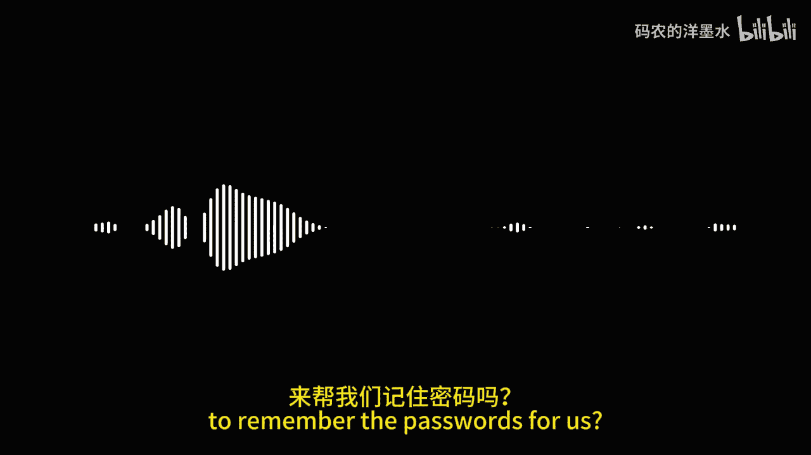

关于保护账户，我还有一个问题。我的问题是，为什么四位数字密码如此不安全，有些程序仍然在使用？这是一个非常好的问题。为什么有些程序员使用这个？这是可用性和安全性之间的权衡。如果你是设计系统的程序员，你大概希望用户使用系统、回来并继续使用它。但如果你让他们访问该账户变得太困难，如果你增加了他们不断忘记密码、丢失密码的可能性，他们可能就会完全停止使用你的系统、应用程序或网站。所以这可能不是一件好事。其他原因可能包括意识不足，或者没有上过网络安全课程，或者没有真正思考过使用如此短密码的影响。所以，如今行业开始推动我们朝着越来越好的方向发展，但我们将在今天和本课程的其他部分看到，在可用性和安全性之间仍然会有很多权衡。

那么，我们能做些什么来防御这些暴力攻击呢？至少在美国，有一个名为国家标准与技术研究院的组织，简称NIST，它实际上发布了关于我们作为消费者、公司或更普遍的人类如何更有效地保护账户的建议。我们认为应该分享其中一些建议，这些建议不仅告知你作为个人公民或消费者的行为，而且如果你在可以影响自己公司政策的企业中工作，这些也是当今普遍认为的最佳实践。

以下是他们建议的引述：“记忆的秘密应至少为8个字符长度。”这至少证实了我们刚刚运行的快速数学和测试，即只有当我们达到像6千万亿种可能性时，才感觉需要很长时间才能实际破解某人的设备。所以，请为你自己的账户考虑这一点，即使是在你的手机上，你可能需要浏览几个菜单选项才能从仅四位数字升级到更长的密码，但很可能你会从这额外的安全层中受益。

另一条建议有点拗口但很有帮助：“验证者（即验证你输入的用户名和密码的网站或应用程序）应允许订阅者选择至少64个字符长度的记忆秘密。所有可打印的ASCII字符以及空格字符都应被接受。Unicode字符也应被接受。”如果你自己不是计算机专业人士，这里面有一些术语。但首先，要点是网站和应用程序应该允许你我创建实际上长达64个字符的密码。这相当长，但这正是重点，特别是当你我记住所有密码变得越来越困难时。现实是，从整体上看，你我可能通过选择一个更容易记住但更长的密码（例如一个句子、一个短语）而变得更好，你可以更容易地记在脑子里，但不一定需要大量的标点符号、数字或字母，但至少是64个字符长度。所以，即使对手尝试字典攻击（尝试所有可能的英语单词或其他语言），即使他们尝试暴力攻击，除非你做了愚蠢的事情，比如选择一个全是0的64字符密码，否则他们将花费太长时间。

更技术性地说，这个建议指的是ASCII。ASCII通常指的是美国英语键盘上的美国英语符号，这是该代码系统的起源。所以包括a到z、0到9以及我之前提到的标点符号。但如今的网站和应用程序也应该支持Unicode，包括表情符号和其他带重音的字符或英语以外语言的符号。不幸的是，这并不常见。我敢说，就在昨天，我第一次在一个新网站上创建账户，它让我费尽周折，想出了正确数量的大写字母、小写字母、标点符号，甚至然后它告诉我只能使用某些标点符号。所以我不得不考虑现在使用哪些符号。这是很多摩擦，对可用性不利，而且如果之后我甚至记不住，对系统的安全性价值也值得怀疑。所以请记住，一般来说，你的密码不仅应该至少8个字符，而且大多数应用程序和网站（也许你自己将来会开发）也应该允许更长的密码，如果系统允许，你作为人类也可以使用更长的密码。

以下是NIST的另一组建议：“验证者（我们正在使用的网站或应用程序）应将预期的秘密（你选择的密码）与包含已知常用、预期或已泄露值的列表进行比较。”也就是说，当你输入密码时，如果它已经是常用密码，如果它非常容易猜测，网站或应用程序可能会说“请选择更好的密码”，以降低对手进入该账户的概率。具体来说，NIST建议，如果某些网站、某些数据库被黑客攻击，并且该数据库包含用户名和密码，并且这些密码现在已被上传到互联网供对手或任何人下载和浏览，那么你不应该被允许从该列表中选择密码，因为它本质上是一个替代字典，本质上是一个聪明的对手在甚至不诉诸暴力破解（我们已经看到需要更多时间）之前就应该开始的密码列表。2. 字典单词，所以我们已经规定避免这是一个好主意，因为对手遍历大量英语单词或其他语言单词列表并首先尝试它们太容易了。3. 重复或顺序字符，例如AAAAAA，或者稍微更有创意但仍然不够好，1234，ABCD。我也会将0000等归入那一类。对手猜测你可能在做一些重复的事情太容易了。4. 上下文特定的单词，例如服务的名称、用户名及其派生词。这是说，如果你第一次注册Gmail账户，Google不应该允许你选择像“gmailpassword”这样的密码。如果你注册Amazon账户，Amazon不应该允许你的密码是“amazonpassword”或类似变体。因为聪明的对手也会尝试同样的启发式方法，这也是问题所在。即使你认为自己很聪明，一个同样聪明的对手也可能想到那个启发式方法，并在诉诸像我刚才在自己笔记本电脑上做的暴力破解之前优先尝试那些技巧。

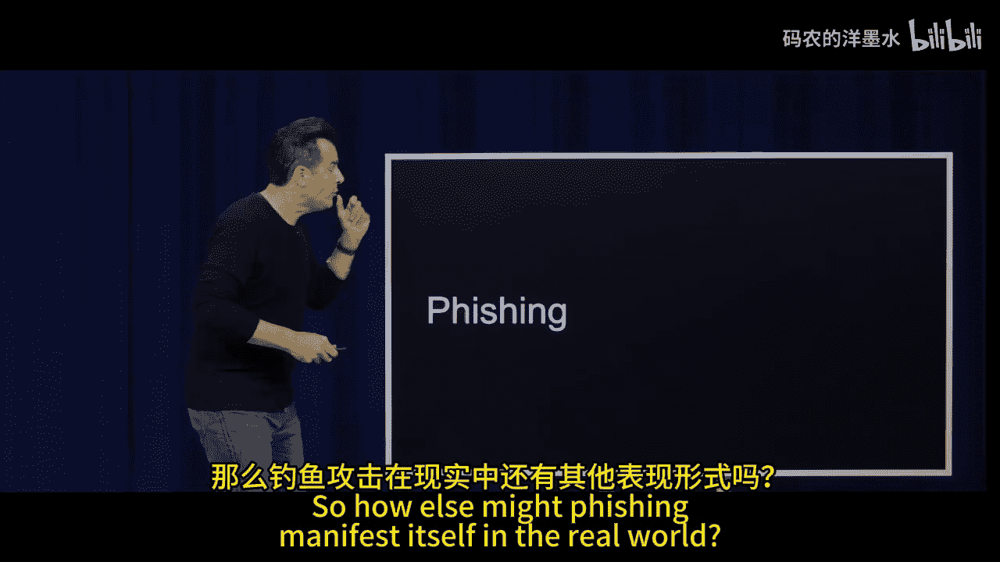

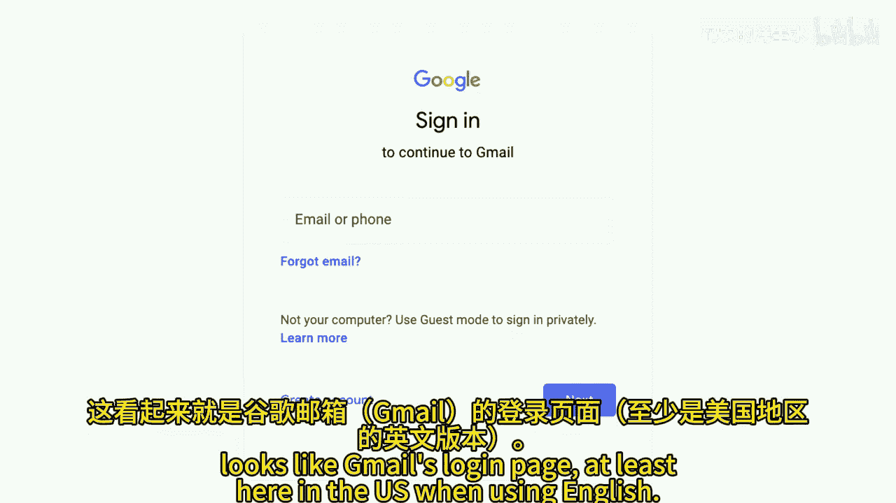

其他一些建议：“记忆秘密验证者不应允许订阅者存储对未经身份验证的声明者可访问的提示。验证者不应提示订阅者使用特定类型的信息（例如，你第一只宠物的名字）来选择记忆秘密。”如今有很多公司、很多网站、很多应用程序违反了这一建议。事实上，我敢打赌你能想到一个或多个账户，你不得不告诉他们，例如，你第一只宠物的名字、你的第一辆车、你母亲或父亲的名字等。收集这些信息也不好，提示也不是好事，因为坦率地说，你我经常习惯于在提示字段中输入可能帮助你记住密码的问题，但如果你的提示是类似“我的密码是我第一只宠物的名字”，那么你现在就是在向世界泄露信息，任何能在网上找到这些信息的人现在也可以进入你的账户。所以这真的是这种情况下的威胁。如果你在这个社交媒体和LinkedIn等网站的时代开始使用个人身份信息，关于我们的信息太多了，可以被发现，你不想用这些关于你的点点滴滴填满所有这些数据库、所有这些系统，因为一个足够专注、有足够时间的聪明对手可能也能找出所有这些相同的值。

还有：“验证者不应要求记忆秘密被任意更改，例如定期更改。”这一条也是很多公司仍然违反的建议。如果你在某个公司工作场所，系统管理员要求你每月、每三个月、六个月、每年更改密码，也许这不再被普遍推荐了，尽管不久前，这确实感觉像是最佳实践。但为什么不再推荐定期（比如每隔几个月）强制更改密码呢？因为密码很容易被忘记，并且更容易受到暴力攻击。为什么它更容易受到攻击？因为对手可以访问密码并获得新密码的提示。是的，强制你我过于频繁地更改密码的一个危险是，你我往往不会付出太多努力。例如，如果我今天的密码是“password1”，那么你知道我三个月后的密码可能是“password2”，或者再过三个月是“password3”。你我可能会付出最少的精力来更改密码，以满足公司的要求，但又不会太难记住新密码。所以确实，如果关于我密码的信息泄露了，而一些对手看到，等等，你上个月的密码是“password2”，我只会启发式地猜测这个月是“password3”，我们可能确实在泄露信息。另一个你可能不希望要求人类在某个时间表上任意更改密码的原因是什么？好吧，我们总是忘记密码。如果我们更改得太频繁，那就不好了。确实，如果你让我过于频繁地更改密码，说实话，我可能会忘记我的下一个密码是什么，因为我会与上个月或前几个月混淆。所以这对我们人类有社会学影响，只是人类，不擅长记住不仅是你让我选择的第一个非常复杂的密码，还有第二个和第三个。所以一般来说，你不应该再想出这样的方案，因为这些不利的副作用。

还有一个建议：“验证者应实施速率限制机制，有效限制可以对订阅者账户进行的失败身份验证尝试次数。”这是什么意思？很可能这是你自己可能经历过的事情，例如，如果你忘记了密码，或者你一直输入错误。也许你的手机屏幕是湿的，所以没有正确记录你的指尖。结果，你可能会将自己锁在自己的手机之外。事实上，你可能在iPhone上看到过类似的情况。Android也有类似的屏幕，例如，如果你连续10次输入错误的密码。Apple、Google和其他公司的假设是，如果10次之后你仍然没有正确输入密码，那么很可能你不是David，不是你，而是其他人拿走了你的手机、偷了你的手机并试图进入它。这并非总是如此，你可以想象一些情况，你只是心不在焉、半睡半醒，也许你没有真正集中注意力，结果把自己锁在外面。所以这里再次存在可用性和安全性之间的权衡，但10次错误尝试后，更高概率的事件可能是对手试图进入，而不是你。

但除了惹恼对手，更重要的是，当意外发生时真的惹恼你之外，这样做的意义是什么？但这实际上做的是减缓对手的速度。换句话说，它增加了对手的成本。为什么？我们刚才看到，一个懂一点Python代码并偷了你手机的聪明对手可以在不到一秒内尝试10000种可能的密码。然而，如果你现在通过在iPhone或Android设备上启用这个功能来减慢他们的速度，这个功能会“踩刹车”，让对手一次尝试不超过10次，这显著减慢了他们的速度。现在他们可能至少需要花费10秒、20秒、一小时、一天或更长时间，特别是因为Android和iPhone也会增加这个时间限制。第一次你搞砸了，是一分钟。如果你再搞砸10次，现在是两分钟，也许是5分钟，也许是10分钟，甚至手机可能会删除自己、擦除自己，如果这也是你或你的公司启用的功能。所以再次强调，除了可用性权衡之外，思考这个问题的正确方式是，我们只是在试图提高对手的门槛。我们试图通过减慢他们的速度来增加他们的成本、风险。我所说的风险是指，如果这像好莱坞电影中的场景，有人刚从星巴克或咖啡店的桌子上偷了你的手机，他们把它插到笔记本电脑上，他们拼命地想在你回到桌子前破解它，那么通过减慢他们的速度，将显著增加他们在行动中被抓住的风险，希望目标也是让他们对你的手机失去兴趣，对你的账户失去兴趣，让他们转向理想情况下不是别人的，但至少是别人的而不是你的。

那么，针对这类暴力攻击甚至字典攻击，还有哪些防御措施呢？这是一个你我越来越能够开启，但也越来越被要求开启的系统，这总体上可能是一件好事。**双因素认证**，或更普遍地称为**多因素认证**，是一种技术，除了使用一个因素（如传统的密码）登录外，你还必须使用第二个或更多因素才能登录。但这些因素通常不仅仅意味着一个密码、两个密码、三个密码等，它们是根本不同类型的因素。一般来说，它们分为以下三类：第一类是知识类别。知识因素就是你**知道**的东西，比如你的密码，理想情况下你保密，没有其他人知道，这就是为什么它能让你验证你的身份，证明你是你，因为希望只有你拥有那个知识。

但第二种类型的因素是**拥有因素**，即你**拥有**的物理物品。所以你可能习惯在工作中随身携带那些小钥匙扣，上面有一个不断变化的代码。这些东西可能很贵，所以世界越来越多地只使用我们自己的手机，你自己的Android手机、你自己的iPhone，它可能支持短信或可能有一个特定的应用程序显示一个短代码，你输入它。假设是，如果你不仅要求用户提供知识因素（如他们的密码），还要求第二个因素（如他们拥有的东西），你就能显著降低对手进入该账户的概率。因为虽然互联网上的任何人都可能通过找出或发现你的密码而对你构成威胁，但拥有因素真正将威胁范围缩小到星巴克的其他顾客或仅在你身边的人，因为他们必须实际获得第二个拥有因素。

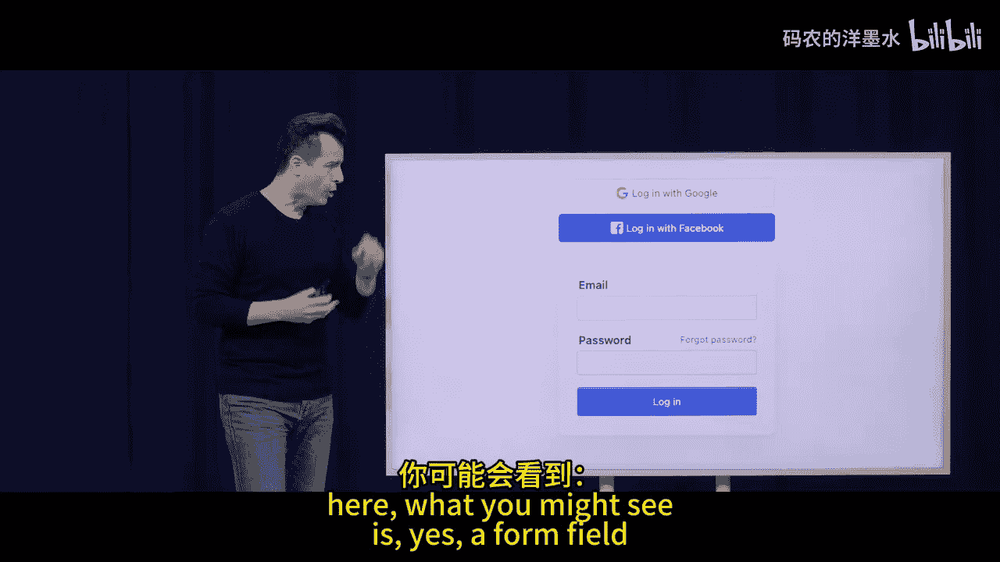

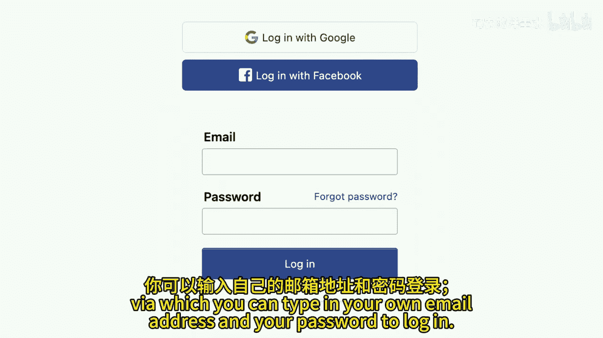

第三种类型的因素现在可能是**固有因素**，即你特有的东西，更普遍地描述为**生物识别技术**。所以可能是你的指纹，可能是你的面部，现在有些东西是你固有的，可以作为第三个因素。因为假设是，理想情况下，世界上只有你拥有完全相同的因素。

这与一些公司、网站、应用程序描述的**两步验证**略有不同，其中两步实际上可能只是某种形式的两个密码。但双因素认证更技术性地指的是两个或更多这些根本不同类型的因素，这是最常见的情况。

现在，当涉及到那些拥有因素、那些钥匙扣或你收到的应用程序或代码时，具体来说，你在这些模型中收到的东西通常被称为**一次性密码**或OTP。其理念是，这不是一个你知道并不断记住、反复使用的密码，它实际上是一次性的，因为它通过短信发送给你，或者通过应用程序通过推送通知发送，或者实际上发送到你钥匙链上的某个东西，比如这个钥匙扣。例如，如今，一家公司可以购买这些，屏幕上的一次性密码每隔几秒就会不断变化，并以某种方式与服务器同步，这样假设是，如果我随身携带这个设备，当被提示时输入这个特定代码，并且该代码与服务器上同步的代码匹配，我应该被允许进入账户，因为假设确实是David随身携带它，而不一定是某个对手。也可能可以通过USB或其他技术插入它，从而将人类从公式中移除，这样设备本身就可以使用系统上的特殊软件进行身份验证。

但现在，你可以下载特殊的应用程序，无论是来自Google还是其他公司的，它们允许你在一个地方管理所有这些一次性密码，你可能会在屏幕上自动看到它们更新，当你实际被网站或应用程序提示时，你可以输入其中任何一个或全部。

但即使在这个一次性密码和拥有因素的领域，也值得记住，其中一些技术比其他技术更安全。现在，网站或应用程序很常见地希望通过短信向你发送这些一次性密码之一，例如，你通过短信收到它，然后你可以输入那个六位代码。更安全的可能是像你从App Store、Google Play商店安装的实际应用程序，它直接与某个服务器通信，而不仅仅是通过蜂窝电话网络。为什么？正如你可能知道的，你的手机里通常有一张SIM卡，要么是物理卡，一个小芯片，要么现在也可能内置在手机里。但那张SIM卡有一个唯一的标识符。当你通常与公司注册电话服务时，他们需要知道你的SIM卡的唯一标识符是什么，无论是物理的还是硬连线到你的设备中的。为什么？因为这就是他们将你的电话号码与该特定设备关联的方式。问题是，欺骗甚至电话公司交换你的SIM卡太有可能了，在某些情况下也太容易了，不一定是物理上的，而是说服移动电话运营商更新他们的系统，说“哦，David现在有这张SIM卡，而不是原来那张”。也就是说，如果我是对手，我只有一部带有任何旧SIM卡的旧手机，我找出了唯一的标识符，也许我给David的移动电话提供商打电话，我以某种方式通过欺骗他们相信是我（比如告诉他们所有那些个人信息）来说服他们，我可能能够说服他们将我的SIM卡（对手的）与档案中已有的SIM卡交换。这样做的含义是，当David随后收到短信时，它们实际上不会发给我（真正的David），而是发给对手的手机。所以一般来说，现在如果你有选择，使用某个网站或应用程序时，选择使用短信或基于文本的消息传递，还是安装在手机或其他设备上的原生应用程序，你通常应该选择后者。一个一流的软件，实际上使用推送通知或你的数据计划，并且不依赖短信，因为存在这种潜在的威胁。

那么，这些系统还存在哪些其他威胁呢？不幸的是，对手有可能以某种方式在你的Mac、PC甚至手机上安装恶意软件。这可能是因为你安装了一个你不应该信任的软件，这可能是因为你的手机或设备感染了病毒或蠕虫之类的。但一般来说，你可能容易受到恶意软件的攻击，包括记录你所有击键的软件。**键盘记录**指的就是这个，很可能是恶意的软件，实际上记录你在该设备上输入或点击的所有内容。那么，这个软件如何处理这些击键呢？通常，如果有互联网连接，它会将它们上传到对手控制的服务器。现在，这种键盘记录威胁的含义是什么？如果你输入用户名，那没什么大不了的，因为那些通常是公开的。但如果你输入密码，并且它被自动上传到对手的服务器，现在他们知道你的用户名和密码。更糟的是，如果对手还看到你输入那个六位代码，你可能从手机或其他设备收到的一次性密码，如果他们足够快、足够聪明，并且知道如何记录你输入的内容，发送到服务器，甚至可能在你本人按下回车键之前，他们不仅可以使用你的用户名和密码，甚至可以使用那个一次性密码，通过在他们自己的手机、笔记本电脑或台式机上假装是你，输入或更现实地通过软件自动输入相同的值，甚至在你还没来得及这样做之前就访问你的账户。

那么，针对这种特定威胁的防御措施是什么？真的只是对你使用的电脑保持普遍的警惕。例如，现在，我很少（如果有的话）实际使用网吧的电脑，甚至哈佛校园的实验室电脑，或者坦率地说，甚至是朋友的电脑，因为我不知道他们在互联网上使用设备时，在最佳实践方面有多安全。我通常只在我自己的个人设备上登录网站和应用程序，这并不是说我也很完美，而是至少我降低了因使用其他我自己不监督的设备而失去对数据控制的可能性，因为那个人、那个所有者自己没有遵守最佳实践。即便如此，我也承认，使用键盘记录并将其上传到对手服务器，并比你更快地输入，是一个相当复杂和困难的威胁，但值得记住，值得意识到这些肯定是理论上的攻击，如果你自己因为某种原因成为目标，这些绝对是你应该注意的事情。所以一般来说，如果你有幸只使用自己的设备，而不是某些共享设备，那往往也是最佳实践。

好的，关于这些攻击有什么问题吗？关于使用长密码，你推荐使用像Google密码或Apple密码这样的系统来为我们记住密码吗？一个非常好的问题。简短的回答是：是的，但我们稍后会详细讨论。

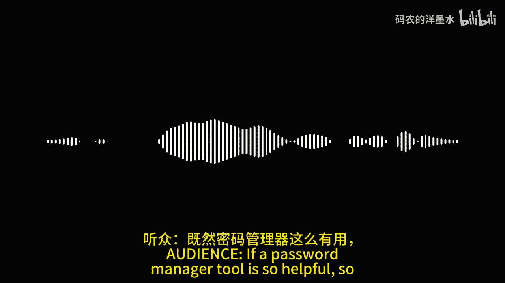

那么，我们还应该注意哪些其他攻击呢？这个攻击的名字有点滑稽，但有一种攻击被称为**凭据填充**。我们已经在本讨论中提到了这一点。凭据填充，凭据类似于用户名和密码，指的是对手找到一大堆用户名和密码的过程，可能是在线，可能是在他们或其他人攻击并发布供全世界下载的某个数据库中。凭据填充意味着不使用字典，不使用暴力破解，而只是字面上使用已知的用户名和密码列表，可能来自其他应用程序或网站，试图将它们填充到不同的网站，看看如果David在这里使用这个用户名和密码，那么他很可能在这里也使用相同的用户名和密码。所以凭据填充是一种威胁，我敢说你们中的许多人现在都容易受到这种攻击。你现在不需要举手承认这一点，但如果你在两个网站、三个网站、30个网站、所有网站上使用相同的用户名和相同的密码，你今天就容易受到这种攻击。需要明确的是，如果这些网站或应用程序中的任何一个被某个对手攻破，并且他们找出了该系统上的所有用户名和密码，一个聪明的对手现在要做的就是尝试在Amazon、Gmail或任何其他你可能因为那些服务很受欢迎而很可能也在使用的网站或应用程序上使用相同的用户名和密码。那么，要点是什么？理想情况下，如果你想对这种凭据填充攻击免疫，即有人在这里获取你的凭据并试图将它们填充到那里的其他服务中，你必须在每个网站、每个应用程序上使用不同的凭据。你不能也不应该在多个网站或应用程序上重复使用相同的密码。用户名可以，特别是如果是你的电子邮件地址，但密码不行。

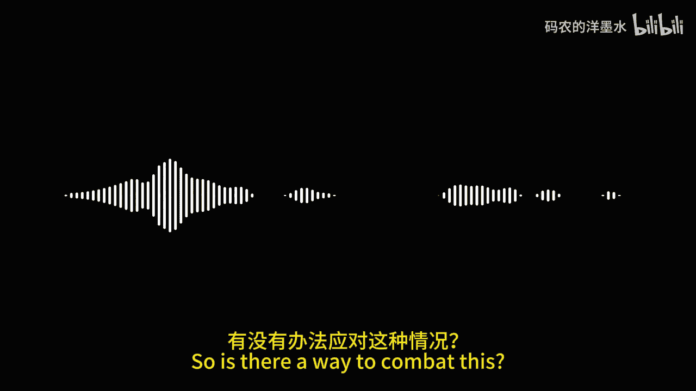

现在，这说起来容易做起来难。所以我们很快会看到，我们如何通过拥有唯一的密码，至少在管理相同密码时获得一些帮助，来尝试实现这一点，避免凭据填充。

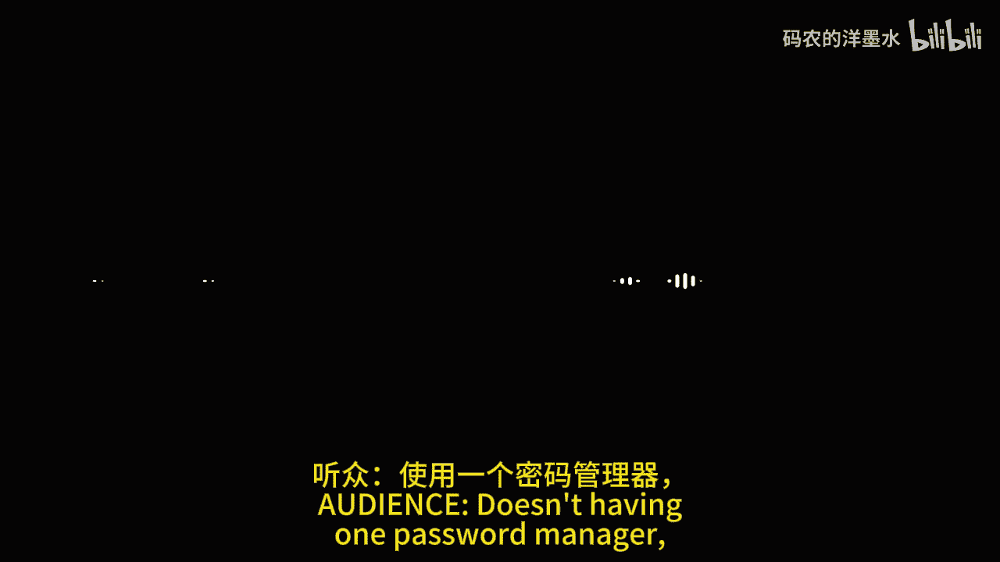

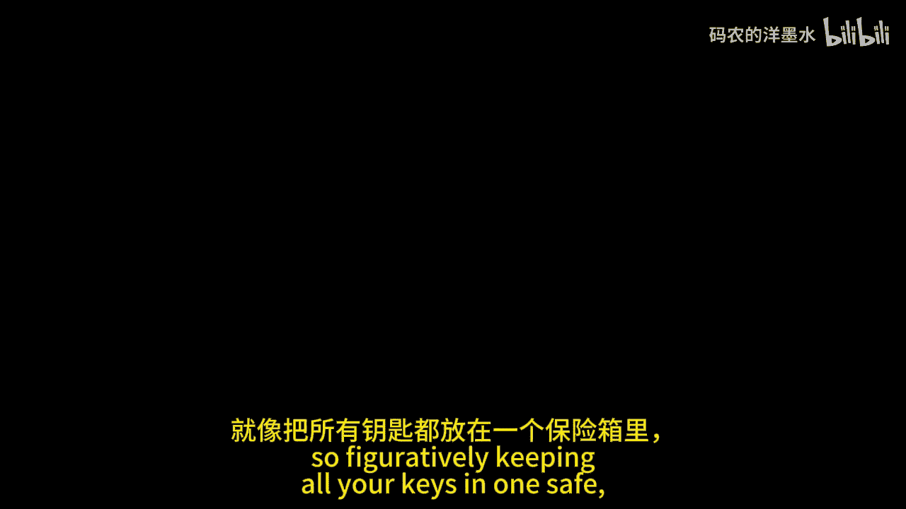

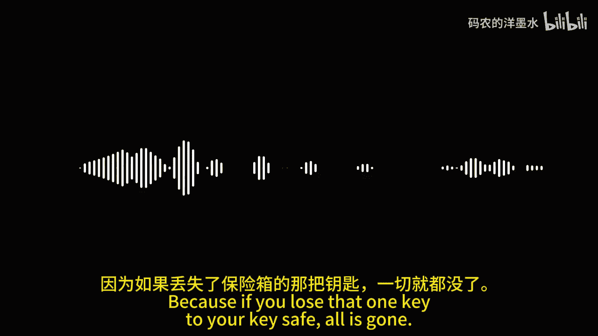

但还有另一种攻击，我们已经直接提到了，称为**社会工程学**。社会工程学本身不是一种技术攻击，而是一种社会攻击，是人类之间的攻击。例如，让我建议以下内容。如果你附近有纸和笔，请在那张纸上写下你的一个密码。任何一个都可以。就在你面前的这张纸上，写下你的一个密码，包括任何字母、数字或标点符号。现在我在聊天中看到一些抗拒，我看到一些人低下头，一些人在涂写，这正是重点。你为什么会接受我的建议，在一张纸上写下你的密码，即使我大概是你在网络安全课上应该信任的人？那些伸手拿笔或铅笔，在一张纸上写下你一个密码的人，刚刚被社会工程学攻击了，因为环境让你相信或信任那个要求或告诉你做某事的人，你表面接受了应该做那件事。今后，如果有任何老师要求你在纸上写下密码，今天的一个要点就是：不要这样做。那就是社会工程学。一般来说，如果有人打电话给你、给你发电子邮件，试图从你那里获取信息，即使看起来和听起来很合法，尤其是在今天之后，你应该始终保持健康的怀疑态度，如果不是足够的偏执，也是为了保护你的账户。如果有人问你类似的问题，或者更阴险地，试图找出你的第一只宠物是什么，你的间谍感官应该警觉起来，你应该想，等等，他们为什么需要这些信息？让我看看情况如何发展，然后再分享任何关于我自己的信息。确实，如果你（愿上帝保佑你）确实用笔或铅笔写下了你的密码，记住那种被欺骗的感觉，因为当它真正重要时，你不想让那种情况发生。现在，在这之后，我知道你不会相信我说的任何话，但去撕碎或撕掉或冲掉那张写有密码的纸。重点不是与任何人分享，只是为了证明那个特定的观点。

除了社会工程学，还有另一种变体威胁，但更具技术性，那就是**网络钓鱼**。你们大多数人可能在这个背景下听说过，你可以把它想象成像去钓鱼一样，试图钓到一个像我或你这样的傻瓜，被诱骗提供他们不应该提供的信息。这通常通过电子邮件发生。很可能，如果你有时浏览垃圾邮件文件夹，你会看到似乎来自PayPal.com、Google、政客等的电子邮件，这些电子邮件经常鼓励你点击链接捐款、点击链接更改密码、点击链接验证信息。网络钓鱼就是试图在这种情况下以技术方式使用社会工程学，试图通过看起来非常令人信服的电子邮件甚至网站来说服你，这是来自PayPal.com的合法电子邮件，或来自政客的合法电子邮件，或来自哈佛老师的合法电子邮件或请求，但事实并非如此。在这种情况下，对手试图利用你对某些公司或个人的信任，他们试图利用你对熟悉的用户界面的舒适感，你以前见过的东西。但不幸的是，对手制作一封看起来非常官方的电子邮件、一个看起来非常合法的网站（甚至看起来与PayPal.com、Gmail或其他服务完全相同）太容易了。坦率地说，如果你上过CS50的其他课程，这在最简单的场景中归结为复制和粘贴，只是复制粘贴一些合法网站，并假装你也拥有它。

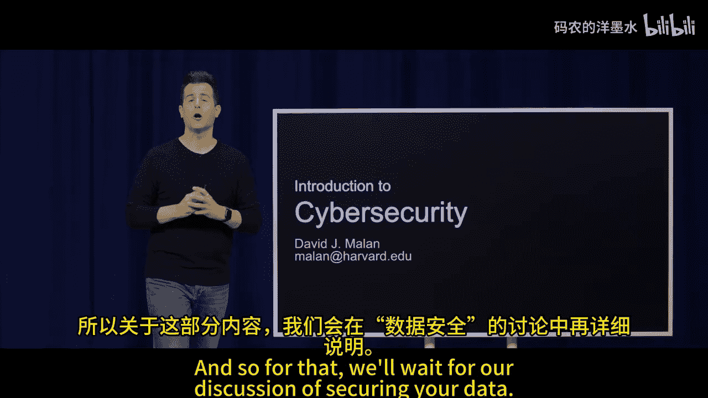

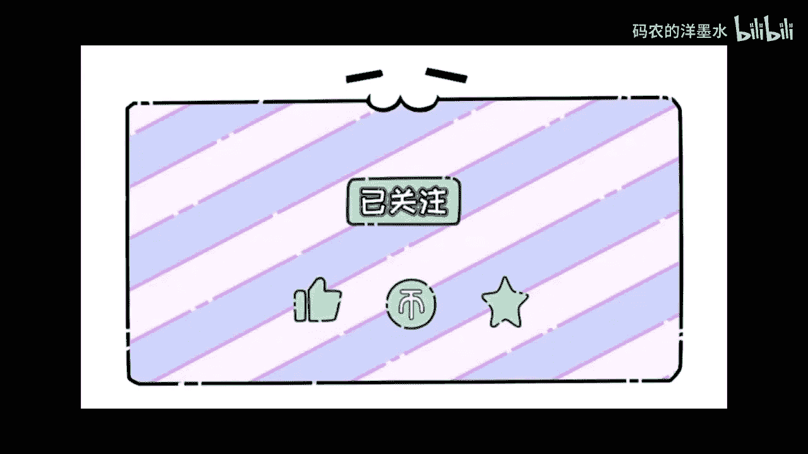

那么，网络钓鱼在现实世界中如何表现呢？考虑一下社交媒体上那些邀请你评论童年最喜欢的歌曲的帖子。有时这些帖子有来自你认识和不认识的人的一百万条回复，但除了对你童年最喜欢的歌曲感兴趣之外，这些帖子通常是在网络钓鱼获取个人信息。因为假设你或至少评论中的某个人