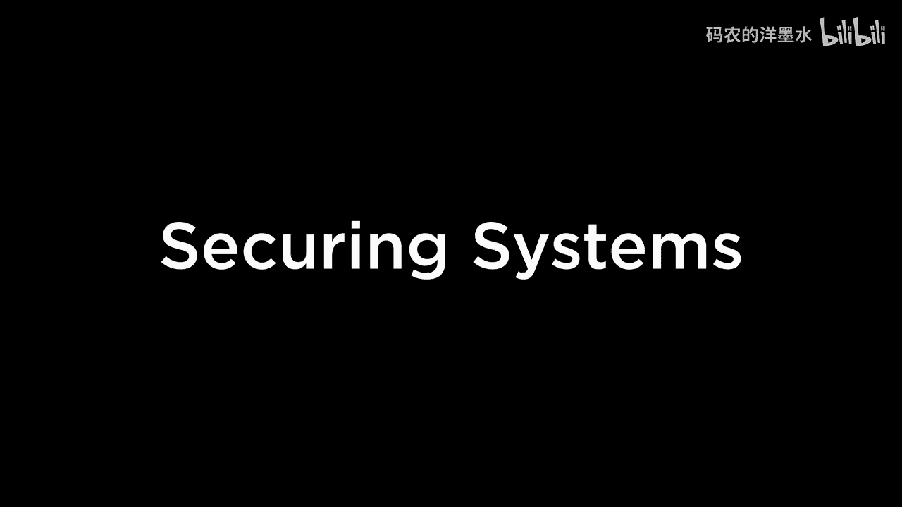
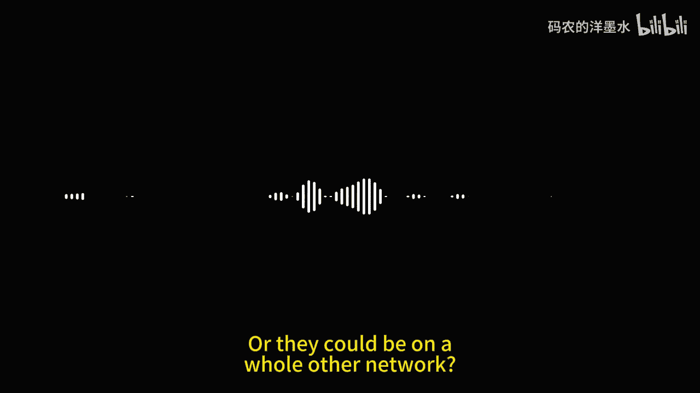
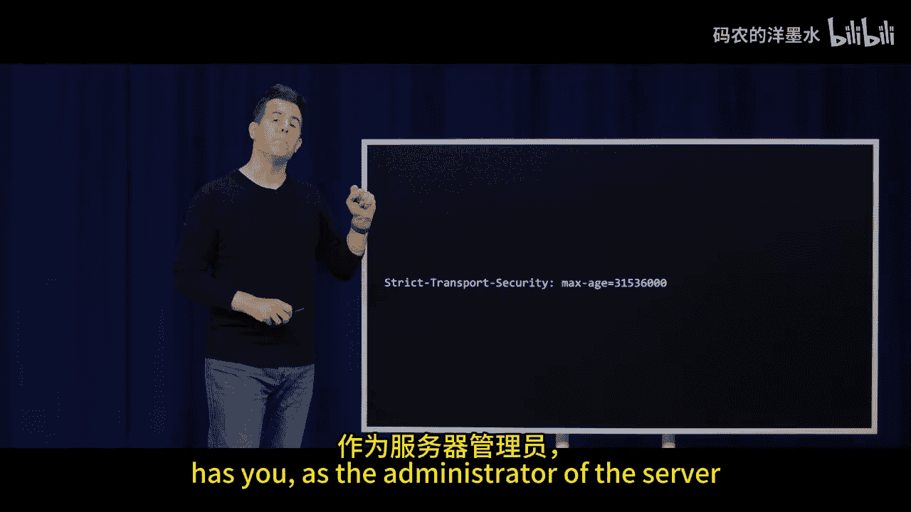
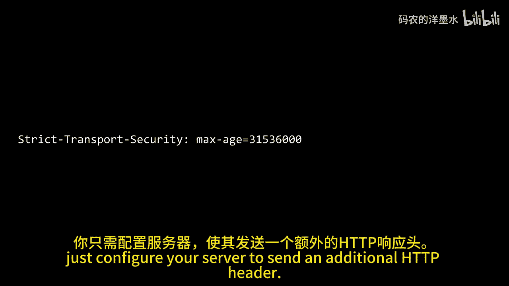
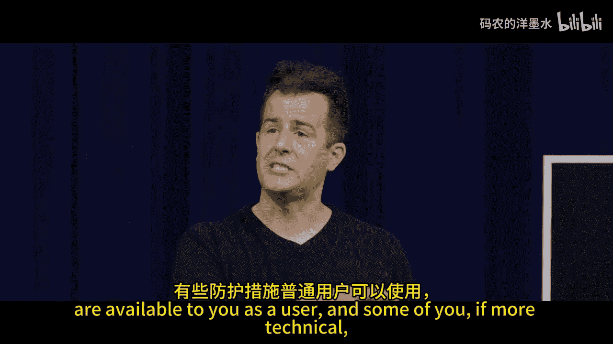
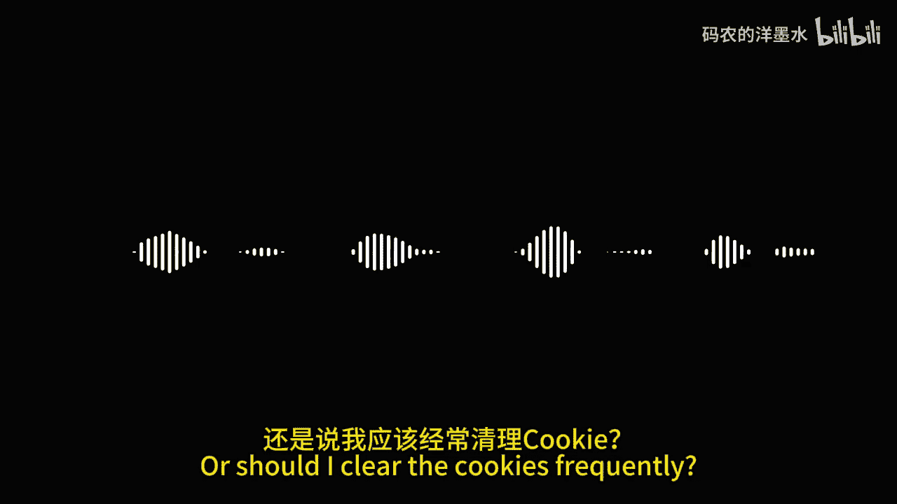
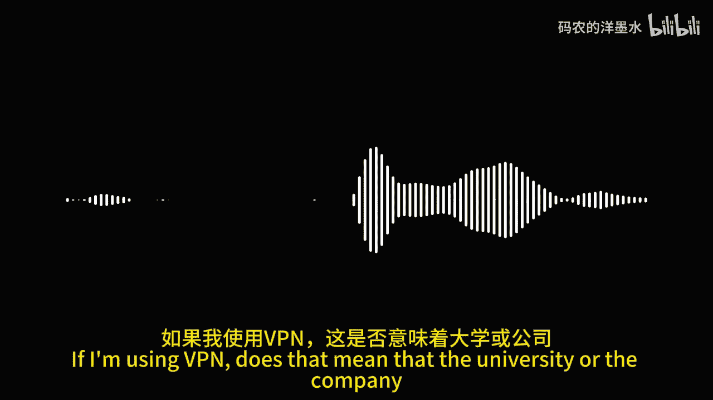
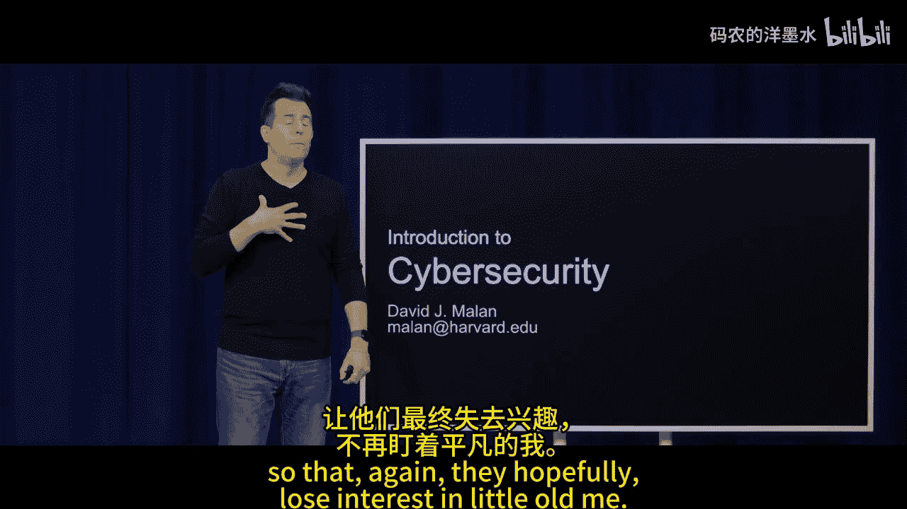

# 004：保护系统 🔒

在本节课中，我们将要学习如何保护联网或接入互联网的系统。我们将从回顾加密技术开始，探讨其在保护网络通信中的核心作用，并分析多种网络攻击的原理与防御策略。

## 概述 📋

上一节我们介绍了加密技术，它是解决许多安全问题的基石。本节中，我们来看看如何利用加密等技术来保护我们的系统，特别是那些通过网络进行通信的系统。

## 加密无线网络 📶

你可能正在使用Wi-Fi无线连接到互联网。当你连接Wi-Fi时，通常会看到两种网络：未加密的和已加密的。已加密的网络通常带有一个小锁图标，这表示你的Wi-Fi连接是加密的。

这意味着从你的设备发送到互联网的任何流量，至少在到达无线接入点之前，都是经过加密的。目前用于保护Wi-Fi网络的主流技术是**WPA**，它确保你的设备与接入点之间的通信是经过加密的。

## HTTP协议的风险与中间人攻击 🕵️

然而，Wi-Fi加密只保护了你与本地接入点之间的通信。互联网上的许多通信本身可能并未加密。例如，当你访问以 `http://` 开头的网站时，你的浏览器使用**HTTP**协议与服务器通信。HTTP协议本身不加密，这意味着通信内容是明文传输的。

这导致了**中间人攻击**的风险。假设用户爱丽丝试图访问服务器鲍勃的网站，而攻击者伊芙位于两者之间。如果爱丽丝使用HTTP，伊芙可以：
*   **窃听**爱丽丝的请求和鲍勃的响应。
*   **篡改**通信内容，例如向网页中注入广告或恶意代码。

例如，服务器返回的HTML代码可能被中间人修改，添加了本不存在的广告或恶意脚本。

**如何检测并摆脱中间人攻击？**
你通常无法直接检测到中间人攻击。防御的核心在于使用加密，确保通信内容无法被窃听或篡改。

## 数据包嗅探与明文传输的危害 📦

在互联网上，数据被封装成**数据包**进行传输，就像信件装在信封里一样。如果数据包内容未加密，攻击者可以进行**数据包嗅探**，查看甚至修改其中的内容。

例如，当你在搜索引擎搜索“cats”时，你的请求数据包中会包含明文查询 `query=cats`。更严重的是，当你在网站购物并输入信用卡信息时，这些敏感数据（如 `credit_card_number=...`）也会以明文形式在数据包中传输，极易被窃取。

**攻击者需要满足什么条件？**
攻击者通常需要连接到同一个Wi-Fi网络，或者只需在物理上接近你，并使用带有天线的设备监听周围的无线数据包。他们无需预先知道你的IP地址，因为可以从流经空中的数据包中获取发送者和接收者的IP地址。

## Cookie与会话劫持 🍪

现代网站使用**Cookie**来维持用户会话状态。当你首次登录网站时，服务器会通过HTTP响应头 `Set-Cookie: session=1234ABCD` 给你的浏览器设置一个Cookie，类似于给你的手盖了个章。之后浏览器访问该网站的每个请求都会带上 `Cookie: session=1234ABCD`，以告知服务器你的身份。

如果使用HTTP，这些Cookie也是明文传输的。攻击者通过数据包嗅探获取你的会话Cookie后，就可以在自己的请求中使用它，从而**劫持你的会话**，冒充你的身份登录网站。

**解决方案**是使用**HTTPS**协议。HTTPS对包括Cookie在内的所有通信内容进行加密，防止中间人窃取。

## HTTPS与TLS/SSL加密 🔐

HTTPS在HTTP的基础上增加了加密层，其核心是**TLS**协议。TLS使用**公钥加密**技术来建立安全连接。

其工作流程涉及**数字证书**。网站服务器拥有一个由受信任的**证书颁发机构**签名的数字证书，其中包含网站的公钥。当你（浏览器）访问一个HTTPS网站时：
1.  浏览器下载服务器的证书。
2.  浏览器使用内置的、受信任的CA公钥来验证该证书的签名是否有效。
3.  如果验证通过，浏览器和服务器之间就会建立一个加密的通信通道。

这样，即使数据包被截获，其中的内容也无法被解读。

## SSL剥离攻击与HSTS防御 ⚠️

一种名为**SSL剥离**的攻击会诱使用户以为他们与网站建立了安全连接，但实际上可能没有，或者连接到了攻击者的假冒网站。

例如，如果你习惯输入 `example.com` 并让浏览器自动补全为 `http://example.com`，攻击者（中间人）可以拦截这个HTTP请求，并返回一个重定向响应，将你引导至一个看起来相似但实为假冒的HTTPS网站（如 `https://examp1e.com`，用数字“1”代替字母“l”）。

**如何防御？**
*   **用户层面**：养成手动输入 `https://` 前缀的习惯。
*   **网站管理员层面**：使用**HSTS**协议。通过配置服务器，在响应头中添加 `Strict-Transport-Security: max-age=31536000; includeSubDomains`，告诉浏览器在未来一年内，对该域名及其子域名的所有访问都必须使用HTTPS。甚至可以申请将域名加入浏览器的**预加载列表**，从源头杜绝首次HTTP访问的风险。

**关于仿冒域名**：虽然域名注册商努力识别和暂停恶意仿冒域名，但由于注册商众多、顶级域名多样，此类攻击仍可能发生并造成短期危害。

**关于Cookie**：使用HTTPS可以防止网络层面的Cookie注入。但**超级Cookie**是由网络运营商（如电信公司）在更底层注入的，需要在运营商账户中手动设置才能关闭。

## VPN与SSH：建立加密通道 🌉

*   **VPN**：**虚拟专用网络**。它在你的设备和VPN服务器之间建立一条加密隧道，加密**所有**互联网流量。连接VPN后，你的对外IP地址会变为VPN服务器的地址，常用于访问公司内网资源或伪装地理位置。
*   **SSH**：**安全外壳协议**。主要用于远程安全地登录服务器并执行命令。所有通过SSH传输的指令和结果都是加密的。

**VPN与Tor的区别**：VPN提供点对点的加密，但不隐藏流量最终目的地。Tor则通过多层路由实现更强的匿名性。

**公司网络下的隐私**：如果公司在你设备上安装了管理软件或自有CA证书，他们可能具备进行中间人攻击的能力，此时VPN也无法保证通信对公司完全不可见。

## 端口、防火墙与网络监控 🚪

*   **端口**：每个网络服务对应一个数字端口（如HTTP: 80, HTTPS: 443, SSH: 22）。攻击者可通过**端口扫描**来发现目标服务器上开放的服务。
*   **渗透测试**：以发现系统漏洞为目的的合法攻击模拟，也称为**道德黑客**。
*   **防火墙**：用于控制网络进出的软件或硬件。可以根据IP地址、端口号或更深入的**深度数据包检查**来允许或阻止流量。
*   **代理服务器**：作为中间人审查网络流量。公司或学校可能使用代理来：
    *   过滤恶意网站。
    *   进行URL重写，将邮件中的链接改为先经过代理检查，再跳转到真实地址，以便记录或阻止访问。
    *   如果他们在你的设备上安装了自有CA证书，甚至可以对HTTPS流量进行解密和检查。

## 恶意软件与防御 🦠

*   **病毒**：需要用户交互（如运行文件、点击附件）才能感染并执行的恶意软件。
*   **蠕虫**：可以自我复制和传播，无需用户交互的恶意软件。
*   **僵尸网络**：由大量被感染的计算机（“肉鸡”）组成的网络，受攻击者控制，可用于发动**分布式拒绝服务攻击**，即同时向目标服务器发送海量请求，使其无法为正常用户服务。
*   **零日攻击**：利用尚未被软件厂商发现或修复的漏洞进行的攻击。

**防御措施**：
1.  **防病毒软件**：定期扫描系统，但需保持更新以识别新威胁。
2.  **启用自动更新**：确保操作系统和应用程序及时修补已知漏洞。
3.  **分层防御**：安全不是单一措施，而是密码管理、加密通信、防火墙、软件更新等多层防护的组合，旨在不断提高攻击者的成本和风险。

## 总结 🎯

本节课中我们一起学习了保护系统安全的核心概念。我们探讨了HTTP明文传输的风险、HTTPS与TLS加密的原理、以及中间人攻击、会话劫持、SSL剥离等具体威胁及其防御策略。我们还了解了VPN、SSH、防火墙、代理等安全工具，并认识了病毒、蠕虫、DDoS等恶意软件攻击。记住，网络安全是一个需要多层防御、持续警惕的领域。