# 006：保护隐私 🔒

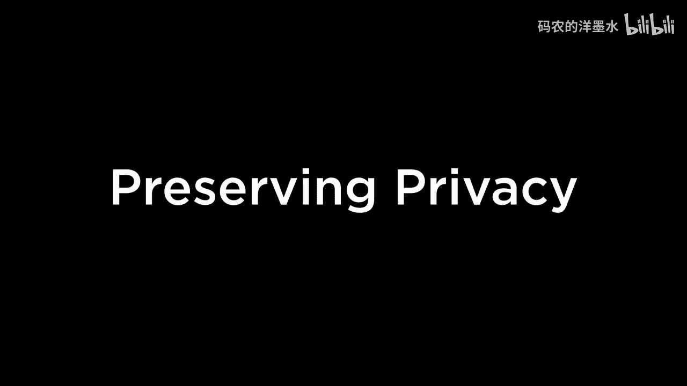

在本节课中，我们将要学习如何保护个人隐私。在前几周，我们重点讨论了如何保护账户、数据、系统和软件的安全，这些内容主要关注如何确保点A与点B之间的通信安全，防止中间人窃取信息。但如果我们甚至不希望点B获得某些信息呢？今天，我们将聚焦于我们日常使用的一些技术，以及未来软件和应用背后的技术，探讨我们正在分享哪些信息（有时甚至是在我们不知情的情况下），并介绍一些机制，帮助你限制这些信息的分享，以更好地保护隐私。

## 网络浏览历史记录 📜

我们首先考虑一些你和我可能每天都会使用的明显功能，比如网络浏览历史记录。无论是在笔记本电脑、台式机还是移动设备上，你的浏览器通常会记录你在万维网上访问过的几乎所有地方。例如，点击URL栏，你有时可以浏览最近访问过的URL；通过浏览器菜单中的“历史记录”，你可以看到今天早些时候、昨天、上周、去年，甚至可能是全部历史记录（特别是如果你登录了Google账户、Microsoft账户等）。

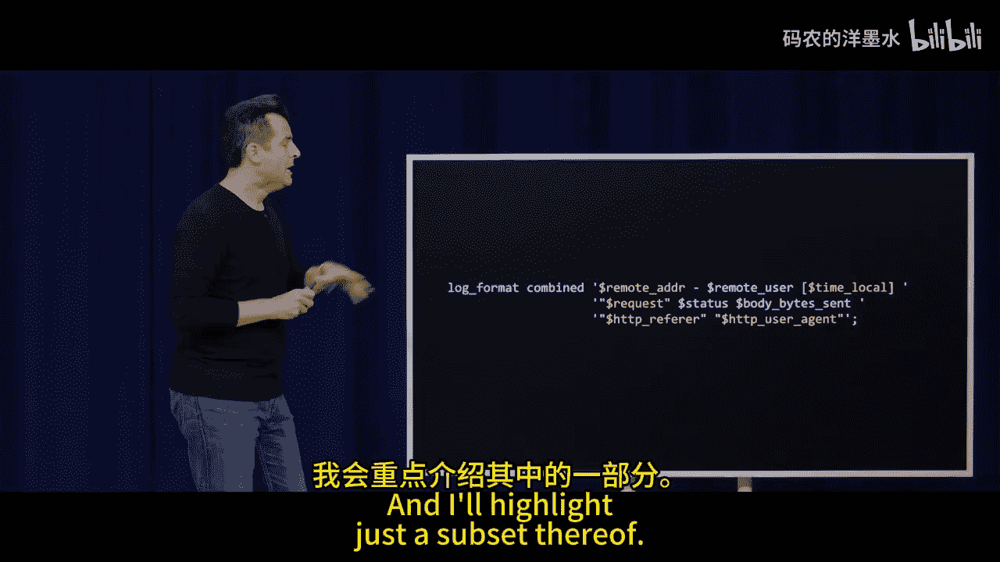

网络浏览历史记录在隐私方面既是一个关注点，也是一个功能。我们先来看看它作为功能的一面：为什么它有用？首先，即使是我，偶尔也会回顾历史记录，试图找到之前浏览过的某个网页，因为它能帮助我更快速地找到信息。此外，你可能已经注意到，你的网络浏览历史记录经常用于自动完成等功能。当你开始输入URL或页面名称中的关键词时，浏览器可能会更快地记住你要找的内容，你只需按回车或点击即可到达该页面。

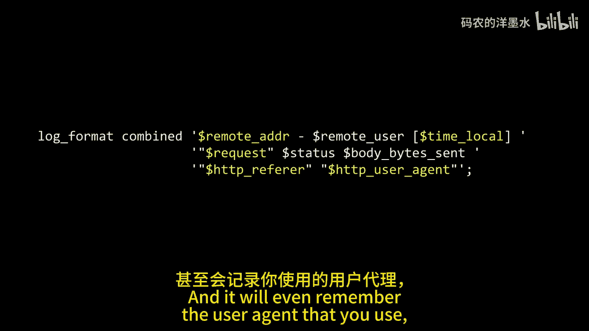

当然，这对你的隐私来说可能是一个潜在问题。你可能不希望其他能够物理访问你设备的人查看你去过的地方。如果你在实验室环境、网吧等公共场所的电脑上访问了某些网站，你可能也不希望他人获取这些信息。因此，你可以想象到一些场景中，这是一个有用的功能；但在另一些场景中，这并不理想，因为它侵犯了你的隐私，或者至少使其面临被他人侵犯的风险。

我们将考虑如何清理或完全删除这些历史记录。你可能已经熟悉浏览器中的某些选项，可以清除浏览历史记录，从而忘记你去过的所有地方、积累的所有Cookie以及浏览器可能记住的所有用户名和密码。然而，这通常是一个相当“一刀切”的解决方案，因为当你清除浏览历史记录时（假设你勾选了所有选项），所有信息都会消失。这可能意味着你被登出Google、Outlook或其他你仍想使用的账户，即使你只是想清除其他内容的历史记录。

## 服务器日志 📊

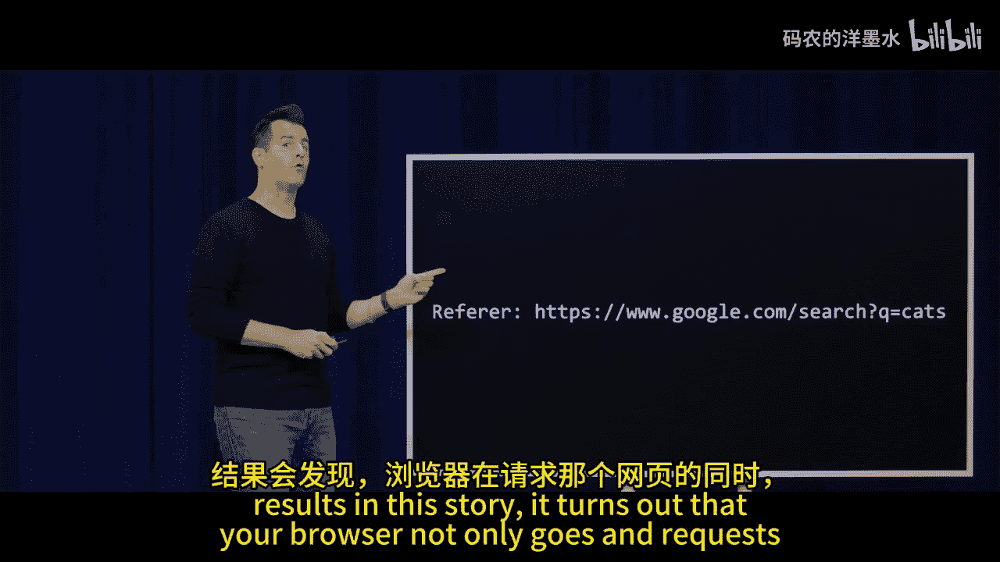

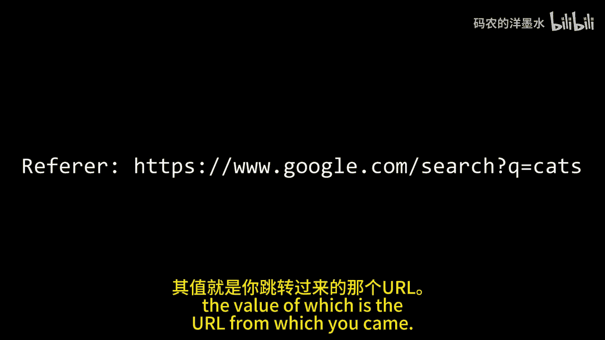

接下来，我们考虑除了你自己的浏览器之外，还有哪些可能涉及隐私的问题。事实上，即使你清理了自己的网络浏览历史记录并完全删除它，通常你访问的任何网站本身也会在服务器端记录大量相同的信息。服务器通常有日志，这不仅是为了诊断目的（以防出现问题，IT人员可以使用这些日志来重建历史并找出问题），还可能用于审计目的（跟踪系统上访问了什么），或者更普遍地用于广告或分析目的，以挖掘或分析这些数据，从而将其货币化或用于其他用途。

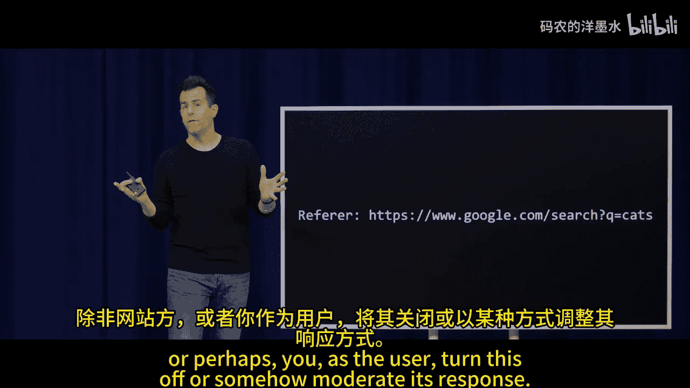

具体来说，当说信息被记录在服务器上时，我们指的是什么？这与你自己的网络浏览历史记录非常相似，但更加详细。例如，这里有一个代表性的配置片段，它捕获了服务器（特别是Web服务器）在你用浏览器访问时记录信息的常见约定。我将重点介绍其中的一个子集。这种所谓的“组合格式”日志格式表明，服务器通常会记录你的远程地址（即IP地址）、你访问页面的日期和时间、你请求的确切内容（服务器上你试图下载或查看的文件或文件夹名称）、引荐来源（即你来自的URL），甚至是你使用的用户代理（即你的浏览器）。

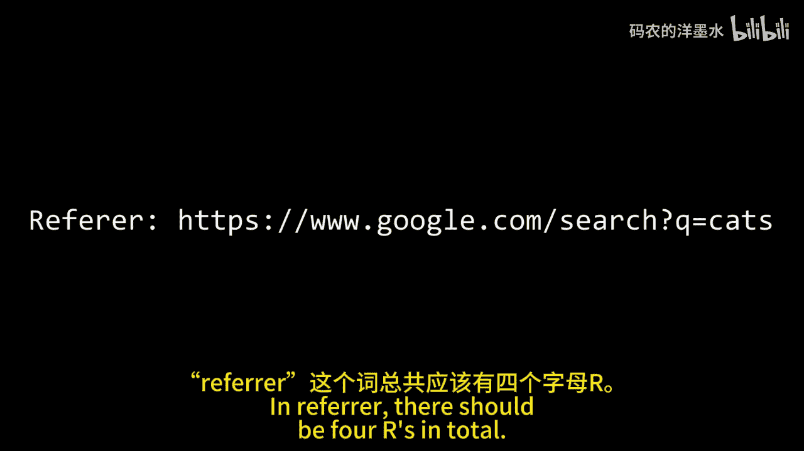

因此，也许你并不知道，每次使用浏览器访问某个网站时，那个虚拟信封里包含的内容远不止你向服务器发出的请求。正如我们过去所描述的，它确实包括信封外部的你的IP地址，以及一些HTTP头部信息。但特别是，它包括一些你可能不希望被服务器永久存储的信息，而且你通常无法控制删除这些信息，除非有法规要求或法律强制服务器按计划为你删除。你对这些信息的控制要少得多。

## HTTP头部与引荐来源 🧭

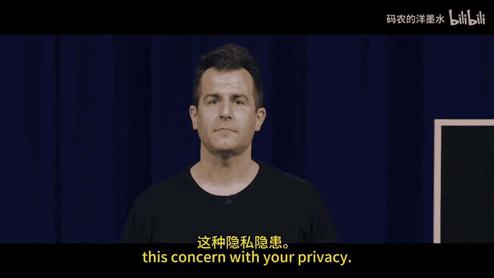

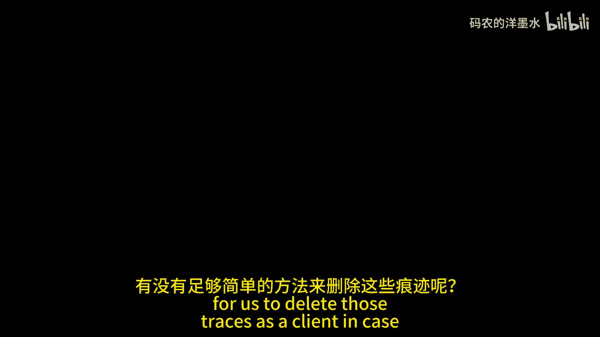

让我们从技术细节上更深入地探讨其中一些信息是什么，以及你如何至少能对分享多少信息施加一些控制。首先，我们重新审视HTTP头部这个基本构建块，因为如今在系统和软件世界中，使用HTML、CSS、JavaScript、Web浏览器和Web服务器的网络应用非常普遍，驱动着我们与技术的大量交互，无论是原生应用、多个网站还是桌面网站等。

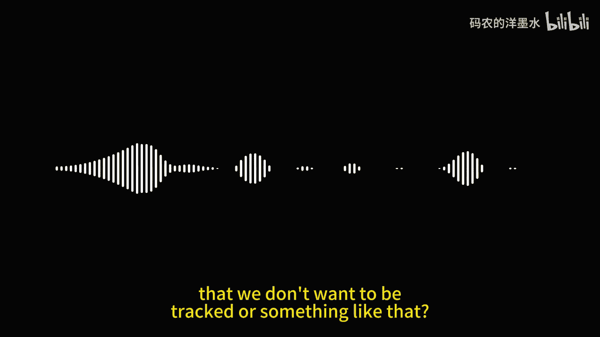

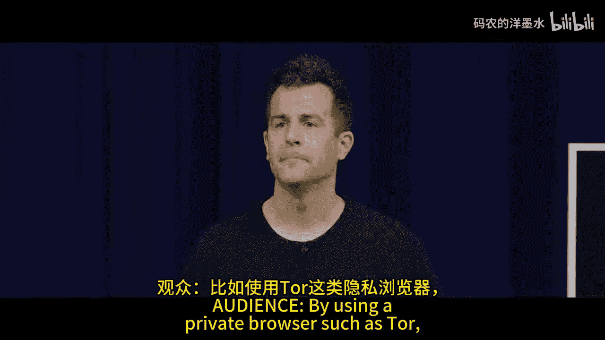

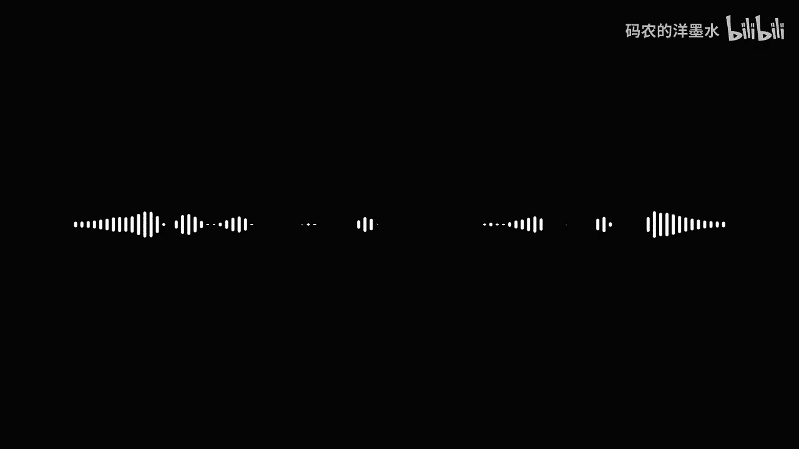

HTTP头部，回想一下，就是那些虚拟信封内的键值对，用于指示浏览器发送给服务器或服务器发送给浏览器的某种设置或信息片段。例如，如果我访问Google.com并搜索“cats”（猫），那么在幕后可能发生什么？在那个Google给我的、显示着大约10、20、30或62.4亿只猫的网页中，可能有这样的HTML。回想一下，我假设存在于Google搜索结果某处的这个HTML是一个链接的锚标签，那边是结束标签。这个链接的超链接引用（href属性）的值是`https://example.com`，而人类将看到的词是“cats”。为了讨论，我假设今天example.com是一个充满猫的网站，这就是为什么当我搜索关键词“cats”时，它可能出现在Google搜索结果中。

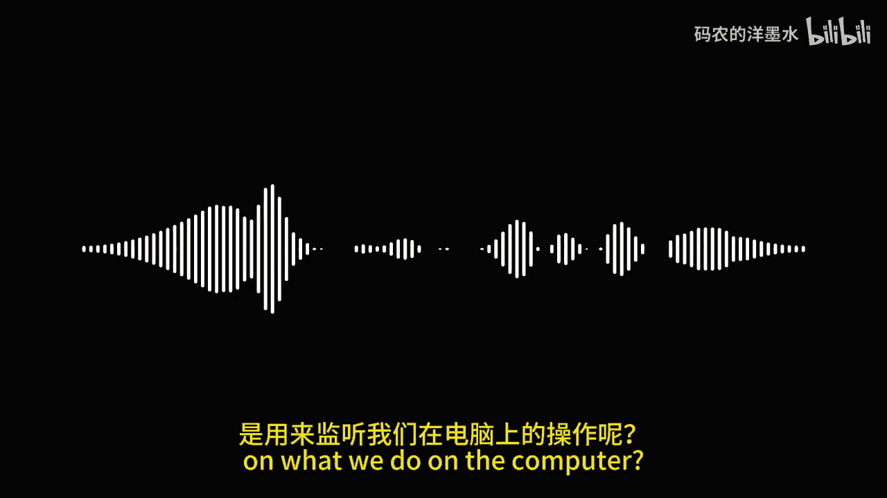

但是，当像你或我这样的用户在Google.com上点击那个链接时（因为在这个故事中，你正是在Google.com上查看搜索结果），事实证明，你的浏览器不仅会去请求那个网页，还会在那个虚拟信封中包含一个像这样的HTTP头部，具体称为“Referer”。在这个例子中，键是“Referer”，值是你来自的URL。例如，如果我刚刚访问了Google.com并搜索了“cats”然后按了回车，回想一下过去的课程，我提出过你在浏览器中搜索“cats”后可能看到的最短URL版本是：`https://www.google.com/search?q=cats`。这就是你会在URL栏中看到的内容。在那下面，你会看到10、20、30或62.4亿只猫，每个都有一个链接，点击后会带你到一个搜索结果。

这个HTTP头部的含义是，默认情况下（也许你并不知道），你的浏览器正在告诉全世界，当你通过链接访问其他网页时，你来自哪个网页。那么，为什么这有吸引力呢？实际上，这对你最终到达的网站很有用，因为它可能对他们的分析有用。他们可能想知道人们是如何找到我的网站的？人们是如何在互联网上找到我的业务的？哦，看起来我有很多用户/客户来自Google.com，特别是当有人搜索“cats”而不是“dogs”或其他东西时。所以你可以想象，特别是在商业领域，知道人们如何找到你（或者相反，人们显然没有如何找到你）是很有用的信息。

但这非常具有侵入性，因为现在这个网站，尽管可以说这不关他们的事，却知道我用的是Google而不是Bing或其他搜索引擎。你可以想象，世界上CS50自己的网站或任何其他网站上可能有链接，仅仅因为你碰巧访问了它们并点击了一个链接，现在它们就通过揭示你来自哪里（即引荐来源）向你所到达的任何网站广播了你的行为。

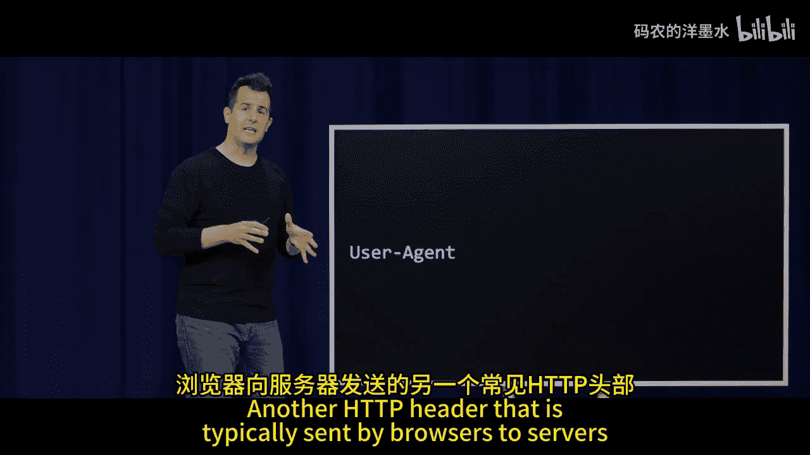

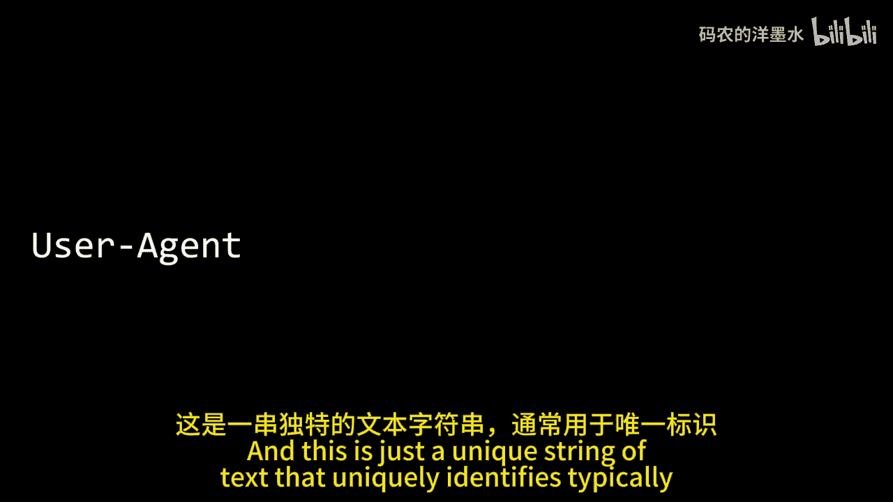

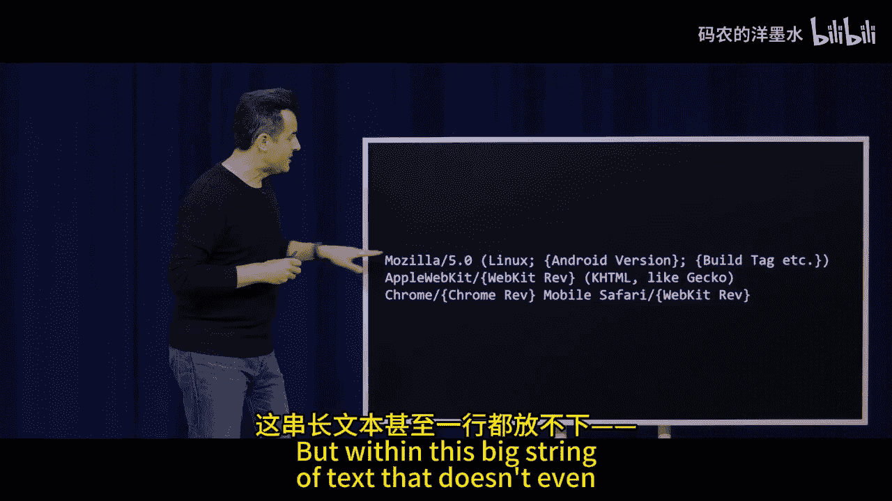

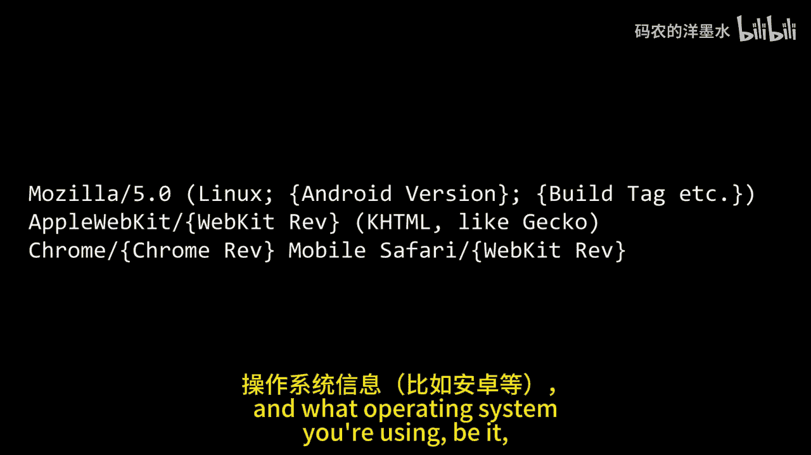

但这长期以来一直是HTTP的一个功能，并且默认是启用的，除非网站或你作为用户将其关闭或以某种方式调整其响应。现在，你们中的一些人可能注意到屏幕上有一个拼写错误。我保证这实际上不是我的错。在英语中，至少“referer”通常不是这样拼写的。这实际上是一个有趣的事实：在“referer”中，总共应该有四个R，应该是R-E-F-E-R-R-E-R。然而，有趣的是，多年前，当这个标准的规范被编写时，编写规范的那位可怜人犯了一个拼写错误，这个错误在历史上被永久保留了下来。因此，这就是浏览器和服务器多年来一直使用和期望的。这个头部的其他变体已经修正了这个印刷错误，但这只是我们互联网历史中的一个趣闻。

这确实是你可能从浏览器发送到服务器的内容。理想情况下，我们希望发送更少的信息。至少，如果example.com（这个猫网站）告诉他们：“好吧，我来自Google，这没什么大不了的”，我会更舒服一些。但我宁愿你不知道我在找什么，仅仅因为这似乎是不必要的。这似乎具有侵入性。谁知道我在找什么样的猫？也许我不希望你确切知道我对猫或狗或其他任何种类动物的偏好。所以，感觉分享这些信息是不必要的。但更理想的是，我敢说，甚至不要告诉example.com我来自哪里，从根本上消除这一切。

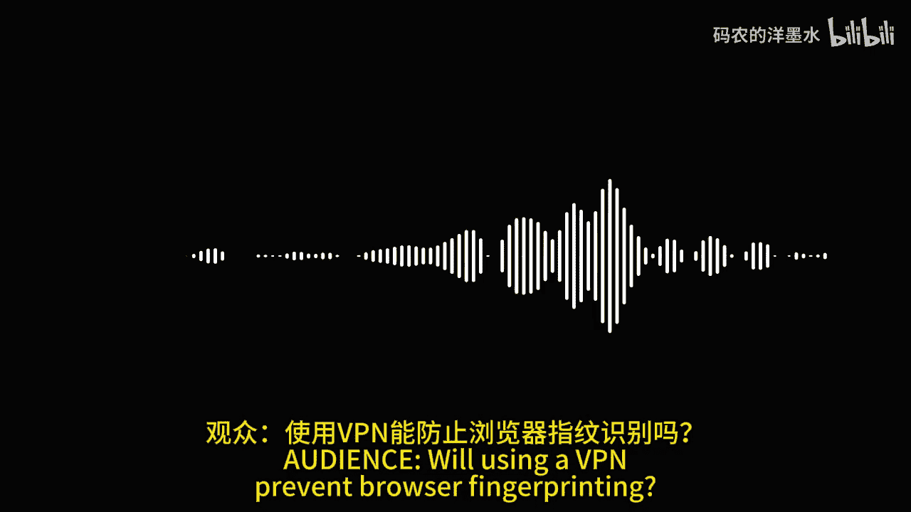

那么，网站如何调整从浏览器发送到服务器的信息量？或者，你如何使用特殊软件来抑制其中一些信息，以更好地保护你的隐私和在线行为？例如，这是一个网页可以放在自己HTML代码中的常见标签，它向浏览器指示：是的，你可以发送引荐地址，但只发送来源（即`https://www.google.com`），仅此而已。不发送搜索路径，不发送`?q=cats`。告诉他们你来自哪个网站，但不发送特定页面、特定搜索查询或搜索结果。注意，在HTML世界中，印刷错误已被修正，中间有两个R，但除此之外，这是一个HTML解决方案。假设浏览器尊重这个HTML，那么它将发送一个Referer HTTP头部，但信息更少，不是整个URL，而只是来源（即域名本身以及协议等）。

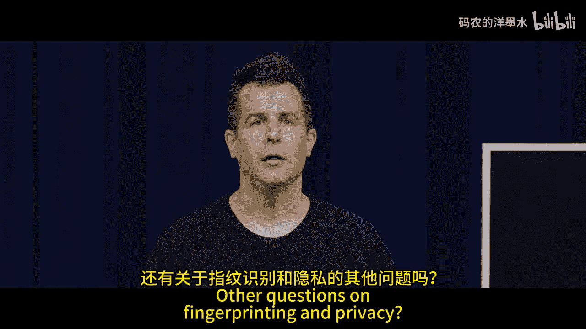

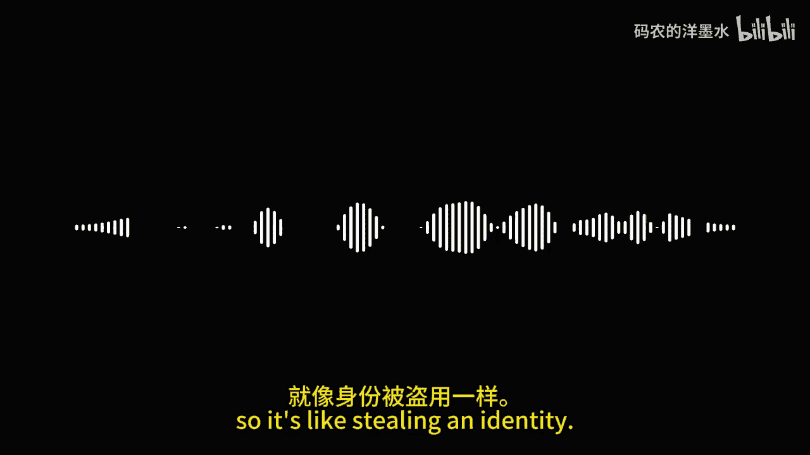

如果你不希望为你的用户/客户发送任何这些信息，你可以这样做。Google目前实际上发送的是来源（URL的一部分）。但如果你想成为一个更好的“公民”，不让浏览器轻易发送比需要更多的信息，你可以在页面中包含这个HTML，通知浏览器不要发送任何引荐信息，因为这个元标签的值实际上是“none”而不是“origin”。还有其他值，允许你在这些设置方面有一定的选择范围，但这些可能是最常见或需要考虑的。

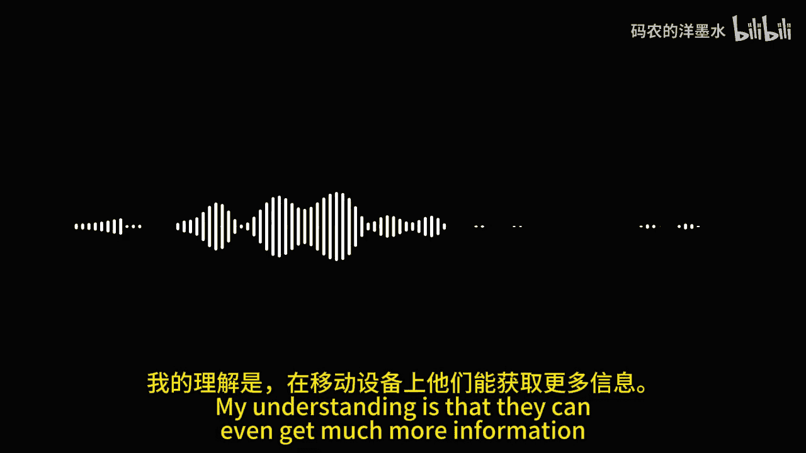

还有一个替代方案，如果你技术性更强，并且控制着Web服务器而不仅仅是服务器上的HTML，你实际上可以配置一个从服务器发送到浏览器的Referrer-Policy HTTP头部。在这种情况下，Referrer-Policy可以指示你只希望发送来源（较短的URL形式），或者实际上指示在这种情况下不应发送任何引荐信息。这是控制相同问题的第二种机制。

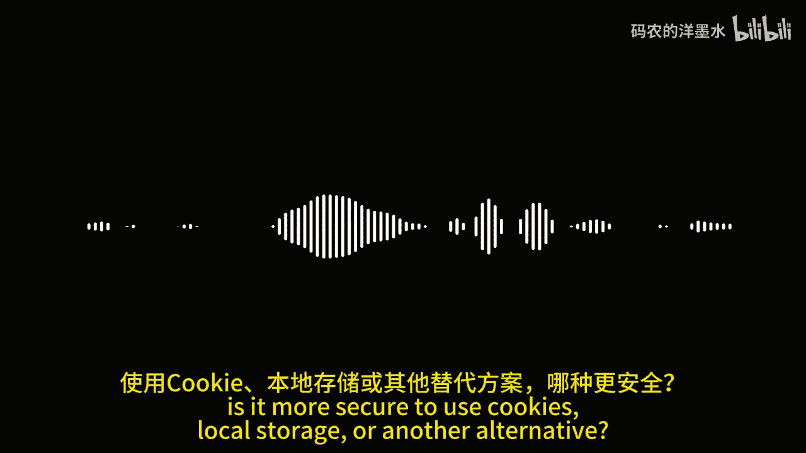

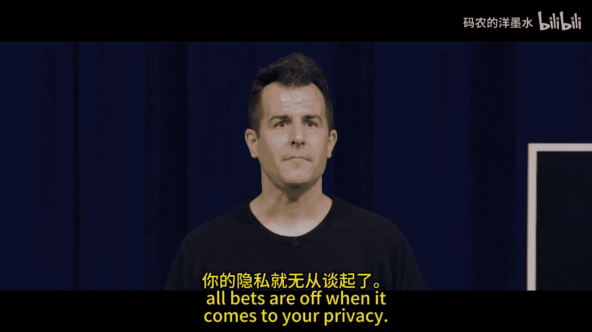

## 客户端软件与隐私浏览 🛡️

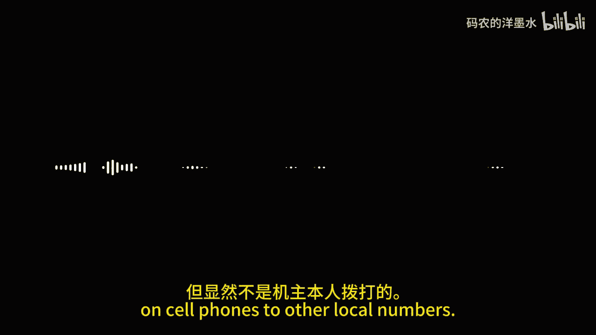

让我在这里暂停一下，看看是否有一些问题。现在你更好地理解了网络的工作原理（至少是默认情况），或者我们如何减轻这种隐私担忧，也许你不仅有一些担忧，还想知道是否有足够简单的方法让我们作为客户端删除这些痕迹，以防我们不想被跟踪之类。

一个很好的问题。我们将向你推荐一些课堂之外的URL。但是，是的，实际上有客户端软件，你通常可以安装在Mac或PC上，这些软件会清除其中一些信息，这样当你的HTTP请求从浏览器发送到服务器时，你可以确保这个第三方软件自动为你删除了大量信息。因为这样，你就不必信任像Google这样的网站会为你减少信息量。相反，你可以通过客户端软件为自己做到这一点，我们将在网上提供一些链接。

另一个问题：使用私人浏览器，例如使用临时操作系统如Tails，这是否会删除互联网上的所有痕迹？还是会在客户端或服务器端留下一些？这是一个好问题。简短的回答是：它会在服务器端和客户端都留下一些证据，但我们稍后也会回到Tails。

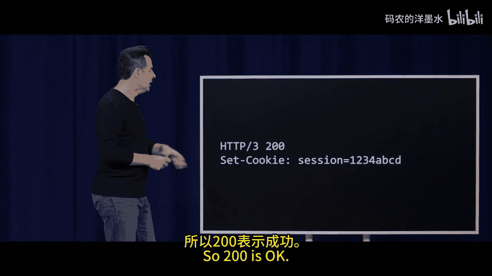

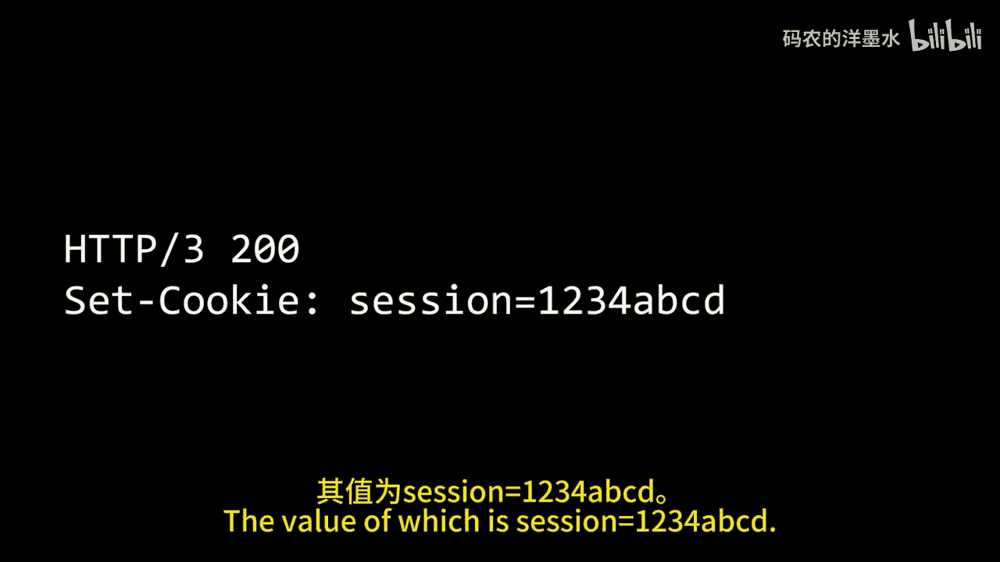

最后一个问题：你之前提到的用于清除提交到服务器端信息的第三方软件，如果那个程序本身被用来监视我们在电脑上的行为怎么办？这是一个非常合理的担忧。一般来说，这是绝对可能的。对你有利的是开源软件，如果你使用的软件其他人可以看到源代码，那么它做恶意事情的可能性较小。资本主义在这里也常常对你有帮助，因为侵犯用户隐私通常不符合公司自身的利益，因为这可能会引起某种反弹，对业务不利。但除此之外，每当涉及到安装软件时，你和我都需要付出很多信任。所以这确实是一个很大的风险。

## 浏览器指纹识别 🖐️

事实证明，你的浏览器可能还在分享其他信息，而你并未意识到它正在提供这些信息。这些信息足以让服务器对你进行“指纹识别”。也就是说，有一种技术，通常称为“指纹识别”，在Web上下文中，意味着以传入的互联网请求的大量特征作为输入，看看是否可以使用这些特征为用户创建某种配置文件，从而唯一地识别该用户。这并不意味着你会具体知道该用户是David Malan，但根据这个系统，你会知道今天看到的用户是否与明天、后天看到的是同一个，因为你可以使用这些信息以高概率推断：好吧，我们一次又一次地看到了完全相同的浏览器配置，很可能是同一个人，而不是互联网上恰好拥有完全相同设置的某个“双胞胎”。

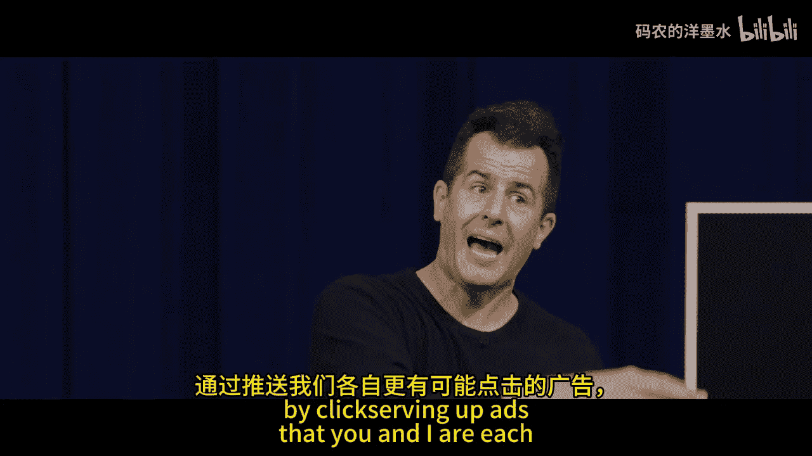

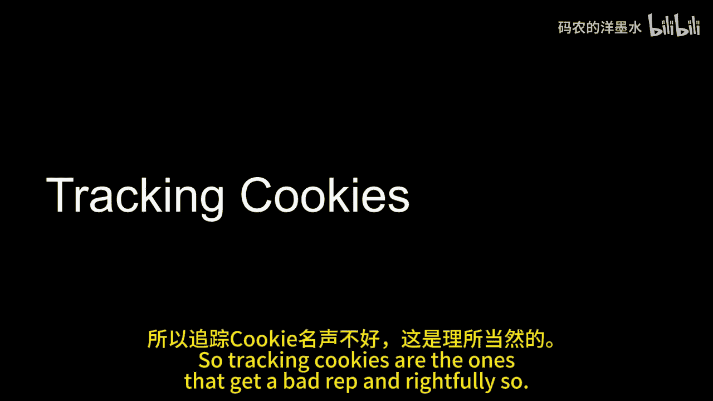

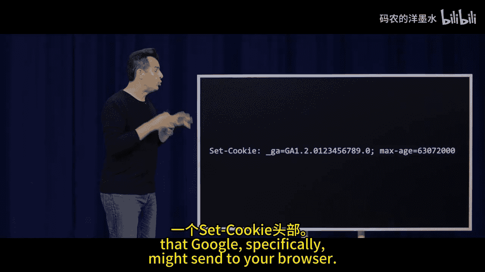

那么，这在技术上如何实现呢？最简单的机制可能就是依赖像你的IP地址这样的东西。回想一下，任何时候你在互联网上做某事，我们一直在谈论的那些虚拟信封在外部也有你的IP地址以及你试图发送信息的目的地的IP地址。在这种情况下，你的IP是返回地址，这意味着在使用某些调用时，你实际上是在告诉远程服务器你在世界上的位置，或者至少你的IP地址是什么。然而，仅凭IP地址可能不足以唯一地识别你，因为在校园、家庭、公司网络中，你可能实际上与许多人共享一个IP地址，但至少它缩小了可能是谁的范围，即使是在少数人之间共享。

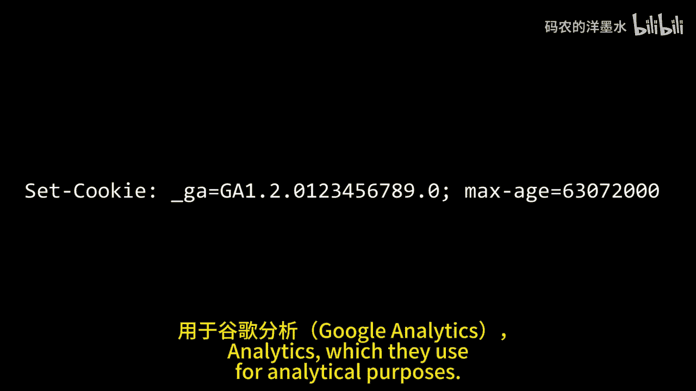

但你的浏览器在那个虚拟信封内还在分享其他信息。另一个通常由浏览器发送到服务器的HTTP头部称为“User-Agent”。这只是一个唯一的文本字符串，通常唯一地标识你使用的浏览器及其版本，以及你使用的操作系统及其版本。例如，一个标准格式可能看起来像这样。它故意显得很冗长，只是为了展示在这个头部的值中可能泄露多少细节。但在这个甚至无法在一行内显示的大文本字符串中（在这里换行到了三行），有一些指示表明你正在使用什么浏览器（无论是Chrome还是其他），以及你正在使用什么操作系统（无论是手机上的Android还是其他，笔记本电脑或台式机）。

当然，世界上很多人可能安装了相同的浏览器。所以，即使加上IP地址，这可能也不足以唯一地识别你，至少概率不高。那么服务器还能做什么呢？如果服务器有能力向你的计算机发送一些代码，例如一些HTML、CSS和JavaScript，服务器可以有效地“询问”浏览器并问它某些问题。例如，服务器可以找出你屏幕的分辨率。这在实践中可能很有用，这样他们就知道如何在屏幕上渲染信息，但仅凭这一点可能就足够了，特别是如果你习惯全屏使用浏览器，并且总是在显示器上使用相同的分辨率，这可能是另一个用于识别或指纹识别你的因素。

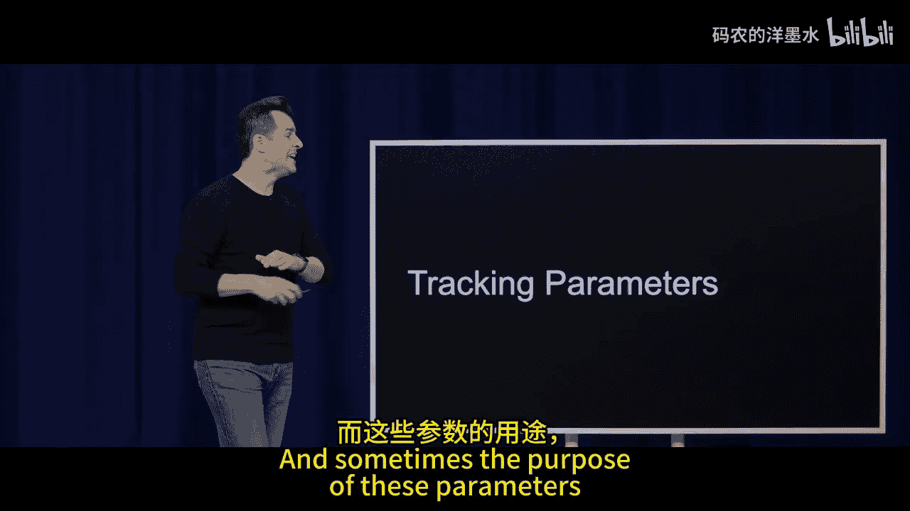

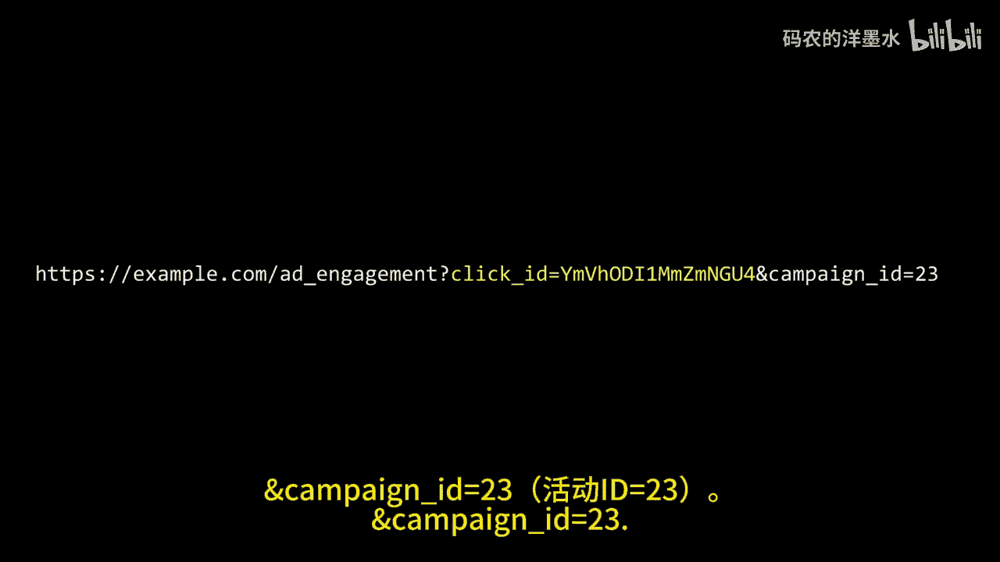

服务器可能能够找出你的系统上安装了哪些字体。服务器可能能够找出你所在的时区，因为这也是浏览器上下文中可用的一个值。还有其他值，这些值加在一起，可以以高概率用于对你和我进行指纹识别。因此，即使你没有登录，即使你使用了各种隐私增强软件产品来尝试删除其中一些HTTP头部等，你仍然在泄露其他信息，包括你的浏览器可能安装的扩展或插件。

所以，如果你习惯一次又一次地使用同一台电脑，并且习惯不更改很多这些设置，仅凭这一点就足以让一个网站有效地跟踪你。这可能可能是无害的，他们可能只是将其用于统计目的，以了解他们有多少用户或客户。但也可能是为了更具侵入性的目的，比如根据你在这些网站上的行为向你提供定向广告，或者真的只是专门跟踪你。关键在于，如果你曾经登录过这个服务器一次，而服务器基于那个指纹记录了你几天、几个月、几年的所有流量，那么在那个时候，他们可以以高概率回溯推断：等等，如果这个用户在这一天是David，并且我们认为在所有前几天都是同一个用户，那么通过传递性，他们现在对你的浏览历史也了解得更多了。

因此，即使在你不知情的情况下，即使没有发送明确识别你的HTTP头部值，我们浏览器所具有的属性或特征的集合，以及我们的浏览行为，仍然足以在很多时候唯一地识别我们中的大多数人。

让我在这里暂停一下，看看是否有关于指纹识别或这些对隐私影响的问题。一个问题：VPN似乎能防止浏览器指纹识别吗？这是一个好问题，我们很快就会更多地讨论VPN。简短的回答是：不。VPN通常只会掩盖你的IP地址，仅此而已。如果你仍然像往常一样使用浏览器和用户账户，所有相同的信息仍然会被泄露。它只会改变其中的一个部分。

另一个问题：黑客是否仍然可以指纹识别并利用它来达到自己的目的，让一切看起来像是我的电脑执行了某些操作，从而窃取身份？简短的回答是：是的，如果黑客能够访问相同的信息。但是，如果我们回到几节课前对加密的关注，如果你只通过HTTPS访问网站，并且没有任何未加密的内容，那么中间的黑客要获取任何相同的信息就会困难得多，因为几乎所有的内容都是加密的（IP地址除外）。但信封内的任何东西，包括这些头部、HTML、JavaScript和CSS，都是加密的。然而，如果黑客以某种方式侵入了你自己的笔记本电脑、台式机、手机或服务器，那么一切都不确定了，他们绝对可以根据相同的信息片段识别你。

另一个问题：我只是好奇想了解在移动设备上时可能有什么不同。我的理解是，当你在移动设备上时，他们甚至可以获得更多信息。这是一个公平的问题。我不认为我会对此回答“是”。我很难想象你的手机除了浏览器正在做的事情之外，还会做什么更多的事情，除了我认为你的手机如今往往具有额外的功能，比如GPS、加速度计、陀螺仪等，理论上这些可以被JavaScript代码询问（通常在用户选择加入的基础上）。所以，作为用户，你可以拒绝访问这些信息，但我怀疑这些特征可能被用来更唯一地识别你，因为笔记本电脑（至少目前）具有较少此类功能。

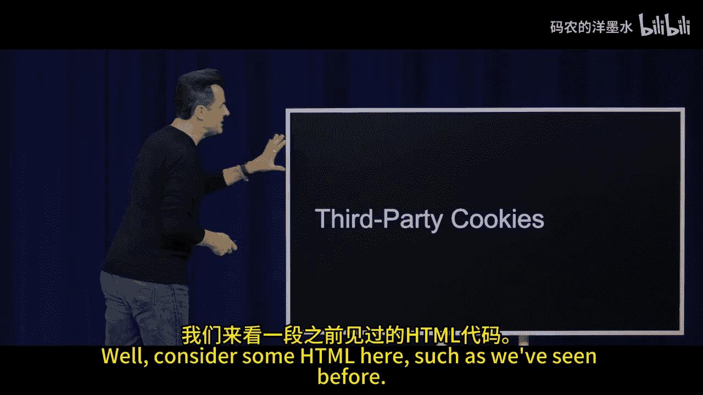

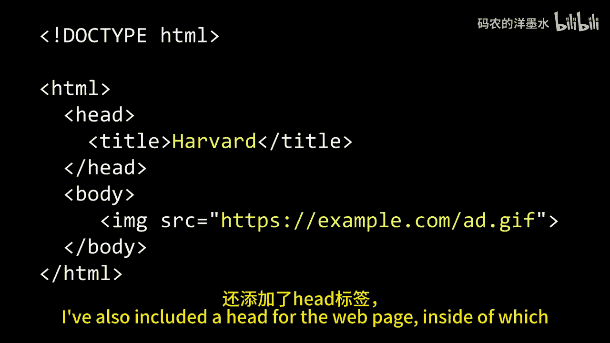

另一个问题：在前端存储和检索数据时，使用Cookie、本地存储还是其他替代方案更安全？这是一个非常好的问题。我们将在接下来的幻灯片中讨论这个主题。一般来说，Cookie因为设计上是用来在浏览器和服务器之间来回发送的，所以如果所有内容都加密了，理论上这不应该是一个问题。但我们过去已经讨论过，可能会犯错误，你可能从HTTP开始，被重定向到HTTPS。所以一般来说，将东西存储在本地存储中，至少可以防止东西意外地通过浏览器连接泄露出去。也就是说，如果你将东西存储在本地存储中，它们实际上是本地可用的。所以，如果你的同事、朋友、兄弟姐妹获得了对设备的物理访问权，更不用说对手了，那么他们不仅可以看到你的Cookie中的所有信息，还可以看到本地存储中的所有信息。因此，在这一点上，当涉及到你的隐私时，物理访问通常意味着一切都不确定了。

## Cookie与跟踪参数 🍪

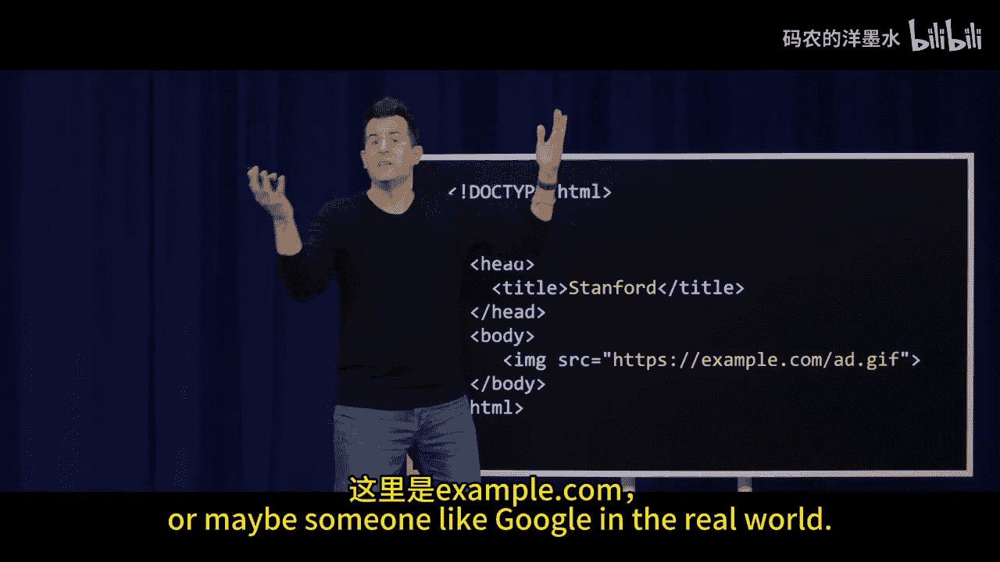

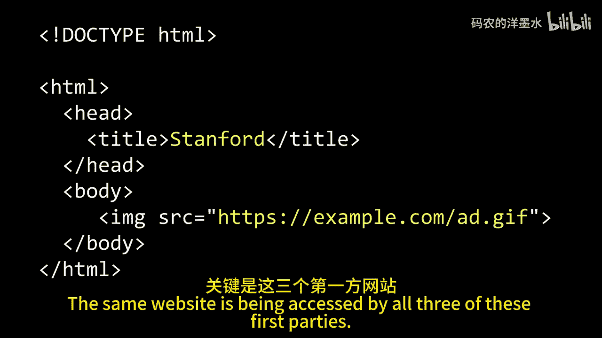

好了，除了这个User-Agent头部，你的浏览器通常还会与服务器来回发送其他头部，其中一个我们已经讨论过，其中一个你可能在课程开始前就知道，即Cookie。但有不同类型的Cookie。回想一下，一般来说，Cookie是服务器放在你计算机上的一段信息，以帮助记住你是谁。因此，在没有这些指纹和特定头部（如这些）的情况下，它可以在你的计算机上放置一个小的随机值（包含数字和字母等），或者如果有很多用户，甚至可能是一个更大的值，并且如果你一次又一次地返回网站，它使用该值来唯一地识别你。除非我在某个时间点登录，否则它不一定知道我是David，在那个时候，它可以意识到：哦，等等，David的Cookie是这个值。现在我知道这个用户是谁了。

但一般来说，有不同类型的Cookie和不同的Cookie设置，值得了解一些。我们之前讨论过我们更恰当地称为“会话Cookie”的东西。Cookie被服务器用来在服务器和浏览器之间“维持状态”。也就是说，不过于技术化地说，HTTP通常是无状态的。当你访问一个页面时，浏览器图标可能会旋转一会儿，然后停止，因为浏览器和服务器之间的交易完成了。但如果你想提醒服务器用户是谁，那么浏览器第二次、第三次、第四次联系服务器时，浏览器最好提醒服务器它是谁。这就是为什么我们使用虚拟手戳的比喻，那个手戳就像是浏览器提醒服务器的方式：你以前见过我，不要再让我登录了。我是David，我是David，即使它只是依赖于这个虚拟手戳，或者实际上是浏览器发送到服务器的Cookie头部中的某个唯一标识符。

因此，会话Cookie允许浏览器和服务器维持会话（这种状态）。更具体地说，它允许它们维持像购物车这样的东西。所以，如果你在Amazon.com或类似网站上购物，Cookie会记住你是谁，或者至少你是同一个人，这样每次你在网站上浏览时，Amazon一次又一次地向你显示购物车的相同内容，这样他们就不会在你仅仅更改页面时意外删除它而失去你的业务。

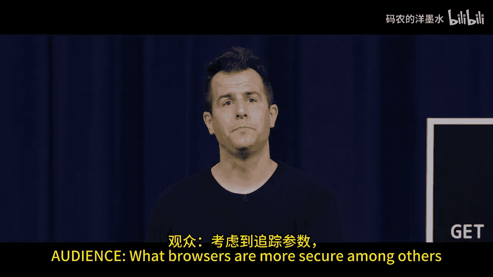

那么会话Cookie是如何工作的呢？当你第一次访问一个想要在你的计算机上放置Cookie的网站时，响应可能看起来像这样：HTTP 200是状态码，回想一下意味着“OK，一切正常”，而不是像404这样的“文件未找到”。所以200是OK。但服务器也可能用这个键值对（这个HTTP头部）响应：`Set-Cookie:`（这是键），其值是`session=1234ABCD`（这是我们之前在这个上下文中讨论Cookie时使用的相同值）。这里的要点是，这个Cookie的名称是“session”，其值等于`1234ABCD`。现在，如果你访问同一个网站，你、你、你，我们都会有不同、看似随机的Cookie值。也就是说，我们每次呈现的手戳是不同的。

这是一个会话Cookie，它是一个会话Cookie，因为当你关闭浏览器、晚上退出或重新启动时，它应该会过期。话虽如此，这有点夸张，因为如今的浏览器经常会为你保留标签页。它们可能会进入睡眠状态，你可能需要唤醒它们。但会话的寿命越来越比过去长了。但想法是，这不是为了持续一年或永远而设计的，根据设计，它的生命周期要短得多。当你的浏览器收到那个Cookie，并且你点击了Amazon.com上的某个其他页面或某个其他产品时，你的浏览器可能会说类似这样的话：`GET /... Cookie: ...`（相同的值）。所以，回想一下我们之前的课程，这就是浏览器提醒服务器其手戳或Cookie值的方式。但同样，想法是当浏览器关闭时，你晚上重新启动，那么明天你就不应该有相同的会话Cookie，至少在这个模型中是这样。并非所有网站都是如此，但根据我们目前使用Cookie的方式，这对你的隐私来说是相当好的。因为如果Cookie根据设计是会话Cookie，并且当你用完那个浏览器标签页或一天使用完浏览器时，它很快就会过期，那么这很好，因为这意味着如果你明天回到同一个网站，那个Cookie可能已经不存在了。所以你看起来或成为一个全新的用户。因此，他们可能无法默认地关联关于你的太多信息。

但这些都是你读到的对你不利、对你的隐私不利的Cookie：跟踪Cookie。这是完全相同的想法：从服务器发送到浏览器的键值对，用于记住你是谁，或者至少你是同一个人，即使我们还不知道你具体是David Malan。但顾名思义，跟踪Cookie真的是为了跟踪你和我而设计的。为什么？可能是为了分析目的，可能是为了调试目的，这样他们就知道用户在哪里，以防出现问题，可能是为了广告目的，这样你和我得到不同的广告，他们可以通过向我们每个人更可能点击的广告来最大化收入。所以跟踪Cookie名声不好，这是理所当然的。

让我们考虑一个旨在跟踪你在特定网站上行为的Cookie的例子。例如，这是Google可能发送到你的浏览器的Set-Cookie头部。事实上，他们使用一个按约定称为“_ga”（用于Google Analytics）的Cookie，他们将其用于分析目的，其值看起来像这样。这个值的要点是，它是基于每个网站生成的，如果该网站使用Google Analytics（Google Analytics是一个允许网站设计者跟踪谁点击了什么、他们使用什么浏览器、什么操作系统，并大致了解其用户群人口统计数据的工具）。但与旨在一天后、浏览器关闭或类似情况下过期的会话Cookie不同，Google的分析性Cookie在这里有一个最大年龄（这么多秒），如果你计算一下，默认是两年。也就是说，如果你访问某个使用Google Analytics的网站（通过在其网站中嵌入一点Google的JavaScript代码），每当从Google网站拉取该Google代码时，Google就有机会在你的计算机上放置这个Cookie，并且你会得到一个基于你第一次访问的唯一ID（基于特定嵌入Google Analytics的网站），并且根据这个HTTP头部，这个Cookie将在你的计算机中存活长达两年。

这对Google来说是有用的，对网站来说可能也有用。但对你和我来说，可能更具侵入性。Google还有许多其他他们使用的Cookie，但这可能是你应该注意的一个。实际上，在接下来的几周或几个月里，如果你查看一些自己的浏览器设置，你很可能会看到这样的值。

但服务器还可能使用什么来跟踪我们，特别是如果你和我有删除Cookie或清除历史记录的习惯，这对Google或试图以这种方式跟踪你的网站来说是适得其反的，但如果你这样做，对你和我的隐私来说是一个加分项。但事实证明，还有其他方式服务器可以跟踪我们，包括通过HTTP参数：跟踪参数。参数是通常出现在URL中、通过GET请求发送的键值对。所以，如果我们回想一下之前在Google上搜索“cats”时，你可能记得URL类似于`https://www.google.com/search?q=cats`。URL中问号之后的任何内容确实是一个HTTP参数，但它不仅可以用于无害、有用的目的，比如搜索“cats”，也可以用于跟踪你。事实上，如果你在URL中看到“&”符号，那可能意味着你有第二个、第三个或更多参数在上面。有时，这些参数的目的只是为了将你作为某个人来跟踪。

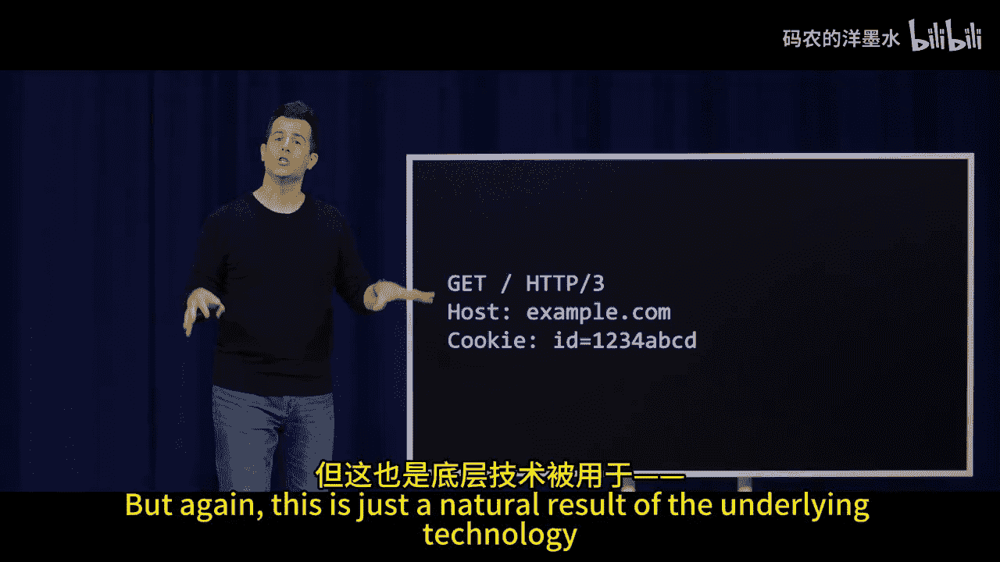

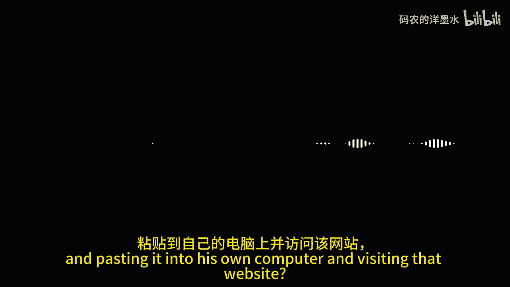

例如，这里有一个代表性的URL。它很长。这是取自example.com，路径是`/ad_engagement?`，然后我在这里高亮显示：`click_id=`，然后是这个长的、看似随机的字符串。但在这个特定的URL中还有第二个HTTP参数：`&campaign_id=23`。所以，campaign_id（如此小的数字）肯定不是为了跟踪你，而是为了向网站提供足够的输入，以知道应该向你提供什么类型的广告，应该启动什么广告活动。但这个click_id（在这种情况下是跟踪Cookie或跟踪参数的委婉说法）实际上是用来专门跟踪你的，因为不同的用户会发现，无论他们点击什么链接，click_id的值都略有不同。

回想一下，跟踪Cookie是通过HTTP头部发送的东西。所以，除非你更熟悉浏览器并能查看一些底层设置，否则你和我很难看到它。但这些跟踪参数就在你面前，至少如果你点击浏览器中的URL并查看其全部内容的话。现在，至少对我们这些关心隐私的最终用户来说，好消息是浏览器甚至第三方软件越来越多地为我们删除这些值。一旦浏览器制造商或第三方软件开发人员知道：等等，click_id除了跟踪我们的用户之外没有其他好目的，他们就可以简单地自动为你删除它。毕竟，当你访问一个网页并获取代表该网页的HTML时，浏览器当然可以在你甚至有机会点击任何东西之前查看那里，并且它可以清除或清理这些类型的跟踪参数。现在，公平地说，如果浏览器制造商不一定知道跟踪参数叫什么，或者如果网站不断更改名称或试图混淆，这可能效果不佳，但至少这是一种尝试，试图对这种非常常见的跟踪你我的技术施加下行压力。

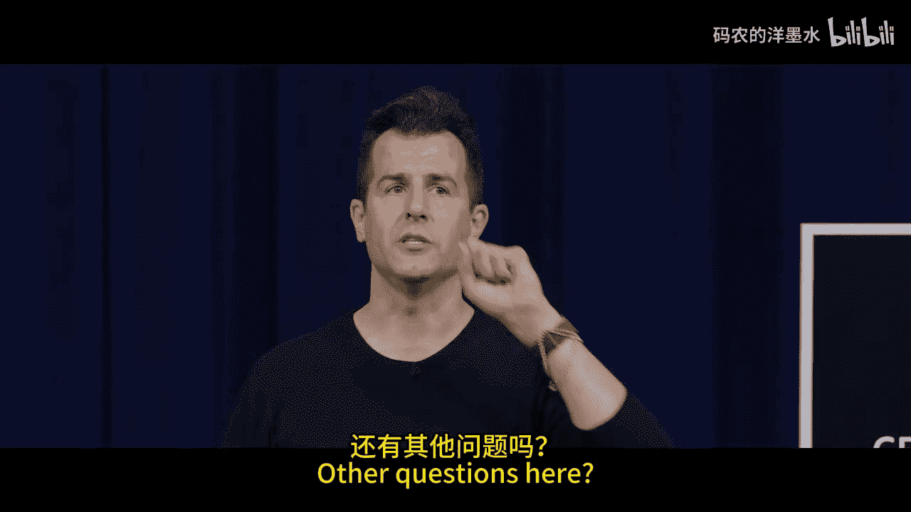

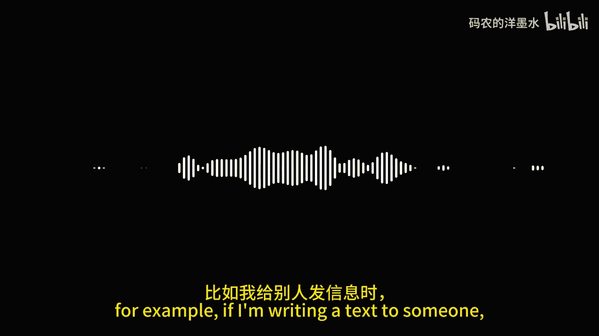

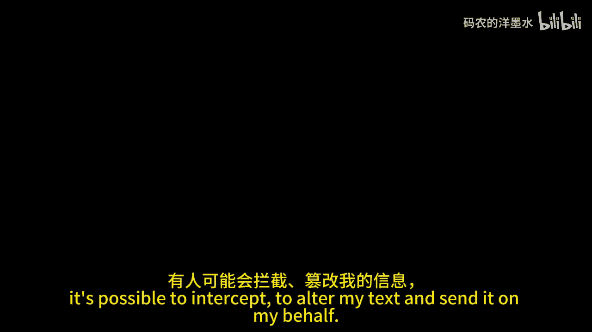

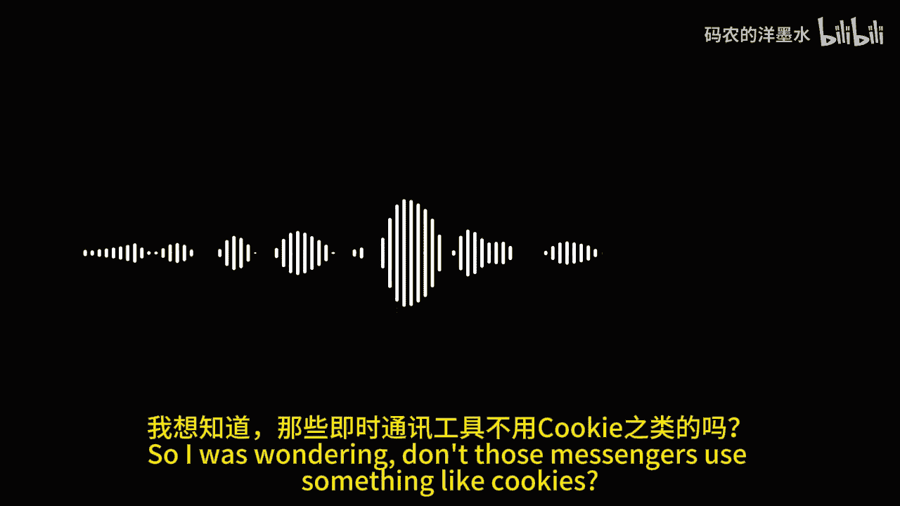

那么，为什么这个参数能够跟踪我们呢？这个参数也可能最终出现在那些服务器日志中，因为例如，这可能是我请求的网页：`/ad_engagement?click_id=...`，这很可能被服务器记录，甚至存储在数据库中，他们可以使用这些信息确切地知道我点击了哪些页面（因为我访问了那些链接），甚至我看到了哪些广告。也许这在商业上是件好事，因为他们现在知道我点击了什么类型的广告，他们可以向我提供更多这样的广告。这对他们来说可能很棒，但对你和我来说，可能并不那么好，如果不是令人讨厌或具有侵入性的话。所以，这是需要注意的另一件事，也是在未来几天和几年里，当你选择浏览器时可能指导你决策的另一件事。如今，你不一定必须使用手机、笔记本电脑或台式机自带的那个浏览器，如果你更习惯，可以安装其他浏览器，而且你和我越来越有更多的选择。

## 第三方Cookie与跨站跟踪 🌐

现在关于这些跟踪参数或之前关于我们隐私的任何问题。一个问题：是Cookie在跟踪，还是被跟踪？Cookie是用来跟踪你的值。所以，回想一下，Cookie的比喻就像那个虚拟手戳。所以，如果所有这些Web服务器都在你的手和我的手上涂上墨水，并且由于HTTP，你和我，我们的浏览器习惯于向每个我们访问的网站呈现这些Cookie（这些手戳），那么该值正被用来跟踪我们。所以，Cookie本身只是一种技术。这是一个非常简单的想法：在你的计算机上存储一个大的随机值，只是为了唯一地识别我们。它们对于为我们提供登录网站、维持购物车等功能是必要的。但很快，特别是因为互联网从一开始在很大程度上是免费使用的（一旦你有了连接，至少很多互联网是免费的），它们被广告商、Facebook和其他世界上的公司使用，或者在某些观点中被滥用了。

另一种思考跟踪Cookie的方式是将其视为第三方Cookie，因为确实，即使在Google的例子中，它们也是这样被使用的。如果一个网站如example.com嵌入了Google Analytics，因此有一些提到Google.com的HTML标签，那么example.com在这个故事中可以说是第一方，而Google.com是第三方。这意味着你的浏览器可能会从example.com和Google都获得Cookie。但最重要的可能来自example的第一方Cookie，因为那是你选择访问并希望使用其功能的网站。像通过Google在该网站上跟踪你的点击和互联网行为这样的第三方功能，那是第三方的。因此，如今浏览器通常提供选项，你可以通过它们禁用第三方Cookie，这对隐私来说往往是好事，因为这意味着你阻止了像Google这样的第三方通过Cookie跟踪你。但这并不一定意味着网站没有以某种方式仍然使用跟踪参数。你只有通过更仔细地查看你点击的或嵌入在网页本身的URL才能知道这一点。这就是现在浏览器和第三方软件通过帮助我们删除不仅那些Cookie，甚至那些参数来提供额外帮助的地方。

但让我们考虑一个更具体的场景，说明第三方Cookie是什么，以及为什么它们允许像Google这样的公司不仅在一个网站上跟踪你的行为，甚至在多个网站上跟踪你的行为。从这个意义上说，第三方变得越来越强大，越来越无所不知，例如，比你和我实际访问的第一方网站更强大。为什么？嗯，如果有很多流行的第三方，Google是其中之一（用于广告和分析），那么如果许多不同的网站都在使用它们，也许哈佛在用，耶鲁在用，斯坦福在用。那么那个第三方很快变得比任何单独的一方都更强大。为什么？因为那个第三方，如果它被嵌入哈佛、耶鲁和斯坦福，那个第三方（例如Google）基本上可以洞察所有三个网站。如果它在所有三个网站上向你发送相同的Cookie，Google可能实际上知道你在浏览哈佛、耶鲁和斯坦福的网站，而哈佛可能不知道你在查看耶鲁和斯坦福，斯坦福可能不知道你在查看耶鲁和哈佛。

那么，这在具体上意味着什么？考虑一下这里的某个HTML，就像我们以前见过的那样。在这个特定的例子中，我突出显示了几个显著的特征。注意，在这个网页中，我不仅给出了一个包含网页主体的body，还包含了一个网页的head，里面是另一个叫做title的标签。我这样做只是为了演示，在这种语言中，有比我们目前看到的更多的标签。具体来说，这个``标签旨在代表Harvard.edu自己的网站，其标题将是“Harvard”（就像屏幕顶部的标签中那样），并且为了简单起见，在这个页面的主体内，让我们假设目前只有一个大广告。为了讨论，没有内容，只有一个广告。那么，那个广告来自哪里？在这个例子中，它来自example.com或我们的Google朋友，具体是一个叫做ad.gif的文件。这个特定的URL被用作图像标签的src属性的值。

那么，我这是什么意思？嗯，如果你在这个故事中访问Harvard.edu，你看到的是一个大的广告，一个大的图形，它来自example.com。那么，这有什么含义呢？假设耶鲁也在做同样的事情。所以，为了讨论，这里是完全相同的HTML，只是它位于Yale.edu。所以页面的标题现在改成了“Yale”。而且，为了让事情真的有趣，让我们把斯坦福也加入进来。完全相同的页面。所以，这个故事的要点是，哈佛、耶鲁和斯坦福都在使用同一个第三方example.com（或者在现实世界中可能是像Google这样的公司）。而且，更重要的是，他们都在请求同一个ad.gif。所以访问的是同一个文件。但即使单独这一点也不是严格的要求；所有这三个第一方都在访问同一个网站。那么，这意味着什么？

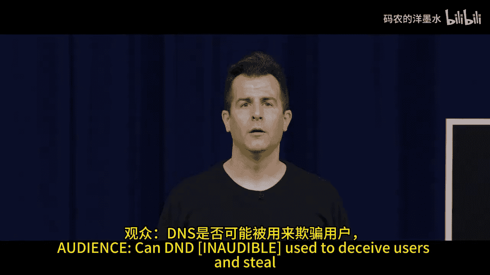

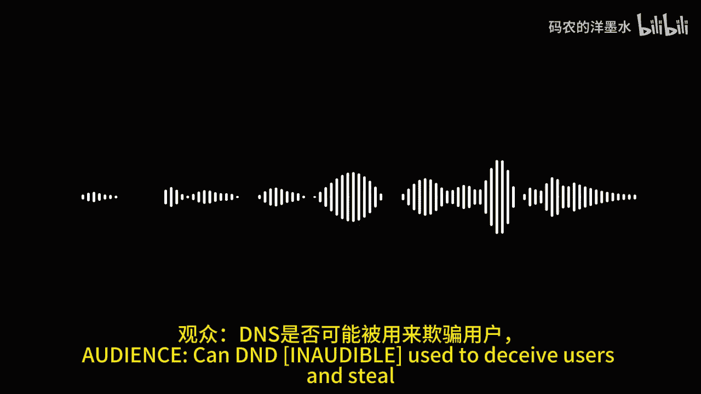

假设你打开浏览器，首先访问Harvard.edu。你的浏览器将下载哈佛网站的HTML。它会看到：哦，里面有一个图像标签。那个图像标签想要显示这个来自example.com的ad.gif。所以，你的浏览器根据浏览器的工作原理，会自动发送第二个HTTP请求，这次请求来自主机example.com的ad.gif。并且，为了将今天的故事联系起来，它可能会包含一个HTTP头部，指定我来自哪里，这对我们的目的很有用，因为它将这些请求置于上下文中。现在，那个服务器example.com（或者在现实世界中的Google）可能会用200 OK响应，比如：好的，这是广告，并且它不仅会包含图像，还会包含它自己的HTTP头部。这是我们的老朋友Set-Cookie，在这个例子中，为了讨论，我打算提议它在我的计算机上设置一个名为“id”的Cookie，因为这将是我在example.com的唯一标识符。它的值将是我一直用于讨论的那个：`id=1234ABCD`，但这对我们每个人来说都是某个大的随机值。而且，天哪，这个东西将持续一年（这是365天的秒数）。所以，这个Cookie被example.com放置在我的计算机上，因为我访问了Harvard.edu。所以哈佛是第一方，example.com是第三方。

但现在的问题是：当我用同一个浏览器访问Yale.edu时，我的手已经被example.com盖了戳。所以发生的是，我的浏览器现在向example.com呈现那个手戳，发送相同的ID和相同的值（即相同的手戳）。主机和之前一样是example.com。但这次引荐来源碰巧是Yale.edu。换句话说，在我访问哈佛并且我的手被盖上了这个跟踪Cookie（来自example.com的第三方Cookie）之后，当我访问Yale.edu时，我的浏览器将再次向example.com呈现相同的手戳，这次引荐来源是Yale.edu。下次我使用浏览器访问Stanford.edu时，相同的消息将从我的浏览器发送到example.com，以请求相同的广告，这次是从Stanford.edu的网站。

那么，通过这三个HTTP请求，含义是什么？Example.com知道我正在访问斯坦福，之前是耶鲁，再之前是哈佛。而哈佛、耶鲁或斯坦福中的任何一个都不一定知道我正在访问其他任何网站。第三方更强大，它更“全知”，仅仅因为example.com（或在现实世界中的Google）非常受欢迎，以至于它被嵌入到这么多该死的网站中。Google和其他公司几乎知道关于你我在网络上所做的一切，我敢说，因为这些广告以这种方式无处不在。

所以，我们看到了一个非常简单的例子，但它简单是因为Cookie和HTTP一旦你意识到它们如何工作，就可以不仅用于为我们所有人解决引人注目的问题（如购物车等），还可以用于将互联网货币化，并且在历史上一直被用于将互联网货币化，或者对我们来说更糟的是，跟踪我们个人的点击和行为。

## 隐私浏览模式与超级Cookie 🕵️♂️

让我在这里暂停一下，看看现在是否有关于第三方Cookie的任何问题，以及为什么因此，对你或我来说，选择禁用它们，或者更好的是，使用开始为我们阻止它们的浏览器，可能是如此引人注目。一个问题：考虑到跟踪参数，哪些浏览器更安全？快速调整一下：我不会说在这个上下文中某些浏览器比其他浏览器更安全。我会说，你想要更注重隐私或保护隐私的浏览器，因为这就是我们今天讨论的内容。希望所有浏览器在HTTPS和加密方面都一样安全，这些加密只是保护点A和点B之间的数据。所以，一般来说，Safari在隐私方面一直很好，他们最近宣布将开始给人们提供从URL中删除跟踪参数的功能。事实上，我之前给出的URI实际上来自Apple最近关于此事的公告。DuckDuckGo可能是最受欢迎的第三方浏览器，非常注重隐私，并试图禁用许多这些跟踪行为。另一个是Brave。也许最严重的违规者可能是Chrome，即使我自己也内疚地使用它，因为它与Google的生态系统如此集成。但Google，当然，他们的业务建立在将你我的行为货币化的基础上。所以，如果你关心这个，那可能是排在列表底部的。所以，这就是我如何对事物进行排名的方式。当然，在微软生态系统中还有Edge，Firefox实际上也应该放在列表更高的位置。我相信它们比Google更注重隐私。

考虑到所有这些跟踪机制，我们能做些什么来保护更多的隐私？你可能已经知道这个功能：隐私浏览。所以，你不一定必须删除所有浏览器历史记录和所有Cookie。相反，你可以偶尔打开一种特殊类型的窗口（今天大多数浏览器都支持），让你进入隐私模式或无痕模式。你可以把这看作是给你计算机中一块不同的内存块，它不知道你过去的任何浏览器历史记录，没有你过去的任何Cookie，不记得你过去的任何用户名和密码。你是全新的开始，这样你在那个窗口中所做的一切都是全新的。但问题是，你在那个窗口中所做的一切仍然完全按照我们描述的网络方式工作。所以你仍然可能有跟踪参数，仍然可能有跟踪Cookie，仍然可能有服务器日志。但当你关闭那个隐私窗口或退出无痕模式时，至少信息会从你的计算机中丢弃，这样如果你明天做完全相同的事情并再次打开无痕窗口，那么就好像你是从零开始与服务器交互一样，除了根据我们过去的讨论，指纹识别仍然是一种可能性。你的IP地址仍然可能被考虑在内，你的浏览器可能仍在泄露的其他信息也可能被考虑在内。但你没有做的是“污染”你的一般浏览历史记录，特别是你使用那个窗口的目的。

你还应该意识到，隐私浏览或无痕模式完全是客户端的事情。特别是我们提到的那些日志仍然被服务器存储。他们可能为你存储一个不同的跟踪Cookie或参数，因为当你在隐私或无痕模式下时，它不一定能识别你。但这并不意味着你的痕迹完全从互联网上消失。相反，它真的只是从你的本地计算机上清除它们，并降低了服务器仍然知道是你的概率，但并没有消除这种概率。所以我会谨慎使用，但话虽如此，如果你参加Web开发课程，或者你已经使用隐私浏览或无痕模式设计自己的网站，它也可以用于开发目的，因为这是一种打开一个全新窗口的方式，它不记得你可能有的过去错误或你点击过的过去网页，并且它通常被用作开发工具的一部分，以实际促进和模仿从某个站点全新开始的想法。

## 超级Cookie与DNS隐私 🌐

超级Cookie，虽然听起来很美味，但这也是我们讨论过的最糟糕的Cookie之一。我们看到了用于维持状态的会话Cookie。我们看到了用于跟踪你的跟踪Cookie。超级Cookie并不那么“超级”。这些Cookie通常由第三方（如你的公司、大学或互联网服务提供商）注入到你的HTTP请求中。也就是说，如果你从浏览器访问某个网站，流量当然会从你的笔记本电脑或手机通过某个互联网服务提供商（无论是在校园、家里还是现实世界中的无线网络），如果提供互联网服务的任何人能够看到那个虚拟信封的内容，从技术上讲，没有什么能阻止他们打开信封（可以这么说）并添加一个或多个他们自己的HTTP头部。例如，移动电话运营商过去曾这样做过，如果你只是从手机请求像example.com这样的网站，他们可能会在你和那个服务器之间的中途，为了讨论，注入一个他们自己的Cookie。我将使用与之前相同的名称和值：`id=1234ABCD`。但值得注意的是，那个值不是来自你的手机，不是来自你的浏览器。你可以清除所有Cookie，清除所有历史记录，在手机上使用无痕或隐私模式，你都不会在客户端看到任何痕迹，因为这该死的东西是在你（点A）和服务器（点B）之间的流量中被注入的。

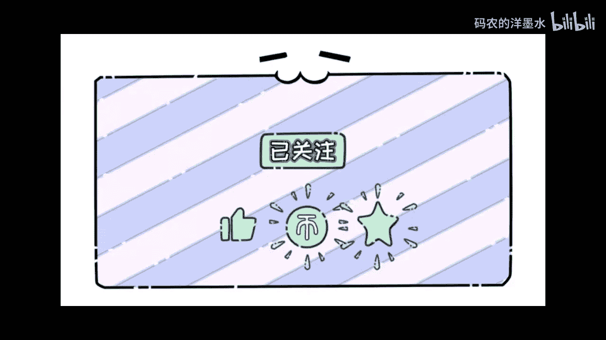

所以，这算是中间人攻击的一个典型例子，但在这个故事中，你的互联网服务提供商这样做是因为他们想跟踪你，或者因为他们与某些