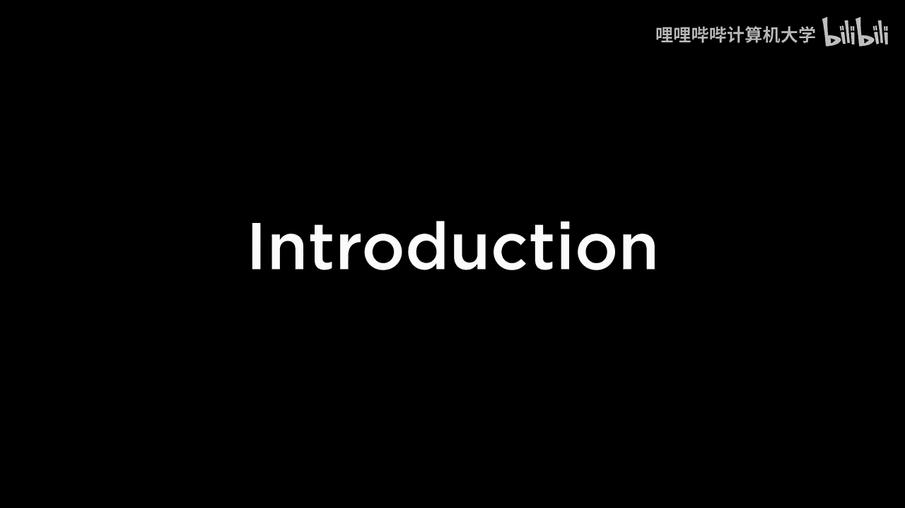

# 001：课程介绍

在本节课中，我们将要学习这门SQL数据库入门课程的整体框架和目标。课程将从基础概念开始，逐步深入到数据库设计、查询优化以及不同数据库管理系统的应用。

Hello world。这是CS50的SQL（或SQL）数据库入门课程。我的名字是David Main。我的名字是Carteranki。CS50本身是一门计算机科学入门课程，在学习过程中，你会接触到SQL等知识。本课程将更深入地专门探讨SQL。你可以在学习CS50之前、期间或之后学习本课程，无论你是一名计算机科学家、数据科学家、程序员，还是仅仅对数据库感兴趣的人。

现在，我们将从一款名为SQLite的软件开始，你可以用它来查询一个数据表，例如一个书籍表。之后，你将进阶学习，不仅处理单个表，还会处理多个表，并了解如何定义它们之间的关系。

上一节我们介绍了课程的整体目标，本节中我们来看看具体的学习路径。

以下是本课程将涵盖的核心内容列表：
*   首先，你将学习如何从头开始设计自己的数据库，了解**模式**和**数据类型**。
*   接着，你将学习如何向该数据库添加数据，即如何**插入**、**更新**和**删除**数据。
*   然后，你将学习如何为数据编写替代**视图**，为数据提供新的呈现方式，从而简化你和他人的数据理解。
*   在课程接近尾声时，你将学习如何优化查询，减少查询所需的时间，尽管这会以牺牲一些存储空间为代价。
*   最后，作为课程的总结，你将学习其他**数据库管理系统**，如MySQL和PostgreSQL，你可以使用它们来实现所有这些功能，并在更大的规模上进行操作。

本节课中我们一起学习了这门SQL数据库课程的完整学习路线，从基础的SQLite查询开始，逐步深入到多表关系、数据库设计、数据操作、视图创建、查询优化，最终扩展到更强大的数据库管理系统。