# 002：第0讲 - 查询

## 概述

在本节课中，我们将要学习如何使用SQL与数据库进行交互。我们将从理解什么是数据库和SQL开始，然后学习如何查询数据，包括选择特定列、过滤行、排序结果以及使用聚合函数。课程将使用一个关于国际布克奖长名单书籍的数据库作为示例。

## 什么是数据库与SQL

我们生活在一个信息时代，每天都会通过互联网和计算机交互产生大量数据。为了存储、组织和管理这些数据，我们使用数据库。

数据库是一种组织数据的方式，允许我们创建、读取、更新和删除数据。为了与数据库交互，我们使用一种称为数据库管理系统（DBMS）的软件。在本课程中，我们将使用SQLite。

SQL（结构化查询语言）是我们用来与数据库交互的语言。它是一种结构化的查询语言，允许我们向数据库中的数据提问。

## 连接到数据库并查看数据

为了开始查询，我们首先需要连接到数据库。我们将使用Visual Studio Code（VS Code）和SQLite。

以下是连接到数据库并查看其中数据的步骤：

1.  打开终端，导航到包含数据库文件的目录。
2.  使用命令 `sqlite3 longlist.db` 连接到数据库。
3.  连接成功后，终端提示符会变为 `sqlite>`。

现在我们已经连接到数据库，让我们看看里面有什么数据。

### 使用SELECT语句

`SELECT` 语句用于从数据库表中选择数据。最基本的查询是选择表中的所有行和所有列。

```sql
SELECT * FROM "longlist";
```

这个查询会返回 `longlist` 表中的所有数据。然而，如果数据量很大，结果可能会难以阅读。

为了更清晰地查看数据，我们可以选择特定的列。例如，如果我们只想查看书名：

```sql
SELECT "title" FROM "longlist";
```

我们也可以同时选择多个列，只需用逗号分隔列名：

```sql
SELECT "title", "author" FROM "longlist";
```

### 限制返回的行数

当数据量很大时，我们可能只想查看前几行来了解数据结构。这时可以使用 `LIMIT` 子句。

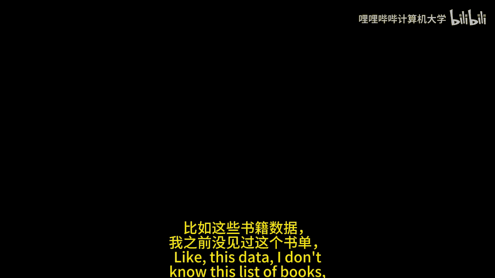

```sql
SELECT "title" FROM "longlist" LIMIT 10;
```

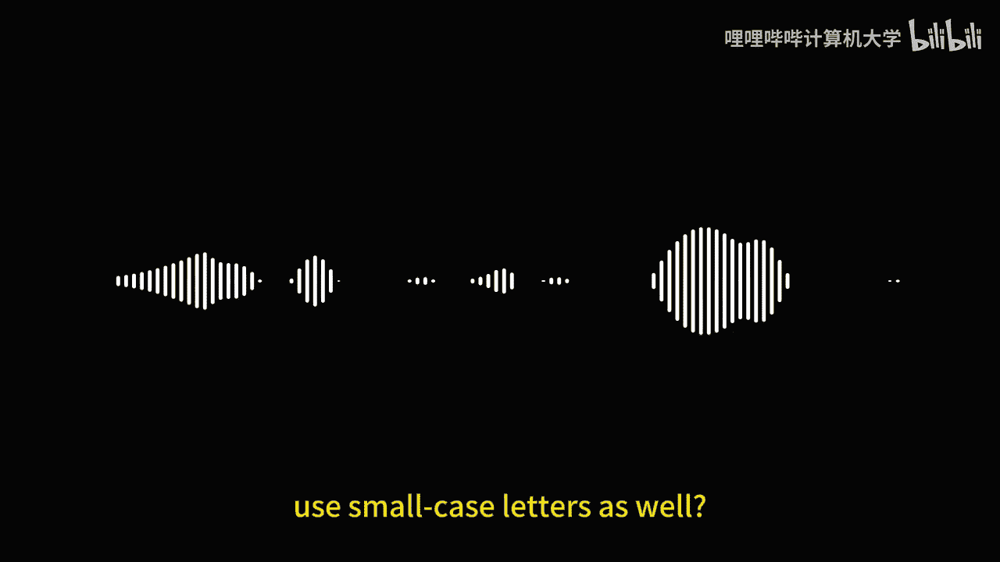

这个查询只返回前10本书的标题。

## 使用WHERE子句过滤数据

通常，我们不想查看所有数据，而是想根据特定条件筛选数据。`WHERE` 子句允许我们指定条件，只返回满足条件的行。

### 基于数值过滤

例如，如果我们只想查看2023年被提名（长名单）的书籍：

```sql
SELECT "title", "author" FROM "longlist" WHERE "year" = 2023;
```

我们也可以使用不等于运算符。例如，查找非精装格式的书籍：


```sql
SELECT "title", "format" FROM "longlist" WHERE "format" != 'hardcover';
-- 或者使用 <>
SELECT "title", "format" FROM "longlist" WHERE "format" <> 'hardcover';
```


### 组合多个条件

我们可以使用 `AND` 和 `OR` 来组合多个条件。例如，查找2022年或2023年被提名的书籍：

```sql
SELECT "title", "author" FROM "longlist" WHERE "year" = 2022 OR "year" = 2023;
```

我们还可以使用括号来明确条件的组合顺序。例如，查找2022年或2023年出版的非精装书籍：

```sql
SELECT "title", "format" FROM "longlist" WHERE ("year" = 2022 OR "year" = 2023) AND "format" != 'hardcover';
```

### 处理空值（NULL）

在数据库中，`NULL` 表示值不存在或缺失。我们可以使用 `IS NULL` 或 `IS NOT NULL` 来查找这些行。


例如，查找没有译者的书籍（译者列为空）：

```sql
SELECT "title", "translator" FROM "longlist" WHERE "translator" IS NULL;
```

反之，查找有译者的书籍：

```sql
SELECT "title", "translator" FROM "longlist" WHERE "translator" IS NOT NULL;
```

## 使用LIKE进行模式匹配

`LIKE` 运算符用于在文本列中搜索指定的模式。它通常与通配符一起使用：
*   `%`：匹配零个、一个或多个字符。
*   `_`：匹配任意单个字符。

例如，查找书名中包含“love”的书籍：

```sql
SELECT "title" FROM "longlist" WHERE "title" LIKE '%love%';
```

查找书名以“The”开头的书籍：

```sql
SELECT "title" FROM "longlist" WHERE "title" LIKE 'The%';
```

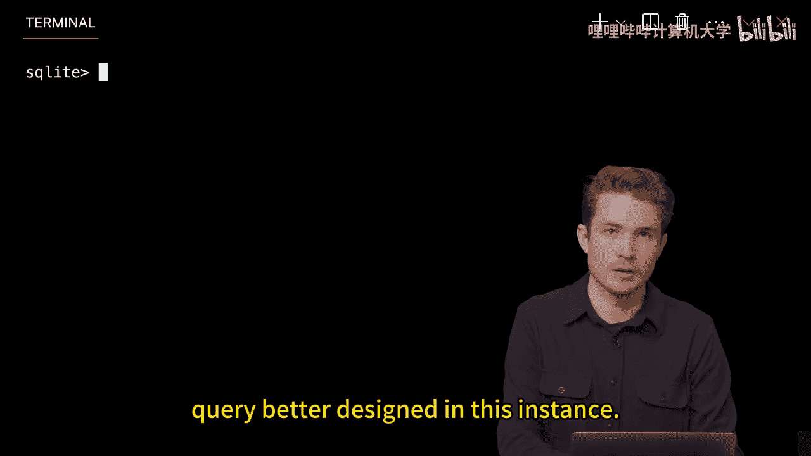


查找书名类似“P_re”的书籍（例如“Pyre”）：

```sql
SELECT "title" FROM "longlist" WHERE "title" LIKE 'P_re';
```

## 使用范围条件

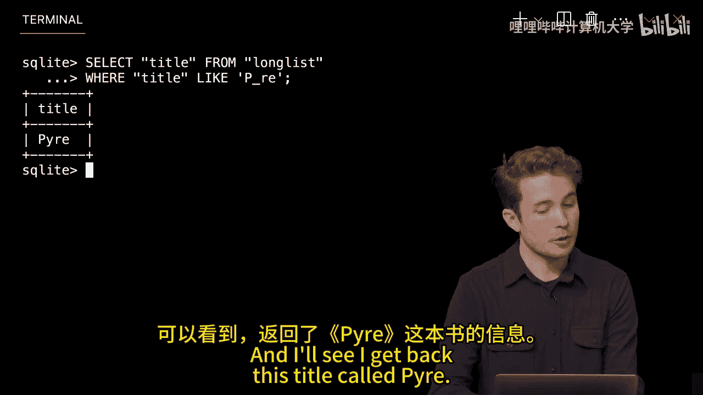

我们可以使用比较运算符（`>`, `<`, `>=`, `<=`）来过滤数值范围。例如，查找2019年至2022年（含）之间被提名的书籍：

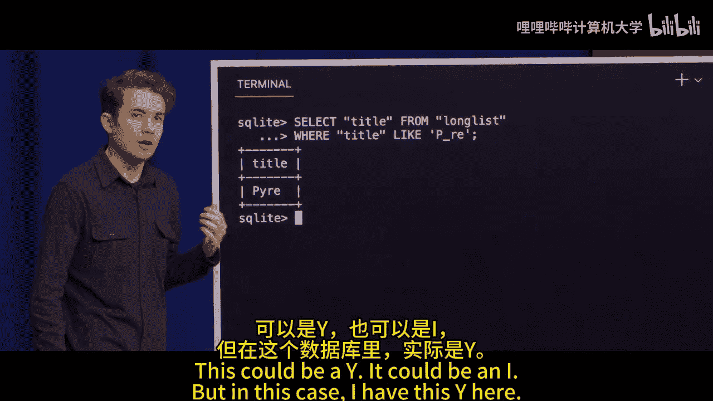

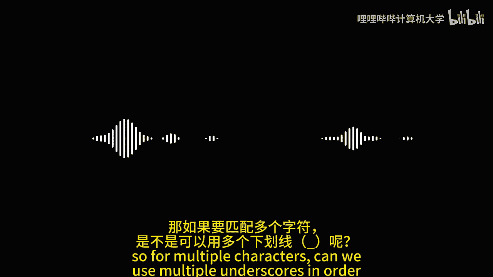

```sql
SELECT "title", "year" FROM "longlist" WHERE "year" >= 2019 AND "year" <= 2022;
```

SQL还提供了 `BETWEEN ... AND ...` 语法，使范围查询更简洁：

```sql
SELECT "title", "year" FROM "longlist" WHERE "year" BETWEEN 2019 AND 2022;
```

我们也可以组合多个范围条件。例如，查找评分高于4.0且投票数超过10000的书籍：

```sql
SELECT "title", "rating", "votes" FROM "longlist" WHERE "rating" > 4.0 AND "votes" > 10000;
```

## 使用ORDER BY排序结果

`ORDER BY` 子句用于对查询结果进行排序。默认情况下，排序是升序（从小到大，或A到Z）。我们可以使用 `DESC` 指定降序排序。

例如，按评分降序排列，查看评分最高的10本书：

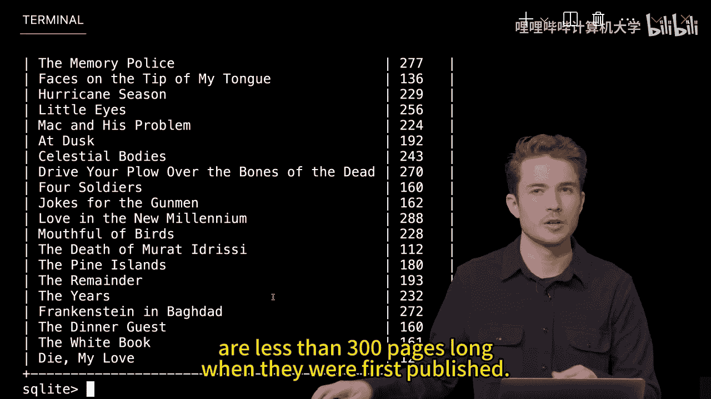

```sql
SELECT "title", "rating" FROM "longlist" ORDER BY "rating" DESC LIMIT 10;
```

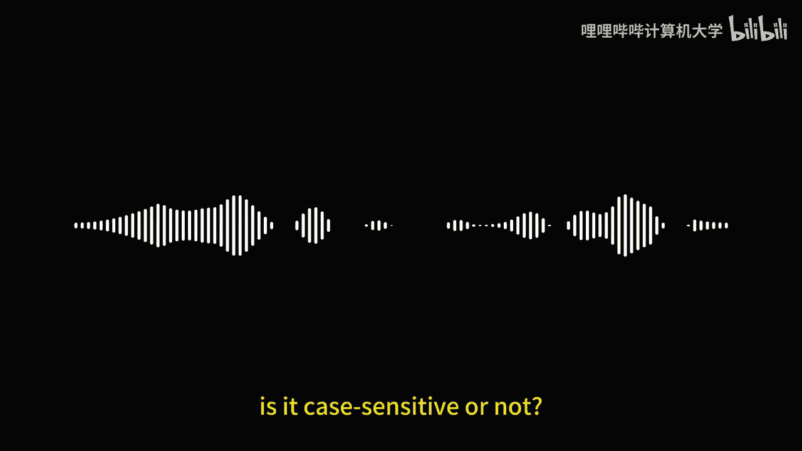

我们可以按多个列排序。例如，先按评分降序排序，评分相同的再按投票数降序排序：

```sql
SELECT "title", "rating", "votes" FROM "longlist" ORDER BY "rating" DESC, "votes" DESC LIMIT 10;
```

也可以按文本列排序，例如按书名字母顺序排列：

```sql
SELECT "title" FROM "longlist" ORDER BY "title";
-- 降序排列（反向字母顺序）
SELECT "title" FROM "longlist" ORDER BY "title" DESC;
```

## 使用聚合函数

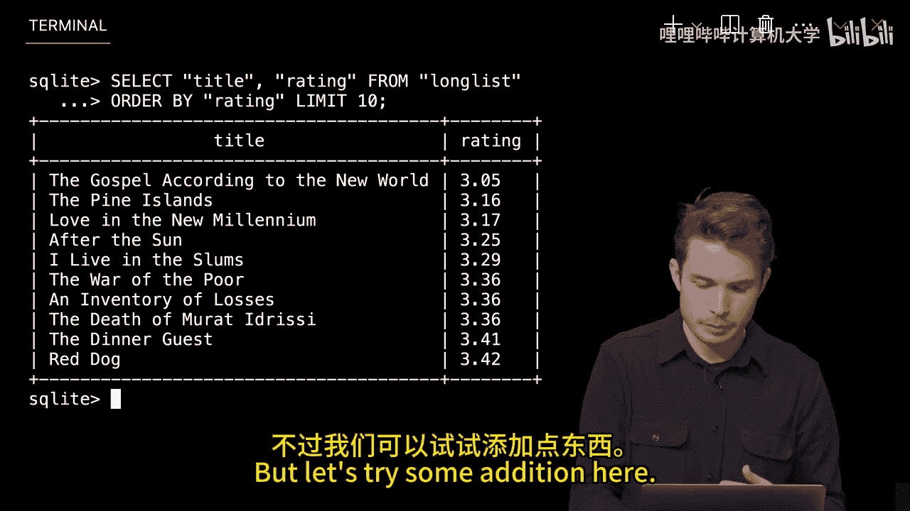

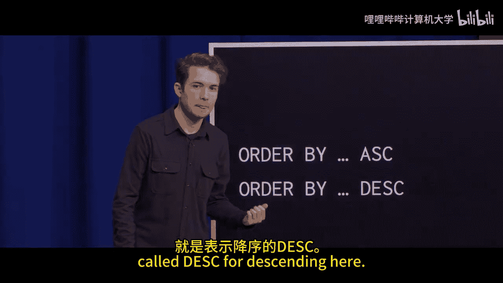

聚合函数对一组行执行计算，并返回单个值。常用的聚合函数包括：
*   `COUNT()`：计数。
*   `AVG()`：平均值。
*   `SUM()`：总和。
*   `MAX()`：最大值。
*   `MIN()`：最小值。

### 计算平均值和四舍五入

计算所有书籍的平均评分：

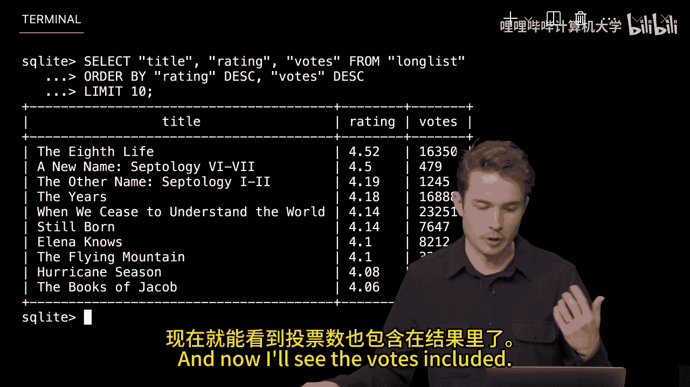

```sql
SELECT AVG("rating") FROM "longlist";
```

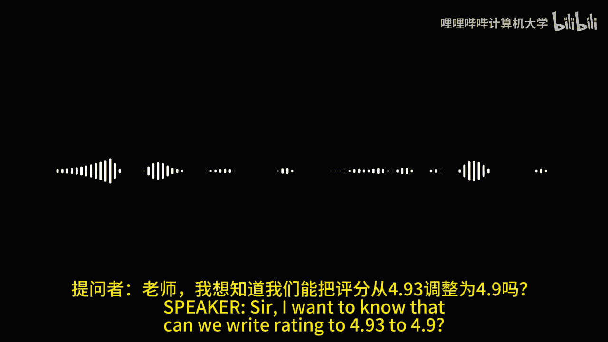

为了使结果更易读，我们可以使用 `ROUND()` 函数将结果四舍五入到指定的小数位数，并使用 `AS` 关键字为结果列起一个别名：

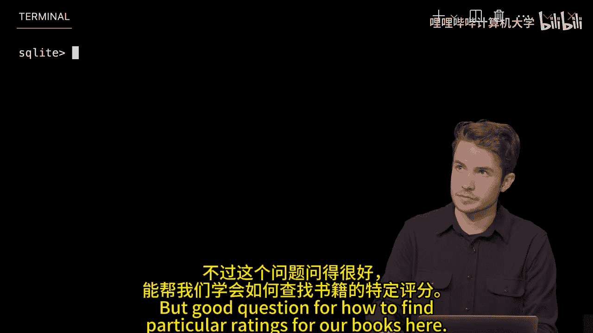


```sql
SELECT ROUND(AVG("rating"), 2) AS "average_rating" FROM "longlist";
```

### 查找最大值和最小值

查找最高评分和最低评分：

```sql
SELECT MAX("rating") FROM "longlist";
SELECT MIN("rating") FROM "longlist";
```

### 计算总和

计算所有书籍获得的总投票数：

```sql
SELECT SUM("votes") FROM "longlist";
```

### 计数

计算表中的总行数（即书籍总数）：

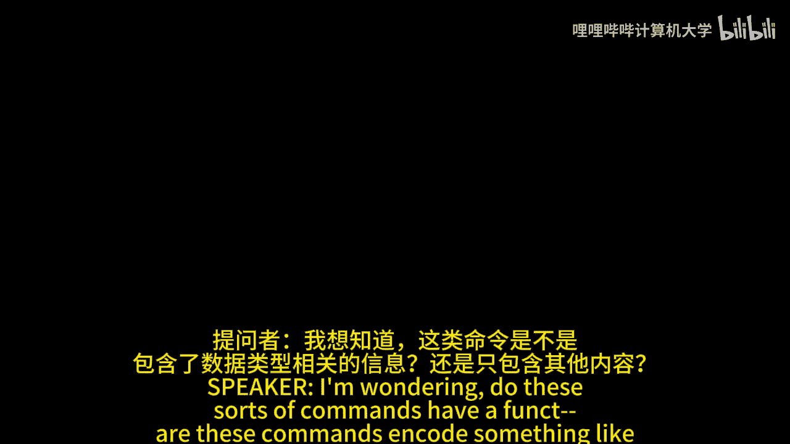


```sql
SELECT COUNT(*) FROM "longlist";
```

计算非空的译者数量：

```sql
SELECT COUNT("translator") FROM "longlist";
```

注意：`COUNT(column)` 只计算该列中非 `NULL` 值的行数。

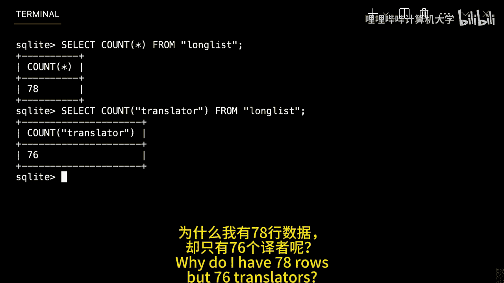


### 查找唯一值

要查找列中不同的（唯一的）值，可以使用 `DISTINCT` 关键字。例如，查找所有不同的出版社：

```sql
SELECT DISTINCT "publisher" FROM "longlist";
```

计算不同出版社的数量：

```sql
SELECT COUNT(DISTINCT "publisher") FROM "longlist";
```

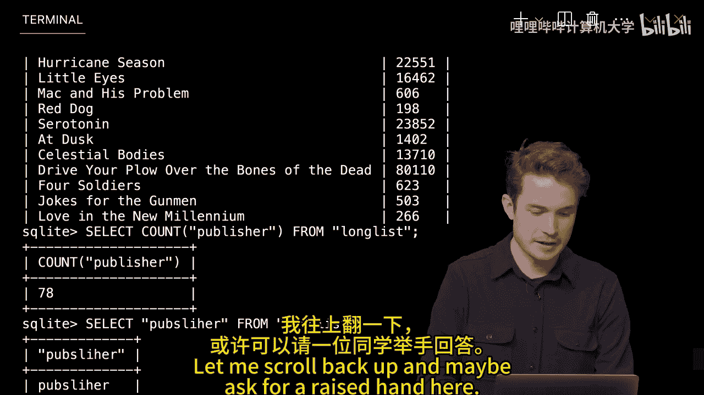


## 退出SQLite

完成查询后，可以使用以下命令退出SQLite环境，返回到常规终端：

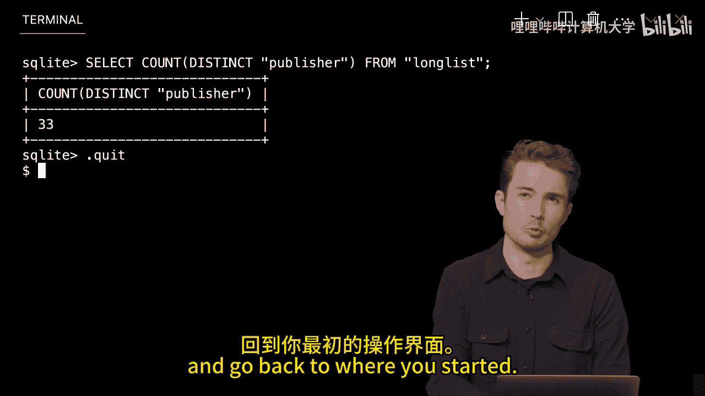

```sql
.quit
```

## 总结


在本节课中，我们一起学习了SQL查询的基础知识。我们了解了如何连接到数据库，使用 `SELECT` 语句查看数据，使用 `WHERE` 子句根据条件过滤行，以及使用 `LIKE` 进行模式匹配。我们还学习了如何使用 `ORDER BY` 对结果进行排序，以及如何使用聚合函数（如 `COUNT`, `AVG`, `SUM`, `MAX`, `MIN`）和 `DISTINCT` 关键字来汇总和分析数据。这些技能是使用SQL与数据库进行有效交互的基础。在接下来的课程中，我们将学习如何设计包含多个相关表的更复杂数据库。