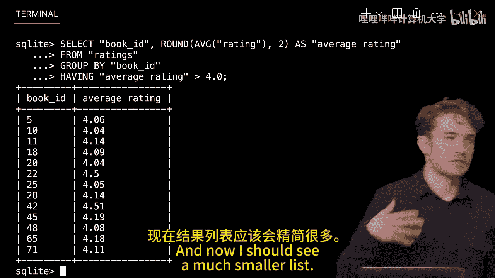

# 003：关系数据库与多表查询


在本节课中，我们将要学习关系数据库的核心概念，即如何在一个数据库中使用多个相互关联的表来组织数据。我们将探讨表之间的关系类型，学习如何使用主键和外键来建立这些关系，并掌握如何通过子查询和连接（JOIN）来查询跨表的数据。

## 概述：从单表到多表

上一节我们介绍了如何查询单个表中的数据。本节中，我们来看看当数据分布在多个表中时，我们该如何处理。关系数据库通过将数据拆分到不同的表中来减少冗余，并通过特定的键（Key）来建立表与表之间的联系。

## 表之间的关系


在关系数据库中，表与表之间主要存在三种关系：

1.  **一对一关系**：一个表中的一条记录只对应另一个表中的一条记录。
2.  **一对多关系**：一个表中的一条记录可以对应另一个表中的多条记录。
3.  **多对多关系**：一个表中的多条记录可以对应另一个表中的多条记录。

为了清晰地表示这些关系，我们可以使用实体关系图（ER Diagram）。在这种图中，实体（如表）用方框表示，关系用连线表示，并使用特定的符号（如“鸦爪”记号）来标明关系的类型（例如，一条线末端的“鸦爪”表示“多”）。

## 主键与外键

为了在表之间建立联系，我们需要使用键。

*   **主键**：表中唯一标识每条记录的列。例如，每本书都可以用一个唯一的ISBN号或一个自定义的ID来标识。
    *   公式：`PRIMARY KEY`
*   **外键**：一个表中的列，它引用了另一个表的主键。通过外键，我们可以将两个表关联起来。
    *   公式：`FOREIGN KEY (column_name) REFERENCES other_table(primary_key_column)`


例如，在`ratings`（评分）表中有一个`book_id`列，它引用了`books`（书籍）表中的主键`id`。这样，我们就知道每条评分对应的是哪本书。

对于多对多关系（如一个作者可以写多本书，一本书也可以有多个作者），我们通常需要创建一个额外的“联结表”（或称为关联实体）。这个表通常包含两个外键，分别指向两个相关表的主键。

## 使用子查询跨表查询


当我们需要基于一个表的查询结果去查询另一个表时，可以使用子查询（嵌套查询）。


以下是使用子查询查找由特定出版商出版的书籍的步骤：

1.  首先，查询出版商的ID。
    ```sql
    SELECT id FROM publishers WHERE publisher = ‘Fitzcarraldo Editions’;
    ```
    （假设返回结果为 `5`）

2.  然后，使用这个ID去查询书籍。
    ```sql
    SELECT title FROM books WHERE publisher_id = 5;
    ```


我们可以将这两个步骤合并为一个子查询，使其更动态：

```sql
SELECT title FROM books WHERE publisher_id = (
    SELECT id FROM publishers WHERE publisher = ‘Fitzcarraldo Editions’
);
```


括号内的查询会先执行，将其结果（`5`）用于外层查询的条件。

当需要匹配多个值时，可以使用 `IN` 关键字。例如，查找由某位作者（可能写了多本书）创作的所有书籍：


```sql
SELECT title FROM books WHERE id IN (
    SELECT book_id FROM authored WHERE author_id = (
        SELECT id FROM authors WHERE name = ‘Fernanda Melchor’
    )
);
```


## 使用连接（JOIN）合并表数据


连接操作允许我们将两个或多个表中的数据合并到一个结果集中，这比多层嵌套的子查询通常更清晰、更高效。


最基本的连接是内连接（`INNER JOIN`），它只返回两个表中匹配的行。

```sql
SELECT * FROM sea_lions
JOIN migrations ON migrations.id = sea_lions.id;
```


这条语句将 `sea_lions` 表和 `migrations` 表合并，条件是两者的 `id` 列值相等。


除了内连接，还有几种外连接：

*   **左连接**：返回左表的所有行，即使右表中没有匹配的行。右表缺失的部分用 `NULL` 填充。
    ```sql
    SELECT * FROM sea_lions LEFT JOIN migrations ON migrations.id = sea_lions.id;
    ```
*   **右连接**：返回右表的所有行，即使左表中没有匹配的行。
    ```sql
    SELECT * FROM sea_lions RIGHT JOIN migrations ON migrations.id = sea_lions.id;
    ```
*   **全连接**：返回左右两表的所有行，无论是否匹配。
    ```sql
    SELECT * FROM sea_lions FULL JOIN migrations ON migrations.id = sea_lions.id;
    ```


如果两个表中用于连接的列名相同，可以使用 **自然连接**，它会自动基于同名列进行连接。


```sql
SELECT * FROM sea_lions NATURAL JOIN migrations;
```


## 使用集合操作符

SQL 也支持对查询结果集进行集合操作，就像处理数学集合一样。


*   **`UNION`**：合并两个结果集，并去除重复行。
    ```sql
    SELECT name FROM authors
    UNION
    SELECT name FROM translators;
    ```
*   **`INTERSECT`**：返回两个结果集的交集（即同时出现在两个结果中的行）。
    ```sql
    SELECT name FROM authors
    INTERSECT
    SELECT name FROM translators;
    ```
*   **`EXCEPT`**：返回第一个结果集中有而第二个结果集中没有的行（差集）。
    ```sql
    SELECT name FROM authors
    EXCEPT
    SELECT name FROM translators;
    ```

## 使用 GROUP BY 进行分组聚合

`GROUP BY` 子句用于将结果集按一列或多列分组，并对每个组进行聚合计算（如求平均值、计数、求和等）。

例如，我们想计算每本书的平均评分：


```sql
SELECT book_id, AVG(rating) AS average_rating FROM ratings GROUP BY book_id;
```


如果我们只想查看平均评分高于 4.0 的书籍，不能在 `WHERE` 子句中直接使用聚合函数。需要使用 `HAVING` 子句来对分组后的结果进行过滤。


```sql
SELECT book_id, ROUND(AVG(rating), 2) AS average_rating
FROM ratings
GROUP BY book_id
HAVING average_rating >= 4.0
ORDER BY average_rating DESC;
```

这里，`HAVING` 的作用类似于 `WHERE`，但它是专门用于过滤分组后的数据。




## 总结


本节课中我们一起学习了关系数据库的核心知识。我们了解了表之间的一对一、一对多和多对多关系，并学会了使用主键和外键来建立这些关系。为了查询跨表的数据，我们掌握了两种主要技术：子查询和连接（JOIN）。此外，我们还学习了如何使用集合操作符（`UNION`, `INTERSECT`, `EXCEPT`）来处理结果集，以及如何使用 `GROUP BY` 和 `HAVING` 对数据进行分组和聚合分析。这些工具使我们能够高效地管理和查询复杂的数据关系。