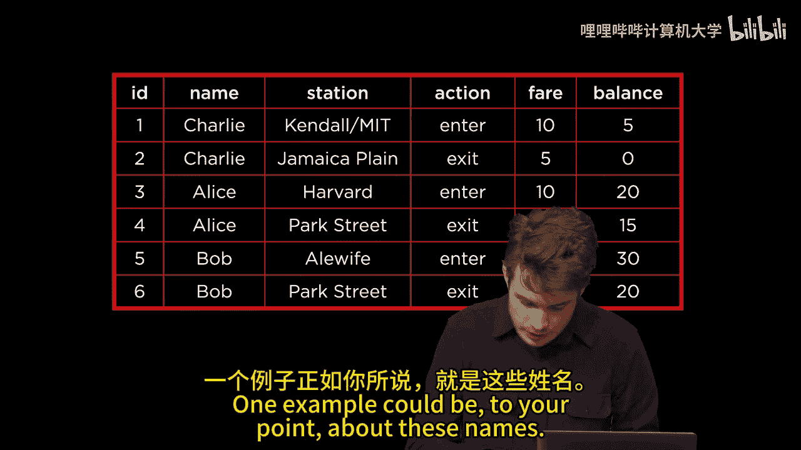
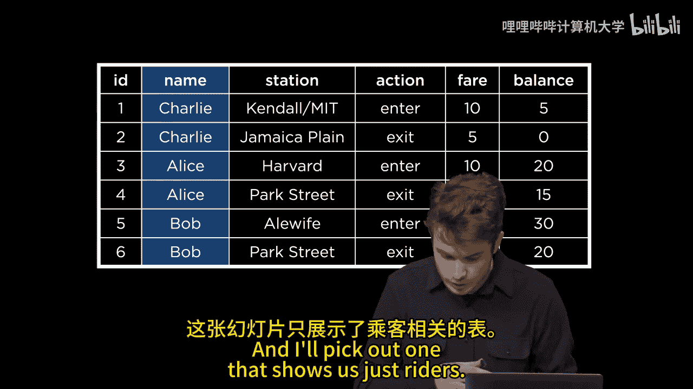
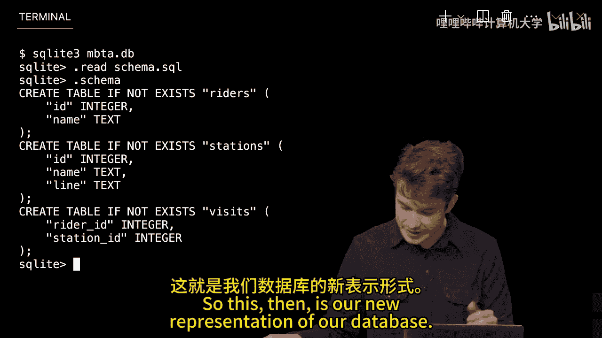
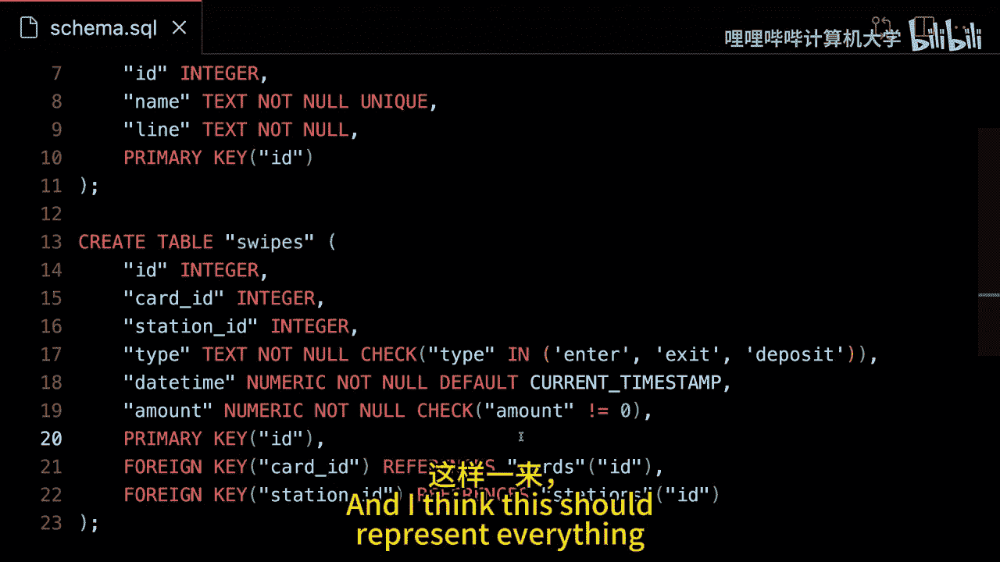
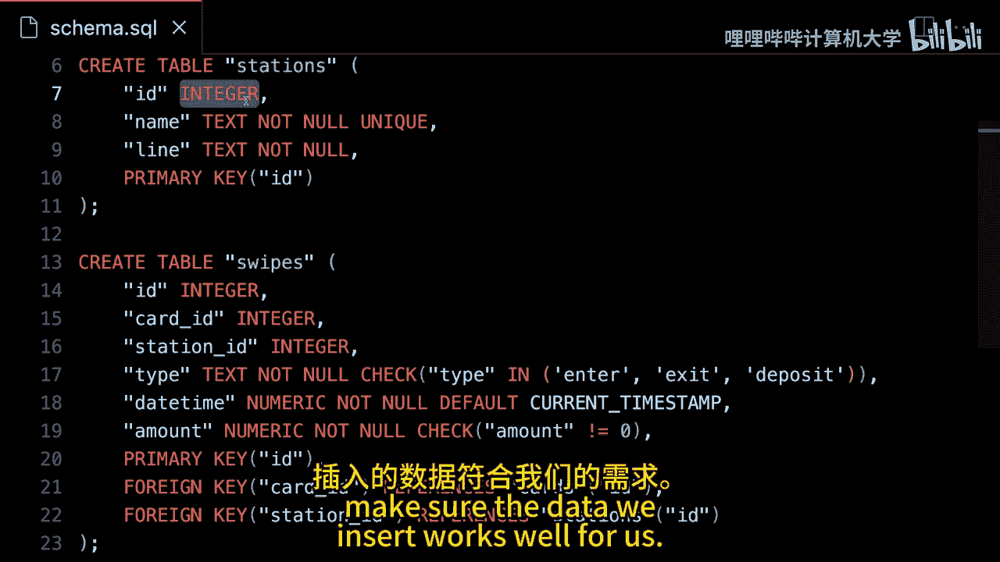

# 004：数据库设计

在本节课中，我们将学习如何设计自己的数据库模式。我们将从回顾上周的书籍数据库开始，逐步学习如何创建表、定义数据类型、应用约束，并最终为波士顿地铁系统设计一个更贴近现实的数据库模式。

## 回顾与引入


上一节我们学习了如何通过多张表以及它们之间的关系来组织数据。本节中，我们将深入探讨如何亲手设计数据库模式，将现实世界中的实体和关系转化为数据库结构。

我们首先回顾一下之前使用的书籍数据库。通过 `dot schema` 命令，我们可以看到创建 `longlist` 表所使用的SQL语句。该语句定义了多个列，并为每列指定了可以存储的数据类型，例如文本（`TEXT`）或整数（`INTEGER`）。

```sql
CREATE TABLE longlist (
    "isbn" TEXT,
    "title" TEXT,
    "author" TEXT,
    ...
);
```







## 设计挑战：地铁系统

现在，让我们尝试为一个现实世界的实体设计数据库：波士顿地铁系统（MBTA）。我们的目标是设计一个模式来有效表示乘客、车站以及他们的乘车行为。


最初，我们可能会设计一个简单的表格来记录乘客的进出站和余额信息。


| ID | 姓名   | 车站           | 行为 | 费用 | 余额 |
|----|--------|----------------|------|------|------|
| 1  | Charlie | Kendall/MIT   | 进站 | 0.10 | 0.05 |
| 2  | Charlie | Jamaica Plain | 出站 | 0.05 | 0.00 |
| 3  | Alice   | Harvard       | 进站 | 0.10 | 0.20 |
| 4  | Alice   | Park Street   | 出站 | 0.05 | 0.15 |


然而，这个设计存在冗余和效率问题。例如，姓名和车站名称被重复存储。为了解决这个问题，我们需要进行**规范化**。

## 规范化与实体关系


规范化的过程是将一个表拆分成多个表，以减少数据冗余。核心原则是将不同的实体（如乘客和车站）放入各自的表中。


根据波士顿地铁的实际运营，系统追踪的是“查理卡”（Charlie Card），而非乘客本人。每张卡可以在多个车站刷卡，每个车站也可以被多张卡访问。这是一种“多对多”的关系。

我们可以用实体关系图（ER Diagram）来表示这种关系：
*   一张**卡**可以访问多个**车站**（至少一个）。
*   一个**车站**可以被多张**卡**访问（可以为零个）。

为了在数据库中实现这种多对多关系，我们需要一个**连接表**（或称为关联实体）。这个表将存储卡ID和车站ID的组合，记录每一次访问（或称为“刷卡”事件）。


## 创建表与数据类型

现在，我们开始使用SQL语句来构建数据库。首先，我们使用 `CREATE TABLE` 语句来创建表。

以下是创建 `cards`（卡）表和 `stations`（车站）表的示例：





```sql
CREATE TABLE cards (
    id INTEGER,
    name TEXT
);
CREATE TABLE stations (
    id INTEGER,
    name TEXT,
    line TEXT
);
```


在SQLite中，列具有**类型亲和性**，它决定了该列倾向于存储哪种**存储类**的数据。SQLite有五种主要的存储类：
*   `NULL`: 空值。
*   `INTEGER`: 整数值。
*   `REAL`: 浮点数值。
*   `TEXT`: 文本字符串。
*   `BLOB`: 二进制大对象（如图像）。

为列指定类型亲和性（如 `INTEGER`、`TEXT`）有助于数据库更高效地处理和转换数据。

## 应用约束


为了确保数据的完整性和一致性，我们需要为表和应用**约束**。

**表约束**应用于整个表，主要包括：
*   `PRIMARY KEY`: 定义主键，确保唯一且非空。
*   `FOREIGN KEY`: 定义外键，引用另一表的主键。

**列约束**应用于单个列，主要包括：
*   `NOT NULL`: 确保该列不能存储`NULL`值。
*   `UNIQUE`: 确保该列中的所有值都是不同的。
*   `CHECK`: 允许定义条件表达式来验证数据。
*   `DEFAULT`: 在插入新行时，若未指定值，则使用默认值。

让我们将这些约束应用到地铁数据库模式中：


```sql
CREATE TABLE cards (
    id INTEGER PRIMARY KEY
);

CREATE TABLE stations (
    id INTEGER PRIMARY KEY,
    name TEXT NOT NULL UNIQUE,
    line TEXT NOT NULL
);
CREATE TABLE swipes (
    id INTEGER PRIMARY KEY,
    card_id INTEGER,
    station_id INTEGER,
    type TEXT NOT NULL CHECK(type IN ('enter', 'exit', 'deposit')),
    datetime NUMERIC NOT NULL DEFAULT CURRENT_TIMESTAMP,
    amount NUMERIC NOT NULL CHECK(amount != 0),
    FOREIGN KEY (card_id) REFERENCES cards(id),
    FOREIGN KEY (station_id) REFERENCES stations(id)
);
```

在这个改进的模式中：
*   `cards` 表只保留一个唯一ID作为主键。
*   `stations` 表的 `name` 必须非空且唯一。
*   `swipes` 表记录了每次刷卡事件，包括类型（进站、出站、充值）、时间戳和金额。我们使用了 `CHECK` 约束来限制 `type` 的取值和确保 `amount` 不为零，并使用 `DEFAULT` 约束为 `datetime` 自动填入当前时间。

## 修改表结构

在设计过程中，我们可能需要修改已有的表结构。SQL提供了 `ALTER TABLE` 语句来实现这一点。

以下是常用的表修改操作：
*   重命名表：`ALTER TABLE visits RENAME TO swipes;`
*   增加列：`ALTER TABLE swipes ADD COLUMN type TEXT;`
*   重命名列：`ALTER TABLE swipes RENAME COLUMN ttpe TO type;`
*   删除列：`ALTER TABLE swipes DROP COLUMN type;`

如果设计发生重大变化，也可以使用 `DROP TABLE` 语句删除整个表，然后重新创建。




## 总结


本节课中我们一起学习了数据库设计的核心概念。我们从识别现实世界中的实体和关系出发，通过**规范化**过程来优化表结构，减少冗余。我们深入探讨了如何使用 `CREATE TABLE` 语句定义表结构，包括为列设置**类型亲和性**。为了保障数据质量，我们学习了应用**主键**、**外键**等表约束，以及 `NOT NULL`、`UNIQUE`、`CHECK`、`DEFAULT` 等列约束。最后，我们还了解了如何使用 `ALTER TABLE` 和 `DROP TABLE` 来修改或删除已有的表结构。



通过这些步骤，你现在已经能够设计出结构清晰、高效且健壮的数据库模式，为下一步向数据库中插入和操作真实数据打下了坚实的基础。