# 005：写入数据

在本节课中，我们将学习如何向数据库中添加、修改和删除数据。我们将以波士顿美术博物馆（MFA）的藏品管理为例，学习如何使用SQL语句来操作数据库。

## 概述

上一节我们学习了如何创建数据库模式。本节中，我们将学习如何向数据库中添加数据，即插入、更新和删除数据。我们将通过波士顿美术博物馆的藏品管理实例，掌握这些核心的写入操作。

## 插入数据

首先，我们来看看如何向数据库表中添加新的数据行。

### 插入单行数据

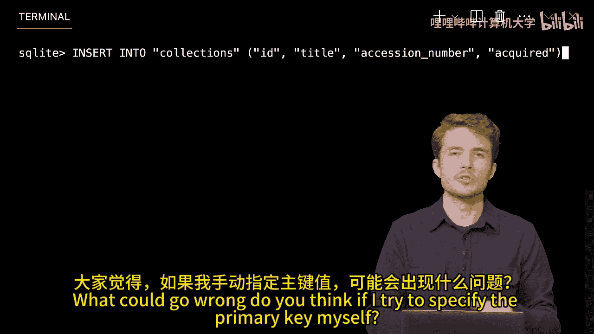

要向表中插入单行数据，我们使用 `INSERT INTO` 语句。其基本语法如下：

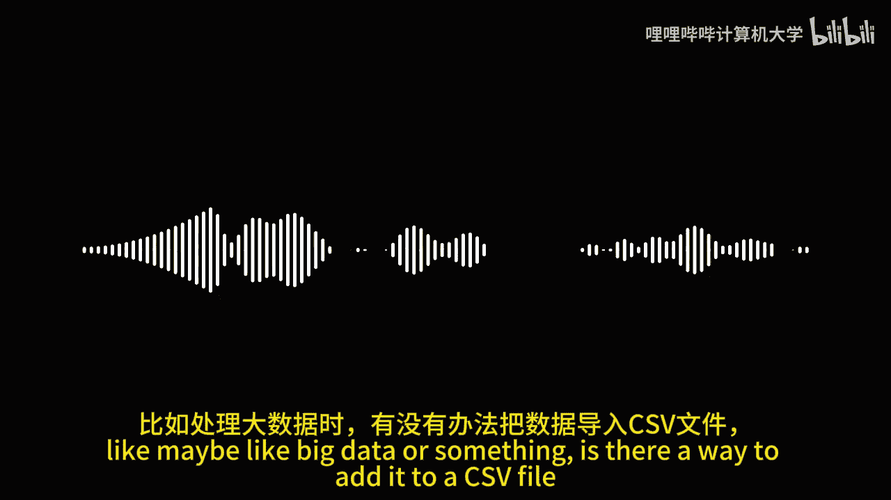

```sql
INSERT INTO table_name (column1, column2, column3, ...)
VALUES (value1, value2, value3, ...);
```

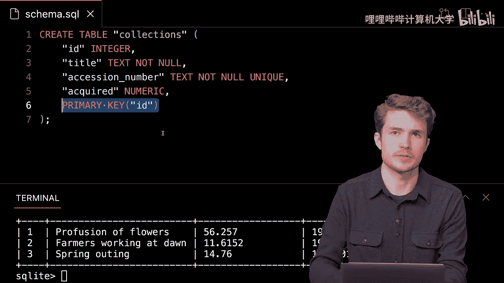

例如，假设我们有一个名为 `collections` 的表，包含 `id`、`title`、`accession_number` 和 `acquired` 列。要向其中添加一幅名为《繁花似锦》的画作，可以执行以下命令：

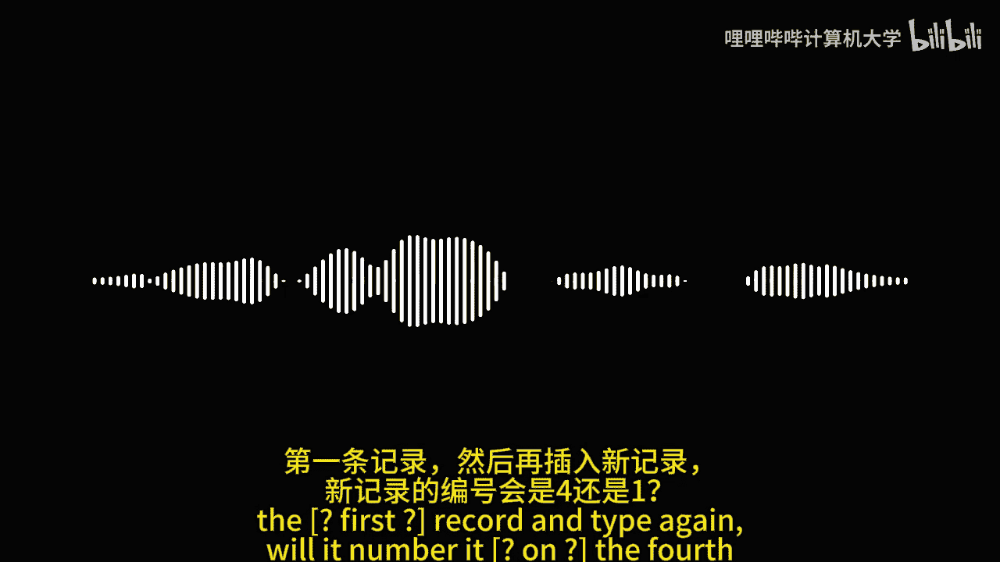

```sql
INSERT INTO collections (id, title, accession_number, acquired)
VALUES (1, 'Profusion of Flowers', '56.257', '1956-04-12');
```

### 插入多行数据

为了提高效率，我们可以一次性插入多行数据。语法如下：

```sql
INSERT INTO table_name (column1, column2, column3, ...)
VALUES
    (value1a, value2a, value3a, ...),
    (value1b, value2b, value3b, ...),
    ...;
```

例如，同时添加两幅画作：

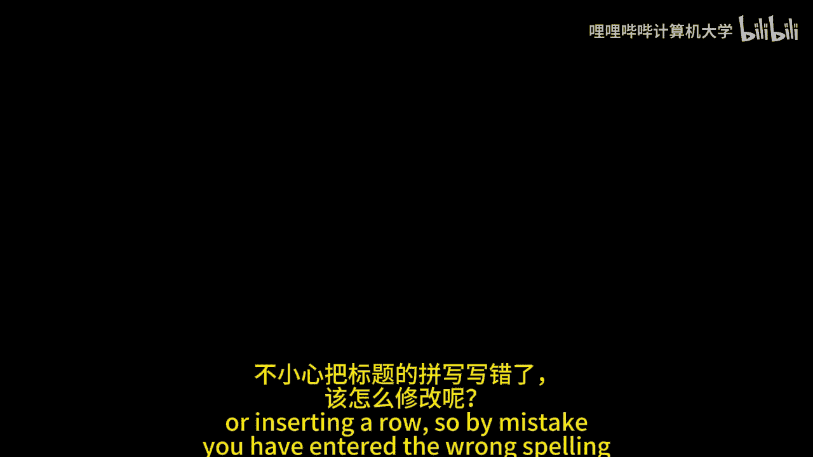

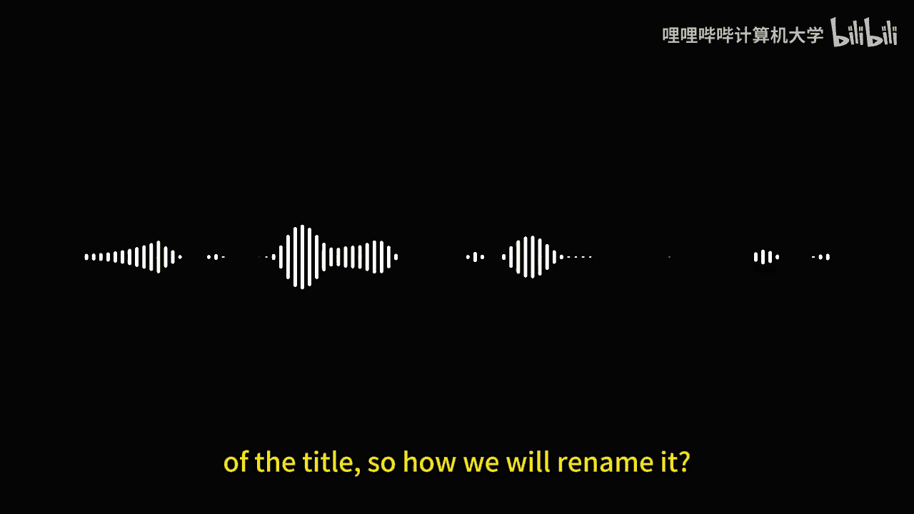

```sql
INSERT INTO collections (title, accession_number, acquired)
VALUES
    ('Imaginative Landscape', '56.496', NULL),
    ('Peonies and Butterfly', '06.1899', '1906-01-01');
```

### 自动递增主键

在定义表模式时，我们可以将主键列设置为 `INTEGER PRIMARY KEY`。这样，在插入新行时，如果省略主键值，SQLite会自动为其分配一个递增的整数。

```sql
-- 创建表时定义自增主键
CREATE TABLE collections (
    id INTEGER PRIMARY KEY,
    title TEXT NOT NULL,
    accession_number TEXT NOT NULL UNIQUE,
    acquired TEXT
);

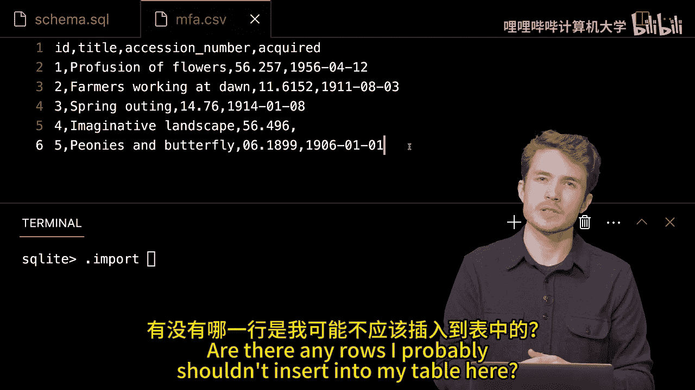


-- 插入数据时无需指定id
INSERT INTO collections (title, accession_number, acquired)
VALUES ('Spring Outing', '14.76', '1914-01-08');
```

## 从CSV文件导入数据

当需要批量导入数据时，从CSV文件读取是一种高效的方法。

### 导入到现有表

如果目标表已存在且结构与CSV文件匹配，可以使用 `.import` 命令。

```sql
-- 在SQLite命令行中执行
.import --csv --skip 1 mfa.csv collections
```
*   `--csv`：指定文件格式为CSV。
*   `--skip 1`：跳过CSV文件的第一行（通常是标题行）。
*   `mfa.csv`：源数据文件。
*   `collections`：目标表名。

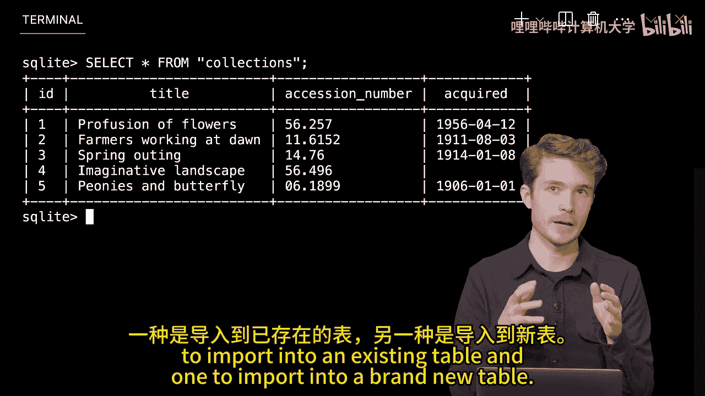

### 导入到新表并处理主键

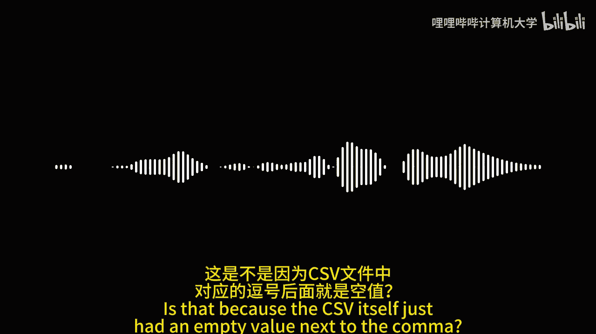

如果CSV文件不包含主键列，可以先将其导入到一个临时表，再通过查询插入到目标表。

```sql
-- 1. 将CSV导入临时表（包含标题行作为列名）
.import --csv mfa.csv temp

-- 2. 从临时表选择数据插入到正式表，id会自动生成
INSERT INTO collections (title, accession_number, acquired)
SELECT title, accession_number, acquired FROM temp;

-- 3. 删除临时表
DROP TABLE temp;
```

## 更新数据

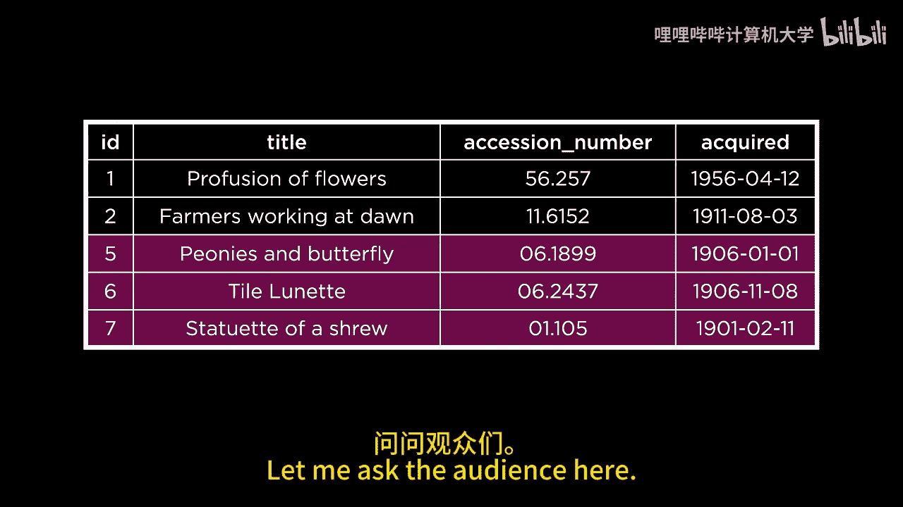

当数据需要更正或修改时，我们使用 `UPDATE` 语句。


### 基本更新语法

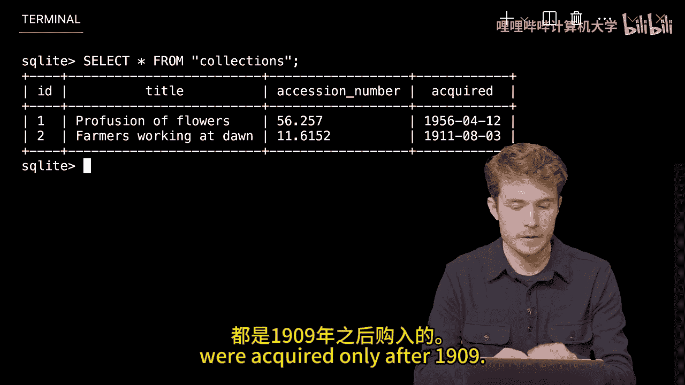

`UPDATE` 语句用于修改表中现有的记录。

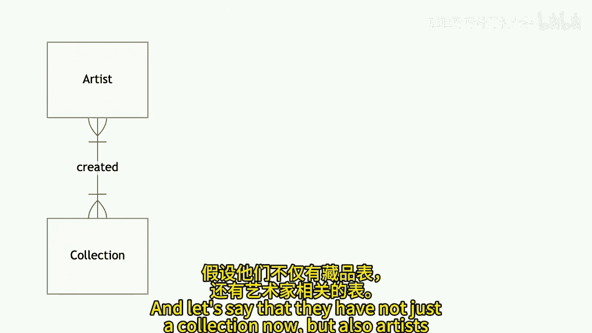

```sql
UPDATE table_name
SET column1 = value1, column2 = value2, ...
WHERE condition;
```


**重要**：`WHERE` 子句用于指定要更新哪些行。如果省略 `WHERE` 子句，将更新表中的所有行！

### 更新示例

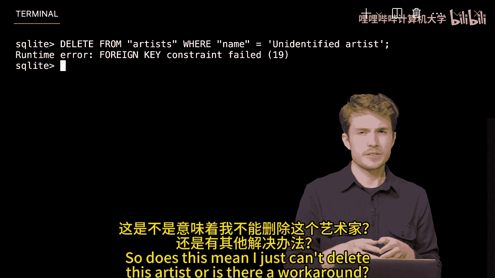

假设我们发现《农夫黎明劳作》这幅画的作者信息有误，需要更正关联关系。


```sql
-- 假设有一个关联表 `created` 连接艺术家和作品
-- 将《农夫黎明劳作》的作者从未知艺术家改为李寅
UPDATE created
SET artist_id = (SELECT id FROM artists WHERE name = 'Li Yin')
WHERE collection_id = (SELECT id FROM collections WHERE title = 'Farmers Working at Dawn');
```

### 数据清洗示例

在处理如投票结果等用户输入数据时，常需要清洗数据（如修正拼写、统一格式）。

```sql
-- 1. 去除标题首尾空格
UPDATE votes SET title = TRIM(title);

-- 2. 将标题统一为大写，解决大小写不一致问题
UPDATE votes SET title = UPPER(title);

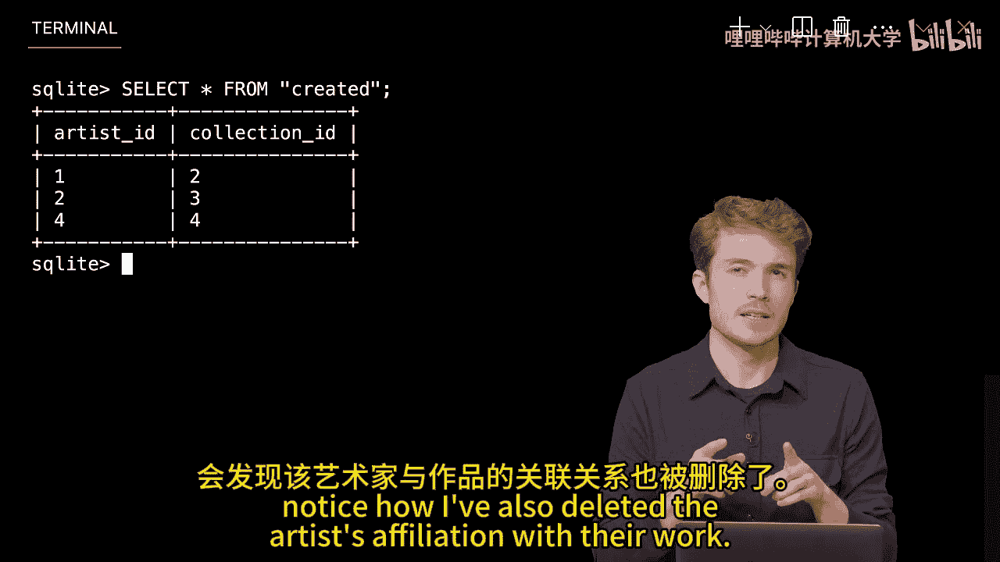

-- 3. 修正特定的拼写错误（使用LIKE进行模式匹配）
UPDATE votes
SET title = 'FARMERS WORKING AT DAWN'
WHERE title LIKE 'FARMERS WORKING%';
-- 注意：使用LIKE需谨慎，确保模式能精确匹配目标行
```

## 删除数据

当需要从表中移除数据时，使用 `DELETE` 语句。

### 基本删除语法

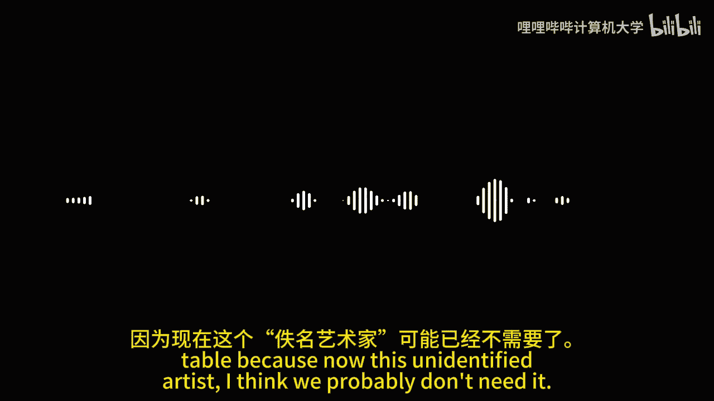

```sql
DELETE FROM table_name WHERE condition;
```

**警告**：与 `UPDATE` 类似，如果省略 `WHERE` 子句，将删除表中的所有行！

### 删除示例

删除在1909年之前获得的藏品：

```sql
DELETE FROM collections WHERE acquired < '1909-01-01';
```

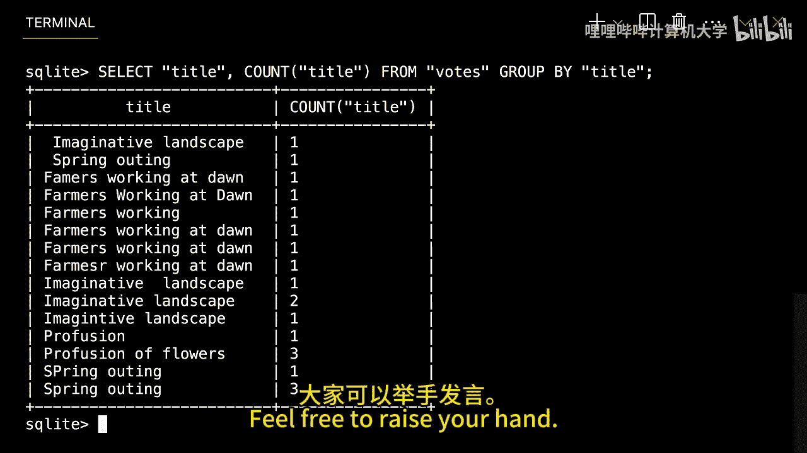

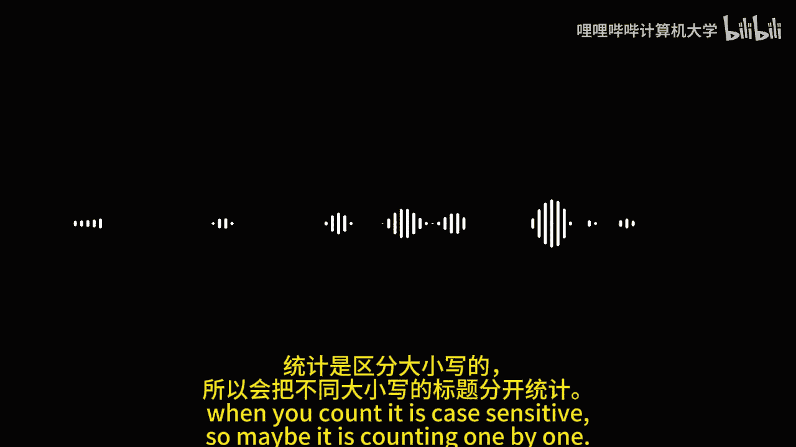

### 外键约束与级联删除

当表之间存在外键约束时，删除操作可能受到限制。我们可以在定义外键时指定 `ON DELETE` 行为。

```sql
-- 创建关联表时定义外键约束
CREATE TABLE created (
    artist_id INTEGER,
    collection_id INTEGER,
    FOREIGN KEY (artist_id) REFERENCES artists(id) ON DELETE CASCADE,
    FOREIGN KEY (collection_id) REFERENCES collections(id) ON DELETE CASCADE
);
```

`ON DELETE` 的可选操作有：
*   `RESTRICT`（默认）：阻止删除被引用的主键。
*   `CASCADE`：同时删除引用该主键的所有外键行。
*   `SET NULL`：将引用该主键的外键值设为 `NULL`。
*   `SET DEFAULT`：将引用该主键的外键值设为默认值。

使用 `CASCADE` 后，删除一位艺术家会自动删除所有与该艺术家关联的作品记录。

```sql
-- 删除艺术家，其在created表中的关联记录也会被自动删除
DELETE FROM artists WHERE name = 'Unidentified Artist';
```

## 触发器

触发器是一种特殊的存储过程，它在指定的表发生特定事件（如 `INSERT`、`UPDATE`、`DELETE`）时自动执行。

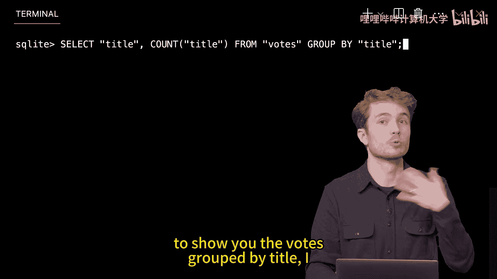

### 创建触发器

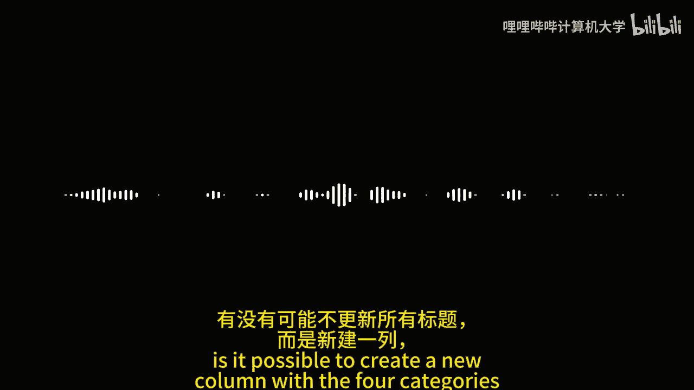

以下触发器在从 `collections` 表删除一条记录**之前**，自动向 `transactions` 表插入一条“售出”记录。

```sql
CREATE TRIGGER sell
BEFORE DELETE ON collections
FOR EACH ROW
BEGIN
    INSERT INTO transactions (title, action)
    VALUES (OLD.title, 'sold');
END;
```
*   `OLD`：代表被删除行的旧值。
*   `NEW`：在 `INSERT` 或 `UPDATE` 触发器中，代表新插入或更新后的值。

再创建一个在购入藏品后自动记录的触发器：

```sql
CREATE TRIGGER buy
AFTER INSERT ON collections
FOR EACH ROW
BEGIN
    INSERT INTO transactions (title, action)
    VALUES (NEW.title, 'bought');
END;
```

## 软删除

软删除是一种数据管理策略，它不真正从数据库移除数据，而是通过一个标志位（如 `deleted` 列）来标记数据已被“删除”。

### 实现软删除

1.  为表添加一个标志列：

    ```sql
    ALTER TABLE collections ADD COLUMN deleted INTEGER DEFAULT 0;
    ```

2.  “删除”数据时，更新标志位而非真正删除行：

    ```sql
    UPDATE collections SET deleted = 1 WHERE title = 'Farmers Working at Dawn';
    ```


3.  查询数据时，过滤掉已标记为删除的行：

    ```sql
    SELECT * FROM collections WHERE deleted = 0;
    ```

软删除的优点是可以保留历史数据以便审计或恢复，但需要考虑数据隐私和合规性（如GDPR规定的“被遗忘权”）。

## 总结

本节课中我们一起学习了SQL中核心的数据写入操作：
1.  **插入数据**：使用 `INSERT INTO` 语句添加新记录，可以单行插入、多行插入或从CSV文件导入。
2.  **更新数据**：使用 `UPDATE` 语句修改现有记录，常用于数据更正和清洗。
3.  **删除数据**：使用 `DELETE` 语句移除记录，需注意外键约束和 `ON DELETE` 规则。
4.  **高级特性**：我们了解了**触发器**如何自动响应数据变化，以及**软删除**作为一种数据保留策略的实现。

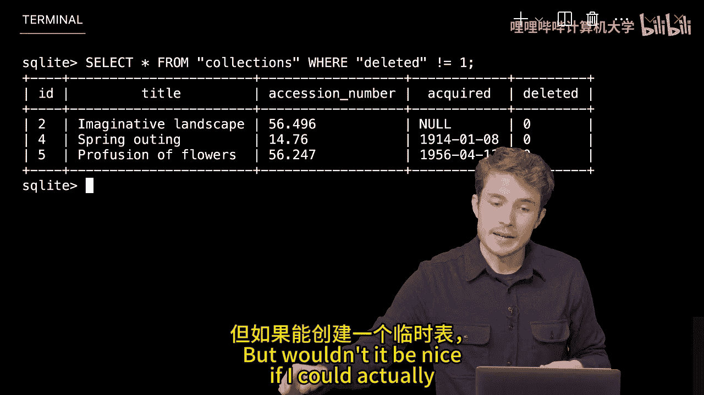

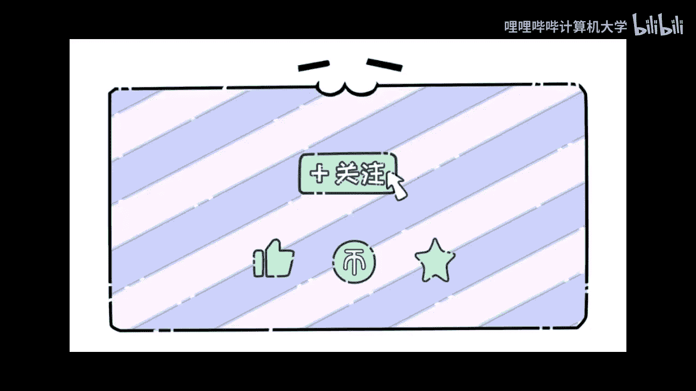

掌握这些写入操作，结合之前学习的查询技能，你已能够对数据库进行完整的增删改查管理。下一节我们将探讨视图等更高级的数据库特性。