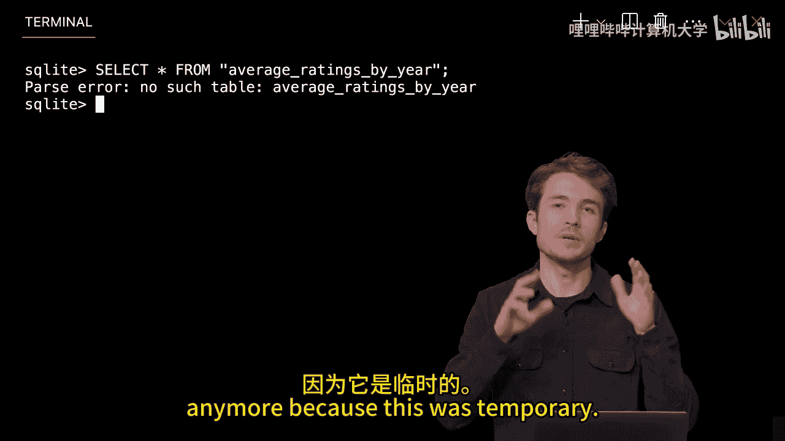
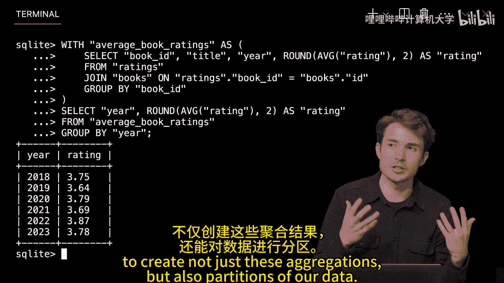
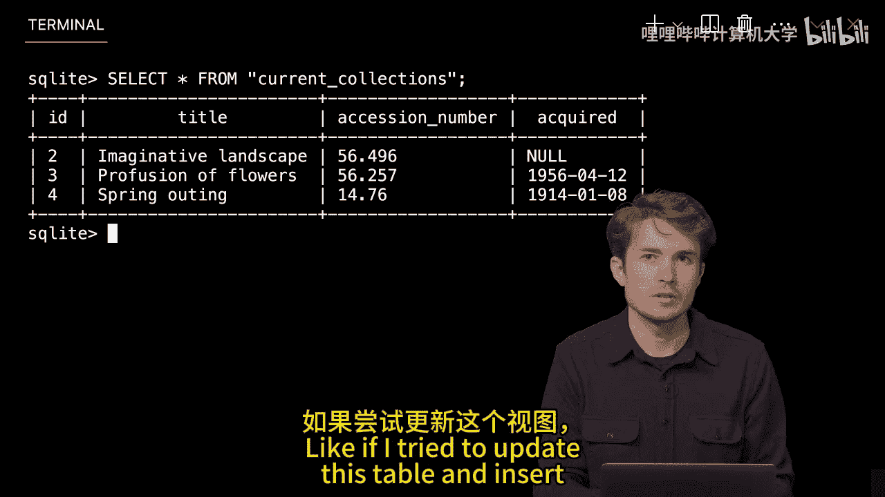
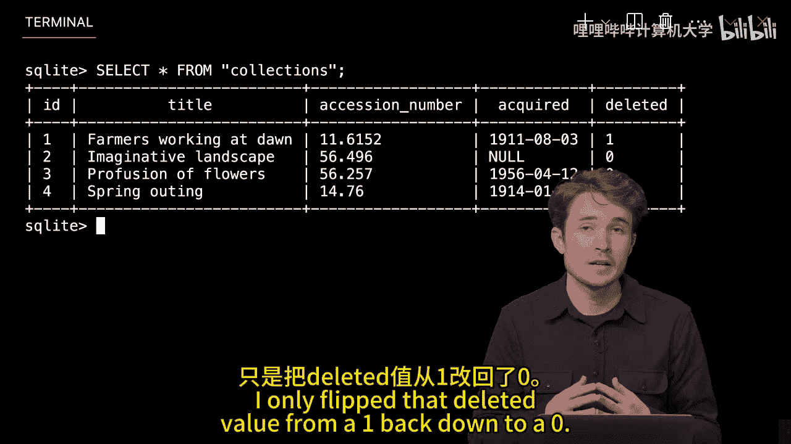

# 006：视图


在本节课中，我们将要学习一个强大的数据库工具——视图。视图可以帮助我们简化复杂的数据查询，聚合数据，划分数据逻辑，甚至增强数据安全性。我们将从基础概念开始，逐步探索视图的各种应用。

## 视图简介

上一节我们学习了如何设计多表数据库以及如何插入、更新和删除数据。随着表数量的增加和关系的复杂化，查询数据变得繁琐。本节中，我们来看看如何通过视图来简化这种复杂性，更清晰地查看数据。

视图是一个虚拟表，它本身由一个查询定义。这意味着视图不存储实际数据，而是保存一个查询。当我们查询视图时，数据库会执行定义该视图的查询，并返回结果。


以下是创建视图的基本语法：
```sql
CREATE VIEW view_name AS
SELECT column1, column2, ...
FROM table_name
WHERE condition;
```

## 使用视图简化数据

我们从一个熟悉的书籍数据集开始。这个数据集包含作者、书籍以及它们之间的多对多关系。为了找到某位作者写了哪些书，我们需要连接多个表，查询过程复杂。


通过创建一个视图，我们可以将作者名和书名合并到一个虚拟表中，从而简化查询。


以下是创建简化视图的步骤：
1.  使用 `JOIN` 语句连接 `authors`、`authored` 和 `books` 表。
2.  将连接查询的结果保存为一个视图。

例如，创建名为 `longlist` 的视图：
```sql
CREATE VIEW longlist AS
SELECT authors.name, books.title
FROM authors
JOIN authored ON authors.id = authored.author_id
JOIN books ON books.id = authored.book_id;
```

创建视图后，查询某位作者的作品就变得非常简单：
```sql
SELECT title FROM longlist WHERE name = 'Fernanda Melchor';
```


## 使用视图聚合数据


除了简化，视图还可以用于数据聚合，例如计算平均值、最小值、最大值等统计信息。我们以书籍评分表为例，其中存储了每本书的多个独立评分。


与其只存储平均分，不如存储所有独立评分，这样我们可以计算更多统计量。我们可以创建一个视图来动态计算每本书的平均评分。


以下是创建聚合视图的步骤：
1.  使用 `GROUP BY` 和聚合函数（如 `AVG`、`ROUND`）计算每本书的平均分。
2.  通过 `JOIN` 将结果与书籍信息表连接。
3.  将整个查询保存为视图。


例如，创建名为 `average_book_ratings` 的视图：
```sql
CREATE VIEW average_book_ratings AS
SELECT books.id, books.title, books.year,
       ROUND(AVG(ratings.rating), 2) AS rating
FROM ratings
JOIN books ON ratings.book_id = books.id
GROUP BY books.id;
```


此后，要查看每本书的平均评分，只需查询该视图即可。如果底层评分数据更新，视图查询的结果也会自动更新。


## 临时视图与公共表表达式




有时我们可能只需要临时地以某种方式查看数据，而不想永久保存视图。这时可以使用临时视图或公共表表达式。

*   **临时视图** 仅在当前数据库连接期间存在。断开连接后，视图自动消失。
    ```sql
    CREATE TEMP VIEW temp_view_name AS ...;
    ```
*   **公共表表达式** 的生命周期更短，仅存在于单个查询的执行过程中。它使用 `WITH` 子句定义，非常适合简化复杂查询中的子查询。
    ```sql
    WITH cte_name AS (
        SELECT ...
    )
    SELECT * FROM cte_name;
    ```

例如，使用CTE计算每年的平均评分：
```sql
WITH average_book_ratings AS (
    SELECT books.year, ROUND(AVG(ratings.rating), 2) AS avg_rating
    FROM ratings
    JOIN books ON ratings.book_id = books.id
    GROUP BY books.id
)
SELECT year, ROUND(AVG(avg_rating), 2) AS rating
FROM average_book_ratings
GROUP BY year;
```



## 使用视图划分数据


视图可用于将大数据集按逻辑划分成更小的、更易管理的部分。例如，书籍表中包含多年的数据，我们可以为每一年创建一个视图。


以下是按年份划分数据的步骤：
1.  编写查询，选择特定年份的数据。
2.  将该查询保存为以年份命名的视图。


例如，创建2022年书籍的视图：
```sql
CREATE VIEW "2022" AS
SELECT id, title FROM books WHERE year = 2022;
```

这样，应用程序或用户可以直接查询 `2022` 这个视图来获取当年的数据，逻辑清晰且高效。需要注意的是，视图本身通常不能直接进行 `INSERT`、`UPDATE` 或 `DELETE` 操作，因为这些操作需要修改底层实际表。


## 使用视图增强数据安全

视图在数据安全方面也很有用。通过视图，我们可以有选择地向用户或应用程序暴露部分数据，隐藏敏感列。


例如，一个打车行程表包含 `起点`、`终点` 和 `乘客` 信息。出于隐私考虑，我们不想让数据分析师看到乘客姓名。


我们可以创建一个视图，只包含 `起点` 和 `终点`，并将 `乘客` 列替换为匿名标识：
```sql
CREATE VIEW analysis AS
SELECT id, origin, destination, 'Anonymous' AS rider
FROM rides;
```

通过只授予用户访问 `analysis` 视图的权限，而非底层的 `rides` 表，可以有效保护乘客隐私。不过，在SQLite等轻量级系统中，权限控制较弱，用户可能仍能访问底层表。在企业级数据库管理系统（如PostgreSQL, MySQL）中，可以实施更严格的访问控制。

## 视图与软删除

视图可以与“软删除”模式结合使用。软删除不是真正从数据库删除记录，而是通过一个标记列（如 `deleted`）来标识记录是否被删除。




我们可以创建一个视图，只显示 `deleted = 0`（未删除）的记录：
```sql
CREATE VIEW current_collections AS
SELECT id, title, accession_number, acquired
FROM collections
WHERE deleted = 0;
```


当想要“删除”一件藏品时，我们更新底层表的 `deleted` 标记为1，该记录就会从 `current_collections` 视图中消失。


为了让针对视图的 `DELETE` 和 `INSERT` 操作能正确映射到底层表的更新操作，我们需要使用 `INSTEAD OF` 触发器。


例如，创建一个触发器，使得对视图的删除操作转化为对底层表 `deleted` 标记的更新：
```sql
CREATE TRIGGER delete_trigger
INSTEAD OF DELETE ON current_collections
FOR EACH ROW
BEGIN
    UPDATE collections SET deleted = 1 WHERE id = OLD.id;
END;
```


同样，可以创建触发器来处理向视图插入数据的情况，例如检查物品是否已存在（通过唯一标识如 `accession_number`），若存在则更新 `deleted` 标记为0，若不存在则插入新行。

## 总结

本节课中我们一起学习了SQL视图的强大功能。我们了解到，视图是一个由查询定义的虚拟表，它可以帮助我们：
*   **简化** 复杂的多表查询。
*   **聚合** 数据以生成动态统计信息。
*   **划分** 大数据集为逻辑片段。
*   **增强** 数据安全性，隐藏敏感信息。
*   与 **软删除** 和 **触发器** 结合，实现更高级的数据管理逻辑。




通过掌握视图，你可以更高效、更清晰、更安全地管理和查询数据库中的数据。