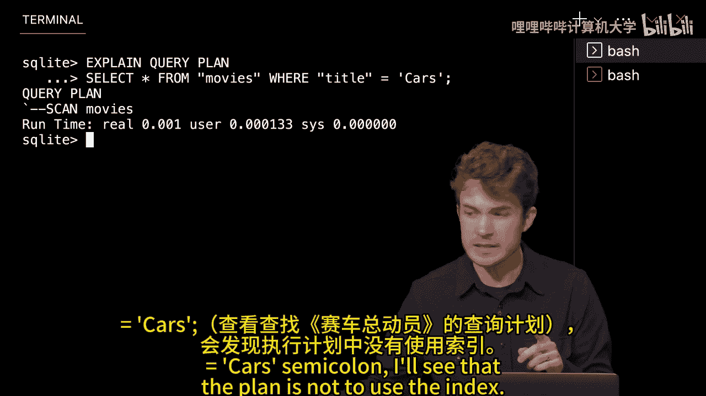
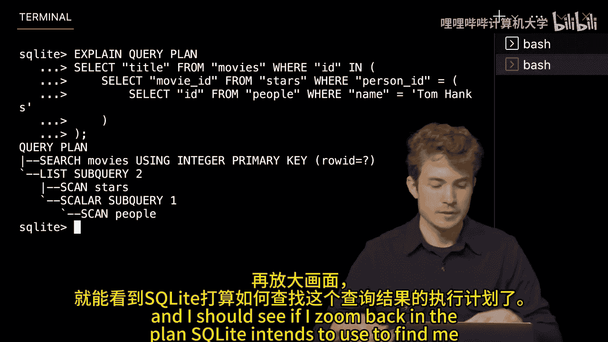
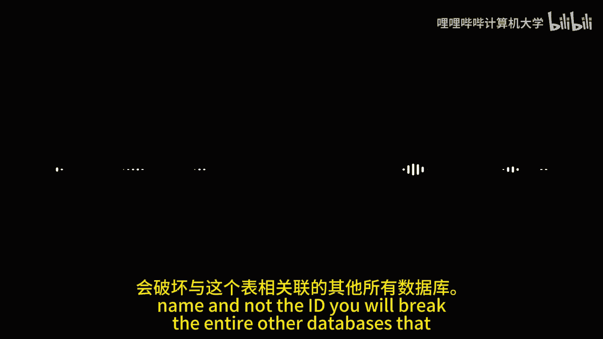

# 007：优化 🚀


在本节课中，我们将学习如何优化数据库，包括减少查询时间、节省存储空间以及处理并发查询。我们将使用一个大型的IMDB电影数据库作为示例，通过创建索引、使用事务和锁等机制来提升数据库性能。


---

## 概述 📋

优化数据库主要关注两个方面：**性能**和**资源**。性能优化旨在减少查询的执行时间，而资源优化则关注如何高效地使用存储空间和处理并发请求。我们将通过具体的SQL操作和概念，如索引、事务和锁，来实现这些目标。


---

## 数据库结构介绍 🗂️

我们使用的数据库是互联网电影数据库（IMDB）的简化版，包含三个主要表：`movies`（电影）、`people`（人员）和`ratings`（评分）。此外，还有一个`stars`表用于表示电影和演员之间的多对多关系。

以下是数据库的实体关系图（ERD）：
- `people`表包含`id`（主键）、`name`和`birthday`。
- `movies`表包含`id`（主键）、`title`和`year`。
- `ratings`表包含`movie_id`、`rating`和`votes`。
- `stars`表包含`person_id`和`movie_id`，用于关联演员和电影。


---

## 优化查询性能 ⚡

### 线性扫描与索引



当我们执行一个简单的查询，例如查找电影《汽车总动员》（Cars）时，数据库可能会进行**线性扫描**（Linear Scan），即逐行检查`title`列，直到找到匹配项。这种方法在数据量较大时效率较低。


**示例查询：**
```sql
SELECT * FROM movies WHERE title = 'Cars';
```

为了优化这类查询，我们可以使用**索引**（Index）。索引是一种数据结构，可以加快数据的检索速度。类似于书籍的目录，索引允许数据库快速定位到所需的数据行，而无需扫描整个表。



---

### 创建索引


在SQL中，我们可以使用`CREATE INDEX`语句为表的特定列创建索引。

**语法：**
```sql
CREATE INDEX index_name ON table_name (column_name);
```

**示例：**
为`movies`表的`title`列创建索引：
```sql
CREATE INDEX title_index ON movies (title);
```


创建索引后，再次执行相同的查询，速度会显著提升。我们可以使用`EXPLAIN QUERY PLAN`命令查看查询的执行计划，确认索引是否被使用。

**示例：**
```sql
EXPLAIN QUERY PLAN SELECT * FROM movies WHERE title = 'Cars';
```

---

### 覆盖索引




覆盖索引（Covering Index）是一种特殊的索引，它包含了查询所需的所有数据，因此无需回表查询。这可以进一步提高查询性能。

**示例：**
为`stars`表创建覆盖索引，包含`person_id`和`movie_id`列：
```sql
CREATE INDEX person_index ON stars (person_id, movie_id);
```

---

## 索引的权衡 ⚖️

虽然索引可以显著提升查询性能，但它们也存在一些权衡：


1. **空间开销**：索引需要额外的存储空间。
2. **写入性能**：插入、更新或删除数据时，索引也需要更新，这可能会降低写入性能。


因此，在创建索引时需要权衡利弊，确保索引的收益大于其成本。


---

## 部分索引 🌟

部分索引（Partial Index）只包含表中满足特定条件的数据行，从而减少索引的大小和存储开销。


**语法：**
```sql
CREATE INDEX index_name ON table_name (column_name) WHERE condition;
```

**示例：**
为2023年上映的电影创建部分索引：
```sql
CREATE INDEX recent_index ON movies (title) WHERE year = 2023;
```

---

## 清理数据库空间 🧹


当我们删除索引或数据时，数据库文件的大小可能不会立即减小。为了回收未使用的空间，我们可以使用`VACUUM`命令。

**示例：**
```sql
VACUUM;
```

执行`VACUUM`后，数据库文件的大小会减小，释放未使用的空间。

---

## 处理并发事务 🔄

### 事务的基本概念

事务（Transaction）是数据库中的一个逻辑工作单元，具有**ACID**属性：
- **原子性（Atomicity）**：事务中的所有操作要么全部完成，要么全部不完成。
- **一致性（Consistency）**：事务必须使数据库从一个一致状态转换到另一个一致状态。
- **隔离性（Isolation）**：多个事务并发执行时，彼此之间互不干扰。
- **持久性（Durability）**：事务完成后，对数据库的修改是永久性的。


---


### 事务的语法

在SQL中，我们可以使用以下语句控制事务：
- `BEGIN TRANSACTION`：开始一个事务。
- `COMMIT`：提交事务，保存所有更改。
- `ROLLBACK`：回滚事务，撤销所有更改。

**示例：**
模拟银行转账事务：
```sql
BEGIN TRANSACTION;
UPDATE accounts SET balance = balance - 10 WHERE id = 1;
UPDATE accounts SET balance = balance + 10 WHERE id = 2;
COMMIT;
```


---

### 锁机制


为了处理并发事务，数据库使用**锁**（Lock）机制来确保数据的一致性。常见的锁类型包括：
- **共享锁（Shared Lock）**：允许多个事务读取数据，但不允许写入。
- **排他锁（Exclusive Lock）**：只允许一个事务读取或写入数据。

**示例：**
使用排他锁确保事务的隔离性：
```sql
BEGIN EXCLUSIVE;
-- 执行事务操作
COMMIT;
```


---

## 总结 🎯

在本节课中，我们一起学习了数据库优化的核心概念和技术：


1. **索引**：通过创建索引加快查询速度，但需要权衡空间和写入性能。
2. **覆盖索引**：进一步优化查询，避免回表操作。
3. **部分索引**：减少索引大小，针对特定条件优化。
4. **空间清理**：使用`VACUUM`命令回收未使用的存储空间。
5. **事务**：通过ACID属性确保数据的一致性和可靠性。
6. **锁机制**：处理并发事务，防止数据冲突。


通过掌握这些技术，你可以显著提升数据库的性能和可靠性，为实际应用场景提供更好的支持。