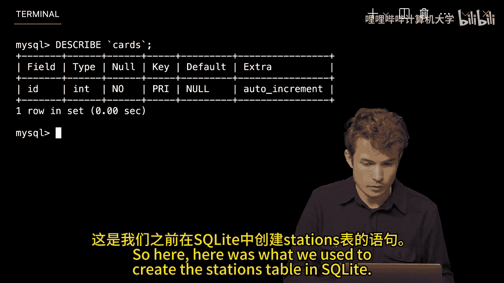
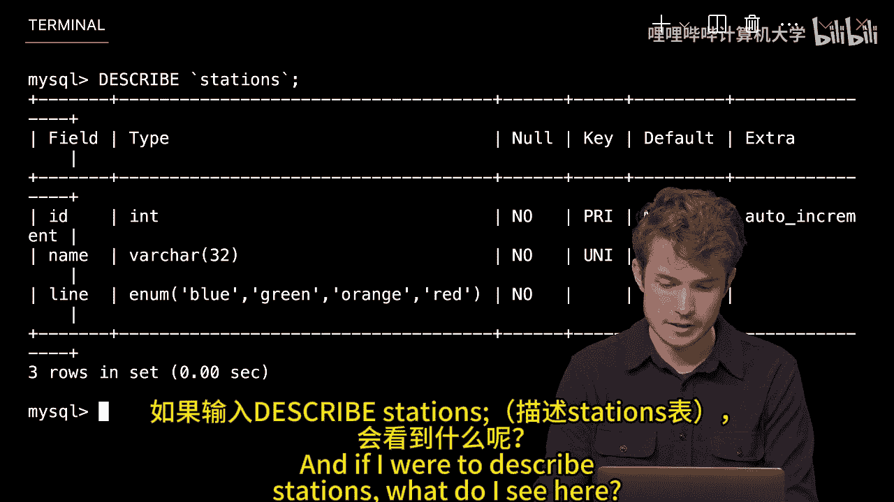
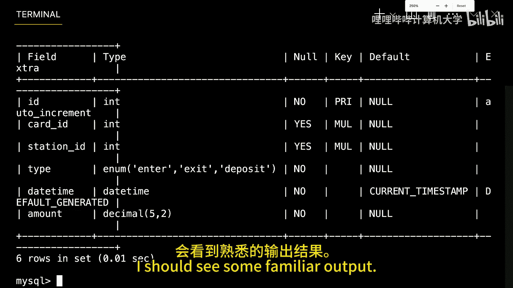
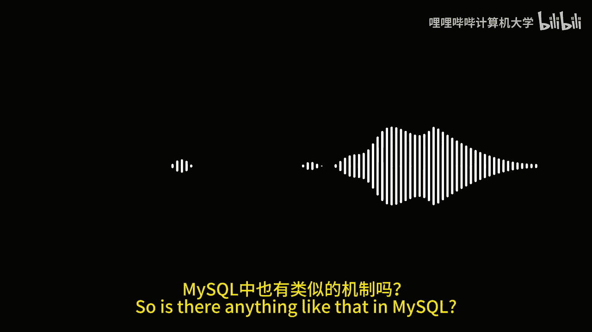
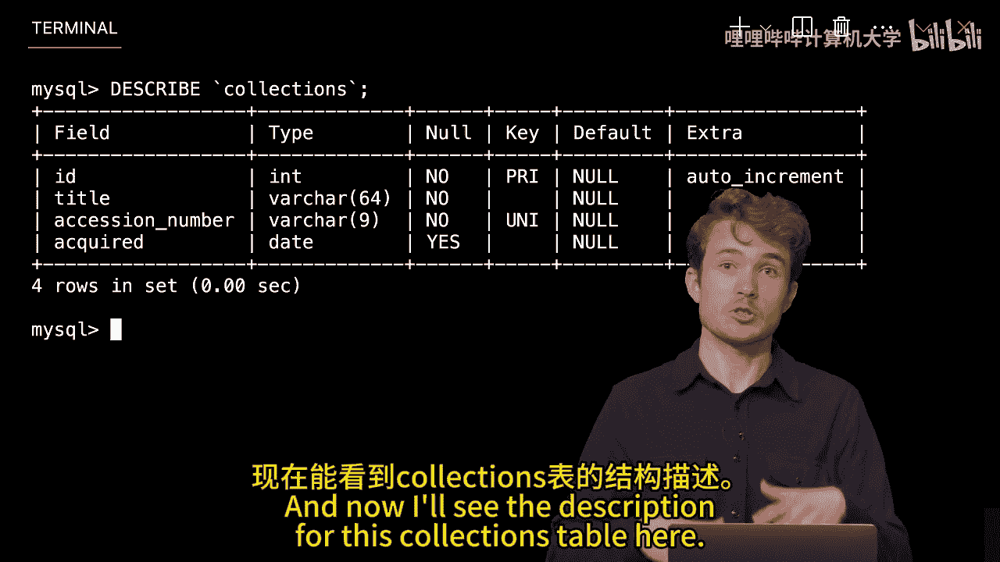
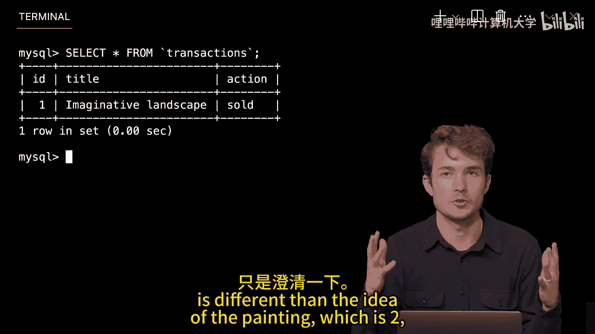
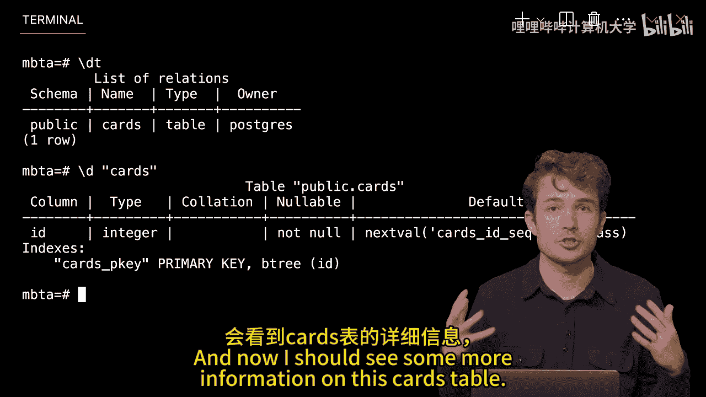
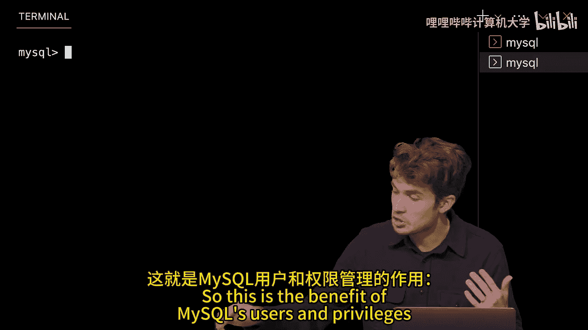
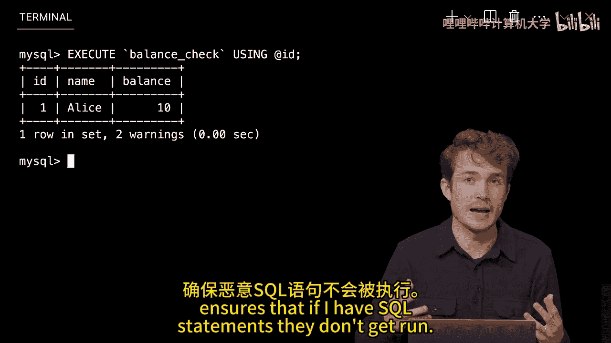
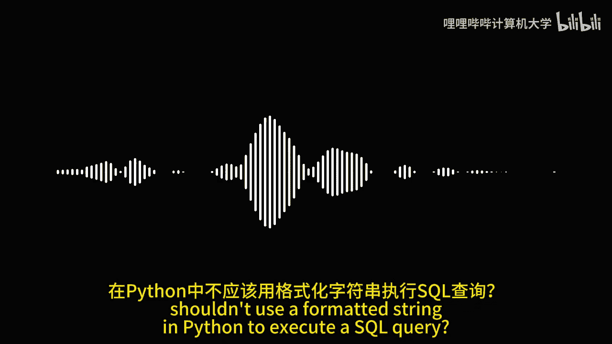

# 008：扩展


## 概述
在本节课中，我们将学习如何将数据库应用扩展到更大规模。我们将介绍MySQL和PostgreSQL这两种数据库管理系统，了解它们与SQLite的区别，并探索用于处理高并发、大数据量的关键技术，如复制、分片、存储过程以及安全防护。

## 从SQLite到MySQL

上一节我们介绍了课程目标，本节中我们来看看如何将SQLite中的数据库模式迁移到MySQL。

### 连接MySQL服务器
与SQLite不同，MySQL是一个数据库服务器，需要通过命令行连接。

```bash
mysql -u root -h 127.0.0.1 -P 3306 -p
```

以下是连接命令各部分的解释：
*   `-u root`：指定以`root`（管理员）用户身份登录。
*   `-h 127.0.0.1`：指定服务器主机地址（`127.0.0.1`代表本地计算机）。
*   `-P 3306`：指定连接端口（MySQL默认端口为3306）。
*   `-p`：提示输入密码。


连接成功后，可以查看服务器上的现有数据库。

```sql
SHOW DATABASES;
```

### 创建数据库和表
首先，我们为波士顿地铁系统（MBTA）创建一个新的数据库。


```sql
CREATE DATABASE `mbta`;
USE mbta;
```

接下来，我们创建`cards`表。在MySQL中，我们需要更精确地指定数据类型。

```sql
CREATE TABLE cards (
    id INT AUTO_INCREMENT,
    PRIMARY KEY(id)
);
```



使用`DESCRIBE`命令可以查看表的结构。

```sql
DESCRIBE cards;
```

### MySQL中的数据类型
MySQL提供了比SQLite更丰富的数据类型，让我们能更精确地控制存储。

以下是MySQL中主要的整数类型及其范围：
| 类型 | 存储大小 | 有符号范围 | 无符号范围 |
| :--- | :--- | :--- | :--- |
| `TINYINT` | 1字节 | -128 到 127 | 0 到 255 |
| `SMALLINT` | 2字节 | -32768 到 32767 | 0 到 65535 |
| `MEDIUMINT` | 3字节 | -8388608 到 8388607 | 0 到 16777215 |
| `INT` | 4字节 | -2147483648 到 2147483647 | 0 到 4294967295 |
| `BIGINT` | 8字节 | -2^63 到 2^63-1 | 0 到 2^64-1 |


对于主键，通常使用`INT`类型并配合`AUTO_INCREMENT`属性，以确保其值自动增长且唯一。



### 创建`stations`表
现在，我们创建`stations`表，用于存储地铁站信息。

```sql
CREATE TABLE stations (
    id INT AUTO_INCREMENT,
    name VARCHAR(32) NOT NULL UNIQUE,
    line ENUM('blue', 'green', 'orange', 'red') NOT NULL,
    PRIMARY KEY(id)
);
```


以下是MySQL中用于存储文本的主要类型：
*   `CHAR(M)`：固定长度的字符串，例如`CHAR(2)`用于存储州名缩写（如`MA`）。
*   `VARCHAR(M)`：可变长度的字符串，最大长度为`M`，例如`VARCHAR(32)`用于存储站名。
*   `TEXT`：用于存储长文本，如文章段落。有`TINYTEXT`、`MEDIUMTEXT`、`LONGTEXT`等变体。
*   `ENUM('value1', 'value2', ...)`：枚举类型，该列的值只能是预定义列表中的一个。
*   `SET('value1', 'value2', ...)`：集合类型，该列的值可以是预定义列表中的多个（用逗号分隔）。


### 修改表结构
如果需要为`line`列添加新的枚举值（例如`silver`），可以使用`ALTER TABLE`语句。

```sql
ALTER TABLE stations
MODIFY line ENUM('blue', 'green', 'orange', 'red', 'silver') NOT NULL;
```

## 存储过程

上一节我们介绍了MySQL的基本操作，本节中我们来看看如何使用存储过程来封装和复用SQL逻辑。


存储过程是一组为了完成特定功能的SQL语句集合，经编译后存储在数据库中，用户可以通过指定存储过程的名字并给出参数来调用执行。

### 创建无参数的存储过程
假设我们有一个博物馆藏品表`collections`，其中有一个`deleted`列用于实现“软删除”（标记为删除而非实际删除）。我们创建一个存储过程来查看所有未删除的藏品。



首先，更改语句分隔符，以便在存储过程中使用分号。

```sql
DELIMITER //
CREATE PROCEDURE current_collections()
BEGIN
    SELECT title, accession_number, acquired
    FROM collections
    WHERE deleted = 0;
END //
DELIMITER ;
```

创建后，使用`CALL`语句来执行存储过程。



```sql
CALL current_collections();
```

### 创建带参数的存储过程
我们可以创建更复杂的存储过程。例如，创建一个`sell`过程，它接受一个藏品ID作为参数，将该藏品标记为删除，并记录一笔销售交易。


```sql
DELIMITER //
CREATE PROCEDURE sell(IN sold_id INT)
BEGIN
    UPDATE collections SET deleted = 1 WHERE id = sold_id;
    INSERT INTO transactions (title, action)
    VALUES ((SELECT title FROM collections WHERE id = sold_id), 'sold');
END //
DELIMITER ;
```


调用带参数的存储过程。

```sql
CALL sell(2);
```



存储过程支持条件判断（`IF...ELSE`）和循环（`LOOP`, `WHILE`）等编程结构，可以构建非常复杂的业务逻辑。


## PostgreSQL简介

上一节我们探讨了MySQL的功能，本节中我们简要了解另一个流行的数据库管理系统PostgreSQL。


PostgreSQL是另一种功能强大的开源关系数据库，它在数据类型和功能上与MySQL略有不同。


### 连接PostgreSQL和基本操作
使用`psql`命令行工具连接PostgreSQL服务器。

```bash
psql -U postgres
```

在PostgreSQL中的一些基本命令：
*   `\l`：列出所有数据库（相当于MySQL的`SHOW DATABASES`）。
*   `\c database_name`：连接到指定数据库（相当于MySQL的`USE`）。
*   `\dt`：列出当前数据库中的所有表。
*   `\d table_name`：描述表的结构。
*   `\q`：退出`psql`。


### PostgreSQL中的数据类型
PostgreSQL的数据类型与MySQL有相似之处，也有其特点。



**整数类型**：主要有`SMALLINT`、`INT`、`BIGINT`。`SERIAL`类型是`INT`的别名，并自动设置`AUTO_INCREMENT`属性，非常适合用作主键。


```sql
CREATE TABLE cards (
    id SERIAL PRIMARY KEY
);
```

**自定义类型**：PostgreSQL允许创建自定义的枚举类型，然后在表定义中使用。

```sql
CREATE TYPE swipe_type AS ENUM ('enter', 'exit', 'deposit');

CREATE TABLE swipes (
    ...
    type swipe_type NOT NULL,
    datetime TIMESTAMP DEFAULT NOW(),
    amount NUMERIC(5,2),
    ...
);
```



**货币类型**：PostgreSQL提供了专门的`MONEY`类型来存储货币金额。


## 扩展策略：复制与分片

上一节我们介绍了两种DBMS，本节中我们来看看当应用增长时，如何利用数据库的高级功能进行扩展。

### 垂直扩展与水平扩展
*   **垂直扩展**：通过升级单个服务器的硬件（CPU、内存、存储）来提高其处理能力。这种方法简单，但存在物理上限且成本高昂。
*   **水平扩展**：通过增加更多的服务器来分担负载。这种方法更具可扩展性，但架构更复杂。


### 复制
复制是将数据从一个数据库服务器（主服务器）拷贝到一个或多个从服务器的过程。主要用于：
1.  **高可用性**：主服务器故障时，从服务器可以接管。
2.  **负载均衡**：将读操作分散到多个从服务器上，减轻主服务器压力。

**单主复制**是最常见的模式：
*   一个主服务器处理所有写操作。
*   一个或多个从服务器（只读副本）复制主服务器的数据，并处理读操作。
*   主服务器将数据更改同步或异步地传播到从服务器。

### 分片
分片是一种将大型数据集水平分割并分布到多个数据库服务器上的技术。每个服务器只保存整体数据的一个子集。

常见的分片策略：
*   **基于范围**：例如，用户ID在1-1000的在分片A，1001-2000的在分片B。
*   **基于哈希**：对某个键（如用户ID）进行哈希计算，根据结果决定数据所在分片。

分片的关键挑战是避免“热点”（某个分片负载过高）以及跨分片的查询变得复杂。


## 数据库安全


上一节我们讨论了扩展策略，本节中我们关注如何保障数据库的安全。

### 访问控制
MySQL和PostgreSQL都提供了基于用户的权限管理系统。

在MySQL中创建用户并授予权限：


```sql
-- 创建用户
CREATE USER 'carter' IDENTIFIED BY 'password';

-- 授予特定数据库上特定表的SELECT权限
GRANT SELECT ON rideshare.analysis TO 'carter';

-- 授予所有权限（谨慎使用）
GRANT ALL PRIVILEGES ON *.* TO 'carter';

-- 撤销权限
REVOKE SELECT ON rideshare.analysis FROM 'carter';
```

### SQL注入攻击与防护
SQL注入是一种通过将恶意SQL代码插入到应用输入参数中，从而欺骗服务器执行非预期命令的攻击方式。

**攻击示例**：一个登录查询可能如下构建：




```sql
SELECT id FROM users WHERE username = '[用户输入的用户名]' AND password = '[用户输入的密码]';
```


攻击者可以在密码输入框中输入：`' OR '1'='1`。这会使查询条件永远为真，从而绕过密码验证。

```sql
SELECT id FROM users WHERE username = 'attacker' AND password = '' OR '1'='1';
```


**防护措施：使用预编译语句**
预编译语句将SQL代码与数据参数分离，数据库会确保参数值仅被当作数据处理，而不会被执行。

在MySQL中使用预编译语句：


```sql
-- 1. 准备语句
PREPARE balance_check FROM 'SELECT * FROM accounts WHERE id = ?';

-- 2. 设置用户输入的参数（例如来自变量）
SET @id = '1 UNION SELECT * FROM accounts'; -- 恶意输入



-- 3. 执行语句，并传入参数
EXECUTE balance_check USING @id;
```


即使`@id`变量中包含恶意SQL代码，预编译语句也会对其进行转义，使其仅作为`id`字段的值进行匹配（例如查找`id`为字符串`"1 UNION SELECT * FROM accounts"`的记录），而不会执行`UNION`部分，从而有效防止了注入攻击。




## 总结
本节课中我们一起学习了数据库扩展的核心概念。我们从比较SQLite、MySQL和PostgreSQL的数据类型开始，学会了如何迁移数据库模式。接着，我们探索了用于自动化复杂操作的存储过程。然后，我们深入研究了应对高负载的扩展策略，包括垂直扩展、水平扩展以及具体的复制和分片技术。最后，我们了解了数据库安全的重要性，特别是如何通过用户权限管理和预编译语句来防御SQL注入攻击。通过这些知识，你已经具备了构建和维护可扩展、安全的数据驱动应用的基础。