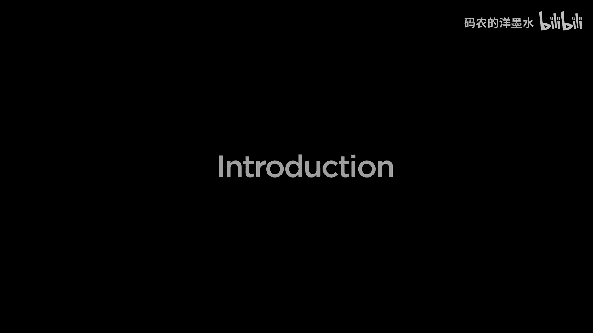
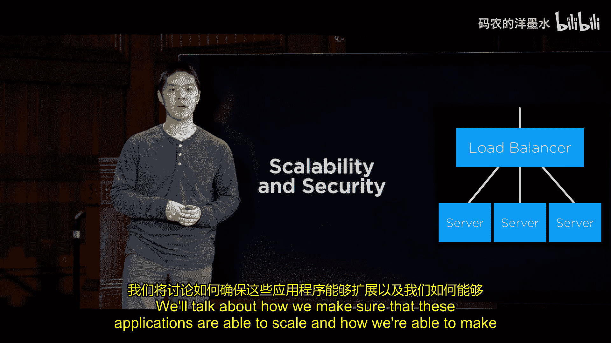
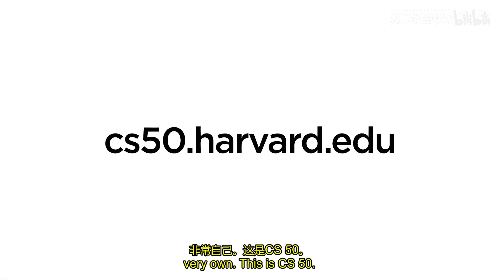

# 001：课程介绍 🎓

在本课程中，我们将学习如何使用Python和JavaScript构建现代Web应用程序。课程将深入探讨Web应用的设计与实现，涵盖HTML、CSS、Python、JavaScript、SQL以及Django、React和Bootstrap等流行框架。

## 课程内容概述

本课程承接CS50导论课，旨在更深入地探索Web编程。我们将从描述网页结构和样式的HTML与CSS开始。

上一节我们介绍了课程的整体目标，本节中我们来看看具体的学习路径。

以下是本课程将涵盖的核心主题：

*   **HTML与CSS**：学习如何构建和美化网页。
*   **Git版本控制**：掌握跟踪代码变更与团队协作的工具。
*   **Python进阶**：探索Python的高级特性，并学习使用**Django**框架创建动态Web应用。
*   **数据库交互**：利用Django的模型和迁移功能，通过**SQL**与数据库交互，创建数据驱动的应用。
*   **JavaScript**：学习使用JavaScript为网页添加动态交互功能，响应用户事件并操作页面内容。
*   **行业最佳实践**：了解测试、持续集成与持续部署，以确保代码质量并快速发布更新。
*   **可扩展性与安全性**：探讨如何将应用部署到网络，并确保其能够应对访问压力和安全威胁。

在学习过程中，你将有机会通过构建自己的Web应用程序来实践所有学到的知识。

## 总结

本节课中我们一起学习了“Web编程与Python和JavaScript”课程的整体框架与学习目标。我们了解到，本课程将从基础的前端技术出发，逐步深入到后端开发、数据库操作、交互逻辑以及部署运维，为我们构建完整、健壮的现代Web应用打下坚实的基础。