# 010：可扩展性与安全性

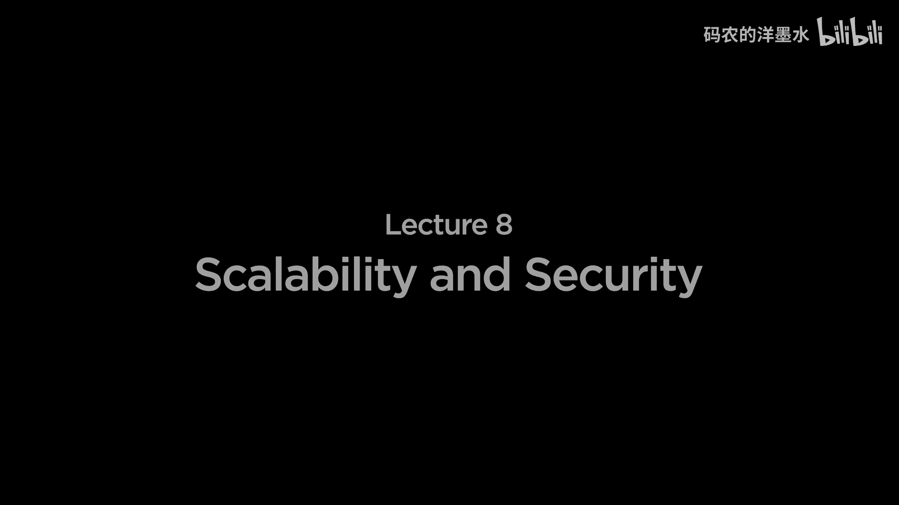

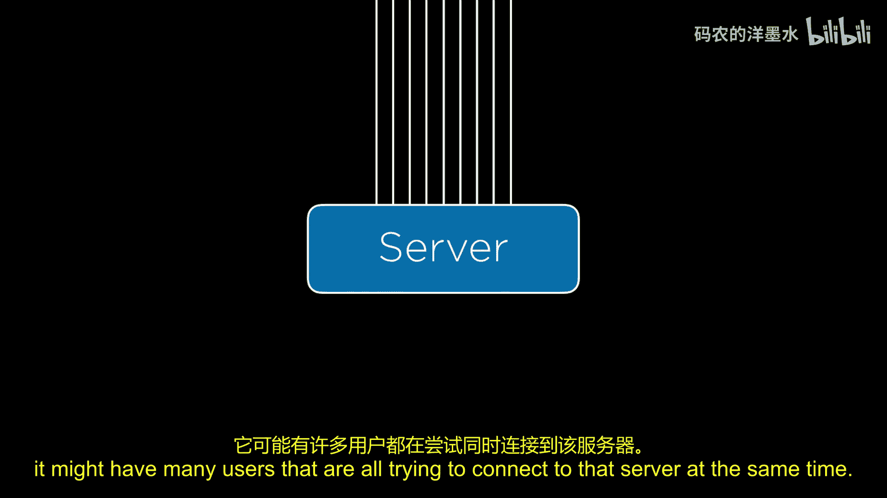

## 概述

在本节课中，我们将探讨Web应用开发中的两个核心议题：可扩展性与安全性。我们将学习如何将本地应用部署到服务器，以应对大量用户访问，并确保应用在面对各种网络威胁时保持安全。

---

## 可扩展性

上一节我们介绍了课程的整体目标，本节中我们来看看如何让Web应用能够服务更多用户。

### 服务器部署

当我们希望将Web应用部署到互联网上供全球用户使用时，需要将其托管在**Web服务器**上。服务器是一台专用的计算机硬件，负责监听并响应传入的网络请求。

目前，服务器主要有两种部署方式：
*   **本地部署**：公司拥有并管理自己的物理服务器，对硬件和软件有完全的控制权。
*   **云部署**：使用亚马逊、谷歌或微软等云服务商提供的服务器。这种方式无需管理物理硬件，并且更容易实现扩展。

### 性能基准测试

一个服务器在同一时间能服务的用户数量是有限的。这取决于服务器的性能以及处理单个请求所需的时间。**基准测试**（例如使用Apache Bench工具）可以帮助我们评估单个服务器的处理能力。

### 垂直扩展与水平扩展

当用户数量超过单台服务器的处理能力时，我们需要进行扩展。

*   **垂直扩展**：升级到更强大、更昂贵的单个服务器。这种方法简单，但存在物理性能上限。
*   **水平扩展**：使用多台服务器共同承担负载。这能有效提升整体处理能力，例如，两台服务器理论上可以服务两倍的用户。

### 负载均衡

在水平扩展架构中，需要一个机制将用户请求分配到不同的服务器上。这个角色由**负载均衡器**承担。

负载均衡器位于服务器集群之前，接收所有用户请求，并根据特定算法将其分发到后端的某台服务器。

以下是几种常见的负载均衡算法：
*   **随机选择**：简单地将请求随机分配给任意服务器。
*   **轮询**：按顺序依次将请求分配给每台服务器。
*   **最少连接数**：将请求分配给当前活跃连接数最少的服务器。

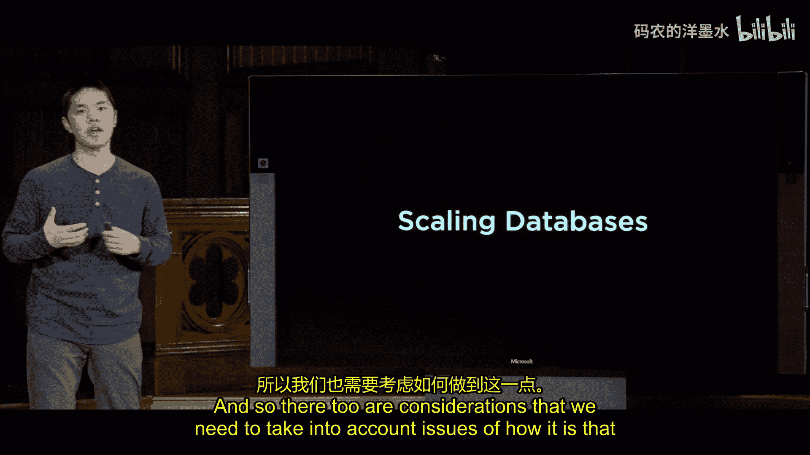

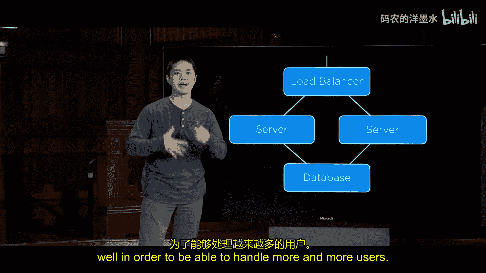

### 会话感知

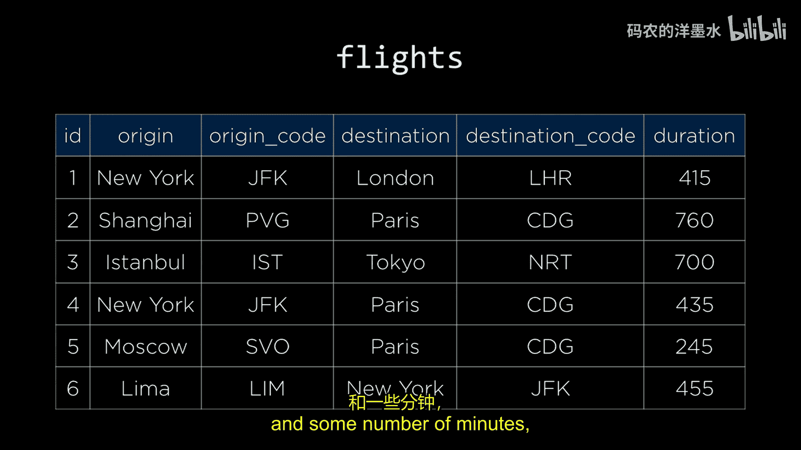

Web应用通常使用**会话**来跟踪用户的登录状态等信息。在负载均衡环境中，如果用户第一次请求被发往服务器A并建立了会话，而第二次请求被发往服务器B，那么服务器B将无法识别该用户，导致需要重新登录。

解决这个问题有以下几种方法：
*   **粘性会话**：负载均衡器记住用户上次访问的服务器，并总是将同一用户的请求发送到那台服务器。缺点是可能导致服务器间负载不均衡。
*   **数据库存储会话**：将所有会话信息存储在共享的数据库中，这样任何服务器都能通过查询数据库来识别用户。
*   **客户端存储会话**：使用加密的Cookie在客户端存储会话信息。需要注意Cookie可能被篡改，且数据量过大会增加网络传输负担。

### 自动扩缩容

用户访问量并非恒定不变。为了经济高效地应对流量波动，可以使用**自动扩缩容**。系统可以根据实时流量，自动增加或减少服务器的数量，在预设的最小和最大服务器数量之间动态调整。

### 避免单点故障

使用多台服务器可以避免**单点故障**——即某个关键组件失效导致整个系统瘫痪。负载均衡器可以通过**心跳检测**定期检查后端服务器的健康状态，一旦发现某台服务器故障，便不再向其分发流量。

值得注意的是，负载均衡器本身也可能成为单点故障。为此，可以部署多个负载均衡器，并设置**热备**机制，当主负载均衡器失效时，备用负载均衡器能立即接管工作。

---

## 数据库扩展

上一节我们讨论了应用服务器的扩展，本节中我们来看看数据存储层如何扩展。

### 数据库分区

随着数据量增长，单个数据库可能成为瓶颈。**数据库分区**是将大型数据集拆分成多个较小部分的技术。

*   **垂直分区**：将一个包含多列的大表拆分成多个关联的小表（即数据库规范化）。例如，将航班信息拆分成“机场”表和“航班”表。
*   **水平分区**：将同一个表的数据按某种规则拆分到多个结构相同的表中。例如，将“航班”表拆分为“国内航班”表和“国际航班”表。这可以提高特定查询的效率，但跨分区联合查询会更复杂。

### 数据库复制

为了防止数据库成为单点故障，并提升读取性能，可以采用**数据库复制**技术。

*   **单主复制**：设置一个**主数据库**用于读写操作，多个**从数据库**仅用于读取操作。任何对主数据库的写入都会同步到所有从数据库。缺点是写入压力仍集中在主数据库上，且主数据库是写入的单点故障。
*   **多主复制**：多个数据库都可以进行读写操作。任何数据库的变更都需要同步到所有其他数据库。这提高了写入能力，但带来了数据同步延迟和**冲突解决**的复杂性（例如更新冲突、唯一性冲突、删除冲突）。

---

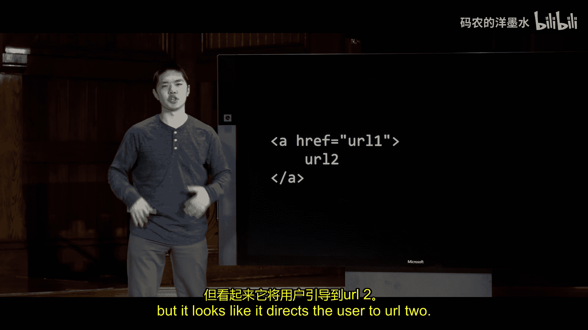

## 缓存

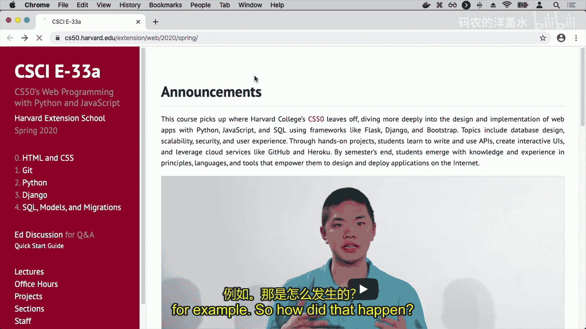

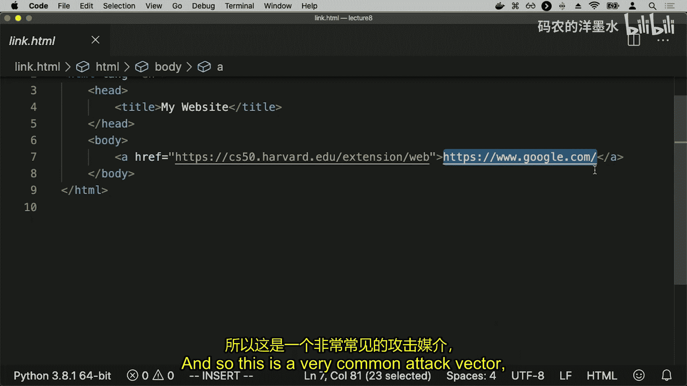

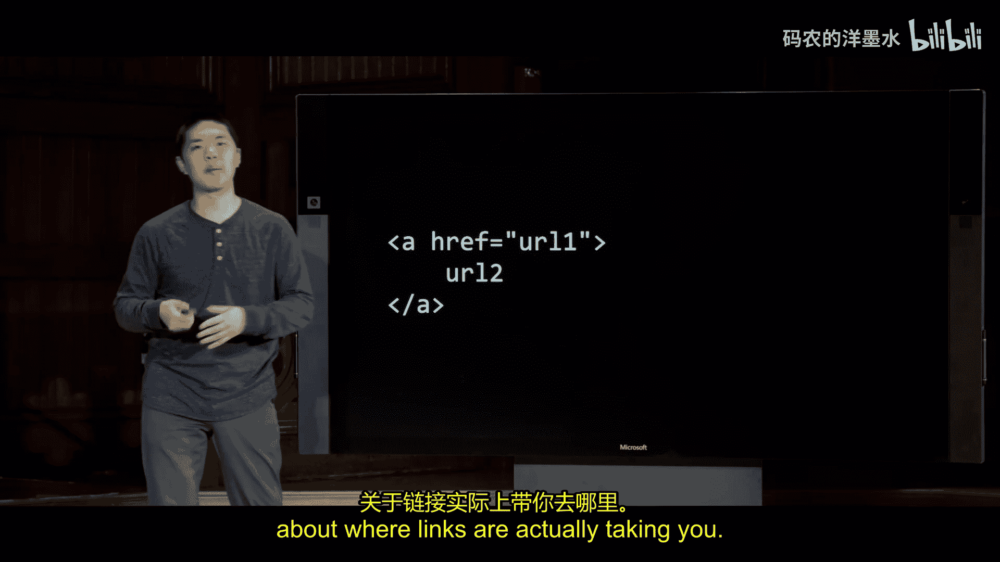

为了进一步减轻数据库和服务器压力，提升响应速度，可以使用**缓存**技术，将常用数据的副本存储在更易访问的位置。

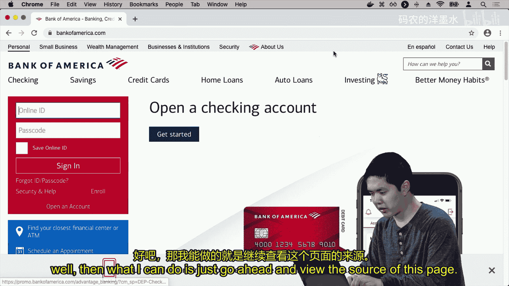

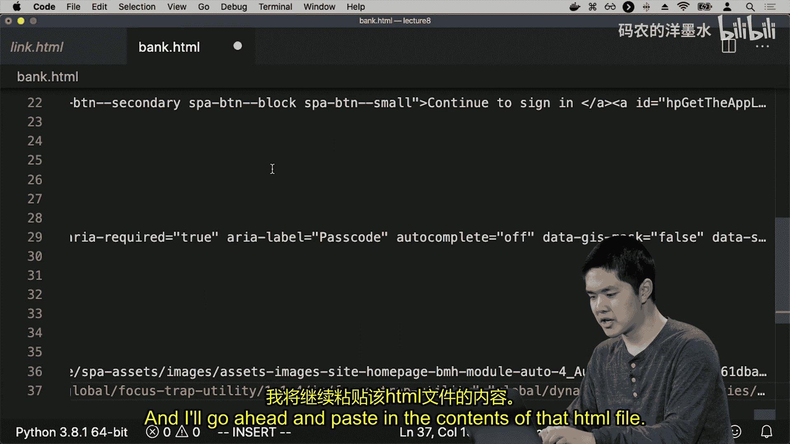

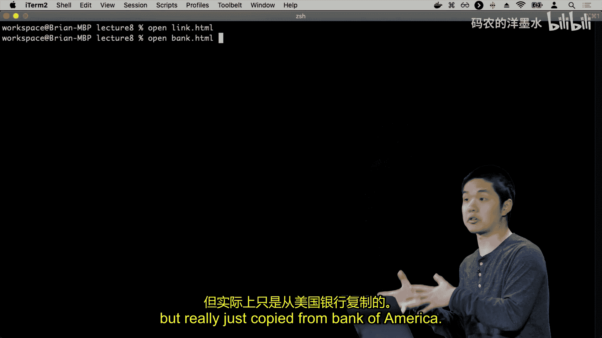

### 客户端缓存

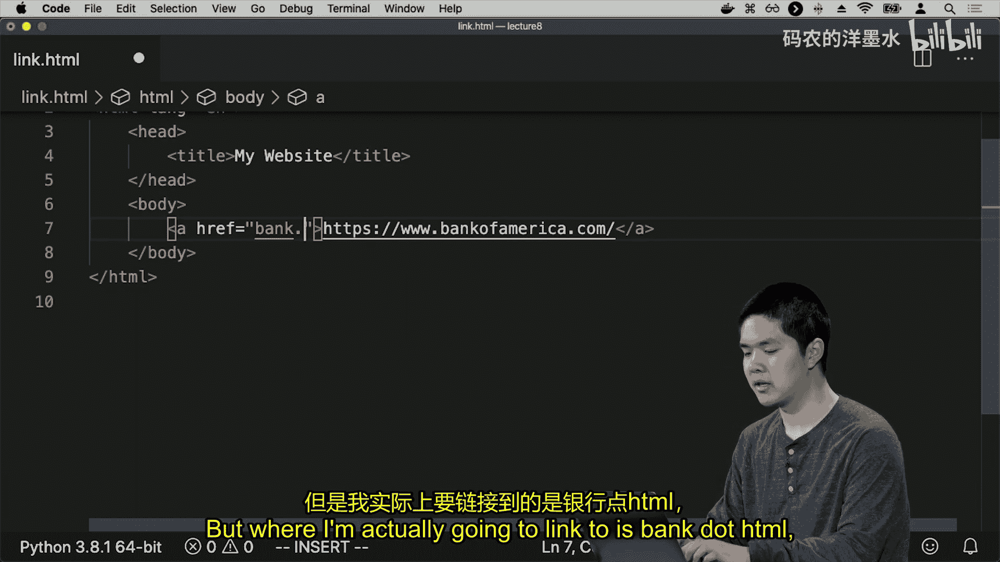

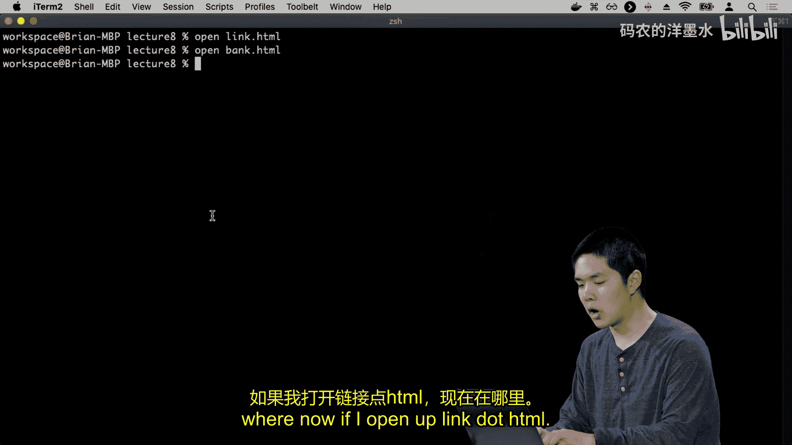

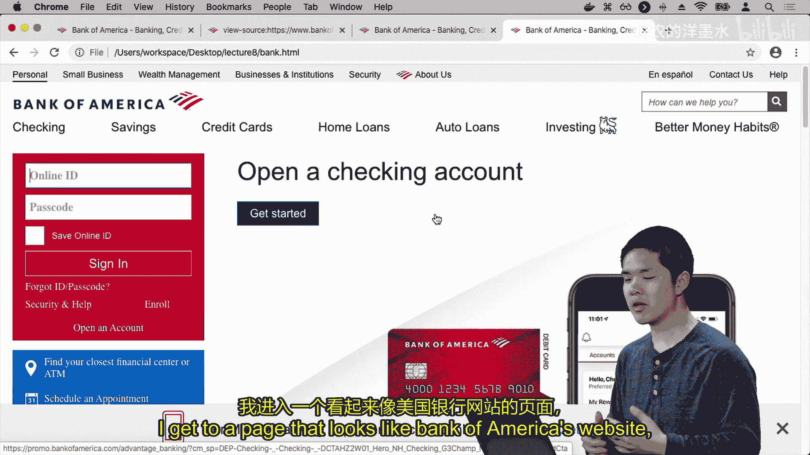

Web浏览器可以缓存静态资源（如图片、CSS、JavaScript文件）甚至整个页面。服务器可以通过HTTP响应头控制缓存行为：

*   **Cache-Control**: 例如 `Cache-Control: max-age=86400` 指示浏览器将该资源缓存86400秒。
*   **ETag**: 服务器为每个资源版本生成一个唯一标识符（ETag）。浏览器再次请求时，可先询问ETag是否变化，若无变化则直接使用缓存，避免重新下载整个资源。

### 服务器端缓存

在服务器端，可以引入缓存系统（如Redis、Memcached）。Django提供了缓存框架，支持多种缓存策略：
*   **视图缓存**：缓存整个视图函数的输出。
*   **模板片段缓存**：缓存模板中某个部分的渲染结果。
*   **低级缓存API**：允许编程式地将任何昂贵计算或查询的结果存储到缓存中。

---

## 安全性

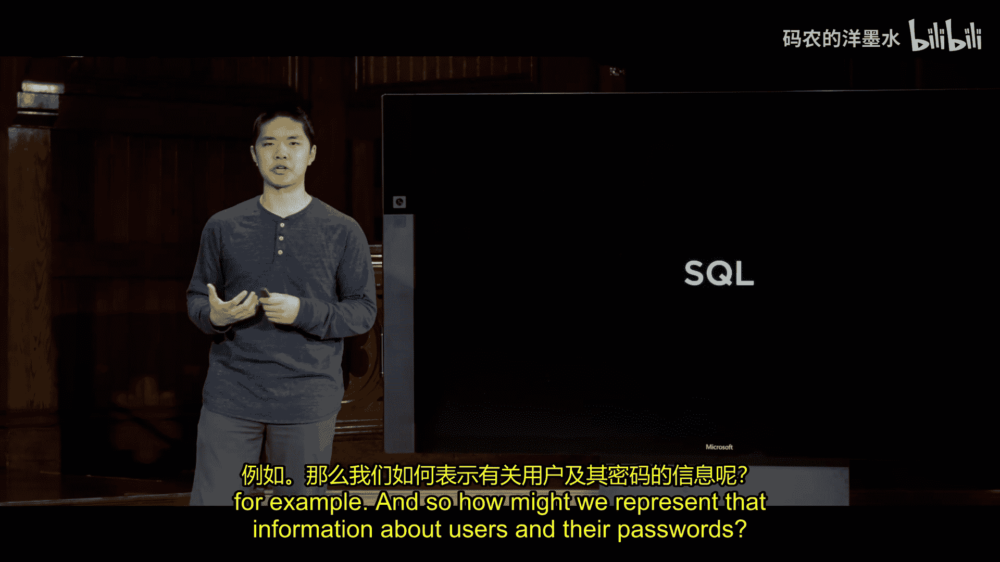

上一节我们探讨了如何让应用支撑更大规模，本节中我们来看看如何保护应用免受攻击。

### 源代码安全（Git）

在使用Git进行版本控制时，务必注意：
*   切勿将密码、API密钥等**敏感凭证**提交到代码仓库。因为Git会保存所有历史记录，即使后续提交中删除了凭证，攻击者仍可从历史记录中恢复它们。

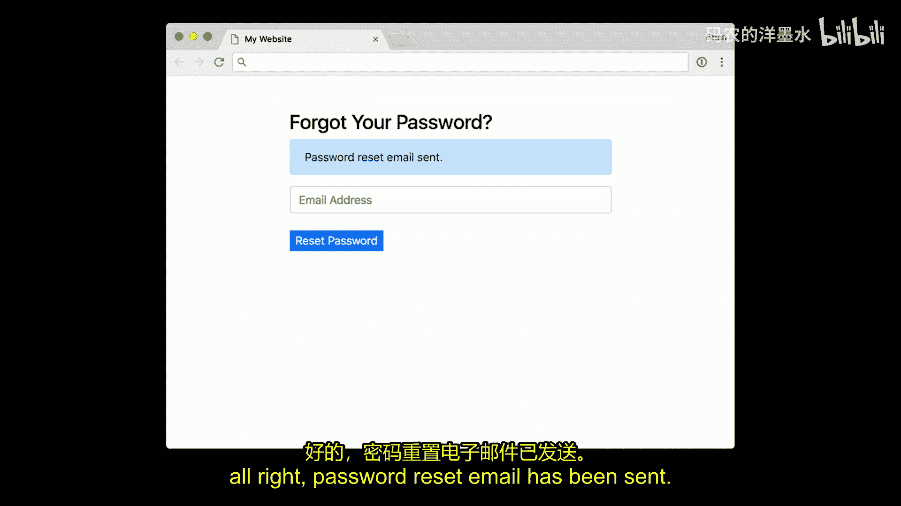

### HTML安全

*   **网络钓鱼攻击**：攻击者可能创建看似指向合法网站（如`google.com`）的链接，但实际上指向恶意网站。用户应养成悬停查看链接真实地址的习惯。
*   **页面克隆**：由于HTML是公开的，攻击者可以轻易复制一个网站的HTML代码，创建外观一模一样的钓鱼网站来欺骗用户。

### 通信安全（HTTPS与加密）

互联网通信需要加密以防止窃听。
*   **对称加密**：通信双方使用同一个密钥进行加密和解密。问题在于如何安全地交换这个密钥。
*   **非对称加密（公钥加密）**：使用一对密钥：**公钥**（公开，用于加密）和**私钥**（保密，用于解密）。服务器将其公钥发给客户端，客户端用该公钥加密信息，只有拥有对应私钥的服务器才能解密。HTTPS协议即基于此原理建立安全连接。

### 数据存储安全

*   **密码存储**：绝对不应以明文存储用户密码。应使用**哈希函数**（如bcrypt、Argon2）对密码进行单向哈希处理，只存储哈希值。登录时，对比输入密码的哈希值与存储的哈希值。
*   **信息泄露**：即使是错误信息也可能泄露敏感数据。例如，“密码重置”功能若提示“该邮箱未注册”，就会暴露哪些邮箱在系统内存在账户。

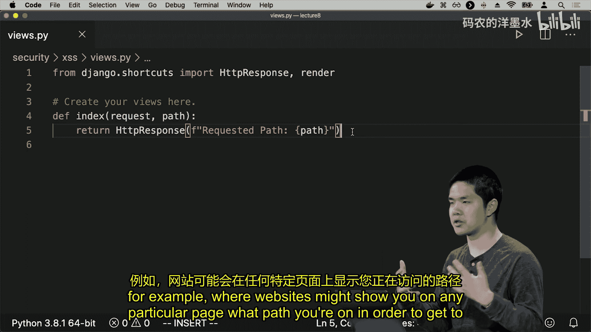

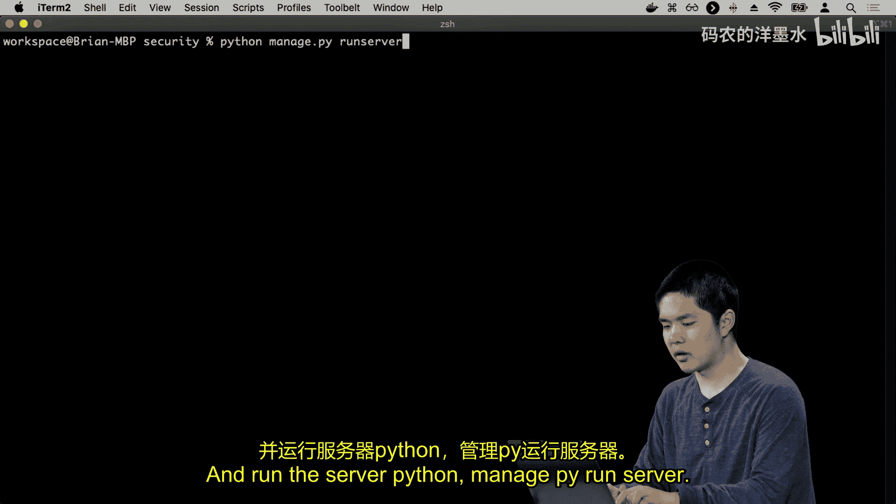

### SQL注入

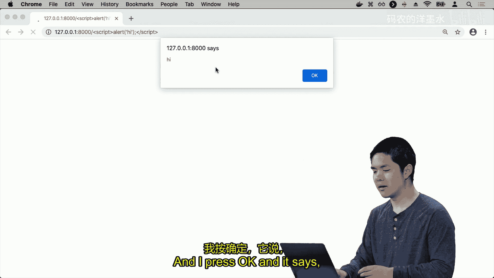

这是一种通过用户输入在SQL查询中注入恶意代码的攻击。例如，在登录表单中输入 `hacker'--`，可能构造出绕过密码检查的查询。
**防御方法**：使用参数化查询或ORM（如Django的模型），它们会自动对用户输入进行转义。

### API安全

*   **速率限制**：防止用户通过大量请求发动**拒绝服务攻击**。
*   **身份验证**：使用API密钥来验证请求者身份。API密钥不应硬编码在源代码中，而应通过**环境变量**进行配置。

### 客户端安全（JavaScript）

*   **跨站脚本攻击**：攻击者向网站注入恶意JavaScript代码，当其他用户浏览该页面时，代码会在其浏览器中执行。例如，通过URL参数注入 ``。
    **防御方法**：对用户提交的内容进行适当的转义和过滤。
*   **跨站请求伪造**：攻击者诱使用户在不知情的情况下向目标网站（如银行）提交恶意请求（如转账）。
    **防御方法**：
    1.  对改变系统状态的操作（如转账）使用POST请求而非GET请求。
    2.  使用**CSRF令牌**：服务器在表单中嵌入一个随会话变化的令牌，提交请求时必须验证该令牌，第三方网站无法伪造此令牌。

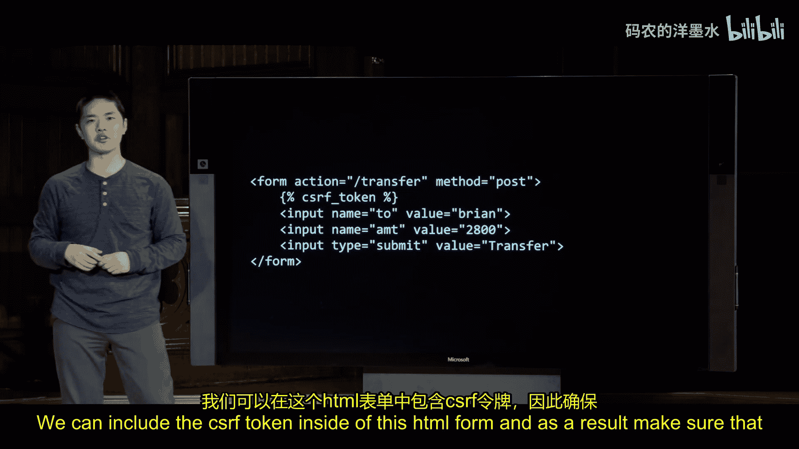

---

## 总结与展望

本节课中我们一起学习了Web应用的可扩展性与安全性核心概念。

*   **可扩展性**涉及通过负载均衡、数据库复制与分区、缓存等技术，构建能够应对高并发访问的稳健架构。
*   **安全性**是一个贯穿始终的主题，我们需要在代码管理、用户输入处理、数据存储、通信加密等各个环节保持警惕，防范SQL注入、XSS、CSRF等常见攻击。

Web开发领域广阔，除了我们学习的Django（Python）和React，还有许多其他优秀的服务端框架（如Express.js、Ruby on Rails）和客户端框架（如Angular、Vue）。在部署方面，可以选择Heroku、AWS、Google Cloud、Azure或GitHub Pages等服务。

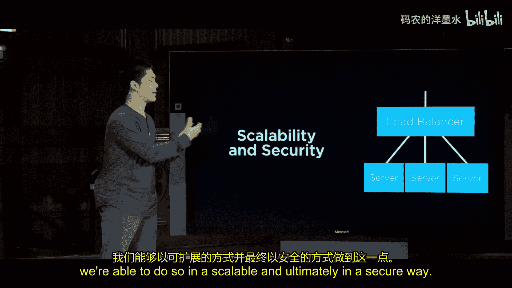

回顾本课程，我们从HTML/CSS、Git、Python基础开始，深入学习了Django Web框架、数据库模型、JavaScript、DOM操作、React框架，并了解了测试、CI/CD以及可扩展性与安全性等最佳实践。希望这些知识能帮助你构建出强大、安全且可扩展的Web应用。