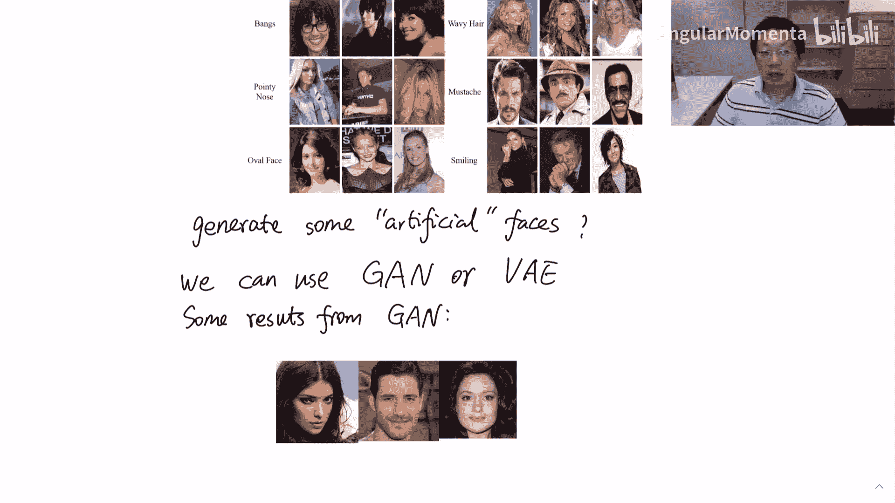

数据分析的数学方法：01：课程概述与机器学习任务简介 🎯

在本节课中，我们将学习数据分析的数学方法课程的整体介绍，并了解机器学习中几种典型任务的基本概念。

大家好，欢迎来到MSP D 5004数据分析的数学方法课程。我是蔡建方，来自香港科技大学数学系，是本课程的讲师。本课程是关于数据分析的数学方法，这是一个相当广泛的主题，因此在接下来的八周内，我们不可能涵盖所有内容。我们将主要关注机器学习的数学工具。

为此，我首先想概述一下机器学习中会涉及哪些数学工具。让我从典型的机器学习任务开始介绍。

**监督学习**

首先讨论的机器学习任务是监督学习。在监督学习中，我们获得一个以输入-输出对形式存在的训练数据集：`(X_i, Y_i)`。我们有许多对数据，因此 `i` 的取值范围是从 `1` 到 `M`。这里的 `X_i` 是输入，它代表某种特征，可以有许多不同的形式，例如向量、矩阵，甚至是一段文本。`Y_i` 是对应的输出，或称为输入的标签，它也可以是许多不同的形式，例如二进制值、实数等。

有了这个训练数据集，我们的目标就是找到输入和输出之间的关系。从数学的角度来看，我们希望找到一个函数 `F`，来反映输入和输出之间的关系。从数学上讲，这个函数 `F` 应满足 `F(X_i)` 约等于 `Y_i` 对所有 `i` 成立。一旦我们找到了这样的函数 `F`，当有新的特征输入 `X` 出现时，我们就可以使用 `F(X)` 作为对 `X` 标签的预测。这是一个典型的监督学习任务，这个问题被称为拟合问题。

现在，让我展示一个监督学习的具体例子：手写数字识别。识别任务中的训练数据集如图所示。输入是手写数字的图像，例如这张图像是 `X_1`，这张图像是 `X_2`，依此类推。对应的 `Y_i` 是图像中所包含数字的识别结果。例如，这里的 `Y_1` 是 `5`，因为显然这张图像中包含数字五；`Y_2` 是 `2`，因为显然这张图像中包含数字二。从这个数据集中，我们可以看到有20个输入-输出对，因此在这个例子中，`M` 等于 `20`。

我们的目标是找到一个从图像到数字（即标签）的映射。我们需要找到一个函数 `F`，使得该函数应用于图像时等于其标签。更严格地说，我们希望 `F(X_i)` 约等于 `Y_i` 对所有 `i` 成立。给定一张新图像，我们只需将推导出的函数应用于该图像，即可获得该图像中包含的数字。例如，如果给定这张图像，那么我们使用 `F(这张图像)` 作为识别出的该图像中包含的数字。

**无监督学习**

现在我们来讨论另一个机器学习任务：无监督学习。在无监督学习中，我们只获得输入数据 `X_i`，而没有标签。因此，无监督学习比监督学习更具挑战性。无监督学习的目标可能因不同应用而大不相同。例如，我们可能需要从这些 `X_i` 中找到共同特征或一些本质参数。如果出现这种情况，这个问题被称为降维。

现在，让我再次展示一个关于手写数字的具体应用问题。这些是 `X_i`，我们获得了16张与前面例子类似的图像，但没有标签。我们的目标是找出哪些图片包含相同的数字。这个问题非常具有挑战性。如果你仔细观察这些图像，可能会注意到第一张图像显示的是数字 `5`，但这个数字 `5` 非常接近数字 `3`。最后一张图像是数字 `7`，但它也非常接近数字 `1`。这个问题可以通过聚类来解决。

让我展示另一个例子。我们获得了一些人脸的图片，如图所示。这些面孔再次用 `X_i` 表示，`i` 的取值范围是从 `1` 到 `M`。那么问题是，如何生成一些人工面孔？如何做到这一点？实际上，这是一个典型的计算机图形学问题。首先，我们希望从这些已知的图片、这些已知的人脸中找到一些共同特征。然后，我们可以利用这些共同特征来生成不属于任何真实人物的面孔。我们能做到吗？答案当然是肯定的。实际上，我们可以使用所谓的生成对抗网络或变分自编码器来生成这些人工面孔。

生成对抗网络和变分自编码器背后的思想如下：首先，我们从这些图片中学习一些参数；然后，我们使用这些参数来重新生成一些新面孔。这里我展示一些来自生成对抗网络的结果。你可以看到，这三张面孔都是完美的人工面孔。

这三个例子是机器学习中三个典型的问题，你应该对此非常熟悉。

**总结**

本节课中，我们一起学习了数据分析数学方法课程的总体介绍，并探讨了监督学习和无监督学习这两种核心机器学习任务的基本框架。我们通过手写数字识别和人脸生成的例子，具体理解了如何用数学函数 `F` 来建模输入与输出的关系，以及在无标签数据中寻找特征和生成新数据的方法。这些概念为后续深入学习具体的数学工具奠定了基础。