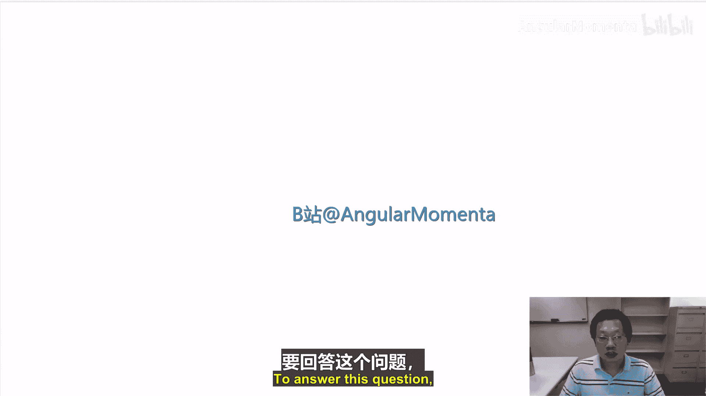
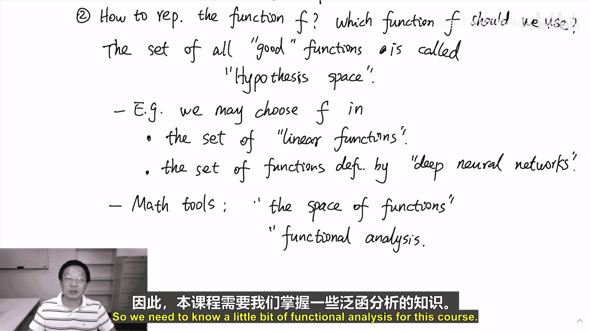

# 002：机器学习中的数学工具 🧮

在本节课中，我们将要学习机器学习中涉及哪些类型的数学。为了回答这个问题，我们首先需要对“什么是机器学习”有一个概括性的了解。

上一节我们介绍了机器学习的基本概念，本节中我们来看看其背后的数学基础。根据Pedro Domingos在2012年发表于《ACM通讯》的论文《关于机器学习需要了解的一些有用知识》，机器学习可以被总结为一个公式：

**学习 = 表示 + 评估 + 优化**

即 **Learning = Representation + Evaluation + Optimization**。

该论文对此公式有详细的阐述。为了理解这个公式，让我们回顾之前的三个例子，看看它具体意味着什么。

## 表示

首先，我们需要表示输入数据 **X**。如何表示输入数据 **X_i** 呢？

以下是几个例子：

*   **图像**：在之前的三个例子中，输入数据 **X_i** 都是图像。对于图像，我们可以用矩阵来很好地表示它。矩阵中的每个元素对应图像中的一个像素。
    *   **数学工具**：矩阵
    *   **对应关系**：矩阵元素 ↔ 图像像素
*   **股票价格**：在某些应用中，输入数据可能是股票价格。这时，我们可以使用向量来表示，向量的每个元素代表特定时间点的股价。
    *   **数学工具**：向量
    *   **对应关系**：向量元素 ↔ 特定时间股价
*   **网页链接**：例如在谷歌的网页排名中，我们需要建模不同网页之间的链接关系。我们可以使用图来表示，其中每个节点代表一个网页，每条边代表一个超链接。
    *   **数学工具**：图
    *   **对应关系**：节点 ↔ 网页，边 ↔ 超链接

从这部分可以看出，为了操作矩阵、向量和图，我们需要相应的数学工具：对于矩阵和向量，我们需要**线性代数**；对于图，我们需要**图论**。有时，我们也会使用流形上的元素来表示输入数据，这需要一些**流形**相关的知识。

## 假设空间

在监督学习中，我们需要表示的另一个东西是函数 **F**。如何表示这个函数 **F** 呢？

一个函数可能过于任意。在实分析中，存在许多行为奇特、高度不可预测的函数。然而，在监督学习中，我们需要进行预测，显然不应该使用这类函数。为了做好预测，我们需要使用行为完全可预测的特殊函数。

因此，在监督学习中，我们寻找的函数 **F** 不能是任意的，它必须是“足够好”的。我们需要定义：对于我们的监督学习任务，什么样的函数是好的？我们需要对函数进行约束，并定义所有我们希望使用的“好函数”的集合，这被称为**假设空间**。

我们必须很好地定义假设空间，并将那些非常不规则的函数排除在外。

以下是假设空间的例子：

*   **线性函数**：在高维机器学习问题中，我们可能假设 **F** 是一个线性函数，因为线性函数的行为是完全可预测的。此时，假设空间就是所有线性函数的集合。这是我们可以使用的最简单的假设空间。
*   **深度神经网络**：深度学习中，我们使用可以由深度神经网络表示的所有函数作为假设空间。换句话说，我们通过人工神经网络来参数化函数。

从这部分可以看出，这里涉及的数学工具是处理函数集合，例如所有线性函数的集合、由深度神经网络表示的函数的集合。在数学中，这属于**泛函分析**的范畴。因此，在本课程中，我们需要了解一些泛函分析的知识。

本节课中我们一起学习了机器学习核心公式的三个组成部分之一——“表示”所涉及的数学工具，包括线性代数、图论和泛函分析的基本概念。下一节我们将继续探讨“评估”与“优化”部分所需的数学方法。