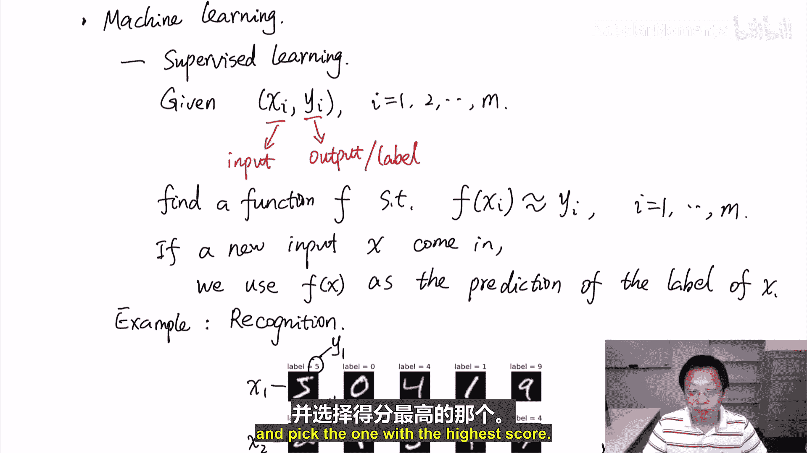
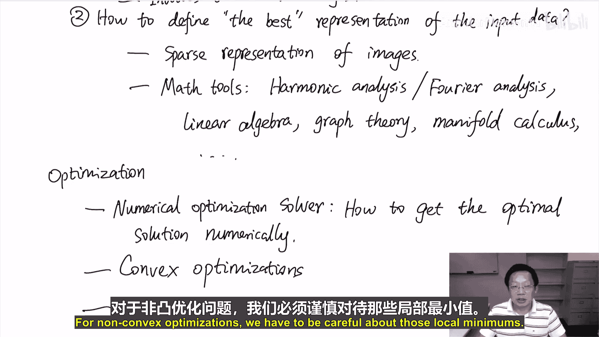

# 003：机器学习中的评估与优化 🧮

在本节课中，我们将要学习机器学习流程中的第二个核心环节——**评估**。上一节我们介绍了如何为函数选择合适的表示方法，本节中我们来看看如何从假设空间中选出最适合当前任务的函数。这个过程被称为评估，它是我们机器学习定义公式中的第二个关键要素。

## 评估的定义与目标

一旦我们在假设空间中有了函数的合适表示，就需要确定哪个函数最能拟合我们的机器学习任务。这个过程就是评估。

在评估中，我们需要定义：谁是假设空间中的最佳函数？或者说，如何定义假设空间中的最佳函数？

例如，在监督学习中，我们希望找到一个函数 **F**，使得 **F(X_i) ≈ y_i**。对于假设空间中的每个函数，我们需要评估它是否足够好地拟合给定的数据。为此，我们为假设空间中的每个函数定义一个分数，然后选择分数最高的那个。

这就是所谓的评估。

## 评估的数学形式

更一般地说，对于假设空间中的每个函数，我们需要为其定义一个分数。

从数学上讲，我们需要定义一个从假设空间中的函数到一个数字的映射。这个函数将一个假设空间中的函数映射为一个数字，这个数字就是该函数的评估分数。然后，我们只需选择假设空间中分数最高的函数作为我们机器学习任务的最佳函数。

可以看到，这里我们需要定义一个以函数为变量的函数。在数学上，我们称这样的东西为**泛函**。因此，这里涉及的数学是研究函数的函数，即**泛函分析**。

## 评估中的领域知识

评估阶段也涉及大量的领域知识。例如：
*   如果机器学习问题来自生物学，我们需要一些生物学知识来定义泛函。
*   如果问题来自计算机视觉，我们需要一些计算机视觉知识来定义泛函。
*   如果问题来自语音识别，我们需要一些关于语言的知识。

在这一部分，领域知识可能占主导地位。统计学也可能在这里被使用。

以上是监督学习中函数的评估。在许多其他情况下，我们还需要评估输入数据的表示。

## 输入数据表示的评估

这里的核心问题是：什么是输入数据的最佳表示？如何定义输入数据的最佳表示？

这个问题在无监督学习中经常出现，因为在无监督学习中，我们只被给予输入数据，并且希望给出输入数据的一个良好摘要。在这种情况下，我们需要找到输入数据的最佳表示。

以下是几个例子：
*   **稀疏表示**：对于图像数据，一种表示是所谓的稀疏表示。基本思想是我们在某个变换域中表示图像，并且在变换域中系数是稀疏的。为了找到输入图像的最佳稀疏近似，我们需要评估所有稀疏向量，并选出最好的一个。
*   **涉及的数学工具**：在稀疏近似中，图像在变换域中是稀疏的。因此，我们需要研究变换，如傅里叶变换、离散余弦变换等，这些与应用调和分析或傅里叶分析有关。其他涉及的数学工具还包括线性代数、图论、流形理论、微积分等。

## 从评估到优化

在评估中，我们的目标是从假设空间中挑选出最佳的可能函数来拟合给定数据，或者挑选出输入数据的最佳可能表示。下一步就是通过数值方法找出这个最佳的可能函数或表示。

这是通过**数值优化**来完成的。具体来说，我们需要最小化泛函，需要一个数值求解器来数值地获得最优解。

## 优化问题的类型

如何数值地获得最优解？机器学习中的许多优化问题是凸优化，尤其是在早期阶段。对于凸优化，局部最小值就是全局最小值，因此我们不需要担心局部最小值问题。

但如今，非凸优化变得越来越重要。例如，在深度学习中，深度神经网络的训练自然会产生非凸优化问题。对于非凸优化，我们必须小心那些局部最小值。

## 总结

本节课中我们一起学习了机器学习中的评估与优化环节。我们了解到，评估是为假设空间中的函数或数据表示定义分数以选出最佳方案的过程，其数学基础是泛函分析，并高度依赖领域知识。随后，寻找这个最佳方案的过程转化为一个优化问题，可能涉及凸优化或更复杂的非凸优化。理解评估与优化，是连接理论模型与实际应用的关键桥梁。