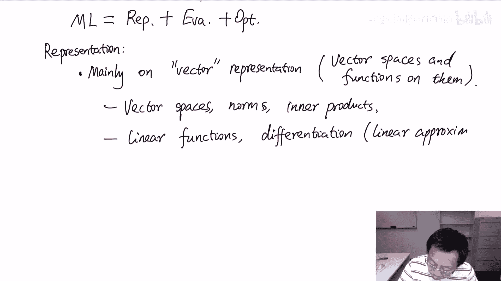
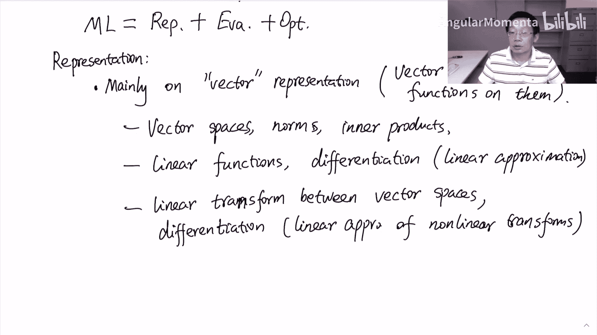
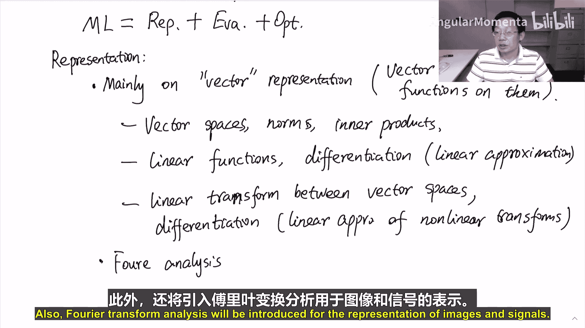
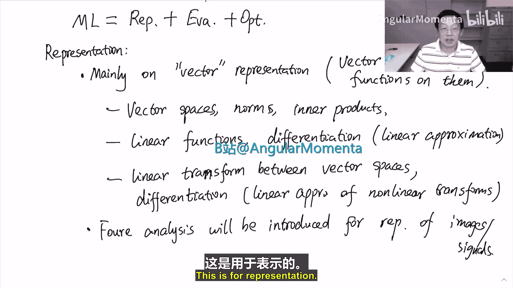
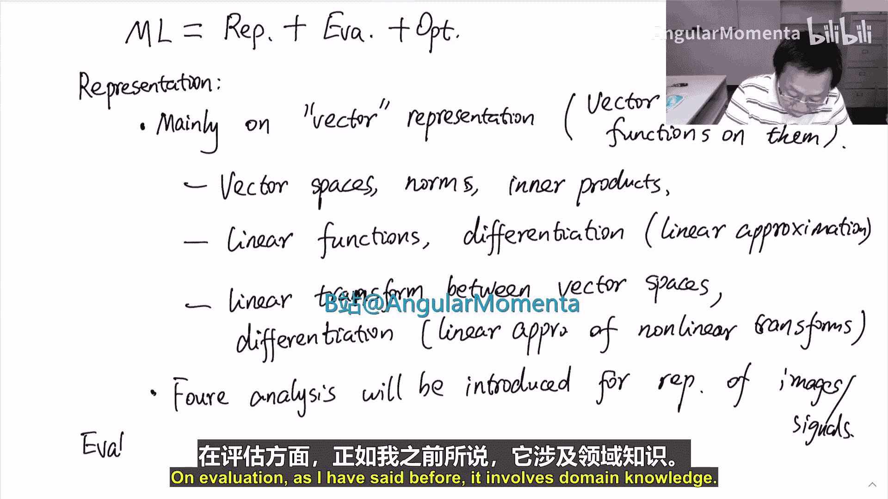
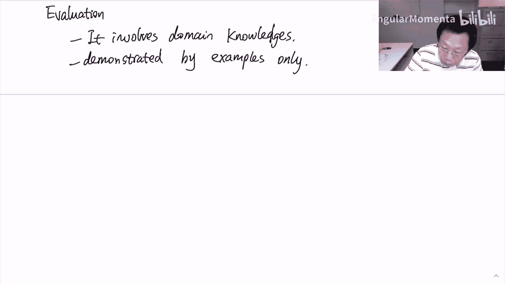
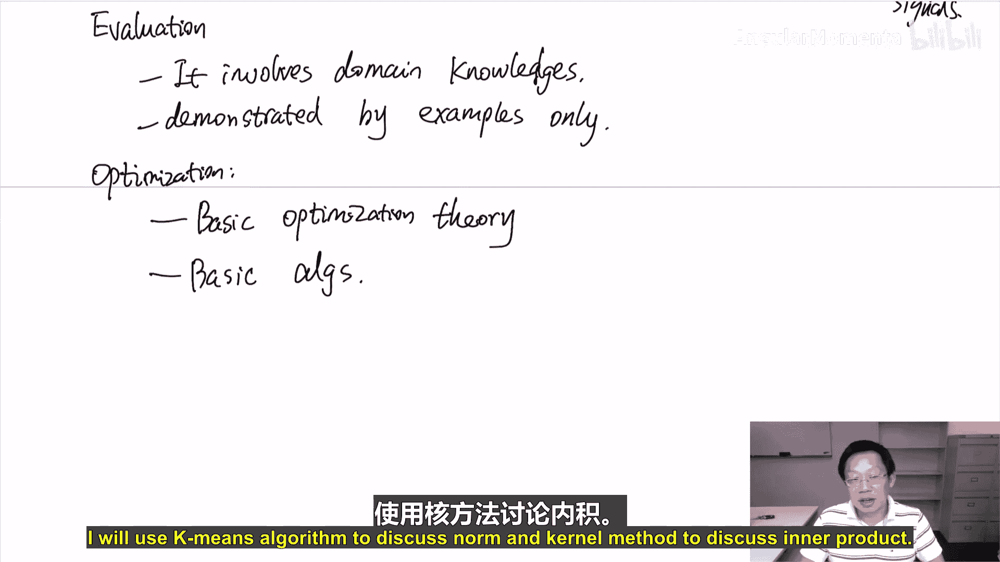

# 004：课程内容概览 📚

在本节课中，我们将要学习本课程的整体框架和核心内容。课程将围绕机器学习的基本公式展开，并介绍支撑该公式所需的数学工具。

---

## 表示、评估与优化

到目前为止，你可能已经注意到机器学习涉及许多数学工具。由于时间限制，我们只能讨论其中的一部分。具体而言，本课程将遵循我们的机器学习公式：**表示 + 评估 + 优化**。

上一节我们介绍了课程的整体框架，本节中我们来看看每个部分具体包含哪些数学内容。

### 表示部分

在表示部分，我们将主要关注向量表示。这意味着我们需要研究向量空间及其上的函数。

以下是表示部分将涵盖的核心数学概念：

*   **向量空间及其上的函数**：这是数据表示的基础。
*   **多元微积分和基础泛函分析**：例如向量空间、范数、内积。
*   **向量空间上的函数**：包括线性函数，以及非线性函数的线性近似（即微分）。
    
*   **线性变换**：向量空间之间的线性映射，以及非线性变换的线性近似（即雅可比矩阵）。
    
*   **傅里叶分析**：将引入用于图像和信号表示。
    

以上内容构成了机器学习中的**表示**环节。

### 评估部分

在评估部分，正如之前所说，它涉及领域知识，内容非常广泛。

因此，评估阶段将主要通过示例来演示。

### 优化部分

在优化部分，我们将讨论一些基础的优化理论和基本算法。

---

## 课程学习方式

以上是将在本课程中讨论的所有主题。所有这些概念都将在可能的情况下，置于机器学习的背景下进行演示。

以下是两个具体的例子：

*   我将使用 **K-means算法** 来讨论**范数**的概念。
*   我将使用**核方法** 来讨论**内积**的概念。
    

---

本节课中我们一起学习了本课程的核心结构，它围绕“表示、评估、优化”的机器学习公式构建。我们概述了表示部分将重点学习的向量空间、微积分、线性变换等数学工具，并了解了评估与优化部分的基本学习方式。后续课程将把这些数学概念与具体的机器学习算法相结合进行讲解。