数据分析的数学方法：第2章：向量空间、度量与极限收敛

在本节课中，我们将学习向量空间、度量以及极限与收敛的基本概念。这些是数据分析中理解数据结构和算法行为的基础。

---

### 向量空间的定义 📖

上一节我们介绍了课程的整体框架，本节中我们来看看向量空间。向量空间也被称为线性空间。在微积分中，你可能已经学习过欧几里得空间。这里，我们将其推广到一般的向量空间。

首先给出向量空间的定义。要定义一个向量空间，必须指定其所在的域。在本课程中，我们主要讨论实数域上的向量空间。我们用 **R** 表示所有实数的集合，即实数域。

一个定义在实数域 **R** 上的向量空间，是一个集合 **V**。这个集合 **V** 可以是任何元素的集合。为了赋予 **V** 中的元素一个线性结构，我们定义两种运算。

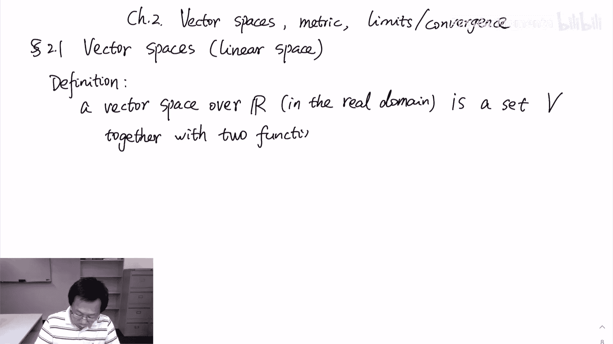

第一种运算是**向量加法**。它需要两个 **V** 中的元素，并将它们映射到 **V** 中的一个新元素。用公式表示如下：

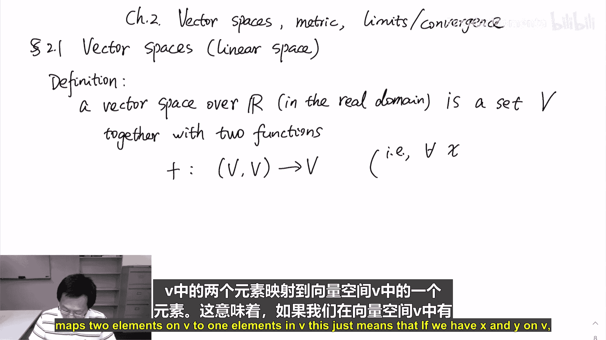

这意味着，如果 **x** 和 **y** 属于 **V**，那么它们的和 **x + y** 也必须属于 **V**。

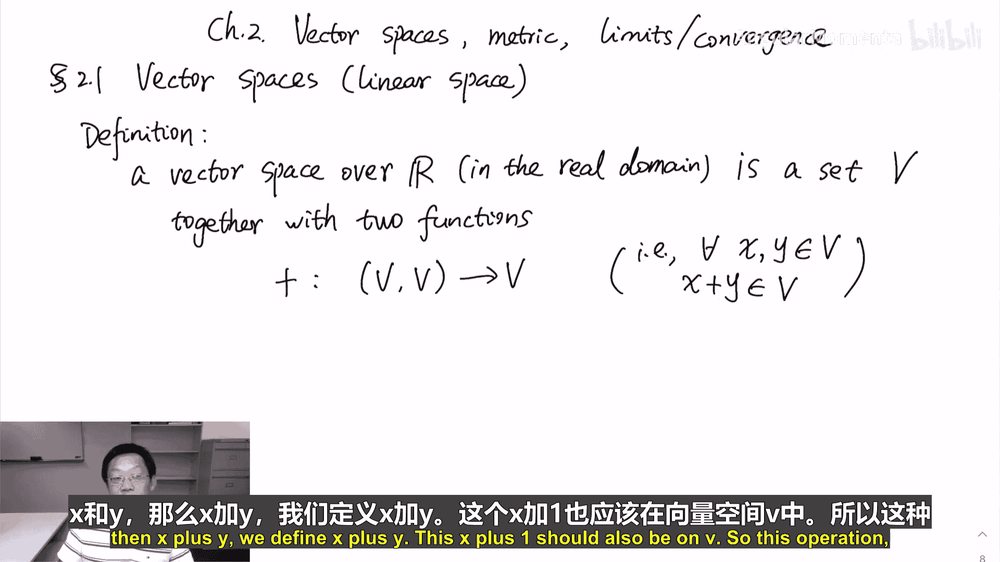

第二种运算是**标量乘法**。它需要一个实数和一个 **V** 中的元素，并将它们映射到 **V** 中的一个新元素。用公式表示如下：

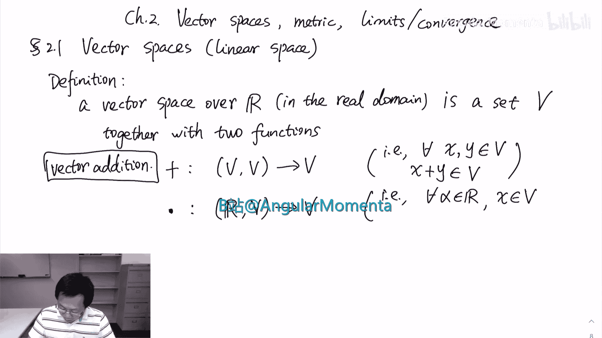

这意味着，如果 **α** 是一个实数，**x** 是 **V** 中的一个元素，那么 **α · x** 也必须是 **V** 中的一个元素。

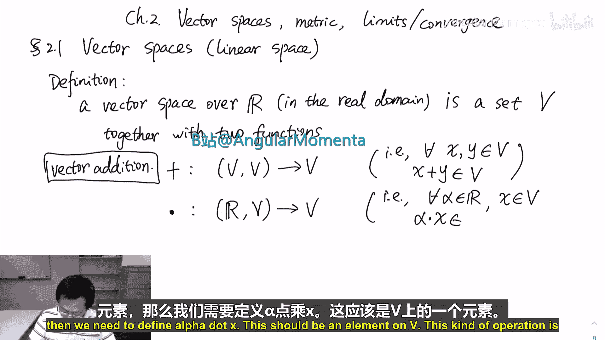

### 向量空间的条件 ✅

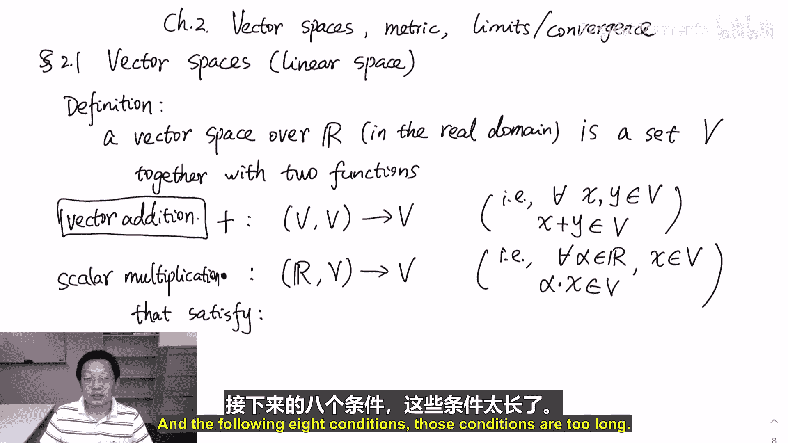

为了使集合 **V** 与这两种运算构成一个真正的线性空间，它们必须满足以下八个公理条件：

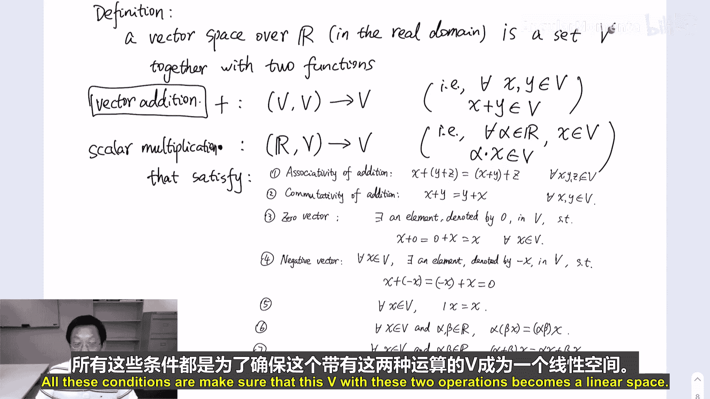

这些条件确保了 **V** 具有一个良好的线性结构。一旦集合 **V** 具备了这种线性结构，我们就可以对其中的元素定义线性组合，并且这些线性组合会满足非常好的性质，例如加法的结合律、交换律等。

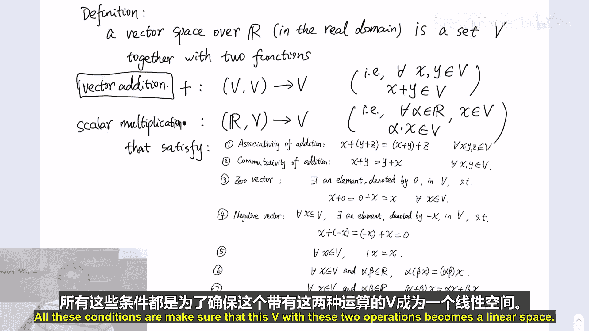

总而言之，一个向量空间就是一个配备了加法和标量乘法运算的集合，这些运算使得该集合具有线性性质。它本质上是欧几里得空间的一种推广。

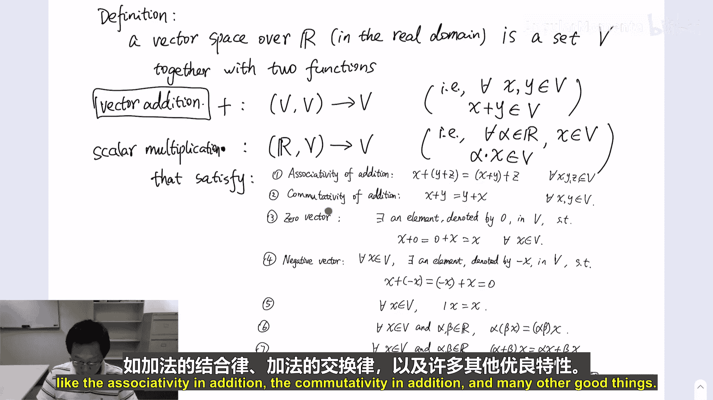

### 重要说明 💡

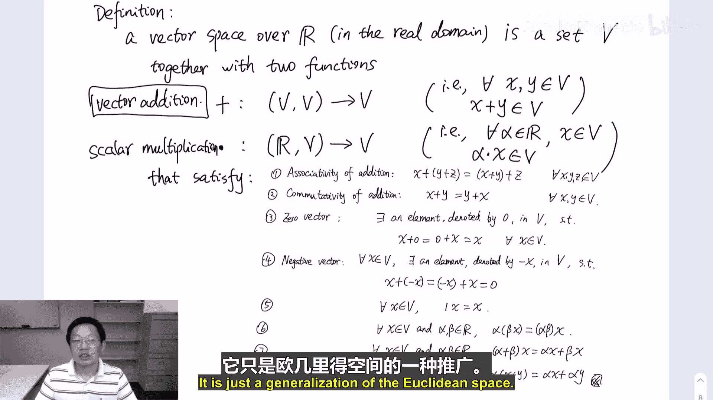

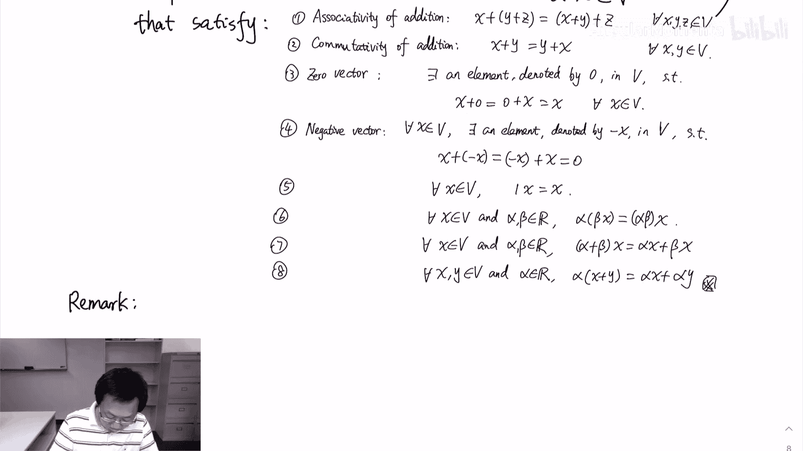

关于这个定义，我想做一个重要的说明。在这个定义中，我们定义了实数域上的向量空间。实际上，这个定义可以扩展到复数域上的向量空间。

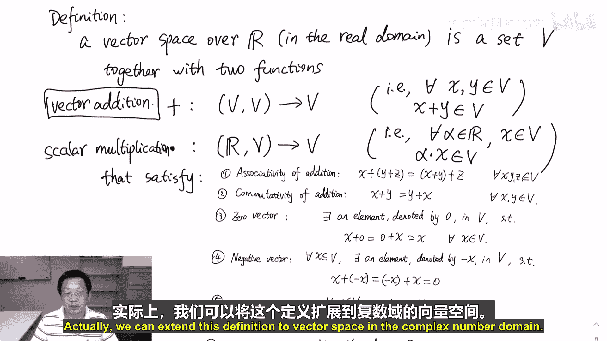

然而，在机器学习中，我们处理的数据通常都在实数域内。因此，在不特别说明的情况下，默认情况下当我们提到“向量空间”时，我们指的是实数域上的向量空间。

---

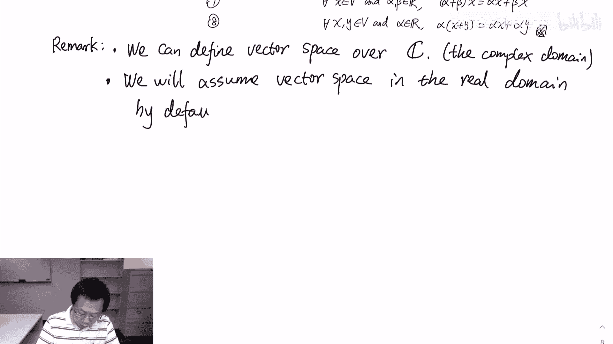

本节课中我们一起学习了向量空间的基本定义、构成它的两种核心运算（向量加法和标量乘法），以及使其成为线性空间所必须满足的公理条件。理解向量空间是学习后续度量、极限和收敛概念的重要基础。