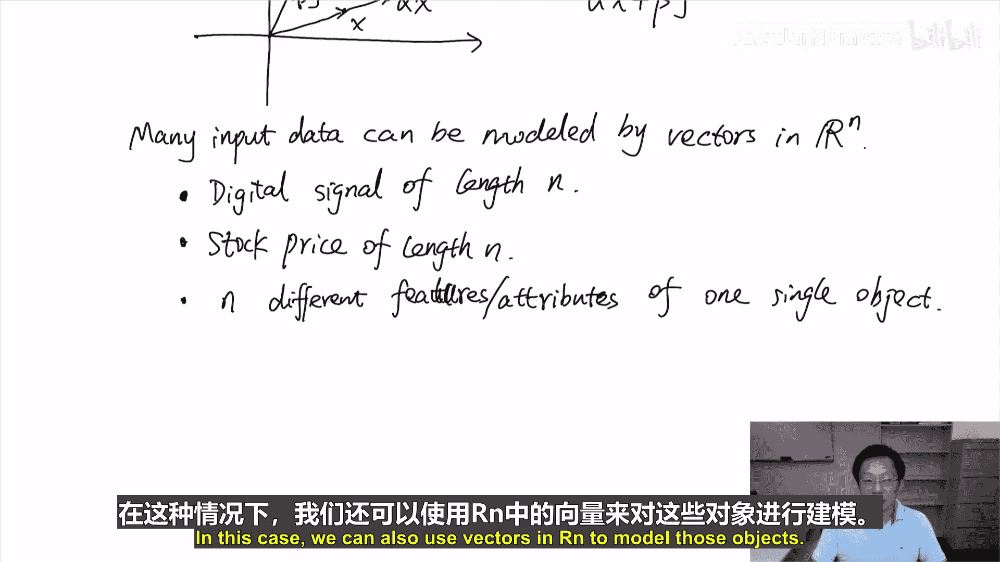

# 006：向量空间示例与应用 🧮

在本节课中，我们将学习向量空间的具体例子，并了解如何利用向量空间为机器学习中的输入数据建模。我们将从简单的实数集开始，逐步扩展到多维欧几里得空间，并探讨其几何直观。

## 示例一：实数集 ℝ

首先，我们考虑实数集 ℝ。它本身就是一个集合。要使其成为一个向量空间，我们需要定义向量加法和标量乘法两种运算。

我们使用标准的实数加法和乘法来定义这两种运算：
*   **向量加法**：定义为实数的标准加法。
*   **标量乘法**：定义为实数的标准乘法。

用公式表示如下：
*   加法：`x + y` （标准实数加法）
*   标量乘法：`α · x` （标准实数乘法）

可以验证，实数集 ℝ 配备上述两种运算后，满足向量空间定义的八个条件。这里我们省略具体的验证过程。

## 示例二：n维欧几里得空间 ℝⁿ

接下来，我们考虑更常见的 n 维欧几里得空间 ℝⁿ。空间中的元素 `x` 和 `y` 是包含 n 个实数的数组。

我们按以下方式定义向量加法和标量乘法：
*   **向量加法**：定义为对应分量的相加。
*   **标量乘法**：定义为每个分量都乘以标量 α。

用公式表示如下：
*   加法：`x + y = (x₁ + y₁, x₂ + y₂, ..., xₙ + yₙ)`
*   标量乘法：`α · x = (αx₁, αx₂, ..., αxₙ)`

同样，ℝⁿ 配备这两种运算后构成一个向量空间。为了更直观地理解，我们以二维空间 ℝ² 为例进行可视化说明。

### ℝ² 中的运算可视化

在 ℝ² 中，向量可以表示为平面上的点或有向线段。

**向量加法**遵循平行四边形法则。给定向量 `x` 和 `y`，它们的和 `x + y` 是以 `x` 和 `y` 为邻边的平行四边形的对角线向量。

**标量乘法**是向量的缩放。向量 `x` 乘以标量 `α` 后，其方向不变（若 α>0）或反向（若 α<0），长度变为原来的 |α| 倍。有时我们会省略标量乘法中的点，直接写作 `αx`。

**线性组合**是加法和标量乘法的结合。给定向量 `x`、`y` 和标量 `α`、`β`，线性组合 `αx + βy` 的几何意义是：先将 `x` 缩放 `α` 倍，`y` 缩放 `β` 倍，然后将得到的两个向量相加。结果向量 `αx + βy` 仍然位于 ℝ² 空间中。

这正是线性空间（向量空间）的核心含义：**对空间内任意向量进行线性组合，结果仍在该空间内**。

## 向量空间在数据建模中的应用 🖥️

理解了向量空间的基本概念后，我们来看它如何为机器学习中的输入数据建模。

事实上，许多类型的输入数据都可以用 ℝⁿ 中的向量来建模。

以下是几个具体的例子：

*   **数字信号**：如果一个数字信号的长度为 n，我们可以用一个 n 维向量来表示它，向量的每个分量对应信号在某一时刻的数值。多个信号则对应多个向量。
*   **股票价格**：对于一只股票，我们可以记录它在 n 个不同时间点的价格，并用一个 n 维向量来表示这只股票的价格序列。不同股票对应不同的向量。
*   **对象特征**：如果一个对象有 n 个不同的特征或属性（例如，身高、体重、年龄），我们可以用一个 n 维向量来描述这个对象，向量的每个分量对应一个特征的值。每个对象都对应一个特征向量。

## 总结

本节课中，我们一起学习了向量空间的两个关键示例：实数集 ℝ 和 n 维欧几里得空间 ℝⁿ。我们明确了构成向量空间所需的两种运算（加法和标量乘法）及其定义方式，并通过 ℝ² 的几何直观理解了线性组合的意义。最后，我们探讨了如何利用 ℝⁿ 中的向量为数字信号、股票价格和对象特征等多种现实数据建模，这为后续在数据分析和机器学习中应用线性代数工具奠定了基础。