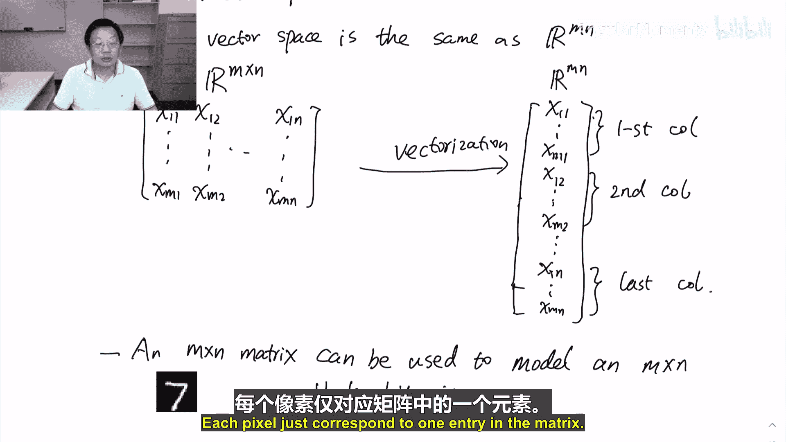

**数据分析的数学方法：P07：向量空间示例（矩阵空间）** 🧮

---

### 概述
在本节中，我们将学习向量空间的第三个示例：**所有实数 M×N 矩阵的集合**。这个例子在标准的线性代数教科书中可能不常见，但在机器学习中非常有用。我们将看到，这个矩阵空间本质上与之前讨论的向量空间是相同的。

---

### 从标准空间到矩阵空间
上一节我们介绍了向量空间的两个标准示例。本节中，我们来看一个在机器学习中特别有用的例子：**矩阵空间**。

**示例 3：所有实数 M×N 矩阵的集合**
我们考虑所有大小为 M×N 的实数矩阵，记作 **R^(M×N)**。这里的 M 和 N 代表矩阵的行数和列数，矩阵的每个元素都是实数。

---

### 矩阵空间中的运算定义
为了使 R^(M×N) 成为一个向量空间，我们需要定义两种运算：**加法** 和 **标量乘法**。

以下是这两种运算的定义方式：

1.  **加法运算**
    对于任意两个矩阵 **X** 和 **Y**（它们都属于 R^(M×N)），我们将其和 **X + Y** 定义为对应元素相加得到的新矩阵。
    *   用公式表示：若 `X = [x_ij]`, `Y = [y_ij]`，则 `(X + Y)_ij = x_ij + y_ij`。
    *   例如，新矩阵的第 (1,1) 个元素是 `x_11 + y_11`，第 (2,1) 个元素是 `x_21 + y_21`，依此类推。

2.  **标量乘法运算**
    对于任意实数 α（标量）和矩阵 **X** ∈ R^(M×N)，我们定义 **αX** 为将 X 的每个元素都乘以 α 后得到的新矩阵。
    *   用公式表示：`(αX)_ij = α * x_ij`。

---

### 矩阵空间与向量空间的等价性
可以验证，定义了上述加法和标量乘法的集合 R^(M×N) 确实构成一个向量空间。

更重要的是，**这个矩阵向量空间与向量空间 R^(M*N) 是相同的**。理解这一点的一个简单方法是“向量化”操作。

*   **向量化**：将矩阵 **X** 的所有列依次堆叠起来，形成一个很长的列向量。
    *   用代码概念描述：`vectorized_X = X.flatten()` 或 `vectorized_X = X.reshape(-1, 1)`。
*   **等价性证明**：
    *   矩阵空间中的加法 `X + Y`，等价于将它们向量化后的长向量进行加法。
    *   矩阵空间中的标量乘法 `αX`，等价于将其向量化后的长向量进行标量乘法。
    *   因此，R^(M×N) 和 R^(M*N) 在结构上是完全一样的，只是数据的排列方式不同。

---

### 矩阵空间在机器学习中的应用
这个矩阵向量空间在机器学习中对数据建模非常有用。

例如，在本课程最初提到的**手写数字识别任务**中，输入数据是小的灰度图像。假设图像有 M 行、N 列像素，每个像素的灰度值可以用一个实数表示。

*   这样，**一张 M×N 的灰度图像，就可以直接用一个 M×N 的矩阵来建模**。
*   矩阵中的每个元素 `(i, j)` 就对应图像中第 i 行、第 j 列像素的灰度值。

通过将图像视为矩阵空间中的点，我们可以方便地运用向量空间中的各种线性代数工具（如距离、投影、变换等）来处理和分析图像数据。

---

### 总结
本节课我们一起学习了向量空间的一个重要示例：**实数矩阵空间 R^(M×N)**。我们定义了该空间中的加法和标量乘法运算，并理解了它通过“向量化”与标准向量空间 R^(M*N) 的等价关系。最后，我们看到了这个空间如何应用于机器学习，例如将灰度图像建模为矩阵，为后续的数据分析奠定了基础。