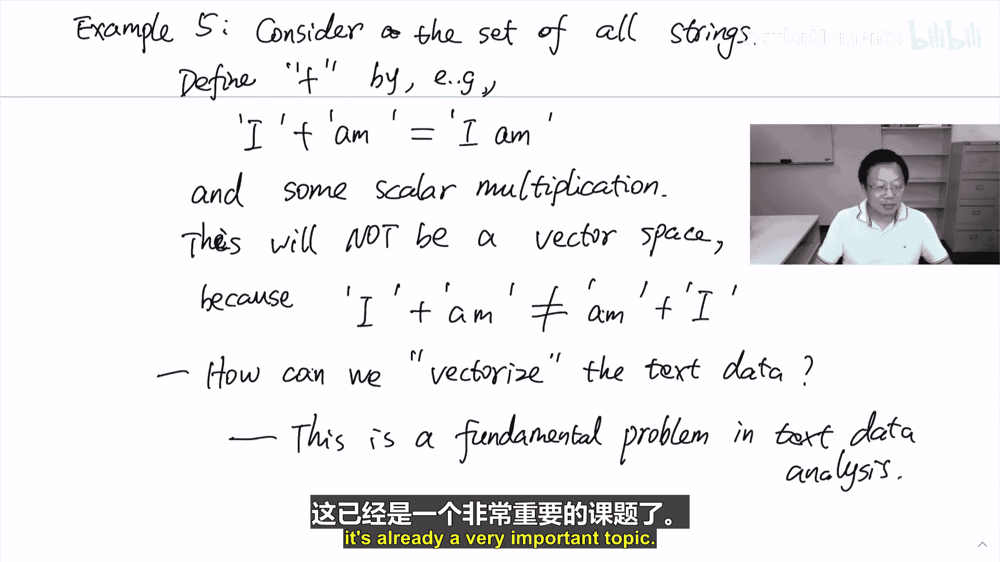

# 008：张量空间与向量空间的反例 📚

在本节课中，我们将学习如何将向量空间的概念扩展到更高维度的数组，即张量。我们将看到张量在数据建模中的实际应用，并探讨一个无法构成向量空间的例子，从而理解向量空间工具的重要性。

---

上一节我们介绍了矩阵作为向量空间的例子。本节中，我们来看看当数组的维度继续增加时会发生什么。

我们考虑所有固定尺寸为 `M × N × L` 的三维实数数组，我称之为三维数组。这个集合记为 `ℝ^(M×N×L)`。

在这个集合上，我们定义加法和标量乘法，方法与之前的例子类似。

*   **加法**：对于任意 `X` 和 `Y` 属于 `ℝ^(M×N×L)`，我们将其写作 `X = (x_ijk)` 和 `Y = (y_ijk)`。定义 `X + Y` 为一个新的三维数组，其 `(i, j, k)` 位置的元素为 `x_ijk + y_ijk`。
*   **标量乘法**：对于任意实数 `α` 和任意 `X` 属于 `ℝ^(M×N×L)`，定义 `αX` 为一个新的三维数组，其 `(i, j, k)` 位置的元素为 `α * x_ijk`。

配备了这种加法和标量乘法运算的 `ℝ^(M×N×L)` 集合，构成了一个向量空间。这个向量空间由固定尺寸的三维数组组成，类似于矩阵和欧几里得向量，在机器学习的建模中非常有用。

以下是两个具体的应用示例：

*   **彩色图像建模**：一张 `M × N` 的彩色图像，每个像素需要红、绿、蓝三个通道的数值来表示颜色。因此，我们可以用一个 `M × N × 3` 的三维数组来建模一张彩色图像。
*   **黑白视频建模**：一段黑白视频由 `L` 帧图像组成，每帧是 `M × N` 的矩阵。因此，我们可以用一个 `M × N × L` 的三维数组来建模这段视频。

那么，彩色视频呢？彩色视频的每一帧是一个 `M × N × 3` 的数组，共有 `L` 帧。因此，我们需要一个四维数组 `M × N × 3 × L` 来表示一段彩色视频。事实上，如果我们类似地定义加法和标量乘法，所有固定尺寸的四维数组乃至更高维数组的集合，都可以构成向量空间。

这些高维数组有一个统一的名字：**张量**。固定尺寸的张量，在配备了适当的加法和标量乘法后，就构成了一个向量空间。如果你有深度学习经验，一定知道软件包 **TensorFlow**，其中的核心操作对象就是张量。因此，张量空间在神经网络的训练和深度学习中是一个非常重要的向量空间。

---

前面的四个例子都是向量空间的成功案例。在例5中，我想给出一个向量空间的**反例**。在许多机器学习应用中，我们需要分析文本数据。你可能会想，我们能为文本数据建立一个向量空间吗？

我们考虑所有字符串的集合。为了建立向量空间，我需要定义加法和标量乘法。例如，我可以用一种简单的方式定义加法：将两个字符串连接起来。`"I " + "am "` 的结果是 `"I am "`，这仍然是一个字符串，所以这个加法是有效的。标量乘法的定义暂且不论。

然而，这**不会**构成一个向量空间。原因很简单，因为交换律不满足。在这个加法定义下，`"I " + "am "` 的结果是 `"I am "`，而 `"am " + "I "` 的结果是 `"am I "`。两者并不相等。因此，向量空间定义中的一个条件无法满足，所以这不能构成一个向量空间。

这意味着，如果我们使用这种加法和标量乘法，我们就无法使用向量空间的强大工具来分析文本数据相关的问题。但向量空间的工具确实非常强大，我们希望能使用它。这就引出了一个自然的问题：**我们如何将文本数据向量化？** 我们如何在所有字符串的集合上建立一个向量空间？这实际上是文本数据分析研究中的一个基本问题。

从这个例子中，你可以看到向量空间在机器学习中的重要性。仅仅是为特定的输入数据建立一个向量空间，本身就是一个非常重要的课题。

---

本节课中我们一起学习了：
1.  如何将向量空间的概念扩展到三维及更高维的数组（张量）。
2.  张量在建模彩色图像和视频等数据时的具体应用。
3.  一个重要的反例：在简单的字符串连接加法下，所有字符串的集合不构成向量空间，这凸显了为数据寻找合适向量化表示的重要性。