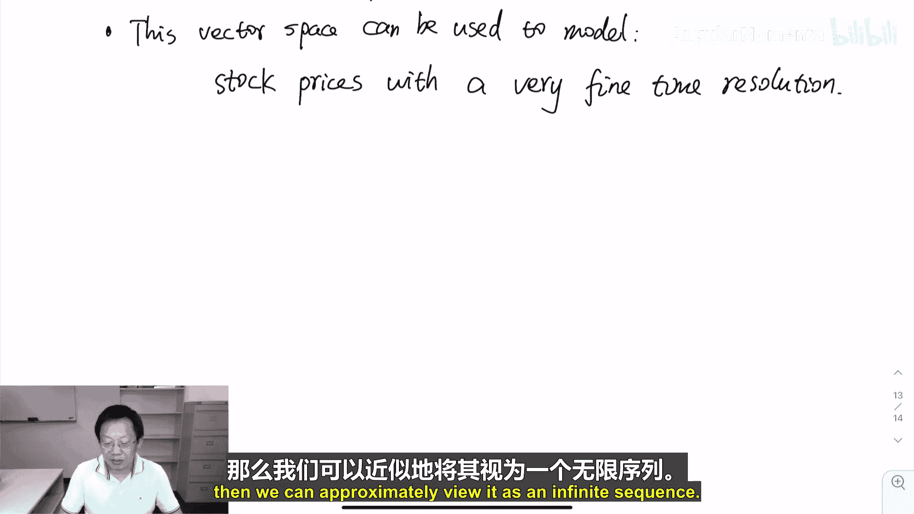

数据分析的数学方法：09：向量空间示例（续）🔢

在本节课中，我们将继续学习向量空间的示例。上一节我们介绍了几个关于输入数据的向量空间例子，本节中我们来看看如何将**函数**和**无限序列**也构建成向量空间。这对于理解机器学习中的假设空间和某些数据模型至关重要。

---

### 示例6：连续函数空间

前面的五个例子都是关于输入数据的。但请记住，在监督学习中，我们需要找到一个函数。因此，我们不仅需要表示输入数据，还需要表示函数。实际上，特定类别的函数集合也能构成一个向量空间。

在这个例子中，我们考虑定义在闭区间 `[a, b]` 上的所有连续函数的集合。这里 `[a, b]` 表示从 `a` 到 `b` 的闭区间，即包含 `a` 和 `b` 之间所有数的集合。

这个集合记为 `C[a, b]`。它由所有在区间 `[a, b]` 上连续的函数 `f` 组成。

为了使它形成一个向量空间，我们需要定义加法和标量乘法。

以下是加法的定义方式：对于 `C[a, b]` 中的任意两个函数 `f` 和 `g`，我们定义 `f + g`。由于 `f` 和 `g` 都在 `C[a, b]` 中，`f + g` 也应该在 `C[a, b]` 中，因此它是一个函数。

这个函数的定义如下：对于区间 `[a, b]` 上的任意数 `t`，`(f + g)(t)` 的值就是 `f(t) + g(t)`。用公式表示就是：

\[
(f + g)(t) = f(t) + g(t)
\]

以下是标量乘法的定义方式：对于任意实数 `α` 和 `C[a, b]` 中的任意函数 `f`，我们定义 `α * f`。同样，`α * f` 也是一个函数。

这个函数的定义如下：对于区间 `[a, b]` 上的任意数 `t`，`(α * f)(t)` 的值就是 `α * f(t)`。用公式表示就是：

\[
(\alpha f)(t) = \alpha \cdot f(t)
\]

可以验证，配备了这两种运算的 `C[a, b]` 确实构成一个向量空间。

因此，我们有时称 `C[a, b]` 为一个**函数空间**，因为它确实是一个向量空间。

这个函数空间在某些机器学习任务中，可能作为**假设空间**使用。所以，向量空间不仅可用于表示输入数据，也可用于表示假设空间。

---

### 示例7：有界无限序列空间

最后一个例子是关于 `R^n` 中的无限序列。我们知道，`R^n` 中的每个向量只是 `n` 个数字的序列。但在许多应用中，我们可能需要每个向量包含无限多个数字。

为此，我们考虑一种特殊的无限序列，称为 **小 l∞ 空间**。这个集合中的每个元素都是一个无限序列 `(a1, a2, ..., an, ...)`。

当然，它并非包含所有无限序列，而是满足特定约束的无限序列。

对于 `l∞` 空间，约束条件是：存在一个不依赖于序列的有限常数 `C`，使得序列中的所有项 `ai` 都满足 `|ai| ≤ C`。这意味着该无限序列中的项是**一致有界**的。

所有一致有界的无限序列的集合就称为 `l∞` 空间。

在这个集合上，我们可以定义两种运算。

以下是加法的定义：如果我们有两个 `l∞` 空间中的序列 `a` 和 `b`，我们定义它们的和 `a + b` 为对应项相加得到的新序列。即：

\[
a + b = (a_1 + b_1, a_2 + b_2, ..., a_n + b_n, ...)
\]

因为 `a` 和 `b` 的项都是一致有界的，所以 `a + b` 的项也是一致有界的，因此这个新序列仍在 `l∞` 空间中。所以这个加法定义是有效的。

以下是标量乘法的定义：对于任意实数 `α` 和 `l∞` 空间中的序列 `a`，我们定义 `α * a` 为每个项乘以 `α` 得到的新序列。即：

\[
\alpha a = (\alpha a_1, \alpha a_2, ..., \alpha a_n, ...)
\]

同样，因为 `a` 的项有界于 `C`，所以 `α * a` 的项有界于 `|α| * C`，因此新序列仍在 `l∞` 空间中。所以这个标量乘法定义也是有效的。

实际上，配备了这种加法和标量乘法的、所有一致有界无限序列的集合，构成了一个向量空间。

这个例子在建模某些输入数据时也很有用。例如，这个向量空间可以用来为具有非常精细时间分辨率的股票价格建模。因为时间分辨率非常精细，以至于同一只股票有太多的价格数据，我们可以近似地将其视为一个无限序列。

---

### 总结

本节课中，我们一起学习了两个重要的向量空间示例：
1.  **连续函数空间 `C[a, b]`**：通过逐点定义加法和标量乘法，连续函数也能构成向量空间，这为表示机器学习中的假设函数提供了数学基础。
2.  **有界无限序列空间 `l∞`**：一致有界的无限序列集合，在按对应项进行加法和标量乘法的运算下，也构成向量空间，可用于建模如高频股票价格等具有大量数据点的序列。

这些例子展示了向量空间概念的强大与普适性，它不仅能描述我们熟悉的数据点，还能描述函数和无限维对象。