# 010：向量空间中的范数与距离 📏

在本节课中，我们将要学习如何为向量空间定义“长度”和“距离”的概念。向量空间本身具有良好的线性结构，但缺乏衡量向量间“远近”的工具。我们将引入“范数”作为长度的数学定义，并利用它来定义距离，从而为后续的机器学习等应用（如聚类分析）奠定基础。

## 从距离到长度

上一节我们介绍了向量空间，本节中我们来看看如何衡量空间中两个向量的“距离”。

设 `V` 是一个向量空间，`x` 和 `y` 是其中的两个向量。我们希望定义它们之间的距离 `d(x, y)`。

首先，距离应具有**平移不变性**。在向量空间中，如果将两个向量同时平移相同的量，它们之间的距离不应改变。具体来说，将 `x` 和 `y` 同时减去 `y`，距离应保持不变：
`d(x, y) = d(x - y, y - y) = d(x - y, 0)`

这里，`y - y = 0` 是向量空间中的零向量。这个等式表明，**任意两点之间的距离，等于其中一个点与原点之间的距离**。因此，我们只需要定义任意向量 `z` 到原点 `0` 的距离，即该向量的**长度**。

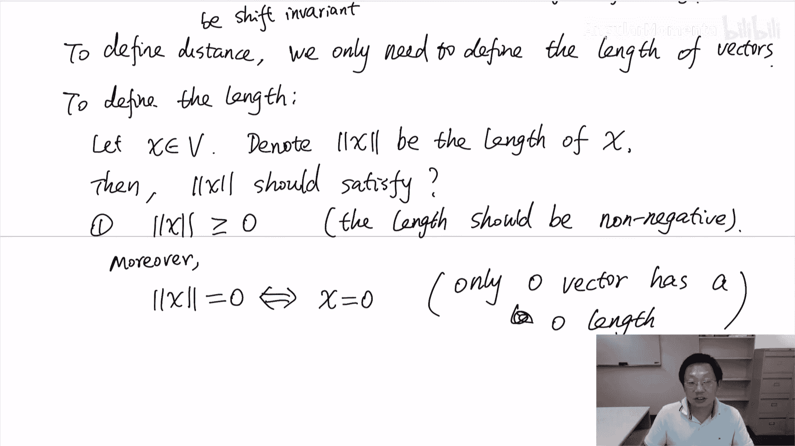

于是，向量 `x` 和 `y` 之间的距离可以定义为：
`d(x, y) = 长度(x - y)`

所以，定义距离的核心在于定义向量的长度。

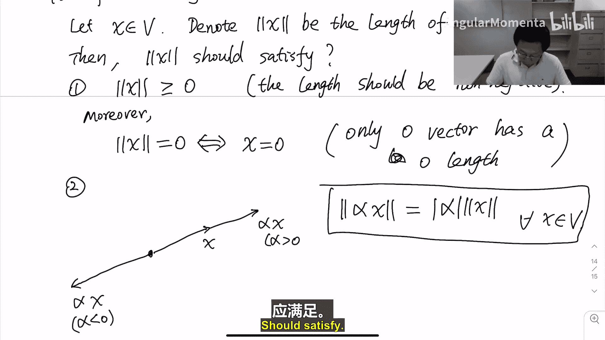

## 长度（范数）应满足的条件

现在，让我们探讨如何定义一个向量的长度。设 `x` 是向量空间 `V` 中的一个向量，我们用双竖线 `||x||` 表示其长度。这个长度函数应满足以下三个直观条件：

以下是长度函数必须满足的三个公理：

1.  **非负性与确定性**：
    *   长度必须是非负的：`||x|| ≥ 0`。
    *   只有零向量的长度为零：`||x|| = 0` 当且仅当 `x = 0`。

2.  **齐次性**：
    *   如果将向量缩放 `α` 倍，其长度也应缩放 `|α|` 倍。对于任意实数 `α` 和向量 `x`，有：
        `||αx|| = |α| · ||x||`

3.  **三角不等式**：
    *   在平面几何中，三角形任意一边的长度小于等于另外两边长度之和。在向量空间中，这体现为：对于任意向量 `x` 和 `y`，有：
        `||x + y|| ≤ ||x|| + ||y||`
    *   其直观含义是：**两点间的直线路径最短**。从原点 `0` 到点 `x+y` 的直接路径长度 `||x+y||`，不应超过经由点 `x` 的间接路径长度 `||x|| + ||y||`。

## 范数的正式定义

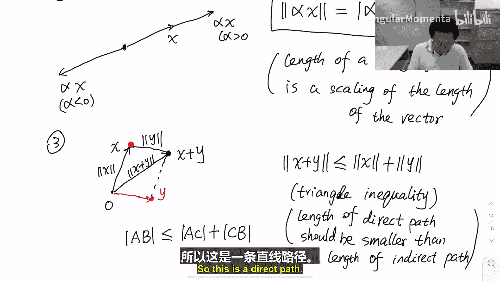

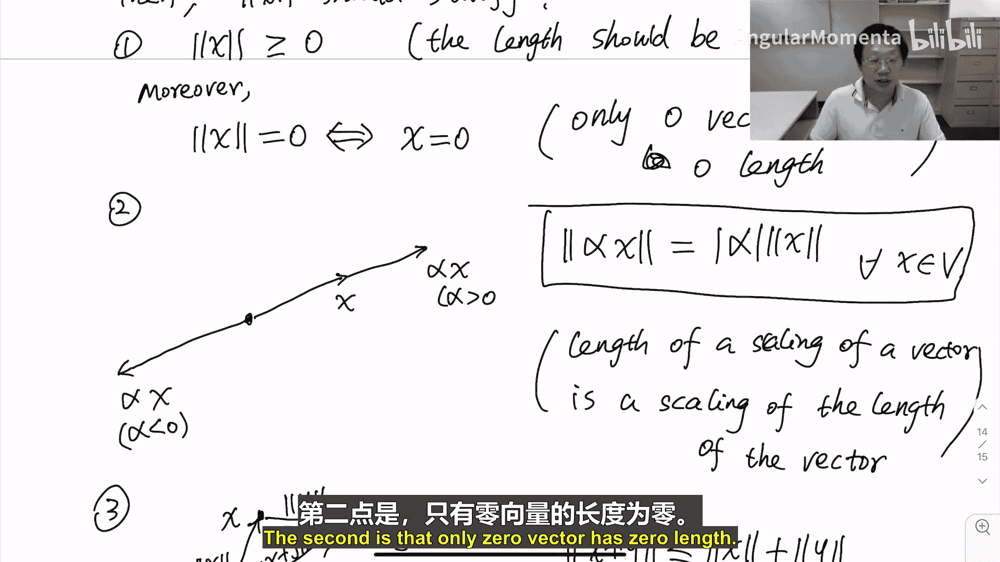

在数学上，满足以上三个条件的长度函数被称为**范数**。

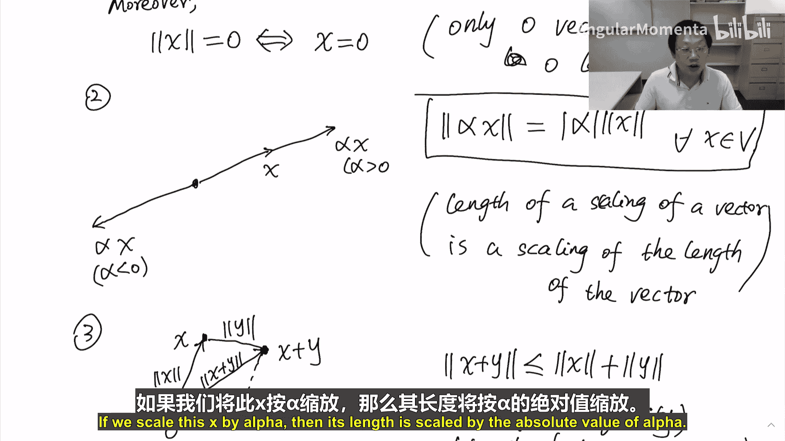

**定义**：设 `V` 是一个向量空间。一个从 `V` 映射到实数 `R` 的函数 `||·||` 称为 `V` 上的一个**范数**，如果对于所有 `x, y ∈ V` 和标量 `α ∈ R`，它满足：
1.  **正定性**：`||x|| ≥ 0`，且 `||x|| = 0 ⇔ x = 0`。
2.  **齐次性**：`||αx|| = |α| · ||x||`。
3.  **三角不等式**：`||x + y|| ≤ ||x|| + ||y||`。

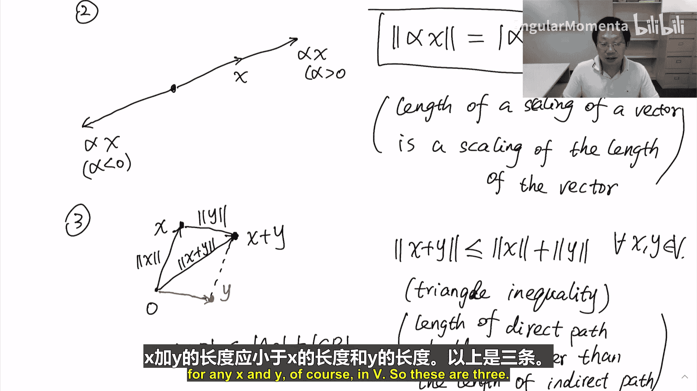

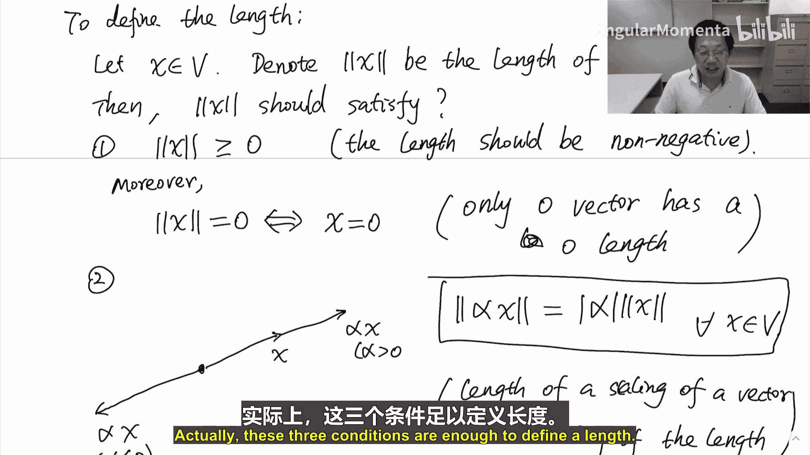

## 由范数定义距离

有了范数的概念，我们现在可以精确定义向量空间中的距离。

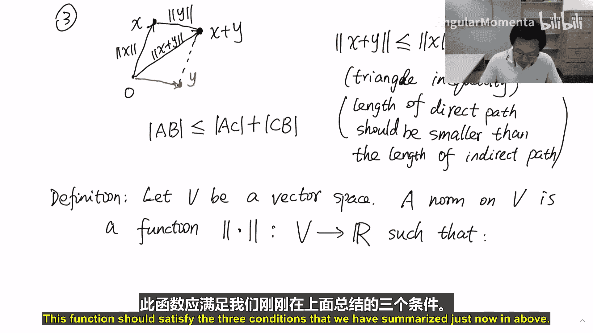

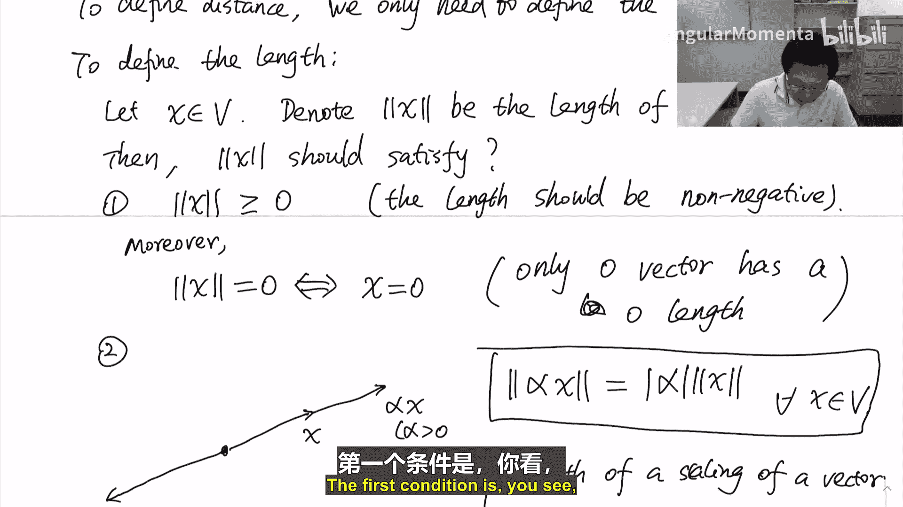

**距离函数** `d(x, y)` 可以通过范数定义为：
`d(x, y) = ||x - y||`

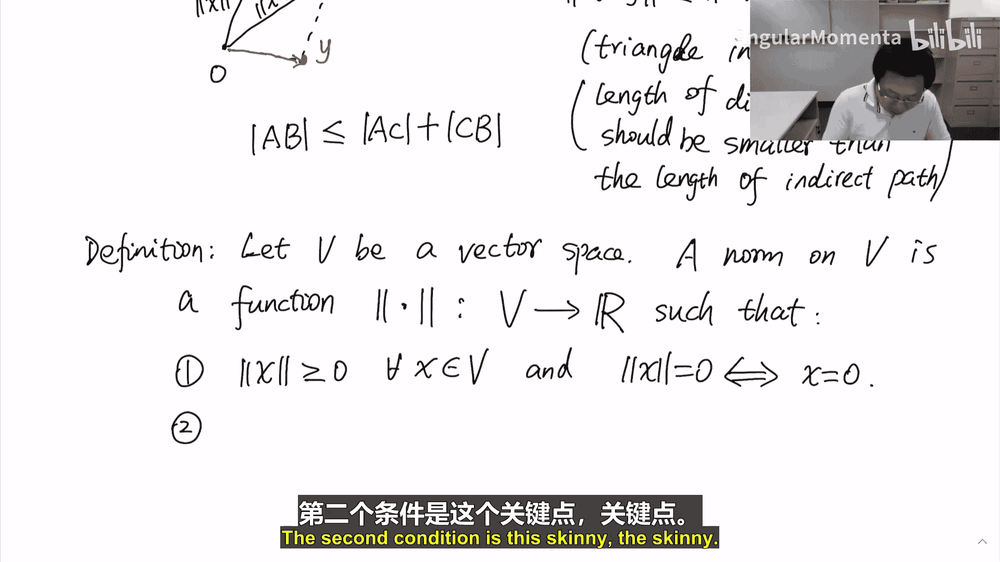

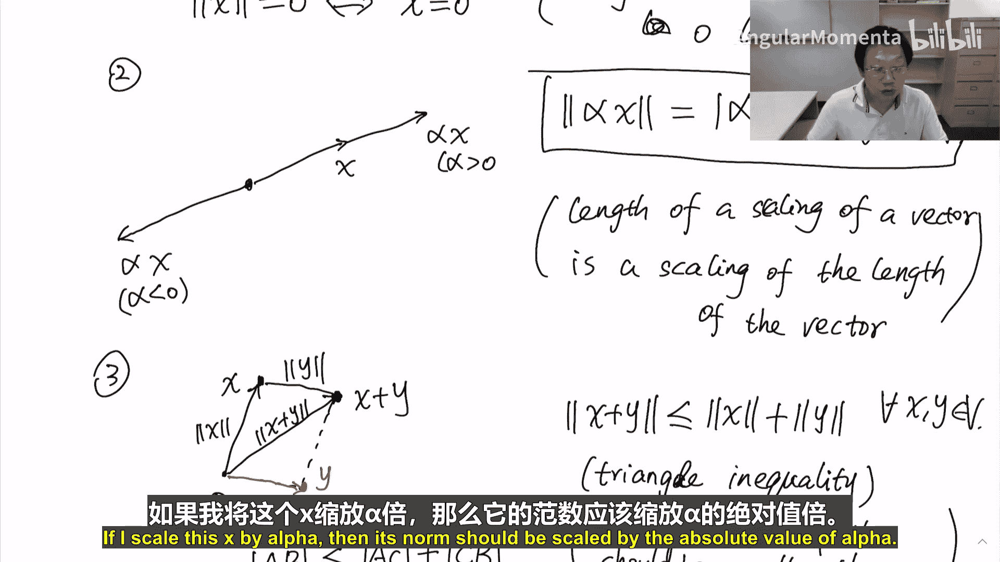

这个定义自然地满足距离的所有直观性质：
*   **非负性**：由范数的正定性保证。
*   **同一性**：`d(x, y) = 0` 当且仅当 `x = y`。
*   **对称性**：`d(x, y) = ||x - y|| = ||-(y - x)|| = | -1 | · ||y - x|| = d(y, x)`。
*   **三角不等式**：对于任意 `z`，有 `d(x, y) = ||x - y|| = ||(x - z) + (z - y)|| ≤ ||x - z|| + ||z - y|| = d(x, z) + d(z, y)`。

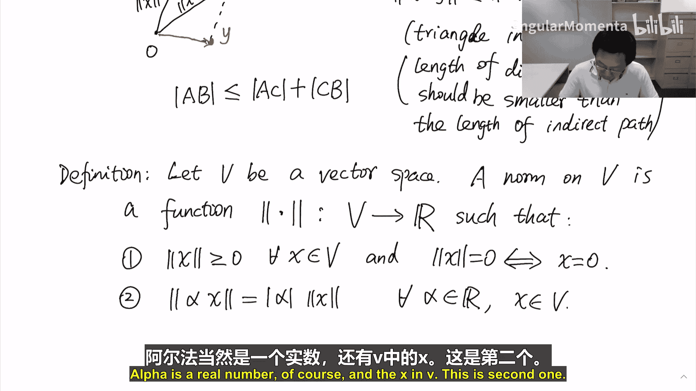

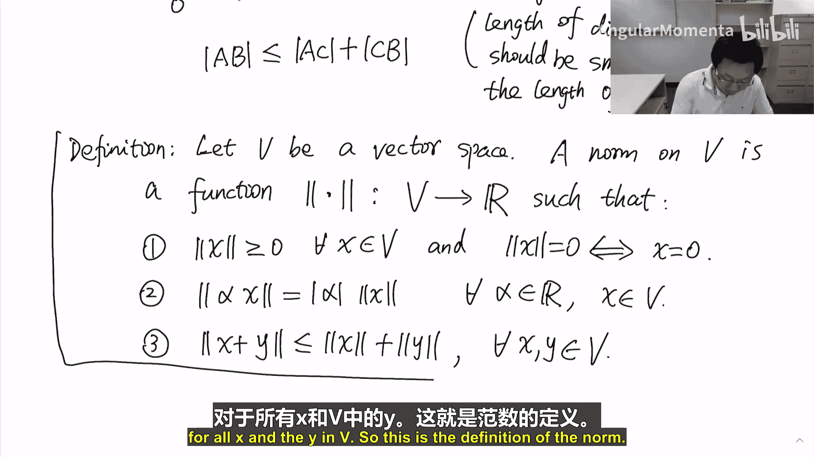

## 总结

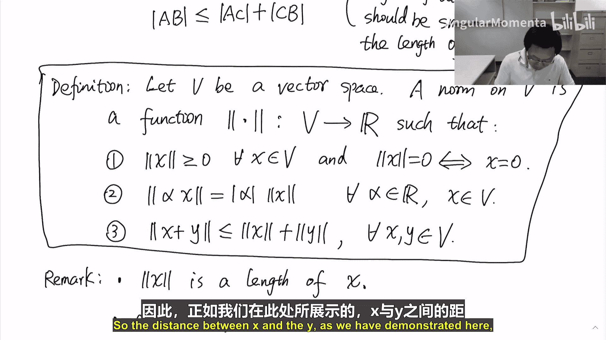

本节课中我们一起学习了为向量空间引入度量概念的关键步骤：
1.  我们认识到，为了比较向量的“远近”，需要在向量空间上定义距离。
2.  通过分析距离应具备的平移不变性，我们将距离的定义归结为定义向量的**长度**。
3.  我们提出了长度函数应满足的三个基本条件：**非负性/确定性**、**齐次性**和**三角不等式**。
4.  满足这些条件的长度函数在数学上被称为**范数**。
5.  最后，我们利用范数自然地定义了向量间的**距离**：`d(x, y) = ||x - y||`。

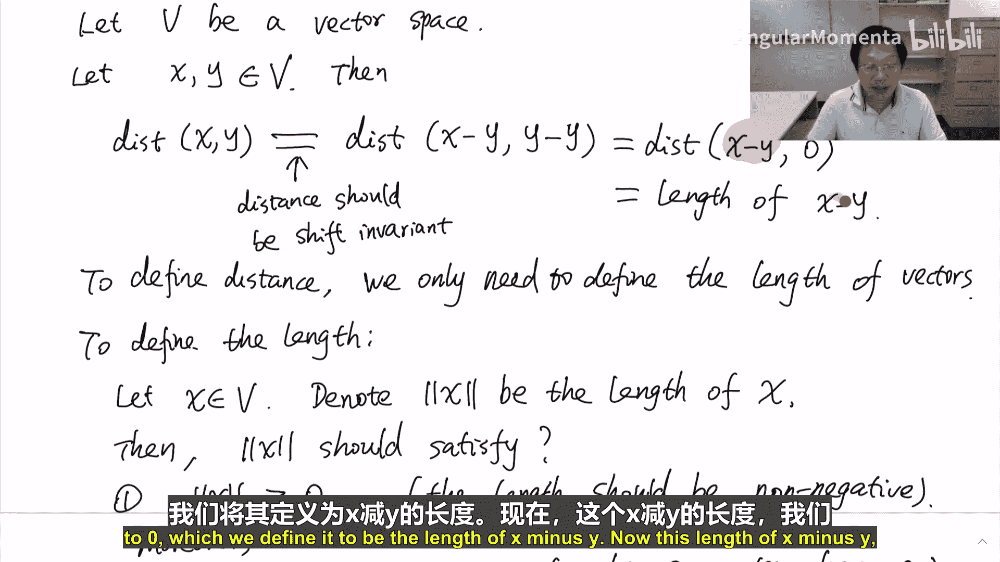

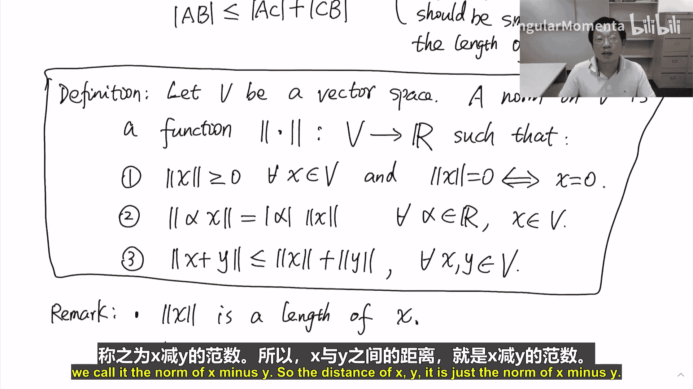

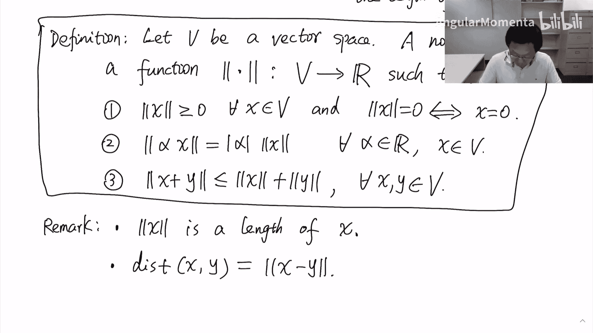

范数为抽象的向量空间提供了具体的几何直观，是连接线性代数与几何、优化、机器学习等领域的重要桥梁。