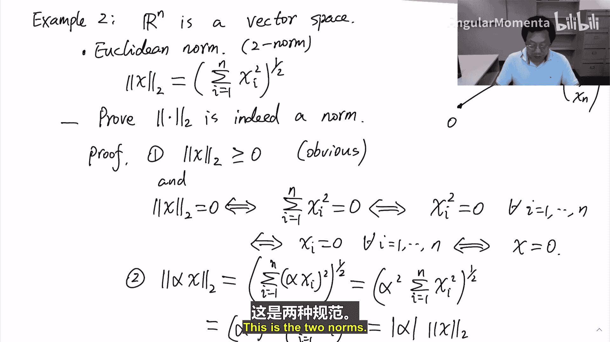

# 011：向量空间范数示例 📚

在本节课中，我们将学习向量空间上范数的具体示例。范数是衡量向量“长度”或“大小”的工具，我们将通过几个具体的例子来理解这个概念。

---

## 示例一：实数集 ℝ 上的范数

首先，我们来看一个最简单的例子。实数集 ℝ 本身就是一个向量空间。在这个空间上，我们需要定义范数。

范数本质上衡量的是向量 `x` 到零向量的“距离”。对于实数 `x`，这个距离就是它的绝对值。因此，我们可以定义 ℝ 上的范数为：
**`||x|| = |x|`**

你可以验证，这个定义满足范数的所有公理。从这个意义上说，范数是绝对值函数的一种推广。

然而，绝对值函数并非 ℝ 上唯一的范数。我们可以定义许多其他的范数。例如：
*   **`||x|| = 0.5 * |x|`**
*   **`||x|| = c * |x|`**，其中 `c` 是任意正数。

这些定义同样满足范数的公理。这告诉我们，即使在同一个向量空间上，也可以定义无限多种范数。这就像测量长度，我们可以用米、千米或毫米，它们都是有效的度量标准。

---

## 示例二：欧几里得空间 ℝⁿ 上的范数

上一节我们介绍了实数集上的范数，本节中我们来看看更一般的情况。考虑 n 维欧几里得空间 ℝⁿ，它也是一个向量空间。与 ℝ 类似，在 ℝⁿ 上也可以定义多种范数。

以下是 ℝⁿ 上最著名的一个范数：

### 欧几里得范数（2-范数）

对于一个向量 **`x = (x₁, x₂, ..., xₙ)`**，其欧几里得长度（即从原点到该点的距离）由勾股定理给出。我们将其定义为 **2-范数**：
**`||x||₂ = √(x₁² + x₂² + ... + xₙ²)`**

现在，我们来验证它是否满足范数的定义。

1.  **非负性与零向量**：显然，**`||x||₂ ≥ 0`**。当且仅当所有分量 `xᵢ = 0` 时，**`||x||₂ = 0`**，即 **`x`** 为零向量。
2.  **齐次性**：对于任意标量 `α`，有：
    **`||αx||₂ = √( (αx₁)² + (αx₂)² + ... + (αxₙ)² ) = √(α²(x₁² + x₂² + ... + xₙ²)) = |α| * ||x||₂`**
    因此，齐次性成立。
3.  **三角不等式**：即验证 **`||x + y||₂ ≤ ||x||₂ + ||y||₂`**。这个性质的证明稍复杂，我们将在后续引入**内积**这个新工具后再进行证明。

综上所述，欧几里得范数（2-范数）确实满足范数的所有条件，是 ℝⁿ 上一个有效的范数。

---

本节课中我们一起学习了范数在具体向量空间上的应用。我们看到了在实数集 ℝ 上，绝对值及其缩放形式都是范数。在更一般的 ℝⁿ 空间中，我们重点介绍了最常用的欧几里得范数（2-范数），并验证了它满足范数的前两个公理。理解这些具体示例，是掌握抽象范数概念的重要一步。