# 012：向量范数家族 🧮

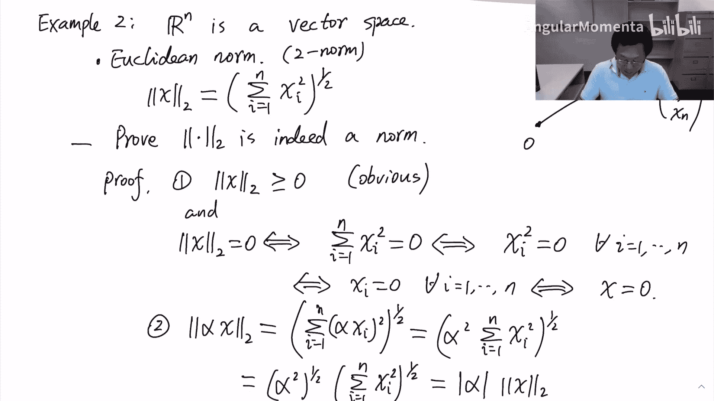

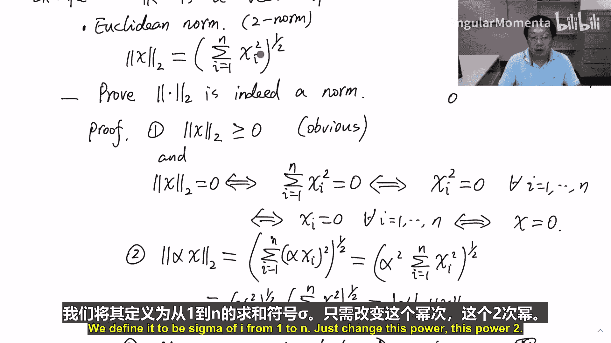

在本节课中，我们将要学习向量范数的一般化定义，即 **p-范数**。我们将从已经熟悉的1-范数和2-范数出发，探讨如何将它们统一到一个更广泛的范数家族中，并最终理解无穷范数的概念。

## 1-范数的定义与验证

上一节我们介绍了2-范数（欧几里得范数），本节中我们来看看另一种常见的范数：**1-范数**。

对于定义在 **Rⁿ** 空间上的向量，其1-范数定义如下：

**公式：**
\[
\|x\|_1 = \sum_{i=1}^{n} |x_i|
\]

其中，向量 \( x = (x_1, x_2, ..., x_n) \)。接下来，我们需要验证这个定义是否满足范数的三个公理。

以下是验证1-范数为范数的过程：

**非负性：**
*   由于绝对值是非负的，其和 \(\|x\|_1\) 也非负。
*   若 \(\|x\|_1 = 0\)，则意味着所有非负项 \(|x_i|\) 之和为零，因此每一项 \(|x_i|\) 都必须为零，从而 \(x_i = 0\) 对所有 \(i\) 成立，即 \(x\) 是零向量。

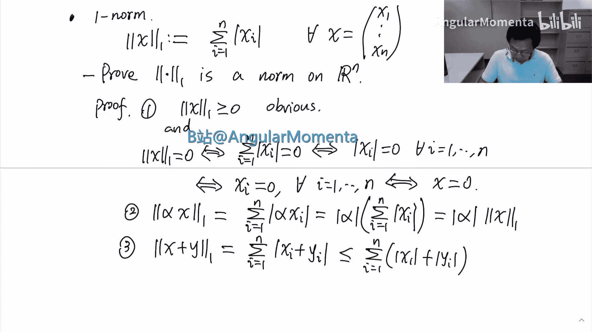

**齐次性：**
*   对于任意标量 \(\alpha\)，有 \(\|\alpha x\|_1 = \sum_{i=1}^{n} |\alpha x_i| = |\alpha| \sum_{i=1}^{n} |x_i| = |\alpha| \cdot \|x\|_1\)。

**三角不等式：**
*   根据定义，\(\|x + y\|_1 = \sum_{i=1}^{n} |x_i + y_i|\)。
*   利用绝对值函数的三角不等式 \(|x_i + y_i| \leq |x_i| + |y_i|\)，我们可以得到：
    \[
    \sum_{i=1}^{n} |x_i + y_i| \leq \sum_{i=1}^{n} (|x_i| + |y_i|) = \sum_{i=1}^{n} |x_i| + \sum_{i=1}^{n} |y_i| = \|x\|_1 + \|y\|_1
    \]

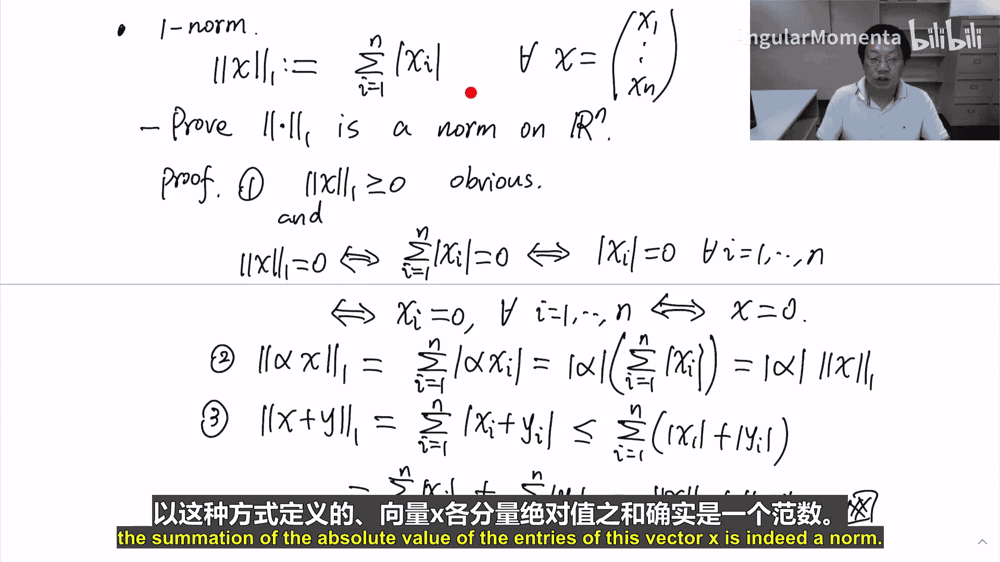

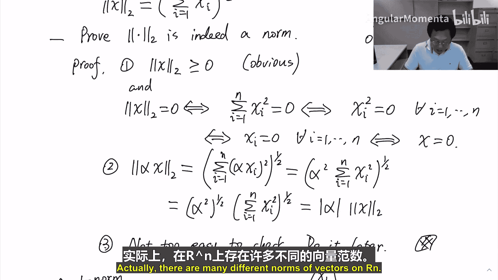

至此，我们完成了证明，确认了1-范数确实是一个有效的范数。

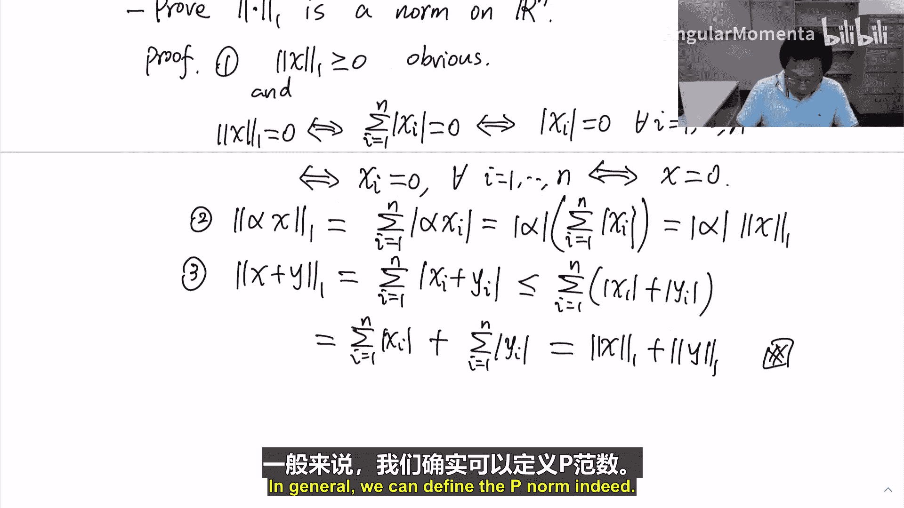

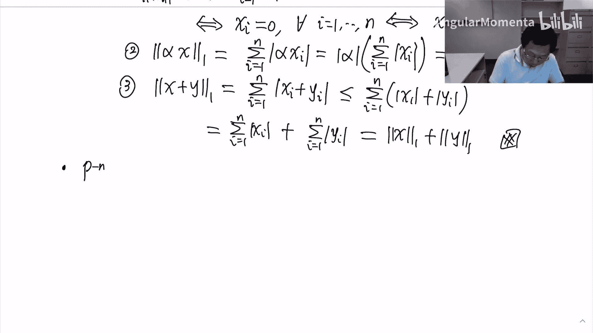

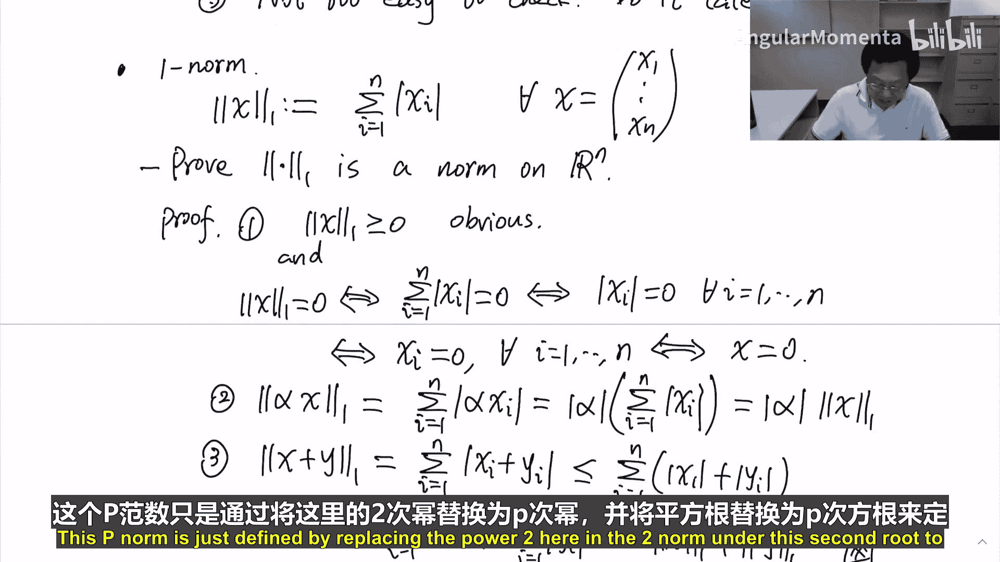

## 推广至 p-范数

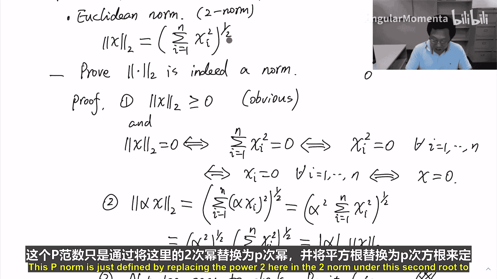

实际上，1-范数和2-范数都属于一个更广泛的范数家族，称为 **p-范数**。

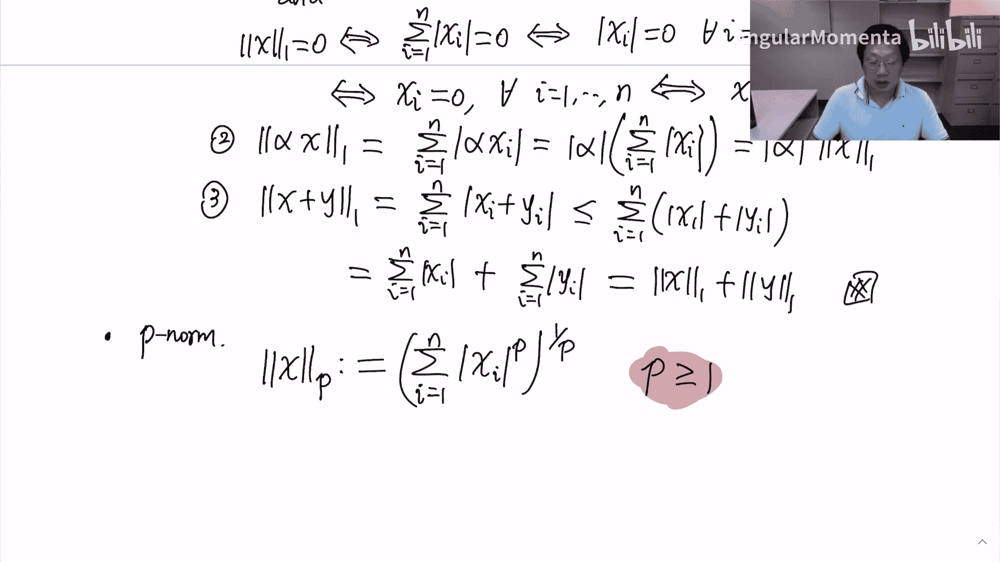

p-范数的定义是通过将2-范数公式中的幂次2推广为任意实数 \(p\) 得到的，其定义如下：

**公式：**
\[
\|x\|_p = \left( \sum_{i=1}^{n} |x_i|^p \right)^{\frac{1}{p}}
\]

其中，参数 \(p\) 必须满足 \(p \geq 1\)。对于任意满足此条件的 \(p\)（可以是整数、分数，甚至是无理数如 \(\pi\)），上述定义都构成 **Rⁿ** 上的一个范数。

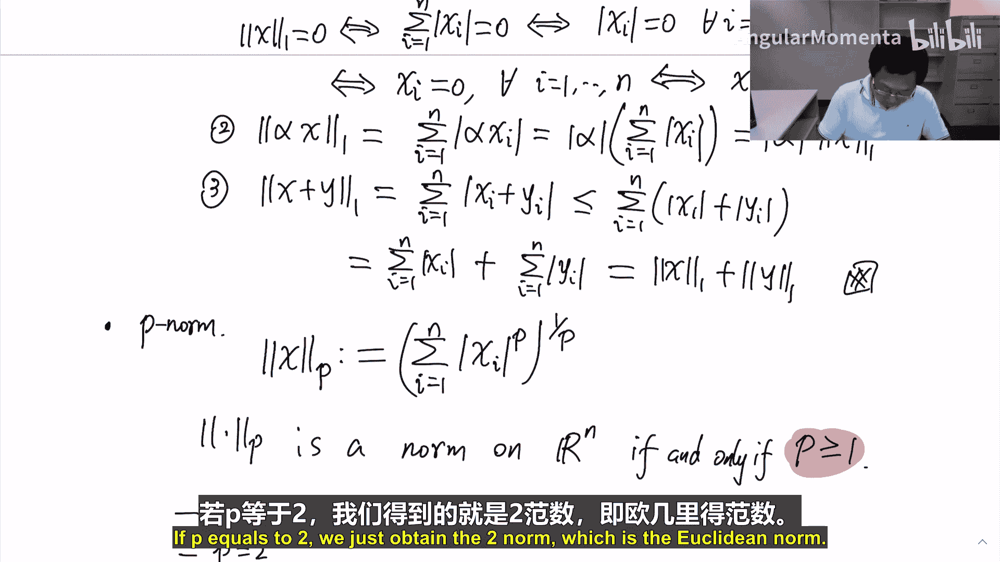

以下是p-范数的一些特例：
*   当 \(p = 1\) 时，得到 **1-范数**：\(\|x\|_1 = \sum |x_i|\)。
*   当 \(p = 2\) 时，得到 **2-范数**（欧几里得范数）：\(\|x\|_2 = \sqrt{\sum |x_i|^2}\)。
*   当 \(p\) 取其他大于等于1的值时，则得到对应的 **p-范数**。

## 无穷范数

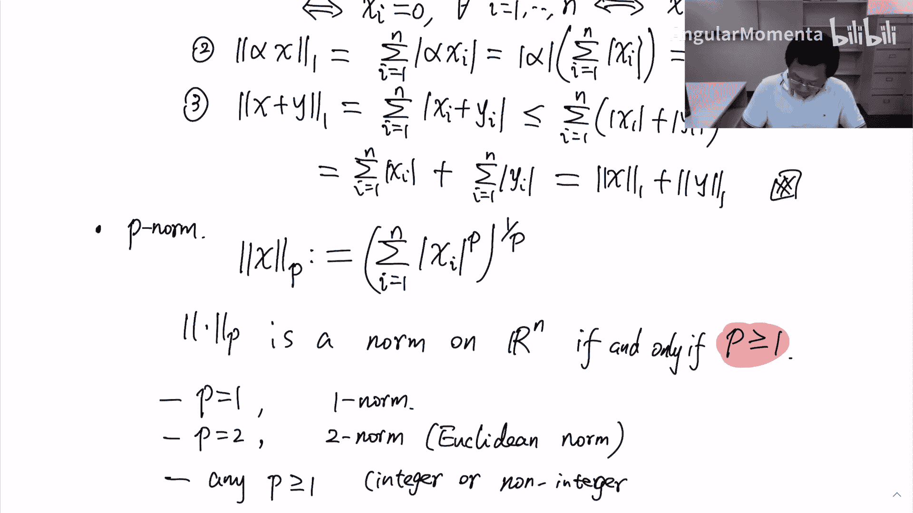

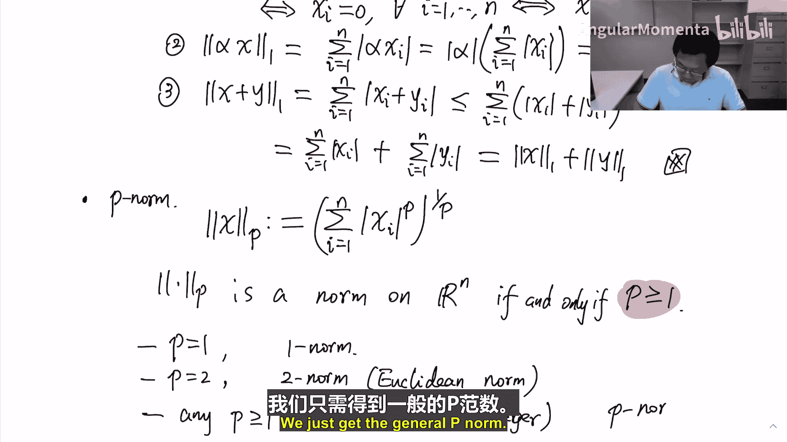

一个有趣的问题是：当 \(p\) 趋向于无穷大时，p-范数会变成什么？

我们可以考虑极限情况 \(\lim_{p \to \infty} \|x\|_p\)。当 \(p\) 非常大时，向量 \(x\) 中绝对值最大的分量将在求和中占据主导地位。取 \(p\) 次方根后，结果将收敛于这个最大绝对值。

因此，我们定义 **无穷范数** 如下：

**公式：**
\[
\|x\|_\infty = \lim_{p \to \infty} \|x\|_p = \max_{i=1,...,n} |x_i|
\]

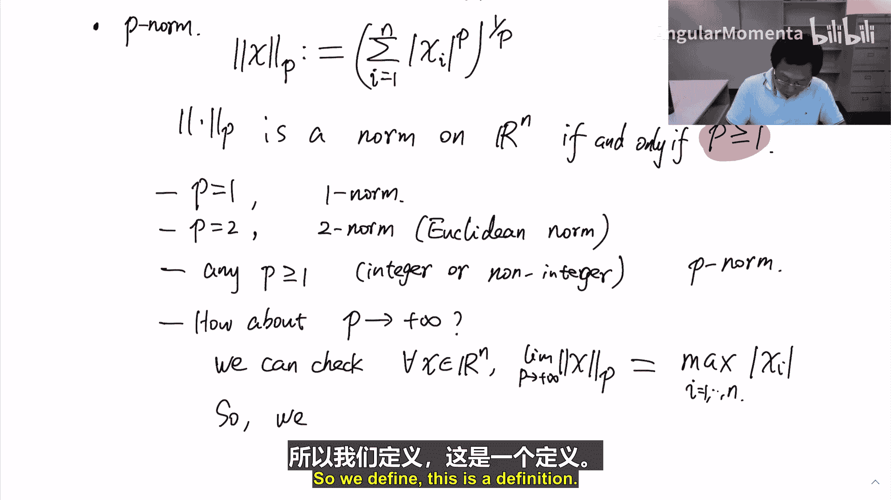

可以验证，无穷范数也满足范数的所有公理，它衡量的是向量分量绝对值的最大值。

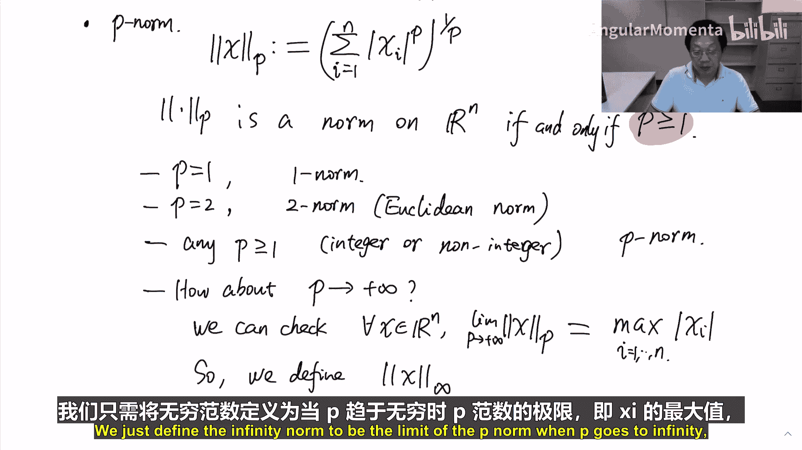

---

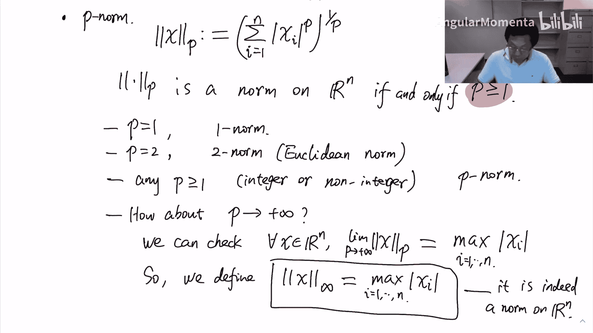

本节课中我们一起学习了向量范数家族。我们从具体的1-范数出发，验证了其作为范数的性质。接着，我们将其与2-范数统一，推广到了更一般的 **p-范数** 概念，并了解了其定义和参数 \(p\) 的条件。最后，我们探讨了当 \(p\) 趋于无穷大时的极限情况，从而引出了 **无穷范数** 的定义。这些不同的范数为衡量向量的大小提供了多种有用的视角。