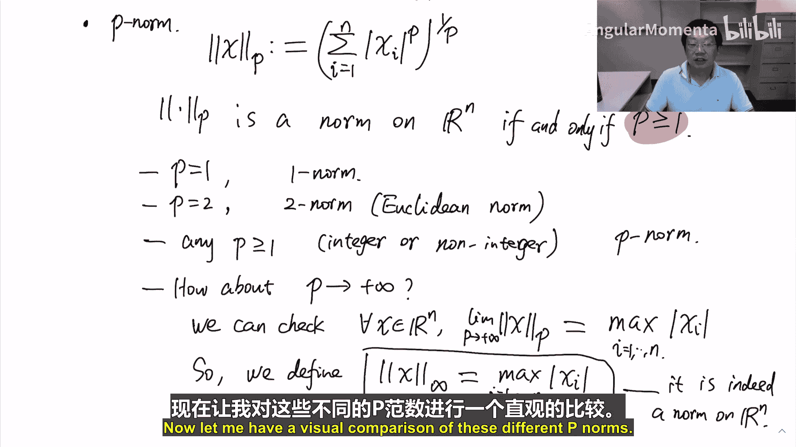
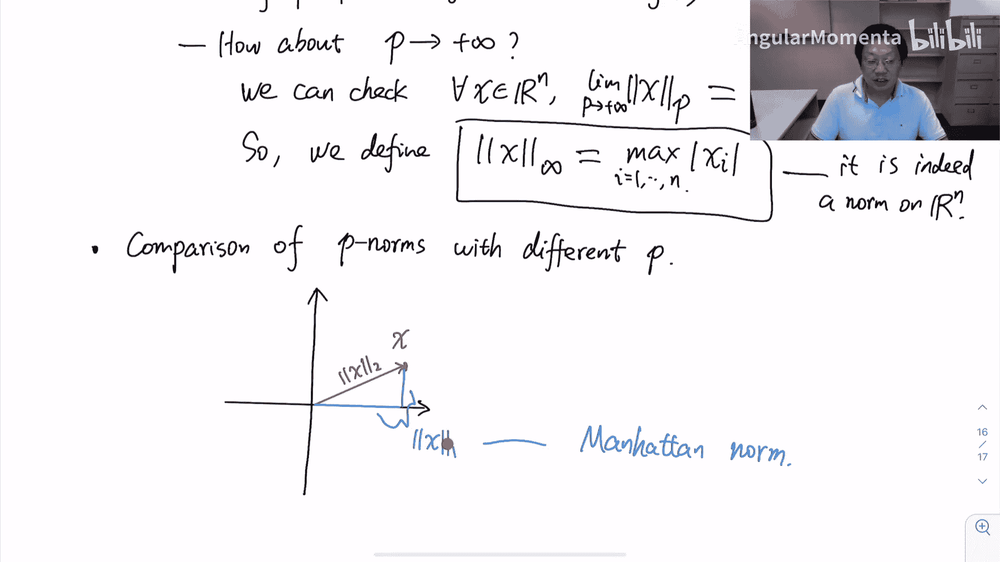
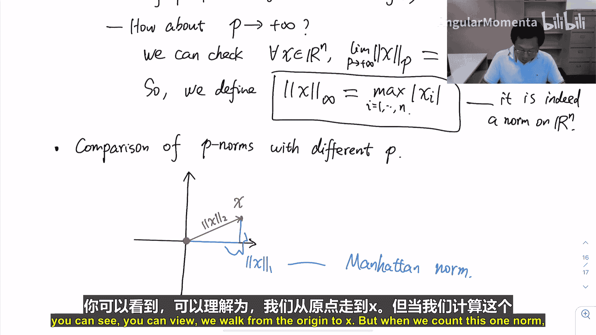
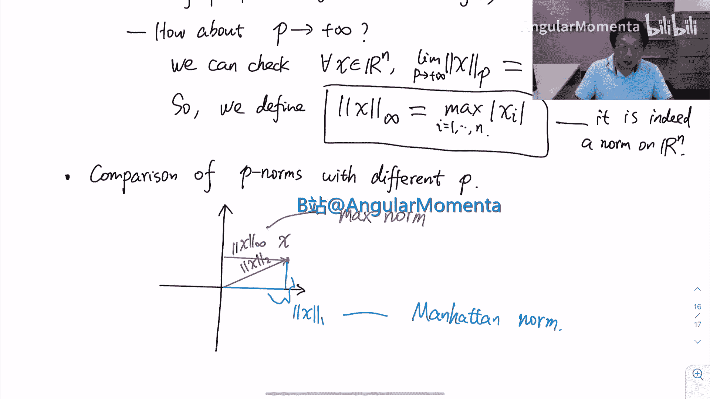
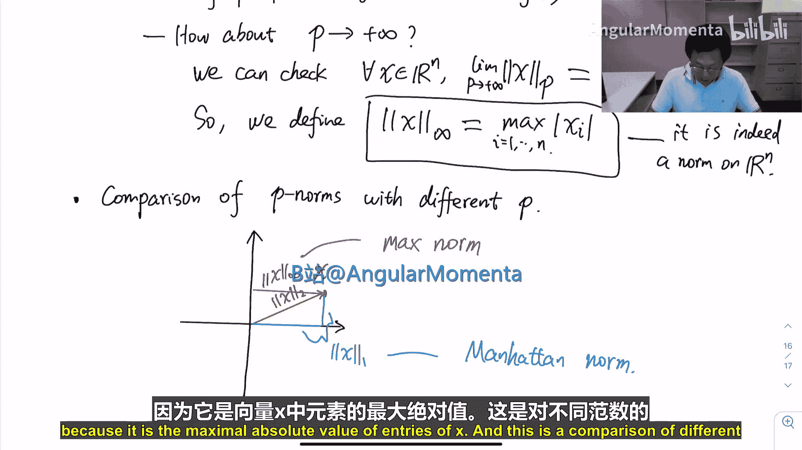
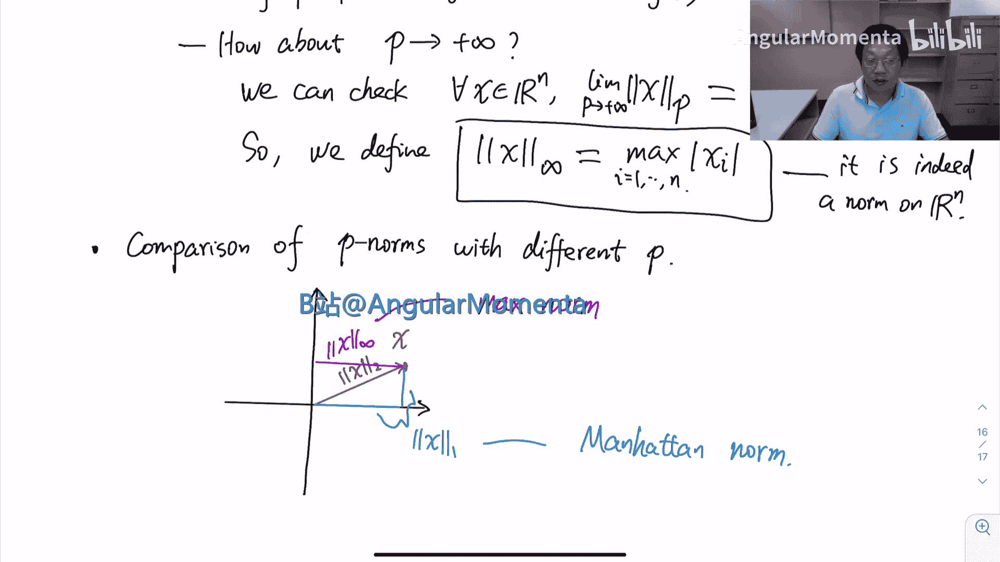
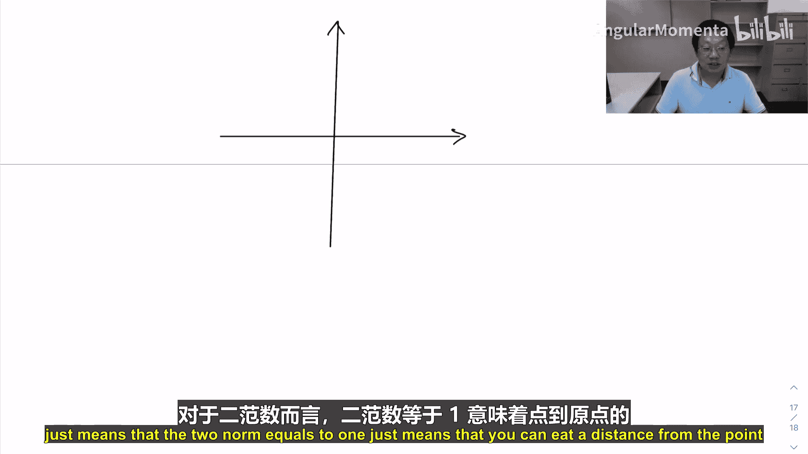
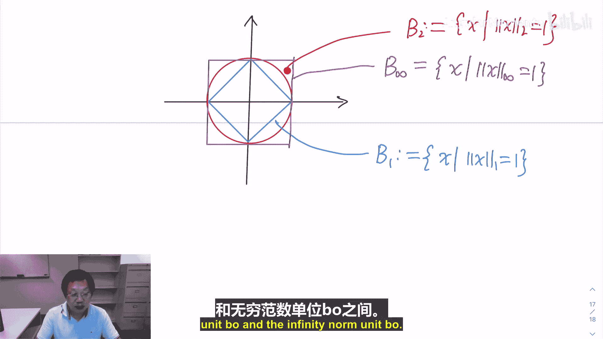
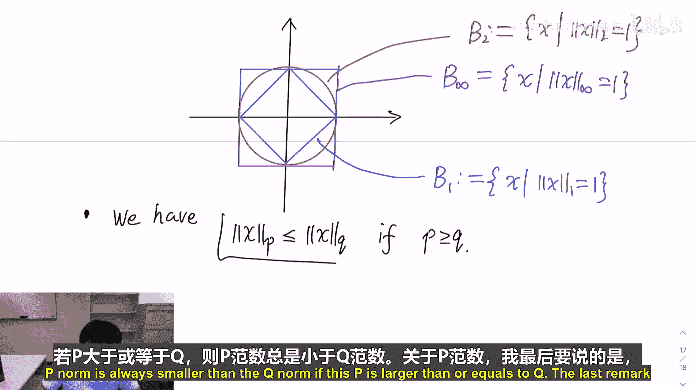
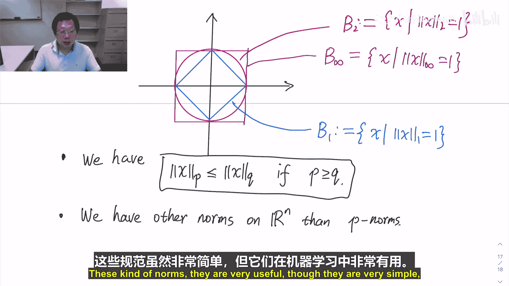

# 013：P范数的可视化比较与单位球

在本节课中，我们将通过可视化方式，直观地比较不同P值下的范数，并理解其单位球的几何形状。这有助于我们掌握不同范数在描述向量“大小”时的差异。

## P范数的可视化比较

上一节我们介绍了P范数的定义，本节中我们来看看不同P范数在二维空间中的几何意义。

现在，让我们对不同的P范数进行一个可视化比较。这里有一个向量X。图中红色线段的长度，就是欧几里得范数，即二范数。所以这个长度就是向量的二范数。

一范数是x1的绝对值加上x2的绝对值。你可以看到，它就是这两个蓝色线段长度的和。因此，这个总和就是一范数。由于这个原因，一范数也被称为曼哈顿范数。因为当我们计算一范数时，从原点到X点，我们只能水平或垂直移动，就像在曼哈顿的街道上行走一样。从原点到X所走过的总距离就是一范数。

无穷范数则是向量坐标中绝对值最大的那个。显然，图中这个坐标值更大，所以这条紫色的线段代表无穷范数。因此，无穷范数也被称为最大值范数，因为它是向量各分量绝对值的最大值。

下图展示了不同范数的比较。

## 不同P范数的单位球

在机器学习中，我们有时也会对不同范数的单位球感兴趣。以下是P范数单位球的比较。

单位球是指满足范数等于1的所有点构成的集合。对于二范数，单位球意味着所有到原点距离为1的点，这恰好构成一个圆。我们称这个集合为B2，即所有满足二范数等于1的向量X的集合。

一范数的单位球是什么呢？你会发现，它就是这个蓝色的、由四条线段组成的旋转正方形。在高维空间中，它是一个多面体。

对于无穷范数，其单位球是一个紫色的正方形。无穷范数单位球意味着向量的无穷范数等于1，即其坐标的绝对值的最大值为1。

下图比较了不同范数的单位球。

那么其他P值的情况呢？如果P值在1和2之间，其单位球的形状会介于一范数单位球和二范数单位球之间。如果P值大于2，其单位球的形状则会介于二范数单位球和无穷范数单位球之间。

下图展示了这种变化。

此外，P范数还有一个很好的性质：如果 **p ≥ q**，那么向量的P范数总是小于或等于其Q范数。用公式表示为：
**||x||_p ≤ ||x||_q** （当 p ≥ q ≥ 1 时）

## 其他范数与总结

关于P范数的最后一点说明是，在R^n空间中，我们不仅拥有P范数族，还有其他类型的范数。所有可能的范数集合非常庞大。

实际上，我们介绍的这三种范数（1-范数、2-范数、∞-范数）在机器学习中有着广泛的应用。例如，在所谓的Lasso回归中，我们就使用一范数进行正则化。这些范数虽然形式简单，但在机器学习中非常有用。

本节课中，我们一起学习了：
1.  通过几何图形直观比较了1-范数、2-范数和∞-范数。
2.  理解了不同范数单位球的形状及其变化规律。
3.  掌握了P范数的一个重要不等式性质。
4.  认识到这些基本范数在机器学习中的实际应用价值。