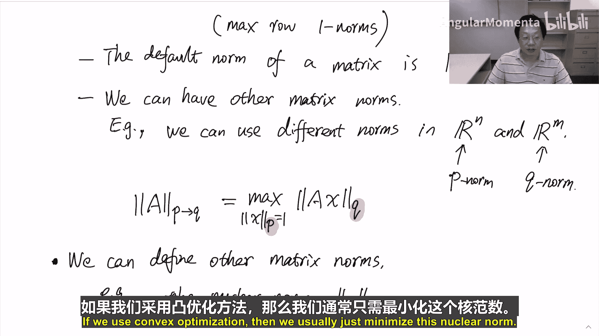

# 015：矩阵范数（二）📐

在本节课中，我们将学习定义矩阵范数的另一种方法。我们将从线性变换的角度来理解矩阵，并定义矩阵的P范数。我们还将通过几何可视化来理解不同P值（如2和1）下矩阵范数的含义，并探讨其解析表达式。最后，我们会简要介绍混合范数与核范数。

---

## 从线性变换定义矩阵范数

从线性代数的知识可知，一个 M×N 的矩阵可以视为一个从 **R^N** 到 **R^M** 的线性变换。换句话说，如果我们有一个大小为 M×N 的矩阵 **A**，它可以等同于一个线性变换（仍记为 **A**），该变换将 N 维欧几里得空间中的向量映射到 **R^M** 中的向量。

基于这种理解，我们可以定义矩阵范数。我们将矩阵 **A** 的 P 范数定义如下：

**公式：**
\[
\|A\|_p = \max_{x \neq 0} \frac{\|Ax\|_p}{\|x\|_p}
\]

在这个定义中，分子是像（image）的 P 范数，分母是定义域（domain）向量的 P 范数。由于分母不能为零，我们取所有非零向量 **x** 中该比值的最大值。这个定义将矩阵 **A** 视为线性变换，并衡量其“放大”向量的最大能力。

为了简化计算，可以证明上述定义等价于在单位 P 范数球面上寻找最大值：

**公式：**
\[
\|A\|_p = \max_{\|x\|_p = 1} \|Ax\|_p
\]

这个定义就是**矩阵的 P 范数**。

---

## 矩阵范数的几何可视化

为了直观理解矩阵 P 范数，我们可以观察当 P 取不同值时，单位球面在线性变换下的图像。

### 当 P = 2 时

当 P=2 时，我们考虑 **R^N** 中的二范数单位球 **B₂**：
\[
B_2 = \{ x \in \mathbb{R}^N \mid \|x\|_2 = 1 \}
\]
这是一个球体。对这个球体施加线性变换 **A**，由于 **A** 是线性变换，它会将球体映射为一个椭球体（ellipsoid），位于 **R^M** 空间中。

根据定义，矩阵的二范数 \(\|A\|_2\) 就是这个椭球体上所有点的二范数中的最大值。从几何上看，这个最大值对应于椭球体最长主轴的长度。因此，**矩阵的二范数等于变换后椭球体最长轴的长度**。

### 当 P = 1 时

当 P=1 时，我们考虑 **R^N** 中的一范数单位球 **B₁**：
\[
B_1 = \{ x \in \mathbb{R}^N \mid \|x\|_1 = 1 \}
\]
这是一个菱形（旋转的正方形，是多面体）。对这个菱形施加线性变换 **A**，由于线性变换保持直线性，其图像在 **R^M** 中仍然是一个多面体。

矩阵的一范数 \(\|A\|_1\) 就是这个多面体上所有点的一范数中的最大值。在示例图像中，这个最大值通常出现在多面体的某个顶点上。

对于无穷范数（P = ∞），可以进行类似的可视化分析，感兴趣可以自行尝试。

---

## 矩阵范数的解析表达式

除了几何理解，矩阵的 P 范数也有具体的解析计算公式。

### 矩阵的二范数（P=2）

矩阵的二范数有一个重要的解析形式。根据定义：
\[
\|A\|_2 = \max_{\|x\|_2 = 1} \|Ax\|_2
\]
由于平方函数是单调递增的，求最大值的点相同，因此：
\[
\|A\|_2^2 = \max_{\|x\|_2 = 1} \|Ax\|_2^2 = \max_{\|x\|_2 = 1} x^T A^T A x
\]
这个表达式恰好是矩阵 **A^T A** 的最大特征值（maximum eigenvalue）的变分形式。因此：

**公式：**
\[
\|A\|_2 = \sqrt{\lambda_{\max}(A^T A)}
\]
其中 \(\lambda_{\max}\) 表示最大特征值。这也被称为矩阵 **A** 的**最大奇异值（maximum singular value）**。矩阵二范数在许多教科书中也被称为**算子范数（operator norm）**，并且常被默认为 **R^{M×N}** 空间中的默认范数。

### 矩阵的一范数（P=1）

矩阵的一范数也有简洁的解析形式。可以证明：
\[
\|A\|_1 = \max_{1 \le j \le n} \sum_{i=1}^{m} |a_{ij}|
\]
观察这个公式，\(\sum_{i=1}^{m} |a_{ij}|\) 正是矩阵 **A** 第 j 列的一范数。因此，**矩阵的一范数等于其所有列向量一范数中的最大值**。

### 矩阵的无穷范数（P=∞）

矩阵的无穷范数与一范数形式相似，但需要对行进行操作：
\[
\|A\|_\infty = \max_{1 \le i \le m} \sum_{j=1}^{n} |a_{ij}|
\]
这里，\(\sum_{j=1}^{n} |a_{ij}|\) 是矩阵 **A** 第 i 行的一范数。因此，**矩阵的无穷范数等于其所有行向量一范数中的最大值**。

---

## 混合矩阵范数

在定义矩阵 P 范数时，我们在定义域（**R^N**）和像空间（**R^M**）中使用了相同的 P 范数。但实际上，我们可以在这两个空间中使用不同的范数。

例如，在定义域中使用 P 范数，在像空间中使用 Q 范数，这样我们可以定义一个新的矩阵范数，记作 \(\|A\|_{p \to q}\)：

**公式：**
\[
\|A\|_{p \to q} = \max_{\|x\|_p = 1} \|Ax\|_q
\]
这里，我们考虑定义域中的 P 范数单位球，但衡量像向量时使用 Q 范数。

这种混合范数在机器学习中非常有用。例如，在处理低秩矩阵分解问题时，如果因子矩阵具有某种特殊结构，我们可能会使用这类混合 P-Q 范数来构建优化目标。

---

## 其他矩阵范数简介

除了上述基于向量范数诱导出的矩阵范数，还存在其他重要的矩阵范数定义。

其中一个是**核范数（nuclear norm）**，通常记为 \(\|A\|_*\)。核范数涉及较多的数学知识（如奇异值），此处不展开其严格定义。但需要知道的是，核范数在机器学习中极其重要，尤其是在处理与低秩矩阵相关的问题时。当我们使用凸优化（convex optimization）方法时，通常通过最小化矩阵的核范数来寻找低秩解。

---

## 总结

本节课我们一起学习了定义矩阵范数的多种视角：

1.  **向量视角**：将矩阵视为长向量，直接应用向量 P 范数，得到矩阵的向量式范数（如 Frobenius 范数）。
2.  **线性变换视角**：将矩阵视为线性变换，通过比值 \(\frac{\|Ax\|_p}{\|x\|_p}\) 的最大值定义**矩阵的 P 范数**。我们通过几何可视化理解了 P=2 和 P=1 时的含义，并学习了其二范数、一范数和无穷范数的解析计算公式。
3.  **扩展视角**：介绍了可以在定义域和像空间使用不同范数的**混合矩阵范数**，并简要提及了在低秩矩阵恢复等问题中至关重要的**核范数**。

这些矩阵范数是机器学习和数据分析中描述矩阵大小、衡量变换程度以及构建优化模型的基础工具。