# 017：范数概念的深入探讨与示例 🔍

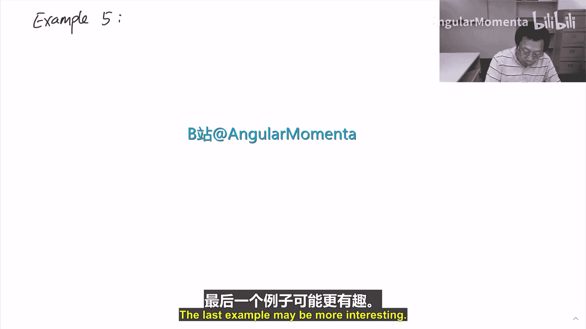

在本节课中，我们将通过一个具体的例子，深入探讨向量空间中范数的定义和性质。我们将看到，即使在同一个向量空间上，也可以定义不同的范数，并且这些范数的选择在实际应用中（如机器学习）会产生截然不同的结果。

---

上一节我们介绍了范数的基本定义和性质。本节中，我们来看一个更复杂的例子，它揭示了范数定义中的一些微妙之处。

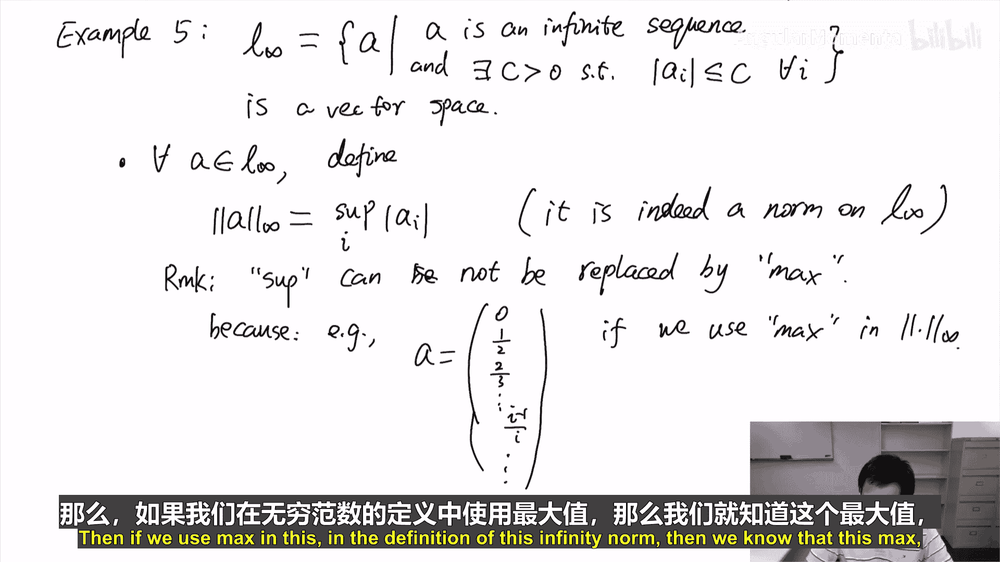

我们考虑一个由**无限序列**构成的向量空间，称为 **L∞** 空间。这个空间中的每个元素 **a** 都是一个无限序列：
**a = (a₁, a₂, a₃, ...)**
并且序列中的所有元素都是有界的，即存在一个常数 **C**，使得对于所有的 **i**，都有 **|aᵢ| ≤ C**。

在这个空间上，我们可以定义 **无穷范数**（Infinity Norm）：
**||a||∞ = supᵢ |aᵢ|**

以下是关于这个定义的一个关键说明：
这个定义中的 **sup**（上确界）**不能**被替换为 **max**（最大值）。

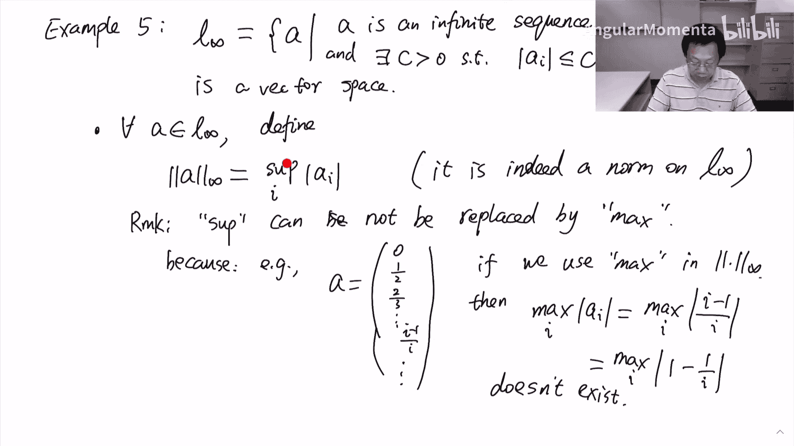

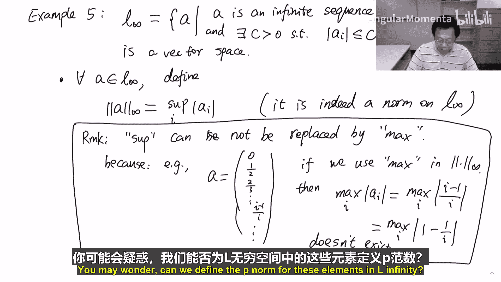

为了理解这一点，我们来看一个例子。考虑序列：
**a = (0, 1/2, 2/3, 3/4, ...)**
其第 **i** 项为 **aᵢ = (i-1)/i = 1 - 1/i**。

*   对于任何固定的 **i**，**aᵢ** 都是一个小于1的确定数值。
*   但是，随着 **i** 无限增大，**aᵢ** 会无限趋近于1。
*   在这个序列中，没有任何一项的值**等于**1，因此最大值 **maxᵢ |aᵢ|** 并不存在。
*   然而，所有项的上确界 **supᵢ |aᵢ|** 是存在的，它就是1。

这就是为什么在定义无穷范数时，我们必须使用上确界 **sup** 而不是最大值 **max**。

---

你可能会问，我们能否像在有限维空间 **ℝⁿ** 中一样，在 **L∞** 空间上定义 **p-范数**呢？其定义形式类似：
**||a||ₚ = ( Σᵢ₌₁∞ |aᵢ|ᵖ )^(1/p)**

但我们必须小心，对于 **L∞** 空间中的某些向量，这样定义的 **p-范数** **可能不是一个有效的范数**。

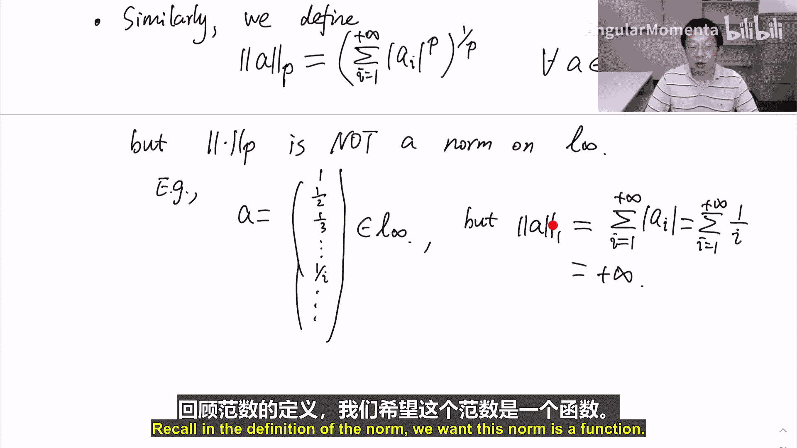

让我们来看一个反例。考虑序列：
**a = (1, 1/2, 1/3, 1/4, ...)**
其第 **i** 项为 **aᵢ = 1/i**。这个序列的所有项都被1所界定，因此它确实属于 **L∞** 空间。

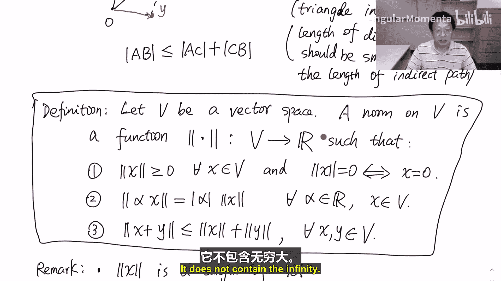

现在，计算它的 **1-范数**：
**||a||₁ = Σᵢ₌₁∞ |1/i| = 1 + 1/2 + 1/3 + 1/4 + ...**
这是一个著名的调和级数，它是**发散**的，其和为**无穷大**。

根据范数的定义，范数必须是一个从向量空间 **V** 到实数集 **ℝ** 的**函数**，且输出值必须是**有限的**实数。由于 **||a||₁ = ∞**，这意味着 **1-范数** 将 **L∞** 空间中的某些向量映射到了“无穷大”，这违反了范数的定义。因此，这样定义的 **1-范数** 在 **L∞** 空间上甚至不是一个合格的函数，更谈不上是范数了。

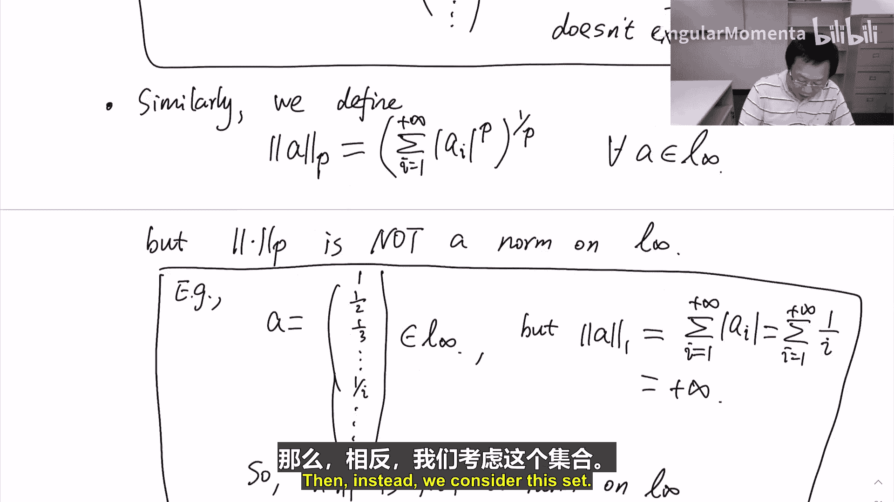

---

那么，如何正确定义一个适用于无限序列的 **p-范数** 呢？通常，我们不是在整个 **L∞** 空间上定义它，而是考虑它的一个**子集**，即所谓的 **Lᵖ 空间**。

**Lᵖ 空间** 定义为：
**Lᵖ = { a ∈ L∞ | ||a||ₚ < ∞ }**
也就是说，**Lᵖ** 空间包含了所有那些 **p-范数** 为有限值的无限序列。

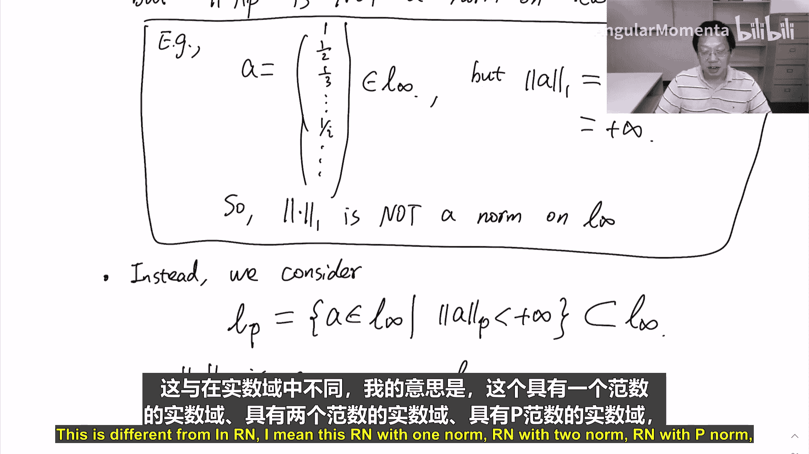

通过这种方式，我们将那些会导致 **p-范数** 为无穷大的序列排除在外。于是，**p-范数** 就成为了 **Lᵖ 空间** 上一个真正有效的范数。

这与有限维空间 **ℝⁿ** 的情况截然不同。在 **ℝⁿ** 中，无论使用1-范数、2-范数还是p-范数，向量空间所包含的元素集合都是完全相同的。但在无限序列的空间中，**L¹**、**L²** 和 **L∞** 所包含的元素集合是**不同**的。

让我们再次用之前的例子来说明：
序列 **a = (1, 1/2, 1/3, ...)**

*   它的无穷范数 **||a||∞ = 1**，所以 **a ∈ L∞**。
*   它的2-范数 **||a||₂ = √(Σ 1/i²) = √(π²/6) = π/√6**，是有限值，所以 **a ∈ L²**。
*   它的1-范数 **||a||₁ = Σ 1/i = ∞**，是无穷大，所以 **a ∉ L¹**。

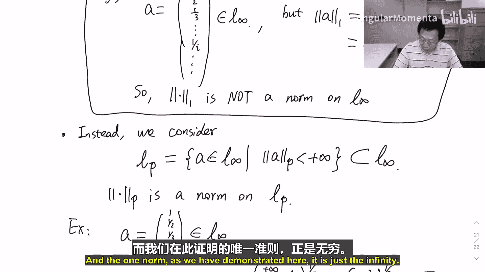

事实上，可以证明，对于任何 **p > 1**，这个序列的 **p-范数** 都是有限的，因此 **a ∈ Lᵖ** 对所有 **p > 1** 都成立，但唯独不属于 **L¹**。

---

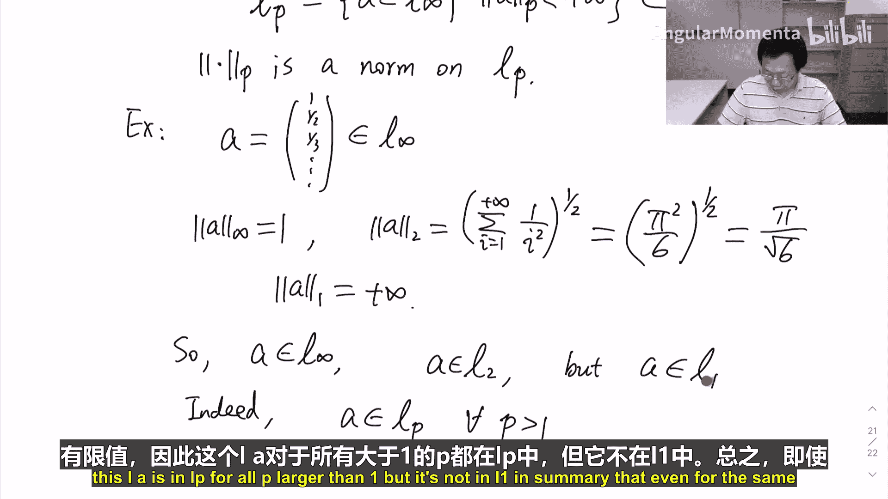

本节课中我们一起学习了范数概念在无限维空间中的延伸。我们通过具体的例子了解到：

1.  **范数的多样性**：即使在同一个向量空间（如无限序列空间）上，也可以定义多种不同的范数（如无穷范数、p-范数），但它们适用的向量子集可能不同。
2.  **定义的精巧性**：定义范数时需要非常小心，确保其值始终为有限实数。在无限维情况下，这可能导致我们需要将定义域限制在某个子空间（如 **Lᵖ** 空间）上。
3.  **应用的重要性**：正如多次提到的，在机器学习等实际应用中，选择不同的范数进行优化（例如，最小化未知向量的范数），会产生完全不同的结果。例如，为了获得**稀疏解**（即大部分分量为零的向量），我们通常选择最小化**1-范数**；而如果使用**2-范数**，则几乎不可能得到稀疏向量。

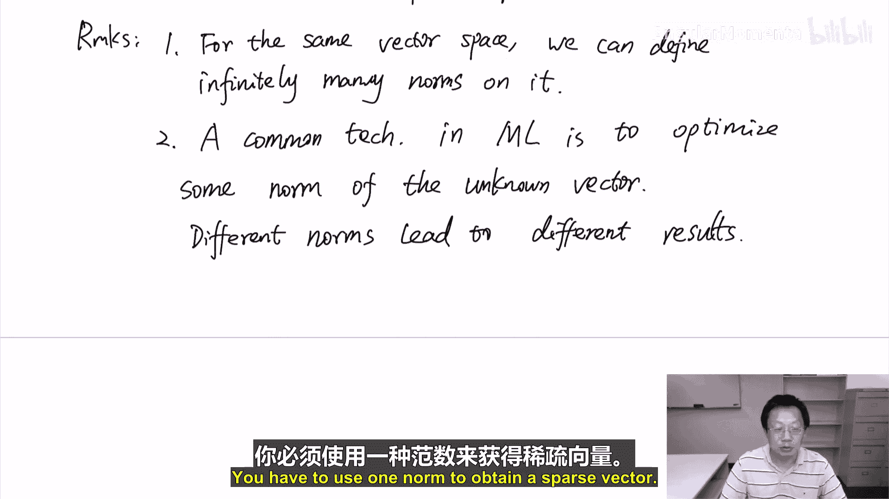

理解不同范数的定义、性质及其背后的空间结构，是理解和应用许多现代数据分析与机器学习算法的基础。