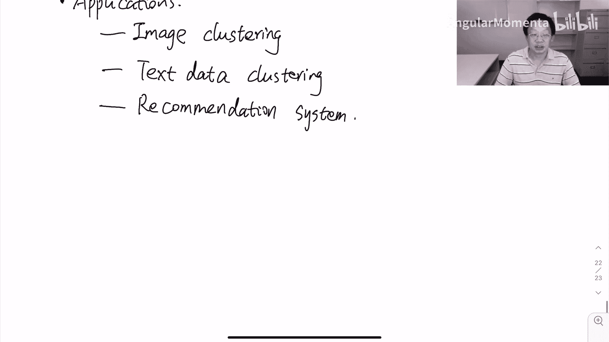

# 018：聚类案例研究 🎯

在本节课中，我们将学习向量空间和范数的一个实际应用：聚类分析。我们将介绍经典的K-means算法，并了解如何使用它来解决数据分组问题。

上一节我们介绍了向量空间和范数的基本概念，本节中我们来看看它们如何应用于一个具体的机器学习任务——聚类。

## 聚类任务定义

聚类任务描述如下。假设我们被给定 **M** 个向量，它们位于向量空间 **R^N** 中。这些向量记为 **x_1, x_2, ..., x_M**，每个都是 **R^N** 中的一个向量。我们的目标是将它们分到不同的组中，即分成 **K** 个组。这里 **K** 是已知的组数。这个过程被称为聚类。

我们可以用一张图来演示聚类。假设这个屏幕平面就是 **R^2**。我们被给定 **M** 个 **R^N** 中的向量，这意味着我们在屏幕上有 **M** 个点。

现在，我想将它们分组，比如分成 **K=3** 组。显然，对于这个简单的例子，一个好的分组可能看起来像这样。这是机器学习中一个简单的聚类任务。

你可能已经注意到我使用了 **R^N** 这个向量空间，但 **R^N** 并非必需。实际上，它可以被任何向量空间替代。这里使用 **R^N** 仅仅是为了简单起见。它可以被任何向量空间替换。

## 聚类的应用

聚类的应用无处不在，我想你一定非常熟悉它们。

以下是聚类的一些常见应用场景：

*   **图像聚类**：例如，我们有一个包含许多人脸的数据库，我们希望根据不同的人对它们进行分组。
*   **文本数据聚类**：我们被给定许多文章，我们希望将它们分成不同的类别，以便可以向不同的读者推荐。
*   **推荐系统**：在推荐系统中，我们可能会根据用户对电影的评分对用户进行聚类。这样，同一组内的用户可能具有相同的品味，我们就可以向同一组内的用户推荐相似的电影。

这些只是聚类的一些明显应用。

当然，对于文本数据聚类，我们需要做的第一件事是向量化。我们需要用一个向量来首先表示每段文本。

本节课中我们一起学习了聚类问题的基本定义、直观展示以及广泛的应用场景。我们了解到，聚类的核心是将数据点（通常表示为向量）划分到不同的组中，并且这个任务可以应用于图像、文本和推荐系统等多个领域。在接下来的课程中，我们将深入探讨解决这一问题的具体算法。