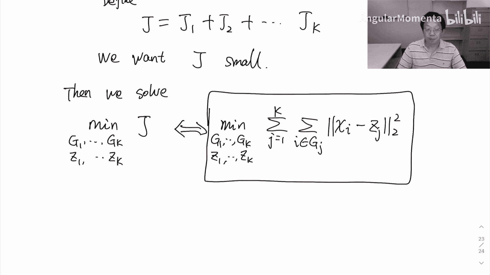

# 019：聚类问题的数学建模 🧮

在本节课中，我们将学习如何用数学方法解决聚类问题。我们将遵循“机器学习 = 表示 + 评估 + 优化”的框架，从数学角度对聚类任务进行建模。

## 表示：如何描述聚类结果 📊

上一节我们介绍了聚类问题的背景，本节中我们来看看如何用数学语言来描述聚类的结果。

首先，输入数据已经被表示为向量，我们无需额外处理。我们需要表示的是“学习器”，即如何将数据点划分到不同的组中。

以下是表示聚类结果所需的数学概念：

*   **数据点分组标签**：对于每个数据点 `x_i`，我们使用 `c_i` 来表示它所属的组别。例如，如果 `x_1` 属于第2组，则 `c_1 = 2`。
*   **组别成员集合**：对于每个组 `j`，我们使用 `G_j` 来表示该组包含哪些数据点的索引集合。其定义为 `G_j = { i | c_i = j }`。例如，如果 `x_1` 属于第2组，那么 `1 ∈ G_2`。
*   **组代表向量**：对于每个组 `j`，我们引入一个**代表向量** `z_j`。这个向量用于代表整个组的特征。在后续的讨论中，我们会看到 `z_j` 通常是该组数据的中心。需要注意的是，`z_j` 不一定来自原始输入数据 `{x_1, ..., x_N}`，它可以是算法生成的一个“人造”向量。

`c_i` 和 `G_j` 之间存在一一对应关系。知道 `c_i` 可以推导出 `G_j`，反之亦然。因此，在实际建模时，我们通常只需使用其中一种表示方式即可。这里我们主要使用 `G_j` 和 `z_j` 来描述聚类。

## 评估：如何衡量聚类的好坏 ⚖️

有了表示方法后，我们需要一个标准来评估哪种分组 `{G_j}` 和代表向量 `{z_j}` 是最好的。这就是评估步骤。

一个好的聚类应该满足：**同一组内的数据点彼此相似**。由于我们为每个组 `j` 定义了代表向量 `z_j`，这个目标可以转化为：**组 `G_j` 内的所有数据点都应接近其代表向量 `z_j`**。

为了量化这个“接近程度”，我们定义一个目标函数（或称损失函数）。

首先，对于单个数据点 `x_i`，它与代表向量 `z_j` 的接近程度可以用它们之间的**距离**来衡量。我们通常使用欧几里得距离的平方，即 **`||x_i - z_j||_2^2`**。平方函数在输入为正时是单调递增的，因此最小化平方距离等价于最小化距离本身。

对于一个特定的组 `G_j`，我们希望组内所有点都接近 `z_j`。因此，我们定义该组的损失 `J_j` 为组内所有点到其代表向量距离平方的总和：

**`J_j = Σ_{i ∈ G_j} ||x_i - z_j||_2^2`**

`J_j` 越小，说明组 `G_j` 内的点越紧密地聚集在 `z_j` 周围。

我们的数据被分成了 `K` 个组。我们希望**所有组**的内部都足够紧密。因此，整体的聚类损失 `J` 定义为所有组损失的总和：

**`J = Σ_{j=1}^{K} J_j = Σ_{j=1}^{K} Σ_{i ∈ G_j} ||x_i - z_j||_2^2`**

我们的目标就是找到最佳的分组 `{G_1, ..., G_K}` 和代表向量 `{z_1, ..., z_K}`，使得这个总损失 `J` 达到最小。这构成了一个优化问题：

**`minimize_{ {G_j}, {z_j} } J = Σ_{j=1}^{K} Σ_{i ∈ G_j} ||x_i - z_j||_2^2`**

## 总结 📝

本节课中我们一起学习了如何为聚类问题建立数学模型。

1.  **在表示部分**，我们引入了分组标签 `c_i`、组集合 `G_j` 和组代表向量 `z_j` 来描述聚类结果。
2.  **在评估部分**，我们基于“组内数据点应彼此相似”的直觉，定义了量化的目标函数 `J`。该函数计算了所有数据点到其所属组代表向量的距离平方和。聚类任务被形式化为一个最小化 `J` 的优化问题。

通过这个数学框架，我们将一个直观的“分组”任务，转化为了一个明确的、可计算的数学问题。在接下来的课程中，我们将探讨如何求解这个优化问题。