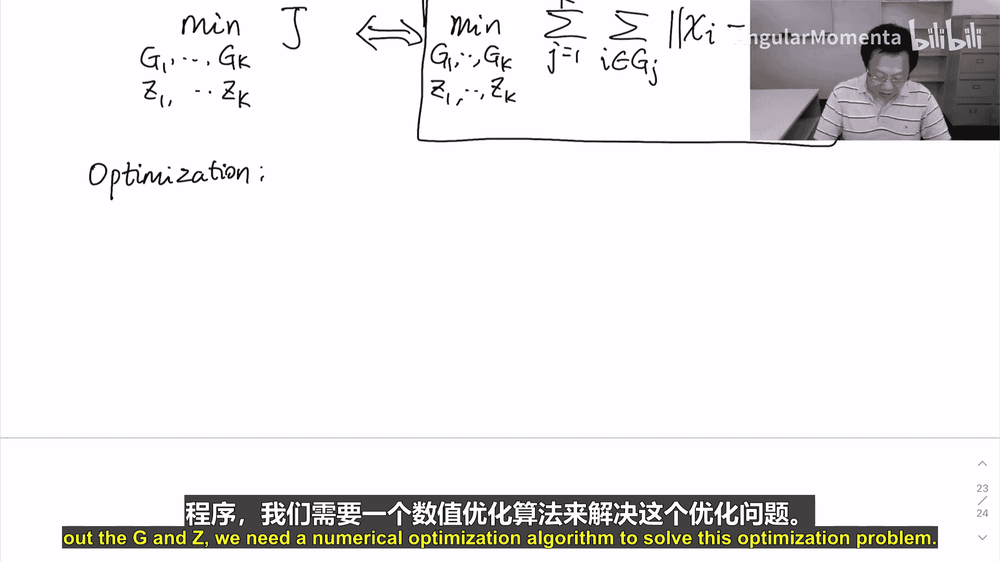
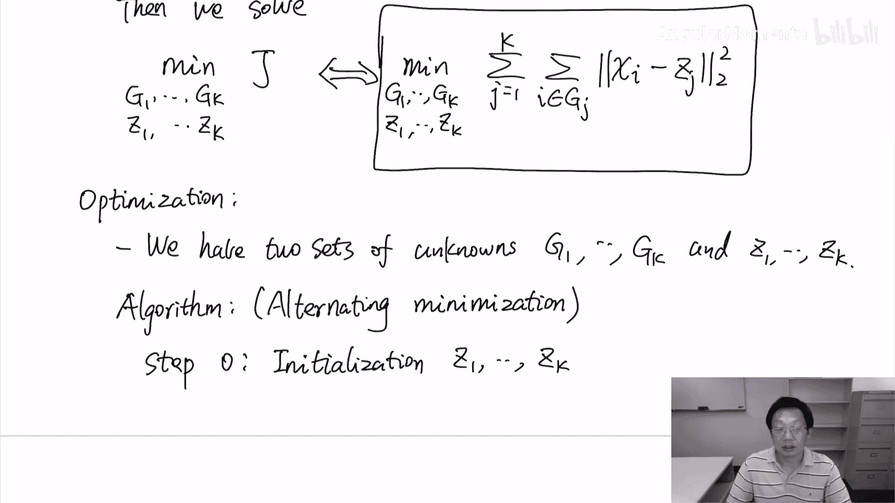
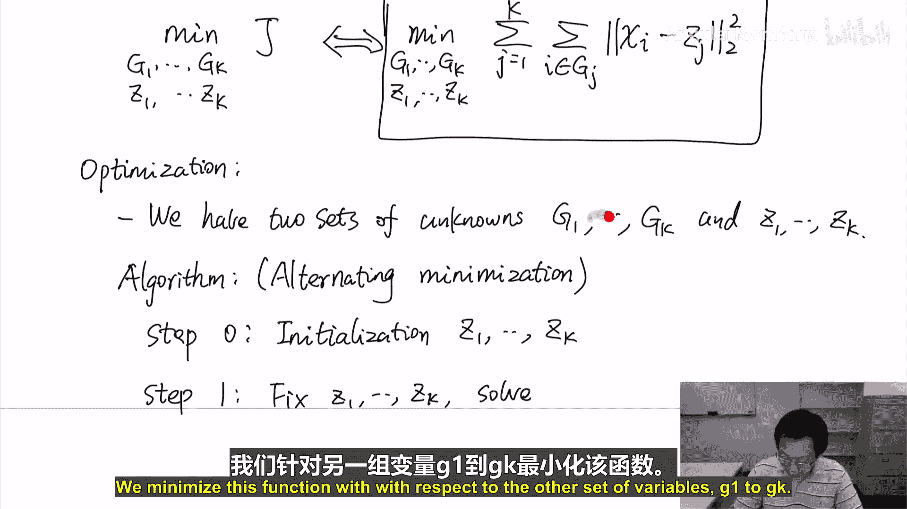
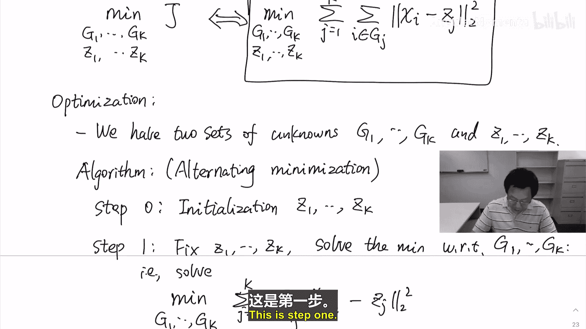
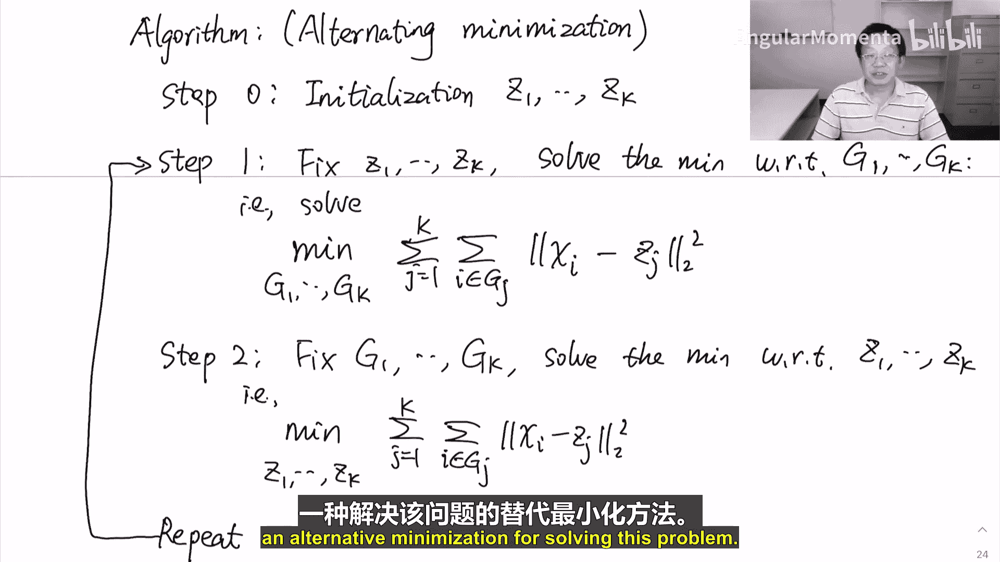
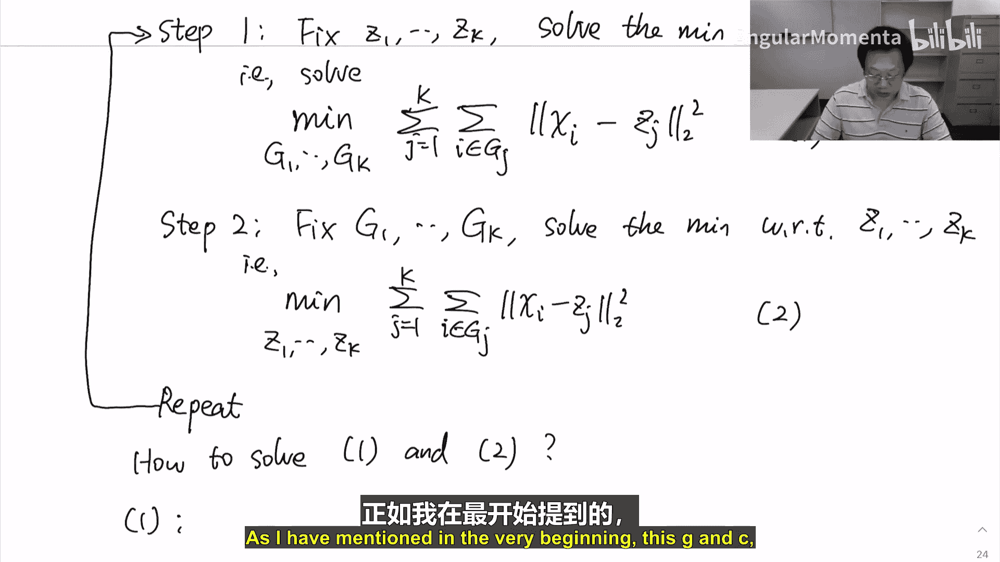
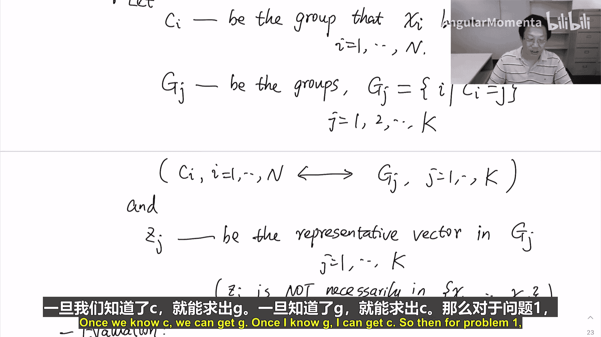
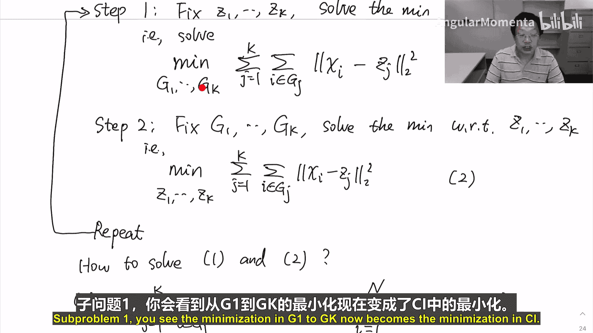
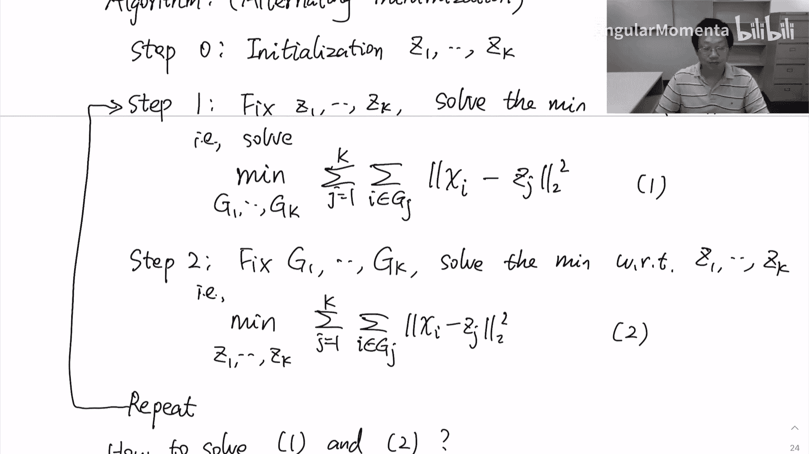
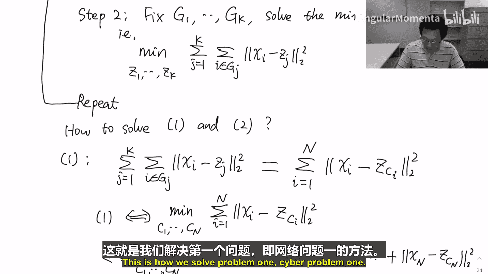

# 020：K-Means算法优化步骤详解 🧮



在本节中，我们将学习如何通过数值优化算法，将K-Means聚类的数学目标函数转化为一个可以实际执行的算法。我们将重点介绍**交替最小化**方法，并推导出每一步更新的具体公式。

上一节我们介绍了K-Means的目标函数，它只是一个数学形式。本节中我们来看看如何通过一个具体的算法来求解这个优化问题。

## 优化问题与交替最小化



目标函数涉及两组未知变量：**分组集合 G** 和 **代表点集合 Z**。为了求解，我们采用**交替最小化**技术：先固定一组变量，优化另一组变量，然后交替进行。



以下是交替最小化的算法框架：



**步骤 0：初始化**
首先，我们需要一个初始解作为起点。可以任意猜测一组代表点 `Z1` 到 `Zk`。

```python
# 伪代码示例：随机初始化K个代表点
Z = initialize_Z_randomly(data, K)
```

**步骤 1：固定Z，优化G（即优化C）**
固定代表点 `Z`，求解目标函数关于分组 `G` 的最小化问题。由于 `G` 与分配向量 `C` 一一对应，这等价于优化 `C`。



**步骤 2：固定G（即固定C），优化Z**
固定分组结果，求解目标函数关于代表点 `Z` 的最小化问题，以得到更好的代表点。

**重复**
重复步骤1和步骤2，直到获得满意的解（例如，分配不再变化或目标函数变化很小）。



然而，上述框架中的两个最小化子问题（步骤1和2）仍需具体的求解公式。接下来，我们将分别推导这两个问题的闭式解。



## 问题一：固定Z，求解C（即分配数据点）

当代表点 `Z` 固定时，目标函数简化为对每个数据点 `Xi` 独立求解其所属组别 `Ci`。

目标函数为：
```
最小化 Σ_{i=1}^{n} || Xi - Z_{Ci} ||²
```
由于求和项中的每一项只依赖于一个 `Ci`，因此可以**独立地**为每个 `i` 求解以下问题：
```
最小化_{Ci ∈ {1, 2, ..., k}} || Xi - Z_{Ci} ||²
```



这意味着，对于第 `i` 个数据点 `Xi`，我们只需计算它到所有 `k` 个代表点 `Zj` 的距离（欧几里得距离的平方），然后将其分配到**距离最近**的那个代表点所在的组。

用语言描述：
> 将每个数据点 `Xi` 分配到离它最近的那个代表点所对应的组。

```python
# 伪代码示例：分配数据点到最近的代表点
for i in range(n):
    distances = [compute_distance(X[i], Z[j]) for j in range(K)]
    C[i] = argmin(distances) # 返回最小距离对应的索引j
```

## 问题二：固定C（即固定分组），求解Z

当每个数据点的分组 `Ci` 固定后，目标函数变为关于代表点 `Zj` 的优化问题。

目标函数为：
```
最小化 Σ_{j=1}^{k} Σ_{i ∈ Gj} || Xi - Zj ||²
```
对于每个固定的组 `j`，其内部的求和项 `Σ_{i ∈ Gj} || Xi - Zj ||²` 只与 `Zj` 有关，且形式为关于 `Zj` 的二次函数。这是一个经典的**均值问题**。

通过求导并令导数为零，可以得出最优解：
> 每个组 `j` 的最优代表点 `Zj`，就是属于该组的所有数据点 `Xi` 的**均值（质心）**。

公式表示为：
```
Zj = (1 / |Gj|) * Σ_{i ∈ Gj} Xi
```
其中 `|Gj|` 是第 `j` 组中数据点的数量。

```python
# 伪代码示例：更新代表点为组内均值
for j in range(K):
    # 找出所有属于组j的数据点索引
    indices = [i for i in range(n) if C[i] == j]
    if len(indices) > 0:
        Z[j] = mean(X[indices]) # 计算均值
```

## 算法流程总结

结合以上推导，我们得到了完整的K-Means算法：

1.  **初始化**：随机选择 `k` 个点作为初始代表点。
2.  **分配步骤**（对应问题一）：将每个数据点分配到最近的代表点所在的组。
3.  **更新步骤**（对应问题二）：将每个组的代表点更新为该组所有点的均值。
4.  **重复**：重复步骤2和3，直到分配结果不再变化（或达到最大迭代次数）。





本节课中我们一起学习了K-Means算法的核心优化过程。我们了解到，通过**交替最小化**策略，并将复杂的联合优化分解为两个可独立求解的子问题——**最近邻分配**和**质心计算**——从而将一个数学目标函数转化为一个清晰、可执行的迭代算法。这正是K-Means算法简洁而强大之处。