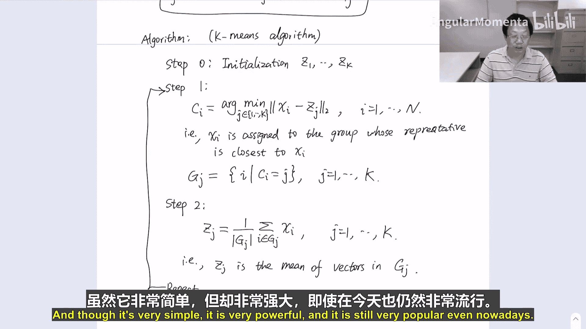
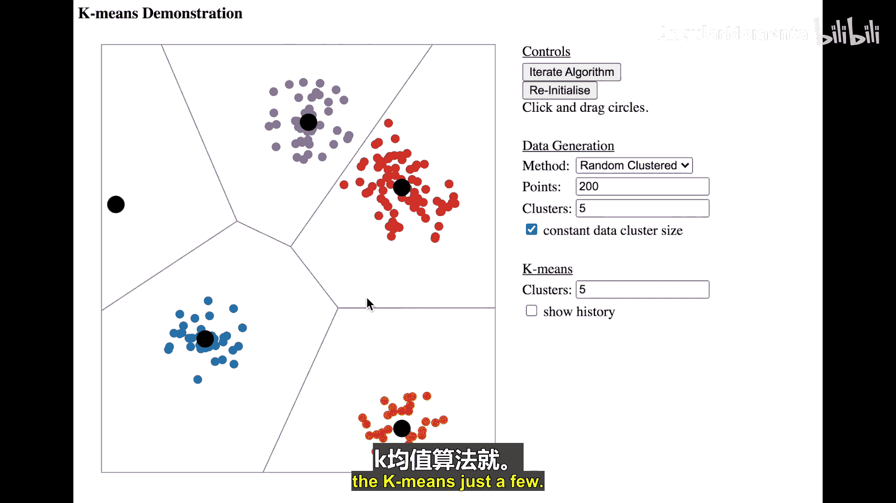

# 022：K均值算法详解 🧮

在本节课中，我们将要学习K均值聚类算法的具体步骤和原理。这是一种基础但强大的数据分析方法，用于将数据点自动分组。

上一节我们介绍了聚类问题的数学形式化，本节中我们来看看如何通过一个迭代算法来求解这个问题。

## 算法步骤

以下是K均值算法的两个核心迭代步骤。

**步骤一：分配数据点**
对于每一个数据点 `X_i`，将其分配到距离最近的代表点所属的组。
`X_i` 被分配给那个其代表点 `Z_j` 与 `X_i` 距离最近的组 `G_j`。
完成此步骤后，我们得到了新的分组 `G_j`。

**步骤二：更新代表点**
在得到新的分组 `G_j` 后，我们需要重新计算每个组的代表点。
对于 `j = 1, 2, ..., k`，新的代表点 `Z_j` 是组 `G_j` 中所有向量的**均值**。
公式表示为：`Z_j = mean(vectors in G_j)`。

## 完整算法流程

现在，让我们将这两个步骤整合成一个完整的、可操作的算法。

1.  **初始化**：从数据点 `X_1` 到 `X_N` 中随机选择 `K` 个向量作为初始代表点 `Z_j`。
2.  **开始迭代**：
    *   **分配**：对于每个数据点 `X_i`，计算其到所有代表点 `Z_j` 的距离，并将其分配到距离最近的代表点所在的组 `G_j`。
    *   **更新**：对于每个组 `G_j`，计算组内所有数据点的均值，将此均值设为新的代表点 `Z_j`。
3.  **重复**：重复执行“分配”和“更新”步骤，直到代表点 `Z_j` 不再发生显著变化，或达到预设的迭代次数。

这个算法非常简单，只有两个核心步骤：首先将每个向量分配给最近的代表点，然后根据新的分组重新计算每个组的均值作为新代表点。正因为更新步骤中“均值”的核心作用，该算法被称为 **K均值算法**。它虽然简单，但功能强大，至今仍被广泛使用。

## 算法演示

为了直观理解K均值算法的工作过程，我们来看一个动态演示。

图中的小点代表我们的数据点 `X_i`（本例中N=200）。大黑点则代表算法中的代表点 `Z_j`。

*   **初始化**：我们随机选择了三个代表点（大黑点）。
*   **第一次迭代**：每个小点根据距离被分配给最近的代表点，从而被标记为不同颜色（组）。此时，右上角的代表点所属的组没有任何数据点。
*   **后续迭代**：算法根据新的分组计算代表点的均值，代表点位置发生移动。数据点的分组也随之更新。经过数次迭代后，算法成功地将数据点分成了三个清晰的簇。

我们也可以尝试更复杂的情况，例如有五个簇的数据。虽然算法初始化了五个代表点，但在迭代过程中，有些代表点可能因为所属组没有数据点而被“淘汰”，最终算法可能收敛到一个有效的、但数量少于初始值的聚类结果。这说明了算法对初始值敏感的特性。

## 总结

本节课中我们一起学习了K均值聚类算法。我们了解了其核心思想是通过迭代执行“分配”和“更新”两个步骤来最小化簇内距离。我们看到了该算法的完整流程，并通过演示观察了其工作过程及效果。K均值算法在大多数情况下非常有效，但它也存在局限性，例如对初始值敏感，并且在某些情况下可能无法得到预期的聚类结果，正如我们在第一个演示示例中看到的那样。尽管如此，它仍然是数据分析中一个不可或缺的基础工具。