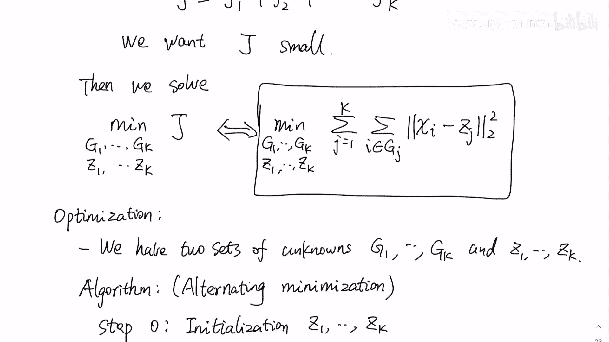
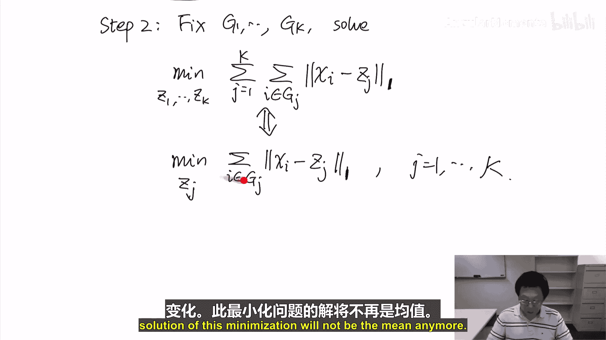
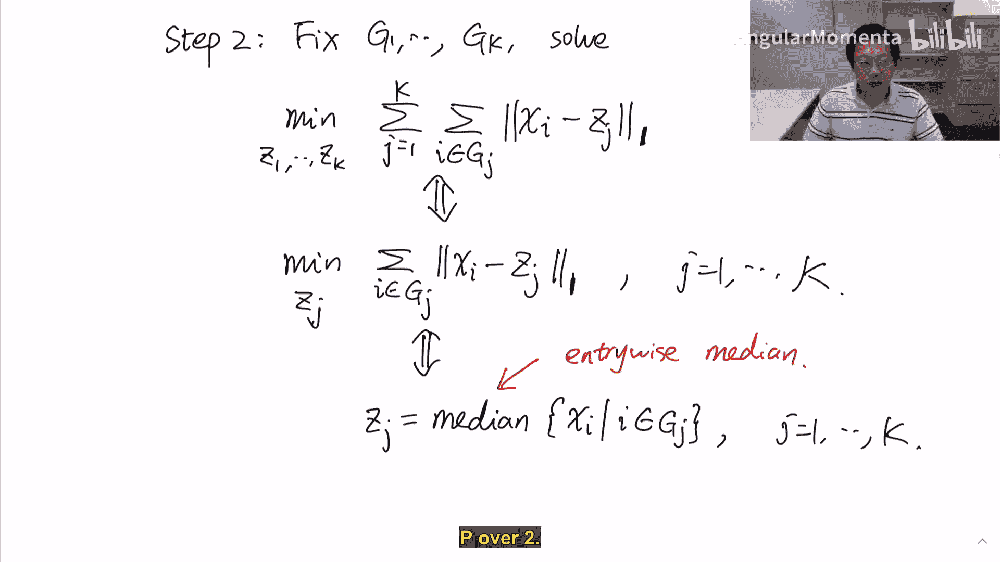
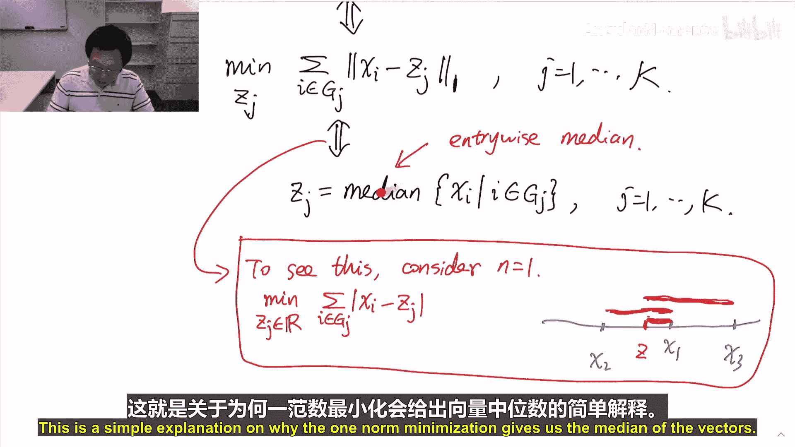
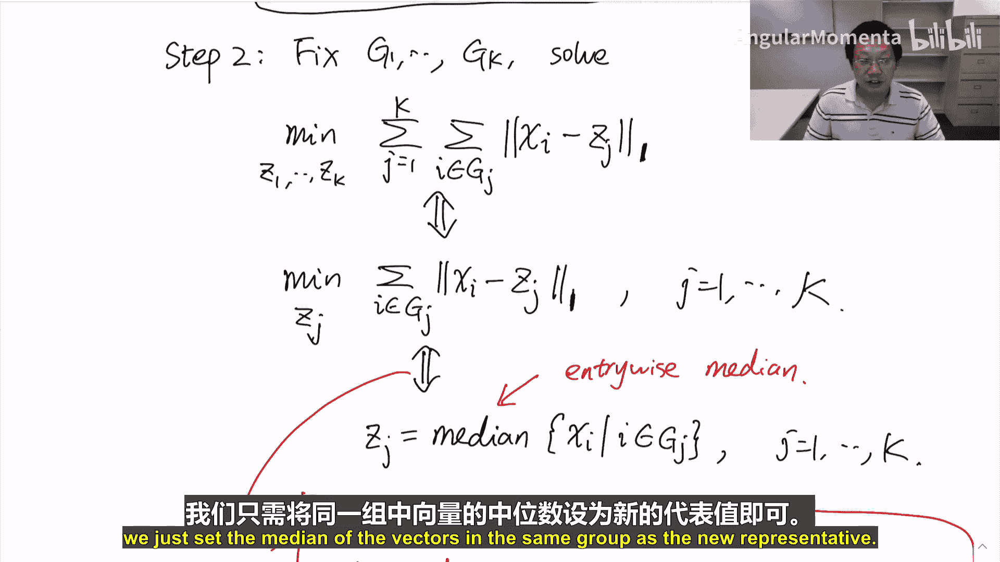
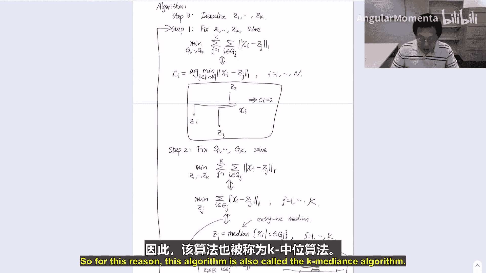
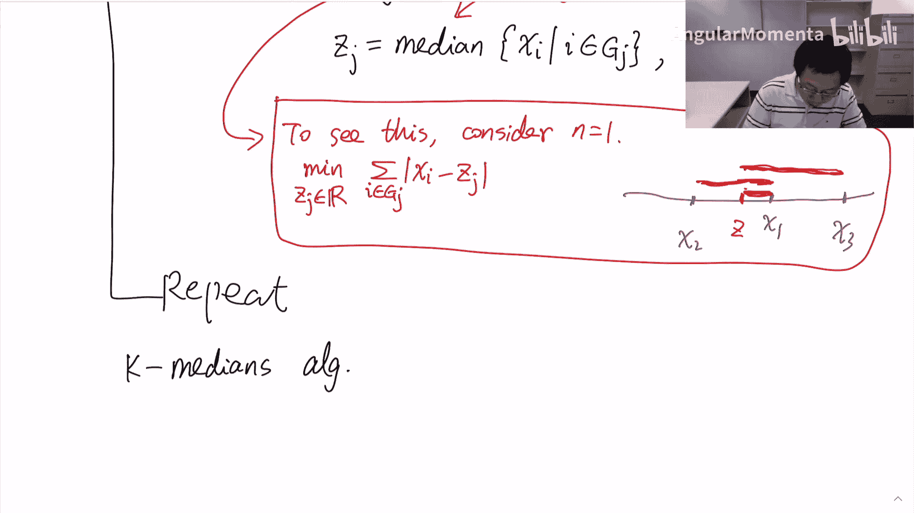

# 023：K-中位数算法 🧮



在本节课中，我们将要学习K-均值算法的一个变体——K-中位数算法。我们将看到，通过改变衡量向量间“距离”的度量方式，我们可以得到一种新的聚类方法，其核心步骤与K-均值相似，但使用了不同的中心点计算方式。

## 算法概述

在K-均值算法中，我们使用了**二范数的平方**作为衡量两个向量接近程度的量化指标。正如我们之前提到的，向量空间上的任何度量都可以用于此目的。因此，这里的二范数平方可以被**RN空间上的任何范数**所替代。

例如，我们可以用**一范数**（不带平方）来替换这个二范数平方。那么，对于聚类问题，我们需要解决同样的最小化问题，但其中的二范数平方被替换为一范数。

## 算法步骤详解

与K-均值算法类似，我们仍然可以使用交替最小化的策略来解决这个问题。以下是K-中位数算法的具体步骤。

### 步骤零：初始化

首先，我们需要初始化代表点Z1到Zk。

### 步骤一：固定代表点，更新分组

在第一步中，我们固定代表点Z1到Zk，然后求解关于分组G1到Gk的最小化问题。此时，我们只处理一范数下的距离。

以下是具体的操作流程：

对于每个数据点Xi，我们计算它与所有代表点Zj在一范数下的距离，然后选择距离最小的那个代表点。Xi就被分配到该代表点所在的组。

例如，假设有一个数据点Xi，以及三个代表点Z1、Z2和Z3。我们分别计算Xi到这三个点的一范数距离（即各坐标差绝对值的和），然后选择距离最小的那个。在这个例子中，如果Z2的距离最小，那么Xi就被分配到第二组。

### 步骤二：固定分组，更新代表点

在第二步中，我们固定分组G1到Gk，然后求解关于代表点Z1到Zk的最小化问题。此时，范数从二范数平方变为了一范数。



这个最小化问题的显式解不再是均值，而是**中位数**。具体来说，每个组的代表点Zj被更新为该组内所有数据点Xi的**逐坐标中位数**。

例如，Zj的第一个坐标是组内所有数据点第一个坐标的中位数，第二个坐标是组内所有数据点第二个坐标的中位数，依此类推。

### 理解中位数解



为了理解为什么一范数最小化会得到中位数解，让我们考虑一个简单的例子，其中n=1（即数据是标量）。

假设我们有三个数：x1, x2, x3。我们的目标是最小化函数 `f(z) = |x1 - z| + |x2 - z| + |x3 - z|`。可以证明，当z等于这三个数的中位数时，这个和达到最小。直观上，如果z不是中位数，那么到某些点的线段会重叠，导致总长度增加；而当z是中位数时，这种重叠最小化。

## 算法总结

现在，步骤二变得非常简单：给定分组后，我们只需将每组内数据点的中位数设为新的代表点。

然后，我们重复这两个步骤，直到结果收敛。这就是K-中位数算法。

与K-均值算法相比，主要区别在于：
*   **K-均值**：使用**均值**作为每组的代表点。
*   **K-中位数**：使用**中位数**作为每组的代表点。



因此，这个算法也被称为**K-中位数算法**。



## 核心公式与代码描述

**核心公式：**
*   分组更新（步骤一）：`argmin_j ||Xi - Zj||_1`
*   代表点更新（步骤二）：`Zj = median({Xi | i ∈ Gj})` （逐坐标计算）

**伪代码描述：**
```
初始化代表点 Z[1], ..., Z[k]
重复直到收敛：
    # 步骤一：分配分组
    for 每个数据点 X[i]:
        G[i] = argmin_j ( sum( |X[i]_d - Z[j]_d| for d in 1..n ) )
    # 步骤二：更新代表点
    for 每个分组 j:
        for 每个坐标维度 d:
            Z[j]_d = median( { X[i]_d for i where G[i] == j } )
```

---





本节课中，我们一起学习了K-中位数算法。我们了解到，通过将K-均值算法中的距离度量从二范数平方改为一范数，代表点的计算就从均值变为了中位数。这种方法对数据中的异常值可能更具鲁棒性。算法的核心框架——交替最小化——保持不变，体现了数学方法在数据分析中的灵活应用。