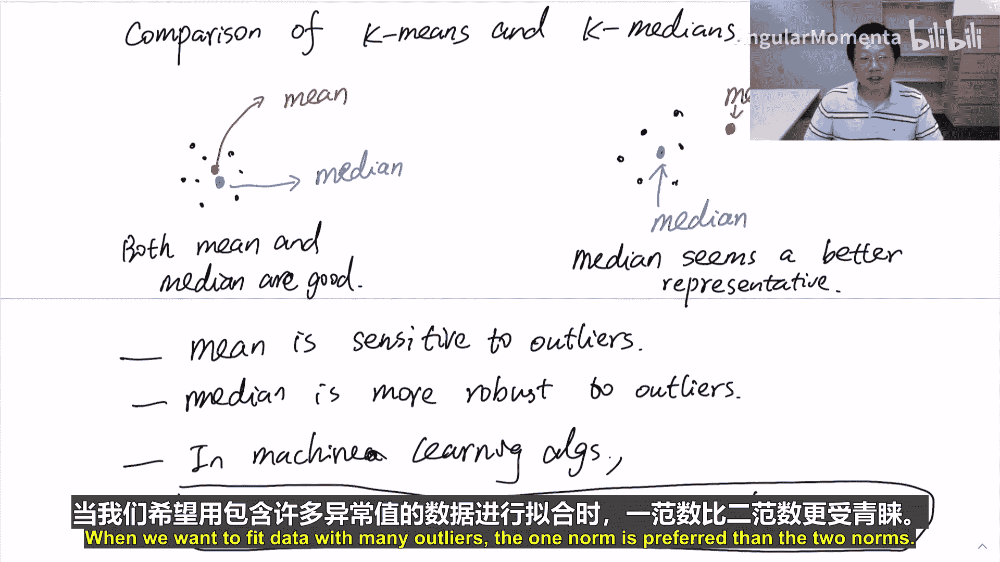

# 024：K-means与K-medoids算法对比 🧮

在本节中，我们将比较K-means和K-medoids这两种聚类算法。我们将重点关注它们在形成新聚类中心时的核心差异，并通过具体例子说明它们对异常值的敏感度有何不同。

上一节我们介绍了K-means和K-medoids的基本流程，本节中我们来看看这两种算法在实际应用中的表现差异。

## 算法核心差异

K-means和K-medoids算法的主要区别在于形成新聚类中心时使用的统计量不同。

*   **K-means** 使用**均值**作为新聚类中心。
*   **K-medoids** 使用**中位数**作为新聚类中心。

## 场景一：数据分布均匀

首先，我们考虑一种理想情况。假设在一次迭代中，某个聚类包含以下数据点。

以下是形成新聚类中心的过程：
*   **K-means**：计算所有点的均值。均值点可能位于此处。
*   **K-medoids**：计算所有点的中位数。中位数点可能位于此处。

在这种情况下，均值和中位数的位置相差不大。两者都是良好的聚类中心代表。

## 场景二：存在异常值

然而，在其他一些情况下，均值和中位数会表现出显著差异。

考虑以下情况。假设当前聚类中的数据点呈如下分布。所有点属于同一个聚类，而其他聚类可能位于较远位置。

虽然这两个点距离本聚类中的大多数点较远，但它们距离本聚类仍比距离其他聚类更近。因此，这两个点仍被归入当前聚类。

以下是形成新聚类中心的过程：
*   **K-means**：计算均值时，所有点（包括两个离群点）都参与计算，因此均值点可能位于此处。
*   **K-medoids**：计算中位数时，我们只关心排序在中间位置的点。这里有九个点，我们关注排名第五的点。这个点就是中位数，它将作为聚类的新中心。

那么，均值和中位数哪个更好？在这个例子中，中位数似乎更优，因为它更接近本聚类中的大多数点。而均值点位于两个子群的中间，既不接近左侧子群，也不接近右侧子群，因此效果不佳。

## 核心结论：对异常值的敏感性

从以上两个例子可以看出：
*   **均值对异常值敏感**。
*   **中位数对异常值更具鲁棒性**。

这种现象的根本原因在于算法背后优化的距离范数不同。

以下是两种算法对应的优化目标：
*   **K-means** 最小化点到聚类中心的**二范数（欧氏距离）平方和**：`min Σ ||x_i - c_k||²`
*   **K-medoids** 最小化点到聚类中心的**一范数（曼哈顿距离）和**：`min Σ ||x_i - c_k||`

在机器学习中，这是一个普遍认知：当数据中存在许多异常值时，一范数通常比二范数更受青睐，因为它对异常值不那么敏感。

本节课中，我们一起学习了K-means与K-medoids算法的核心区别。我们通过具体场景分析，了解到K-means使用均值作为中心，对异常值敏感；而K-medoids使用中位数作为中心，对异常值更具鲁棒性。这一差异源于它们分别优化二范数和一范数距离。在实际应用中，根据数据中是否存在异常值来选择合适的算法至关重要。