# 025：向量序列的收敛性 🎯


在本节中，我们将学习向量空间中序列的收敛性。在机器学习算法的评估阶段，我们会在向量空间上构造函数并进行优化。为了分析函数或构建优化函数的数值算法，我们需要了解函数如何随其变量变化。为此，我们需要研究向量序列的收敛性。例如，K均值算法是一种迭代算法，它通过算法构造了一个向量序列。我们自然想知道这个向量序列是否收敛。因此，本节将借助向量空间上的度量，定义向量空间中的收敛和极限。

## 范数向量空间中的收敛定义

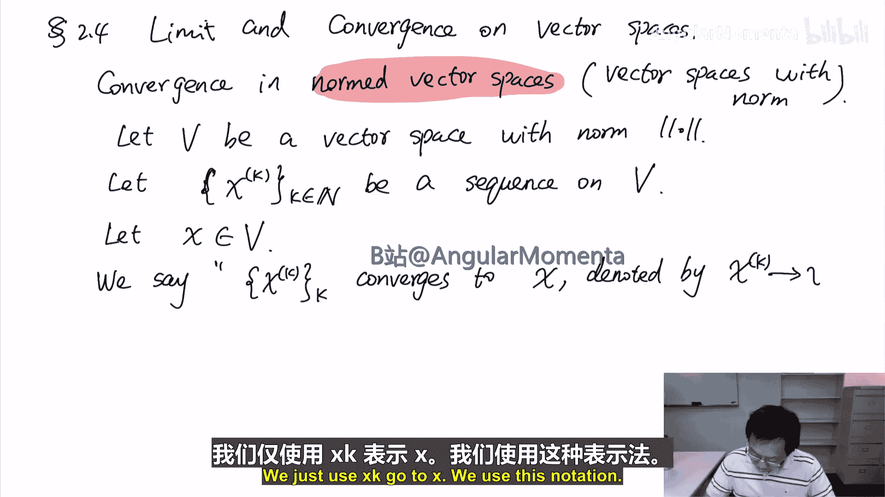

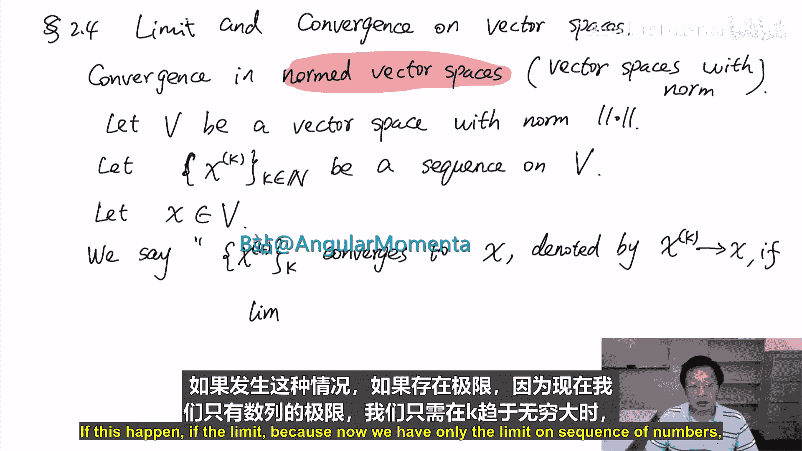

上一节我们介绍了向量空间和范数的概念。本节中，我们来看看如何在范数向量空间中定义序列的收敛。

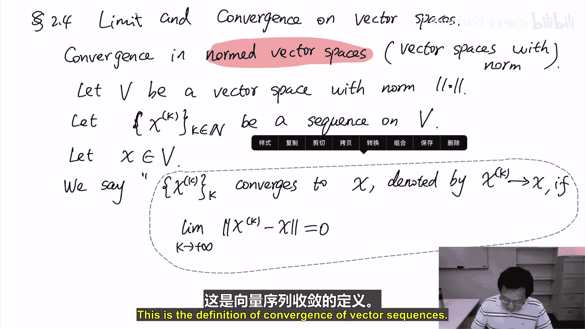

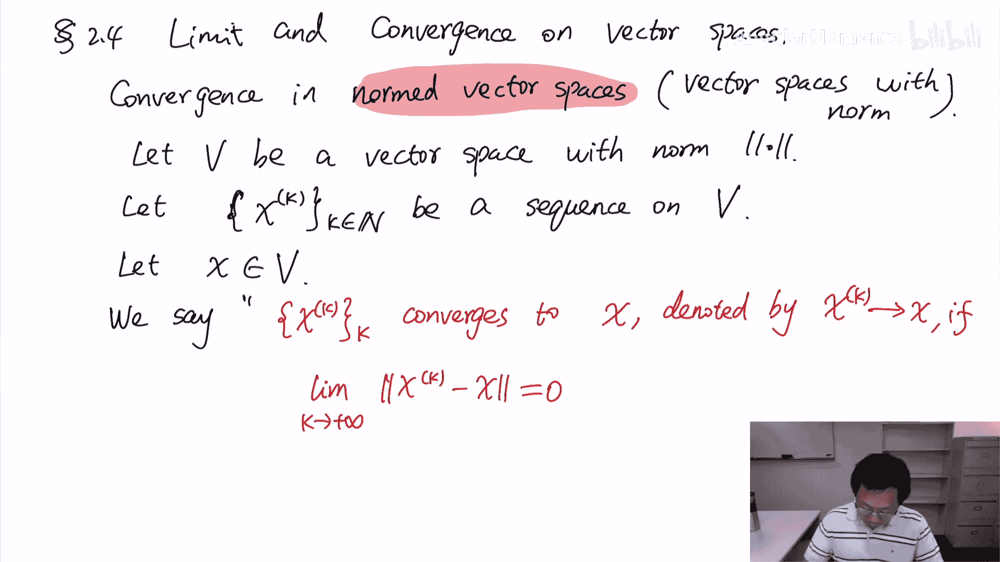

设 `(V, ||·||)` 是一个赋范向量空间。假设我们有一个定义在该空间上的向量序列，记为 `{x_k}`，其中 `k` 是自然数。同时，假设我们有另一个向量 `x ∈ V`。

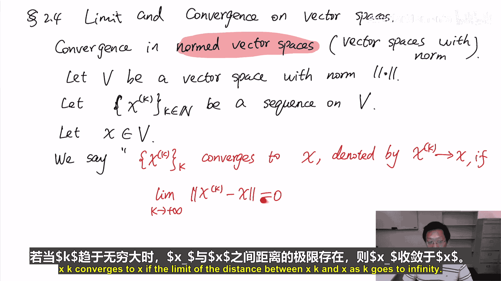

那么，我们说序列 `{x_k}` 收敛于 `x`，记作：
```
x_k → x
```
当且仅当：
```
lim_{k→∞} ||x_k - x|| = 0
```
因为范数 `||x_k - x||` 衡量了 `x_k` 与 `x` 之间的距离。当这个距离随着 `k` 增大而趋近于0时，我们就说向量序列 `{x_k}` 收敛于 `x`。这个定义非常直观，它利用范数将向量序列的收敛问题转化为了我们熟悉的实数序列极限问题。

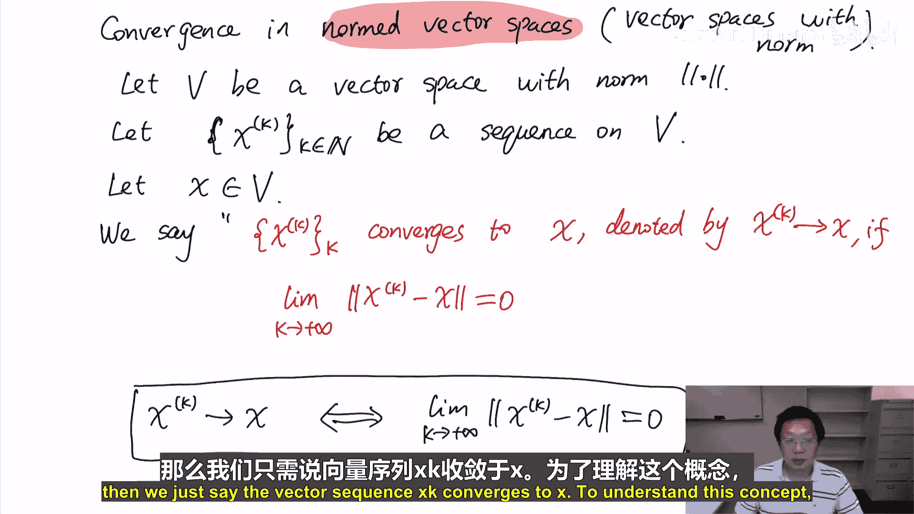

## 示例解析

为了深入理解这个概念，让我们看几个具体的例子。

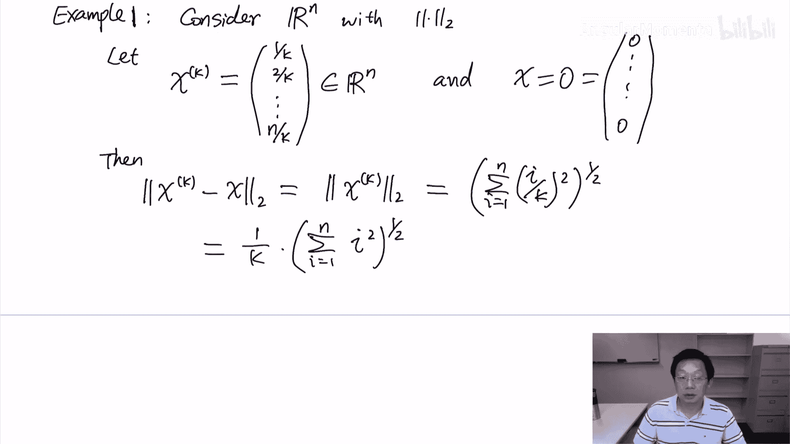

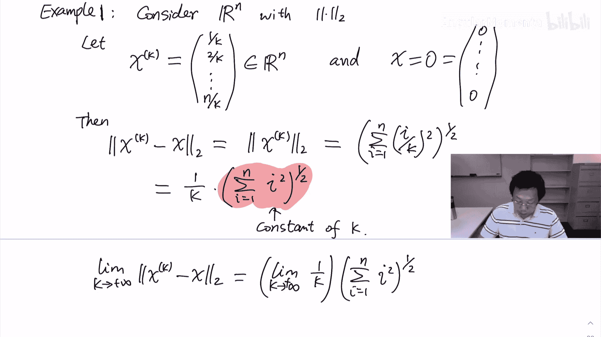

### 示例一：ℝⁿ 空间中的收敛

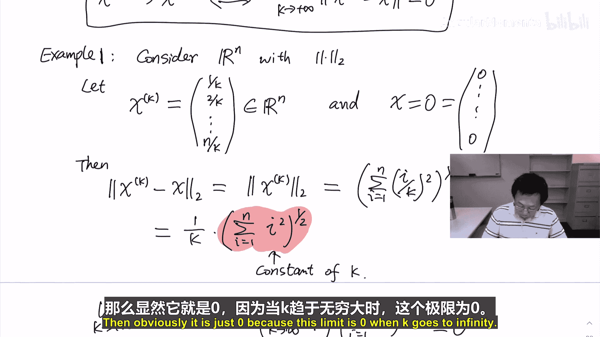

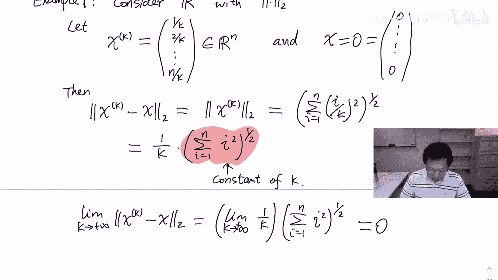

考虑向量空间 `ℝⁿ` 及其上的2-范数（欧几里得范数）。我们定义一个向量序列 `{x_k}` 如下：
```
x_k = [1/k, 2/k, ..., n/k]^T ∈ ℝⁿ
```
令 `x` 为零向量，即 `x = [0, 0, ..., 0]^T`。

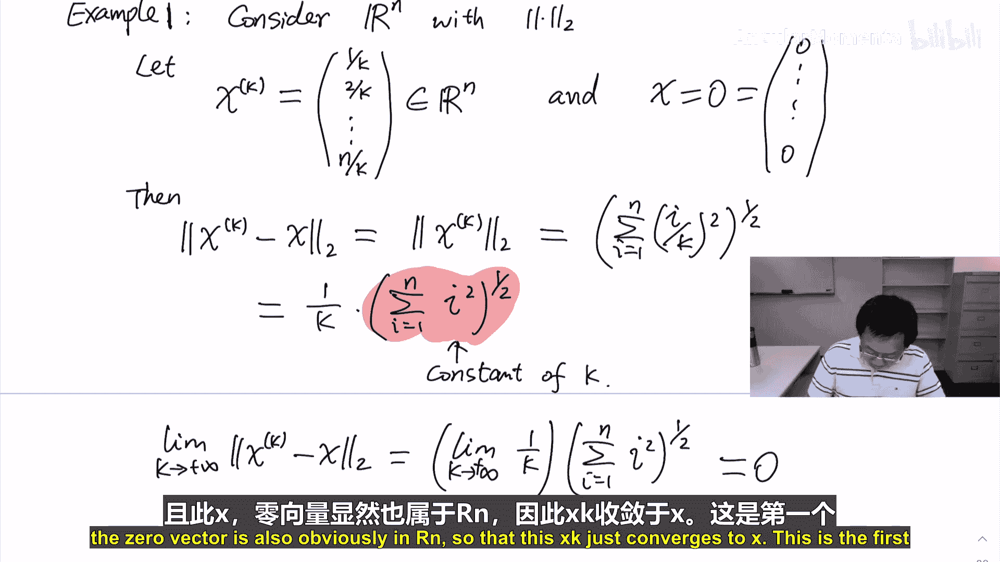

现在计算距离 `||x_k - x||₂`。由于 `x` 是零向量，这个距离就等于 `||x_k||₂`。根据2-范数的定义：
```
||x_k||₂ = sqrt( (1/k)² + (2/k)² + ... + (n/k)² )
         = (1/k) * sqrt( 1² + 2² + ... + n² )
```
令常数 `C = sqrt( 1² + 2² + ... + n² )`，则：
```
||x_k - x||₂ = C / k
```
当 `k → ∞` 时，`C / k → 0`。因此，根据定义，序列 `{x_k}` 在 `ℝⁿ` 中收敛于零向量 `x`。

### 示例二：函数空间中的收敛

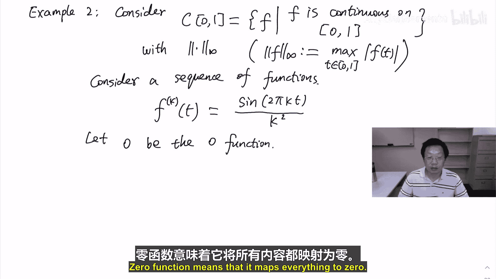

我们知道，函数也可以构成向量空间。考虑定义在闭区间 `[0, 1]` 上的所有连续函数组成的空间 `C[0,1]`。在这个空间上，我们可以定义无穷范数（最大值范数）：
```
||f||_∞ = max_{t ∈ [0,1]} |f(t)|
```
现在，我们在这个函数空间中定义一个函数序列 `{f_k}`：
```
f_k(t) = sin(2πkt) / k²
```
令 `f` 为零函数，即对于所有 `t ∈ [0,1]`，有 `f(t) = 0`。

计算 `f_k` 与零函数之间的距离 `||f_k - f||_∞`：
```
||f_k - f||_∞ = max_{t ∈ [0,1]} |sin(2πkt) / k²|
              = (1/k²) * max_{t ∈ [0,1]} |sin(2πkt)|
              = 1/k²
```
因为正弦函数的绝对值最大值是1。当 `k → ∞` 时，`1/k² → 0`。因此，函数序列 `{f_k}` 在无穷范数意义下收敛于零函数 `f`。

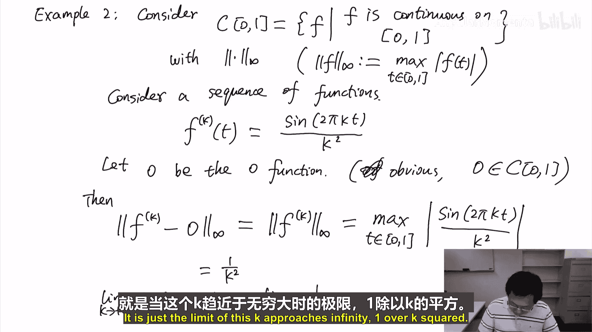

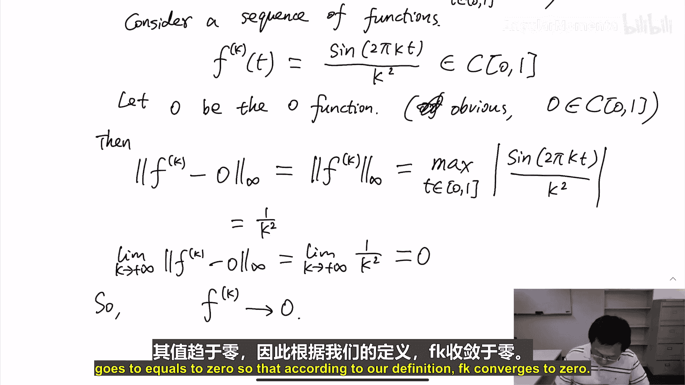

从几何直观上看，`f_1(t) = sin(2πt)` 是一个标准的正弦波。随着 `k` 增大，函数 `f_k(t)` 的振幅 `1/k²` 变得越来越小，同时振荡频率 `k` 变高。当 `k` 非常大时，函数的图像会非常贴近于 `t` 轴（即 `y=0` 这条线），这形象地展示了收敛的过程。

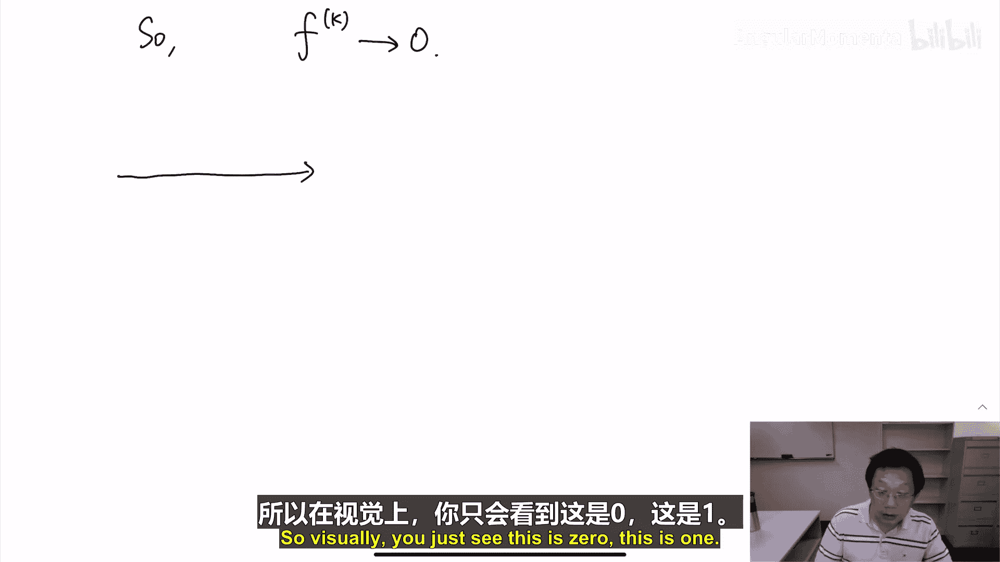

## 总结

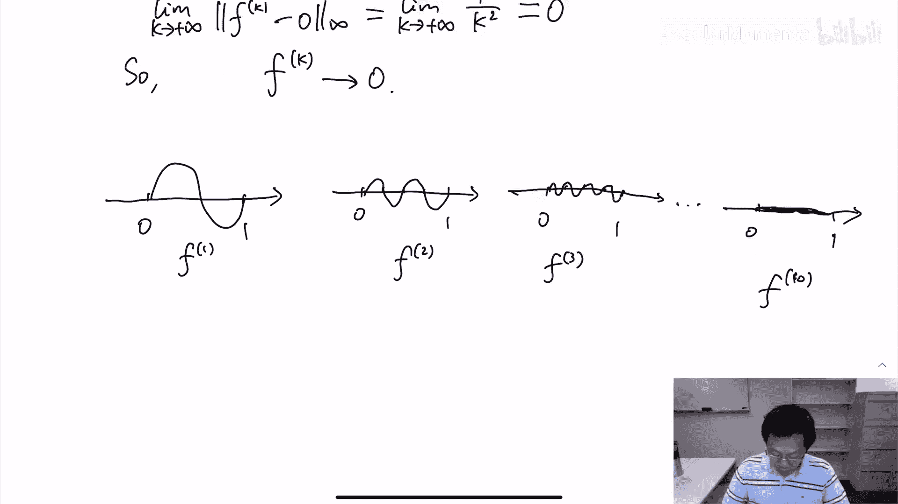

本节课中我们一起学习了向量序列收敛性的核心定义。我们首先在赋范向量空间 `(V, ||·||)` 中定义了收敛：序列 `{x_k}` 收敛于 `x` 当且仅当距离 `||x_k - x||` 随着 `k` 趋于无穷而趋于零。随后，我们通过两个具体例子巩固了这一概念：一个是在 `ℝⁿ` 欧几里得空间中的数值向量序列，另一个是在连续函数空间 `C[0,1]` 中的函数序列。这两个例子表明，无论向量的具体形式是数组还是函数，只要能在相应空间上定义合理的范数（距离），我们就可以统一地讨论序列的收敛性。这是分析迭代算法（如优化算法、机器学习算法）稳定性和极限行为的重要数学基础。