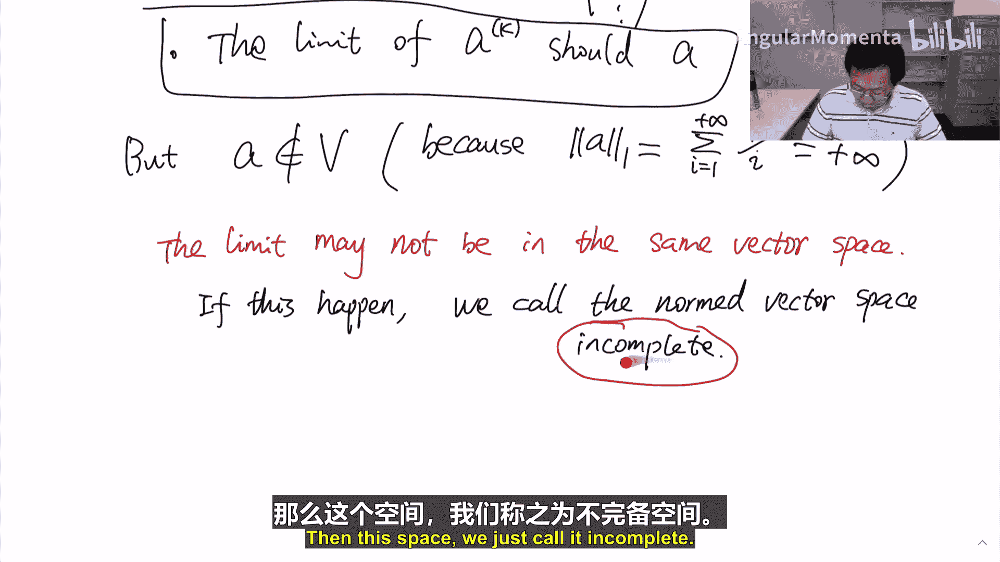

**数据分析的数学方法：07-02-02：序列收敛与范数依赖性** 🧮

在本节中，我们将探讨一个关键概念：**序列的收敛性依赖于所选择的范数**。我们将通过具体的例子来展示，即使对于相同的序列和极限点，在不同的范数定义下，其收敛性也可能完全不同。理解这一点对于在数据分析中选择合适的度量标准至关重要。

---

### **示例一：不同范数下的收敛性**

上一节我们介绍了L1、L2和L∞范数空间。本节中，我们来看看一个具体的序列在这些不同空间中的收敛行为。

我们考虑一个无限序列的集合。定义序列 **a_k** 如下：其前k项为 **1/k**，其余所有项均为0。


**公式表示：**
```
a_k = (1/k, 1/k, ..., 1/k, 0, 0, ...)
          ↑ 前k项 ↑
```


对于任意给定的k，该序列只有有限个非零项。因此，它的L1范数、L2范数和L∞范数都是有限的。这意味着 **a_k** 同时属于L1、L2和L∞空间。

我们考虑极限点 **a**，即全零序列（零向量）。显然，**a** 也属于上述所有空间。

现在，我们分别在不同范数下考察序列 **{a_k}** 是否收敛于 **a**。


以下是具体分析：


*   **在L2范数下：**
    计算 **a_k** 与 **a** 在L2范数下的距离：
    ```
    ||a_k - a||_2 = ||a_k||_2 = sqrt( Σ_{i=1}^{k} (1/k)^2 ) = sqrt( k * (1/k^2) ) = 1/sqrt(k)
    ```
    当 k → ∞ 时，`1/sqrt(k) → 0`。因此，**在L2范数下，a_k 收敛于 a**。


*   **在L∞范数下：**
    计算 **a_k** 与 **a** 在L∞范数下的距离：
    ```
    ||a_k - a||_∞ = ||a_k||_∞ = max{ |1/k|, 0, 0, ... } = 1/k
    ```
    当 k → ∞ 时，`1/k → 0`。因此，**在L∞范数下，a_k 收敛于 a**。

*   **在L1范数下：**
    计算 **a_k** 与 **a** 在L1范数下的距离：
    ```
    ||a_k - a||_1 = ||a_k||_1 = Σ_{i=1}^{k} |1/k| = k * (1/k) = 1
    ```
    当 k → ∞ 时，该极限为常数 `1`，不等于0。因此，**在L1范数下，a_k 不收敛于 a**。


**结论：** 对于完全相同的序列 **{a_k}** 和极限点 **a**，其收敛性取决于所使用的范数。在L2和L∞范数下收敛，在L1范数下却不收敛。这清楚地表明，**收敛性依赖于范数的选择**。


---

### **示例二：极限点可能不在原空间中** 🔍


接下来，我们看一个更深入的例子，它揭示了向量空间“完备性”的重要性。


我们构造一个向量空间 **V**，它由所有L1范数有限的无限序列构成（即 `||x||_1 < ∞` 的序列x的集合）。但是，**我们在V上使用的范数不是L1范数，而是L∞范数**。

**空间定义：**
```
V = { 无限序列 a | ||a||_1 < ∞ }， 但V上的范数为 ||·||_∞
```

在这个空间V中，我们考虑一个序列 **{a_k}**，其定义如下：前k项为 `(1, 1/2, ..., 1/k)`，其余项为0。

**公式表示：**
```
a_k = (1, 1/2, ..., 1/k, 0, 0, ...)
```

对于任意k，**a_k** 的L1范数是调和级数的前k项和，是有限的，因此 **a_k ∈ V**。


现在，考虑另一个序列 **a**，其定义为所有项均非零：第i项为 `1/i`。


**公式表示：**
```
a = (1, 1/2, 1/3, ...)
```

我们考察在空间V的L∞范数下，**{a_k}** 是否收敛于 **a**。

计算 **a_k** 与 **a** 的L∞范数距离：
```
||a_k - a||_∞ = sup{ |0|, ..., |0|, |1/(k+1)|, |1/(k+2)|, ... } = 1/(k+1)
```
当 k → ∞ 时，`1/(k+1) → 0`。从距离上看，**a_k** 似乎应该收敛于 **a**。


**然而，这里存在一个关键问题：极限点 a 本身并不属于空间 V。**
因为序列 **a** 的L1范数是调和级数的无穷和：
```
||a||_1 = Σ_{i=1}^{∞} 1/i = ∞
```
根据空间V的定义（L1范数有限），**a ∉ V**。


**结论：** 这个例子表明，一个序列可以在某个范数下收敛，但其极限点可能**不在**原始的向量空间内部。如果一个向量空间中的某些收敛序列，其极限点跑到了空间外部，我们就称这个空间关于该范数是**不完备**的。完备性（即空间对极限运算封闭）是泛函分析和许多高级数据分析方法中的一个核心概念。


---


### **本节总结**


本节课中我们一起学习了两个重要观点：
1.  **收敛性依赖于范数**：判断一个序列是否收敛，以及收敛于何处，与你为向量空间所选择的范数（或距离度量）密切相关。在不同的范数下，结论可能截然不同。
2.  **完备性的概念**：一个向量空间可能“不完整”，即其中某些收敛序列的极限点并不属于该空间本身。这引出了“完备空间”的概念，在完备空间中，所有柯西序列的极限都仍在空间内。这在保证数学分析（如极限交换、解的存在唯一性）的严谨性方面至关重要。



理解这些概念，有助于我们在处理数据、构建模型时，更加审慎地选择度量标准，并理解所用数学框架的局限性。