# 027：赋范向量空间的完备性 🔄

在本节中，我们将探讨赋范向量空间的一个关键性质——完备性。我们将了解为什么完备性在理论和实践中都至关重要，并学习如何用柯西序列来严格定义它。最后，我们会列举一些完备与不完备空间的例子。

---

## 完备性的重要性

上一节我们通过示例4看到，有些赋范向量空间是不完备的。这意味着这些空间在极限运算下不是封闭的。

实际上，完备性是赋范向量空间的一个核心问题。理论上，因为我们将要讨论向量空间上的函数，进行函数分析或优化，这意味着我们需要定义向量空间上函数的微积分。如果底层的向量空间不完备，我们就无法定义诸如微分这样的微积分运算。这与单变量微积分的情况类似：在单变量微积分中，我们首先需要完备化数系。我们的函数都定义在实数上，而非有理数上，因为所有有理数的集合是不完备的。完备化有理数，我们就得到了实数。这是原因之一。

实践中，让我们回到机器学习。正如我们在Kese算法中看到的，机器学习中的许多算法都是迭代算法。在这些算法中，我们在某个赋范向量空间中产生一系列迭代。我们可以确保每次迭代都在该向量空间内。但如果底层向量空间不完备，那么迭代的极限可能不在该赋范向量空间中。这意味着我们得到的解不是预期的解——我们期望解在底层的赋范向量空间中。因此，底层的赋范向量空间必须是完备的。

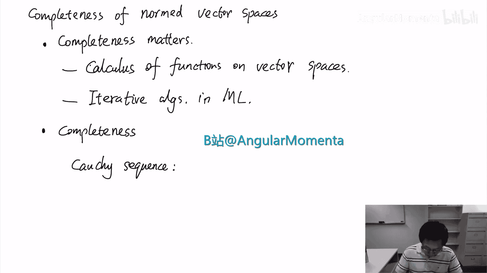

---

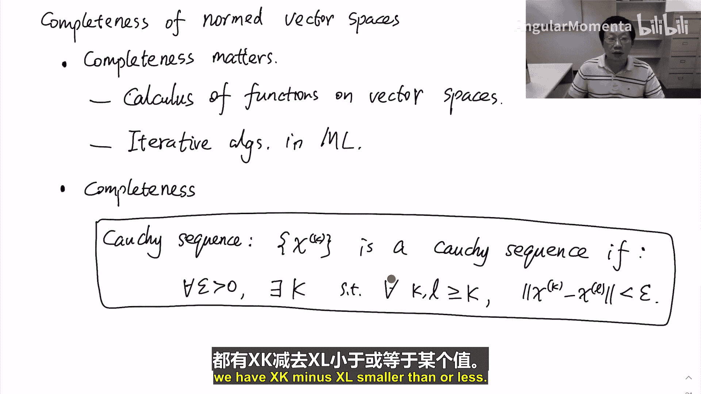

## 柯西序列与完备性的定义

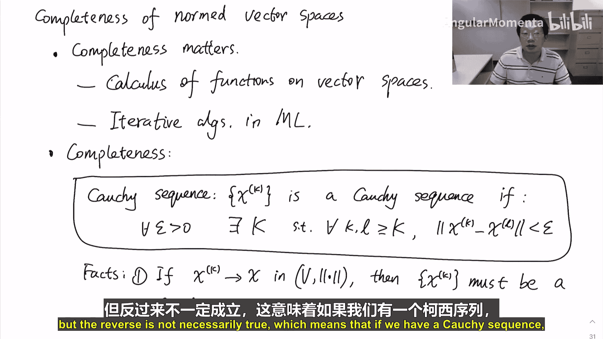

但到目前为止，完备性只是一个宽泛的概念。从数学上，我们如何严格地定义完备性呢？这关系到柯西序列。

柯西序列的定义相当数学化。直观地说，对于一个序列 **{x_k}**，当 **k** 和 **l** 足够大时，它们的距离 **||x_k - x_l||** 应该非常非常小。

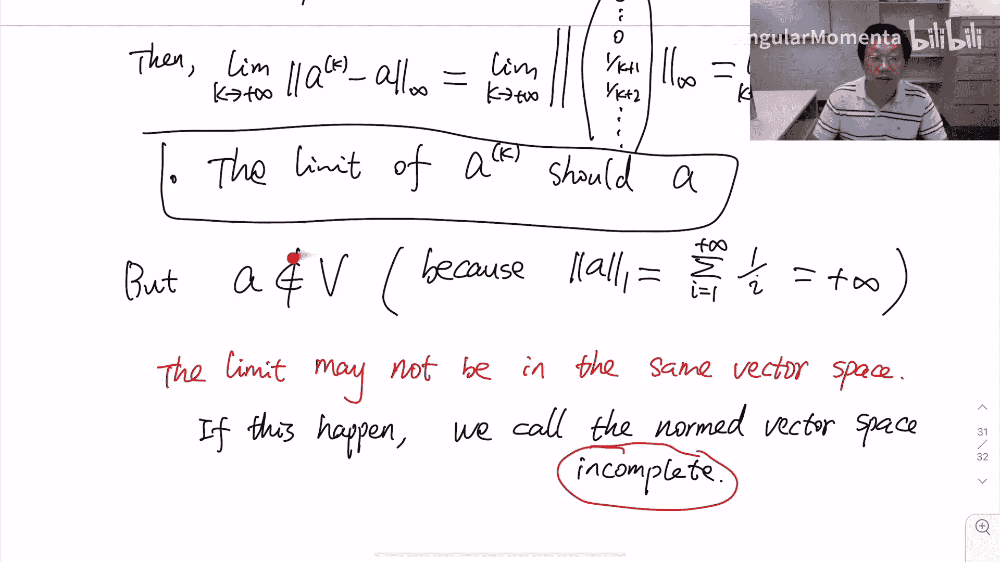

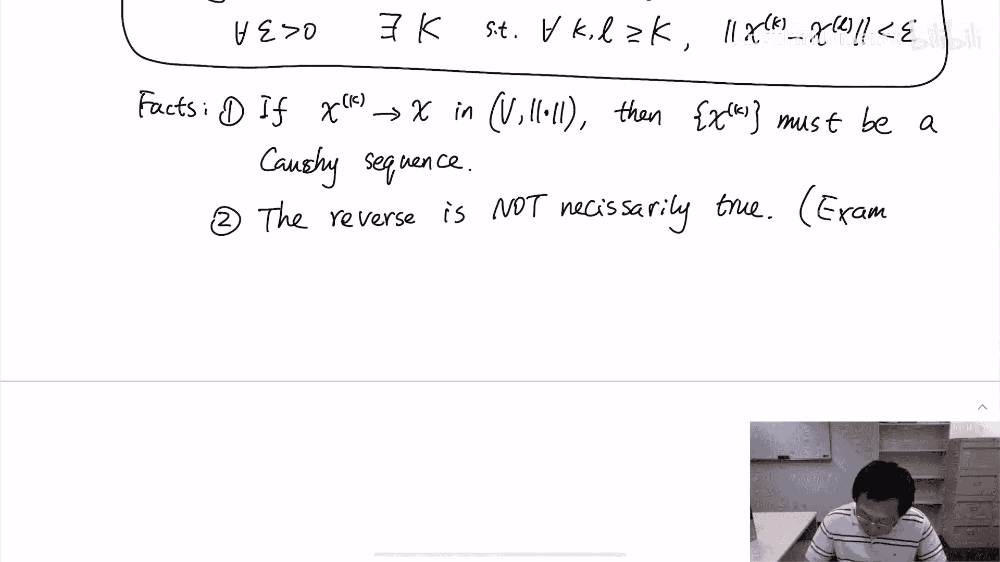

序列 **{x_k}** 是一个柯西序列，如果对于任意 **ε > 0**，我们都能找到一个足够大的 **K**，使得对于所有 **k, l ≥ K**，都有 **||x_k - x_l|| < ε**。

有了柯西序列，我们可以观察到：
1.  如果序列 **{x_k}** 在范数意义下收敛于某个极限 **x**，那么这个序列必定是一个柯西序列。这意味着收敛序列一定是柯西序列。
2.  反之则不必然成立。这意味着一个柯西序列可能不收敛。

事实上，我们的示例4就是这样一个例子。那里构造的序列 **{a_k}** 是一个柯西序列，你可以验证这一点。但这个柯西序列并不收敛，因为假设的极限 **a** 不在空间 **V** 中。

从这两个事实我们看到，所有收敛序列的集合是所有柯西序列集合的一个子集。也就是说，柯西序列不一定收敛，但收敛序列一定是柯西序列。

让我们回到柯西序列的定义。在柯西序列的定义中，对于足够大的两个数 **k** 和 **l**，**x_k** 和 **x_l** 的距离变得越来越小。这个序列应该是收敛的。柯西序列的另一个优点是，在它的定义中，我们只使用了序列本身的信息，没有用到序列之外的任何信息。这与收敛序列的定义不同：在收敛序列的定义中，我们需要同时知道序列 **{x_k}** 和极限 **x**。但在实际情况下，我们可能只有序列，而不知道极限。因此，柯西序列的判定更具可操作性，它只涉及序列本身。

现在，借助柯西序列，我们可以定义完备性。

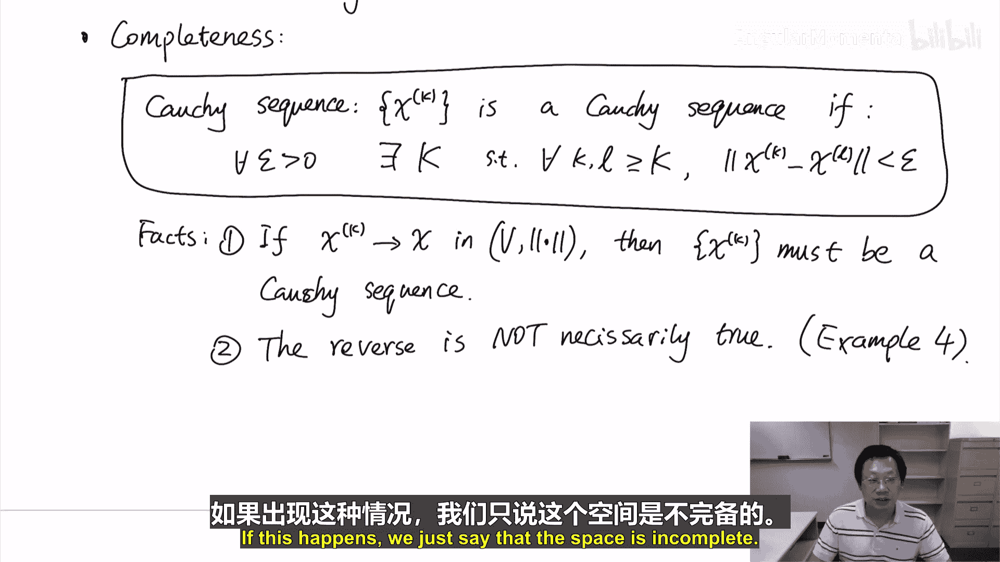

实际上，对于柯西序列，直观上，当 **k** 和 **l** 足够大时，**x_k** 和 **x_l** 会越来越接近，所以这个序列应该是收敛的。但我们确实有一些反例表明，柯西序列可能不收敛。如果发生这种情况，我们就说那个空间是不完备的。

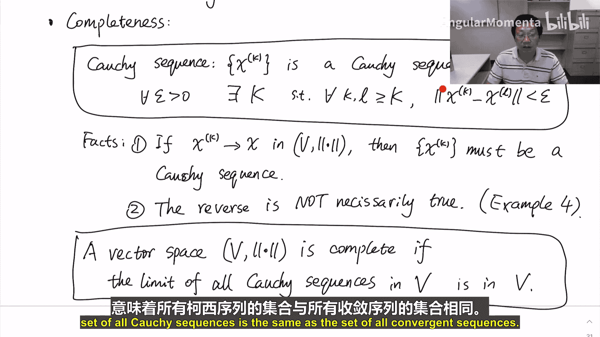

**完备性的定义**：一个赋范向量空间 **V** 是完备的，如果 **V** 中所有柯西序列的极限都在 **V** 中。换句话说，对于该空间，所有柯西序列的集合与所有收敛序列的集合是相同的。

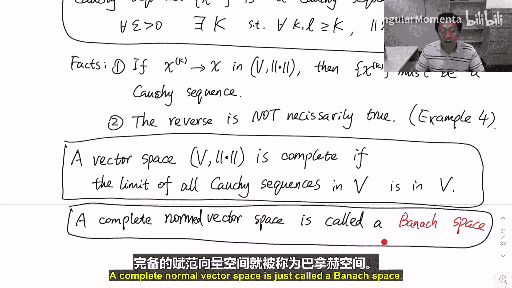

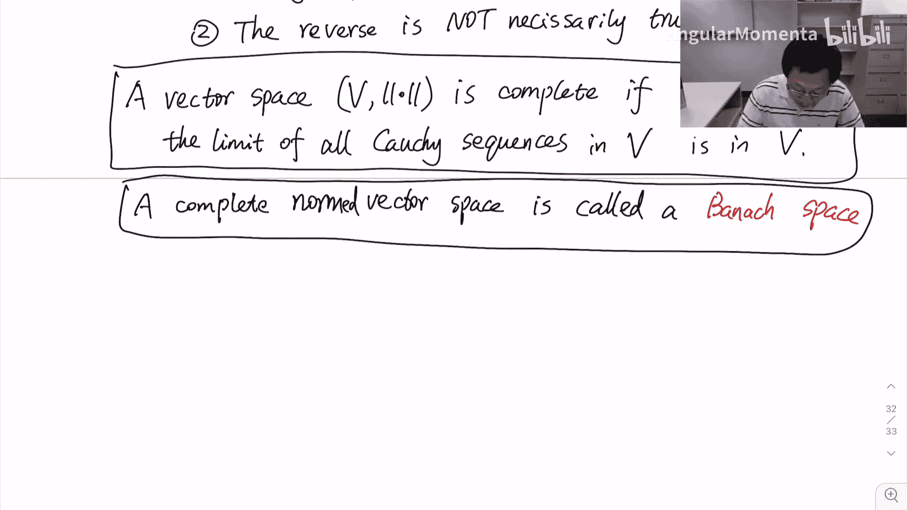

---

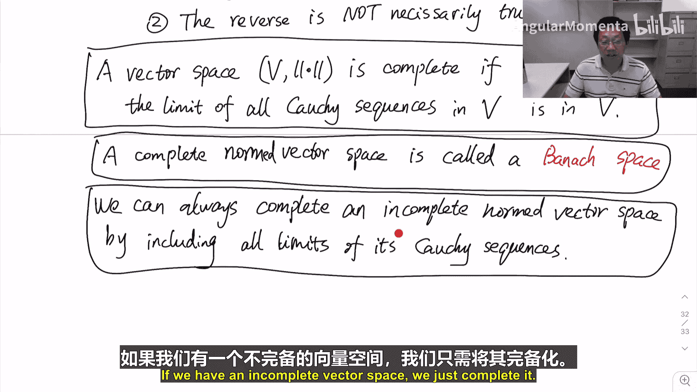

## 巴拿赫空间与空间的完备化

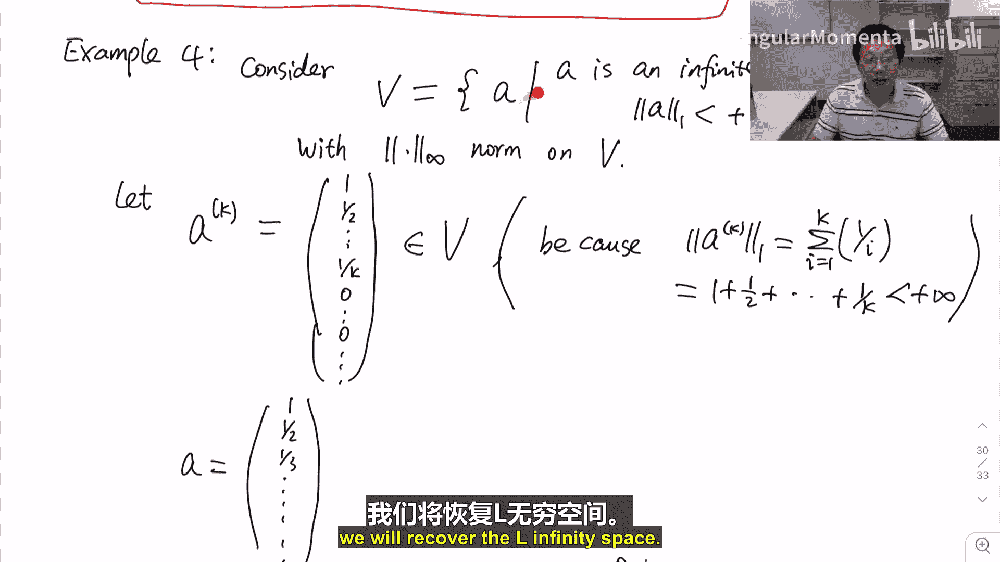

实际上，完备的赋范向量空间有一个专门的名称：**巴拿赫空间**。

关于完备性的另一个事实是，我们总是可以完备化一个不完备的赋范向量空间。我们可以通过包含所有柯西序列的极限来完备化一个赋范向量空间。这是一个好消息。如果我们有一个不完备的向量空间，我们只需完备化它。

例如，对于示例4中的空间，它是不完备的，但我们在无穷范数下完备化它，就会得到 **l^∞** 空间。

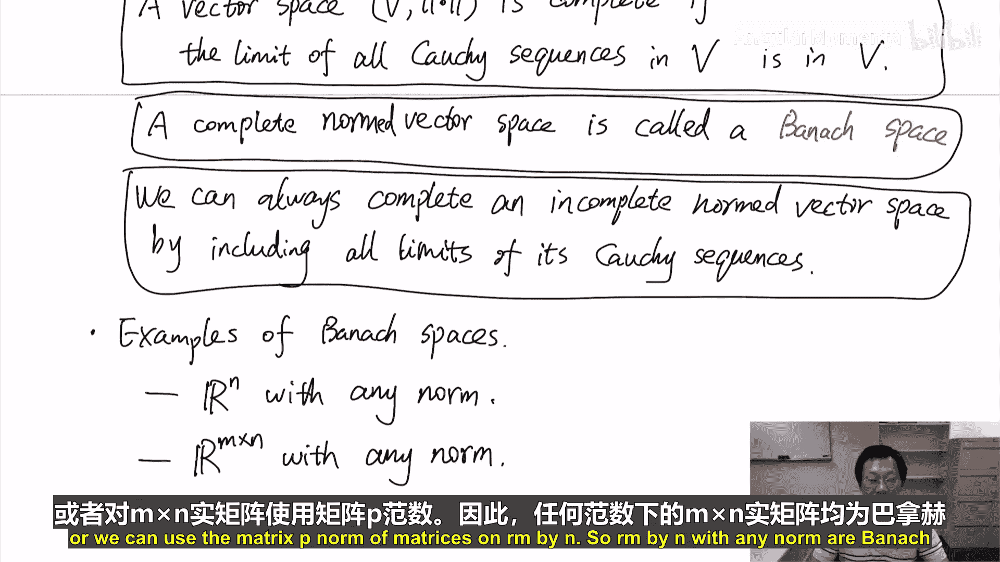

---

## 完备与不完备空间的例子

现在，我给出一些完备的赋范向量空间（即巴拿赫空间）的例子。因为在向量函数的微积分中，我们将主要在巴拿赫空间上工作。

以下是完备赋范向量空间的例子：
*   **欧几里得空间 R^N**：配备任何范数（1-范数、2-范数、p-范数、无穷范数），它们都是完备的赋范向量空间，即巴拿赫空间。
*   **矩阵空间 R^(M×N)**：同样，配备任何范数（矩阵的向量p-范数或矩阵p-范数），它们都是巴拿赫空间。
*   **张量空间 R^(N×M×L)**：配备任何范数，也是完备的赋范向量空间。
*   **函数空间 C[a, b]**：配备无穷范数 **||·||_∞**，它是完备的。但需要注意，函数空间的完备性对所使用的范数非常敏感。
*   **L^p 空间**：配备 p-范数 **||·||_p**，对于任何 **p ≥ 1** 以及 **p = ∞**，这些都是完备的赋范向量空间。

同样，也存在一些不完备空间的“坏”例子。

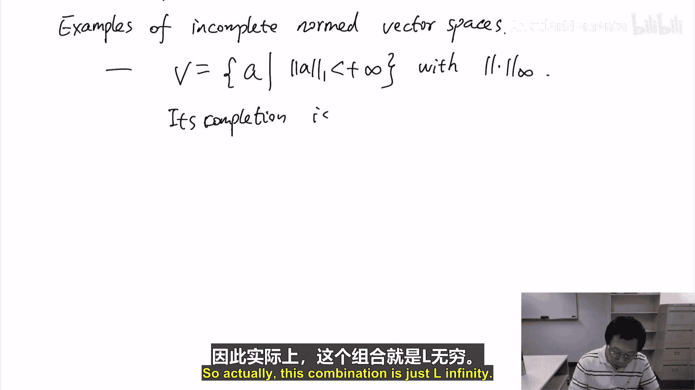

以下是不完备赋范向量空间的例子：
*   **示例4中的空间**：即所有一范数有限的无限序列组成的空间 **V**，但我们在其上使用无穷范数。这个空间是不完备的。如前所述，我们可以完备化它，其完备化正是 **l^∞** 空间。
*   **函数空间 C[a, b]**：如果我们不使用无穷范数，而是使用 p-范数（定义为 **||f||_p = (∫ |f(t)|^p dt)^(1/p)**），那么对于 **p ≥ 1**，空间 **C[a, b]** 配备 p-范数是不完备的。它的完备化就是所谓的 **L^p[a, b]** 空间。在学习微积分时，积分通常是黎曼积分，但定义 **L^p** 空间时，我们需要将黎曼积分扩展到勒贝格积分，这非常复杂，通常需要学习几个学期的实分析课程。

---

## 总结

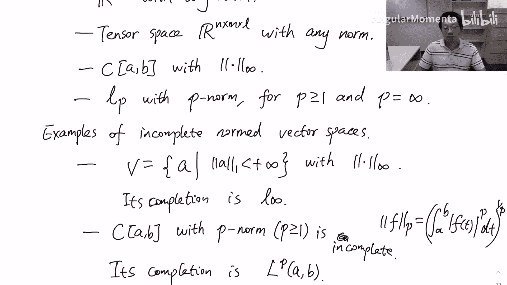

本节课中，我们一起学习了赋范向量空间完备性的核心概念。我们了解到完备性对于在空间上建立微积分理论和保证迭代算法极限的存在至关重要。我们通过柯西序列严格定义了完备性：一个空间是完备的（即巴拿赫空间），当且仅当其中所有柯西序列的极限仍属于该空间。最后，我们区分了像 **R^N**、**L^p** 空间这样的完备空间示例，以及像特定范数下的连续函数空间这样的不完备空间示例，并知道了不完备空间总是可以被完备化。理解空间的完备性，是深入学习函数分析和优化理论的重要基础。