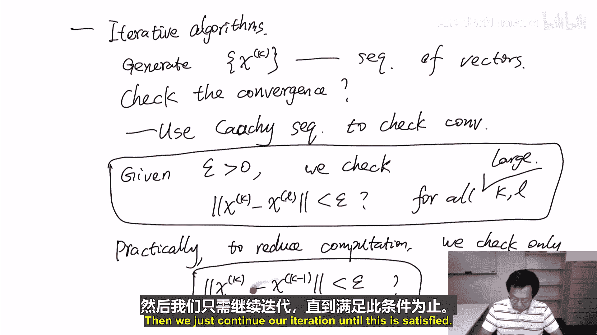

**数据分析的数学方法：07-04-02：收敛与极限在向量空间中的应用**


在本节中，我们将探讨收敛与极限概念在一般向量空间中的两个具体应用。我们将看到，如何选择合适的范数以及如何在实际迭代算法中判断收敛性。


上一节我们介绍了柯西序列和完备空间的概念，本节中我们来看看这些概念如何应用于实际问题。


---

### **应用一：选择合适的范数**


在监督学习中，我们需要在假设空间中寻找函数。这个假设空间必须是完备的，否则我们可能会遇到问题。

为了说明这一点，我们考虑一个简单的设置：给定一个训练数据集 `(X_i, Y_i)`，其中 `i` 从 `1` 到 `M`。这里我们假设 `X` 是区间 `[A, B]` 内的一个数，`Y_i` 是一个实数。

我们希望找到一个函数 `F`。我们假设 `F` 的假设空间是 `C[A,B]`，即所有在 `[A, B]` 上连续的函数集合。我们希望找到的 `F` 满足 `F(X_i)` 近似等于 `Y_i`。


现在，假设我们有一个迭代算法。该算法生成一个函数序列 `{F_k}`，其中 `k = 1, 2, 3, ...`。算法从 `F_0` 开始，生成 `F_1`, `F_2`, `F_3` 等等。我们期望当 `k` 增大时，`F_k` 越来越接近我们期望的解。当然，每个 `F_k` 都在 `C[A,B]` 中，因为我们希望最终解是一个连续函数。


我们需要研究 `F_k` 的收敛性。在 `C[A,B]` 上，我们可以选择多种范数。如果我们选择 **2-范数**（`L^2` 范数）：


**公式：** `||F_k - F||_2 = (∫_A^B |F_k(x) - F(x)|^2 dx)^(1/2)`


假设 `F_k` 是一个柯西序列，那么它应该收敛。即存在某个函数 `F`，使得当 `k` 趋于无穷时，`||F_k - F||_2` 趋于 `0`。


然而，从之前的例子我们知道，对于 `p ≥ 1`，赋范向量空间 `(C[A,B], ||·||_p)` 是**不完备**的。这意味着，即使 `F_k` 是柯西序列，其极限 `F` 可能**不在** `C[A,B]` 中。换句话说，`F` 可能不是一个连续函数。这就不是我们期望的解，因为我们设定的假设空间是连续函数空间。

为了确保我们得到的极限函数是连续的，我们必须保证 `C[A,B]` 在所选的范数下是完备的。我们知道，`C[A,B]` 在**无穷范数**（一致收敛范数）下是完备的。


**公式：** `||F_k - F||_∞ = sup_{x∈[A,B]} |F_k(x) - F(x)|`


因此，我们改用无穷范数。再次假设 `F_k` 是一个柯西序列，并且存在某个 `F` 使得 `||F_k - F||_∞` 趋于 `0`。由于 `(C[A,B], ||·||_∞)` 是完备的，柯西序列的极限必然也在该空间中。所以，这个极限 `F` 一定在 `C[A,B]` 中，即 `F` 是连续函数。这样我们就找到了一个符合假设空间要求的解。

这个例子告诉我们，在研究收敛性时，必须选择合适的范数，否则可能得到不符合预期的解。


---


### **应用二：迭代算法中的收敛性判断**


第二个例子同样关于迭代算法。我们看到，机器学习中的许多算法（如 K-Means）都是迭代算法，它们生成一个向量序列 `{X_k}`。

我们想检查这个序列是否收敛。但这里我们只有序列 `X_k`，并不知道它的极限是什么。那么，我们如何检查收敛性呢？


我们可以利用柯西序列的定义。在定义柯西序列时，我们只使用了序列本身，而没有使用其假设的极限。


以下是具体思路：我们利用柯西序列来判断收敛性。这意味着，给定一个我们想要达到的精度 `ε`（例如 `ε = 10^(-3)`）。为了检查序列 `{X_k}` 是否是柯西序列，我们需要检查对于所有足够大的 `k` 和 `l`，是否有 `||X_k - X_l||` 足够小（小于 `ε`）。

**公式：** `∀ ε > 0, ∃ N, s.t. ∀ k, l > N, ||X_k - X_l|| < ε`

如果这个条件满足，那么该序列是柯西序列，因此是收敛的。


然而，这种方法不切实际，因为我们需要检查所有足够大的 `k` 和 `l` 对，计算量太大。


为了降低计算复杂度，在实践中我们通常不检查所有 `k` 和 `l`。相反，我们只检查一对 `k` 和 `l`，通常是检查当前迭代与前一次迭代的差值。即，我们检查 `||X_k - X_{k-1}||` 是否小于预设的精度 `ε`。

**代码逻辑：**
```
while ||X_k - X_{k-1}|| >= ε:
    # 继续迭代，计算 X_{k+1}
    k = k + 1
# 当差值小于 ε 时，停止迭代，认为序列已收敛
```

这非常容易实现，因为我们只需要检查当前迭代与上一次迭代之间的距离。如果这个距离小于 `ε`，我们就认为序列已经收敛，并停止算法。如果不满足，则序列尚未收敛，我们继续迭代直到条件满足。

---

### **总结**



在本节课中，我们一起学习了收敛与极限概念在两个实际问题中的应用：
1.  **选择合适的范数至关重要**：在函数空间中寻找解时，必须选择能使该空间完备的范数（如无穷范数），以确保迭代算法产生的序列极限仍在期望的假设空间内。
2.  **迭代算法的实用收敛判断**：在实际计算中，我们通常通过检查连续两次迭代结果之间的差值是否小于某个阈值（`||X_k - X_{k-1}|| < ε`）来判断算法是否收敛，这是一种高效且实用的近似方法。