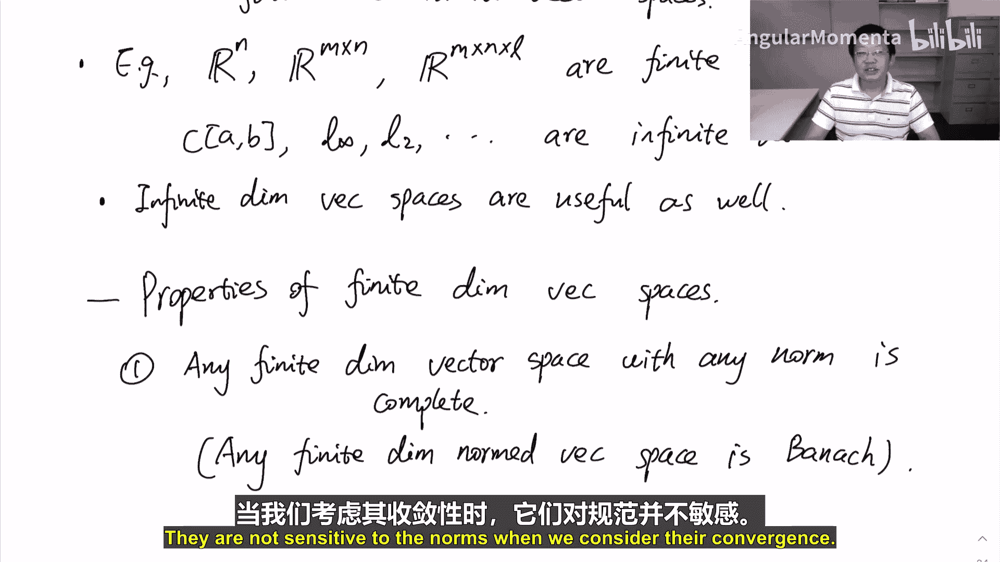

# 029：有限维向量空间的性质 📐

在本节课中，我们将要学习有限维向量空间的一些关键性质。我们将看到，与之前讨论过的某些“棘手”的无限维空间不同，有限维空间在范数和收敛性方面具有非常良好和一致的行为。

## 回顾：无限维空间的“棘手”之处

上一节我们介绍了范数向量空间，特别是关于极限和收敛的概念。我们看到了某些空间在收敛性上可能存在问题。

例如，**C[a,b]** 空间，即所有连续函数的集合。这个空间在使用无穷范数时是完备的，但在使用 **2-范数** 或 **p-范数**（其中 p ≥ 1）时可能是不完备的。

此外，在演示序列的收敛性时，我们发现极限的收敛性**依赖于所选的范数**。我们使用序列空间和无穷序列空间作为例子，发现极限可能不在我们最初使用的同一个向量空间中。这些空间的行为并不理想。

## 对比：有限维空间的“良好”性质

与此相反，对于某些向量空间，情况则好得多。

当我们举出巴拿赫空间的例子时，你可以看到 **R^n**、**R^(m×n)**、**R^(m×n×l)** 这些空间，无论使用何种范数，它们都表现得相当好。它们总是巴拿赫空间，总是完备的。

为什么会发生这种情况？主要原因在于，这些“良好”的空间是**有限维**的，而那些“棘手”的空间是**无限维**的。

## 为何研究有限维空间？

本节将介绍有限维向量空间的一些性质。

研究有限维向量空间的另一个动机来自实践角度。在实践中，我们的计算机只能处理有限数量的数字和有限位数。因此，对于任何实际的迭代算法，我们总是在有限维向量空间中工作。那么，这些有限维空间中的收敛性和极限自然就变得非常重要。

我们称一个向量空间是有限维的，是因为该空间中的向量可以由**有限多个参数**确定。

以下是有限维空间的例子：
*   **R^n**：每个向量由 n 个数字确定。
*   **R^(m×n)**（矩阵空间）：每个矩阵由 m × n 个参数确定。
*   **R^(m×n×l)**（张量空间）：每个张量由 m × n × l 个参数确定。

相反，以下空间是无限维的：
*   **C[a,b]**：因为每个函数由定义域 [a, b] 中无穷多个点上的值确定。
*   **l^∞**, **l^2**, **l^p**（无穷序列空间）：因为每个向量是一个无穷序列。

尽管在许多情况下，我们将处理有限维向量空间，但这并不意味着无限维空间无用。实际上，无限维向量空间同样有用。例如，我们可以用 **R^(m×n)** 空间来建模黑白图像，但这仅适用于固定分辨率的图像。当数据库中的图像分辨率变得越来越精细时，我们的空间 **R^(m×n)** 就越来越接近一个无限维空间。为了研究算法在这种情况下的渐近性质，当 m 和 n 变得越来越大时，我们需要使用无限维空间来进行分析。

无论如何，现在让我来介绍有限维向量空间的性质。

## 性质一：完备性

第一个性质是：**任何有限维向量空间，配备任何范数，都是完备的**。

这意味着任何有限维赋范向量空间都是巴拿赫空间。这非常好，对吧？因此，当我们在有限维向量空间上进行迭代算法时，我们不需要担心其完备性。只要我们使用任何范数，极限将自动位于该空间内。我们不需要担心所使用的范数，它们对范数的选择不敏感。

## 性质二：范数等价性与收敛性

当我们考虑收敛性时，在有限维空间中有一个更强的结论。

在有限维空间中，所有范数在某种意义上是“等价”的。这意味着，如果一个序列在一种范数下收敛，那么它在**任何其他范数**下也会收敛到同一个极限。收敛性不依赖于范数的具体选择。

更具体地说，对于有限维空间 **V** 上的任意两个范数 **||·||_α** 和 **||·||_β**，存在正常数 **c** 和 **C**，使得对任意向量 **x ∈ V**，都有：
**c ||x||_α ≤ ||x||_β ≤ C ||x||_α**

这个性质极大地简化了分析工作，因为我们可以选择最方便计算的范数来证明收敛性，而结论对所有范数都成立。

## 总结

本节课中我们一起学习了有限维向量空间的核心性质。

我们首先回顾了无限维空间在收敛性上可能遇到的困难，例如完备性依赖于范数选择。然后，我们对比指出，像 **R^n** 这样的有限维空间则表现良好，无论采用何种范数都是完备的巴拿赫空间。

我们探讨了研究有限维空间的实践动机，即实际计算都发生在有限维框架内。最后，我们重点学习了有限维空间的两个关键性质：
1.  **完备性**：任何有限维赋范向量空间都是完备的。
2.  **范数等价性**：在有限维空间中，所有范数都是等价的，因此序列的收敛性不依赖于范数的具体选择。

这些性质保证了我们在有限维空间中进行数值计算和算法分析时，具有坚实且一致的数学基础。